<!-- ====== Badges (centered) ====== -->

  <!-- Example badges using Shields.io -->
  
  
  
  

# AWS Grandmaster Roadmap

A structured, hands-on journey from **AWS fundamentals** to **grandmaster-level architecture**.

This repository is a **skill tree**, not a link collection. Each phase builds on the one before it, and every lesson is a self-contained tutorial with core concepts, architecture diagrams, a hands-on lab, real CLI commands, cost analysis, and exercises. The diagrams are written in [Mermaid](https://mermaid.js.org/) and render automatically on GitHub.

---

## How to Use This Repo

1. **Read the phase overview first.** Each `README.md` inside a phase folder explains the goals, the lesson order, and the capstone project.
2. **Work the lessons in order.** Numbering is deliberate — later lessons assume earlier ones.
3. **Type the commands.** Reading a lab is not the same as running it. Every command is copy-pasteable.
4. **Do the exercises.** Each lesson ends with a task and a "success looks like" statement so you can verify you actually got it.
5. **Build the capstone.** Every phase ends with a project that integrates everything in that phase.

The route through the repository:

```mermaid
flowchart LR
    p1["Phase 1\nCore Foundations"] --> p2["Phase 2\nProfessional Architectures"]
    p2 --> p3["Phase 3\nDevOps and Automation"]
    p3 --> p4["Phase 4\nServerless Architectures"]
    p4 --> p5["Phase 5\nData and AI"]
    p5 --> p6["Phase 6\nSecurity and Governance"]
    p6 --> p7["Phase 7\nEdge and IoT"]
    p7 --> p8["Phase 8\nIndustry Architectures"]
    p8 --> p9["Phase 9\nCutting-Edge AWS"]
    p9 --> p10["Phase 10\nGrandmaster Projects"]
    p10 --> goal["Multi-specialty mastery"]
```

---

## Phase Index

| Phase | Focus | Lessons | Capstone |
|-------|-------|---------|----------|
| [Phase 1](./phase-1-core-foundations/README.md) | Core Foundations — IAM, compute, storage, networking, monitoring | 18 | Secure 3-tier web app |
| [Phase 2](./phase-2-professional-architectures/README.md) | Professional Architectures — HA, DR, multi-region, edge | 8 | Multi-region resilient architecture |
| [Phase 3](./phase-3-devops-and-automation/README.md) | DevOps and Automation — IaC, CI/CD, containers, observability | 13 | Full CI/CD pipeline for microservices |
| [Phase 4](./phase-4-serverless-architectures/README.md) | Serverless Architectures — Lambda, API Gateway, events, streams | 9 | Uber-like serverless backend |
| [Phase 5](./phase-5-data-and-ai/README.md) | Data and AI — lakes, Glue, Athena, Redshift, SageMaker | 9 | Serverless data pipeline |
| [Phase 6](./phase-6-security-and-governance/README.md) | Security and Governance — KMS, threat detection, compliance | 11 | Multi-account security baseline |
| [Phase 7](./phase-7-edge-and-iot/README.md) | Edge and IoT — IoT Core, Greengrass, Outposts, hybrid | 9 | Industrial IoT platform |
| [Phase 8](./phase-8-industry-architectures/README.md) | Industry Architectures — FinTech, healthcare, gaming, media, gov | 8 | Regulated industry reference architecture |
| [Phase 9](./phase-9-cutting-edge-aws/README.md) | Cutting-Edge AWS — quantum, robotics, space, Graviton, AIOps | 6 | Cutting-edge lab |
| [Phase 10](./phase-10-grandmaster-projects/README.md) | Grandmaster Projects — SaaS, chaos, cost AI, community | 6 | Global multi-tenant SaaS platform |

---

## Phase 1 – Core Foundations

> **Goal:** the five pillars every AWS workload touches — identity, compute, storage, networking, and observability.

- **IAM**: users, roles, policies, SCPs
- **Compute**: EC2, AMIs, Auto Scaling
- **Storage**: S3, EBS, EFS, lifecycle policies
- **Networking**: VPC, subnets, security groups, NACLs
- **Monitoring**: CloudWatch, CloudTrail
- *Hands-on*: Build a secure 3-tier web app

| # | Lesson |
|---|--------|
| 01 | [IAM Users](./phase-1-core-foundations/01-iam-users.md) |
| 02 | [IAM Roles](./phase-1-core-foundations/02-iam-roles.md) |
| 03 | [IAM Policies](./phase-1-core-foundations/03-iam-policies.md) |
| 04 | [Service Control Policies](./phase-1-core-foundations/04-service-control-policies.md) |
| 05 | [EC2 Basics](./phase-1-core-foundations/05-ec2-basics.md) |
| 06 | [Amazon Machine Images](./phase-1-core-foundations/06-amis.md) |
| 07 | [Auto Scaling](./phase-1-core-foundations/07-auto-scaling.md) |
| 08 | [S3 Fundamentals](./phase-1-core-foundations/08-s3-fundamentals.md) |
| 09 | [Amazon EBS](./phase-1-core-foundations/09-ebs.md) |
| 10 | [Amazon EFS](./phase-1-core-foundations/10-efs.md) |
| 11 | [S3 Lifecycle Policies](./phase-1-core-foundations/11-s3-lifecycle-policies.md) |
| 12 | [VPC Fundamentals](./phase-1-core-foundations/12-vpc-fundamentals.md) |
| 13 | [Subnets and Route Tables](./phase-1-core-foundations/13-subnets-and-route-tables.md) |
| 14 | [Security Groups](./phase-1-core-foundations/14-security-groups.md) |
| 15 | [Network ACLs](./phase-1-core-foundations/15-network-acls.md) |
| 16 | [CloudWatch](./phase-1-core-foundations/16-cloudwatch.md) |
| 17 | [CloudTrail](./phase-1-core-foundations/17-cloudtrail.md) |
| 18 | [Capstone: Secure 3-Tier Web App](./phase-1-core-foundations/18-project-secure-3-tier-web-app.md) |

---

## Phase 2 – Professional Architectures

> **Goal:** design for failure, scale, and geography.

- High availability and disaster recovery
- Multi-region VPC design
- Route 53, CloudFront, Global Accelerator
- Cost optimization strategies
- Well-Architected Framework deep dive
- *Goal*: Solutions Architect Professional

| # | Lesson |
|---|--------|
| 01 | [High Availability](./phase-2-professional-architectures/01-high-availability.md) |
| 02 | [Disaster Recovery](./phase-2-professional-architectures/02-disaster-recovery.md) |
| 03 | [Multi-Region VPC Design](./phase-2-professional-architectures/03-multi-region-vpc-design.md) |
| 04 | [Route 53](./phase-2-professional-architectures/04-route-53.md) |
| 05 | [CloudFront](./phase-2-professional-architectures/05-cloudfront.md) |
| 06 | [Global Accelerator](./phase-2-professional-architectures/06-global-accelerator.md) |
| 07 | [Cost Optimization](./phase-2-professional-architectures/07-cost-optimization.md) |
| 08 | [Well-Architected Framework](./phase-2-professional-architectures/08-well-architected-framework.md) |

---

## Phase 3 – DevOps and Automation

> **Goal:** treat infrastructure as code and make deployment boring.

- IaC: CloudFormation, CDK, Terraform
- CI/CD: CodePipeline, Jenkins, GitHub Actions
- Containers: ECS, EKS, Fargate
- Observability: X-Ray, OpenTelemetry
- *Hands-on*: Full CI/CD pipeline for microservices

| # | Lesson |
|---|--------|
| 01 | [Infrastructure as Code Fundamentals](./phase-3-devops-and-automation/01-infrastructure-as-code-fundamentals.md) |
| 02 | [AWS CloudFormation](./phase-3-devops-and-automation/02-cloudformation.md) |
| 03 | [AWS CDK](./phase-3-devops-and-automation/03-aws-cdk.md) |
| 04 | [Terraform on AWS](./phase-3-devops-and-automation/04-terraform-on-aws.md) |
| 05 | [CodePipeline](./phase-3-devops-and-automation/05-codepipeline.md) |
| 06 | [Jenkins on AWS](./phase-3-devops-and-automation/06-jenkins-on-aws.md) |
| 07 | [GitHub Actions for AWS](./phase-3-devops-and-automation/07-github-actions-for-aws.md) |
| 08 | [Containers and ECS](./phase-3-devops-and-automation/08-containers-and-ecs.md) |
| 09 | [Amazon EKS](./phase-3-devops-and-automation/09-amazon-eks.md) |
| 10 | [AWS Fargate](./phase-3-devops-and-automation/10-aws-fargate.md) |
| 11 | [AWS X-Ray](./phase-3-devops-and-automation/11-aws-x-ray.md) |
| 12 | [OpenTelemetry and ADOT](./phase-3-devops-and-automation/12-opentelemetry-and-adot.md) |
| 13 | [Capstone: Full CI/CD Pipeline](./phase-3-devops-and-automation/13-project-full-cicd-pipeline.md) |

---

## Phase 4 – Serverless Architectures

> **Goal:** build systems with no servers to patch and pay only for what executes.

- Lambda tuning and orchestration
- API Gateway, Step Functions
- EventBridge, SQS, SNS, Kinesis
- *Hands-on*: Uber-like backend with serverless stack

| # | Lesson |
|---|--------|
| 01 | [Lambda Fundamentals](./phase-4-serverless-architectures/01-lambda-fundamentals.md) |
| 02 | [Lambda Performance Tuning](./phase-4-serverless-architectures/02-lambda-performance-tuning.md) |
| 03 | [API Gateway](./phase-4-serverless-architectures/03-api-gateway.md) |
| 04 | [Step Functions](./phase-4-serverless-architectures/04-step-functions.md) |
| 05 | [EventBridge](./phase-4-serverless-architectures/05-eventbridge.md) |
| 06 | [Amazon SQS](./phase-4-serverless-architectures/06-amazon-sqs.md) |
| 07 | [Amazon SNS](./phase-4-serverless-architectures/07-amazon-sns.md) |
| 08 | [Amazon Kinesis](./phase-4-serverless-architectures/08-amazon-kinesis.md) |
| 09 | [Capstone: Uber-like Serverless Backend](./phase-4-serverless-architectures/09-project-uber-like-serverless-backend.md) |

---

## Phase 5 – Data and AI

> **Goal:** build a data platform and train, deploy, and operate models on it.

- Data lakes: S3, Glue, Athena, Lake Formation
- Redshift performance tuning
- EMR and Spark clusters on AWS
- Kinesis for real-time analytics
- SageMaker ML training and deployment
- *Goal*: AWS Data Analytics Specialty

| # | Lesson |
|---|--------|
| 01 | [Data Lakes on S3](./phase-5-data-and-ai/01-data-lakes-on-s3.md) |
| 02 | [AWS Glue](./phase-5-data-and-ai/02-aws-glue.md) |
| 03 | [Amazon Athena](./phase-5-data-and-ai/03-amazon-athena.md) |
| 04 | [AWS Lake Formation](./phase-5-data-and-ai/04-aws-lake-formation.md) |
| 05 | [Amazon Redshift](./phase-5-data-and-ai/05-amazon-redshift.md) |
| 06 | [Amazon EMR and Spark](./phase-5-data-and-ai/06-amazon-emr-and-spark.md) |
| 07 | [Kinesis Real-Time Analytics](./phase-5-data-and-ai/07-kinesis-real-time-analytics.md) |
| 08 | [SageMaker Training and Deployment](./phase-5-data-and-ai/08-sagemaker-training-and-deployment.md) |
| 09 | [Capstone: Serverless Data Pipeline](./phase-5-data-and-ai/09-project-serverless-data-pipeline.md) |

---

## Phase 6 – Security and Governance

> **Goal:** control access at scale, detect threats, and satisfy auditors.

- IAM deep dive (cross-account, federation)
- Encryption (KMS, CloudHSM, Nitro Enclaves)
- Security Hub, GuardDuty, Macie
- Compliance: HIPAA, PCI, FedRAMP
- AWS Organizations and multi-account strategy
- *Goal*: AWS Security Specialty

| # | Lesson |
|---|--------|
| 01 | [IAM Cross-Account Access](./phase-6-security-and-governance/01-iam-cross-account-access.md) |
| 02 | [Identity Federation and IAM Identity Center](./phase-6-security-and-governance/02-identity-federation-and-iam-identity-center.md) |
| 03 | [AWS KMS](./phase-6-security-and-governance/03-aws-kms.md) |
| 04 | [AWS CloudHSM](./phase-6-security-and-governance/04-aws-cloudhsm.md) |
| 05 | [Nitro Enclaves](./phase-6-security-and-governance/05-nitro-enclaves.md) |
| 06 | [AWS Security Hub](./phase-6-security-and-governance/06-aws-security-hub.md) |
| 07 | [Amazon GuardDuty](./phase-6-security-and-governance/07-amazon-guardduty.md) |
| 08 | [Amazon Macie](./phase-6-security-and-governance/08-amazon-macie.md) |
| 09 | [Compliance: HIPAA, PCI, FedRAMP](./phase-6-security-and-governance/09-compliance-hipaa-pci-fedramp.md) |
| 10 | [AWS Organizations Multi-Account Strategy](./phase-6-security-and-governance/10-aws-organizations-multi-account-strategy.md) |
| 11 | [Capstone: Security Baseline](./phase-6-security-and-governance/11-project-security-baseline.md) |

---

## Phase 7 – Edge and IoT

> **Goal:** run workloads where the data is created, and in places the cloud does not reach.

- IoT Core, Greengrass, FreeRTOS
- Hybrid cloud: Snowball, Snowmobile, Outposts
- Edge compute: Wavelength and Local Zones
- *Hands-on*: Industrial IoT project

| # | Lesson |
|---|--------|
| 01 | [AWS IoT Core](./phase-7-edge-and-iot/01-aws-iot-core.md) |
| 02 | [AWS IoT Greengrass](./phase-7-edge-and-iot/02-aws-iot-greengrass.md) |
| 03 | [FreeRTOS](./phase-7-edge-and-iot/03-freertos.md) |
| 04 | [AWS Snow Family](./phase-7-edge-and-iot/04-aws-snow-family.md) |
| 05 | [AWS Outposts](./phase-7-edge-and-iot/05-aws-outposts.md) |
| 06 | [AWS Wavelength](./phase-7-edge-and-iot/06-aws-wavelength.md) |
| 07 | [AWS Local Zones](./phase-7-edge-and-iot/07-aws-local-zones.md) |
| 08 | [Hybrid Cloud Patterns](./phase-7-edge-and-iot/08-hybrid-cloud-patterns.md) |
| 09 | [Capstone: Industrial IoT](./phase-7-edge-and-iot/09-project-industrial-iot.md) |

---

## Phase 8 – Industry Architectures

> **Goal:** apply AWS to the constraints of a regulated or specialised industry.

- **FinTech**: ledger databases, fraud detection pipelines
- **Healthcare**: FHIR APIs, HIPAA-ready storage
- **Gaming**: GameLift, matchmaking, scaling
- **Media**: IVS, Transcoder, CDN optimization
- **Government**: air-gapped regions

| # | Lesson |
|---|--------|
| 01 | [FinTech Ledger Databases](./phase-8-industry-architectures/01-fintech-ledger-databases.md) |
| 02 | [Fraud Detection Pipelines](./phase-8-industry-architectures/02-fraud-detection-pipelines.md) |
| 03 | [Healthcare FHIR APIs](./phase-8-industry-architectures/03-healthcare-fhir-apis.md) |
| 04 | [HIPAA-Ready Storage](./phase-8-industry-architectures/04-hipaa-ready-storage.md) |
| 05 | [Gaming: GameLift and Scaling](./phase-8-industry-architectures/05-gaming-gamelift-and-scaling.md) |
| 06 | [Media: IVS, Transcoder and CDN](./phase-8-industry-architectures/06-media-ivs-transcoder-and-cdn.md) |
| 07 | [Government and Air-Gapped Regions](./phase-8-industry-architectures/07-government-air-gapped-regions.md) |
| 08 | [Capstone: Industry Reference Architecture](./phase-8-industry-architectures/08-project-industry-reference-architecture.md) |

---

## Phase 9 – Cutting-Edge AWS

> **Goal:** understand where AWS is going and how to evaluate emerging services honestly.

- Quantum computing: Amazon Braket
- Robotics: AWS RoboMaker
- Space data: Ground Station
- Sustainability: Graviton, carbon footprint APIs
- AI-powered infrastructure (AIOps)

| # | Lesson |
|---|--------|
| 01 | [Amazon Braket](./phase-9-cutting-edge-aws/01-amazon-braket.md) |
| 02 | [AWS RoboMaker](./phase-9-cutting-edge-aws/02-aws-robomaker.md) |
| 03 | [AWS Ground Station](./phase-9-cutting-edge-aws/03-aws-ground-station.md) |
| 04 | [Graviton and Sustainability](./phase-9-cutting-edge-aws/04-graviton-and-sustainability.md) |
| 05 | [AIOps and AI-Powered Infrastructure](./phase-9-cutting-edge-aws/05-aiops-and-ai-powered-infrastructure.md) |
| 06 | [Capstone: Cutting-Edge Lab](./phase-9-cutting-edge-aws/06-project-cutting-edge-lab.md) |

---

## Phase 10 – Grandmaster Projects

> **Goal:** operate at the scale and standard of a principal engineer or AWS Hero.

- Build a global SaaS multi-tenant platform
- Chaos engineering: simulate data center outage
- AI-driven cost optimization engine
- Contribute to open-source AWS SDK/Terraform modules
- Teach and mentor: AWS Hero, re:Invent speaker

| # | Lesson |
|---|--------|
| 01 | [Global SaaS Multi-Tenant Platform](./phase-10-grandmaster-projects/01-global-saas-multi-tenant-platform.md) |
| 02 | [Chaos Engineering](./phase-10-grandmaster-projects/02-chaos-engineering.md) |
| 03 | [AI-Driven Cost Optimization](./phase-10-grandmaster-projects/03-ai-driven-cost-optimization.md) |
| 04 | [Contributing to Open Source](./phase-10-grandmaster-projects/04-contributing-to-open-source.md) |
| 05 | [Teaching and Thought Leadership](./phase-10-grandmaster-projects/05-teaching-and-thought-leadership.md) |
| 06 | [Capstone: Grandmaster Project](./phase-10-grandmaster-projects/06-grandmaster-capstone.md) |

---

## Certification Mapping

The phases line up with the AWS certification ladder, so the same study serves both purposes.

| Certification | Covers | Phases |
|---------------|--------|--------|
| Cloud Practitioner | Fundamentals and billing model | 1 |
| Solutions Architect – Associate | Resilient, performant, cost-optimized design | 1, 2 |
| Developer – Associate | Serverless, CI/CD, SDK usage | 3, 4 |
| SysOps Administrator – Associate | Operations, monitoring, deployment | 1, 3 |
| Solutions Architect – Professional | Complex multi-account, multi-region design | 2, 6, 10 |
| DevOps Engineer – Professional | Automation, IaC, pipelines, observability | 3, 10 |
| Data Engineer – Associate | Ingestion, transformation, orchestration | 5 |
| Data Analytics – Specialty | Analytics, warehousing, visualization | 5 |
| Machine Learning – Specialty | Model training, tuning, deployment | 5 |
| Security – Specialty | Identity, detection, infrastructure, data protection | 6 |
| Advanced Networking – Specialty | Hybrid and advanced VPC design | 2, 7 |

---

## Suggested Pace

| Timeline | Phases | Outcome |
|----------|--------|---------|
| Weeks 1–4 | 1 | Solid foundations, one working 3-tier app |
| Weeks 5–8 | 2, 3 | Can design for failure and automate delivery |
| Weeks 9–14 | 4, 5 | Serverless and data platform capability |
| Weeks 15–20 | 6, 7 | Security depth and edge/hybrid competence |
| Weeks 21+ | 8, 9, 10 | Specialization and a portfolio-grade capstone |

This is a guide, not a schedule. Depth beats speed — finishing Phase 1 with a genuinely well-understood 3-tier application is worth more than skimming all ten phases.

---

## Conventions Used in This Repo

- **Diagrams** are Mermaid code blocks, so they render on GitHub and can be edited as text.
- **Cost figures** are approximate `eu-west-1` prices and are meant to show relative magnitude and the right questions to ask, not to be a quote.
- **CLI examples** are real and copy-pasteable. Replace account IDs (`123456789012`) and resource IDs with your own.
- **Exercises** end with a "success looks like" statement so you can tell whether you actually finished.
- **Security notes** appear in every lesson because security is not a phase — it is a property of every layer.

---

## Contributing

Corrections, additional labs, and clearer diagrams are welcome. When adding a lesson:

- Follow the structure used by existing lessons (learning objectives, core concepts, diagram, lab, CLI reference, best practices, pitfalls, cost, security, exercise, resources).
- Keep diagrams as Mermaid with quoted node labels, and avoid `style`/`classDef` directives — they break GitHub's renderer.
- Keep CLI examples real and copy-pasteable.

---

## Disclaimer

These tutorials are for learning. Everything here creates real AWS resources that cost real money. Most labs include a teardown step — use it. Set a budget alarm before you begin, and always delete what you created.

---

## End Goal

- Multi-specialty mastery (Architect, DevOps, Data, Security, IoT)
- Ability to **design AWS at Amazon's scale**
- Recognition as a thought leader (books, talks, whitepapers)
