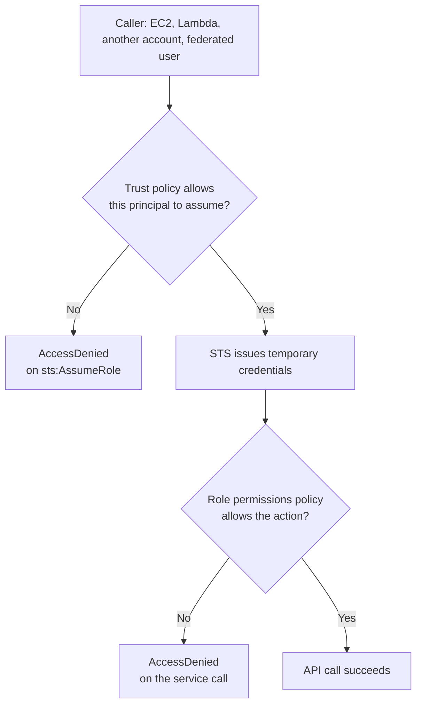
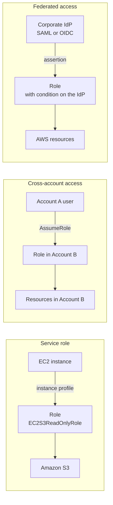

# 02 · IAM Roles

> **Phase 1 — Core Foundations** · Lesson 02 of 18
> ⬅️ Previous: [IAM Users](./01-iam-users.md) · ➡️ Next: [IAM Policies](./03-iam-policies.md) · 🏠 [Phase overview](./README.md)

## 🎯 Learning Objectives

By the end of this lesson you will be able to:

- Explain how an IAM role differs from an IAM user, and why that difference removes an entire class of breach
- Write a trust policy and understand that it and the identity policy are two independent gates
- Create a role for an AWS service and attach it to an EC2 instance via an instance profile
- Describe the three main use cases: AWS service roles, cross-account access, and federated users

**Estimated time:** 50 min · **Difficulty:** Beginner

---

## 🧠 Core Concepts

An **IAM role** is an identity with **temporary credentials** that is *assumed* by something that needs it, rather than logged into. The something can be:

- **An AWS service** — EC2, Lambda, ECS tasks, and most managed services
- **Another AWS account** — cross-account access without sharing keys
- **A federated identity** — a user from your corporate SSO, Active Directory, or a third-party IdP
- **A workload outside AWS** — through OIDC federation, as GitHub Actions does

The distinction from an IAM user is the whole point:

| | IAM user | IAM role |
|---|---|---|
| Credentials | Long-lived password and/or access keys | Temporary, rotated automatically (default 1 hour, up to 12) |
| Who uses it | A specific person or app, identified up front | Whoever is entitled to assume it |
| Stored where | Config files, CI secrets, environment variables | Nowhere — exchanged at runtime via STS |
| Leak impact | Valid until someone notices and rotates | Expires on its own |

That last row is the argument. A leaked access key is usable until a human detects it. A leaked role session token expires in an hour, and the credential that minted it was itself short-lived.

There is one concept that trips up almost everyone: a role has **two** policies, and **both** must allow the action for it to succeed.

1. The **trust policy** (also called the assume-role policy document) answers *who may assume this role*.
2. The **identity/permissions policy** attached to the role answers *what the role may then do*.

A trust policy naming `ec2.amazonaws.com` does not grant EC2 anything. It only permits EC2 to assume the role. If the role has no permissions policy, an instance with that role can do nothing at all. This two-gate model is the source of the "I attached the role but it still says AccessDenied" confusion.

### Key terminology

| Term | Meaning |
|------|---------|
| **Trust policy** | The JSON document defining who may assume the role. |
| **Permissions policy** | The JSON document defining what the role can do once assumed. |
| **STS** | AWS Security Token Service, which issues the temporary credentials. |
| **Instance profile** | The container that lets an EC2 instance receive a role's credentials. |
| **`AssumeRole`** | The API call that exchanges your identity for temporary role credentials. |
| **Session name** | A label attached to an assumed session, which makes CloudTrail attribution possible. |
| **`ExternalId`** | A shared secret that prevents the confused-deputy problem in third-party access. |
| **`iam:PassRole`** | The permission to hand a role to a service; widely overlooked and security-critical. |

---

## 🗺️ Architecture Diagram

The two-gate model, which explains almost every role problem:



The three primary role patterns:



---

## 🧪 Hands-on Lab: Create a Role for EC2

**Goal:** Give an EC2 instance read-only access to S3 with no credentials stored on the instance, and prove both the trust policy and the permissions policy are doing their job.

**Prerequisites:** Permissions to create roles and instances.

### Step 1 — Write the trust policy

The trust policy comes first, because the role cannot exist without it.

```bash
cat > trust-policy.json <<'EOF'
{
  "Version": "2012-10-17",
  "Statement": [
    {
      "Sid": "AllowEC2ToAssume",
      "Effect": "Allow",
      "Principal": { "Service": "ec2.amazonaws.com" },
      "Action": "sts:AssumeRole"
    }
  ]
}
EOF
```

Two deliberate choices to notice. The `Principal` is a *service*, not an account or a wildcard — this role cannot be assumed by a human or by another account. And the policy has a `Sid`, so CloudTrail errors and reviews can reference it.

### Step 2 — Create the role

```bash
aws iam create-role \
  --role-name EC2S3ReadOnlyRole \
  --assume-role-policy-document file://trust-policy.json \
  --description "Read-only S3 access for the web tier" \
  --max-session-duration 3600 \
  --tags Key=Owner,Value=platform-team

# Attach the permissions policy — the second of the two gates
aws iam attach-role-policy \
  --role-name EC2S3ReadOnlyRole \
  --policy-arn arn:aws:iam::aws:policy/AmazonS3ReadOnlyAccess
```

### Step 3 — Create the instance profile

EC2 does not accept a role directly — it accepts an instance profile, which is a container that holds exactly one role.

```bash
aws iam create-instance-profile --instance-profile-name EC2S3ReadOnlyRole

aws iam add-role-to-instance-profile \
  --instance-profile-name EC2S3ReadOnlyRole \
  --role-name EC2S3ReadOnlyRole
```

The requirement that an instance profile holds a single role is a historical constraint, and it is why instance profile and role names are usually identical.

### Step 4 — Attach it to an instance

```bash
# Launch a new instance with the profile
aws ec2 run-instances \
  --image-id ami-0123456789abcdef0 \
  --instance-type t3.micro \
  --iam-instance-profile Name=EC2S3ReadOnlyRole \
  --metadata-options "HttpTokens=required" \
  --tag-specifications 'ResourceType=instance,Tags=[{Key=Name,Value=role-lab}]'

# Or attach to an existing, running instance via a replace operation
aws ec2 replace-iam-instance-profile-association \
  --iam-instance-profile Name=EC2S3ReadOnlyRole \
  --association-id iip-assoc-0123456789abcdef0
```

Note `HttpTokens=required`: it enforces IMDSv2, which is what stops an SSRF vulnerability from stealing the role's credentials.

### Step 5 — Test permissions

```bash
# SSH in, then confirm there is no credentials file anywhere
ssh -i phase1-lab.pem ec2-user@<public-dns-name>
ls -la ~/.aws 2>/dev/null || echo "no credentials stored — correct"

# The role supplies credentials automatically
aws sts get-caller-identity
# Expected ARN: arn:aws:sts::123456789012:assumed-role/EC2S3ReadOnlyRole/i-0123456789abcdef0

aws s3 ls
```

Read that ARN carefully — it is the clearest demonstration of the whole lesson. The identity is not a user; it is the role, assumed by the instance. Nothing on disk grants it, and it expires on its own.

### Step 6 — Prove the two gates independently

```bash
# Gate 2 test: the permissions policy is what limits you, not trust
aws s3 ls s3://a-bucket-you-do-not-own/        # 403 — role has no access to it
aws s3 cp /etc/hosts s3://your-bucket/         # AccessDenied — read-only policy

# Gate 1 test: confirm the trust policy is EC2-only
aws iam get-role --role-name EC2S3ReadOnlyRole \
  --query 'Role.AssumeRolePolicyDocument' --output json
# You cannot AssumeRole into it yourself — the trust policy names only ec2.amazonaws.com
```

---

## 💻 CLI Reference

```bash
# Create a role from a trust policy
aws iam create-role --role-name MyRole \
  --assume-role-policy-document file://trust-policy.json

# Inspect both policies of a role — always check both when debugging
aws iam get-role --role-name MyRole --query 'Role.AssumeRolePolicyDocument'
aws iam list-attached-role-policies --role-name MyRole

# Assume a role into a shell session, with a session name for CloudTrail attribution
aws sts assume-role \
  --role-arn arn:aws:iam::111122223333:role/CrossAccountRole \
  --role-session-name deploy-pipeline-2026-10-14 \
  --duration-seconds 3600

# Configure a CLI profile that assumes a role, so you never copy keys around
aws configure --profile cross-account
aws configure set role_arn arn:aws:iam::111122223333:role/CrossAccountRole --profile cross-account
aws configure set source_profile default --profile cross-account
aws sts get-caller-identity --profile cross-account

# Require MFA to assume a role (add to the trust policy's Condition)
# "Condition": { "Bool": { "aws:MultiFactorAuthPresent": "true" } }

# Flag roles whose trust policy allows any principal — a genuine misconfiguration
for role in $(aws iam list-roles --query 'Roles[].RoleName' --output text); do
    if aws iam get-role --role-name "$role" \
        --query 'Role.AssumeRolePolicyDocument.Statement[].Principal' --output json \
        | grep -q '"\*"'; then
      echo "REVIEW: $role trusts a wildcard principal"
    fi
done
```

| Command | Purpose |
|---------|---------|
| `assume-role --role-session-name` | The session name is what makes CloudTrail attribution possible |
| `configure set role_arn` | Removes the need to distribute long-lived keys to developers |
| `get-role` | Shows the trust policy — the gate people forget to check |
| `list-attached-role-policies` | Shows the permissions policy — the other gate |

---

## ✅ Best Practices

| Practice | Why it matters |
|----------|----------------|
| Prefer roles over users for services and applications | No long-lived credentials to leak or rotate |
| Use instance profiles for EC2 instead of embedding keys | Keys on disk are readable by anything on the host |
| Scope the trust policy tightly | Avoid `"Principal": "*"`; name the exact service or account |
| Require MFA and `ExternalId` for cross-account trust | Blocks misuse and the confused-deputy problem |
| Use the session name when assuming roles | CloudTrail shows the role *and* who used it |
| Keep session duration short | Default is one hour; longer sessions widen the blast radius |
| Guard `iam:PassRole` like an admin permission | Whoever can pass a role can grant its permissions to a service they control |
| Delete unused roles | An unused role with a broad trust policy is standing risk |

A worked example of a properly hardened cross-account trust policy:

```json
{
  "Version": "2012-10-17",
  "Statement": [
    {
      "Sid": "AllowThirdPartyWithExternalIdAndMFA",
      "Effect": "Allow",
      "Principal": { "AWS": "arn:aws:iam::999988887777:root" },
      "Action": "sts:AssumeRole",
      "Condition": {
        "StringEquals": { "sts:ExternalId": "REPLACE_WITH_A_LONG_RANDOM_STRING" },
        "Bool": { "aws:MultiFactorAuthPresent": "true" }
      }
    }
  ]
}
```

Three controls in one statement: a specific account, a shared secret that proves the request is for your tenant specifically, and a requirement for MFA.

---

## ⚠️ Common Pitfalls

| Pitfall | Symptom | Fix |
|---------|---------|-----|
| Assuming the trust policy grants permissions | Instance has the role but every call fails | Attach a permissions policy as well — these are two gates |
| Multiple roles in one instance profile | `LimitExceeded` | One role per profile; the constraint is historical |
| Overly broad trust policy | Any principal can assume the role | Name the specific service, account, or federated principal |
| Missing `ExternalId` for third-party access | Confused-deputy vulnerability | Require `sts:ExternalId` in the trust policy condition |
| Not enforcing IMDSv2 | An SSRF bug leaks role credentials | Set `HttpTokens=required` on the instance |
| Session duration exceeding the role maximum | `AssumeRole` fails validation | Set `--max-session-duration` on the role before requesting longer |
| Unattributed cross-account activity | CloudTrail shows the role but not the caller | Always pass `--role-session-name` |
| Forgetting that root can assume any role | Unexpected access path | Treat the root account's trust as a privileged boundary |

---

## 💰 Cost Considerations

IAM roles are **free**. STS is free for `AssumeRole` calls, and there is no charge for temporary credentials.

There is one cost-adjacent behaviour worth knowing. Temporary credentials obtained by assuming a role are cached by the AWS CLI and SDKs, and when they expire a new call retrieves fresh ones. This is invisible in normal use, but it matters for long-running jobs: a process that runs longer than the session duration must handle credential refresh, or it will fail partway through. The SDKs do this automatically; hand-rolled signing code often does not.

The genuine cost story for roles is spend *prevention*. A role with a tightly scoped permissions policy and a short session duration is the mechanism that stops a compromised workload from provisioning expensive resources, because the role simply cannot call `ec2:RunInstances` in the first place. Combined with a Service Control Policy ceiling (Lesson 04), roles are the enforcement point for "this workload may not spend more than X."

For audits, roles are also cheaper to manage than users: there are no rotation schedules, no credential reports to chase, and no keys to revoke — which is a direct reduction in operational effort.

---

## 🔐 Security Considerations

- **Roles are the migration path away from keys.** If you have applications using long-lived access keys, moving them to a role is the single highest-value security change available, and it also removes a rotation burden.
- **Trust policy is the attack surface you must review.** A trust policy with `"Principal": "*"` and no condition lets *any* AWS principal in the world assume your role. This is a real and recurrent misconfiguration.
- **`iam:PassRole` is effectively `iam:GrantAllPermissions`.** A user who can pass an admin role to a Lambda function they control has admin. Restrict it with a condition limiting which role ARNs can be passed to which services.
- **Always require `ExternalId` for third-party SaaS.** Without it, a vendor's other customer could point at your role ARN and assume it — the confused deputy problem.
- **Enforce IMDSv2.** The metadata service hands the role's credentials to anything that can reach `169.254.169.254`. `HttpTokens=required` means a request must present a token first, which defeats the classic SSRF-to-credential-theft chain.
- **Use conditions on the trust policy.** `aws:MultiFactorAuthPresent`, `aws:PrincipalOrgID` to restrict to your own organization, and `aws:SourceIp` are all worth considering.
- **Set the shortest viable session duration.** A one-hour credential that leaks is far less damaging than a twelve-hour one.
- **Monitor `AssumeRole` in CloudTrail.** An `AssumeRole` from an unexpected source IP or at an unusual hour is one of the highest-signal indicators of compromise available.
- **Delete unused roles.** `RoleLastUsed` tells you whether a role has been used at all in the last 400 days; unused roles with broad trust are standing risk with no benefit.

---

## 🧩 Exercise

Create an IAM Role `AppRole` with `AmazonDynamoDBFullAccess`, attach it to an EC2 instance, then from that instance run:

```bash
aws dynamodb list-tables
```

Then go further and prove the two-gate model for yourself:

1. Remove the permissions policy from the role and confirm the call now fails, even though the instance still has the role attached and the trust policy is unchanged.
2. Re-attach it and instead change the trust policy to name a different service. Confirm the instance can no longer obtain credentials at all.

Success looks like: the command returns without any credentials configured on the instance — the role supplies them automatically — and you can state, for each of the two failure cases above, which gate rejected the request and what the error message was.

---

## 📚 Resources

- [IAM Roles Documentation](https://docs.aws.amazon.com/IAM/latest/UserGuide/id_roles.html)
- [Using IAM Roles with EC2](https://docs.aws.amazon.com/IAM/latest/UserGuide/id_roles_use_switch-role-ec2.html)
- [Best Practices for IAM Roles](https://docs.aws.amazon.com/IAM/latest/UserGuide/best-practices.html)
- [Cross-Account Access with ExternalId](https://docs.aws.amazon.com/IAM/latest/UserGuide/confused-deputy.html)
- [Instance Metadata Service IMDSv2](https://docs.aws.amazon.com/AWSEC2/latest/UserGuide/configuring-instance-metadata-service.html)
- [IAM Access Analyzer](https://docs.aws.amazon.com/IAM/latest/UserGuide/what-is-access-analyzer.html)

---

## ➡️ Next Steps

You now know how to hand permissions to an identity, and why the trust policy and the permissions policy are separate gates that must both open. The next lesson explains the document that actually defines what those permissions are, and the evaluation logic that decides whether a request is allowed.

> ⬅️ Previous: [IAM Users](./01-iam-users.md) · ➡️ Next: [IAM Policies](./03-iam-policies.md) · 🏠 [Phase overview](./README.md)
