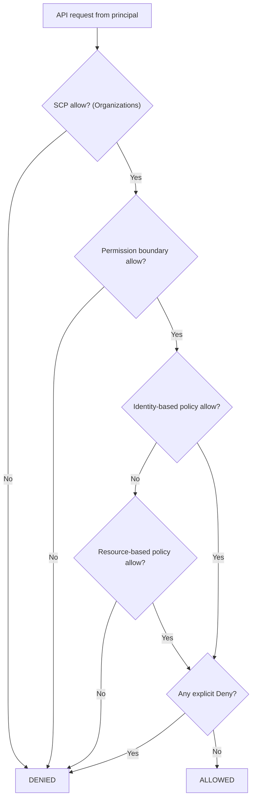
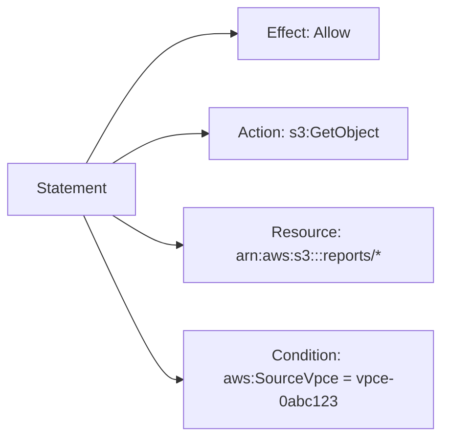

# 03 · IAM Policies

> **Phase 1 — Core Foundations** · Lesson 03 of 18
> ⬅️ Previous: [IAM Roles](./02-iam-roles.md) · ➡️ Next: [Service Control Policies](./04-service-control-policies.md) · 🏠 [Phase overview](./README.md)

## Learning Objectives

By the end of this lesson you will be able to:

- Read and write IAM policy documents in JSON
- Distinguish identity-based, resource-based, and permission-boundary policies
- Apply the evaluation logic (explicit deny wins) to debug access problems
- Use IAM Access Analyzer to validate policies before deploying them

**Estimated time:** 60 min · **Difficulty:** Beginner

---

## Core Concepts

An **IAM policy** is a JSON document that answers one question: *may this principal perform this action on this resource, under these conditions?* Policies never grant anything on their own — they only take effect when attached to a principal (a user, group, or role) or to a resource (like an S3 bucket or KMS key).

Every policy has one or more **statements**. A statement names an `Effect` (`Allow` or `Deny`), one or more `Action`s, and one or more `Resource`s. An optional `Condition` block narrows when the statement applies — for example, "only if the request comes from a specific VPC endpoint" or "only if MFA was used".

The part most people get wrong is **evaluation logic**. AWS evaluates every applicable policy together, then applies a fixed set of rules:

1. An **explicit `Deny`** anywhere always wins — no `Allow` can override it.
2. If there is no explicit deny, access is granted only if at least one policy **explicitly allows** the action.
3. If nothing allows it, the request is denied by default (**implicit deny**).

That is why the single most useful debugging question for an `AccessDenied` error is not "which policy allows this?" but rather "is something explicitly denying it?"

### Key terminology

| Term | Meaning |
|------|---------|
| **Identity-based policy** | Attached to a user, group, or role. Describes what that principal may do. |
| **Resource-based policy** | Attached to a resource (S3 bucket policy, KMS key policy, SQS queue policy). Describes who may access it. |
| **Permission boundary** | An advanced feature that caps the maximum permissions an identity policy can grant. |
| **SCP** | Service Control Policy — an organization-level guardrail. Covered in the next lesson. |
| **Principal** | The identity the statement refers to. Only valid in resource-based policies and trust policies. |
| **NotAction / NotResource** | Negated variants that match everything *except* the listed items. Powerful and easy to misuse. |

---

## Architecture Diagram

How the different policy types combine when a request is evaluated:



A single statement, annotated part by part:



---

## Hands-on Lab: Write and Attach a Least-Privilege Policy

**Goal:** Create a policy that lets a user read objects from exactly one S3 bucket, and verify that it cannot read anything else.

**Prerequisites:** An AWS account, AWS CLI configured with an admin profile, an existing S3 bucket.

### Step 1 — Create the policy document

Replace `reports-bucket` and the account ID with your own values.

```json
{
  "Version": "2012-10-17",
  "Statement": [
    {
      "Sid": "ListOnlyTheReportsBucket",
      "Effect": "Allow",
      "Action": "s3:ListBucket",
      "Resource": "arn:aws:s3:::reports-bucket"
    },
    {
      "Sid": "ReadObjectsInReportsBucket",
      "Effect": "Allow",
      "Action": "s3:GetObject",
      "Resource": "arn:aws:s3:::reports-bucket/*"
    }
  ]
}
```

Note the two-resource trick: `s3:ListBucket` applies to the **bucket** ARN, while `s3:GetObject` applies to the **object** ARN (`/*`). Mixing these up is the most common cause of "I can list but not download" and vice versa.

### Step 2 — Validate before you deploy

```bash
# Ask AWS whether this policy is valid and what it actually grants
aws accessanalyzer validate-policy \
  --policy-type IDENTITY_POLICY \
  --policy-document file://reports-read-policy.json

# See the effective permissions the policy resolves to
aws accessanalyzer check-no-new-access \
  --new-policy-document file://reports-read-policy.json \
  --existing-policy-document file://current-policy.json \
  --policy-type IDENTITY_POLICY
```

### Step 3 — Create and attach the policy

```bash
# Create a customer-managed policy (not inline — managed policies are reusable and versioned)
aws iam create-policy \
  --policy-name ReportsBucketReadOnly \
  --policy-document file://reports-read-policy.json

# Attach it to the user created in Lesson 01
aws iam attach-user-policy \
  --user-name dev-user \
  --policy-arn arn:aws:iam::123456789012:policy/ReportsBucketReadOnly
```

### Step 4 — Verify it worked

```bash
# This must succeed
aws s3 ls s3://reports-bucket/ --profile dev-user

# This must fail with AccessDenied — that proves least privilege
aws s3 ls s3://some-other-bucket/ --profile dev-user
```

If the second command returns data, your policy is too broad — check that you did not use a wildcard resource.

---

## CLI Reference

```bash
# List policies attached to a user
aws iam list-attached-user-policies --user-name dev-user

# Show the JSON of a managed policy (latest version only)
aws iam get-policy-version \
  --policy-arn arn:aws:iam::123456789012:policy/ReportsBucketReadOnly \
  --version-id v1

# Create a new version (managed policies keep up to 5 versions)
aws iam create-policy-version \
  --policy-arn arn:aws:iam::123456789012:policy/ReportsBucketReadOnly \
  --policy-document file://reports-read-policy-v2.json \
  --set-as-default

# Find out which principals can reach a resource
aws accessanalyzer list-findings --analyzer-arn arn:aws:access-analyzer:eu-west-1:123456789012:analyzer/console-analyzer

# Simulate whether a principal can perform an action — no real API call is made
aws iam simulate-principal-policy \
  --policy-source-arn arn:aws:iam::123456789012:user/dev-user \
  --action-names s3:GetObject \
  --resource-arns arn:aws:s3:::reports-bucket/quarterly.pdf
```

| Command | Purpose |
|---------|---------|
| `validate-policy` | Catches JSON and semantic errors before deploy |
| `simulate-principal-policy` | Answers "can this identity do X?" without trial and error |
| `accessanalyzer list-findings` | Surfaces unintended external or cross-account access |
| `create-policy-version` | Safely rolls out policy changes with rollback history |

---

## Best Practices

| Practice | Why it matters |
|----------|----------------|
| Grant specific actions, not `s3:*` or `*` | A wildcard silently covers future, more sensitive actions AWS adds later |
| Scope resources with the narrowest ARN | `arn:aws:s3:::reports-bucket/*` beats `arn:aws:s3:::*/*` |
| Add `Condition` blocks for defense in depth | Require MFA, TLS, or a specific VPC endpoint |
| Prefer managed policies over inline policies | Reusable, versioned, auditable |
| Use IAM Access Analyzer in CI | Blocks over-permissive policies before they reach production |
| Never put credentials or account IDs in a public repo | Use placeholders like `123456789012` |

---

## Common Pitfalls

| Pitfall | Symptom | Fix |
|---------|---------|-----|
| Bucket ARN vs object ARN mix-up | `ListBucket` works, `GetObject` fails | Use `bucket` for list actions, `bucket/*` for object actions |
| Expecting `Allow` to beat a `Deny` | Access denied despite a valid allow policy | Find and remove the explicit deny; deny always wins |
| Forgetting region-specific services | Policy works in one region, fails in another | Use `"Resource": "*"` only for truly global/regional-agnostic actions, or list regions explicitly |
| Using `NotAction` casually | Far broader access than intended | Replace with an explicit action list |
| Case sensitivity errors | `s3:getobject` silently matches nothing | Actions are case-sensitive — use documented casing |
| Stale versions | Old permissions still apply after an update | Set the new version as default explicitly |

---

## Cost Considerations

IAM itself is **free** — there is no charge for users, roles, policies, or API calls to IAM. The real cost of a bad policy is indirect: over-permissive policies are the leading cause of data-breach recovery bills, and a missing `Condition` can allow a compromised access key to spin up expensive GPU instances. Treat policy review as a cost-control activity, not just a security one.

Costs that *are* real here: IAM Access Analyzer charges per analyzer per month plus per policy validated beyond the free tier, and CloudTrail data-event logging (needed to audit who used a policy) is billed per 100,000 events.

---

## Security Considerations

- **Least privilege is iterative.** Start broad in a sandbox, then use IAM Access Advisor and CloudTrail to see what was actually used and trim to that.
- **Boundaries for delegation.** If you let teams create their own roles, attach a permission boundary so they cannot escalate beyond a ceiling you set.
- **Conditions you should nearly always add:** `aws:MultiFactorAuthPresent` for human access, `aws:SecureTransport` to force TLS, `aws:PrincipalOrgID` to block external accounts.
- **Never use `"Principal": "*"`** in a resource policy unless the resource is genuinely public and intentional — S3 Block Public Access exists precisely to catch this.

---

## Exercise

Create a policy named `DynamoAppUser` that allows a user to read and write items in a single DynamoDB table called `orders`, and nothing else. Then prove it works by writing an item successfully and attempting (and failing) to read a different table.

Success looks like: `simulate-principal-policy` returns `allowed` for `dynamodb:PutItem` on the `orders` table ARN and `implicitDeny` for the same action on any other table.

---

## Resources

- [IAM JSON Policy Reference](https://docs.aws.amazon.com/IAM/latest/UserGuide/reference_policies.html)
- [Policy Evaluation Logic](https://docs.aws.amazon.com/IAM/latest/UserGuide/reference_policies_evaluation-logic.html)
- [IAM Access Analyzer](https://docs.aws.amazon.com/IAM/latest/UserGuide/what-is-access-analyzer.html)
- [Actions, Resources, and Condition Keys Reference](https://docs.aws.amazon.com/service-authorization/latest/reference/reference_policies_actions-resources-contextkeys.html)

---

## Next Steps

Policies control what happens *inside* your account. The next lesson adds the layer above that: Service Control Policies, which set hard ceilings across every account in an AWS Organization.

> ⬅️ Previous: [IAM Roles](./02-iam-roles.md) · ➡️ Next: [Service Control Policies](./04-service-control-policies.md) · 🏠 [Phase overview](./README.md)
