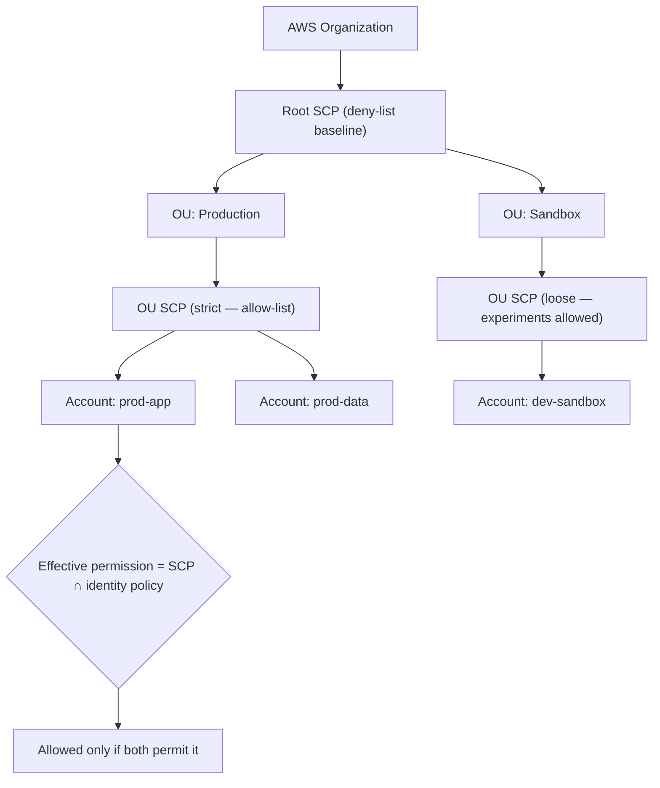
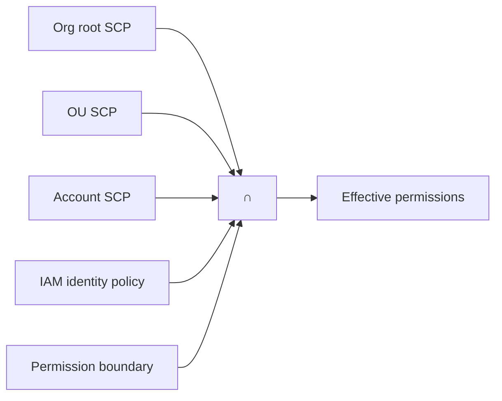

# 04 · Service Control Policies

> **Phase 1 — Core Foundations** · Lesson 04 of 18
> ⬅️ Previous: [IAM Policies](./03-iam-policies.md) · ➡️ Next: [EC2 Basics](./05-ec2-basics.md) · 🏠 [Phase overview](./README.md)

## Learning Objectives

By the end of this lesson you will be able to:

- Explain what a Service Control Policy (SCP) is and where it sits in the authorization chain
- Write SCPs that create real guardrails without blocking legitimate work
- Distinguish deny-list from allow-list strategies and know when each is appropriate
- Test an SCP safely using the policy simulator before rolling it out

**Estimated time:** 50 min · **Difficulty:** Intermediate

---

## Core Concepts

An **SCP** is an IAM policy that you attach to an organization root, an organizational unit (OU), or an individual account inside AWS Organizations. It does not grant permissions. It defines the **maximum** permissions that any principal in the attached accounts can ever use — a hard ceiling that no identity-based policy can punch through.

This is the key mental model: IAM policies say "these identities *may* do this". SCPs say "**nobody** here may do *that*, under any circumstances". An SCP can only take permissions away.

SCPs apply to **principals** — IAM users and roles in the member accounts. They do not apply to the management account, and they never restrict service-linked roles. That last point is deliberate: if an SCP could break service-linked roles, you could brick your own account.

There are two strategies for writing SCPs:

- **Deny-list** (also called blocklist) — start with `FullAWSAccess` attached and add explicit `Deny` statements for things you never want. Simple, low blast radius, but anything AWS launches tomorrow is allowed by default.
- **Allow-list** — remove `FullAWSAccess` and explicitly allow only approved services and actions. Far safer, but high maintenance and easy to break workloads when a team needs a new service.

For most organizations the pragmatic answer is deny-list at the root with a few small allow-list OUs for tightly regulated workloads.

### Key terminology

| Term | Meaning |
|------|---------|
| **Organizational unit (OU)** | A container for accounts inside an organization. SCPs inherit downward. |
| **Root SCP** | An SCP attached at the organization root. Applies to every member account. |
| **FullAWSAccess** | The default policy AWS attaches everywhere, which allows everything. |
| **Guardrail** | A control that prevents a class of risky action — SCPs are *preventive* guardrails. |
| **Management account** | The account that owns the organization; SCPs do not restrict it. |
| **Delegated administrator** | A member account granted administrative rights for a specific service. |

---

## Architecture Diagram

Where SCPs sit relative to everything else:



Inheritance and intersection — a principal's real permissions are the overlap of every layer:



---

## Hands-on Lab: Build a Guardrail Baseline

**Goal:** Prevent two genuinely dangerous classes of action across every member account — disabling audit logging, and using the root user — while leaving normal work untouched.

**Prerequisites:** An AWS Organization with at least one member account. SCPs require the `organizations:*` permissions and can only be managed from the management account or a delegated administrator.

### Step 1 — Turn on Organizations with all features

```bash
# SCPs require the "all features" mode, not the older consolidated billing only mode
aws organizations describe-organization

# If not already enabled, create the organization with all features
aws organizations create-organization --feature-set ALL
```

### Step 2 — Write the deny-list guardrail

Save this as `guardrails.json`. Note the two `StringNotEquals` conditions — they protect the accounts and roles that must remain able to fix things.

```json
{
  "Version": "2012-10-17",
  "Statement": [
    {
      "Sid": "DenyDisablingAuditAndSecurity",
      "Effect": "Deny",
      "Action": [
        "cloudtrail:StopLogging",
        "cloudtrail:DeleteTrail",
        "guardduty:DeleteDetector",
        "guardduty:DisableOrganizationAdminAccount",
        "config:DeleteConfigurationRecorder",
        "config:StopConfigurationRecorder",
        "securityhub:DisableSecurityHub",
        "securityhub:DeleteMembers"
      ],
      "Resource": "*"
    },
    {
      "Sid": "DenyCloudTrailBucketDeletion",
      "Effect": "Deny",
      "Action": ["s3:DeleteBucket", "s3:DeleteBucketPolicy"],
      "Resource": ["arn:aws:s3:::my-org-cloudtrail-logs"]
    },
    {
      "Sid": "DenyRootUserOutsideBreakGlass",
      "Effect": "Deny",
      "Action": "*",
      "Resource": "*",
      "Condition": {
        "StringNotEquals": {
          "aws:PrincipalArn": [
            "arn:aws:iam::*:role/OrganizationAccountAccessRole",
            "arn:aws:iam::*:role/BreakGlassAdmin"
          ]
        }
      }
    }
  ]
}
```

The third statement looks aggressive but is the highest-value guardrail in the whole set: it stops the root user from doing anything except with the two roles you have explicitly carved out.

### Step 3 — Attach it to the root

```bash
# Create the policy inside the organization
aws organizations create-policy \
  --name "SecurityBaseline" \
  --description "Prevent disabling audit/security services and root-user misuse" \
  --type SERVICE_CONTROL_POLICY \
  --content file://guardrails.json

# Attach it to the organization root so every member account inherits it
aws organizations attach-policy \
  --policy-id p-EXAMPLE12345 \
  --target-id r-exampleroot
```

### Step 4 — Verify the guardrail actually blocks something

```bash
# From a member account, confirm the identity policy would normally allow this
aws iam simulate-principal-policy \
  --policy-source-arn arn:aws:iam::111122223333:role/AdminRole \
  --action-names cloudtrail:StopLogging

# Now confirm the SCP blocks it
aws organizations list-policies-for-target --target-id r-exampleroot --filter SERVICE_CONTROL_POLICY
aws cloudtrail stop-logging --name org-trail   # expected: AccessDenied
```

The second command is the one that matters. If `stop-logging` succeeds, the SCP is not attached where you think it is.

---

## CLI Reference

```bash
# List every SCP in the organization
aws organizations list-policies --filter SERVICE_CONTROL_POLICY

# Show which accounts or OUs a policy is attached to
aws organizations list-targets-for-policy --policy-id p-EXAMPLE12345

# Show which policies apply to a given account
aws organizations list-policies-for-target --target-id 111122223333 --filter SERVICE_CONTROL_POLICY

# Update a policy (this replaces the content wholesale)
aws organizations update-policy \
  --policy-id p-EXAMPLE12345 \
  --content file://guardrails-v2.json

# Detach and delete
aws organizations detach-policy --policy-id p-EXAMPLE12345 --target-id r-exampleroot

# Check which services are blocked by SCPs before you enable them
aws organizations describe-effective-policy \
  --policy-type SERVICE_CONTROL_POLICY \
  --target-id 111122223333
```

| Command | Purpose |
|---------|---------|
| `describe-effective-policy` | Shows the merged SCP that actually applies to an account |
| `list-policies-for-target` | Confirms which SCPs are attached to an account or OU |
| `describe-create-organization-status` | Polls the async status when enabling Organizations |
| `enable-policy-type` | Must be run once before SCPs can be used at all |

---

## Best Practices

| Practice | Why it matters |
|----------|----------------|
| Enable the SCP policy type before you need it | `enable-policy-type` is a one-time prerequisite and easy to forget |
| Attach SCPs at the highest sensible level | Root-level guardrails cannot be forgotten when a new account is added |
| Always test on one OU first | A bad root-level SCP can lock every engineer out of every account |
| Keep the break-glass role exempt from the root-user deny | Without an exemption you cannot recover from a mistake |
| Never use SCPs for granting access | SCPs can only restrict; if you find yourself trying to allow, you want an IAM policy |
| Document each SCP with a `Sid` and a comment | Six months later nobody remembers why `ec2:*` was denied |
| Version your SCPs in source control | Manual edits in the console are invisible and unreviewable |

---

## Common Pitfalls

| Pitfall | Symptom | Fix |
|---------|---------|-----|
| SCP applied to the wrong target | Guardrail appears not to work at all | Run `list-policies-for-target` and check inheritance from the root |
| Expecting SCPs to restrict the management account | Admin actions succeed despite a deny | Move workloads out of the management account; SCPs never apply there |
| Removing `FullAWSAccess` by accident | Every member account loses all access, including AWS support tooling | Re-attach `FullAWSAccess` immediately and switch to a deny-list |
| Forgetting service-linked roles | Managed services stop working mysteriously | SCPs do not apply to service-linked roles, but do apply to the roles they create |
| Denying an action the console depends on | Console pages break with confusing errors | Deny the mutating action, not the read action, where possible |
| No `Sid` on statements | CloudTrail errors are impossible to trace | Always name statements |

---

## Cost Considerations

AWS Organizations, OUs, and SCPs are **free**. There is no per-policy or per-account charge.

The savings from SCPs are indirect but substantial. An SCP denying `ec2:RunInstances` types with GPU accelerators, or denying the creation of resources outside approved regions, prevents the single most common cause of runaway cloud bills: a developer in a sandbox account launching expensive instances, or resources accumulating in an unmonitored region. A region-restriction SCP is often the highest-return control in the entire account structure.

One cost to be aware of: CloudTrail records every denied API call, so aggressive deny-lists can increase log volume. This is negligible for most organizations, but at very high API volumes the S3 storage for logs is billed.

---

## Security Considerations

- **SCPs are preventive, not detective.** They block an action up front. Pair them with CloudTrail, Config, and Security Hub so you also know when someone *tried*.
- **Deny, don't hide.** The best guardrails target destructive actions (`Delete*`, `StopLogging`, `LeaveOrganization`, `Disable*`) rather than reading actions.
- **Always include `organizations:LeaveOrganization` in a deny-list.** Without it, a compromised account can remove itself from your governance entirely.
- **Protect the SCP itself.** Add a statement denying `organizations:DetachPolicy` and `organizations:UpdatePolicy` for everyone except your security administration role.
- **Region control is a security control.** Denying all actions outside approved regions closes a large exfiltration and shadow-IT path, and simplifies compliance boundaries.
- **The management account is your weakest governance link.** Restrict who can log into it, enable MFA on root, and keep no workloads there.

An example region and leave-organization guardrail:

```json
{
  "Version": "2012-10-17",
  "Statement": [
    {
      "Sid": "DenyOutsideApprovedRegions",
      "Effect": "Deny",
      "NotAction": [
        "iam:*",
        "sts:*",
        "organizations:*",
        "cloudfront:*",
        "route53:*",
        "support:*",
        "budgets:*"
      ],
      "Resource": "*",
      "Condition": {
        "StringNotEquals": {
          "aws:RequestedRegion": ["eu-west-1", "eu-central-1", "us-east-1"]
        }
      }
    },
    {
      "Sid": "DenyLeavingOrganization",
      "Effect": "Deny",
      "Action": ["organizations:LeaveOrganization"],
      "Resource": "*"
    }
  ]
}
```

Note the `NotAction` list: global services such as IAM and Route 53 do not live in a region, so they must be exempted or the policy breaks them.

---

## Exercise

Write an SCP that enforces two rules across a `Sandbox` OU:

1. No IAM user or role may create an access key that never expires — deny `iam:CreateAccessKey` entirely in the sandbox.
2. Nobody may launch an instance larger than `m5.large` — deny `ec2:RunInstances` where `ec2:InstanceType` is not in an approved list.

Attach it to a test OU, then attempt both actions from an account in that OU and confirm both are denied.

Success looks like: the sandbox can still launch an `m5.large` and use all other EC2 features, but `CreateAccessKey` returns `AccessDenied` and an `m7i.24xlarge` launch is rejected.

---

## Resources

- [Service Control Policies — AWS Organizations](https://docs.aws.amazon.com/organizations/latest/userguide/orgs_manage_policies_scps.html)
- [SCP Syntax and Evaluation](https://docs.aws.amazon.com/organizations/latest/userguide/orgs_manage_policies_scps_syntax.html)
- [Strategies for Using SCPs](https://docs.aws.amazon.com/organizations/latest/userguide/orgs_manage_policies_scps_strategies.html)
- [Service Control Policies Example Library](https://docs.aws.amazon.com/organizations/latest/userguide/orgs_manage_policies_scps_examples.html)

---

## Next Steps

Identity and access are now covered end to end: users, roles, policies, and organization guardrails. Next we move to the first compute primitive — EC2 — where IAM roles stop being an abstraction and start showing up as instance profiles attached to real machines.

> ⬅️ Previous: [IAM Policies](./03-iam-policies.md) · ➡️ Next: [EC2 Basics](./05-ec2-basics.md) · 🏠 [Phase overview](./README.md)
