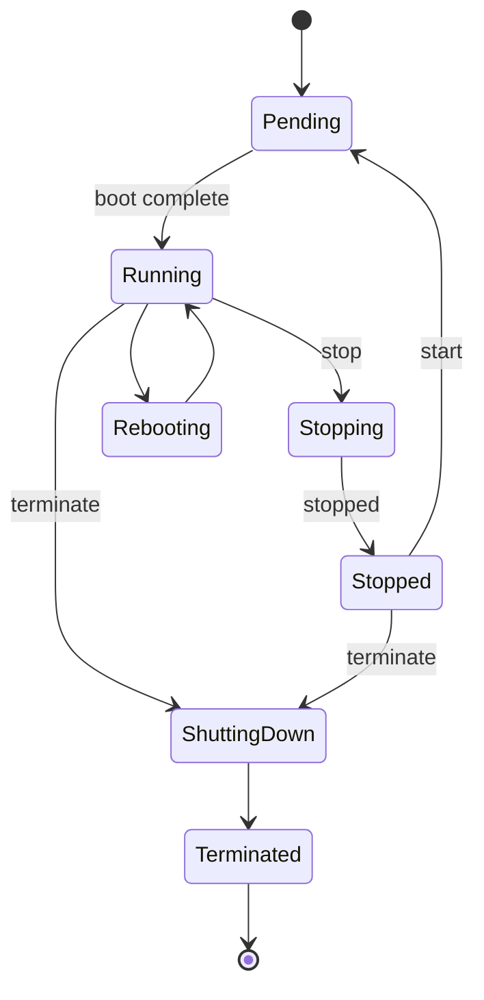
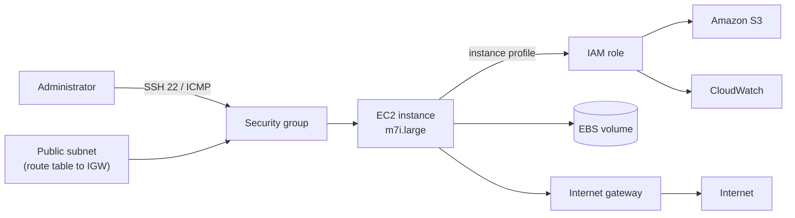

# 05 · EC2 Basics

> **Phase 1 — Core Foundations** · Lesson 05 of 18
> ⬅️ Previous: [Service Control Policies](./04-service-control-policies.md) · ➡️ Next: [Amazon Machine Images](./06-amis.md) · 🏠 [Phase overview](./README.md)

## 🎯 Learning Objectives

By the end of this lesson you will be able to:

- Choose an EC2 instance family and size that matches a workload's actual bottleneck
- Launch an instance with the correct networking, IAM role, and storage configuration
- Connect to a Linux instance using EC2 Instance Connect or SSH
- Bootstrap an instance at boot with user data and retrieve its logs for debugging
- Explain instance lifecycle states and when you are still being billed

**Estimated time:** 60 min · **Difficulty:** Beginner

---

## 🧠 Core Concepts

**Amazon EC2** provides resizable virtual machines. You pick an **AMI** (the operating system and preinstalled software), an **instance type** (CPU, memory, network, and storage characteristics), a **network placement** (VPC and subnet), and a **security group**. Everything else — the hypervisor, the hardware, the datacenter — is AWS's problem.

Picking the right instance family is mostly about identifying the bottleneck. Start with a **general purpose** (`t`, `m`) instance, measure, and only move when you can name which resource is saturated. Reaching for a `c` family because you have "a lot of traffic" is guessing; noticing that CPU credits are exhausted on a `t3.micro` is diagnosing.

Instance families at a glance:

| Family | Optimized for | Typical use |
|--------|---------------|-------------|
| `t` | Burstable CPU with credits | Dev boxes, low-traffic web servers |
| `m` | Balanced CPU/memory | General application servers |
| `c` | Compute | Batch jobs, encoding, high-traffic web |
| `r` / `x` | Memory | In-memory caches, large databases |
| `i` / `d` | Local NVMe / HDD storage | High-IOPS databases, data processing |
| `g` / `p` | GPU | ML training and inference |
| `inf` / `trn` | Custom accelerators | Large-scale ML inference and training |

There is an important consequence of virtualization that surprises people: **stopping an instance does not always preserve its public IPv4 address**, and with the newer default VPC behaviour an instance kept stopped for a long period can still incur EBS charges for its volumes. The instance itself is not billed while `stopped`, but every attached EBS volume is.

### Key terminology

| Term | Meaning |
|------|---------|
| **AMI** | Amazon Machine Image — the template an instance boots from. |
| **Instance type** | The hardware profile, e.g. `m7i.large`. |
| **Key pair** | An SSH key pair used for initial Linux login. |
| **User data** | A script run once at first boot, as root. |
| **Instance profile** | The container that attaches an IAM role to an instance. |
| **Placement group** | A strategy for how instances are physically distributed. |
| **Tenancy** | Whether the instance runs on shared or dedicated hardware. |

---

## 🗺️ Architecture Diagram

Instance lifecycle — note where billing stops and starts:



How an instance sits inside the network and reaches AWS services:



---

## 🧪 Hands-on Lab: Launch and Bootstrap an Instance

**Goal:** Launch a Linux instance that installs and starts a web server automatically at boot, and verify it via its public DNS name.

**Prerequisites:** An AWS CLI profile with EC2 permissions, a VPC with a public subnet (Lesson 13), and an existing security group that allows inbound HTTP 80 and SSH 22.

### Step 1 — Find the latest Amazon Linux 2023 AMI

```bash
# Resolve the newest AL2023 AMI for your region instead of hardcoding an ID
aws ec2 describe-images \
  --owners amazon \
  --filters "Name=name,Values=al2023-ami-2023*-x86_64" "Name=state,Values=available" \
  --query 'sort_by(Images, &CreationDate)[-1].[ImageId,Name]' \
  --output text
```

### Step 2 — Create a key pair

```bash
# Store the private key securely — you cannot download it again
aws ec2 create-key-pair \
  --key-name phase1-lab \
  --query 'KeyMaterial' \
  --output text > phase1-lab.pem
chmod 400 phase1-lab.pem
```

### Step 3 — Write user data

Save as `user-data.sh`. This runs once, as root, on first boot:

```bash
#!/bin/bash
set -euo pipefail

dnf update -y
dnf install -y httpd
systemctl enable --now httpd

# Instance metadata is available without credentials at this address
TOKEN=$(curl -sX PUT "http://169.254.169.254/latest/api/token" \
  -H "X-aws-ec2-metadata-token-ttl-seconds: 300")
INSTANCE_ID=$(curl -s -H "X-aws-ec2-metadata-token: $TOKEN" \
  http://169.254.169.254/latest/meta-data/instance-id)

echo "<h1>Hello from $INSTANCE_ID</h1>" > /var/www/html/index.html
```

The IMDSv2 token dance is required because AWS now disables the older IMDSv1 by default. Hardcoding `curl http://169.254.169.254/...` without a token is the most common reason user-data scripts silently produce empty files.

### Step 4 — Launch

```bash
aws ec2 run-instances \
  --image-id ami-0123456789abcdef0 \
  --instance-type t3.micro \
  --key-name phase1-lab \
  --security-group-ids sg-0123456789abcdef0 \
  --subnet-id subnet-0123456789abcdef0 \
  --iam-instance-profile Name=EC2S3ReadOnlyRole \
  --metadata-options "HttpTokens=required,HttpEndpoint=enabled" \
  --user-data file://user-data.sh \
  --tag-specifications 'ResourceType=instance,Tags=[{Key=Name,Value=phase1-lab},{Key=Environment,Value=lab}]'
```

### Step 5 — Verify

```bash
# Read the boot log to confirm the user-data script ran without error
aws ec2 get-console-output \
  --instance-id i-0123456789abcdef0 \
  --query 'Output' --output text | tail -30

# Confirm the web server answers
curl -s "http://$(aws ec2 describe-instances --instance-ids i-0123456789abcdef0 \
  --query 'Reservations[0].Instances[0].PublicDnsName' --output text)"
```

If the console output shows `dnf: command not found`, you booted a Debian-family AMI — use `apt-get` instead. If it shows nothing at all, the script is still running or failed before logging.

### Step 6 — Connect

```bash
# Simplest path: EC2 Instance Connect, no key management required
aws ec2-instance-connect ssh --instance-id i-0123456789abcdef0

# Classic SSH alternative
ssh -i phase1-lab.pem ec2-user@<public-dns-name>
```

### Step 7 — Clean up

```bash
# Terminating destroys the instance; EBS volumes marked DeleteOnTermination go with it
aws ec2 terminate-instances --instance-ids i-0123456789abcdef0
```

---

## 💻 CLI Reference

```bash
# List instances with their state, type, and name tag
aws ec2 describe-instances \
  --query 'Reservations[].Instances[].{Id:InstanceId,State:State.Name,Type:InstanceType,Name:Tags[?Key==`Name`]|[0].Value}' \
  --output table

# Stop (keeps volumes) and start again
aws ec2 stop-instances --instance-ids i-0123456789abcdef0
aws ec2 start-instances --instance-ids i-0123456789abcdef0

# Resize: change instance type in place (requires a stopped state)
aws ec2 modify-instance-attribute --instance-id i-0123456789abcdef0 \
  --instance-type '{"Value": "m7i.large"}'

# Check what an instance's IAM role can actually do
aws ec2 describe-iam-instance-profile-associations --filters "Name=instance-id,Values=i-0123456789abcdef0"

# Inspect credit balance on a burstable instance
aws cloudwatch get-metric-statistics \
  --namespace AWS/EC2 --metric-name CPUCreditBalance \
  --dimensions Name=InstanceId,Value=i-0123456789abcdef0 \
  --start-time "$(date -u -v-1H +%Y-%m-%dT%H:%M:%S)" --end-time "$(date -u +%Y-%m-%dT%H:%M:%S)" \
  --period 300 --statistics Average
```

| Command | Purpose |
|---------|---------|
| `describe-instances` | Inventory and state of every instance |
| `get-console-output` | Boot log — the first place to look when user data fails |
| `modify-instance-attribute` | Vertical scaling without rebuilding |
| `create-image` | Snapshot an instance into an AMI (see Lesson 06) |

---

## ✅ Best Practices

| Practice | Why it matters |
|----------|----------------|
| Use an IAM role, never access keys on an instance | Keys on disk are a leak waiting to happen; roles rotate automatically |
| Enforce IMDSv2 with `HttpTokens=required` | Blocks SSRF attacks that steal instance credentials |
| Tag everything (`Name`, `Environment`, `Owner`) | Untagged resources cannot be attributed or cleaned up |
| Prefer `t3`/`t4g` with unlimited mode for spiky web traffic | Avoids the "CPU is throttled" surprise during a traffic spike |
| Use Graviton (`t4g`, `m7g`) when software supports ARM64 | Typically 20% better price-performance than x86 equivalents |
| Never store data on the root volume | Root volumes are sometimes replaced; separate data volumes survive |
| Disable public IPs unless genuinely needed | Every public IPv4 is now a billed, attackable asset |

---

## ⚠️ Common Pitfalls

| Pitfall | Symptom | Fix |
|---------|---------|-----|
| Using IMDSv1 syntax in user data | Empty variables, silent misconfiguration | Add the IMDSv2 token request shown above |
| Assuming stop clears the bill | Ongoing EBS and Elastic IP charges | Terminate, or snapshot and delete volumes |
| Adding an SSH rule from `0.0.0.0/0` | Instance gets brute-forced within minutes | Use EC2 Instance Connect or SSM Session Manager |
| Forgetting `chmod 400` on the private key | SSH refuses with "unprotected private key file" | Fix permissions before connecting |
| Choosing an instance before measuring | Paying for capacity you never use | Start small, watch CloudWatch, resize once |
| Losing the public IP after stop | Automation breaks after a restart | Attach an Elastic IP, or use a DNS name |

---

## 💰 Cost Considerations

Four separate line items appear on your bill for one running instance, and it is worth being able to name all four:

1. **Compute** — billed per second with a 60-second minimum, priced by instance type and region. A `t3.micro` running 24/7 for a month costs roughly the price of a coffee; a `p4d.24xlarge` costs more than a car per month.
2. **EBS storage** — per GB-month, plus extra for provisioned IOPS on `io` volumes. This is charged even while the instance is stopped.
3. **Data transfer out** — free into AWS, billed per GB outbound to the internet. Inbound is free.
4. **Public IPv4 addresses** — billed per address-hour whenever attached to a running or stopped instance.

The biggest lever is not the instance type, it is **whether the instance needs to exist**. Development environments should stop outside working hours; scheduled scaling (Lesson 07) typically removes 65% of the compute cost for a 9-to-5 workload. Beyond that, Savings Plans and Reserved Instances cut steady-state cost by 30–60%, and Spot instances cut it by up to 90% for interruption-tolerant work.

A useful habit: tag every lab instance with `Environment=lab` and set a budget alarm at a low threshold, so an experiment you forget about is caught within a day rather than at the end of the month.

---

## 🔐 Security Considerations

- **IMDSv2 enforced.** The instance metadata service hands out temporary IAM credentials to anything that can reach `169.254.169.254`. Requiring a token defeats the classic SSRF-to-credential-theft attack.
- **No long-lived credentials on the box.** An attached IAM role rotates credentials automatically and appears in CloudTrail under the session name, making attribution possible.
- **Avoid SSH where possible.** AWS Systems Manager Session Manager gives shell access with no open inbound port, full session logging to S3 and CloudWatch, and IAM-based authorization.
- **Patch.** Untagged, unpatched instances are the most common initial foothold. Use Systems Manager Patch Manager rather than manual `dnf update`.
- **Encrypt volumes by default.** Enable EBS encryption by default at the account level so no new volume can be unencrypted.
- **Restrict egress.** A security group that allows all outbound traffic lets a compromised instance exfiltrate data or mine crypto. Egress rules matter as much as ingress.

---

## 🧩 Exercise

Launch two instances in the same subnet from the same AMI. Give the first an IAM role with S3 read access, and the second no role at all. From each instance, attempt `aws s3 ls` using the instance profile. Confirm one succeeds and the other fails with `Unable to locate credentials`.

Then resize the second instance from `t3.micro` to `t3.small` and confirm the change took effect.

Success looks like: `describe-instances` shows `t3.small`, the role-less instance still cannot reach S3, and both instances share the same AMI but different effective permissions.

---

## 📚 Resources

- [Amazon EC2 User Guide](https://docs.aws.amazon.com/AWSEC2/latest/UserGuide/concepts.html)
- [Instance Types](https://docs.aws.amazon.com/ec2/latest/instancetypes/instance-types.html)
- [EC2 Instance Metadata Service (IMDSv2)](https://docs.aws.amazon.com/AWSEC2/latest/UserGuide/configuring-instance-metadata-service.html)
- [EC2 Instance Connect](https://docs.aws.amazon.com/AWSEC2/latest/UserGuide/ec2-instance-connect-methods.html)
- [AWS Systems Manager Session Manager](https://docs.aws.amazon.com/systems-manager/latest/userguide/session-manager.html)

---

## ➡️ Next Steps

User data is fine for a lab, but running `dnf update` on every boot is slow and non-deterministic. The next lesson replaces boot-time configuration with a prebuilt golden image.

> ⬅️ Previous: [Service Control Policies](./04-service-control-policies.md) · ➡️ Next: [Amazon Machine Images](./06-amis.md) · 🏠 [Phase overview](./README.md)
