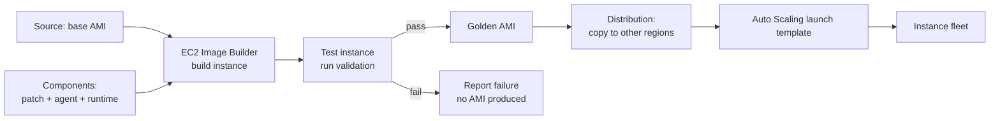
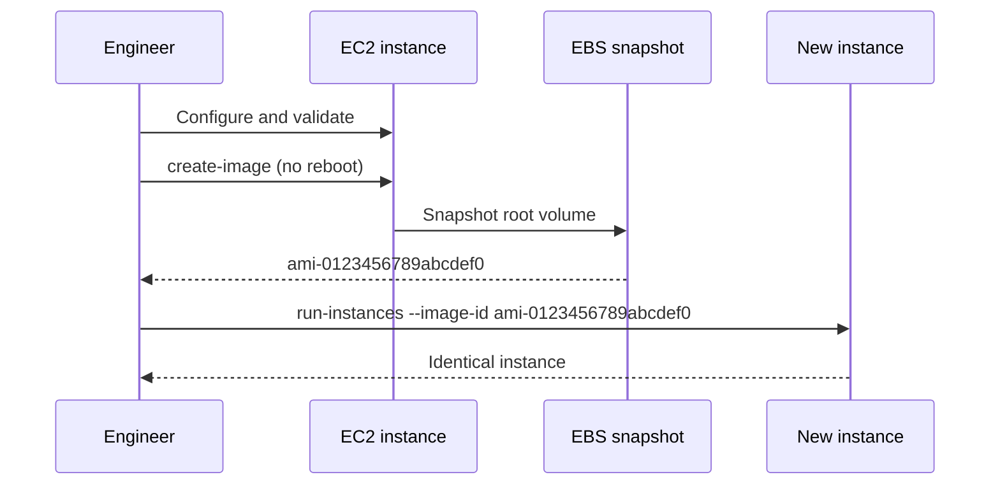

# 06 · Amazon Machine Images

> **Phase 1 — Core Foundations** · Lesson 06 of 18
> ⬅️ Previous: [EC2 Basics](./05-ec2-basics.md) · ➡️ Next: [Auto Scaling](./07-auto-scaling.md) · 🏠 [Phase overview](./README.md)

## Learning Objectives

By the end of this lesson you will be able to:

- Explain what an AMI actually contains and why it is region-scoped
- Create a golden image from a running instance and launch identical copies from it
- Decide between baking configuration into an image and configuring at boot
- Share an AMI across accounts and regions safely

**Estimated time:** 50 min · **Difficulty:** Intermediate

---

## Core Concepts

An **AMI** is the template an EC2 instance boots from. Internally it is three things: one or more **EBS snapshots** of the root volume (and any additional volumes you included), a set of **block device mappings** describing which snapshot becomes which device, and **launch permissions** describing who may use it.

The most important property of an AMI is that it is **regional**. An AMI ID is only valid in the region where it was created. Moving one to another region means copying it, which produces a different ID. This single fact breaks more deployment scripts than any other aspect of EC2 — a CloudFormation template with a hardcoded `ami-0123456789abcdef0` works in `eu-west-1` and fails everywhere else.

The second important decision is **bake versus boot**. You can build a fully configured image ahead of time (baking, "immutable infrastructure"), or start from a bare OS and configure it at launch (bootstrapping, via user data or a configuration management tool). Baking produces fast, deterministic launches and is the right answer for autoscaling groups. Bootstrapping keeps images generic and is better when configuration changes frequently or needs to vary per environment.

A pragmatic hybrid: bake the slow, rarely-changing layers (OS patches, language runtimes, agents), and bootstrap the fast, environment-specific values (config files, secrets references).

### Key terminology

| Term | Meaning |
|------|---------|
| **Golden image** | A hardened, patched, fully-prepared AMI used as an organizational standard. |
| **Baking** | Building an AMI from a template or instance, usually in a pipeline. |
| **Base AMI** | An AWS-provided image such as Amazon Linux, RHEL, or Ubuntu. |
| **Block device mapping** | The mapping from an AMI snapshot to a device name on the instance. |
| **AMI deprecation** | Marking an AMI unusable for new launches while keeping existing ones running. |
| **EC2 Image Builder** | The managed service for building and testing AMIs on a schedule. |

---

## Architecture Diagram

The baking pipeline — this is what "no manual steps" looks like:



How an instance becomes a reusable image:



---

## Hands-on Lab: Create and Use a Golden AMI

**Goal:** Install a web server and a monitoring agent on an instance, bake it into an AMI, and launch an identical copy that serves content immediately with no user data.

**Prerequisites:** The instance from Lesson 05, still running.

### Step 1 — Prepare the instance

```bash
# Connect and install everything the image should contain
ssh -i phase1-lab.pem ec2-user@<public-dns-name>

sudo dnf install -y httpd amazon-cloudwatch-agent
sudo systemctl enable httpd
```

### Step 2 — Clean up machine-specific state

This step is what separates a working golden image from one that duplicates identities and breaks on launch.

```bash
# Remove SSH host keys so every instance generates its own
sudo rm -f /etc/ssh/ssh_host_*

# Clear cloud-init state so it re-runs on the next boot
sudo cloud-init clean --logs

# Clear shell history and logs
sudo rm -rf /var/log/*.log
sudo tee /root/.bash_history </dev/null
history -c
```

### Step 3 — Bake the image

```bash
# --no-reboot avoids a restart but risks capturing a dirty filesystem; prefer --reboot for consistency
aws ec2 create-image \
  --instance-id i-0123456789abcdef0 \
  --name "phase1-golden-$(date +%Y%m%d-%H%M)" \
  --description "AL2023 with httpd and CloudWatch agent" \
  --no-reboot \
  --tag-specifications 'ResourceType=image,Tags=[{Key=Name,Value=phase1-golden},{Key=Version,Value=1}]'

# Watch until State is available
aws ec2 describe-images --owners self \
  --filters "Name=name,Values=phase1-golden-*" \
  --query 'Images[].[ImageId,Name,State]' --output table
```

### Step 4 — Launch from the golden AMI with no user data

```bash
aws ec2 run-instances \
  --image-id ami-0fedcba9876543210 \
  --instance-type t3.micro \
  --security-group-ids sg-0123456789abcdef0 \
  --subnet-id subnet-0123456789abcdef0 \
  --tag-specifications 'ResourceType=instance,Tags=[{Key=Name,Value=from-golden-ami}]'
```

### Step 5 — Verify

```bash
# httpd should already be installed and enabled — no user data was supplied
aws ssm send-command \
  --document-name "AWS-RunShellScript" \
  --targets "Key=tag:Name,Values=from-golden-ami" \
  --parameters commands=["systemctl is-active httpd","rpm -q httpd"]
```

If `httpd` is not active, the image was created before `systemctl enable` completed — always verify inside the source instance before baking.

### Step 6 — Share the AMI with another account

```bash
# Grant launch permission to a specific account (never make a golden image public)
aws ec2 modify-image-attribute \
  --image-id ami-0fedcba9876543210 \
  --launch-permission "Add=[{UserId=111122223333}]"

# Share the backing snapshots too, or the other account cannot launch
aws ec2 describe-images --image-ids ami-0fedcba9876543210 \
  --query 'Images[0].BlockDeviceMappings[].Ebs.SnapshotId' --output text | \
  xargs -n1 -I{} aws ec2 modify-snapshot-attribute \
    --snapshot-id {} --attribute createVolumePermission \
    --operation-type add --user-ids 111122223333
```

Forgetting the snapshot permission is the classic cross-account AMI failure: the image appears in the other account's console but every launch fails.

### Step 7 — Copy to another region

```bash
# Produces a new AMI ID in the destination region
aws ec2 copy-image \
  --source-region eu-west-1 \
  --source-image-id ami-0fedcba9876543210 \
  --name "phase1-golden-eu-central-1" \
  --region eu-central-1
```

---

## CLI Reference

```bash
# List your own AMIs with creation date
aws ec2 describe-images --owners self \
  --query 'sort_by(Images,&CreationDate)[].[ImageId,Name,CreationDate]' --output table

# Deprecate an old AMI so it can no longer be launched
aws ec2 enable-image-deprecation --image-id ami-0fedcba9876543210 --deprecate-at 2026-12-31T00:00:00Z

# Deregister (the AMI entry) and delete the snapshots separately
aws ec2 deregister-image --image-id ami-0fedcba9876543210
aws ec2 delete-snapshot --snapshot-id snap-0123456789abcdef0

# Find the newest Amazon Linux 2023 AMI via the public SSM parameter
aws ssm get-parameter \
  --name /aws/service/ami-amazon-linux-latest/al2023-ami-kernel-default-x86_64 \
  --query 'Parameter.Value' --output text
```

| Command | Purpose |
|---------|---------|
| `create-image` | Bake a running or stopped instance into an AMI |
| `copy-image` | Move an AMI to another region (creates a new ID) |
| `modify-image-attribute` | Manage cross-account launch permissions |
| `enable-image-deprecation` | Retire an image without breaking running instances |

The SSM parameter lookup deserves special attention — it is the correct way to avoid hardcoded AMI IDs in templates, because it always resolves to the newest patched image in whichever region you are deploying to.

---

## Best Practices

| Practice | Why it matters |
|----------|----------------|
| Bake immutable images, bootstrap only environment specifics | Deterministic, fast, and reproducible launches |
| Never hardcode AMI IDs | Use the SSM public parameter instead |
| Clean machine-specific state before baking | Prevents duplicate SSH host keys and stale cloud-init |
| Version and tag every image | `Version=7` plus a date makes rollback trivial |
| Deprecate rather than delete | Deleting an AMI breaks autoscaling groups that reference it |
| Automate with EC2 Image Builder | Manual baking drifts and is never repeatable |
| Keep golden images private | A public AMI can leak internal configuration and secrets |

---

## Common Pitfalls

| Pitfall | Symptom | Fix |
|---------|---------|-----|
| Using an AMI ID in the wrong region | `InvalidAMIID.NotFound` | Copy the image, or resolve the ID per region at deploy time |
| Forgetting snapshot permissions on cross-account share | Image visible, launch fails | Also share the backing EBS snapshots |
| Baking before services are enabled | Golden image boots without the app running | Verify inside the source instance first |
| Leaving SSH host keys in the image | SSH warns of a changed host key for every instance | Remove `/etc/ssh/ssh_host_*` before baking |
| Deleting an AMI used by a launch template | Autoscaling cannot launch new instances | Deprecate; check references before deleting |
| Secrets baked into images | Credentials leak to everyone with launch access | Reference Secrets Manager at runtime |

---

## Cost Considerations

An AMI itself is free, but **the EBS snapshots behind it are not**. Snapshot storage is billed per GB-month based on the data actually stored, and because EBS snapshots are incremental, a chain of daily golden images costs far less than the sum of their full sizes — only changed blocks are charged after the first snapshot.

The real cost risk is **unbounded image accumulation**. A pipeline baking a daily image for three years leaves over a thousand AMIs and their snapshot chains. A retention policy that deregisters images older than 90 days and deletes their exclusive snapshots is standard hygiene.

Also remember that copying an AMI to another region duplicates its snapshot storage in that region, so multi-region golden images multiply the storage line item. Only copy to regions you actually deploy in.

Practical figures: a 10 GB root volume snapshot chain for 30 daily images typically stays under a few dollars per month, because each incremental snapshot only stores changed blocks. A thousand images, however, is a different story.

---

## Security Considerations

- **Patch cadence is the whole point.** The value of a golden image is that it is *known* patched. An unmaintained image is just an old OS with a friendly name. Rebuild on a schedule — monthly at minimum — and treat the rebuild as the patch mechanism.
- **Never bake secrets.** Anything in the image is readable by anyone who can launch it. Fetch secrets at boot from Secrets Manager or Parameter Store using the instance role.
- **Keep images private.** Marking an AMI public exposes your installed software, configuration files, and any inadvertently included data. Audit with `describe-images --owners self` and check `Public`.
- **Share with account IDs, not "all".** Use `launch-permission Add=[{UserId=...}]` and never `Group=all`.
- **Scan before you promote.** Run a vulnerability scan (Amazon Inspector, Trivy, or a CIS benchmark) as a gate in the image pipeline. An image that fails the scan should never become the golden image.
- **Sign and verify.** For high-assurance environments, consider cryptographically signing images and enforcing signature verification at launch.

---

## Exercise

Build an automated image pipeline description for a two-tier application:

1. A base image with OS patches and the CloudWatch agent
2. A web-tier image that adds Nginx and a placeholder site
3. A test step that launches the image, curls the site, and fails the build if it does not get a 200

Success looks like: you can explain exactly which state is baked into each image, which state comes from user data at launch, and where a secret would be injected — and the answer to "where are the secrets" must not be "in the image".

---

## Resources

- [Amazon Machine Images (AMI)](https://docs.aws.amazon.com/AWSEC2/latest/UserGuide/AMIs.html)
- [Create an AMI from an Instance](https://docs.aws.amazon.com/AWSEC2/latest/UserGuide/creating-an-ami-ebs.html)
- [EC2 Image Builder](https://docs.aws.amazon.com/imagebuilder/latest/userguide/what-is-image-builder.html)
- [AMIs and Regions](https://docs.aws.amazon.com/AWSEC2/latest/UserGuide/using-regions-availability-zones.html)
- [Amazon Inspector](https://docs.aws.amazon.com/inspector/latest/user/what-is-inspector.html)

---

## Next Steps

Golden images make instance launches fast and identical — which is the prerequisite for the next lesson. Auto Scaling groups are only reliable when every instance they launch is truly interchangeable.

> ⬅️ Previous: [EC2 Basics](./05-ec2-basics.md) · ➡️ Next: [Auto Scaling](./07-auto-scaling.md) · 🏠 [Phase overview](./README.md)
