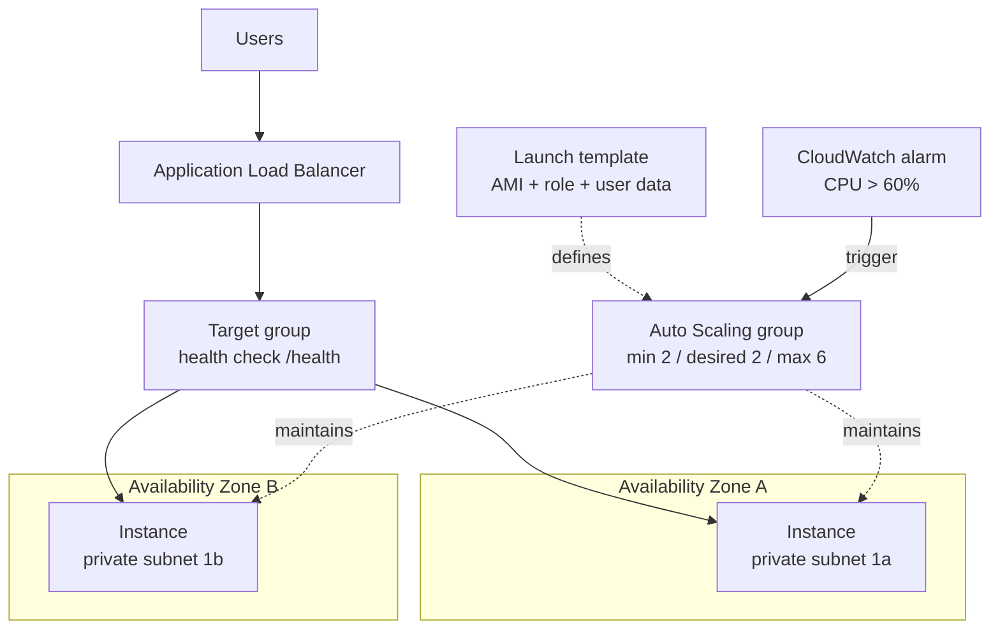
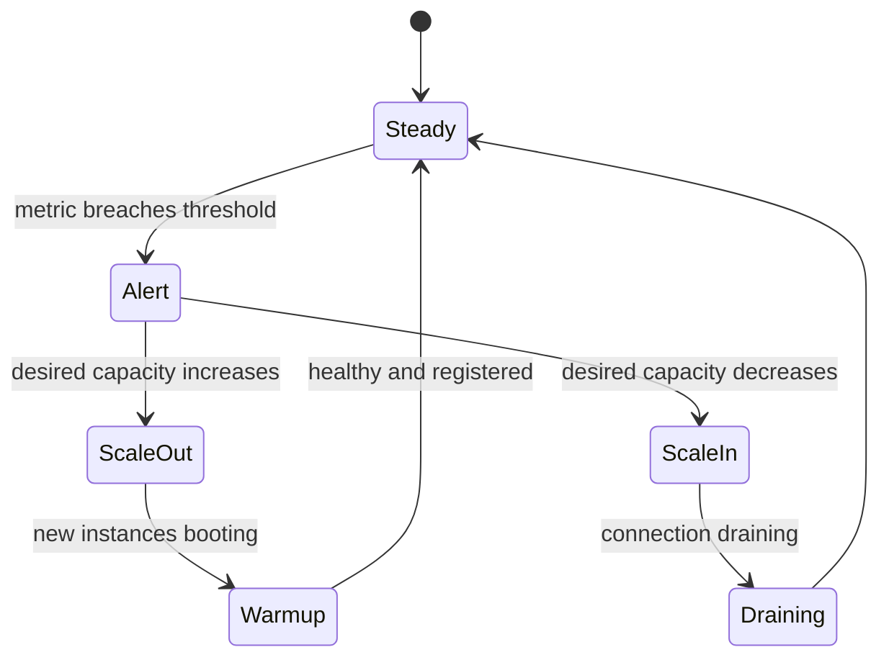

# 07 · Auto Scaling

> **Phase 1 — Core Foundations** · Lesson 07 of 18
> ⬅️ Previous: [Amazon Machine Images](./06-amis.md) · ➡️ Next: [S3 Fundamentals](./08-s3-fundamentals.md) · 🏠 [Phase overview](./README.md)

## 🎯 Learning Objectives

By the end of this lesson you will be able to:

- Build a launch template and an Auto Scaling group that spans multiple Availability Zones
- Choose between target tracking, step scaling, and scheduled scaling for a given workload
- Configure health checks that replace unhealthy instances automatically
- Explain the difference between scaling policies and instance refresh, and when to use each

**Estimated time:** 60 min · **Difficulty:** Intermediate

---

## 🧠 Core Concepts

An **Auto Scaling group (ASG)** maintains a desired number of healthy instances matching a **launch template**. It does three distinct jobs, and conflating them causes most ASG problems:

1. **Maintaining capacity** — if an instance fails a health check, the ASG terminates it and launches a replacement. This is the self-healing behaviour, and it works even with a single scaling policy disabled.
2. **Scaling in and out** — adding or removing instances in response to demand, driven by scaling policies.
3. **Spreading across AZs** — balancing instances across the subnets you configure, which gives you Availability Zone fault tolerance for free.

**Scaling policies** come in four flavours:

- **Target tracking** — "keep average CPU at 50%". The ASG does the math. This should be your default; it is the simplest to reason about and self-adjusts.
- **Step scaling** — "if CPU is 60–70%, add one; if it is 70–85%, add three". More control, more tuning.
- **Scheduled scaling** — "be at 10 instances on Monday at 08:00". Essential for predictable traffic such as business hours or batch windows.
- **Predictive scaling** — uses machine learning on historical patterns to scale ahead of the load. Useful for cyclical traffic without a clean schedule.

A critical concept is the **cooldown** (or warmup) period. A newly launched instance needs time to boot and warm up before it can serve useful traffic. If the ASG scales out again before the new instance registers, it will overshoot. The default cooldown plus a launch template with a baked AMI is what makes scaling fast and accurate.

Finally, **instance refresh** is how you roll out a new AMI. Instead of manually terminating instances, you trigger a refresh and the ASG replaces them in batches, honouring a minimum healthy percentage so you never lose capacity mid-rollout.

### Key terminology

| Term | Meaning |
|------|---------|
| **Launch template** | The versioned definition of how to launch each instance. |
| **Desired capacity** | How many instances the ASG tries to maintain right now. |
| **Min / max size** | The hard bounds the ASG will never scale beyond. |
| **Health check grace period** | Time to wait before judging a new instance unhealthy. |
| **Cooldown / warmup** | Time to wait before reacting to metrics from new instances. |
| **Instance refresh** | A rolling replacement of all instances with a new template version. |
| **Warm pool** | Pre-initialized instances kept ready to speed up scale-out. |

---

## 🗺️ Architecture Diagram

An Auto Scaling group spanning two AZs behind a load balancer:



The scaling decision loop:



---

## 🧪 Hands-on Lab: A Self-Healing, Auto-Scaling Web Tier

**Goal:** Build an ASG behind an Application Load Balancer that maintains two healthy instances, replaces a terminated one automatically, and scales out under CPU load.

**Prerequisites:** A VPC with two public subnets in different AZs, the golden AMI from Lesson 06, and a security group allowing HTTP.

### Step 1 — Create a launch template

```bash
aws ec2 create-launch-template \
  --launch-template-name phase1-web-lt \
  --version-description "v1 golden AMI" \
  --launch-template-data '{
    "ImageId": "ami-0fedcba9876543210",
    "InstanceType": "t3.micro",
    "SecurityGroupIds": ["sg-0123456789abcdef0"],
    "IamInstanceProfile": {"Name": "EC2S3ReadOnlyRole"},
    "MetadataOptions": {"HttpTokens": "required", "HttpEndpoint": "enabled"},
    "UserData": "'"$(base64 -w0 <<'EOF'
#!/bin/bash
set -euo pipefail
TOKEN=$(curl -sX PUT http://169.254.169.254/latest/api/token -H "X-aws-ec2-metadata-token-ttl-seconds: 300")
AZ=$(curl -s -H "X-aws-ec2-metadata-token: $TOKEN" http://169.254.169.254/latest/meta-data/placement/availability-zone)
echo "ok" > /var/www/html/health
echo "zone $AZ" > /var/www/html/index.html
systemctl restart httpd
EOF
)'"",
    "TagSpecifications": [{"ResourceType": "instance", "Tags": [{"Key": "Name", "Value": "phase1-web"}]}]
  }'
```

The `base64 -w0` wrapping is required because launch template user data must be base64-encoded. Omitting it produces an instance that boots but runs nothing.

### Step 2 — Create the target group and load balancer

```bash
# Target group with a health check path the app actually serves
aws elbv2 create-target-group \
  --name phase1-web-tg \
  --protocol HTTP --port 80 \
  --vpc-id vpc-0123456789abcdef0 \
  --health-check-path /health \
  --health-check-interval-seconds 15 \
  --healthy-threshold-count 2 \
  --unhealthy-threshold-count 2

# Internet-facing ALB in two public subnets
aws elbv2 create-load-balancer \
  --name phase1-web-alb \
  --subnets subnet-0aaaa111 subnet-0bbbb222 \
  --security-groups sg-0123456789abcdef0

aws elbv2 create-listener \
  --load-balancer-arn arn:aws:elasticloadbalancing:eu-west-1:123456789012:loadbalancer/app/phase1-web-alb/50dc6c495c0c9188 \
  --protocol HTTP --port 80 \
  --default-actions Type=forward,TargetGroupArn=arn:aws:elasticloadbalancing:eu-west-1:123456789012:targetgroup/phase1-web-tg/73e2d6bc24d8a067
```

### Step 3 — Create the Auto Scaling group

```bash
aws autoscaling create-auto-scaling-group \
  --auto-scaling-group-name phase1-web-asg \
  --launch-template LaunchTemplateName=phase1-web-lt,Version='$Latest' \
  --target-group-arns arn:aws:elasticloadbalancing:eu-west-1:123456789012:targetgroup/phase1-web-tg/73e2d6bc24d8a067 \
  --vpc-zone-identifier "subnet-0aaaa111,subnet-0bbbb222" \
  --min-size 2 --max-size 6 --desired-capacity 2 \
  --health-check-type ELB --health-check-grace-period 120 \
  --default-instance-warmup 120 \
  --tags Key=Environment,Value=lab,PropagateAtLaunch=true
```

Note `--health-check-type ELB`: with `EC2` the ASG only checks that the VM is running; with `ELB` it checks that the load balancer considers the instance healthy, which is what actually catches a hung web server. Also note that we use `--vpc-zone-identifier` with subnets rather than Availability Zones — this is required for launch templates.

### Step 4 — Add target tracking

```bash
aws autoscaling put-scaling-policy \
  --auto-scaling-group-name phase1-web-asg \
  --policy-name cpu-target-50 \
  --policy-type TargetTrackingScaling \
  --target-tracking-configuration '{
    "TargetValue": 50.0,
    "PredefinedMetricSpecification": {"PredefinedMetricType": "ASGAverageCPUUtilization"},
    "ScaleInCooldown": 300,
    "ScaleOutCooldown": 60
  }'
```

### Step 5 — Verify self-healing

```bash
# Terminate one instance and watch a replacement appear
aws autoscaling describe-auto-scaling-groups --auto-scaling-group-names phase1-web-asg \
  --query 'AutoScalingGroups[0].Instances[].[InstanceId,LifecycleState,HealthStatus]' --output table

aws ec2 terminate-instances --instance-ids <one-instance-id>

# Within a couple of minutes the group should be back at 2 healthy instances
watch -n 15 "aws autoscaling describe-auto-scaling-groups --auto-scaling-group-names phase1-web-asg \
  --query 'AutoScalingGroups[0].Instances[].[InstanceId,HealthStatus]' --output table"
```

### Step 6 — Verify scaling out

```bash
# Drive CPU up from an instance and watch capacity increase
ssh -i phase1-lab.pem ec2-user@<instance-ip> 'yes > /dev/null & yes > /dev/null &'

# Observe the activity log
aws autoscaling describe-scaling-activities --auto-scaling-group-name phase1-web-asg \
  --max-items 10 --query 'Activities[].[StartTime,StatusCode,Description]' --output table
```

---

## 💻 CLI Reference

```bash
# Change capacity manually
aws autoscaling set-desired-capacity --auto-scaling-group-name phase1-web-asg --desired-capacity 4

# Roll out a new launch template version safely
aws autoscaling start-instance-refresh \
  --auto-scaling-group-name phase1-web-asg \
  --preferences '{"MinHealthyPercentage":75,"InstanceWarmup":120}'

# Watch the refresh progress
aws autoscaling describe-instance-refreshes --auto-scaling-group-name phase1-web-asg \
  --query 'InstanceRefreshes[0].[Status,PercentageComplete,InstancesToUpdate]'

# Pause all scaling (useful during an incident or a migration)
aws autoscaling suspend-processes --auto-scaling-group-name phase1-web-asg

# Resume normal behaviour
aws autoscaling resume-processes --auto-scaling-group-name phase1-web-asg

# List scaling policies and their alarms
aws autoscaling describe-policies --auto-scaling-group-name phase1-web-asg
```

| Command | Purpose |
|---------|---------|
| `start-instance-refresh` | Rolling deployment of a new AMI without downtime |
| `suspend-processes` | Freeze scaling during maintenance or incident response |
| `describe-scaling-activities` | The audit log of every scaling decision and why it happened |
| `set-desired-capacity` | Manual override when automation must be bypassed |

---

## ✅ Best Practices

| Practice | Why it matters |
|----------|----------------|
| Always span at least two AZs | A single-AZ ASG has no fault tolerance despite looking redundant |
| Use target tracking as the default policy | Fewer knobs, self-adjusting, fewer 3am surprises |
| Set a realistic warmup and grace period | Prevents scale-out overshoot and premature instance termination |
| Keep min size at or above your baseline | Scaling from zero means cold starts on every quiet period |
| Health check type `ELB`, not `EC2` | Catches application-level failure, not just VM failure |
| Bake the AMI, keep user data minimal | Fast scale-out is the whole benefit of autoscaling |
| Enable instance scale-in protection for stateful work | Prevents termination of a node mid-job |
| Use `$Latest` or a pinned version deliberately | `$Latest` auto-adopts changes; pinning is safer for production |

A useful rule of thumb for choosing min and max: set **min** to what you need at your quietest realistic moment, and **max** to a level you can afford to run if the alarm is stuck on. An ASG that can scale to 500 instances is a bill waiting to happen if a metric misbehaves.

---

## ⚠️ Common Pitfalls

| Pitfall | Symptom | Fix |
|---------|---------|-----|
| Unhealthy instance loop | Instances launch and terminate repeatedly | Check the health check path returns 200 and the grace period is long enough |
| Scaling out but never in | Capacity ratchets up and stays high | Verify scale-in cooldown and that the alarm has an `OK` action |
| Metric follows the fleet average | Add instances, average CPU stays flat, keeps scaling | Use a scale-in-safe metric or target value lower than the real threshold |
| Forgetting `--vpc-zone-identifier` with launch templates | ASG creation fails validation | Specify subnets, not AZs, when using a launch template |
| No warmup after scale-out | Over-provisioning as new instances are counted while still booting | Set `DefaultInstanceWarmup` |
| AMI deleted while in use | Launch failures on every scale-out | Deprecate, never delete, and check launch template references |
| Terminating instances manually | ASG immediately replaces them, costs surprise you | Suspend processes or scale the group down instead |

---

## 💰 Cost Considerations

Auto Scaling is **free** — you pay only for the instances it runs and the load balancer in front of them. The economics of autoscaling are about matching spend to demand.

Consider a web tier that needs 10 `m7i.large` instances from 09:00 to 18:00 and 2 overnight. Running 10 instances around the clock costs roughly five times as much as matching demand. A combination of scheduled scaling (to move the baseline up and down) and target tracking (to handle variance within the day) typically removes 50–70% of compute cost for a diurnal workload.

Three deeper levers:

- **Spot instances in the ASG** — configure a mixed instances policy with On-Demand and Spot. Spot saves up to 90% but instances can be reclaimed; mixing 70% Spot with 30% On-Demand gives most of the saving with resilience. Use capacity rebalancing so the ASG replaces Spot instances *before* they are interrupted.
- **Graviton instance types** — mixing `m7g` alongside `m7i` in a mixed instances policy lets the ASG pick whichever is cheapest, and Graviton is roughly 20% better price-performance.
- **Aggressive scale-in** — many organizations scale out fast and in slowly. If your workload tolerates it, a shorter scale-in cooldown (120–180s) and a target value closer to the real threshold recovers cost meaningfully.

One warning: a badly configured scale-out policy on a metrics-driven loop can create a "scaling spiral" that is expensive to discover. Always set a hard `max-size` you are willing to pay for, and put a budget alarm on the account.

---

## 🔐 Security Considerations

- **Scaling must not change your security posture.** Because every instance comes from the same launch template, a security misconfiguration in the template is replicated across the fleet. Review the template as security-critical code.
- **Never put secrets in user data.** User data is visible via the instance metadata service and in the EC2 console. Fetch secrets at runtime using the instance role.
- **Keep the IAM role least-privilege and shared.** All instances share one instance profile, so the role's permissions are the blast radius for a single compromised instance. Scope it tightly.
- **Enforce IMDSv2 in the launch template.** This is the single highest-value setting in the template — set `HttpTokens: required`.
- **Protect the ALB with TLS and a WAF.** Terminating TLS at the ALB keeps certificates off the instances; AWS WAF in front of the ALB blocks common exploit traffic before it reaches your fleet.
- **Restrict who can modify the ASG.** Someone who can raise `max-size` or change the launch template can run arbitrary code across your fleet. Treat ASG modification permissions as privileged.
- **Use instance scale-in protection for sensitive nodes.** Prevents an instance performing a critical task from being reclaimed specifically by scale-in.

---

## 🧩 Exercise

Take the ASG from the lab and add two behaviours:

1. **Scheduled scaling** — the group should have a minimum of 4 instances between 08:00 and 20:00 on weekdays, and 1 outside those hours.
2. **Instance refresh** — publish launch template version 2 that changes the welcome page, then roll it out with a minimum healthy percentage of 75% and confirm there is no 5xx error observed at the load balancer during the rollout.

Success looks like: `describe-scaling-activities` shows the scheduled action firing, and the ALB's `HTTPCode_ELB_5XX_Count` metric stays at zero throughout the refresh.

---

## 📚 Resources

- [Amazon EC2 Auto Scaling User Guide](https://docs.aws.amazon.com/autoscaling/ec2/userguide/what-is-amazon-ec2-auto-scaling.html)
- [Target Tracking Scaling Policies](https://docs.aws.amazon.com/autoscaling/ec2/userguide/as-scaling-target-tracking.html)
- [Auto Scaling Warm Pools](https://docs.aws.amazon.com/autoscaling/ec2/userguide/ec2-auto-scaling-warm-pools.html)
- [Instance Refresh](https://docs.aws.amazon.com/autoscaling/ec2/userguide/asg-instance-refresh.html)
- [Elastic Load Balancing User Guide](https://docs.aws.amazon.com/elasticloadbalancing/latest/application/introduction.html)

---

## ➡️ Next Steps

You now have elastic compute. The next three lessons cover where the state lives — starting with the service that holds more data than any other in AWS, and the one most likely to appear on an exam or in an incident.

> ⬅️ Previous: [Amazon Machine Images](./06-amis.md) · ➡️ Next: [S3 Fundamentals](./08-s3-fundamentals.md) · 🏠 [Phase overview](./README.md)
