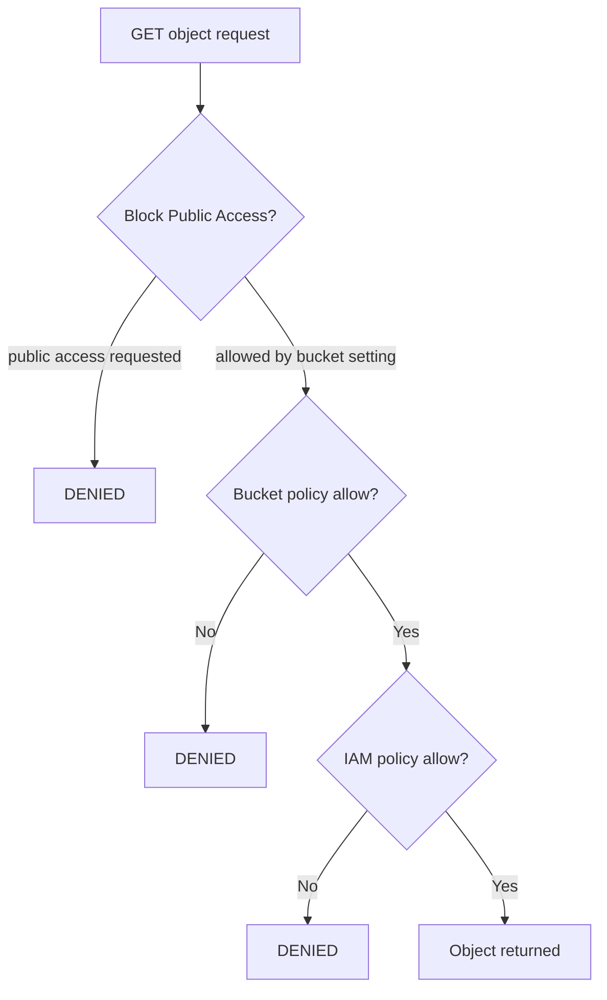
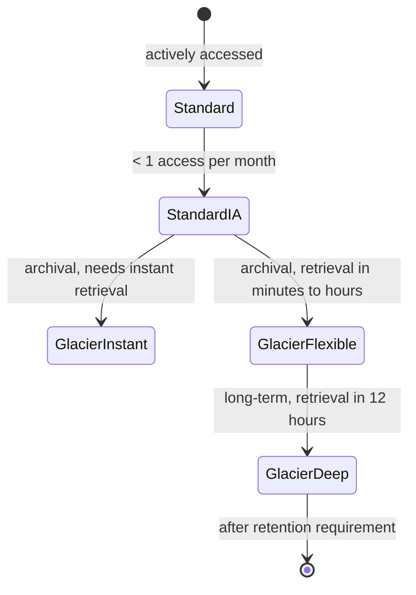

# 08 · S3 Fundamentals

> **Phase 1 — Core Foundations** · Lesson 08 of 18
> ⬅️ Previous: [Auto Scaling](./07-auto-scaling.md) · ➡️ Next: [Amazon EBS](./09-ebs.md) · 🏠 [Phase overview](./README.md)

## 🎯 Learning Objectives

By the end of this lesson you will be able to:

- Explain the S3 data model and why buckets are globally named but regionally stored
- Enable versioning, encryption, and Block Public Access correctly on a new bucket
- Choose the right storage class for a given access pattern
- Understand S3 consistency, durability, and the limits you will actually hit

**Estimated time:** 55 min · **Difficulty:** Beginner

---

## 🧠 Core Concepts

**Amazon S3** is object storage. You put **objects** (the data plus metadata) into **buckets** (a flat namespace of keys). There is no real directory structure — the console shows folders, but the underlying model is a flat key space where a key like `logs/2026/10/14/app.log` is a single string, not three nested containers. This matters because the leading portion of a key determines how S3 partitions the data, which is the key to performance.

S3's guarantees are the reason it is the default answer for durable storage. It is designed for **11 nines of durability** (99.999999999%) and 99.99% availability for the Standard class. Objects are stored redundantly across multiple devices and, for most classes, across multiple Availability Zones within a region. No other storage primitive in AWS gives you that for the price.

A property that surprises newcomers: **S3 is strongly read-after-write consistent** for all operations now, including overwrites and deletes. The old advice about eventual consistency for overwrites is obsolete. What you *do* still need to think about is caching — CloudFront distributions and browser caches will happily serve stale data long after S3 has the new object.

Every bucket should have the following enabled from creation, and there is no good reason to delay: **Block Public Access**, **default encryption**, and **versioning** for anything you could regret deleting.

### Key terminology

| Term | Meaning |
|------|---------|
| **Bucket** | A globally unique container for objects, created in a specific region. |
| **Key** | The full object name, e.g. `reports/2026/q3.pdf`. |
| **Prefix** | The leading part of a key, used for organizing and for partition scaling. |
| **Versioning** | Keeps every version of an object, so deletes become delete markers. |
| **Storage class** | The durability/availability/access-cost trade-off, e.g. Standard, IA, Glacier. |
| **Lifecycle rule** | Automated transition or expiration based on age and prefix. |
| **Replication** | Cross-region or same-region automatic copying of objects. |
| **Presigned URL** | A time-limited URL granting temporary access to one object. |

---

## 🗺️ Architecture Diagram

The object model and how access is decided:



Storage class decision flow:



A useful way to remember the trade-off: as you move down that chain, **storage cost falls and retrieval cost and latency rise**. Intelligent-Tiering automates the first two steps based on observed access.

---

## 🧪 Hands-on Lab: Create a Hardened Versioned Bucket

**Goal:** Create a bucket that cannot be made public, encrypts by default, keeps every version, and serves a private file via a time-limited presigned URL.

**Prerequisites:** AWS CLI configured, permissions to create buckets and IAM policies.

### Step 1 — Create the bucket

```bash
# Bucket names are globally unique across all AWS accounts — expect to retry
BUCKET="phase1-lab-$(aws sts get-caller-identity --query Account --output text)-$(date +%s)"

aws s3api create-bucket \
  --bucket "$BUCKET" \
  --region eu-west-1 \
  --create-bucket-configuration LocationConstraint=eu-west-1
```

Note the `LocationConstraint`: if you omit it for any region other than `us-east-1`, the bucket is silently created in `us-east-1`.

### Step 2 — Lock it down at creation time

```bash
# Block every path to public access, including future ACLs and policies
aws s3api put-public-access-block \
  --bucket "$BUCKET" \
  --public-access-block-configuration \
    "BlockPublicAcls=true,IgnorePublicAcls=true,BlockPublicPolicy=true,RestrictPublicBuckets=true"

# Enable versioning BEFORE writing anything you might need to recover
aws s3api put-bucket-versioning \
  --bucket "$BUCKET" \
  --versioning-configuration Status=Enabled

# Encrypt by default with SSE-KMS (SSE-S3 is the cheaper alternative)
aws s3api put-bucket-encryption \
  --bucket "$BUCKET" \
  --server-side-encryption-configuration '{
    "Rules": [{
      "ApplyServerSideEncryptionByDefault": {"SSEAlgorithm": "aws:kms"},
      "BucketKeyEnabled": true
    }]
  }'

# Require TLS for every request — this is a deny, so it cannot be bypassed
aws s3api put-bucket-policy --bucket "$BUCKET" --policy "{
  \"Version\": \"2012-10-17\",
  \"Statement\": [{
    \"Sid\": \"DenyInsecureTransport\",
    \"Effect\": \"Deny\",
    \"Principal\": \"*\",
    \"Action\": \"s3:*\",
    \"Resource\": [\"arn:aws:s3:::$BUCKET\", \"arn:aws:s3:::$BUCKET/*\"],
    \"Condition\": {\"Bool\": {\"aws:SecureTransport\": \"false\"}}
  }]
}"
```

### Step 3 — Upload and verify versioning

```bash
echo "v1 content" > report.txt
aws s3 cp report.txt "s3://$BUCKET/reports/report.txt"

echo "v2 content" > report.txt
aws s3 cp report.txt "s3://$BUCKET/reports/report.txt"

# Both versions exist; the newest is current
aws s3api list-object-versions --bucket "$BUCKET" \
  --query 'Versions[].[VersionId,IsLatest,Size]' --output table
```

### Step 4 — Prove that versioning protects you

```bash
# Deleting without a version id only adds a delete marker
aws s3 rm "s3://$BUCKET/reports/report.txt"
aws s3 ls "s3://$BUCKET/reports/"     # appears empty

# Remove the delete marker to restore the object
MARKER=$(aws s3api list-object-versions --bucket "$BUCKET" \
  --prefix reports/report.txt --query 'DeleteMarkers[0].VersionId' --output text)
aws s3api delete-object --bucket "$BUCKET" --key reports/report.txt --version-id "$MARKER"
aws s3 ls "s3://$BUCKET/reports/"     # object is back
```

### Step 5 — Share one object without making the bucket public

```bash
# Generate a URL valid for 15 minutes
aws s3 presign "s3://$BUCKET/reports/report.txt" --expires-in 900
```

That URL works for anyone, for 15 minutes, without any credentials — and the bucket remains completely private.

---

## 💻 CLI Reference

```bash
# List buckets (this is an account-level operation, not per-region)
aws s3 ls

# Recursively sync a directory, deleting files removed locally
aws s3 sync ./site "s3://$BUCKET/site/" --delete

# Copy only files newer than the destination copy
aws s3 sync ./data "s3://$BUCKET/data/" --size-only

# Multipart upload settings for very large objects (parallelism and part size)
aws configure set s3.max_concurrent_requests 20
aws configure set s3.multipart_chunksize 64MB

# Report the storage class breakdown of a bucket
aws s3api list-objects-v2 --bucket "$BUCKET" \
  --query 'Contents[].[StorageClass,Size]' --output table

# Find and delete incomplete multipart uploads (they are billed as storage!)
aws s3api list-multipart-uploads --bucket "$BUCKET"

# Grant a pre-signed PUT so a client can upload without credentials
aws s3 presign "s3://$BUCKET/incoming/file.zip" --expires-in 3600 --region eu-west-1
```

| Command | Purpose |
|---------|---------|
| `s3 sync` | Incremental directory mirroring — the workhorse for static sites and backups |
| `list-object-versions` | See every version and delete marker |
| `list-multipart-uploads` | Find orphaned upload parts that are silently billed |
| `presign` | Time-limited access without changing bucket permissions |

---

## ✅ Best Practices

| Practice | Why it matters |
|----------|----------------|
| Enable Block Public Access on every bucket | A single misconfigured bucket policy is a headline news story |
| Turn on versioning when the bucket is created | Enabling it later does not retroactively protect earlier objects |
| Enable default encryption and `BucketKeyEnabled` | Protects data at rest and reduces KMS request cost |
| Separate prefixes by workload and access pattern | Makes lifecycle rules and access analysis possible |
| Use random or high-cardinality key prefixes | Avoids hot partitions when request rates are very high |
| Add a bucket policy denying non-TLS access | Encryption in transit is not on by default |
| Never use the root account for bucket operations | Bucket policies on root are a governance smell |
| Tag buckets with owner, environment, and data classification | Enables cost attribution and automated policy enforcement |

---

## ⚠️ Common Pitfalls

| Pitfall | Symptom | Fix |
|---------|---------|-----|
| Missing `LocationConstraint` | Bucket created in `us-east-1` regardless of intent | Always pass `--create-bucket-configuration` outside `us-east-1` |
| Assuming `s3 rm` deletes the data | Storage bill does not drop after deletion | With versioning on, delete markers keep all versions; expire them with lifecycle |
| Public bucket by accident | Data readable by anyone with the URL | Block Public Access plus an explicit check before any policy change |
| One prefix for all traffic | Throttling (`503 SlowDown`) at very high request rates | Spread keys across prefixes; S3 scales per prefix |
| Forgetting multipart cleanup | Storage charges for parts you cannot see | Lifecycle rule `AbortIncompleteMultipartUpload` after 7 days |
| Presigned URL sharing | A `403` for the recipient | Ensure the signer's credentials are still valid and the URL has not expired |
| Using S3 for a filesystem | Applications break on rename and partial writes | Use EFS (Lesson 10) or mountpoint for S3 when you need POSIX semantics |

---

## 💰 Cost Considerations

S3 billing has four components, and the one people forget most often is the fourth:

1. **Storage** — per GB-month, varying by storage class. Standard is roughly $0.023/GB-month in `eu-west-1`; Glacier Deep Archive is under $0.002.
2. **Requests** — `PUT`, `COPY`, `POST`, and `LIST` are billed; `GET` on Standard is billed at a lower rate. `LIST` operations on a large bucket can add up.
3. **Data transfer out** — free to the internet up to 100 GB per month, then billed per GB. Free between S3 and CloudFront.
4. **Management features** — Intelligent-Tiering monitoring, replication, inventory, and KMS request charges.

The dominant saving is **storage class selection combined with lifecycle rules** (Lesson 11). A 100 TB archive moved from Standard to Glacier Deep Archive drops from roughly $2,300 per month to about $100 — a 95% reduction, in exchange for hours-long retrieval.

Second biggest: **versioning without expiry**. Versioned buckets grow forever if nothing expires old versions. Every lifecycle configuration on a versioned bucket should include `NoncurrentVersionExpiration`.

Third: **request patterns**. If something is listing a large bucket every few minutes, that is a steady request charge and a sign you should be using inventory reports instead.

---

## 🔐 Security Considerations

- **Four layers decide access:** Block Public Access, the bucket policy, the IAM identity policy, and any ACL. Explicit deny at any layer wins.
- **Object ownership must be `BucketOwnerEnforced`** on new buckets. This disables ACLs entirely and removes an entire class of accidental-access bug.
- **Deny unencrypted uploads** as well as unencrypted downloads, or someone can write plaintext into your "encrypted" bucket.
- **Use `aws:SecureTransport` and `aws:SourceVpce` conditions** to force traffic through TLS and optionally through a VPC endpoint, which also eliminates NAT gateway data-processing charges.
- **Enable access logging or CloudTrail data events** for buckets containing sensitive data. Note that data events are billed per event, so scope them to the buckets that matter.
- **Object Lock** in compliance mode gives WORM guarantees for regulatory retention — but it is irreversible, so test the retention period carefully.
- **Guard against `s3:PutBucketPolicy`** — whoever can change a bucket policy can make a bucket public. Restrict that permission and alert on it in CloudTrail.

An upload-encryption enforcement statement:

```json
{
  "Sid": "DenyUnencryptedUploads",
  "Effect": "Deny",
  "Principal": "*",
  "Action": "s3:PutObject",
  "Resource": "arn:aws:s3:::phase1-lab-123456789012-1700000000/*",
  "Condition": {
    "StringNotEquals": {
      "s3:x-amz-server-side-encryption": "aws:kms"
    }
  }
}
```

---

## 🧩 Exercise

Create a bucket that enforces all four of these properties, and prove each one with a command:

1. No object can be uploaded without server-side encryption
2. No request over plain HTTP is allowed
3. Deleting an object without a version ID does not lose data
4. A single object can be shared with an external party for 10 minutes

Success looks like: an unencrypted `put-object` returns `AccessDenied`, a plain `curl` over HTTP returns `403`, `list-object-versions` shows the object still present after an `s3 rm`, and the presigned URL downloads successfully before expiring.

---

## 📚 Resources

- [Amazon S3 User Guide](https://docs.aws.amazon.com/AmazonS3/latest/userguide/Welcome.html)
- [Storage Classes](https://docs.aws.amazon.com/AmazonS3/latest/userguide/storage-class-intro.html)
- [Bucket Policies and Policies vs ACLs](https://docs.aws.amazon.com/AmazonS3/latest/userguide/access-policy-language-overview.html)
- [Performance Design Patterns](https://docs.aws.amazon.com/AmazonS3/latest/userguide/optimizing-performance.html)
- [Security Best Practices for S3](https://docs.aws.amazon.com/AmazonS3/latest/userguide/security-best-practices.html)
- [Block Public Access](https://docs.aws.amazon.com/AmazonS3/latest/userguide/access-control-block-public-access.html)

---

## ➡️ Next Steps

S3 is object storage for data you address by key. The next two lessons cover block and file storage — the primitives you use when an operating system, not an application, needs to read and write.

> ⬅️ Previous: [Auto Scaling](./07-auto-scaling.md) · ➡️ Next: [Amazon EBS](./09-ebs.md) · 🏠 [Phase overview](./README.md)
