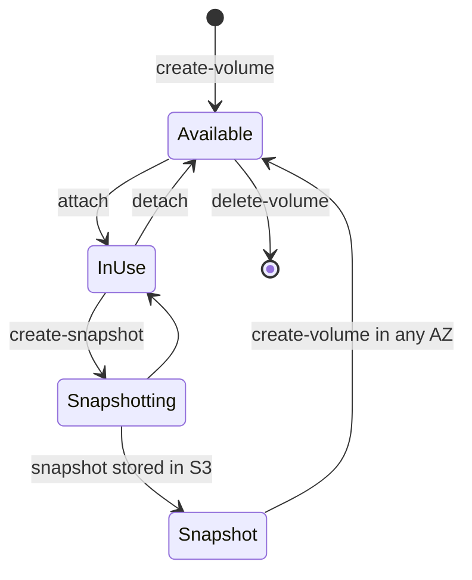
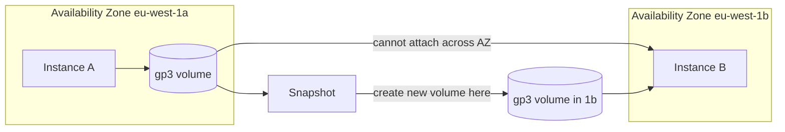

# 09 · Amazon EBS

> **Phase 1 — Core Foundations** · Lesson 09 of 18
> ⬅️ Previous: [S3 Fundamentals](./08-s3-fundamentals.md) · ➡️ Next: [Amazon EFS](./10-efs.md) · 🏠 [Phase overview](./README.md)

## 🎯 Learning Objectives

By the end of this lesson you will be able to:

- Choose the correct EBS volume type for a workload based on IOPS, throughput, and latency needs
- Attach, format, mount, and persist a data volume across reboots
- Take snapshots and restore a volume from one, including to a different AZ
- Explain EBS multi-attach and when it is a trap rather than a feature

**Estimated time:** 55 min · **Difficulty:** Beginner

---

## 🧠 Core Concepts

**Amazon EBS** provides network-attached block storage for EC2. To the operating system it looks like a local disk, but it lives on separate hardware and is reached over the network. That single design fact explains almost every EBS behaviour:

- Because it is network-attached, **latency is higher than a local NVMe disk**, but the data survives the instance being stopped or terminated (if configured to).
- Because it is separate hardware, a volume is **bound to one Availability Zone**. You cannot attach a volume in `eu-west-1a` to an instance in `eu-west-1b`. You *can* snapshot it and create a new volume in another AZ.
- Because it is remote, throughput and IOPS are **provisioned properties**, not just consequences of the disk size.

EBS volume types fall into two families:

**SSD-backed** (for transactional, low-latency work):

| Type | Best for | Notes |
|------|----------|-------|
| `gp3` | Almost everything | Baseline 3,000 IOPS and 125 MB/s, independently scaled up. The default choice. |
| `gp2` | Legacy | Performance tied to size (3 IOPS/GB). Migrate to `gp3` — it is cheaper and better. |
| `io2` / `io2 Block Express` | Mission-critical databases | Up to 256,000 IOPS, sub-millisecond, 99.999% durability. |
| `io1` | Legacy high-IOPS | Superseded by `io2` at the same price with lower durability. |

**HDD-backed** (for throughput at low cost):

| Type | Best for | Notes |
|------|----------|-------|
| `st1` | Streaming, log processing, big data | Cannot be a boot volume. Throughput-optimized. |
| `sc1` | Cold data, infrequent access | Cheapest EBS per GB. Cannot be a boot volume. |

The most important practical change in recent years is that **`gp3` decouples size from performance**. With `gp2`, needing 10,000 IOPS meant provisioning a 3,334 GB volume. With `gp3`, you provision 100 GB and independently set 10,000 IOPS — paying for performance you need without paying for capacity you do not.

Snapshots are **incremental, stored in S3 behind the scenes, and regionally replicated within the region's AZs**. Because they only store changed blocks after the first snapshot, a daily snapshot chain is far cheaper than the sum of its apparent sizes.

### Key terminology

| Term | Meaning |
|------|---------|
| **Volume** | A block device, created in one AZ, attached to one instance. |
| **Snapshot** | A point-in-time incremental backup of a volume, stored durably in S3. |
| **IOPS** | Input/output operations per second — small, random reads and writes. |
| **Throughput** | MB/s — large, sequential transfers. A different axis from IOPS. |
| **DeleteOnTermination** | Whether the volume is destroyed when the instance terminates. |
| **EBS Multi-Attach** | Attaching one `io1`/`io2` volume to several instances in the same AZ. |
| **Fast snapshot restore** | Paid feature that removes the first-touch latency after creating a volume from a snapshot. |

---

## 🗺️ Architecture Diagram

Volume lifecycle and its relationship to snapshots and AZs:



The AZ constraint, which is the cause of most EBS confusion:



---

## 🧪 Hands-on Lab: Add a Persistent Data Volume

**Goal:** Attach a `gp3` volume to an instance, format and mount it, make the mount survive a reboot, snapshot it, and restore the data to a new volume.

**Prerequisites:** A running instance (Lesson 05), permissions for EC2 volume and snapshot operations.

### Step 1 — Create the volume in the instance's AZ

```bash
# Get the instance's AZ — the volume must be created there
AZ=$(aws ec2 describe-instances --instance-ids i-0123456789abcdef0 \
  --query 'Reservations[0].Instances[0].Placement.AvailabilityZone' --output text)

aws ec2 create-volume \
  --availability-zone "$AZ" \
  --size 20 \
  --volume-type gp3 \
  --iops 3000 \
  --throughput 125 \
  --encrypted \
  --tag-specifications 'ResourceType=volume,Tags=[{Key=Name,Value=phase1-data}]'
```

### Step 2 — Attach it

```bash
aws ec2 attach-volume \
  --volume-id vol-0123456789abcdef0 \
  --instance-id i-0123456789abcdef0 \
  --device /dev/sdf
```

### Step 3 — Format and mount

```bash
# Find where the new device appeared (NVMe instances rename /dev/sdf to /dev/nvme1n1)
lsblk

# Create a filesystem and mount it
sudo mkfs -t xfs /dev/nvme1n1
sudo mkdir -p /data
sudo mount /dev/nvme1n1 /data
sudo chown ec2-user:ec2-user /data

# Prove it works
echo "persistent" | sudo tee /data/proof.txt
```

### Step 4 — Make the mount survive a reboot

This is the step people skip, and it is why their data "disappears" after a restart.

```bash
# Use the UUID, not the device name — device names can change on reboot
UUID=$(sudo blkid -s UUID -o value /dev/nvme1n1)
echo "UUID=$UUID /data xfs defaults,nofail 0 2" | sudo tee -a /etc/fstab

# Validate the fstab entry BEFORE rebooting; a bad fstab can make the instance unbootable
sudo mount -a
sudo reboot
```

After reconnecting, `ls /data` must still show `proof.txt`. If it does not, the fstab entry is wrong — fix it before trusting the volume.

### Step 5 — Snapshot

```bash
aws ec2 create-snapshot \
  --volume-id vol-0123456789abcdef0 \
  --description "phase1-data $(date -I)" \
  --tag-specifications 'ResourceType=snapshot,Tags=[{Key=Name,Value=phase1-data-snap}]'

# Wait for completion before restoring — snapshots are asynchronous
aws ec2 wait snapshot-completed --snapshot-ids snap-0123456789abcdef0
```

### Step 6 — Restore to a different AZ

```bash
# Create a volume from the snapshot in a different AZ — this is how you migrate
aws ec2 create-volume \
  --availability-zone eu-west-1b \
  --snapshot-id snap-0123456789abcdef0 \
  --volume-type gp3 \
  --tag-specifications 'ResourceType=volume,Tags=[{Key=Name,Value=phase1-data-restored}]'
```

### Step 7 — Increase size without downtime

```bash
aws ec2 modify-volume --volume-id vol-0123456789abcdef0 --size 40 --volume-type gp3

# Wait for the modification to finish
aws ec2 describe-volumes-modifications --volume-ids vol-0123456789abcdef0 \
  --query 'VolumesModifications[0].ModificationState'

# Then grow the filesystem from inside the instance (no unmount needed with xfs)
sudo xfs_growfs /data
```

---

## 💻 CLI Reference

```bash
# List volumes with type, size, state, and encryption status
aws ec2 describe-volumes \
  --query 'Volumes[].[VolumeId,VolumeType,Size,State,Encrypted,AvailabilityZone]' --output table

# List snapshots you own, newest first
aws ec2 describe-snapshots --owner-ids self \
  --query 'sort_by(Snapshots,&StartTime)[-10:].[SnapshotId,VolumeId,VolumeSize,StartTime]' --output table

# Detach (will fail if the instance is running and the volume is in use)
aws ec2 detach-volume --volume-id vol-0123456789abcdef0

# Change a volume type or IOPS in place
aws ec2 modify-volume --volume-id vol-0123456789abcdef0 --iops 6000 --throughput 250

# Protect a volume from accidental deletion
aws ec2 modify-volume-attribute --volume-id vol-0123456789abcdef0 \
  --attribute enable-deletion-protection --value true

# Recycle the root volume of a running instance (stop required)
aws ec2 create-replace-root-volume-task \
  --instance-id i-0123456789abcdef0 \
  --snapshot-id snap-0123456789abcdef0

# Enable Fast Snapshot Restore to avoid first-touch latency
aws ec2 enable-fast-snapshot-restores \
  --availability-zones eu-west-1a \
  --source-snapshot-ids snap-0123456789abcdef0

# Check the EBS direct API / SSM data for an attached volume
aws ec2 describe-volumes --volume-ids vol-0123456789abcdef0 \
  --query 'Volumes[0].Attachments[0].[InstanceId,Device,State]'
```

| Command | Purpose |
|---------|---------|
| `create-snapshot` + `wait` | Reliable point-in-time backup; always wait before restoring |
| `modify-volume` | Elastic resize or type change with no downtime |
| `enable-deletion-protection` | Stops an accidental delete of a critical volume |
| `create-replace-root-volume-task` | Reimage an instance's root volume without rebuilding |

---

## ✅ Best Practices

| Practice | Why it matters |
|----------|----------------|
| Default to `gp3`, not `gp2` | Cheaper per GB and 20% cheaper per IOPS, with independent scaling |
| Mount data volumes by UUID in `/etc/fstab` | Device names change; UUIDs do not |
| Always pass `nofail` in fstab | A missing volume should not make the instance unbootable |
| Encrypt every volume | Enable EBS encryption by default at the account level |
| Separate the root volume from data volumes | Lets you replace the root without touching data |
| Snapshot before any risky change | Snapshots are cheap; rebuilds are not |
| Tag snapshots with the instance and purpose | Untagged snapshots accumulate silently for years |
| Keep `DeleteOnTermination=false` on data volumes | Prevents a mistaken terminate from destroying data |

---

## ⚠️ Common Pitfalls

| Pitfall | Symptom | Fix |
|---------|---------|-----|
| Wrong AZ | `InvalidVolume.ZoneMismatch` | Create the volume in the instance's AZ or restore from a snapshot there |
| Missing `nofail` in fstab | Instance hangs on boot and needs console recovery | Add `nofail` before rebooting |
| Confusing IOPS with throughput | "Slow" volume despite high IOPS provisioned | Large sequential reads need throughput; small random need IOPS |
| `gp2` volume grown for performance | Paying for terabytes to get IOPS | Switch to `gp3` and set IOPS directly |
| Restoring before the snapshot finishes | Incomplete or corrupt volume | Use `wait snapshot-completed` |
| First-touch latency after restore | New volume is slow for the first minutes | Enable fast snapshot restore, or pre-warm with reads |
| Multi-Attach misuse | Filesystem corruption | Only use with a cluster-aware filesystem such as GFS2 and strict fencing |
| Terminating an instance with `DeleteOnTermination=true` | Data gone | Set it to false for data volumes |

---

## 💰 Cost Considerations

You pay for **provisioned capacity, not used capacity**. A 500 GB volume that is 2% full costs the same as one that is full, so rightsizing volumes is a straightforward saving.

Rough `eu-west-1` figures per month:

| Type | Price | Note |
|------|-------|------|
| `gp3` | ~$0.088/GB-month | Plus $0.005/provisioned IOPS above 3,000, and $0.04/MBps above 125 |
| `gp2` | ~$0.114/GB-month | More expensive than `gp3` for less performance |
| `io2` | ~$0.142/GB-month + $0.075/IOPS | For high-IOPS databases only |
| `st1` | ~$0.054/GB-month | Throughput workloads |
| `sc1` | ~$0.018/GB-month | Cold data |
| Snapshots | ~$0.05/GB-month | Only for changed blocks after the first snapshot |

The migration from `gp2` to `gp3` is the single easiest EBS saving: a 1 TB `gp2` volume drops from about $114 to about $88 per month with *better* performance. At scale, across a fleet, this is a routine 20% storage reduction.

Second lever: **delete unattached volumes**. An `available` volume is still billed in full. A monthly sweep for volumes in `available` state older than 30 days is standard hygiene and often finds terabytes.

Third: **snapshot retention**. Incremental snapshots are cheap individually but a daily chain kept for five years is not. A retention policy — 7 daily, 4 weekly, 12 monthly — covers almost every real recovery need at a fraction of the cost.

---

## 🔐 Security Considerations

- **Encrypt by default.** Set account-level EBS encryption so no new volume can be unencrypted. Encryption covers the volume, its snapshots, and any volumes created from those snapshots.
- **KMS key choice matters.** `aws/ebs` (the AWS-managed key) is zero-effort but gives you no control over key policy or access audit granularity. A customer-managed key lets you restrict who can decrypt, and enables cross-account sharing under your terms.
- **Snapshots inherit sensitivity.** An unencrypted snapshot of an encrypted volume cannot be created, but a snapshot shared publicly exposes everything. Never share snapshots publicly, and audit snapshot permissions with `describe-snapshot-attribute`.
- **Deletion protection on critical volumes.** Prevents a fat-fingered `delete-volume` from destroying a database.
- **Beware the copy-and-share path.** Someone with `ec2:CreateVolume` and `ec2:CreateSnapshot` plus KMS decrypt can exfiltrate an entire disk image to their own account. Restrict snapshot sharing permissions to a narrow role and alert on `ModifySnapshotAttribute`.
- **Data remanence is not your problem, but key destruction is.** Deleting a KMS key that encrypts volumes makes the data permanently unrecoverable. Ensure key deletion is protected by a waiting period and restricted IAM.

An audit that reliably finds exposed snapshots:

```bash
# Find any snapshot shared with accounts other than your own
for snap in $(aws ec2 describe-snapshots --owner-ids self --query 'Snapshots[].SnapshotId' --output text); do
  perms=$(aws ec2 describe-snapshot-attribute --snapshot-id "$snap" --attribute createVolumePermission \
    --query 'CreateVolumePermissions' --output json)
  [ "$perms" != "[]" ] && echo "$snap shares: $perms"
done
```

---

## 🧩 Exercise

Take an existing instance with no data volume and add one, then prove all four properties:

1. The data survives a reboot
2. The volume is encrypted, and a snapshot of it cannot be made unencrypted
3. The volume is restored into a different Availability Zone and attaches successfully
4. A `gp2` 100 GB volume is replaced with an equivalent-or-better `gp3` configuration at lower cost

Success looks like: `lsblk` shows the volume after a reboot, `describe-volumes` shows `Encrypted: true`, the restored volume attaches in the second AZ, and you can state the monthly cost delta between the `gp2` and `gp3` configuration.

---

## 📚 Resources

- [Amazon EBS User Guide](https://docs.aws.amazon.com/ebs/latest/userguide/what-is-ebs.html)
- [EBS Volume Types](https://docs.aws.amazon.com/ebs/latest/userguide/ebs-volume-types.html)
- [Amazon EBS Snapshots](https://docs.aws.amazon.com/ebs/latest/userguide/ebs-snapshots.html)
- [EBS Multi-Attach](https://docs.aws.amazon.com/ebs/latest/userguide/ebs-volumes-multi.html)
- [EBS Encryption](https://docs.aws.amazon.com/ebs/latest/userguide/ebs-encryption.html)

---

## ➡️ Next Steps

EBS gives one instance its own fast disk. But what happens when ten instances need to read and write the *same* files at the same time? EBS cannot help, and that is exactly the problem the next lesson solves.

> ⬅️ Previous: [S3 Fundamentals](./08-s3-fundamentals.md) · ➡️ Next: [Amazon EFS](./10-efs.md) · 🏠 [Phase overview](./README.md)
