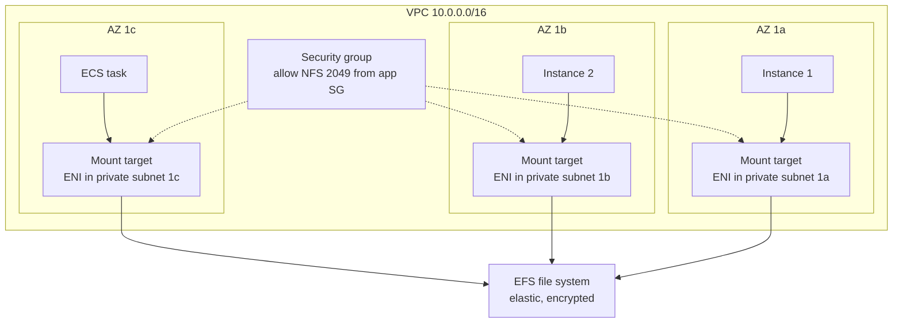
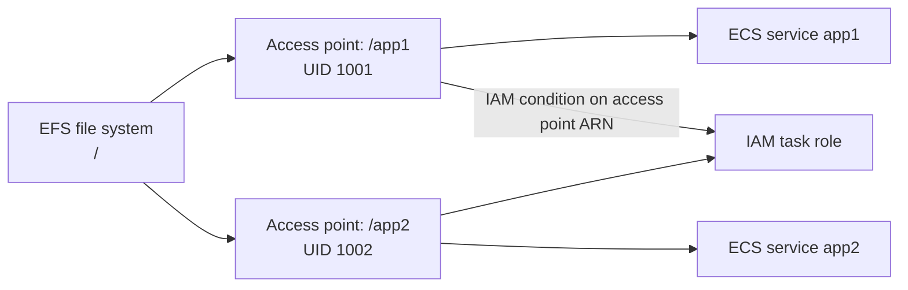

# 10 · Amazon EFS

> **Phase 1 — Core Foundations** · Lesson 10 of 18
> ⬅️ Previous: [Amazon EBS](./09-ebs.md) · ➡️ Next: [S3 Lifecycle Policies](./11-s3-lifecycle-policies.md) · 🏠 [Phase overview](./README.md)

## 🎯 Learning Objectives

By the end of this lesson you will be able to:

- Explain when a shared POSIX filesystem is the right answer instead of S3 or EBS
- Create an EFS file system and mount it from multiple instances at once
- Choose between the throughput modes and storage classes based on a real workload
- Use access points and IAM authorization to isolate tenants or applications

**Estimated time:** 55 min · **Difficulty:** Intermediate

---

## 🧠 Core Concepts

**Amazon EFS** is a managed, elastic NFS file system. The mental model is simple: it is a network drive that many Linux instances can mount simultaneously, backed by storage that grows and shrinks automatically with no provisioning.

The service exists because neither S3 nor EBS solves the shared-filesystem problem. S3 is object storage with an HTTP API — it has no file locking, renaming an "object" is a copy plus a delete, and most applications cannot use it directly. EBS is a block device that cannot be attached to more than one instance in a normal configuration. If you have a legacy application, a content management system, or a fleet of containers that all need to read and write the same files, EFS is the primitive you want.

The trade-offs are **cost and latency**. EFS costs roughly ten times what S3 Standard costs per gigabyte, and network filesystem operations are slower than a local disk. EFS is for workloads that genuinely need POSIX semantics shared across instances — not a general-purpose place to put data you could serve from S3.

Two choices define an EFS configuration:

**Throughput mode:**

| Mode | Behaviour | When to use |
|------|-----------|-------------|
| **Elastic** | Automatically scales throughput up and down with demand. Billed per GB transferred. | Default choice. Unpredictable or spiky workloads, and small file systems. |
| **Provisioned** | You specify MB/s regardless of stored size. | Workloads needing high throughput from a small data set. |
| **Bursting** | Throughput scales with stored size, with credits for bursts. | Legacy mode; predictable, large data sets. |

Elastic mode changed the economics of EFS significantly: previously a small file system could only burst briefly, which made EFS unusable for a 10 GB workload that needed 100 MB/s. With Elastic, you get the throughput you need and pay for what you transfer.

**Storage classes:**

| Class | Use | Retrieval |
|-------|-----|-----------|
| **Standard** | Frequently accessed | Immediate, multi-AZ |
| **One Zone** | Frequently accessed, no AZ-fault tolerance needed | Immediate, single AZ, ~47% cheaper |
| **Infrequent Access (IA)** | Files not accessed daily | Immediate, but per-GB retrieval charge |
| **Archive** | Rarely accessed compliance data | Minutes to hours, cheapest |

Lifecycle management on EFS moves files between classes automatically based on last access time. A rule that moves anything untouched for 30 days to IA typically reduces cost by 60–80% for file shares that hold a mix of active and stale data.

### Key terminology

| Term | Meaning |
|------|---------|
| **File system** | The EFS resource, scoped to a region and reachable in every AZ you create mount targets in. |
| **Mount target** | An ENI in a specific subnet giving access to the file system from that AZ. |
| **Access point** | An application-specific entry point with its own path, UID/GID, and permissions. |
| **Security group** | Controls which instances may reach the mount target over NFS port 2049. |
| **POSIX permissions** | Standard Unix ownership and mode bits, enforced by EFS. |
| **NFSv4.1** | The protocol EFS speaks; mount with `-t nfs4` or the `amazon-efs-utils` client. |

---

## 🗺️ Architecture Diagram

How a fleet of instances reaches one file system:



Access points isolating two applications on one file system:



---

## 🧪 Hands-on Lab: A Shared File System Across Two Instances

**Goal:** Create an encrypted EFS file system with mount targets in two AZs, mount it from two instances, and prove that a file written on one is visible on the other.

**Prerequisites:** A VPC with private subnets in at least two AZs, and two instances running in those subnets.

### Step 1 — Create the file system

```bash
# Create with encryption and a lifecycle policy in one go
aws efs create-file-system \
  --encrypted \
  --performance-mode generalPurpose \
  --throughput-mode elastic \
  --creation-token phase1-efs \
  --tags Key=Name,Value=phase1-efs \
  --region eu-west-1
```

### Step 2 — Create a mount target in each AZ

You need one mount target per Availability Zone, in a subnet of that AZ.

```bash
FS_ID=fs-0123456789abcdef0

aws efs create-mount-target \
  --file-system-id "$FS_ID" \
  --subnet-id subnet-0aaaa111 \
  --security-groups sg-0aaa111222333

aws efs create-mount-target \
  --file-system-id "$FS_ID" \
  --subnet-id subnet-0bbbb222 \
  --security-groups sg-0aaa111222333

# Mount targets take a few minutes; wait until Available
aws efs describe-mount-targets --file-system-id "$FS_ID" \
  --query 'MountTargets[].[AvailabilityZoneName,LifeCycleState,IpAddress]' --output table
```

### Step 3 — Allow NFS traffic

```bash
# The mount target security group must allow 2049 from the instance security group.
# Referencing the source by security group id is better than by CIDR —
# it keeps working when instances move subnets.
aws ec2 authorize-security-group-ingress \
  --group-id sg-0aaa111222333 \
  --protocol tcp --port 2049 \
  --source-group sg-0instance123456
```

### Step 4 — Create an access point

```bash
aws efs create-access-point \
  --file-system-id "$FS_ID" \
  --posix-user Uid=1001,Gid=1001 \
  --root-directory 'Path=/app1,CreationInfo={OwnerUid=1001,OwnerGid=1001,Permissions=0755}' \
  --tags Key=Name,Value=app1-ap
```

### Step 5 — Mount from both instances

Install the EFS mount helper first, which handles TLS and gives you the `tls` mount option.

```bash
# On each instance
sudo dnf install -y amazon-efs-utils
sudo mkdir -p /mnt/efs

# Mount via the access point. The tls option encrypts data in transit.
sudo mount -t efs -o tls,accesspoint=fsap-0123456789abcdef0 "$FS_ID":/ /mnt/efs

# Persist across reboots using the same options
echo "$FS_ID:/ /mnt/efs efs _netdev,tls,accesspoint=fsap-0123456789abcdef0 0 0" | sudo tee -a /etc/fstab
```

The `_netdev` option is required — it tells the boot process to wait for the network before attempting the mount.

### Step 6 — Verify sharing

```bash
# On instance 1
echo "written by instance 1 at $(date)" | sudo tee /mnt/efs/shared.txt

# On instance 2
cat /mnt/efs/shared.txt          # must show instance 1's line
echo "and instance 2 was here" | sudo tee -a /mnt/efs/shared.txt

# On instance 1 again
cat /mnt/efs/shared.txt          # must show both lines
```

If the second instance cannot see the file, check the mount target security group and confirm both instances are using the same access point.

### Step 7 — Add lifecycle management

```bash
aws efs put-lifecycle-configuration \
  --file-system-id "$FS_ID" \
  --lifecycle-policies '[{"TransitionToIA":"AFTER_30_DAYS"},{"TransitionToPrimaryStorageClass":"AFTER_1_ACCESS"}]'
```

The second policy is important: without it, files moved to IA stay there even if they become active again, and you keep paying retrieval charges.

---

## 💻 CLI Reference

```bash
# Describe file systems and their size
aws efs describe-file-systems --query 'FileSystems[].[FileSystemId,SizeInBytes.Value,ThroughputMode,Encrypted]' --output table

# List mount targets and their state
aws efs describe-mount-targets --file-system-id fs-0123456789abcdef0 \
  --query 'MountTargets[].[MountTargetId,AvailabilityZoneName,LifeCycleState]' --output table

# List access points
aws efs describe-access-points --file-system-id fs-0123456789abcdef0

# Switch throughput mode (can also go back to elastic)
aws efs update-file-system --file-system-id fs-0123456789abcdef0 \
  --throughput-mode provisioned --provisioned-throughput-in-mbps 512

# Apply a backup policy
aws efs put-backup-policy --file-system-id fs-0123456789abcdef0 \
  --backup-policy Status=ENABLED

# Check client mount status on a Linux instance with the EFS client
sudo mount -t efs -o tls fs-0123456789abcdef0:/ /mnt/efs
nfsstat -m
```

| Command | Purpose |
|---------|---------|
| `create-mount-target` | Enables access from one AZ; one per AZ is required |
| `create-access-point` | Isolates an application's view and enforces its UID/GID |
| `put-lifecycle-configuration` | Automates cost reduction by access age |
| `put-backup-policy` | Enables AWS Backup for the file system |

---

## ✅ Best Practices

| Practice | Why it matters |
|----------|----------------|
| Use Elastic throughput unless you have measured otherwise | Avoids over-provisioning and works for small file systems |
| Always use `amazon-efs-utils` with the `tls` option | Encrypts data in transit; plain NFS is cleartext |
| Create one mount target per AZ you run workloads in | Cross-AZ mounts add latency and data transfer charges |
| Use access points, not the root path | Per-application ownership and a smaller blast radius |
| Enable `TransitionToPrimaryStorageClass` alongside IA | Otherwise files never return to the primary class |
| Mount with `_netdev,nofail` in fstab | Prevents boot hangs when the file system is unreachable |
| Enable backups for file systems holding irreplaceable data | EFS has no versioning; a bad `rm -rf` is unrecoverable otherwise |
| Set `chmod` and ownership with the access point, not at runtime | Consistent permissions across every mounting instance |

---

## ⚠️ Common Pitfalls

| Pitfall | Symptom | Fix |
|---------|---------|-----|
| Missing mount target for an AZ | Instance hangs on mount | Create a mount target in every AZ where consumers run |
| Security group not allowing 2049 | Mount times out with no clear error | Allow NFS 2049 from the consumer security group |
| Expected performance from a small file system on Bursting mode | Throughput caps out low | Switch to Elastic or Provisioned throughput |
| Files moved to IA and never back | Steady retrieval charges | Add `TransitionToPrimaryStorageClass` |
| No `_netdev` in fstab | Instance fails to boot when EFS is unreachable | Add `_netdev` and `nofail` |
| Treating EFS as cheap storage | Bill far higher than expected | Use S3 for archival; EFS is roughly 10x S3 Standard per GB |
| Using EFS for a database | Corruption and terrible performance | Databases need block storage: EBS or a managed service |
| Cross-AZ mount | Silent latency and data transfer charges | Mount from an instance in the same AZ as the mount target |

---

## 💰 Cost Considerations

EFS is the most expensive of the three storage primitives you have learned, and it is worth understanding exactly why before using it.

Four cost dimensions:

1. **Storage** — Standard is roughly $0.30/GB-month in `eu-west-1`, One Zone roughly $0.16, IA roughly $0.025, Archive roughly $0.008. Compare that to S3 Standard at about $0.023.
2. **Throughput** — In Elastic mode, roughly $0.03 per GB read and $0.06 per GB written. This is the line item that surprises people: a workload reading 10 TB a month incurs about $300 in throughput charges on top of storage.
3. **Provisioned throughput** — A flat monthly charge per MB/s if you use Provisioned mode.
4. **Backup** — AWS Backup charges for the backup vault storage and warm/cold transitions.

The single highest-impact configuration is **lifecycle management**. A 10 TB share where 8 TB has not been accessed in 60 days drops from roughly $3,000 to about $640 per month by transitioning to IA — a saving of about 79%.

Second: **choose One Zone when you can**. If the file system is scratch space or a build cache, One Zone cuts storage cost by roughly 47%. You lose AZ-fault tolerance, which is acceptable for regenerable data.

Third: **reconsider whether you need EFS at all**. If the "shared filesystem" is really just a place to put uploaded documents that are served over HTTP, S3 is an order of magnitude cheaper. If it is a build cache, a container image registry, or an artifact store, S3 or ECR is the right answer. Reach for EFS when the application genuinely requires POSIX file semantics.

---

## 🔐 Security Considerations

- **Encryption at rest is a creation-time choice.** You cannot encrypt an existing unencrypted EFS file system — you must create a new one and copy the data. Enable it on day one.
- **Encryption in transit requires action.** EFS supports TLS, but only if you mount with `-o tls` via `amazon-efs-utils`. Plain NFS mounts are cleartext on the network.
- **Use IAM authorization where possible.** With `--iam` mount option, access is checked against IAM policies, letting you restrict a specific instance or role to a specific access point.
- **Security groups are the primary network control.** The mount target security group is a real firewall — never allow 2049 from `0.0.0.0/0`, and prefer referencing a source security group over a CIDR.
- **Access points are a least-privilege tool.** They let two applications share one file system without being able to see each other's directories, and they enforce a fixed UID/GID so a compromise of one app cannot escalate its file ownership.
- **Watch for the classic misconfiguration:** a file system in a public subnet with a mount target whose security group allows 2049 from the internet. EFS should always live in private subnets.
- **No native file audit.** EFS does not log per-file access. If you need an audit trail of who read which file, that has to come from the application layer or CloudTrail for control-plane operations only.

An IAM policy restricting a task to one access point:

```json
{
  "Version": "2012-10-17",
  "Statement": [
    {
      "Effect": "Allow",
      "Action": [
        "elasticfilesystem:ClientMount",
        "elasticfilesystem:ClientWrite"
      ],
      "Resource": "arn:aws:elasticfilesystem:eu-west-1:123456789012:file-system/fs-0123456789abcdef0",
      "Condition": {
        "StringEquals": {
          "elasticfilesystem:AccessPointArn": "arn:aws:elasticfilesystem:eu-west-1:123456789012:access-point/fsap-0123456789abcdef0"
        }
      }
    }
  ]
}
```

---

## 🧩 Exercise

Design a shared file system for a containerized web application that has three concerns:

1. A `uploads` directory that all application tasks must write to
2. A `config` directory that tasks must read but never write
3. A `cache` directory that can be lost without consequence

Choose an EFS configuration and justify each decision: storage class, throughput mode, number of access points, and lifecycle policy. State explicitly whether the `cache` directory belongs on EFS at all.

Success looks like: you can state the monthly cost estimate per 100 GB for each directory, and you have a defensible reason for any directory you decided *not* to put on EFS.

---

## 📚 Resources

- [Amazon EFS User Guide](https://docs.aws.amazon.com/efs/latest/ug/whatisefs.html)
- [EFS Performance](https://docs.aws.amazon.com/efs/latest/ug/performance.html)
- [EFS Storage Classes](https://docs.aws.amazon.com/efs/latest/ug/storage-classes.html)
- [EFS Access Points](https://docs.aws.amazon.com/efs/latest/ug/efs-access-points.html)
- [Mounting EFS with the EFS Mount Helper](https://docs.aws.amazon.com/efs/latest/ug/using-amazon-efs-utils.html)

---

## ➡️ Next Steps

You now have all three storage primitives: object, block, and file. The next lesson returns to S3 to automate the cost problem that every storage system eventually has — data that nobody deletes.

> ⬅️ Previous: [Amazon EBS](./09-ebs.md) · ➡️ Next: [S3 Lifecycle Policies](./11-s3-lifecycle-policies.md) · 🏠 [Phase overview](./README.md)
