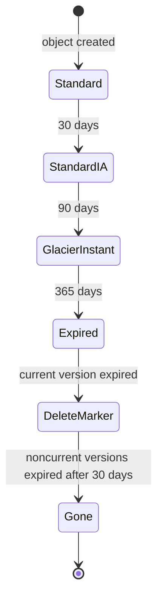
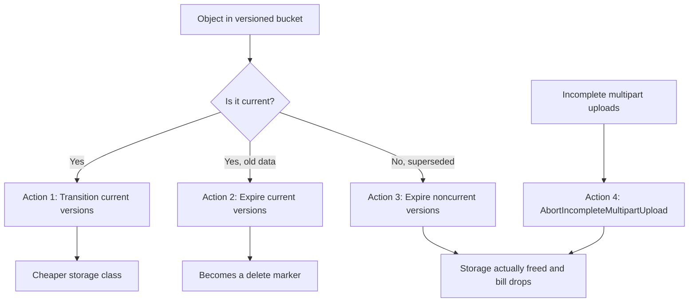

# 11 · S3 Lifecycle Policies

> **Phase 1 — Core Foundations** · Lesson 11 of 18
> ⬅️ Previous: [Amazon EFS](./10-efs.md) · ➡️ Next: [VPC Fundamentals](./12-vpc-fundamentals.md) · 🏠 [Phase overview](./README.md)

## 🎯 Learning Objectives

By the end of this lesson you will be able to:

- Write lifecycle rules that transition objects between storage classes and expire them
- Distinguish current versions, noncurrent versions, and delete markers in a versioned bucket
- Design a retention schedule from a stated business requirement
- Diagnose why a lifecycle rule is not deleting what you expected

**Estimated time:** 45 min · **Difficulty:** Intermediate

---

## 🧠 Core Concepts

A **lifecycle configuration** is a set of rules attached to a bucket. Each rule matches a subset of objects — by prefix, tag, or object size — and applies one or more **actions** after a period of time. The two action families are **transition** (change storage class) and **expiration** (delete).

Lifecycle management exists because storage grows monotonically. Applications write logs, uploads, exports, and backups, and almost nothing deletes them. The result is that a bucket ends up holding years of cold data in the most expensive storage class. A lifecycle rule turns "we should clean that up someday" into an automated policy.

The part that trips people up is **versioning interaction**. In a versioned bucket, every object has exactly one *current* version and zero or more *noncurrent* versions. When you delete an object without specifying a version, S3 does not remove anything — it writes a **delete marker** and that marker becomes the current version. The underlying data is still there, still billed.

This means a versioned bucket effectively needs three separate lifecycle actions:

1. **Transition current versions** — move active data to cheaper classes as it ages
2. **Expire current versions** — delete the data (typically only for transient data like logs)
3. **Expire noncurrent versions** — the one everybody forgets, and the reason versioned buckets grow forever

A fourth, easy-to-miss action is **`AbortIncompleteMultipartUpload`**. Failed or interrupted multipart uploads leave parts behind that are billed as storage but do not appear in `list-objects` at all. Every bucket that receives large uploads should abort incomplete multipart uploads after a few days.

### Key terminology

| Term | Meaning |
|------|---------|
| **Rule** | One lifecycle definition, with a filter and one or more actions. |
| **Transition** | Change an object's storage class after N days. |
| **Expiration** | Delete an object (or noncurrent versions) after N days. |
| **Noncurrent version** | A superseded version of an object in a versioned bucket. |
| **Delete marker** | A zero-byte placeholder that makes an object appear deleted. |
| **Minimum storage duration** | A class-specific penalty period; deleting early still charges for it. |
| **Filter** | The scope: prefix, tag, object size, or a combination. |

---

## 🗺️ Architecture Diagram

A complete lifecycle for a versioned log bucket:



The three actions that must be present in a versioned bucket:



---

## 🧪 Hands-on Lab: Automate a Retention Schedule

**Goal:** Apply a lifecycle policy to a versioned bucket that moves data to cheaper classes as it ages, expires transient log data, and — critically — cleans up noncurrent versions so the bill actually falls.

**Prerequisites:** The versioned bucket from Lesson 08.

### Step 1 — Understand the requirement first

Never write a lifecycle rule without a stated requirement. Assume this one:

- Logs are actively read for the first 30 days
- After 30 days they are occasionally read for investigations
- After 90 days they are only needed for a compliance review, which allows minutes of retrieval latency
- Nothing needs to be kept beyond 400 days
- Superseded versions only matter for 30 days after being replaced

Everything in the rule below maps to one of those sentences.

### Step 2 — Write the configuration

```json
{
  "Rules": [
    {
      "ID": "LogRetentionSchedule",
      "Status": "Enabled",
      "Filter": { "Prefix": "logs/" },
      "Transitions": [
        { "Days": 30, "StorageClass": "STANDARD_IA" },
        { "Days": 90, "StorageClass": "GLACIER_IR" }
      ],
      "Expiration": { "Days": 400 },
      "NoncurrentVersionTransitions": [
        { "NoncurrentDays": 7, "StorageClass": "GLACIER_IR" }
      ],
      "NoncurrentVersionExpiration": { "NoncurrentDays": 30 },
      "AbortIncompleteMultipartUpload": { "DaysAfterInitiation": 7 }
    },
    {
      "ID": "CleanupIncompleteUploads",
      "Status": "Enabled",
      "Filter": { "Prefix": "" },
      "AbortIncompleteMultipartUpload": { "DaysAfterInitiation": 7 }
    }
  ]
}
```

Two deliberate choices worth noticing:

- `NoncurrentVersionExpiration` is what makes the storage bill actually drop. Without it, everything you ever uploaded stays billed forever.
- The second rule has no prefix, so it applies to the whole bucket. Incomplete multipart uploads can occur anywhere.

### Step 3 — Apply it

```bash
aws s3api put-bucket-lifecycle-configuration \
  --bucket "$BUCKET" \
  --lifecycle-configuration file://lifecycle.json
```

### Step 4 — Verify it was accepted

```bash
aws s3api get-bucket-lifecycle-configuration --bucket "$BUCKET"
```

A policy with an invalid transition — for example moving to `GLACIER` before `STANDARD_IA` — is rejected with a `MalformedXML` or validation error. Always read back what you applied.

### Step 5 — Prove the accounting effect with S3 Storage Lens

```bash
# Storage Lens gives per-bucket and per-prefix storage class breakdowns
aws s3control get-storage-lens-configuration \
  --account-id "$(aws sts get-caller-identity --query Account --output text)" \
  --config-id default-account-dashboard
```

The metric that matters is the ratio of bytes in Standard versus IA/Glacier over time. If that ratio does not move after your rule's transition days have passed, the rule is not matching anything.

### Step 6 — Test before you trust

Lifecycle rules wait for real time to pass, which makes them slow to validate. Use the S3 Lifecycle test facility on a copy of the data, or apply the rule to a small bucket with a 1-day transition and confirm the effect within 48 hours.

```bash
# A throwaway bucket with an aggressive rule is the fastest sanity check
aws s3api put-bucket-lifecycle-configuration \
  --bucket "$TEST_BUCKET" \
  --lifecycle-configuration '{
    "Rules": [{
      "ID": "FastTest",
      "Status": "Enabled",
      "Filter": {"Prefix": ""},
      "Transitions": [{"Days": 1, "StorageClass": "STANDARD_IA"}]
    }]
  }'
```

---

## 💻 CLI Reference

```bash
# Show the current lifecycle configuration
aws s3api get-bucket-lifecycle-configuration --bucket "$BUCKET"

# Remove all lifecycle rules
aws s3api delete-bucket-lifecycle --bucket "$BUCKET"

# Find how much space is held by noncurrent versions
aws s3api list-object-versions --bucket "$BUCKET" \
  --query 'length(NoncurrentVersions)' 

# Find delete markers that are still billing as metadata
aws s3api list-object-versions --bucket "$BUCKET" \
  --query 'DeleteMarkers[].[Key,VersionId,IsLatest]' --output table

# List incomplete multipart uploads and their size
aws s3api list-multipart-uploads --bucket "$BUCKET" \
  --query 'Uploads[].[Key,Initiated,UploadId]' --output table

# Inventory reports give a full object listing without per-object request charges
aws s3api put-bucket-inventory-configuration \
  --bucket "$BUCKET" \
  --id weekly-inventory \
  --inventory-configuration '{
    "Destination": {"S3BucketDestination": {"AccountId": "123456789012", "Bucket": "arn:aws:s3:::my-inventory-bucket", "Format": "Parquet"}},
    "IsEnabled": true,
    "Schedule": {"Frequency": "Weekly"},
    "IncludedObjectVersions": "All",
    "OptionalFields": ["Size", "StorageClass", "LastModifiedDate"]
  }'
```

| Command | Purpose |
|---------|---------|
| `get-bucket-lifecycle-configuration` | Always verify what was applied |
| `list-object-versions` | See noncurrent versions and delete markers directly |
| `list-multipart-uploads` | Find storage you cannot see in the object listing |
| `put-bucket-inventory-configuration` | Get a per-object report without paying for lists |

---

## ✅ Best Practices

| Practice | Why it matters |
|----------|----------------|
| Always pair transitions with `NoncurrentVersionExpiration` | Versioned buckets grow forever otherwise |
| Apply `AbortIncompleteMultipartUpload` on every bucket | Invisible storage that never gets cleaned up |
| Keep transitions in cost order (Standard → IA → Glacier) | S3 rejects non-monotonic transition sequences |
| Respect minimum storage durations | `STANDARD_IA` charges 30 days minimum, `GLACIER` 90, `DEEP_ARCHIVE` 180 — deleting earlier still bills |
| Prefer tag-based filters for application data | Decouples retention from key naming conventions |
| Use separate buckets for very different retention needs | One rule cannot serve both 7-day logs and 7-year records |
| Coordinate with Object Lock requirements | Lifecycle cannot delete objects under a retention period |
| Test with a throwaway bucket and 1-day transitions | Faster than waiting a month to find a typo |

---

## ⚠️ Common Pitfalls

| Pitfall | Symptom | Fix |
|---------|---------|-----|
| Expiring noncurrent versions never configured | Bill does not fall after deletion | Add `NoncurrentVersionExpiration` |
| Expiring current versions accidentally | Data loss | Check `Expiration` against the actual requirement; use `Prefix` filters |
| Assuming delete marker removal is instant | Object listing stays confusing | Delete markers are cleaned by the noncurrent expiry action |
| Transitioning to Glacier when you need instant access | Applications break on retrieval | Use `GLACIER_IR` if you need immediate reads |
| Minimum duration charges | Cost does not drop as expected | Know the minimums: IA 30, Glacier IR 90, Glacier Flexible 90, Deep Archive 180 |
| Rule matches nothing | Nothing changes at all | Check the prefix or tag filter against real keys in the bucket |
| Deleting small objects through transitions | Transition cost exceeds saving | Add `ObjectSizeGreaterThan` or leave small objects in Standard |
| Lifecycle and replication both enabled | Replica bucket diverges | Replication ignores lifecycle-driven expiration of the source |

A subtle but expensive one worth expanding: **transitioning very small objects is a net loss**. Each transition is billed as a lifecycle transition request, and a 4 KB object moved to IA costs more in request charges than it saves in storage. A `Filter` with `ObjectSizeGreaterThan` of 128 KB avoids this trap entirely.

---

## 💰 Cost Considerations

Lifecycle policies are **free** — there is no charge for creating or evaluating rules. There are, however, charges for the transitions themselves and for early deletion.

**Transition requests** are billed per 1,000 objects. Moving ten million small objects to Glacier costs real money in requests before you save anything on storage.

**Early deletion penalties** apply per object and are non-negotiable:

| Class | Minimum billable duration |
|-------|---------------------------|
| Standard-IA | 30 days |
| One Zone-IA | 30 days |
| Glacier Instant Retrieval | 90 days |
| Glacier Flexible Retrieval | 90 days |
| Glacier Deep Archive | 180 days |

If you transition an object to Glacier and delete it 10 days later, you are charged for the full 90 days regardless.

**Retrieval charges** also apply — moving data *out* of an archive class is billed per GB, and expedited retrievals cost substantially more than standard ones. A lifecycle that archives data which is then frequently restored is worse than doing nothing.

A worked example: a 50 TB bucket accumulating 2 TB per month, entirely in Standard at ~$0.023/GB-month, costs about $1,150 per month and grows. Applying a rule that moves data to Standard-IA at 30 days, Glacier IR at 90 days, and expires at 400 days reduces the steady-state cost to roughly $150–250 per month depending on access patterns — an 80% reduction, achieved once, with no ongoing effort.

The other lifecycle-adjacent saving worth knowing: **S3 Intelligent-Tiering**. For data with unpredictable access patterns, it monitors access and moves objects automatically, with no retrieval fees. It has a small per-object monitoring charge, so it suits objects over roughly 128 KB. When you cannot predict access patterns, this is often better than guessing at transition days.

---

## 🔐 Security Considerations

- **Lifecycle rules can delete data, so they are a security control surface.** Restrict `s3:PutLifecycleConfiguration` to a narrow role. Someone who can change a lifecycle rule can silently destroy your retention guarantee.
- **A short expiry can defeat a compliance obligation.** If a regulation requires seven-year retention, a lifecycle rule expiring at 365 days is a compliance breach, not a cost optimization. Retention requirements must come from the business, not from an engineer's guess.
- **Object Lock overrides lifecycle.** In compliance mode, lifecycle expiration cannot delete an object before its retain-until date, which is the correct design: the immutability guarantee is stronger than the cost optimization.
- **Log the changes.** Lifecycle configuration changes appear in CloudTrail as `PutBucketLifecycleConfiguration`. Alert on them in buckets holding regulated data — a surprise change is a higher-signal anomaly than almost anything else in S3.
- **Do not let lifecycle mask a security incident.** If you suspect an attacker deleted data, a lifecycle rule that removed delete markers destroys the evidence trail. During an investigation, suspend lifecycle changes first.
- **Cross-region replication is not protected by source lifecycle.** Expiration on the source does not delete replicas, so a bucket with replication needs lifecycle rules applied on both sides or the replica grows unbounded.

---

## 🧩 Exercise

You have a bucket receiving three kinds of data, each with a different requirement:

- `uploads/` — user-uploaded images, actively served for 90 days, then almost never accessed, must be kept for 2 years
- `exports/` — generated CSV exports, downloaded once and then never needed, must be deleted after 7 days
- `backups/` — database dumps, accessed only during a disaster, must be kept for 7 years

Write a single lifecycle configuration with three rules that satisfies all of these, minimizes cost, and includes the noncurrent-version cleanup that is appropriate for each.

Success looks like: each rule maps to a stated requirement, the total steady-state storage cost is demonstrably lower than leaving everything in Standard, and you can explain why `exports/` does not need a transition at all.

---

## 📚 Resources

- [Managing the Lifecycle of S3 Objects](https://docs.aws.amazon.com/AmazonS3/latest/userguide/object-lifecycle-mgmt.html)
- [Lifecycle Configuration Elements](https://docs.aws.amazon.com/AmazonS3/latest/userguide/intro-lifecycle-rules.html)
- [S3 Storage Classes](https://docs.aws.amazon.com/AmazonS3/latest/userguide/storage-class-intro.html)
- [S3 Intelligent-Tiering](https://docs.aws.amazon.com/AmazonS3/latest/userguide/intelligent-tiering.html)
- [S3 Storage Lens](https://docs.aws.amazon.com/AmazonS3/latest/userguide/storage_lens.html)
- [S3 Inventory](https://docs.aws.amazon.com/AmazonS3/latest/userguide/storage-inventory.html)

---

## ➡️ Next Steps

Storage is complete. The next four lessons move to networking — the part of AWS where a single misunderstanding produces an architecture that looks correct in a diagram but does not pass a single packet.

> ⬅️ Previous: [Amazon EFS](./10-efs.md) · ➡️ Next: [VPC Fundamentals](./12-vpc-fundamentals.md) · 🏠 [Phase overview](./README.md)
