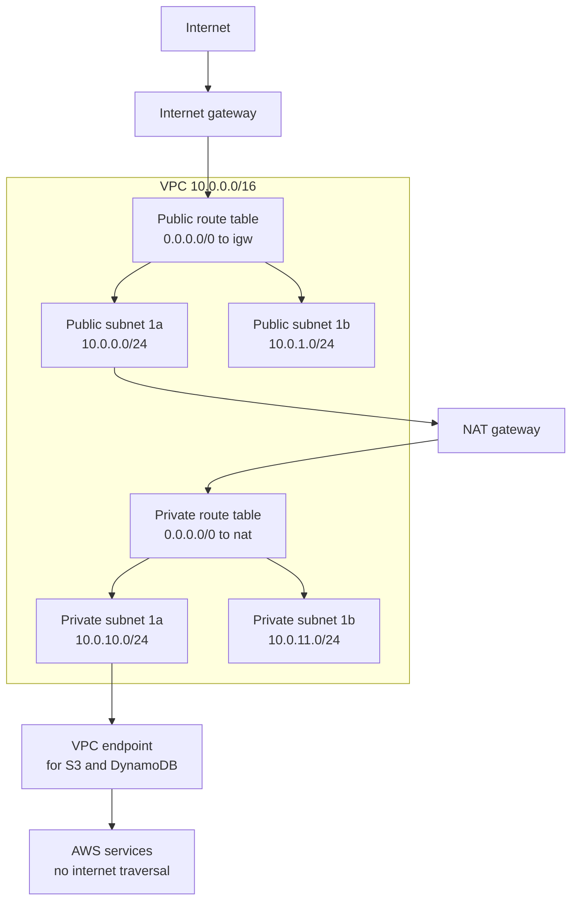
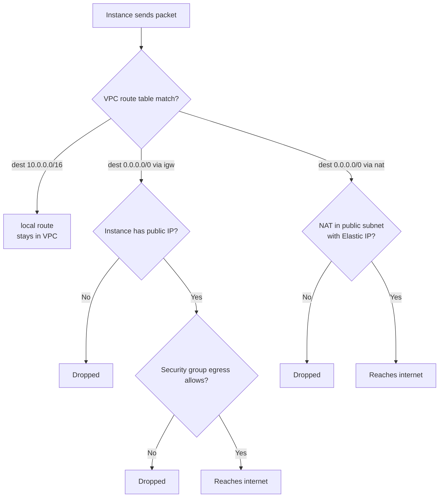

# 12 · VPC Fundamentals

> **Phase 1 — Core Foundations** · Lesson 12 of 18
> ⬅️ Previous: [S3 Lifecycle Policies](./11-s3-lifecycle-policies.md) · ➡️ Next: [Subnets and Route Tables](./13-subnets-and-route-tables.md) · 🏠 [Phase overview](./README.md)

## 🎯 Learning Objectives

By the end of this lesson you will be able to:

- Design a CIDR plan that will not need to be renumbered later
- Create a VPC with an internet gateway and understand exactly what that does and does not do
- Explain the difference between a NAT gateway, a NAT instance, and a VPC endpoint
- Diagnose why an instance in a "public subnet" still cannot reach the internet

**Estimated time:** 65 min · **Difficulty:** Intermediate

---

## 🧠 Core Concepts

A **VPC** is a logically isolated network. You define its address space with a **CIDR block** — for example `10.0.0.0/16` — and everything you create lives inside that range. This is one of the few places in AWS where an early decision is genuinely expensive to undo: you cannot change a VPC's CIDR block later without recreating the network, and you cannot overlap CIDRs with anything you want to peer with.

The most common planning mistake is sizing too small. A `/24` gives you 256 addresses, of which AWS reserves five, which sounds ample for a small application until you count load balancer nodes, RDS instances, Lambda functions in a VPC, and EKS pods (which consume an IP address each from the subnet). A `/16` costs nothing extra and gives you room. If you genuinely need more than a `/16`, use a second non-overlapping CIDR block via a secondary CIDR association rather than starting over.

Within the VPC, **subnets** partition the address range and are bound to a single Availability Zone. A subnet is called **public** when its route table has a route to an **internet gateway**, and **private** otherwise. That is the entire definition — there is no "public subnet" checkbox. This is why an instance in a subnet with an internet gateway still cannot reach the internet if its route table lacks the route, or if it has no public IP address.

Three mechanisms give private resources outbound access or access to AWS services:

| Mechanism | Direction | Cost | Use for |
|-----------|-----------|------|---------|
| **Internet gateway** | In and out, from the internet | Free | Public subnets, load balancers, bastion hosts |
| **NAT gateway** | Out only, to the internet | Hourly + per GB | Private subnets needing OS updates or third-party APIs |
| **VPC endpoint** | To AWS services only | Gateway endpoints are free; interface endpoints are hourly | S3, DynamoDB, and most AWS APIs — preferred over NAT |

VPC endpoints deserve emphasis. Traffic to S3 or DynamoDB through a NAT gateway incurs NAT data-processing charges on top of the S3 request charges. A **gateway endpoint** for S3 is free and keeps that traffic on the AWS network. In a data-heavy architecture, replacing NAT with gateway endpoints commonly saves hundreds of dollars a month.

### Key terminology

| Term | Meaning |
|------|---------|
| **CIDR block** | The IP range of the VPC, e.g. `10.0.0.0/16`. |
| **Internet gateway** | Attached to a VPC; enables internet routing for subnets that reference it. |
| **Egress-only internet gateway** | Outbound-only IPv6 access, the IPv6 equivalent of NAT. |
| **NAT gateway** | Managed outbound-only internet access for private subnets. Lives in a public subnet. |
| **VPC endpoint** | Private connectivity to AWS services without crossing the internet. |
| **Route table** | The rules that decide where traffic from a subnet goes. |
| **Peering** | A direct connection between two VPCs with non-overlapping CIDRs. |
| **Transit gateway** | A hub connecting many VPCs and on-premises networks. |
| **Reserved addresses** | Five IPs per subnet that AWS holds back. |

---

## 🗺️ Architecture Diagram

A canonical VPC layout. Notice that the NAT gateway sits in the public subnet and the private route table points to it:



Packet path decision — a useful diagram to keep in mind when debugging:



---

## 🧪 Hands-on Lab: Build a Two-Tier VPC From Scratch

**Goal:** Create a VPC with public and private subnets in two AZs, an internet gateway, a NAT gateway, and an S3 gateway endpoint — then prove that the private instance can reach S3 without internet access.

**Prerequisites:** Permissions to create VPC resources.

### Step 1 — Plan the CIDR range

Write this down before creating anything:

| Purpose | CIDR |
|---------|------|
| VPC | `10.0.0.0/16` |
| Public subnet AZ-a | `10.0.0.0/24` |
| Public subnet AZ-b | `10.0.1.0/24` |
| Private subnet AZ-a | `10.0.10.0/24` |
| Private subnet AZ-b | `10.0.11.0/24` |
| Spare for future tiers | `10.0.20.0/22` |

Leaving deliberate space for future tiers is the difference between a plan and a guess.

### Step 2 — Create the VPC

```bash
VPC=$(aws ec2 create-vpc --cidr-block 10.0.0.0/16 \
  --tag-specifications 'ResourceType=vpc,Tags=[{Key=Name,Value=phase1-vpc}]' \
  --query 'Vpc.VpcId' --output text)
echo "VPC=$VPC"

# DNS support and DNS hostnames are required for RDS endpoints and many services
aws ec2 modify-vpc-attribute --vpc-id "$VPC" --enable-dns-support
aws ec2 modify-vpc-attribute --vpc-id "$VPC" --enable-dns-hostnames
```

### Step 3 — Create subnets

```bash
# Public subnets
PUB1=$(aws ec2 create-subnet --vpc-id "$VPC" --cidr-block 10.0.0.0/24 \
  --availability-zone eu-west-1a \
  --tag-specifications 'ResourceType=subnet,Tags=[{Key=Name,Value=public-1a}]' \
  --query 'Subnet.SubnetId' --output text)

PUB2=$(aws ec2 create-subnet --vpc-id "$VPC" --cidr-block 10.0.1.0/24 \
  --availability-zone eu-west-1b \
  --tag-specifications 'ResourceType=subnet,Tags=[{Key=Name,Value=public-1b}]' \
  --query 'Subnet.SubnetId' --output text)

# Private subnets
PRIV1=$(aws ec2 create-subnet --vpc-id "$VPC" --cidr-block 10.0.10.0/24 \
  --availability-zone eu-west-1a \
  --tag-specifications 'ResourceType=subnet,Tags=[{Key=Name,Value=private-1a}]' \
  --query 'Subnet.SubnetId' --output text)

PRIV2=$(aws ec2 create-subnet --vpc-id "$VPC" --cidr-block 10.0.11.0/24 \
  --availability-zone eu-west-1b \
  --tag-specifications 'ResourceType=subnet,Tags=[{Key=Name,Value=private-1b}]' \
  --query 'Subnet.SubnetId' --output text)

# Auto-assign public IPs only in public subnets
aws ec2 modify-subnet-attribute --subnet-id "$PUB1" --map-public-ip-on-launch
aws ec2 modify-subnet-attribute --subnet-id "$PUB2" --map-public-ip-on-launch
```

### Step 4 — Create the internet gateway and route table

```bash
IGW=$(aws ec2 create-internet-gateway \
  --tag-specifications 'ResourceType=internet-gateway,Tags=[{Key=Name,Value=phase1-igw}]' \
  --query 'InternetGateway.InternetGatewayId' --output text)
aws ec2 attach-internet-gateway --internet-gateway-id "$IGW" --vpc-id "$VPC"

PUBNET=$(aws ec2 create-route-table --vpc-id "$VPC" \
  --tag-specifications 'ResourceType=route-table,Tags=[{Key=Name,Value=public-rt}]' \
  --query 'RouteTable.RouteTableId' --output text)
aws ec2 create-route --route-table-id "$PUBNET" \
  --destination-cidr-block 0.0.0.0/0 --gateway-id "$IGW"
aws ec2 associate-route-table --route-table-id "$PUBNET" --subnet-id "$PUB1"
aws ec2 associate-route-table --route-table-id "$PUBNET" --subnet-id "$PUB2"
```

### Step 5 — Create the NAT gateway

A NAT gateway must live in a **public** subnet and needs an Elastic IP. It is also AZ-scoped: for real availability you need one NAT gateway per AZ, which doubles the hourly cost.

```bash
EIP=$(aws ec2 allocate-address --domain vpc --query 'AllocationId' --output text)

NAT=$(aws ec2 create-nat-gateway \
  --subnet-id "$PUB1" \
  --allocation-id "$EIP" \
  --tag-specifications 'ResourceType=natgateway,Tags=[{Key=Name,Value=phase1-nat-1a}]' \
  --query 'NatGateway.NatGatewayId' --output text)

aws ec2 wait nat-gateway-available --nat-gateway-ids "$NAT"

PRIVNET=$(aws ec2 create-route-table --vpc-id "$VPC" \
  --tag-specifications 'ResourceType=route-table,Tags=[{Key=Name,Value=private-rt}]' \
  --query 'RouteTable.RouteTableId' --output text)
aws ec2 create-route --route-table-id "$PRIVNET" \
  --destination-cidr-block 0.0.0.0/0 --nat-gateway-id "$NAT"
aws ec2 associate-route-table --route-table-id "$PRIVNET" --subnet-id "$PRIV1"
aws ec2 associate-route-table --route-table-id "$PRIVNET" --subnet-id "$PRIV2"
```

### Step 6 — Add an S3 gateway endpoint

```bash
aws ec2 create-vpc-endpoint \
  --vpc-id "$VPC" \
  --service-name com.amazonaws.eu-west-1.s3 \
  --vpc-endpoint-type Gateway \
  --route-table-ids "$PRIVNET"
```

This is free and removes all S3 traffic from the NAT gateway path.

### Step 7 — Verify

```bash
# Describe the routes to confirm the topology is what you intended
aws ec2 describe-route-tables \
  --filters "Name=vpc-id,Values=$VPC" \
  --query 'RouteTables[].[Tags[?Key==`Name`]|[0].Value, Routes[].[DestinationCidrBlock,GatewayId,NatGatewayId]]' \
  --output json
```

Launch one instance in `$PUB1` and one in `$PRIV1`, then confirm: the public instance has outbound internet, the private instance can `aws s3 ls` (via the endpoint), and neither can reach the other on unexpected ports until you add a security group rule.

---

## 💻 CLI Reference

```bash
# See whether a subnet is public: does its route table have a 0.0.0.0/0 route to an IGW?
aws ec2 describe-route-tables --filters "Name=association.subnet-id,Values=$PUB1"

# List endpoints in a VPC
aws ec2 describe-vpc-endpoints --filters "Name=vpc-id,Values=$VPC" \
  --query 'VpcEndpoints[].[VpcEndpointType,ServiceName,State]' --output table

# Check the default security group — it should allow nothing after hardening
aws ec2 describe-security-groups --filters "Name=default-for-vpc,Values=true" "Name=vpc-id,Values=$VPC"

# Confirm DNS resolution and hostnames are enabled
aws ec2 describe-vpc-attribute --vpc-id "$VPC" --attribute enableDnsHostnames

# List all NAT gateways and their state
aws ec2 describe-nat-gateways --query 'NatGateways[].[NatGatewayId,State,SubnetId]' --output table
```

| Command | Purpose |
|---------|---------|
| `describe-route-tables` | The single most useful networking debug command |
| `create-vpc-endpoint` | Free or cheap private access to AWS services |
| `describe-vpc-attribute` | Confirms DNS settings that RDS and endpoints depend on |

---

## ✅ Best Practices

| Practice | Why it matters |
|----------|----------------|
| Plan CIDR with room to grow and no overlaps | You cannot resize a VPC, and overlaps block peering forever |
| Use a `/16` for the VPC and `/24` for subnets | Costs nothing, avoids the IP-exhaustion class of incident |
| Name every subnet and route table | `private-1a` is debuggable; `subnet-0f3a91` is not |
| Keep the default VPC unused, or delete it | It is permissive by default and easy to deploy into by mistake |
| One NAT gateway per AZ for production | A single NAT gateway is a single-AZ dependency for your entire private tier |
| Prefer gateway endpoints for S3 and DynamoDB | Eliminates NAT data-processing charges |
| Use separate route tables per tier | A shared route table makes an accidental public subnet likely |
| Enable VPC Flow Logs on day one | Retroactive network forensics is not possible |

---

## ⚠️ Common Pitfalls

| Pitfall | Symptom | Fix |
|---------|---------|-----|
| Subnet has an IGW route but no public IP | Instance cannot reach the internet | Enable auto-assign public IP, or attach an Elastic IP |
| NAT gateway in a private subnet | No outbound connectivity at all | NAT gateways must be in a public subnet |
| Missing DNS hostnames on the VPC | RDS endpoint does not resolve | Enable `enableDnsHostnames` |
| Overlapping CIDRs | Peering and transit gateway attachments fail | Renumber before you build; this is the expensive one |
| Default security group left open | Unintended access between resources | Remove all rules from default security groups |
| Expecting five available IPs per subnet to be usable | Address count is lower than the CIDR suggests | AWS reserves the first four and the last address |
| One NAT gateway for all AZs | AZ failure removes outbound access for everything | One NAT per AZ in production |
| Forgetting that NAT gateways are AZ-scoped | "The NAT failed and nothing works" | Treat NAT as a per-AZ resource with its own failure mode |

---

## 💰 Cost Considerations

A VPC, subnets, route tables, internet gateways, and gateway endpoints are all **free**. Almost every networking cost comes from three places:

**NAT gateway** — the most common surprise. Roughly $0.048 per hour in `eu-west-1` (about $35 per month) plus $0.048 per GB processed. Two NAT gateways for AZ redundancy is about $70 per month before any data flows.

**Data transfer** — free within the same AZ, billed between AZs (about $0.01/GB each direction), and billed per GB outbound to the internet. A chatty multi-AZ application that moves 50 TB a month between AZs is paying real money for traffic that a small architectural change could eliminate. Note the corollary: a NAT gateway and the instance using it being in *different* AZs adds cross-AZ charges on top of NAT processing.

**Interface endpoints** — roughly $0.011 per hour each (about $8 per month) plus data processing. Cheap compared to NAT for high-volume traffic, but 20 endpoints at $8 each adds up; prefer gateway endpoints where they exist.

The highest-return optimizations, in order:

1. **Gateway endpoints for S3 and DynamoDB** — free, and it removes the largest category of NAT data-processing charges in most accounts.
2. **Keep traffic intra-AZ where possible** — a load balancer in the same AZ as its targets avoids cross-AZ transfer.
3. **Delete idle NAT gateways** — development VPCs often have a NAT gateway costing $35 per month serving almost no traffic. A single NAT gateway for a dev VPC, or none at all with endpoints instead, is a straightforward saving.
4. **Use PrivateLink instead of NAT for AWS service traffic** — same effect as gateway endpoints for services that do not offer them.
5. **Elastic IP addresses** — free while attached to a running instance or NAT gateway, but **billed when unattached**. A forgotten Elastic IP is a small but real monthly charge.

---

## 🔐 Security Considerations

- **Subnets are not a security boundary.** A subnet's public/private property is about routing, not access. What actually controls access is security groups and NACLs — treat the public/private distinction as a blast-radius reduction, not a firewall.
- **Keep a private subnet genuinely private.** No route to an internet gateway, no public IPs, and reach it via a bastion, Systems Manager Session Manager, or a VPN. Session Manager is preferable because it requires no open port at all.
- **Least-privilege egress.** The default security group allows all outbound traffic. Restricting egress to what an instance actually needs limits both data exfiltration and the ability of a compromised host to reach command-and-control infrastructure.
- **Flow logs for detection and forensics.** Enable VPC Flow Logs to CloudWatch or S3. Rejected-connection records are one of the highest-signal network intrusion indicators available, and they cannot be reconstructed after the fact.
- **Endpoints reduce attack surface as well as cost.** Gateway and interface endpoints keep S3 and API traffic off the internet entirely, which means there is no path for it to be intercepted.
- **Beware the default VPC.** It has an internet gateway, a permissive default security group, and auto-assigned public IPs. Deleting it, or at minimum locking its default security group down, removes a common source of accidental exposure.
- **Segment by tier with security groups referencing each other.** A database security group that allows port 3306 only from the application security group cannot be reached from the internet regardless of routing.

---

## 🧩 Exercise

Design and build a VPC for an application with these requirements, then state the monthly infrastructure cost of the network layer alone:

1. Two Availability Zones
2. A public tier with a load balancer and a NAT gateway in each AZ
3. A private application tier with instances that need OS updates from the internet
4. A private database tier that must have **no** internet path in either direction
5. A private tier that reads and writes S3 heavily
6. Complete network isolation of the database tier from the internet, provable by a route table inspection

Success looks like: `describe-route-tables` shows the database subnets have no `0.0.0.0/0` route at all, S3 traffic from the application tier does not traverse the NAT gateway, and you can state the network-layer monthly cost broken into NAT gateways, endpoints, and expected data transfer.

---

## 📚 Resources

- [Amazon VPC User Guide](https://docs.aws.amazon.com/vpc/latest/userguide/what-is-amazon-vpc.html)
- [VPC CIDR Blocks](https://docs.aws.amazon.com/vpc/latest/userguide/vpc-cidr-blocks.html)
- [NAT Gateways](https://docs.aws.amazon.com/vpc/latest/userguide/vpc-nat-gateway.html)
- [VPC Endpoints and AWS PrivateLink](https://docs.aws.amazon.com/vpc/latest/privatelink/what-is-privatelink.html)
- [VPC Flow Logs](https://docs.aws.amazon.com/vpc/latest/userguide/flow-logs.html)
- [VPC Pricing](https://aws.amazon.com/vpc/pricing/)

---

## ➡️ Next Steps

You have a VPC with subnets and routes. The next lesson goes deeper into the two things that decide whether a subnet is actually public, and how to design subnet boundaries so that a single AZ failure does not take your application down.

> ⬅️ Previous: [S3 Lifecycle Policies](./11-s3-lifecycle-policies.md) · ➡️ Next: [Subnets and Route Tables](./13-subnets-and-route-tables.md) · 🏠 [Phase overview](./README.md)
