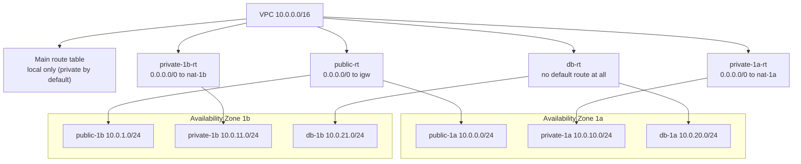
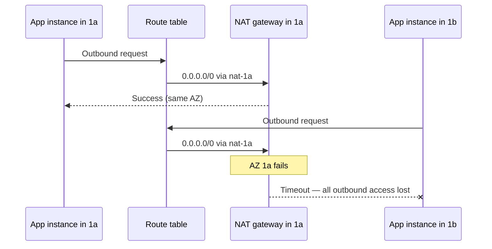

# 13 · Subnets and Route Tables

> **Phase 1 — Core Foundations** · Lesson 13 of 18
> ⬅️ Previous: [VPC Fundamentals](./12-vpc-fundamentals.md) · ➡️ Next: [Security Groups](./14-security-groups.md) · 🏠 [Phase overview](./README.md)

## 🎯 Learning Objectives

By the end of this lesson you will be able to:

- Prove whether a subnet is public or private by inspecting its route table, not by its name
- Explain how the implicit `local` route works and why it cannot be deleted
- Choose between long-prefix and short-prefix routes when they overlap
- Design a multi-tier subnet layout that survives a single Availability Zone failure

**Estimated time:** 50 min · **Difficulty:** Intermediate

---

## 🧠 Core Concepts

A **subnet** is a slice of a VPC's CIDR block, bound permanently to one Availability Zone. That binding is the single most important property: every resource you launch into the subnet lives in that AZ, and if that AZ has a problem, everything in the subnet has a problem.

A **route table** is a list of destination-to-target mappings. When a packet leaves a resource, AWS consults the route table of that resource's subnet, finds the **longest prefix match**, and sends the packet to the corresponding target. Route tables are associated with subnets — a subnet has exactly one route table (unless it falls back to the VPC's main route table), and one route table can serve many subnets.

Every route table contains an implicit **`local` route** covering the VPC's CIDR block. This route has the longest possible match for anything inside the VPC and cannot be removed. It is why two subnets in the same VPC can talk to each other with no route table configuration at all — and it is also why "why can these two instances reach each other?" almost always has the answer "because of the local route, and your security groups allow it."

**Longest prefix match** is worth internalizing, because it is the mechanism behind almost every clever routing trick:

| Routes present | Packet to | Chosen route |
|----------------|-----------|--------------|
| `0.0.0.0/0 → IGW`, `10.1.0.0/16 → peering` | `10.1.2.3` | The peering route — `/16` is more specific than `/0` |
| `0.0.0.0/0 → NAT`, `s3 prefix list → endpoint` | `52.218.x.x` (S3) | The endpoint route, because prefix lists are more specific than `/0` |
| `10.0.0.0/16 → local`, `10.0.5.0/24 → peering` | `10.0.5.7` | The peering route — `/24` beats `/16` |

That third row is how you can carve out a piece of your own address space and send it elsewhere, which is useful but also a classic source of "the instance in that subnet cannot reach our database" bugs.

A **main route table** is the one that applies to any subnet without an explicit association. The best practice is to leave the main route table with only the `local` route, so a newly created subnet is private by default and cannot accidentally be exposed by forgetting an association.

### Key terminology

| Term | Meaning |
|------|---------|
| **Availability Zone** | An isolated datacenter group; a subnet lives entirely in one. |
| **Route table** | Ordered set of destination → target routes. |
| **Longest prefix match** | The rule that decides which route wins when several match. |
| **Local route** | The implicit, undeletable route covering the VPC CIDR. |
| **Main route table** | The fallback route table for unassociated subnets. |
| **Prefix list** | A named set of CIDRs, e.g. the AWS-managed S3 prefix list. |
| **Edge association** | Attaching a route table to a gateway, not a subnet (used for traffic inspection). |

---

## 🗺️ Architecture Diagram

How route tables map to subnets in a two-AZ layout:



Why one NAT gateway per AZ matters — the failure mode of a shared NAT:



---

## 🧪 Hands-on Lab: Build a Three-Tier Subnet Layout and Prove Its Properties

**Goal:** Create a layout with public, application-private, and database-private tiers across two AZs, with per-AZ NAT gateways and a database tier that has no internet route at all.

**Prerequisites:** The VPC from Lesson 12.

### Step 1 — Create the subnets

```bash
# Application tier
APP1=$(aws ec2 create-subnet --vpc-id "$VPC" --cidr-block 10.0.10.0/24 \
  --availability-zone eu-west-1a \
  --tag-specifications 'ResourceType=subnet,Tags=[{Key=Name,Value=app-1a}]' \
  --query 'Subnet.SubnetId' --output text)

APP2=$(aws ec2 create-subnet --vpc-id "$VPC" --cidr-block 10.0.11.0/24 \
  --availability-zone eu-west-1b \
  --tag-specifications 'ResourceType=subnet,Tags=[{Key=Name,Value=app-1b}]' \
  --query 'Subnet.SubnetId' --output text)

# Database tier
DB1=$(aws ec2 create-subnet --vpc-id "$VPC" --cidr-block 10.0.20.0/24 \
  --availability-zone eu-west-1a \
  --tag-specifications 'ResourceType=subnet,Tags=[{Key=Name,Value=db-1a}]' \
  --query 'Subnet.SubnetId' --output text)

DB2=$(aws ec2 create-subnet --vpc-id "$VPC" --cidr-block 10.0.21.0/24 \
  --availability-zone eu-west-1b \
  --tag-specifications 'ResourceType=subnet,Tags=[{Key=Name,Value=db-1b}]' \
  --query 'Subnet.SubnetId' --output text)

# Mark the database subnets as not auto-assigning public IPs (they should be off by default, but be explicit)
aws ec2 modify-subnet-attribute --subnet-id "$DB1" --no-map-public-ip-on-launch
aws ec2 modify-subnet-attribute --subnet-id "$DB2" --no-map-public-ip-on-launch
```

### Step 2 — Create a per-AZ NAT gateway

This is the change that removes the single-AZ dependency.

```bash
EIP2=$(aws ec2 allocate-address --domain vpc --query 'AllocationId' --output text)

NAT2=$(aws ec2 create-nat-gateway \
  --subnet-id "$PUB2" \
  --allocation-id "$EIP2" \
  --tag-specifications 'ResourceType=natgateway,Tags=[{Key=Name,Value=phase1-nat-1b}]' \
  --query 'NatGateway.NatGatewayId' --output text)

aws ec2 wait nat-gateway-available --nat-gateway-ids "$NAT2"
```

### Step 3 — Create one private route table per AZ

Each private subnet routes through the NAT gateway **in its own AZ**, which avoids both the single-AZ dependency and cross-AZ data transfer charges.

```bash
APPRT1=$(aws ec2 create-route-table --vpc-id "$VPC" \
  --tag-specifications 'ResourceType=route-table,Tags=[{Key=Name,Value=app-rt-1a}]' \
  --query 'RouteTable.RouteTableId' --output text)
aws ec2 create-route --route-table-id "$APPRT1" \
  --destination-cidr-block 0.0.0.0/0 --nat-gateway-id "$NAT"
aws ec2 associate-route-table --route-table-id "$APPRT1" --subnet-id "$APP1"

APPRT2=$(aws ec2 create-route-table --vpc-id "$VPC" \
  --tag-specifications 'ResourceType=route-table,Tags=[{Key=Name,Value=app-rt-1b}]' \
  --query 'RouteTable.RouteTableId' --output text)
aws ec2 create-route --route-table-id "$APPRT2" \
  --destination-cidr-block 0.0.0.0/0 --nat-gateway-id "$NAT2"
aws ec2 associate-route-table --route-table-id "$APPRT2" --subnet-id "$APP2"
```

### Step 4 — Create the database route table with no default route

This is the step that makes "no internet access" a structural property rather than a hope.

```bash
DBRT=$(aws ec2 create-route-table --vpc-id "$VPC" \
  --tag-specifications 'ResourceType=route-table,Tags=[{Key=Name,Value=db-rt}]' \
  --query 'RouteTable.RouteTableId' --output text)

# Deliberately create NO 0.0.0.0/0 route. Only the implicit local route exists.
aws ec2 associate-route-table --route-table-id "$DBRT" --subnet-id "$DB1"
aws ec2 associate-route-table --route-table-id "$DBRT" --subnet-id "$DB2"
```

### Step 5 — Verify, and verify the right way

Never trust a subnet's name. Inspect its routes.

```bash
# 1. Which route table is this subnet actually using?
aws ec2 describe-route-tables \
  --filters "Name=association.subnet-id,Values=$APP1" \
  --query 'RouteTables[0].[RouteTableId,Routes[].[DestinationCidrBlock,GatewayId,NatGatewayId]]' \
  --output json

# 2. Confirm the database tier has NO default route
aws ec2 describe-route-tables \
  --filters "Name=association.subnet-id,Values=$DB1" \
  --query 'RouteTables[0].Routes[?DestinationCidrBlock!=`local`]' --output json
# Expected output: []  — nothing but the local route

# 3. Confirm nothing is silently falling back to the main route table
aws ec2 describe-route-tables \
  --filters "Name=vpc-id,Values=$VPC" "Name=default-for-vpc,Values=true" \
  --query 'RouteTables[0].[RouteTableId,Associations]' --output json
```

If the second command returns anything, the database tier has a path to the internet and the design is not doing what you think.

### Step 6 — Prove the failure mode is fixed

```bash
# From the app instance in 1b, confirm traffic leaves through the NAT in 1b
INSTANCE_IP=10.0.11.15
aws ec2 describe-nat-gateways --nat-gateway-ids "$NAT2" \
  --query 'NatGateways[0].[NatGatewayId,SubnetId,State]'

# Check the NAT gateway's byte counters to confirm which one carried the traffic
aws cloudwatch get-metric-statistics \
  --namespace AWS/NATGateway --metric-name BytesOutToDestination \
  --dimensions Name=NatGatewayId,Value="$NAT2" \
  --start-time "$(date -u -v-1H +%Y-%m-%dT%H:%M:%S)" --end-time "$(date -u +%Y-%m-%dT%H:%M:%S)" \
  --period 300 --statistics Sum
```

Traffic from the `1b` app instance showing up in `NAT2`'s counters is the proof that the per-AZ routing is correct.

---

## 💻 CLI Reference

```bash
# List all route tables with their associations and routes
aws ec2 describe-route-tables --filters "Name=vpc-id,Values=$VPC" --output json

# Find which subnet a route table serves
aws ec2 describe-route-tables --route-table-ids rtb-0123456789abcdef0 \
  --query 'RouteTables[0].Associations[].[SubnetId,Main]' --output table

# Replace a route's target without deleting it
aws ec2 replace-route --route-table-id rtb-0123456789abcdef0 \
  --destination-cidr-block 0.0.0.0/0 --nat-gateway-id "$NAT2"

# Find subnets lacking a default route (i.e. private subnets)
aws ec2 describe-route-tables --filters "Name=vpc-id,Values=$VPC" \
  --query 'RouteTables[?length(Routes[?DestinationCidrBlock==`0.0.0.0/0`])==`0`].Associations[].SubnetId' \
  --output text

# Show free IP address counts per subnet — useful when pods or Lambdas exhaust a subnet
aws ec2 describe-subnets --filters "Name=vpc-id,Values=$VPC" \
  --query 'Subnets[].[Tags[?Key==`Name`]|[0].Value,CidrBlock,AvailableIpAddressCount]' --output table

# Check whether a specific route table is the main route table
aws ec2 describe-route-tables --route-table-ids rtb-0123456789abcdef0 \
  --query 'RouteTables[0].Associations[?Main==`true`]'
```

| Command | Purpose |
|---------|---------|
| `describe-route-tables` | Establish ground truth about routing |
| `replace-route` | Change a target atomically, common in failover runbooks |
| `describe-subnets` | Watch for IP exhaustion before it breaks a deployment |

---

## ✅ Best Practices

| Practice | Why it matters |
|----------|----------------|
| Leave the main route table with only the local route | New subnets are private unless you deliberately expose them |
| One route table per AZ for private subnets | Avoids cross-AZ data transfer and single-AZ outbound dependency |
| Give the database tier no default route | Makes isolation structural, not configuration-dependent |
| Name route tables and subnets to match their AZ | `app-rt-1b` is a design; `rtb-0f3a91` is a mystery |
| Never trust a subnet's name to tell you if it is public | Names are free text; routes are enforced |
| Use prefix list routes for AWS services | More specific than `0.0.0.0/0`, so they win without breaking anything |
| Watch available IP counts | EKS and Lambda consume IPs you did not budget for |
| Document CIDR allocations in the repo | Prevents the next person from overlapping a range |

---

## ⚠️ Common Pitfalls

| Pitfall | Symptom | Fix |
|---------|---------|-----|
| Subnet looks public but has no internet | Instance cannot reach the internet | Check both the route table and whether a public IP is assigned |
| Forgetting a subnet association | Subnet silently uses the main route table | Always verify with `describe-route-tables` |
| Database subnet accidentally routed | "Isolated" tier has internet access | Assert with a query that returns no non-local routes |
| Overlapping routes chosen unexpectedly | Traffic goes somewhere surprising | Remember longest prefix match; check for a more specific route |
| Deleting the local route | Not possible — but people try | Understand that intra-VPC traffic needs no configuration |
| One private route table for both AZs | Cross-AZ NAT charges and a single-AZ dependency | One route table and one NAT gateway per AZ |
| Route table attached to the wrong subnet | Change appears to have no effect | Re-read the associations, not the route definitions |
| IP exhaustion in a `/24` | New launches fail with `InsufficientFreeAddressesInSubnet` | Size subnets for the densest consumer, or add a secondary range |

---

## 💰 Cost Considerations

Route tables, subnets, and the local route are all **free**. The cost decisions in this lesson are entirely about what the routes point at.

The per-AZ NAT gateway pattern costs twice as much in hourly terms: two NAT gateways at roughly $0.048/hour each is about $70 per month instead of $35. That is the price of removing a single-AZ dependency, and for production it is nearly always correct. For a development VPC serving one engineer, a single NAT gateway — or none at all, relying on VPC endpoints and Session Manager — is the right trade.

The more subtle saving is **cross-AZ data transfer**, billed at roughly $0.01/GB in each direction. A route table that sends all private subnets through one NAT gateway means every instance not in that NAT's AZ pays cross-AZ transfer on every outbound byte. For a workload moving 20 TB a month outbound, that is roughly $200 per month of pure waste, fixed permanently by adding a second route table and NAT gateway that cost $35.

Sizing is also an economic decision, though indirectly. A `/24` per subnet gives 251 usable addresses. If you later need EKS, each pod consumes an IP, and a small node with a `/24` runs out fast. Enlarging a subnet is not possible — you must create a new one and migrate. Allocating generous CIDRs up front is free; renumbering later is not.

Finally, remember the free path: **gateway endpoints for S3 and DynamoDB** cost nothing and remove traffic from the NAT billing entirely. In most accounts this is the single largest easy networking saving available.

---

## 🔐 Security Considerations

- **Routing is not security.** A private subnet is not protected because it lacks a route to the internet; it is protected because nothing routes to it *and* security groups control what gets in. Always assume someone will eventually add a route — the security group should still hold.
- **The local route means every subnet can reach every other by default.** Two subnets in the same VPC are reachable from each other with no route configuration. Every tier-to-tier restriction must therefore come from security groups or NACLs, never from routing.
- **Use the main route table as a safety net.** Keeping it local-only means a forgotten association produces a subnet with no internet access rather than an accidentally exposed one. Fail closed, not open.
- **Segment by tier, and prove it.** The database tier should have no default route *and* a security group allowing its port only from the application security group. Two independent controls, both of which must fail before exposure.
- **Route table changes are a security event.** Adding a `0.0.0.0/0` route to a previously private route table is exactly what an attacker would do to establish egress. Monitor `CreateRoute` and `AssociateRouteTable` in CloudTrail and alert on changes to production route tables.
- **Centralized inspection for regulated environments.** For traffic inspection, route through a dedicated inspection VPC using a transit gateway with edge associations. This is more complex but gives a single choke point for firewall and IDS appliances.
- **Avoid asymmetric routing.** If two paths exist between the same endpoints with different return paths, stateful inspection silently drops traffic. This is the classic cause of "the firewall is configured correctly but nothing works."

---

## 🧩 Exercise

You have a VPC with the three-tier layout from the lab. A new requirement arrives: a **fourth tier** for a third-party integration that must be able to reach the internet but must **not** be reachable from the application tier, and must not be able to reach the database tier.

Design the subnet, route table, and security group configuration to satisfy this, then prove it:

1. The integration tier has outbound internet access
2. The application tier cannot initiate a connection to the integration tier
3. The integration tier cannot initiate a connection to the database tier
4. The database tier remains without any internet route

Success looks like: a connectivity test from the integration instance to the database instance times out, a test from the application instance to the integration instance times out, and `describe-route-tables` shows the database subnet still has only the local route — with a written explanation of which control blocked each attempt.

---

## 📚 Resources

- [VPC Subnets](https://docs.aws.amazon.com/vpc/latest/userguide/configure-subnets.html)
- [Route Tables](https://docs.aws.amazon.com/vpc/latest/userguide/VPC_Route_Tables.html)
- [Subnet Route Table Associations](https://docs.aws.amazon.com/vpc/latest/userguide/route-table-options.html)
- [AWS-managed Prefix Lists](https://docs.aws.amazon.com/vpc/latest/userguide/managed-prefix-lists.html)
- [Subnet Sizing](https://docs.aws.amazon.com/vpc/latest/userguide/subnet-sizing.html)

---

## ➡️ Next Steps

Routing decides where a packet *can* go. The next two lessons cover what decides whether it is *allowed* — starting with the control you will use every single day: security groups.

> ⬅️ Previous: [VPC Fundamentals](./12-vpc-fundamentals.md) · ➡️ Next: [Security Groups](./14-security-groups.md) · 🏠 [Phase overview](./README.md)
