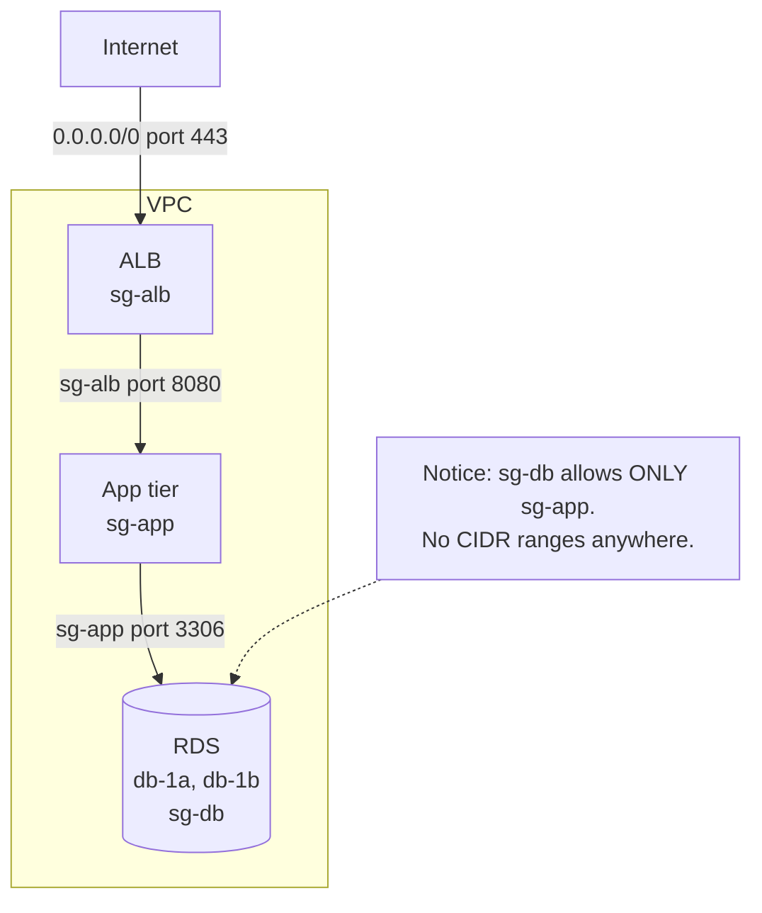
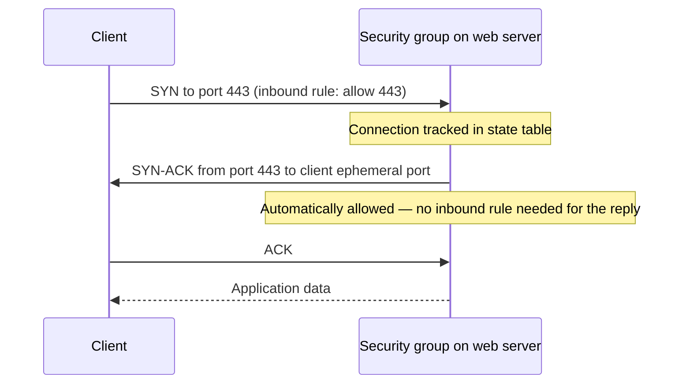

# 14 · Security Groups

> **Phase 1 — Core Foundations** · Lesson 14 of 18
> ⬅️ Previous: [Subnets and Route Tables](./13-subnets-and-route-tables.md) · ➡️ Next: [Network ACLs](./15-network-acls.md) · 🏠 [Phase overview](./README.md)

## 🎯 Learning Objectives

By the end of this lesson you will be able to:

- Explain why security groups are stateful and what that means for return traffic
- Apply the default-deny model correctly, including the egress rules most people forget
- Use security group referencing instead of CIDR ranges for tier-to-tier access
- Debug a blocked connection by reasoning about both directions of the flow

**Estimated time:** 45 min · **Difficulty:** Beginner

---

## 🧠 Core Concepts

A **security group** is a stateful, allow-only firewall attached to an elastic network interface. Every instance, load balancer, RDS instance, Lambda function in a VPC, and ECS task has at least one. Rules are evaluated as a whole set, not in order, and there is no way to write a deny rule — anything not explicitly allowed is denied.

**Stateful** is the single most important property. When an inbound connection is allowed, the return traffic is automatically permitted, regardless of the outbound rules. The same is true in reverse: an outbound connection that is allowed brings its responses back in without an inbound rule. This is why you never need an ephemeral-port inbound rule for a web server — the response to an accepted connection on port 80 is implicitly allowed. NACLs, covered in the next lesson, work the other way around, and the difference is the source of an enormous number of troubleshooting hours.

The **default security group** in every VPC allows all traffic from itself and all outbound traffic. It is permissive by design and should be emptied. The important trap: a new instance launched with no security group specified is placed in the default security group, so an organization that never locks it down is silently running an open-by-default network.

**Security group referencing** is the feature that makes tiered architectures work cleanly. Instead of writing `10.0.10.0/24` as the source for a database rule, you write `sg-app-tier` as the source. This is better in three ways: it survives subnet renumbering, it is self-documenting, and it cannot accidentally include an unrelated resource that happens to share a CIDR range.

One subtlety that causes real confusion: **a security group rule referencing a security group applies to traffic from ENIs that have that group attached**, including the case where both groups are attached to the same instance. If an instance has both the app and db groups attached, the db rule allowing the app group would allow the instance to reach itself. Keep groups attached to exactly one role per instance wherever possible.

### Key terminology

| Term | Meaning |
|------|---------|
| **Stateful** | Return traffic is automatically allowed once a connection is established. |
| **Allow-only** | There are no deny rules; everything defaults to denied. |
| **Referencing** | Using a security group ID as a source or destination instead of a CIDR. |
| **Egress rule** | Controls outbound traffic; the default group allows all of it. |
| **ENI** | Elastic network interface; security groups attach to ENIs, not to instances directly. |
| **Ephemeral ports** | The high-numbered client ports (1024–65535) used for return traffic. |
| **Rule limit** | Default 60 inbound and 60 outbound rules per group. |

---

## 🗺️ Architecture Diagram

A three-tier referencing chain. Each tier permits only the tier above it:



Why stateful matters — the flow that would need an explicit rule on a stateless firewall:



---

## 🧪 Hands-on Lab: Build a Least-Privilege Referencing Chain

**Goal:** Create security groups for a load balancer, an application tier, and a database, where the database is reachable only from the application tier and the application tier only from the load balancer.

**Prerequisites:** The VPC and subnets from Lessons 12 and 13.

### Step 1 — Clean up the default security group first

Do this before creating anything else, or you will forget.

```bash
DEFAULT_SG=$(aws ec2 describe-security-groups --filters \
  "Name=default-for-vpc,Values=true" "Name=vpc-id,Values=$VPC" \
  --query 'SecurityGroups[0].GroupId' --output text)

# Remove the permissive self-referencing rule
aws ec2 revoke-security-group-ingress --group-id "$DEFAULT_SG" --protocol -1 --source-group "$DEFAULT_SG" 2>/dev/null || true

# Remove the allow-all egress rule
aws ec2 revoke-security-group-egress --group-id "$DEFAULT_SG" --protocol -1 --cidr 0.0.0.0/0 2>/dev/null || true

# Verify it is now empty
aws ec2 describe-security-groups --group-ids "$DEFAULT_SG" \
  --query 'SecurityGroups[0].[IpPermissions,IpPermissionsEgress]' --output json
```

### Step 2 — Create the load balancer security group

```bash
SG_ALB=$(aws ec2 create-security-group --group-name phase1-alb-sg \
  --description "ALB: HTTPS from internet" --vpc-id "$VPC" \
  --query 'GroupId' --output text)

aws ec2 authorize-security-group-ingress --group-id "$SG_ALB" \
  --protocol tcp --port 443 --cidr 0.0.0.0/0

# Port 80 allowed only to redirect to HTTPS
aws ec2 authorize-security-group-ingress --group-id "$SG_ALB" \
  --protocol tcp --port 80 --cidr 0.0.0.0/0
```

The load balancer is the only component that should ever have an `0.0.0.0/0` inbound rule, and only on the ports it actually serves.

### Step 3 — Create the application security group

```bash
SG_APP=$(aws ec2 create-security-group --group-name phase1-app-sg \
  --description "App tier: traffic only from ALB" --vpc-id "$VPC" \
  --query 'GroupId' --output text)

# Source is the ALB security group, not a CIDR range
aws ec2 authorize-security-group-ingress --group-id "$SG_APP" \
  --protocol tcp --port 8080 --source-group "$SG_ALB"

# Allow SSH only from a bastion security group — never from 0.0.0.0/0
# aws ec2 authorize-security-group-ingress --group-id "$SG_APP" \
#   --protocol tcp --port 22 --source-group "$SG_BASTION"
```

### Step 4 — Create the database security group

```bash
SG_DB=$(aws ec2 create-security-group --group-name phase1-db-sg \
  --description "RDS: traffic only from app tier" --vpc-id "$VPC" \
  --query 'GroupId' --output text)

aws ec2 authorize-security-group-ingress --group-id "$SG_DB" \
  --protocol tcp --port 3306 --source-group "$SG_APP"
```

Now the database is unreachable from anywhere except instances carrying `sg-app` — regardless of subnet, IP address, or route table.

### Step 5 — Restrict egress

The default for a new group is allow-all egress. Replace it with only what each tier needs.

```bash
# App tier: remove allow-all egress, then allow only what is needed
aws ec2 revoke-security-group-egress --group-id "$SG_APP" --protocol -1 --cidr 0.0.0.0/0

# Database access
aws ec2 authorize-security-group-egress --group-id "$SG_APP" \
  --protocol tcp --port 3306 --source-group "$SG_DB"

# HTTPS to the internet for package updates and third-party APIs
aws ec2 authorize-security-group-egress --group-id "$SG_APP" \
  --protocol tcp --port 443 --cidr 0.0.0.0/0

# Database tier: no outbound internet at all
aws ec2 revoke-security-group-egress --group-id "$SG_DB" --protocol -1 --cidr 0.0.0.0/0 2>/dev/null || true
aws ec2 authorize-security-group-egress --group-id "$SG_DB" \
  --protocol tcp --port 3306 --source-group "$SG_APP"
```

Egress restriction is the control that limits where a compromised instance can send data. It is the difference between "the attacker got in" and "the attacker got in and exfiltrated 40 GB before anyone noticed."

### Step 6 — Debug a blocked path properly

When a connection fails, reason about it as two separate directions:

```bash
# 1. Is there a rule allowing the INBOUND connection on the destination?
aws ec2 describe-security-groups --group-ids "$SG_DB" \
  --query 'SecurityGroups[0].IpPermissions[?ToPort==`3306`]' --output json

# 2. Is there a rule allowing the OUTBOUND connection on the source?
aws ec2 describe-security-groups --group-ids "$SG_APP" \
  --query 'SecurityGroups[0].IpPermissionsEgress[?ToPort==`3306`]' --output json

# 3. Is the connection even reaching the destination? Check flow logs.
aws logs filter-log-events \
  --log-group-name /aws/vpc/flowlogs \
  --filter-pattern "REJECT" \
  --start-time "$(date -u -v-15M +%s000)"
```

A flow-log `REJECT` on the destination means a security group or NACL blocked it. `NODATA` means the traffic never arrived, so the problem is routing or a listener that is not running — a different class of problem entirely.

---

## 💻 CLI Reference

```bash
# Show all rules for a group in a readable form
aws ec2 describe-security-groups --group-ids "$SG_APP" \
  --query 'SecurityGroups[0].{Ingress:IpPermissions,Egress:IpPermissionsEgress}' --output json

# Find every rule in the account that exposes a port to the whole internet
aws ec2 describe-security-groups \
  --filters "Name=ip-permission.cidr,Values=0.0.0.0/0" \
  --query 'SecurityGroups[].[GroupId,GroupName,IpPermissions[?contains(CidrIp,`0.0.0.0/0`)].[FromPort,ToPort]]' \
  --output json

# Find rules exposing SSH specifically — the highest-signal audit query
aws ec2 describe-security-groups \
  --filters "Name=ip-permission.from-port,Values=22" "Name=ip-permission.cidr,Values=0.0.0.0/0" \
  --query 'SecurityGroups[].[GroupId,GroupName]' --output table

# Add a rule description so future readers know why it exists
aws ec2 authorize-security-group-ingress --group-id "$SG_APP" \
  --ip-permissions 'IpProtocol=tcp,FromPort=8080,ToPort=8080,UserIdGroupPairs=[{GroupId="'"$SG_ALB"'",Description="ALB to app tier"}]'

# List which ENIs use a security group (find what you would break by editing it)
aws ec2 describe-network-interfaces --filters "Name=group-id,Values=$SG_APP" \
  --query 'NetworkInterfaces[].[NetworkInterfaceId,Description,PrivateIpAddress]' --output table

# Copy a group's rules to a new group in another VPC
aws ec2 describe-security-groups --group-ids "$SG_APP" \
  --query 'SecurityGroups[0].IpPermissions' --output json > rules.json
aws ec2 authorize-security-group-ingress --group-id "$NEW_SG" --ip-permissions file://rules.json
```

| Command | Purpose |
|---------|---------|
| `describe-security-groups --filters ip-permission.cidr` | The audit query that finds accidental internet exposure |
| `describe-network-interfaces --filters group-id` | Find out what a group change would affect |
| `authorize-security-group-ingress --ip-permissions` | Add rules with descriptions for maintainability |

---

## ✅ Best Practices

| Practice | Why it matters |
|----------|----------------|
| Reference security groups, not CIDRs, for internal traffic | Survives renumbering and cannot over-match |
| Restrict egress as well as ingress | Limits data exfiltration from a compromised instance |
| Never allow SSH or RDP from `0.0.0.0/0` | It will be brute-forced; use Session Manager instead |
| Give every rule a description | Six months later the description is the only documentation |
| One group per role, named for the role | `sg-app` attaches only to app instances, making rules predictable |
| Empty the default security group in every VPC | New resources fall back to it silently |
| Audit for `0.0.0.0/0` rules on a schedule | Exposure creeps in through quick fixes |
| Treat security group changes as privileged | They are the actual network firewall |

---

## ⚠️ Common Pitfalls

| Pitfall | Symptom | Fix |
|---------|---------|-----|
| Only checking inbound rules | Connection fails with a correct-looking inbound rule | Also check egress on the source |
| Adding an ephemeral-port inbound rule | Unnecessary rule, adds to the rule count | Security groups are stateful; return traffic is automatic |
| Confusing security groups with NACLs | "I allowed it in the group but it still fails" | Check the subnet NACL too — see Lesson 15 |
| Rules are silently additive | A new rule does not restrict the old permissive one | Remove the old rule; there is no deny |
| Hitting the 60-rule limit | `RulesPerSecurityGroupLimitExceeded` | Consolidate with prefix lists or reference groups |
| Same group on client and server | Self-referencing rule allows unintended traffic | Keep one role per security group |
| Expecting ordering between rules | "The deny should override the allow" | There are no deny rules and no ordering |
| Assuming a group protects a subnet | Resources in the subnet have their own groups | Security groups are per-ENI, not per-subnet |

---

## 💰 Cost Considerations

Security groups are **free**. There is no charge for creating groups or rules, and no limit on how many you attach to an interface (beyond the account quota of groups per VPC).

The cost impact is indirect but real in two directions. A permissive security group that lets an attacker mine cryptocurrency on your instances turns a security incident into a billing incident — GPU instances run up charges at a rate that budget alarms catch only after the fact. And a missing egress rule on the database tier is what prevents a compromised application from exfiltrating an entire database, which is the difference between a contained incident and a reportable data breach.

There is also a genuine cost-relevant use of security group rules: egress restriction to specific destinations can force traffic through VPC endpoints instead of the internet, which removes NAT gateway data-processing charges. A rule that permits `443` only to a prefix list for AWS services keeps traffic on the AWS network.

Nothing here reduces the bill directly. The point is that security groups are one of the few controls that costs nothing to get right from the start, which makes shipping with allow-all egress an unnecessary risk.

---

## 🔐 Security Considerations

- **The default is already deny.** You cannot make a security group more closed than having no rules. This means a group with no rules is a perfectly valid starting state, and it is a better starting state than a permissive one.
- **No deny rules means you must remove, not override.** If an old rule allows `0.0.0.0/0` on port 22, adding a narrower rule does nothing useful — you must delete the permissive one. This is the most common audit finding in AWS accounts.
- **Egress matters more than most teams assume.** Allow-all egress lets a compromised instance reach command-and-control servers, exfiltrate data to an attacker-controlled bucket, and download further tooling. Restrict egress to the destinations the workload genuinely uses.
- **Prefer no inbound SSH at all.** AWS Systems Manager Session Manager provides shell access with no open port, IAM authorization, and full session logging. It removes an entire category of exposed attack surface.
- **Put TLS-terminating load balancers in front of everything.** Combined with a rule that allows the app port only from the load balancer group, this means application ports are never reachable directly from the internet.
- **Rule descriptions are an audit artifact.** A rule with no description is indistinguishable from a mistake during a review, and will usually be removed — sometimes breaking production.
- **Monitor changes.** `AuthorizeSecurityGroupIngress` on a production group is a high-signal CloudTrail event. An attacker who has gained a foothold will typically open a port to return. Alert on it.
- **Combine with NACLs for defense in depth.** Security groups are the primary control; NACLs are the subnet-level backstop. Two independent layers mean a single mistake is not sufficient for exposure.

An audit that should be run monthly:

```bash
# Every rule in the account that exposes anything to the whole internet
aws ec2 describe-security-groups \
  --filters "Name=ip-permission.cidr,Values=0.0.0.0/0" \
  --query 'SecurityGroups[].{Group:GroupName,ID:GroupId,Rules:IpPermissions[?CidrIp==`0.0.0.0/0`].[FromPort,ToPort,IpProtocol]}' \
  --output json
```

Anything in that output on a port other than 80/443 deserves a written justification.

---

## 🧩 Exercise

Take the three-tier security group chain from the lab and break it in a controlled way to build debugging intuition:

1. Remove the egress rule on `sg-app` that permits port 3306 to `sg-db`. Confirm the application can no longer reach the database, and confirm that the *inbound* rule on `sg-db` still exists — proving the failure is on the source side.
2. Restore it, then remove the inbound rule on `sg-db` instead. Confirm the same symptom with a different cause.
3. Add a rule allowing `0.0.0.0/0` on port 22 to `sg-app`, then find it with the audit query above and remove it.

Success looks like: you can describe, without looking anything up, which of the two rule sets caused each failure — and you have a flow-log `REJECT` record that confirms which layer dropped the packet.

---

## 📚 Resources

- [Security Groups for Your VPC](https://docs.aws.amazon.com/vpc/latest/userguide/vpc-security-groups.html)
- [Security Group Rules Reference](https://docs.aws.amazon.com/vpc/latest/userguide/security-group-rules.html)
- [AWS Systems Manager Session Manager](https://docs.aws.amazon.com/systems-manager/latest/userguide/session-manager.html)
- [VPC Flow Logs](https://docs.aws.amazon.com/vpc/latest/userguide/flow-logs.html)
- [Infrastructure Protection — AWS Well-Architected](https://docs.aws.amazon.com/well-architected/latest/security-pillar/infrastructure-protection.html)

---

## ➡️ Next Steps

Security groups are the primary network control, but they are not the only one. The next lesson covers the layer below them — the subnet-level firewall that is stateless, ordered, and capable of blocking traffic that security groups would allow.

> ⬅️ Previous: [Subnets and Route Tables](./13-subnets-and-route-tables.md) · ➡️ Next: [Network ACLs](./15-network-acls.md) · 🏠 [Phase overview](./README.md)
