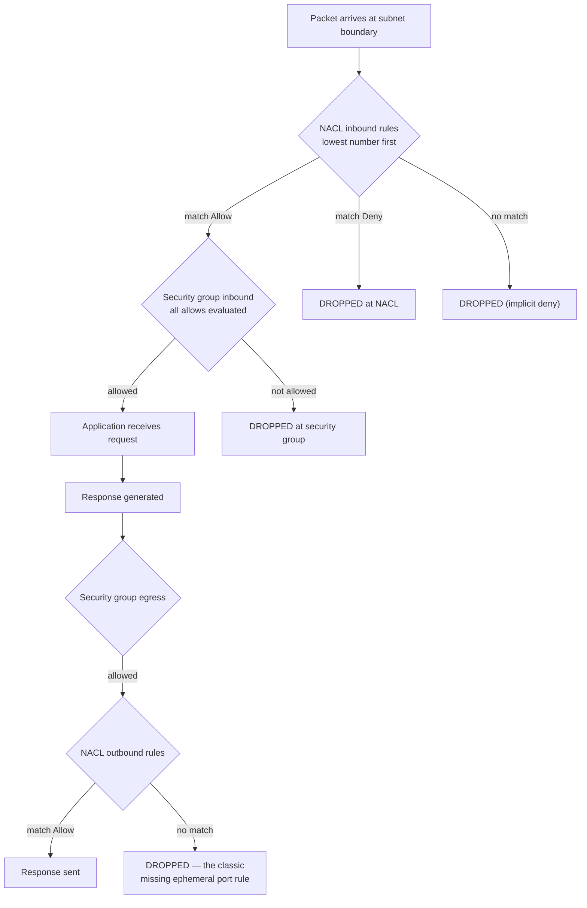
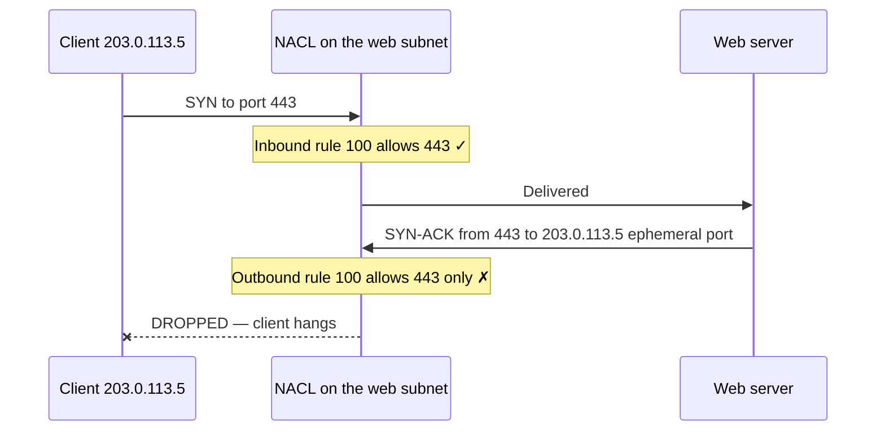

# 15 · Network ACLs

> **Phase 1 — Core Foundations** · Lesson 15 of 18
> ⬅️ Previous: [Security Groups](./14-security-groups.md) · ➡️ Next: [CloudWatch](./16-cloudwatch.md) · 🏠 [Phase overview](./README.md)

## 🎯 Learning Objectives

By the end of this lesson you will be able to:

- Explain the three properties that separate NACLs from security groups: statelessness, ordering, and explicit deny
- Configure ephemeral port ranges correctly so return traffic is not silently dropped
- Use NACLs as a subnet-level backstop rather than a primary control
- Diagnose an asymmetric routing or NACL drop from flow logs

**Estimated time:** 45 min · **Difficulty:** Intermediate

---

## 🧠 Core Concepts

A **network ACL** is an optional, stateless firewall applied to a subnet. It differs from a security group in three ways that are worth memorizing, because every NACL problem is a consequence of one of them:

| Property | Security group | Network ACL |
|----------|----------------|-------------|
| State | **Stateful** — return traffic automatic | **Stateless** — return traffic needs its own rule |
| Rules | Allow only, no order | Allow **and deny**, evaluated in **number order** |
| Applied to | An ENI (instance, task, function) | A subnet (all resources in it) |

**Statelessness is the property that breaks things.** Because the NACL does not track connections, the response to an allowed inbound request must be explicitly permitted by an *outbound* rule. For a client connecting to a web server on port 443, the server's response leaves from port 443 to a **random high port** on the client — the client's ephemeral port. If your outbound NACL rules do not cover the ephemeral range, the request succeeds inbound and the response is dropped. The client hangs, and the flow log shows an outbound `REJECT` on a port you never configured.

The ephemeral port range differs by platform and by service. Linux typically uses `32768–60999`. Windows uses `49152–65535`. Elastic Load Balancing uses `1024–65535` for health checks and backend connections. The safe and common practice is to allow `1024–65535` on both directions, which is why every AWS default NACL contains exactly that rule.

**Ordering** is the second consequence. Rules are numbered, evaluated from lowest to highest, and the **first match wins**. Rule 100 allowing all traffic means rule 200 denying SSH never fires. This is why you should number rules in gaps of 100: it leaves room to insert a rule between two existing ones without renumbering the world.

**The default NACL** allows all inbound and outbound traffic by default, so it is equivalent to no NACL at all. Every custom NACL you create starts with **deny all** in both directions, which is the opposite behaviour. Creating a custom NACL and associating it with a subnet without adding rules takes that subnet completely offline — including SSH, which makes it hard to fix remotely.

### Key terminology

| Term | Meaning |
|------|---------|
| **Stateless** | Return traffic must be explicitly allowed. |
| **Rule number** | Evaluation order; lowest match wins, gaps of 100 recommended. |
| **Ephemeral port** | The high-numbered client port used for return traffic. |
| **Default NACL** | Allows everything; effectively no filtering. |
| **Custom NACL** | Starts with deny-all in both directions. |
| **Association** | The link between a NACL and a subnet; one NACL per subnet, one NACL can serve many subnets. |
| **Deny rule** | The capability security groups lack; useful for blocking a specific hostile CIDR. |

---

## 🗺️ Architecture Diagram

The evaluation order and where NACLs sit relative to security groups:



Why statelessness bites — the flow that a security group handles automatically and a NACL does not:



The fix is a second outbound rule permitting the ephemeral range, which is what the default NACL already has.

---

## 🧪 Hands-on Lab: Add a NACL Backstop and Break It Deliberately

**Goal:** Create a custom NACL for the application subnet that permits only HTTP/HTTPS, application ports, and ephemeral return traffic — then remove the ephemeral rule to see exactly how the failure presents itself.

**Prerequisites:** The VPC and subnets from Lesson 12, and the security groups from Lesson 14.

### Step 1 — Create the NACL

```bash
NACL=$(aws ec2 create-network-acl --vpc-id "$VPC" \
  --tag-specifications 'ResourceType=network-acl,Tags=[{Key=Name,Value=app-nacl}]' \
  --query 'NetworkAcl.NetworkAclId' --output text)

echo "NACL=$NACL"

# Confirm it starts fully closed — this is the difference from the default NACL
aws ec2 describe-network-acls --network-acl-ids "$NACL" \
  --query 'NetworkAcls[0].[Entries[].[RuleNumber,Protocol,RuleAction,Egress,CidrBlock]]' --output json
```

Note that the output contains only the implicit `*` deny rule. A custom NACL is closed until you open it.

### Step 2 — Add inbound rules

```bash
# 100: HTTPS from the internet
aws ec2 create-network-acl-entry --network-acl-id "$NACL" \
  --rule-number 100 --protocol tcp --port-range From=443,To=443 \
  --cidr-block 0.0.0.0/0 --rule-action allow --ingress

# 110: HTTP from the internet (for redirect)
aws ec2 create-network-acl-entry --network-acl-id "$NACL" \
  --rule-number 110 --protocol tcp --port-range From=80,To=80 \
  --cidr-block 0.0.0.0/0 --rule-action allow --ingress

# 120: application traffic from inside the VPC
aws ec2 create-network-acl-entry --network-acl-id "$NACL" \
  --rule-number 120 --protocol tcp --port-range From=8080,To=8080 \
  --cidr-block 10.0.0.0/16 --rule-action allow --ingress

# 130: return traffic to clients — REQUIRED because NACLs are stateless
aws ec2 create-network-acl-entry --network-acl-id "$NACL" \
  --rule-number 130 --protocol tcp --port-range From=1024,To=65535 \
  --cidr-block 0.0.0.0/0 --rule-action allow --ingress
```

Rule 130 is inbound because the request *responses* arriving to this subnet come from ephemeral ports on the client. This is the part that confuses everyone at first.

### Step 3 — Add outbound rules

```bash
# 100: return traffic to clients — the rule everyone forgets
aws ec2 create-network-acl-entry --network-acl-id "$NACL" \
  --rule-number 100 --protocol tcp --port-range From=1024,To=65535 \
  --cidr-block 0.0.0.0/0 --rule-action allow --egress

# 110: outbound to the database tier
aws ec2 create-network-acl-entry --network-acl-id "$NACL" \
  --rule-number 110 --protocol tcp --port-range From=3306,To=3306 \
  --cidr-block 10.0.20.0/23 --rule-action allow --egress

# 120: outbound HTTPS for package updates and API calls
aws ec2 create-network-acl-entry --network-acl-id "$NACL" \
  --rule-number 120 --protocol tcp --port-range From=443,To=443 \
  --cidr-block 0.0.0.0/0 --rule-action allow --egress
```

### Step 4 — Associate the NACL

Do this only after the rules exist. Associating an empty custom NACL takes the subnet offline.

```bash
ASSOC=$(aws ec2 describe-network-acls --network-acl-ids "$NACL" \
  --query 'NetworkAcls[0].Associations[0].NetworkAclAssociationId' --output text 2>/dev/null || echo "")

aws ec2 associate-network-acl --network-acl-id "$NACL" --subnet-id "$APP1"

# Verify the association moved to the right subnet
aws ec2 describe-network-acls --filters "Name=association.subnet-id,Values=$APP1" \
  --query 'NetworkAcls[0].[NetworkAclId,Tags[?Key==`Name`]|[0].Value]'
```

### Step 5 — Break it deliberately and observe the failure

This is the most valuable part of the lab. Understanding what a broken NACL looks like saves hours later.

```bash
# Delete the ephemeral return rule
aws ec2 delete-network-acl-entry --network-acl-id "$NACL" \
  --rule-number 100 --egress

# Now request the page from a client. Expect: the request appears to hang.
curl -v --max-time 20 https://<alb-dns-name>/
```

Note carefully what you observe:

- The TCP handshake **succeeds** — the client gets a SYN-ACK, and `curl` reports "Connected".
- The response body **never arrives** — `curl` hangs until it times out.
- A VPC flow log shows an **outbound REJECT** from the web server on a high-numbered port.

That specific signature — handshake fine, response missing, outbound reject on a high port — is the unique fingerprint of a missing ephemeral NACL rule. No other failure produces it.

### Step 6 — Restore and verify

```bash
aws ec2 create-network-acl-entry --network-acl-id "$NACL" \
  --rule-number 100 --protocol tcp --port-range From=1024,To=65535 \
  --cidr-block 0.0.0.0/0 --rule-action allow --egress

curl -s -o /dev/null -w "%{http_code}\n" --max-time 20 https://<alb-dns-name>/
```

---

## 💻 CLI Reference

```bash
# Show all rules for a NACL with their evaluation order
aws ec2 describe-network-acls --network-acl-ids "$NACL" \
  --query 'sort_by(NetworkAcls[0].Entries,&RuleNumber)[].[RuleNumber,Egress,RuleAction,Protocol,PortRange,CidrBlock]' \
  --output table

# Find which NACL a subnet is using
aws ec2 describe-network-acls --filters "Name=association.subnet-id,Values=$APP1" \
  --query 'NetworkAcls[0].NetworkAclId' --output text

# Replace a rule (create-network-acl-entry overwrites at the same number)
aws ec2 create-network-acl-entry --network-acl-id "$NACL" \
  --rule-number 130 --protocol tcp --port-range From=1024,To=65535 \
  --cidr-block 0.0.0.0/0 --rule-action allow --ingress

# Block a specific hostile CIDR at the subnet boundary — impossible with security groups
aws ec2 create-network-acl-entry --network-acl-id "$NACL" \
  --rule-number 50 --protocol -1 --cidr-block 198.51.100.0/24 \
  --rule-action deny --ingress

# Restore a subnet to the default NACL (removing all custom filtering)
DEFAULT_NACL=$(aws ec2 describe-network-acls \
  --filters "Name=default,Values=true" "Name=vpc-id,Values=$VPC" \
  --query 'NetworkAcls[0].NetworkAclId' --output text)
aws ec2 associate-network-acl --network-acl-id "$DEFAULT_NACL" --subnet-id "$APP1"

# Confirm that no custom NACL is filtering any subnet
aws ec2 describe-network-acls --filters "Name=vpc-id,Values=$VPC" \
  --query 'NetworkAcls[].[NetworkAclId,IsDefault,Associations[].SubnetId]' --output json
```

| Command | Purpose |
|---------|---------|
| `describe-network-acls` | Verify rule order and association |
| `create-network-acl-entry` at an existing number | Atomically replace a rule |
| `associate-network-acl` | Move a subnet back to the default (unfiltered) NACL |
| Rule number 50 with a deny | The only place in VPC networking where you can deny a CIDR |

---

## ✅ Best Practices

| Practice | Why it matters |
|----------|----------------|
| Leave NACLs at their default unless you have a specific need | The default is permissive but predictable; custom NACLs mostly cause outages |
| Always allow `1024–65535` in both directions | Statelessness makes this non-optional for return traffic |
| Number rules in gaps of 100 | Leaves room to insert without renumbering |
| Create all rules BEFORE associating the NACL | An empty custom NACL takes the subnet completely offline |
| Remember that both the source and destination NACL apply | A packet must pass both; two rule sets to check |
| Use NACL deny rules for a specific abusive CIDR | This is the one thing security groups cannot do |
| Never rely on NACLs as your primary control | Security groups are stateful, per-resource, and far less footgun-prone |
| Keep a documented note of why a custom NACL exists | Otherwise the next engineer removes it and something breaks |

---

## ⚠️ Common Pitfalls

| Pitfall | Symptom | Fix |
|---------|---------|-----|
| Missing ephemeral outbound rule | Handshake succeeds, response never arrives | Allow `1024–65535` outbound |
| Missing ephemeral inbound rule | Similar, on the return path into the subnet | Allow `1024–65535` inbound too |
| Associating an empty custom NACL | The subnet goes completely offline, including SSH | Add rules before associating, or reassociate the default NACL |
| Rule ordering surprise | A deny rule never fires | The allow rule has a lower number; renumber |
| Both NACLs must allow | Traffic works one way but not the other | Check the source subnet NACL *and* the destination subnet NACL |
| Windows ephemeral range | Connections fail only from Windows clients | Windows uses `49152–65535`, covered by `1024–65535` but watch narrower ranges |
| ELB health checks fail after adding a NACL | Targets marked unhealthy | ELB uses `1024–65535` for health checks; ensure the range is allowed |
| Assuming NACLs replace security groups | A subnet seems protected but instances are not | NACLs are a coarse backstop; keep security groups tight |

---

## 💰 Cost Considerations

Network ACLs are **free**. There is no charge for rules, associations, or evaluations.

There is a real cost to using them badly, though, and it is bounded only by how long an outage lasts. The most expensive NACL mistakes are outages: a misordered deny rule that blocks a database tier, or an empty custom NACL that takes a subnet offline during a deployment. These are self-inflicted incidents where the diagnostic signal (a stateless outbound reject) is unfamiliar, and teams spend hours looking at security groups first.

A useful framing: NACLs have a low purchase price and a high operational price. That asymmetry is why mature organizations use them sparingly — typically for a specific deny of a hostile CIDR, or as a deliberate coarse boundary on a subnet that should never talk to anything except one destination.

If you are optimizing cost, NACLs do not appear in the conversation. Use the effort on VPC endpoints and NAT gateway consolidation instead, where the savings are measurable in hundreds of dollars per month.

---

## 🔐 Security Considerations

- **NACLs are defense in depth, not a primary control.** They apply to a whole subnet, which is too coarse to express "the app tier may reach the database but the web tier may not." Security groups express that precisely.
- **The real value is the deny rule.** A NACL is the only place in VPC networking where you can write an explicit deny. If you are under a live attack from a specific CIDR range, a NACL deny at rule 50 stops it at the subnet boundary for every resource at once, without touching security groups.
- **Deny rules can be bypassed by changing the source IP**, so a NACL deny is a mitigation, not a solution. Pair it with a WAF rule at the application layer.
- **Statelessness makes NACLs an unreliable audit control.** Because they cannot reason about connections, a NACL that "looks restrictive" can still permit arbitrary return traffic. Never treat a NACL as evidence that a subnet is isolated.
- **An empty custom NACL is a self-inflicted denial of service.** If your incident response plan involves associating a NACL to contain a compromise, make sure the rules are written and tested in advance — writing them during an incident, under pressure, is where subnets go dark.
- **Log and alert on NACL changes.** `CreateNetworkAclEntry` with a deny action, or a new association, can silently disrupt production. It is also a plausible attacker action to disrupt egress logging.
- **Prefer VPC endpoints to NACL rules for service access.** Isolation should come from routing and endpoints rather than a firewall that must be manually maintained.

---

## 🧩 Exercise

You are asked to limit a subnet so it can reach **only** an S3 gateway endpoint and the database tier, and nothing else on the internet.

1. Write the NACL rules (with rule numbers) that achieve this on the application subnet
2. Work out whether this is actually achievable with NACLs alone, given that gateway endpoints are reached over the VPC's local route

Then answer this: is a NACL actually the right tool for this requirement, or is a security group with a restricted egress rule — combined with a route table that has no `0.0.0.0/0` route — the better design? Justify your answer with reference to statelessness and the granularity of each control.

Success looks like: you have a written configuration for both approaches and a defensible recommendation that explains why the coarser, stateless tool is the wrong choice for a per-application egress policy.

---

## 📚 Resources

- [Network ACLs](https://docs.aws.amazon.com/vpc/latest/userguide/vpc-network-acls.html)
- [Security Groups vs Network ACLs](https://docs.aws.amazon.com/vpc/latest/userguide/infrastructure-security.html)
- [Ephemeral Ports and NAT](https://docs.aws.amazon.com/vpc/latest/userguide/vpc-nat-gateway.html)
- [VPC Flow Logs](https://docs.aws.amazon.com/vpc/latest/userguide/flow-logs.html)
- [Compare Security Groups and Network ACLs](https://docs.aws.amazon.com/vpc/latest/userguide/VPC_Security.html)

---

## ➡️ Next Steps

Networking is complete. The next two lessons cover how you find out what is happening across all of it — metrics, logs, alarms, and the audit trail that tells you who changed what.

> ⬅️ Previous: [Security Groups](./14-security-groups.md) · ➡️ Next: [CloudWatch](./16-cloudwatch.md) · 🏠 [Phase overview](./README.md)
