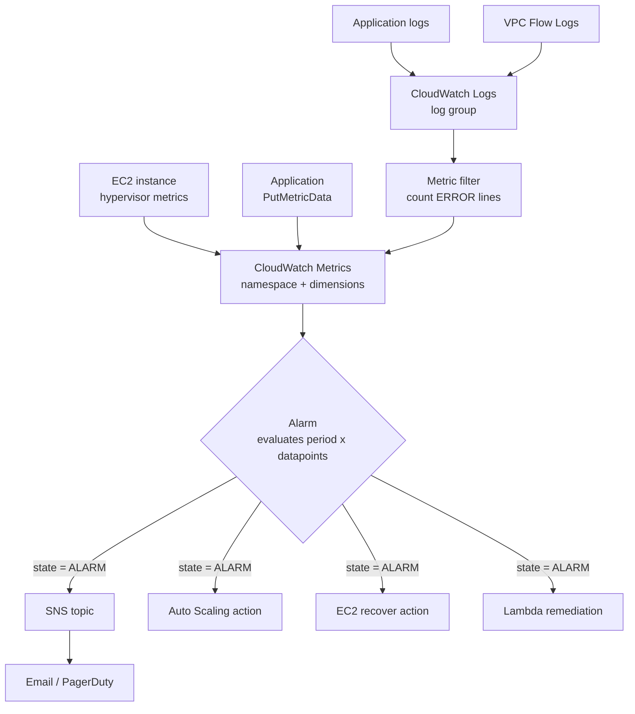
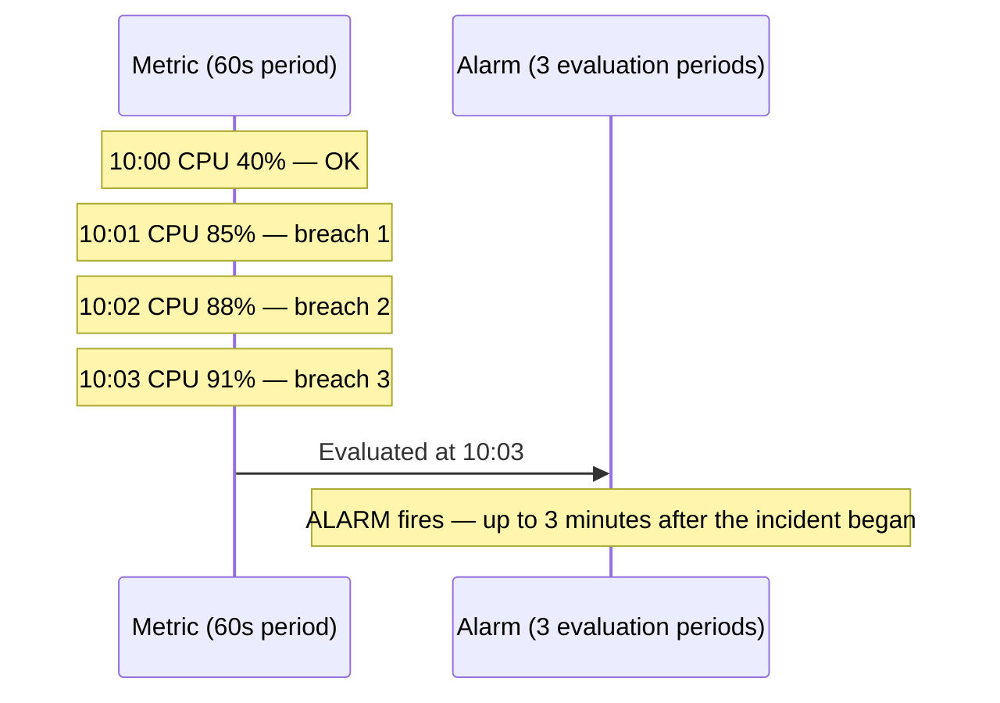

# 16 · CloudWatch

> **Phase 1 — Core Foundations** · Lesson 16 of 18
> ⬅️ Previous: [Network ACLs](./15-network-acls.md) · ➡️ Next: [CloudTrail](./17-cloudtrail.md) · 🏠 [Phase overview](./README.md)

## 🎯 Learning Objectives

By the end of this lesson you will be able to:

- Distinguish the three CloudWatch data types: metrics, logs, and events
- Publish a custom metric and build an alarm that is actually actionable
- Write Logs Insights queries that answer real operational questions
- Understand metric resolution, retention, and aggregation so alarms behave predictably

**Estimated time:** 60 min · **Difficulty:** Beginner

---

## 🧠 Core Concepts

**CloudWatch** is three products wearing one name, and conflating them causes most confusion:

1. **Metrics** — numeric time series. AWS services publish them automatically (EC2 CPU, ALB request counts, S3 bucket sizes). You can publish your own with `PutMetricData`.
2. **Logs** — `CloudWatch Logs` stores and lets you query log data. Services like Lambda, ECS, RDS, and VPC Flow Logs write here. Logs Insights is the query language.
3. **Alarms** — watchers on metrics that change state and trigger actions. Alarms can notify SNS, run Auto Scaling actions, or invoke EC2 recovery.

The metric model has four properties you must understand, because every confusing alarm traces back to one of them:

| Property | Meaning | Consequence |
|----------|---------|-------------|
| **Namespace** | The grouping, e.g. `AWS/EC2` or `MyApp/Orders` | You query within a namespace |
| **Dimensions** | Up to 30 name/value pairs identifying the metric, e.g. `InstanceId` | Different dimension sets are *different metrics* |
| **Resolution** | Standard (60s) or high resolution (1s) | High resolution costs more and only affects custom metrics |
| **Retention** | 1-minute data for 15 days, then progressively coarser | Data ages into 5-minute, 1-hour, and 1-day granularity over time |

The dimensions point is the one that bites hardest. `CPUUtilization` for an instance is published under the dimension `InstanceId`. If you request it without that dimension, you get nothing. Worse, if you request `CPUUtilization` with a *different* set of dimensions than the publisher used, CloudWatch creates nothing and the alarm sits in `INSUFFICIENT_DATA` forever.

**Alarms are about state, not events.** An alarm has three states — `OK`, `ALARM`, and `INSUFFICIENT_DATA` — and it evaluates on a schedule according to its period and evaluation periods. An alarm with a 60-second period and three evaluation periods needs three consecutive breaching datapoints before it fires. That means a brief spike is absorbed, which is usually what you want, and also means a real incident has a built-in delay of up to three minutes.

The distinction that separates useful monitoring from noise: **`INSUFFICIENT_DATA` is not `OK`**. An alarm whose metric stopped being published is in `INSUFFICIENT_DATA`, which looks quiet but means you have gone blind. Treating it as healthy, or using `treatMissingData: notBreaching`, is how teams fail to notice that an entire service stopped emitting metrics.

### Key terminology

| Term | Meaning |
|------|---------|
| **Metric** | A named time series with dimensions. |
| **Dimension** | An attribute identifying a metric, e.g. `InstanceId`, `FunctionName`. |
| **Custom metric** | A metric you publish yourself via `PutMetricData`. |
| **Metric math** | Combining metrics in an expression, e.g. error rate from errors divided by requests. |
| **Alarm** | A state machine over a metric that triggers actions. |
| **Composite alarm** | An alarm that combines other alarms, reducing notification noise. |
| **Log group / stream** | The container and the sequence within it for log events. |
| **Metric filter** | Extracts a metric from log data, e.g. count of ERROR lines. |
| **Logs Insights** | The query language for searching log groups. |
| **Embedded Metric Format** | Publishing metrics by writing structured JSON to a log. |

---

## 🗺️ Architecture Diagram

How the three CloudWatch surfaces connect:



The alarm evaluation window, which explains why alarms feel slow:



---

## 🧪 Hands-on Lab: Custom Metrics, a Useful Alarm, and a Logs Insights Query

**Goal:** Publish an application-level metric, alarm on a *business* condition rather than CPU, extract a metric from log lines, and query logs with Logs Insights.

**Prerequisites:** An EC2 instance with an IAM role permitting `cloudwatch:PutMetricData` and `logs:*`.

### Step 1 — Publish a custom metric

```bash
# Publish application metrics with dimensions that let you slice them later
aws cloudwatch put-metric-data \
  --namespace "MyApp/Orders" \
  --metric-data \
    'MetricName=OrdersProcessed,Value=142,Unit=Count,Dimensions={Environment=prod,Tier=api}' \
    'MetricName=OrderProcessingLatency,Value=340,Unit=Milliseconds,Dimensions={Environment=prod,Tier=api}'
```

Choosing the namespace and dimensions deliberately is what makes the metric useful later. `Environment` as a dimension lets you alarm on production without including staging.

### Step 2 — Create a metric filter from logs

Assume application logs are in `/myapp/api` and contain lines like `ERROR checkout failed order=1234`.

```bash
aws logs put-metric-filter \
  --log-group-name /myapp/api \
  --filter-name CheckoutErrors \
  --filter-pattern '[timestamp, level=ERROR, ...]' \
  --metric-transformations \
    metricName=CheckoutErrorCount,metricNamespace=MyApp/Orders,metricValue=1,defaultValue=0
```

The `defaultValue=0` matters: without it, the metric stops being published when there are no errors, the alarm falls into `INSUFFICIENT_DATA`, and you cannot tell "no errors" from "logging broke."

### Step 3 — Alarm on the business metric, not just infrastructure

```bash
aws cloudwatch put-metric-alarm \
  --alarm-name "checkout-errors-high" \
  --alarm-description "Checkout error rate exceeded 5 in 5 minutes" \
  --namespace "MyApp/Orders" \
  --metric-name CheckoutErrorCount \
  --statistic Sum \
  --period 300 \
  --evaluation-periods 1 \
  --threshold 5 \
  --comparison-operator GreaterThanThreshold \
  --treat-missing-data notBreaching \
  --dimensions Name=Environment,Value=prod \
  --alarm-actions arn:aws:sns:eu-west-1:123456789012:ops-alerts \
  --ok-actions arn:aws:sns:eu-west-1:123456789012:ops-alerts
```

Two deliberate choices here:

- The metric is a **business signal** (`CheckoutErrorCount`), not CPU. A CPU alarm on a healthy autoscaling group tells you nothing you can act on. "Customers cannot check out" is actionable.
- `--ok-actions` is set, so the team gets a recovery notification and knows when to stop looking.

### Step 4 — Use metric math for a percentage rather than a raw count

A raw error count is misleading if traffic volume varies. An error *rate* is the signal that matters.

```bash
aws cloudwatch put-metric-alarm \
  --alarm-name "checkout-error-rate" \
  --metrics '[
    {"Id":"errors","MetricStat":{"Metric":{"Namespace":"MyApp/Orders","MetricName":"CheckoutErrorCount","Dimensions":[{"Name":"Environment","Value":"prod"}]},"Period":300,"Stat":"Sum"},"ReturnData":false},
    {"Id":"requests","MetricStat":{"Metric":{"Namespace":"MyApp/Orders","MetricName":"OrdersProcessed","Dimensions":[{"Name":"Environment","Value":"prod"}]},"Period":300,"Stat":"Sum"},"ReturnData":false},
    {"Id":"rate","Expression":"(errors / requests) * 100","Label":"Error rate %","ReturnData":true}
  ]' \
  --evaluation-periods 2 \
  --threshold 2 \
  --comparison-operator GreaterThanThreshold \
  --alarm-actions arn:aws:sns:eu-west-1:123456789012:ops-alerts
```

This is the pattern worth internalizing: almost every meaningful alarm is a ratio, a rate, or a percentile, not a raw counter.

### Step 5 — Build a dashboard

```bash
aws cloudwatch put-dashboard --dashboard-name phase1-app \
  --dashboard-body '{
    "widgets": [
      {"type":"metric","x":0,"y":0,"width":12,"height":6,"properties":{
        "title":"Order error rate","metrics":[["MyApp/Orders","CheckoutErrorCount","Environment","prod"]],
        "period":300,"stat":"Sum","view":"timeSeries"
      }},
      {"type":"metric","x":12,"y":0,"width":12,"height":6,"properties":{
        "title":"Latency p99","metrics":[["MyApp/Orders","OrderProcessingLatency","Environment","prod",{"stat":"p99"}]],
        "view":"timeSeries"
      }},
      {"type":"log","x":0,"y":6,"width":24,"height":6,"properties":{
        "title":"Recent errors","query":"SOURCE \"/myapp/api\" | fields @timestamp, level, message | filter level = \"ERROR\" | sort @timestamp desc | limit 20",
        "view":"table"
      }}
    ]
  }'
```

Notice the latency widget uses `p99`, not `Average`. Averages hide exactly the problem you are looking for: if 1% of requests take 30 seconds, the average barely moves while real users are experiencing a broken service.

### Step 6 — Query logs with Logs Insights

```bash
# Find the slowest requests and group them
aws logs start-query \
  --log-group-name /myapp/api \
  --start-time "$(date -u -v-1H +%s)" \
  --end-time "$(date -u +%s)" \
  --query-string '
    fields @timestamp, requestId, path, duration, status
    | filter status >= 500
    | stats count() as errors, avg(duration) as avg_ms, max(duration) as max_ms by path
    | sort errors desc
    | limit 20
  '

# Retrieve the results using the queryId returned above
aws logs get-query-results --query-id <queryId>
```

Three Logs Insights patterns worth keeping:

```
# Top error messages and their frequency
fields @timestamp, message
| filter level = "ERROR"
| stats count() by message
| sort count desc

# Latency percentiles per endpoint
fields path, duration
| stats pct(duration, 50) as p50, pct(duration, 99) as p99 by path

# Find requests that span a deployment window
fields @timestamp, version, status
| filter @timestamp > 1760000000 and version = "1.4.2"
| stats count() by status
```

The third one is the query that answers "did the deploy break anything?" — and it is the reason you should log a version or commit SHA with every request.

---

## 💻 CLI Reference

```bash
# Get statistics for a metric over a window
aws cloudwatch get-metric-statistics \
  --namespace AWS/EC2 --metric-name CPUUtilization \
  --dimensions Name=InstanceId,Value=i-0123456789abcdef0 \
  --start-time "$(date -u -v-6H +%Y-%m-%dT%H:%M:%S)" \
  --end-time "$(date -u +%Y-%m-%dT%H:%M:%S)" \
  --period 300 --statistics Average Maximum

# List metrics matching a namespace, to discover the exact dimensions in use
aws cloudwatch list-metrics --namespace "MyApp/Orders" \
  --query 'Metrics[].[MetricName,Dimensions]' --output json

# See why an alarm is in its current state
aws cloudwatch describe-alarms --alarm-names checkout-errors-high \
  --query 'MetricAlarms[0].[StateValue,StateReason,StateUpdatedTimestamp]'

# Find any alarm that has stopped receiving data — the silent failure mode
aws cloudwatch describe-alarms --state-value INSUFFICIENT_DATA \
  --query 'MetricAlarms[].[AlarmName,StateReason]' --output table

# Tail a log group by following events as they arrive
aws logs tail /myapp/api --follow --since 10m

# Create a log group with a real retention period (never leave it on "never expire")
aws logs create-log-group --log-group-name /myapp/api
aws logs put-retention-policy --log-group-name /myapp/api --retention-in-days 30
```

| Command | Purpose |
|---------|---------|
| `list-metrics` | Discover the exact dimensions before writing an alarm |
| `describe-alarms --state-value INSUFFICIENT_DATA` | Find monitoring that has gone blind |
| `put-retention-policy` | Stop paying for logs nobody will read |
| `logs tail --follow` | Live debugging without a full query |

---

## ✅ Best Practices

| Practice | Why it matters |
|----------|----------------|
| Alarm on symptoms customers feel, not on resources | "Checkout failing" is actionable; "CPU is 70%" usually is not |
| Always set `--ok-actions` | Recovery notification tells the team to stop investigating |
| Use percentiles (`p99`, `p95`), rarely averages | Averages hide the tail users actually experience |
| Set an explicit log retention on every log group | The default is never expire, which is a growing bill |
| Give every alarm a description | On-call engineers should not have to guess intent at 3am |
| Prefer composite alarms for team-facing alerts | Reduces the storm of correlated alerts from one incident |
| Use `defaultValue=0` on log-derived metrics | Distinguishes "no errors" from "no data" |
| Monitor the monitoring | An alarm on `INSUFFICIENT_DATA` across critical alarms catches silent failure |

---

## ⚠️ Common Pitfalls

| Pitfall | Symptom | Fix |
|---------|---------|-----|
| Wrong dimensions | Alarm stuck in `INSUFFICIENT_DATA` forever | Use `list-metrics` to find the exact dimension set |
| Missing data treated as `breaching` | Alarms fire whenever the service is quiet | Use `notBreaching` for log-derived metrics with `defaultValue=0` |
| Averages hiding latency | Dashboards look healthy, users complain | Switch to `p99` |
| Logs with no retention policy | Bill grows indefinitely | Set retention at creation; 30 days is a reasonable default |
| Too many alarms, not enough signal | Alert fatigue, real alerts ignored | Consolidate with composite alarms; delete alarms nobody acts on |
| Evaluating a spiky metric with 1 period | Constant flapping between states | Use more evaluation periods or a shorter period with `M out of N` |
| Custom metrics from the wrong region | Metric appears to be missing | Metrics are regional; publish and query in the same region |
| Logging everything at DEBUG | High ingestion cost and slow queries | Log at INFO in production; make level configurable |

---

## 💰 Cost Considerations

CloudWatch is often the surprise line item in an AWS bill, because most of it is usage-based and grows silently. The four components:

**1. Metrics.** Standard-resolution custom metrics are billed per metric per month, with the first ten custom metrics free and tiered pricing beyond. AWS-service-provided metrics are free. High-resolution metrics cost more. A metric's price depends on its full dimension combination, so adding a dimension multiplies the metric count.

**2. API requests.** `PutMetricData` is billed per 1,000 requests, and `GetMetricStatistics` calls from dashboards and alarms are billed too.

**3. Logs ingestion and storage.** This is usually the largest component. Ingestion is billed per GB, storage per GB-month, and Logs Insights queries are billed per GB scanned. VPC Flow Logs are the classic offender: a busy VPC can generate terabytes per month, and each query scans the whole selected range.

**4. Alarms.** Standard alarms are billed per alarm per month; composite alarms and high-resolution alarms cost more.

Concrete reductions that matter:

- **Set log retention everywhere.** A log group with no retention policy stores data forever. Moving to 30 days, or exporting older data to S3 and querying it with Athena, is often a 60–80% reduction in the log storage line. Use `put-retention-policy` at scale.
- **Filter before you ingest.** Do not ship DEBUG logs to CloudWatch. Filter at the agent or with subscription filters, and put cheap long-term copies in S3.
- **Narrow Logs Insights queries.** Queries are billed by the volume scanned, so a query against one day costs far less than one against a month. Always bound the time range.
- **Use Contributor Insights or Embedded Metric Format selectively.** Both are billed and easy to enable broadly.
- **Delete unused alarms and dashboards.** Alarms are cheap individually and add up across hundreds of resources.

One more note worth internalizing: **CloudWatch Logs and S3 are not interchangeable**. S3 stores the same data for roughly a tenth of the CloudWatch storage price, with far cheaper querying via Athena. A common and effective pattern is to keep 7–30 days hot in CloudWatch for troubleshooting and archive the rest to S3.

---

## 🔐 Security Considerations

- **Logs frequently contain sensitive data.** Application logs are where passwords, tokens, personal data, and full request bodies end up. Use the CloudWatch Logs data protection feature to detect and mask sensitive data, or scrub at the application layer before logging.
- **Encrypt log groups with a customer-managed KMS key.** CloudWatch Logs encrypts at rest by default, but a CMK gives you control of the key policy, and therefore control of who can decrypt your logs.
- **Log access is access to your data.** `logs:GetLogEvents` and `logs:FilterLogEvents` let a caller read everything your application logged. Restrict those permissions and route them through a break-glass role rather than granting them broadly.
- **Do not put credentials in log output.** Environment dumps, connection strings, and request headers routinely leak. Add a linting step or a review checklist for log statements.
- **Use resource policies on log groups** to prevent a role from being able to delete the audit trail. `logs:DeleteLogGroup` on a security log group should be denied and alerted.
- **Metric and alarm tampering is a real attack technique.** Someone who can disable an alarm (`cloudwatch:DisableAlarmActions`) or delete a metric filter can blind your detection. Monitor those API calls in CloudTrail.
- **Beware of using logs as your only audit source.** CloudWatch is operational telemetry; CloudTrail is the audit trail. They serve different purposes and you need both — the next lesson covers the second.

---

## 🧩 Exercise

Build a monitoring setup for a simple HTTP API with these requirements:

1. A dashboard showing request count, p99 latency, and error rate as a percentage — not a raw count
2. An alarm that fires when the error rate exceeds 2% for two consecutive 5-minute periods
3. A metric filter that counts `WARN` log lines and publishes them to a custom namespace
4. A Logs Insights query that lists the ten slowest distinct request paths in the last hour
5. A stated monthly cost estimate for this setup, assuming 50 GB of logs per month and 20 custom metrics

Then answer: what would your monitoring miss if the application stopped emitting logs entirely, and how would you detect that *before* a customer reports it?

Success looks like: every alarm is actionable by an on-call engineer, the cost estimate identifies logs as the dominant line item, and your answer to the final question involves alarming on the absence of data rather than on its value.

---

## 📚 Resources

- [Amazon CloudWatch User Guide](https://docs.aws.amazon.com/AmazonCloudWatch/latest/monitoring/WhatIsCloudWatch.html)
- [Amazon CloudWatch Logs](https://docs.aws.amazon.com/AmazonCloudWatch/latest/logs/WhatIsCloudWatchLogs.html)
- [CloudWatch Logs Insights Query Syntax](https://docs.aws.amazon.com/AmazonCloudWatch/latest/logs/CWL_QuerySyntax.html)
- [Creating CloudWatch Alarms](https://docs.aws.amazon.com/AmazonCloudWatch/latest/monitoring/AlarmThatSendsEmail.html)
- [CloudWatch Metrics Concepts](https://docs.aws.amazon.com/AmazonCloudWatch/latest/monitoring/cloudwatch_concepts.html)
- [CloudWatch Pricing](https://aws.amazon.com/cloudwatch/pricing/)

---

## ➡️ Next Steps

CloudWatch tells you how your systems are behaving. It does not tell you who changed a security group at 2am, or who deleted a bucket. That is a different question, and it needs a different service.

> ⬅️ Previous: [Network ACLs](./15-network-acls.md) · ➡️ Next: [CloudTrail](./17-cloudtrail.md) · 🏠 [Phase overview](./README.md)
