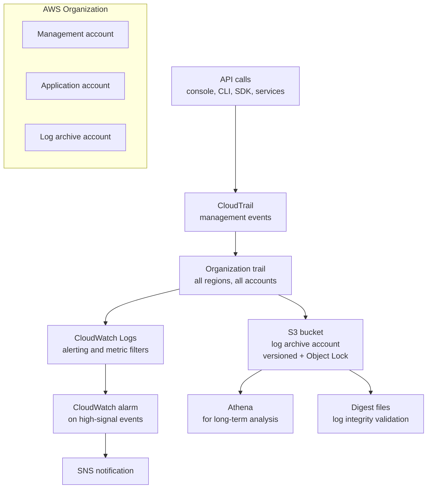
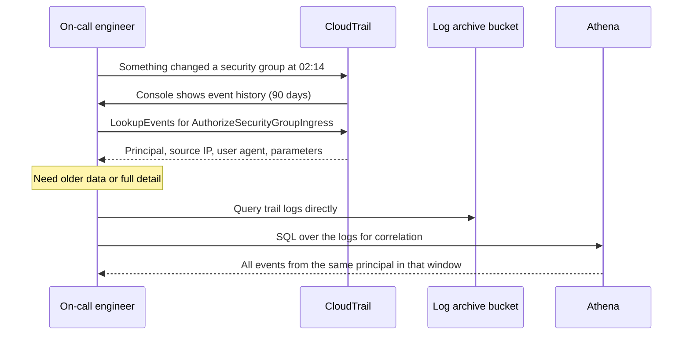

# 17 · CloudTrail

> **Phase 1 — Core Foundations** · Lesson 17 of 18
> ⬅️ Previous: [CloudWatch](./16-cloudwatch.md) · ➡️ Next: [Capstone: Secure 3-Tier Web App](./18-project-secure-3-tier-web-app.md) · 🏠 [Phase overview](./README.md)

## 🎯 Learning Objectives

By the end of this lesson you will be able to:

- Explain the difference between CloudTrail event history, a trail, and data events
- Create a multi-region trail delivering to a hardened S3 bucket with log file validation
- Use CloudTrail to answer "who made this API call, from where, and what did they change?"
- Understand what CloudTrail does *not* record, and what fills that gap

**Estimated time:** 55 min · **Difficulty:** Intermediate

---

## 🧠 Core Concepts

**CloudTrail** records API activity in your account. Every time someone — a person, an application, a role, an AWS service — calls an API, CloudTrail writes an event describing who did it, when, from where, and the request parameters. It is the authoritative answer to "who changed that?" and the foundation of every audit, compliance, and incident response process on AWS.

CloudTrail has three distinct modes, and knowing which one you are relying on matters enormously:

1. **Event history** — a free, always-on, 90-day record of *management events* in the region, visible in the console with no configuration. This is not a trail. It cannot be sent anywhere, it cannot be extended beyond 90 days, and it disappears permanently after that window. Relying on event history for compliance is a common and serious mistake.
2. **Trails** — a configuration that delivers events to an S3 bucket (and optionally CloudWatch Logs) indefinitely. Trails can be single-region or multi-region, and can cover all accounts in an organization. This is what you actually need.
3. **Data events** — high-volume, opt-in events for the *data plane*: S3 `GetObject`/`PutObject`, Lambda `Invoke`, DynamoDB item-level operations. These are **not** recorded by default because the volume is enormous, and they are billed separately.

That last distinction is the one that produces the most confusion during an incident. A trail recording management events will show you that someone changed a bucket policy. It will **not** show you that someone downloaded a specific object, because `GetObject` is a data event. If you are investigating a data breach and did not enable S3 data events in advance, the information simply does not exist — you cannot turn it on retroactively.

CloudTrail records **management events** including security-relevant ones you should care about deeply: `CreateUser`, `AttachUserPolicy`, `AuthorizeSecurityGroupIngress`, `PutBucketPolicy`, `StopLogging`, `DeleteTrail`, `CreateAccessKey`, and `AssumeRole`. Those last two are the highest-signal events in any investigation.

**Log file validation** is a feature that produces a digest file alongside each log file, allowing you to cryptographically prove that logs have not been altered or deleted. Without it, an attacker who gains S3 write access could tamper with the audit trail. With it, tampering is detectable. Enable it on every trail.

Finally, understand CloudTrail's limits. It records the API call, not the effect. It does not record SSH sessions on an instance, database queries inside RDS, application-level actions, or reads within an SNS/SQS message. For those you need VPC Flow Logs, database audit logs, application logs in CloudWatch, and GuardDuty for threat detection.

### Key terminology

| Term | Meaning |
|------|---------|
| **Event** | A record of one API call, in JSON. |
| **Management event** | Control-plane operations — creating, modifying, deleting resources. Recorded by default. |
| **Data event** | Data-plane operations — S3 object reads and writes, Lambda invocations. Opt-in and billed. |
| **Insight event** | Anomaly detection over API call rates. |
| **Trail** | A configuration delivering events to S3 and/or CloudWatch Logs. |
| **Organization trail** | A single trail covering every account in an AWS Organization. |
| **Log file validation** | Cryptographic digests proving logs were not modified. |
| **Event selector** | The filter defining which events a trail records. |
| **`CloudTrailEvent`** | The full JSON of an event, available via `LookupEvents` and in S3. |

---

## 🗺️ Architecture Diagram

CloudTrail's position in the account and where events flow:



How an investigation actually proceeds:



---

## 🧪 Hands-on Lab: A Hardened Multi-Region Organization Trail

**Goal:** Create a trail that covers all regions, delivers to a locked-down S3 bucket with log file validation, feeds CloudWatch Logs for alerting, and can answer a specific investigative question.

**Prerequisites:** Permissions for CloudTrail, S3, and KMS. For an organization trail, the management account.

### Step 1 — Create the log archive bucket

```bash
LOG_BUCKET="org-cloudtrail-logs-$(aws sts get-caller-identity --query Account --output text)"

aws s3api create-bucket --bucket "$LOG_BUCKET" --region eu-west-1 \
  --create-bucket-configuration LocationConstraint=eu-west-1

# Versioning protects against an attacker overwriting log files
aws s3api put-bucket-versioning --bucket "$LOG_BUCKET" \
  --versioning-configuration Status=Enabled

# Block all public access
aws s3api put-public-access-block --bucket "$LOG_BUCKET" \
  --public-access-block-configuration \
  "BlockPublicAcls=true,IgnorePublicAcls=true,BlockPublicPolicy=true,RestrictPublicBuckets=true"

# Encrypt with a customer-managed key so you control who can read the audit trail
aws s3api put-bucket-encryption --bucket "$LOG_BUCKET" \
  --server-side-encryption-configuration '{
    "Rules": [{"ApplyServerSideEncryptionByDefault": {"SSEAlgorithm": "aws:kms", "KMSMasterKeyID": "alias/cloudtrail-logs"}, "BucketKeyEnabled": true}]
  }'
```

### Step 2 — Apply the bucket policy CloudTrail requires

```bash
cat > trail-bucket-policy.json <<'EOF'
{
  "Version": "2012-10-17",
  "Statement": [
    {
      "Sid": "AWSCloudTrailAclCheck",
      "Effect": "Allow",
      "Principal": { "Service": "cloudtrail.amazonaws.com" },
      "Action": "s3:GetBucketAcl",
      "Resource": "arn:aws:s3:::REPLACE_BUCKET",
      "Condition": { "StringEquals": { "aws:SourceArn": "arn:aws:cloudtrail:eu-west-1:REPLACE_ACCOUNT:trail/org-trail" } }
    },
    {
      "Sid": "AWSCloudTrailWrite",
      "Effect": "Allow",
      "Principal": { "Service": "cloudtrail.amazonaws.com" },
      "Action": "s3:PutObject",
      "Resource": "arn:aws:s3:::REPLACE_BUCKET/AWSLogs/*",
      "Condition": {
        "StringEquals": {
          "s3:x-amz-acl": "bucket-owner-full-control",
          "aws:SourceArn": "arn:aws:cloudtrail:eu-west-1:REPLACE_ACCOUNT:trail/org-trail"
        }
      }
    },
    {
      "Sid": "DenyInsecureTransport",
      "Effect": "Deny",
      "Principal": "*",
      "Action": "s3:*",
      "Resource": ["arn:aws:s3:::REPLACE_BUCKET", "arn:aws:s3:::REPLACE_BUCKET/*"],
      "Condition": { "Bool": { "aws:SecureTransport": "false" } }
    },
    {
      "Sid": "DenyDeletionOfLogs",
      "Effect": "Deny",
      "Principal": "*",
      "Action": ["s3:DeleteObject", "s3:DeleteObjectVersion", "s3:PutBucketPolicy"],
      "Resource": ["arn:aws:s3:::REPLACE_BUCKET/*", "arn:aws:s3:::REPLACE_BUCKET"],
      "Condition": {
        "StringNotEquals": { "aws:PrincipalArn": "arn:aws:iam::REPLACE_ACCOUNT:role/LogAdminRole" }
      }
    }
  ]
}
EOF

sed -i '' "s/REPLACE_BUCKET/$LOG_BUCKET/g; s/REPLACE_ACCOUNT/$(aws sts get-caller-identity --query Account --output text)/g" trail-bucket-policy.json

aws s3api put-bucket-policy --bucket "$LOG_BUCKET" --policy file://trail-bucket-policy.json
```

The `DenyDeletionOfLogs` statement is the important one. An audit trail that the audited party can delete is not an audit trail.

### Step 3 — Create the trail

```bash
aws cloudtrail create-trail \
  --name org-trail \
  --s3-bucket-name "$LOG_BUCKET" \
  --is-multi-region-trail \
  --is-organization-trail \
  --enable-log-file-validation \
  --kms-key-id alias/cloudtrail-logs \
  --s3-key-prefix "cloudtrail"

# Start delivery — creating a trail does not automatically enable it
aws cloudtrail start-logging --name org-trail
```

The most common mistake with CloudTrail is creating a trail and never starting logging. `create-trail` configures it; `start-logging` turns it on. Always verify with `get-trail-status`.

### Step 4 — Verify logging is actually working

```bash
aws cloudtrail get-trail-status --name org-trail \
  --query '{Logging:IsLogging,LatestDelivery:LatestDeliveryTime,LatestError:LatestDeliveryError}'
```

`IsLogging` must be `true` and `LatestDeliveryError` must be `null`. If delivery is erroring, the bucket policy is almost always the cause.

### Step 5 — Add high-signal alerting via CloudWatch Logs

```bash
# Send events to CloudWatch Logs so you can alarm on them
aws cloudtrail update-trail --name org-trail \
  --cloud-watch-logs-log-group-arn arn:aws:logs:eu-west-1:123456789012:log-group:CloudTrail/OrgTrail:* \
  --cloud-watch-logs-role-arn arn:aws:iam::123456789012:role/CloudTrailToCloudWatchLogs

# Alert whenever anyone disables the trail itself
aws logs put-metric-filter \
  --log-group-name CloudTrail/OrgTrail \
  --filter-name TrailTampering \
  --filter-pattern '{ ($.eventName = "StopLogging") || ($.eventName = "DeleteTrail") || ($.eventName = "UpdateTrail") }' \
  --metric-transformations metricName=TrailTamperingCount,metricNamespace=Security/CloudTrail,metricValue=1,defaultValue=0

aws cloudwatch put-metric-alarm \
  --alarm-name "cloudtrail-tampering" \
  --namespace Security/CloudTrail --metric-name TrailTamperingCount \
  --statistic Sum --period 300 --evaluation-periods 1 --threshold 1 \
  --comparison-operator GreaterThanOrEqualToThreshold \
  --treat-missing-data notBreaching \
  --alarm-actions arn:aws:sns:eu-west-1:123456789012:security-alerts \
  --alarm-description "Someone attempted to disable or modify CloudTrail logging"
```

Filter patterns worth adding immediately, because each corresponds to a known attacker action:

| Event | Why it matters |
|-------|----------------|
| `StopLogging`, `DeleteTrail` | Blinding the audit trail |
| `CreateAccessKey` | Establishing persistence with long-lived credentials |
| `AuthorizeSecurityGroupIngress` | Opening a path back in |
| `PutBucketPolicy` with public access | Exposing data |
| `AssumeRole` from an unexpected source IP | Lateral movement |
| `DeleteTrail`, `PutRetentionPolicy` on a security log group | Destroying evidence |
| Console login without MFA | Weak authentication |

### Step 6 — Answer an investigative question

```bash
# Who authorized a security group ingress in the last 24 hours, and from where?
aws cloudtrail lookup-events \
  --lookup-attributes AttributeKey=EventName,AttributeValue=AuthorizeSecurityGroupIngress \
  --start-time "$(date -u -v-1d +%Y-%m-%dT%H:%M:%SZ)" \
  --query 'Events[].[EventTime,Username,CloudTrailEvent]' --output json | \
  python3 -c "
import json,sys
for t,u,e in json.load(sys.stdin):
    ev = json.loads(e)
    print(f\"{t}  {u}  {ev.get('sourceIPAddress')}  {ev.get('userAgent','')[:40]}\")
"

# Who created access keys, and when?
aws cloudtrail lookup-events \
  --lookup-attributes AttributeKey=EventName,AttributeValue=CreateAccessKey \
  --max-results 50 \
  --query 'Events[].[EventTime,Username]' --output table

# Every action taken by one suspicious principal
aws cloudtrail lookup-events \
  --lookup-attributes AttributeKey=Username,AttributeValue=suspicious-user \
  --max-results 100 \
  --query 'Events[].[EventTime,EventName,CloudTrailEvent]' --output json
```

### Step 7 — Query the archive at scale with Athena

`LookupEvents` only covers the last 90 days and returns limited detail. For real analysis over the full trail, query the S3 logs with Athena.

```bash
# Create a table over the trail logs (run once), then query like this:
# SELECT eventtime, useridentity.arn, sourceipaddress, eventname
# FROM cloudtrail_logs
# WHERE eventsource = 'ec2.amazonaws.com'
#   AND eventname = 'AuthorizeSecurityGroupIngress'
#   AND eventtime >= '2026/10/01'
# ORDER BY eventtime DESC
# LIMIT 100;
```

---

## 💻 CLI Reference

```bash
# Confirm a trail's configuration and status
aws cloudtrail describe-trails --include-shadow-trails false \
  --query 'trailList[].[Name,IsMultiRegionTrail,LogFileValidationEnabled,S3BucketName,HomeRegion]' --output table

# Verify log file integrity — proves logs were not tampered with
aws cloudtrail validate-logs \
  --trail-arn arn:aws:cloudtrail:eu-west-1:123456789012:trail/org-trail \
  --start-time 2026-10-01T00:00:00Z

# Enable S3 data events on a trail (billed separately, use with intent)
aws cloudtrail put-event-selectors --trail-name org-trail \
  --advanced-event-selectors '[{
    "Name": "S3DataEvents",
    "FieldSelectors": [
      {"Field": "eventCategory", "Equals": ["Data"]},
      {"Field": "resources.type", "Equals": ["AWS::S3::Object"]},
      {"Field": "resources.ARN", "StartsWith": ["arn:aws:s3:::sensitive-bucket/"]}
    ]
  }]'

# Check whether event history is available and how far back
aws cloudtrail lookup-events --max-results 5 \
  --query 'Events[0].EventTime' --output text

# Find AWS account IDs that assumed roles into your account
aws cloudtrail lookup-events \
  --lookup-attributes AttributeKey=EventName,AttributeValue=AssumeRole \
  --query 'Events[].[EventTime,Username]' --output table
```

| Command | Purpose |
|---------|---------|
| `get-trail-status` | The check that actually confirms logging is on and delivering |
| `validate-logs` | Cryptographic proof the trail was not altered |
| `put-event-selectors` | Enable data events, ideally scoped to sensitive resources only |
| `lookup-events` | Fast investigative queries over the last 90 days |

---

## ✅ Best Practices

| Practice | Why it matters |
|----------|----------------|
| Always call `start-logging` after `create-trail` | A configured trail that is not logging catches nothing |
| Enable multi-region trails | Attackers use regions you are not monitoring |
| Enable log file validation | Makes tampering detectable, not just unlikely |
| Use an organization trail | One trail covering every account, immune to per-account tampering |
| Deliver to a dedicated log archive account | Production accounts cannot delete their own audit trail |
| Enable versioning and Object Lock on the log bucket | Protects against overwrite and deletion |
| Alert on trail tampering itself | The first thing an attacker does is blind the logs |
| Send security-relevant events to CloudWatch Logs | Turns the audit trail into real-time detection |
| Enable S3 data events for sensitive buckets only | Records who read what, without paying for every object in the account |
| Keep logs beyond 90 days in S3 | Event history expires; compliance requirements usually do not |

---

## ⚠️ Common Pitfalls

| Pitfall | Symptom | Fix |
|---------|---------|-----|
| Assuming event history is a trail | Logs gone after 90 days | Create a real trail delivering to S3 |
| Trail created but not started | Nothing is recorded at all | `start-logging`, then verify with `get-trail-status` |
| Single-region trail | Events from unused regions are invisible | Set `--is-multi-region-trail` |
| Data events assumed to be on | "Who downloaded that object?" cannot be answered | Explicitly enable data events for sensitive buckets in advance |
| No log file validation | Tampering cannot be proven | Enable at trail creation; it cannot be added retroactively to old logs |
| Bucket policy missing `GetBucketAcl` | No logs delivered, error visible in trail status | Include the full policy from the lab |
| Trailing slash missing in S3 ARN in policy | `PutObject` denied | Use `arn:aws:s3:::bucket/AWSLogs/*` exactly |
| Assuming CloudTrail logs everything | SSH commands, database queries, and reads are missing | Pair with VPC Flow Logs, GuardDuty, and application logs |

---

## 💰 Cost Considerations

The first copy of management events is **free**: one multi-region trail recording management events across all regions, without data events, incurs no CloudTrail charge. Delivery to S3 costs only the S3 storage, which is small.

Costs begin with:

- **Additional trails** beyond the first copy of management events — billed per 100,000 events.
- **Data events** — the expensive part. S3 data events are billed per 100,000 events, and a busy bucket can generate millions per day. Enabling S3 data events on every bucket in a large account is a fast path to a five-figure monthly bill.
- **CloudWatch Logs delivery** — ingestion and storage charges, plus Logs Insights query charges.
- **Insight events** — billed per 100,000 events analyzed.
- **S3 storage** for the archive — genuinely cheap, at roughly $0.023/GB-month, and reduced further by lifecycle transition to cheaper classes after 90 days.

The practical guidance:

1. **Keep one organization multi-region trail with management events** — effectively free, and never disable it.
2. **Enable data events selectively**, scoped by resource ARN to the buckets that actually hold sensitive or regulated data. The `resources.ARN StartsWith` selector in the lab is how you do this precisely.
3. **Apply a lifecycle policy to the log bucket** — transition to Standard-IA at 90 days, Glacier IR at 400 days, expire per your retention requirement.
4. **Do not ship every log group to CloudWatch Logs.** Only security-relevant events need near-real-time alerting. Everything else can be analyzed on demand from S3 with Athena, which costs far less per query than Logs Insights per GB scanned.

A realistic figure: an organization trail with management events plus data events on three sensitive buckets typically costs tens of dollars per month, of which the CloudWatch Logs ingestion is the largest component. The same scope, enabled account-wide without resource filters, can cost thousands.

---

## 🔐 Security Considerations

- **CloudTrail is a target, not just a tool.** The first action of a competent attacker with admin credentials is to disable or tamper with logging. Alert on `StopLogging`, `DeleteTrail`, and `UpdateTrail` in real time. This single alarm has more detection value than almost any other.
- **Separate the writer from the reader and the deleter.** Deliver logs to a dedicated archive account that production accounts cannot write to except through CloudTrail itself, and cannot delete from at all. The `DenyDeletionOfLogs` policy statement is the mechanism.
- **Log file validation closes the tampering window.** Without digest files you have no way to prove the logs you are reading are complete.
- **Object Lock for regulatory retention.** For compliance regimes requiring immutable audit records, S3 Object Lock in compliance mode prevents deletion even by the root user for the retention period. Choose the period carefully — it is irreversible.
- **Encrypt with a customer-managed key.** A CMK lets you control who can decrypt the audit trail, and lets you revoke access by disabling the key. Remember that key deletion makes all logs encrypted with it permanently unreadable.
- **Restrict `cloudtrail:LookupEvents`.** The event history panel exposes a great deal of information about your account structure, principals, and API surface. It is a reconnaissance goldmine for an attacker with read access.
- **Know the blind spots.** CloudTrail does not record SSH commands on an instance, database queries inside RDS, or reads of SNS/SQS messages. For those, use Systems Manager Session Manager logging, database audit logs, and application-level logging with a clear data classification in mind.
- **Do not let event history be your only evidence.** Its 90-day limit is generous for incident response and inadequate for a legal or regulatory inquiry, which routinely reaches back years.

---

## 🧩 Exercise

You are handed a security incident. An S3 bucket containing customer data was found to be publicly readable for an unknown period, and it has now been fixed. Answer these questions using CloudTrail, and where you cannot answer, name the tool or log source that would have been needed:

1. Who made the bucket public, from which IP address, and at what time?
2. Was the bucket policy change accompanied by similar changes to other buckets?
3. Who downloaded objects from the bucket while it was public?
4. Did anyone attempt to disable or modify CloudTrail around the same time?
5. Are there any access keys created around the incident window?

Then answer the harder question: **which of these five could you not have answered if data events had never been enabled, and what would you change today to make sure you can answer it next time?**

Success looks like: questions 1, 2, 4, and 5 are answered from management events, question 3 is the one you cannot answer retroactively, and your remediation plan includes scoped S3 data events on all buckets holding sensitive data.

---

## 📚 Resources

- [AWS CloudTrail User Guide](https://docs.aws.amazon.com/awscloudtrail/latest/userguide/cloudtrail-user-guide.html)
- [CloudTrail Record Contents](https://docs.aws.amazon.com/awscloudtrail/latest/userguide/cloudtrail-event-reference.html)
- [Log File Integrity Validation](https://docs.aws.amazon.com/awscloudtrail/latest/userguide/cloudtrail-log-file-validation-intro.html)
- [Data Events](https://docs.aws.amazon.com/awscloudtrail/latest/userguide/logging-data-events-with-cloudtrail.html)
- [CloudTrail Security Best Practices](https://docs.aws.amazon.com/awscloudtrail/latest/userguide/best-practices-security.html)
- [Querying CloudTrail Logs with Athena](https://docs.aws.amazon.com/athena/latest/ug/cloudtrail-logs.html)

---

## ➡️ Next Steps

You have every building block of Phase 1: identity, compute, storage, networking, and observability. The final lesson of the phase assembles them into a single production-shaped architecture, and holds you to the standard of being able to explain every design decision.

> ⬅️ Previous: [CloudWatch](./16-cloudwatch.md) · ➡️ Next: [Capstone: Secure 3-Tier Web App](./18-project-secure-3-tier-web-app.md) · 🏠 [Phase overview](./README.md)
