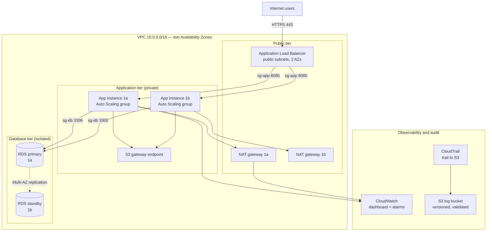
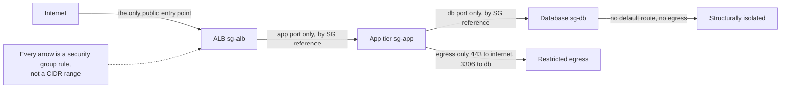

# 18 · Capstone: Secure 3-Tier Web App

> **Phase 1 — Core Foundations** · Lesson 18 of 18
> ⬅️ Previous: [CloudTrail](./17-cloudtrail.md) · 🏠 [Phase overview](./README.md)

## Learning Objectives

By the end of this capstone you will be able to:

- Assemble VPC, IAM, compute, storage, and observability into one coherent architecture
- Justify every network and authorization decision in the design to a reviewer
- Deploy a working application across two Availability Zones with no single point of failure in the app tier
- Produce the operational artifacts a real team would require: diagram, cost estimate, and teardown procedure

**Estimated time:** 4–6 hours · **Difficulty:** Advanced

---

## The Brief

You are building the production environment for a small but real application: a web frontend, an application API, and a relational database. The requirement is not "make it work" — a single EC2 instance with a public IP would technically satisfy that. The requirement is to build it the way a competent team builds it, and to be able to **defend every decision**.

This capstone deliberately has no single correct answer. It has a set of hard requirements and a set of decisions you must make, document, and reason about. The grading standard is not "did the application respond with HTTP 200" — it is "can you explain why the architecture is shaped this way, and what you would change at ten times the scale or a tenth of the budget."

Everything you need was covered in Lessons 01 through 17. This lesson is about composition.

---

## Target Architecture

The reference design. Your implementation may differ, but every deviation must be a deliberate, documented decision.



The trust boundaries, which is the part a reviewer will probe hardest:



---

## Hard Requirements

These are not optional. Each one maps to a lesson, and a reviewer will check each one.

### Identity (Lessons 01–04)

- [ ] No long-lived access keys anywhere — every compute resource uses an IAM role
- [ ] Each tier has its own IAM role with least-privilege permissions, not a shared admin role
- [ ] The EC2 role can write logs and read the specific S3 bucket it needs, and nothing else
- [ ] Root user has MFA enabled and no access keys
- [ ] RDS credentials are stored in Secrets Manager, never in user data or source

### Networking (Lessons 12–15)

- [ ] A VPC with a documented CIDR plan and room to grow
- [ ] Public subnets in two AZs for the load balancer and NAT gateways
- [ ] Private application subnets in two AZs
- [ ] Database subnets in two AZs with **no** `0.0.0.0/0` route in either direction
- [ ] One NAT gateway per AZ, with per-AZ private route tables
- [ ] An S3 gateway endpoint so object traffic does not traverse NAT
- [ ] Security groups that reference each other by group ID, never by CIDR
- [ ] The only inbound rule from `0.0.0.0/0` is 443 on the load balancer
- [ ] No SSH port open to the internet — use Session Manager

### Compute (Lessons 05–07)

- [ ] A launch template using a golden AMI, with IMDSv2 enforced
- [ ] An Auto Scaling group spanning both AZs, minimum 2 instances
- [ ] A target-tracking scaling policy with a stated target and justification
- [ ] Health checks via the load balancer, not just EC2 status checks
- [ ] Verified self-healing: terminate an instance, watch it be replaced

### Storage and Data (Lessons 08–11)

- [ ] RDS with Multi-AZ enabled (not a read replica — an actual standby)
- [ ] RDS storage encrypted, and automated backups with a stated retention period
- [ ] Any S3 bucket is versioned, encrypted, and has a lifecycle policy
- [ ] Block Public Access enabled on every bucket

### Observability and Audit (Lessons 16–17)

- [ ] A CloudWatch dashboard showing ALB requests, target response time p99, app CPU, RDS connections
- [ ] Alarms that are actionable: target 5xx rate, RDS free storage, RDS CPU, and unhealthy host count
- [ ] Every alarm has an SNS action and a meaningful description
- [ ] A CloudTrail multi-region trail with log file validation delivering to S3
- [ ] Log retention set on every CloudWatch log group
- [ ] An alarm that fires when the CloudTrail trail is modified or stopped

---

## Implementation Path

Work through these stages in order. Each ends with a verification step — do not proceed until it passes.

### Stage 1 — Network foundation

Build the VPC, subnets, route tables, NAT gateways, and endpoints from [Lesson 12](./12-vpc-fundamentals.md) and [Lesson 13](./13-subnets-and-route-tables.md).

**Verify:** `describe-route-tables` shows the database subnets have only the local route. Screenshot or save the output.

### Stage 2 — Security groups

Create the three security groups from [Lesson 14](./14-security-groups.md) with referencing rules only.

**Verify:** the audit query for `0.0.0.0/0` rules returns only the ALB on ports 80 and 443.

### Stage 3 — Golden image

Build an AMI containing the application runtime, the CloudWatch agent, and the Systems Manager agent, following [Lesson 06](./06-amis.md).

**Verify:** launch a test instance from the AMI with no user data and confirm the CloudWatch agent reports metrics within five minutes.

### Stage 4 — Database

Note the ordering: the database must exist before the application can be configured against it.

```bash
# Create a subnet group spanning the two isolated database subnets
aws rds create-db-subnet-group \
  --db-subnet-group-name phase1-db-subnets \
  --db-subnet-group-description "Isolated database subnets" \
  --subnet-ids subnet-db1a subnet-db1b

# Store the password in Secrets Manager and let RDS manage rotation
aws secretsmanager create-secret \
  --name phase1/rds/master \
  --secret-string '{"username":"appuser","password":"'"$(openssl rand -base64 24)"'"}'

aws rds create-db-instance \
  --db-instance-identifier phase1-db \
  --db-instance-class db.t4g.micro \
  --engine mysql \
  --master-username appuser \
  --master-user-password "$(aws secretsmanager get-secret-value --secret-id phase1/rds/master --query SecretString --output text | python3 -c 'import json,sys; print(json.load(sys.stdin)["password"])')" \
  --allocated-storage 20 \
  --storage-encrypted \
  --multi-az \
  --vpc-security-group-ids "$SG_DB" \
  --db-subnet-group-name phase1-db-subnets \
  --backup-retention-period 7 \
  --no-publicly-accessible \
  --enable-cloudwatch-logs-exports error slowquery
```

**Verify:** `describe-db-instances` shows `MultiAZ: true`, `StorageEncrypted: true`, `PubliclyAccessible: false`, and the instance is in the isolated subnet group.

### Stage 5 — Application tier

Create the launch template and Auto Scaling group from [Lesson 07](./07-auto-scaling.md), configured to read the database credentials from Secrets Manager at boot.

```bash
# The instance role needs exactly this and no more
cat > app-role-policy.json <<'EOF'
{
  "Version": "2012-10-17",
  "Statement": [
    {
      "Effect": "Allow",
      "Action": "secretsmanager:GetSecretValue",
      "Resource": "arn:aws:secretsmanager:eu-west-1:123456789012:secret:phase1/rds/master-*"
    },
    {
      "Effect": "Allow",
      "Action": ["logs:CreateLogStream", "logs:PutLogEvents"],
      "Resource": "arn:aws:logs:eu-west-1:123456789012:log-group:/phase1/app:*"
    },
    {
      "Effect": "Allow",
      "Action": "s3:GetObject",
      "Resource": "arn:aws:s3:::phase1-app-assets/*"
    },
    {
      "Effect": "Allow",
      "Action": ["ssmmessages:CreateControlChannel", "ssmmessages:CreateDataChannel", "ssmmessages:OpenControlChannel", "ssmmessages:OpenDataChannel"],
      "Resource": "*"
    }
  ]
}
EOF
```

Note what is absent: no `AmazonS3FullAccess`, no wildcards on actions, and the Secrets Manager resource is scoped to the one secret by ARN prefix.

**Verify:** run `aws secretsmanager get-secret-value` and `aws s3 ls s3://a-bucket-you-do-not-own` from an app instance. The first must succeed, the second must fail.

### Stage 6 — Observability

Build the dashboard and alarms from [Lesson 16](./16-cloudwatch.md). Prioritize these four alarms:

```bash
# 1. ALB target 5xx — the signal that customers are seeing errors
aws cloudwatch put-metric-alarm \
  --alarm-name phase1-alb-5xx \
  --namespace AWS/ApplicationELB --metric-name HTTPCode_Target_5XX_Count \
  --dimensions Name=LoadBalancer,Value=app/phase1-alb/50dc6c495c0c9188 \
  --statistic Sum --period 300 --evaluation-periods 2 --threshold 10 \
  --comparison-operator GreaterThanThreshold \
  --treat-missing-data notBreaching \
  --alarm-actions arn:aws:sns:eu-west-1:123456789012:ops-alerts \
  --alarm-description "App tier returning 5xx errors"

# 2. RDS free storage — the classic outage that arrives with no warning
aws cloudwatch put-metric-alarm \
  --alarm-name phase1-rds-storage \
  --namespace AWS/RDS --metric-name FreeStorageSpace \
  --dimensions Name=DBInstanceIdentifier,Value=phase1-db \
  --statistic Average --period 300 --evaluation-periods 1 --threshold 3000000000 \
  --comparison-operator LessThanThreshold \
  --alarm-actions arn:aws:sns:eu-west-1:123456789012:ops-alerts \
  --alarm-description "RDS free storage below 3 GB"

# 3. Unhealthy hosts — detects a tier that has lost redundancy
aws cloudwatch put-metric-alarm \
  --alarm-name phase1-unhealthy-hosts \
  --namespace AWS/ApplicationELB --metric-name UnHealthyHostCount \
  --dimensions Name=TargetGroup,Value=targetgroup/phase1-web-tg/73e2d6bc24d8a067 Name=LoadBalancer,Value=app/phase1-alb/50dc6c495c0c9188 \
  --statistic Maximum --period 60 --evaluation-periods 2 --threshold 1 \
  --comparison-operator GreaterThanOrEqualToThreshold \
  --treat-missing-data notBreaching \
  --alarm-actions arn:aws:sns:eu-west-1:123456789012:ops-alerts \
  --alarm-description "One or more app instances failing health checks"

# 4. Audit trail tampering — the highest-signal security alarm you can have
aws cloudwatch put-metric-alarm \
  --alarm-name phase1-trail-tampering \
  --namespace Security/CloudTrail --metric-name TrailTamperingCount \
  --statistic Sum --period 300 --evaluation-periods 1 --threshold 1 \
  --comparison-operator GreaterThanOrEqualToThreshold \
  --treat-missing-data notBreaching \
  --alarm-actions arn:aws:sns:eu-west-1:123456789012:security-alerts \
  --alarm-description "CloudTrail logging was modified or stopped"
```

**Verify:** deliberately break the application (stop the web server on one instance) and confirm the unhealthy-host alarm fires and that you receive the notification.

### Stage 7 — Failure drills

This is the stage most people skip, and it is the one that proves the architecture is real. Run all three drills and record the observed recovery time.

| Drill | Action | Expected outcome | Recorded recovery time |
|-------|--------|------------------|------------------------|
| Instance failure | Terminate one app instance | ASG replaces it, ALB serves continuously | |
| AZ failure | Simulate by scaling the ASG to only the second AZ's subnet | Zero 5xx errors, capacity preserved | |
| Database failover | Reboot RDS with failover | Reconnects to the standby within the RTO | |

```bash
# Drill 1
aws ec2 terminate-instances --instance-ids <one-app-instance>
# Watch the ALB 5xx metric and the ASG's replacement activity

# Drill 2 — restrict the ASG to a single AZ's subnets
aws autoscaling update-auto-scaling-group --auto-scaling-group-name phase1-web-asg \
  --vpc-zone-identifier "subnet-0bbbb222"

# Drill 3
aws rds reboot-db-instance --db-instance-identifier phase1-db --force-failover
aws rds describe-events --source-identifier phase1-db --source-type db-instance --duration 30
```

The AZ drill is the interesting one. It tests whether your application can actually run with its subnets constrained, and whether your connection handling copes when one AZ disappears.

### Stage 8 — Teardown

Write and test the teardown procedure. Deleting a VPC requires every dependency to be removed first, in the right order.

```bash
# Delete order matters: resources that depend on others must go first
aws autoscaling delete-auto-scaling-group --auto-scaling-group-name phase1-web-asg --force-delete
aws elbv2 delete-load-balancer --load-balancer-arn <alb-arn>
aws elbv2 delete-target-group --target-group-arn <tg-arn>
aws rds delete-db-instance --db-instance-identifier phase1-db --skip-final-snapshot
aws secretsmanager delete-secret --secret-id phase1/rds/master --force-delete-without-recovery
aws ec2 delete-nat-gateway --nat-gateway-id "$NAT"
aws ec2 release-address --allocation-id "$EIP"
aws ec2 detach-internet-gateway --internet-gateway-id "$IGW" --vpc-id "$VPC"
aws ec2 delete-internet-gateway --internet-gateway-id "$IGW"
aws ec2 delete-vpc --vpc-id "$VPC"
```

**Verify:** the VPC delete succeeds. If it fails with a dependency error, your teardown order is incomplete — and that same missing step would have been an orphaned resource quietly billing you.

---

## Deliverables

Produce all six. Each is a real artifact, not a summary.

### 1. Architecture diagram

A mermaid diagram (or a draw.io export) showing the two AZs, all three tiers, the route tables, and the security group boundaries. Label the security groups on each connection.

### 2. Network and CIDR document

| Subnet | CIDR | AZ | Route table | Internet path |
|--------|------|----|-------------|---------------|
| public-1a | | | | |
| private-app-1a | | | | |
| private-db-1a | | | | |

Include the security group matrix:

| Source → Destination | Port | Mechanism |
|----------------------|------|-----------|
| Internet → ALB | 443 | CIDR `0.0.0.0/0` |
| ALB → app | 8080 | SG reference |
| app → RDS | 3306 | SG reference |

### 3. IAM documentation

Every role, its trust policy, and its attached permissions with a one-line justification for each permission. The reviewer's question is "why does this role need this?" and the answer must be specific.

### 4. Operational runbook

For each of the three alerts, write: what it means, the first three diagnostic commands, and the escalation path. A runbook that says "investigate" is not a runbook.

### 5. Cost estimate

A table with every resource, its configuration, and its estimated monthly cost. Include the data transfer assumptions explicitly. Then state the **single largest cost** and one concrete change that would reduce it.

### 6. Failure drill report

The table from Stage 7, filled in with actual measured recovery times, plus a paragraph on anything that surprised you. Honest observations are worth more than a clean report.

---

## Review Questions

Answer these without looking anything up. If you cannot, that lesson needs another pass.

1. Why is the database tier unreachable from the internet, stated in terms of both routing *and* security groups?
2. What happens to in-flight requests when an app instance is terminated, and which component handles it?
3. Why does the application tier need a NAT gateway at all if it has an S3 gateway endpoint?
4. If the ALB's 5xx alarm fires but the unhealthy-host alarm does not, what class of problem is it?
5. Why is `Multi-AZ` on RDS different from adding a read replica?
6. Which CloudTrail event would tell you that someone changed a security group, and is that a management or data event?
7. Where would you look to find out that an app instance is unable to reach the database, and what would each log source tell you?
8. What would break first if this architecture scaled to 100 times the traffic?

---

## Cost Estimate Template

Fill in with your actual region's pricing. A minimal version of this architecture in `eu-west-1`:

| Resource | Configuration | Estimated monthly cost |
|----------|---------------|------------------------|
| ALB | 1 ALB, ~10 GB processed | ~$20 |
| NAT gateways | 2 × $0.048/hr | ~$70 |
| EC2 app tier | 2 × t3.micro on-demand, 24/7 | ~$16 |
| RDS | db.t4g.micro, Multi-AZ, 20 GB | ~$50 |
| EBS | 2 × 30 GB gp3 | ~$6 |
| S3 | logs + assets, 20 GB | ~$2 |
| CloudWatch | alarms, dashboards, ~5 GB logs | ~$10 |
| CloudTrail | management events + CloudWatch delivery | ~$5 |
| **Total** | | **~$180/month** |

The observation to draw from this table is that **the NAT gateways cost more than all the compute combined**. That is the single most useful cost insight in this phase: the cheapest architecture is not about picking smaller instances, it is about removing resources that exist by default. Replacing the NAT gateways with VPC endpoints where possible, or accepting a single NAT gateway for a non-production environment, changes the bill far more than downsizing the instances.

Now compute what this same architecture would cost if it handled 100 times the traffic, and identify which line item grows fastest. The answer — data transfer and NAT processing — is why architectural decisions dominate instance sizing at scale.

---

## Extension Challenges

If you finish early, these are ordered by difficulty:

1. **Add HTTPS end to end.** An ACM certificate on the ALB, an HTTP-to-HTTPS redirect listener, and HSTS headers. Verify with `curl -v` that the redirect and the certificate chain are correct.
2. **Add a second application tier.** Split the API into two services on different ports, each with its own security group, and add ALB listener rules to route by path. Prove that one service cannot reach the other's port.
3. **Add WAF.** Attach AWS WAF to the ALB with the AWS managed core rule set and a rate-limiting rule. Verify a `curl` loop gets blocked.
4. **Replace the ALB with CloudFront.** Put CloudFront in front of the ALB with an origin access control, and explain what changed about your security groups and why.
5. **Make it multi-region.** Describe what a second region would require — Route 53 failover, replicated data, and the RPO/RTO you could achieve. You do not need to build it, but you do need to name every component and its failure mode.

---

## Resources

- [AWS Well-Architected Framework](https://docs.aws.amazon.com/well-architected/latest/framework/welcome.html)
- [Building a Three-Tier Architecture on AWS](https://docs.aws.amazon.com/whitepapers/latest/serverless-multi-tier-architectures-api-gateway-lambda/welcome.html)
- [Amazon RDS Multi-AZ Deployments](https://docs.aws.amazon.com/AmazonRDS/latest/UserGuide/Concepts.MultiAZ.html)
- [Elastic Load Balancing Best Practices](https://docs.aws.amazon.com/elasticloadbalancing/latest/application/application-load-balancer-getting-started.html)
- [AWS Systems Manager Session Manager](https://docs.aws.amazon.com/systems-manager/latest/userguide/session-manager.html)
- [Operational Readiness Reviews — Well-Architected](https://docs.aws.amazon.com/well-architected/latest/operational-excellence-pillar/operational-readiness-reviews.html)

---

## Phase 1 Complete

You have built a secure, observable, auditable three-tier application and — more importantly — you can explain every decision in it.

The skills you practised here are not "EC2 skills" or "VPC skills". They are the reasoning habits that apply to every later phase: reason about the trust boundary, prefer the specific over the wildcard, make the failure mode structural rather than configured, and verify that a control actually blocks what it claims to block. In Phase 4 you will build serverless systems where there are no servers to SSH into, and the same habits are what keep those systems secure.

**Next:** [Phase 2 — Professional Architectures](../phase-2-professional-architectures/README.md) takes this single-region, single-account architecture and asks what changes when you need to survive the loss of an entire region.

> ⬅️ Previous: [CloudTrail](./17-cloudtrail.md) · 🏠 [Phase overview](./README.md) · ➡️ [Phase 2 — Professional Architectures](../phase-2-professional-architectures/README.md)
