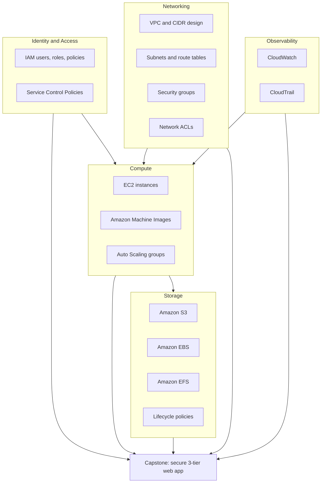

# Phase 1 — Core Foundations

Welcome to **Phase 1** of the AWS Grandmaster Roadmap — your "AWS bootcamp".

This phase builds the foundations everything else stands on. Before you design multi-region architectures or build serverless platforms, you need to be fluent in the five pillars that every AWS workload touches: **identity, compute, storage, networking, and observability**. Every later phase assumes you can navigate these services without looking things up.

Work through the lessons in order. Each one is self-contained, but the numbering follows a deliberate dependency chain: you cannot reason about security groups in [Lesson 14](./14-security-groups.md) without the VPC and subnet model from [Lessons 12](./12-vpc-fundamentals.md) and [13](./13-subnets-and-route-tables.md).

## Phase Goals

- Control access properly with **IAM** users, roles, policies, and organization-level guardrails
- Launch and scale **compute** with EC2, AMIs, and Auto Scaling groups
- Choose the right **storage** primitive — S3, EBS, or EFS — and control its cost with lifecycle policies
- Build an isolated **network** with VPCs, subnets, security groups, and NACLs
- Achieve **visibility** with CloudWatch metrics and CloudTrail audit logs
- Tie it all together in a **secure 3-tier web application**

## Phase Map

## Lessons in this Phase

| # | Lesson | Focus | Difficulty |
|---|--------|-------|------------|
| 01 | [IAM Users](./01-iam-users.md) | Human and programmatic identities, credentials, groups | Beginner |
| 02 | [IAM Roles](./02-iam-roles.md) | Temporary credentials, trust policies, instance profiles | Beginner |
| 03 | [IAM Policies](./03-iam-policies.md) | Policy JSON, evaluation logic, least privilege | Beginner |
| 04 | [Service Control Policies](./04-service-control-policies.md) | Organization-level guardrails and hard ceilings | Intermediate |
| 05 | [EC2 Basics](./05-ec2-basics.md) | Instance types, AMIs, key pairs, user data, placement | Beginner |
| 06 | [Amazon Machine Images](./06-amis.md) | Golden images, baking, cross-account sharing | Intermediate |
| 07 | [Auto Scaling](./07-auto-scaling.md) | Launch templates, scaling policies, health checks | Intermediate |
| 08 | [S3 Fundamentals](./08-s3-fundamentals.md) | Buckets, objects, versioning, storage classes | Beginner |
| 09 | [Amazon EBS](./09-ebs.md) | Volume types, snapshots, encryption, performance | Beginner |
| 10 | [Amazon EFS](./10-efs.md) | Shared POSIX storage, throughput modes, access points | Intermediate |
| 11 | [S3 Lifecycle Policies](./11-s3-lifecycle-policies.md) | Transition and expiration rules for cost control | Intermediate |
| 12 | [VPC Fundamentals](./12-vpc-fundamentals.md) | CIDR planning, internet and NAT gateways | Intermediate |
| 13 | [Subnets and Route Tables](./13-subnets-and-route-tables.md) | Public vs private subnets, routing, AZ design | Intermediate |
| 14 | [Security Groups](./14-security-groups.md) | Stateful instance-level firewalls, referencing | Beginner |
| 15 | [Network ACLs](./15-network-acls.md) | Stateless subnet-level filtering, ephemeral ports | Intermediate |
| 16 | [CloudWatch](./16-cloudwatch.md) | Metrics, alarms, dashboards, Logs Insights | Beginner |
| 17 | [CloudTrail](./17-cloudtrail.md) | Audit logging, trails, event history, integrity | Intermediate |
| 18 | [Capstone: Secure 3-Tier Web App](./18-project-secure-3-tier-web-app.md) | Full project tying the phase together | Advanced |

## Capstone Project

**Secure 3-Tier Web Application.** Build a production-shaped architecture with a public frontend, a private application tier, and an RDS database that is reachable only from the app tier. Every layer is protected by its own security group, and the whole stack is observable through CloudWatch and auditable through CloudTrail.

Deliverables:

- Working 3-tier deployment across at least two Availability Zones
- IAM roles for each tier (no long-lived credentials anywhere)
- Network diagram showing subnets, route tables, and security group boundaries
- CloudWatch dashboard and at least three meaningful alarms
- CloudTrail trail delivering to S3 with log file validation enabled
- A written teardown procedure and cost estimate

See [Lesson 18](./18-project-secure-3-tier-web-app.md) for the full brief.

## Phase Checklist

- [ ] I can explain the difference between an IAM user, a role, and a policy
- [ ] I can write a least-privilege policy from scratch without copying a wildcard
- [ ] I have launched an EC2 instance and connected to it
- [ ] I have created an AMI and launched an instance from it
- [ ] I have configured an Auto Scaling group with a scaling policy
- [ ] I have created an S3 bucket with versioning and a lifecycle policy
- [ ] I can choose between EBS and EFS for a given workload
- [ ] I have designed a VPC with public and private subnets in two AZs
- [ ] I can explain exactly why a security group rule did or did not allow traffic
- [ ] I can explain the difference between a security group and a NACL
- [ ] I have built a CloudWatch dashboard and alarmed on a real metric
- [ ] I have queried CloudTrail to find out who made a specific API call
- [ ] The 3-tier web app is deployed, observable, and torn down cleanly

## Phase Resources

- [AWS Well-Architected Framework](https://docs.aws.amazon.com/well-architected/latest/framework/welcome.html)
- [AWS IAM User Guide](https://docs.aws.amazon.com/IAM/latest/UserGuide/introduction.html)
- [Amazon EC2 User Guide](https://docs.aws.amazon.com/ec2/index.html)
- [Amazon S3 User Guide](https://docs.aws.amazon.com/AmazonS3/latest/userguide/Welcome.html)
- [Amazon VPC User Guide](https://docs.aws.amazon.com/vpc/latest/userguide/what-is-amazon-vpc.html)
- [Amazon CloudWatch User Guide](https://docs.aws.amazon.com/AmazonCloudWatch/latest/monitoring/WhatIsCloudWatch.html)
- [AWS CloudTrail User Guide](https://docs.aws.amazon.com/awscloudtrail/latest/userguide/cloudtrail-user-guide.html)

## Next Phase

Once you can build a secure, observable 3-tier application without a tutorial in front of you, you are ready to design for failure, scale, and geography.

[Phase 2 — Professional Architectures](../phase-2-professional-architectures/README.md)
