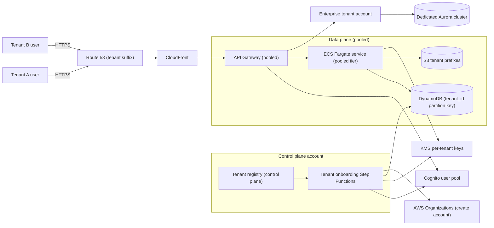
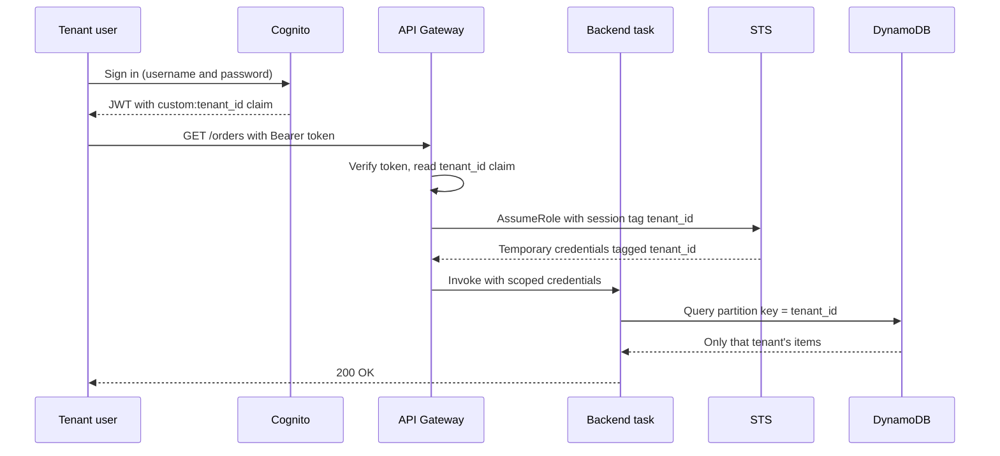
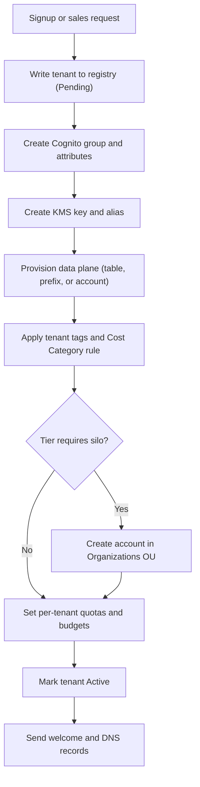
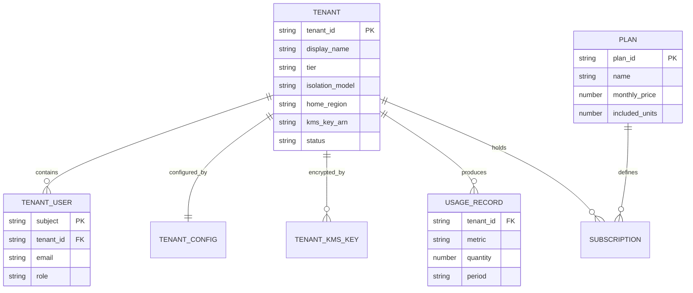

# 01 · Global SaaS Multi-Tenant Platform

> **Phase 10 — Grandmaster Projects** · Lesson 01 of 06
> ⬅️ Previous: [Phase 9 — Cutting-Edge AWS](../phase-9-cutting-edge-aws/README.md) · ➡️ Next: [Chaos Engineering](./02-chaos-engineering.md) · 🏠 [Phase overview](./README.md)

## Learning Objectives

By the end of this lesson you will be able to:

- Compare silo, pool, and bridge multi-tenancy models and justify a choice per workload
- Enforce tenant isolation with IAM ABAC session tags, Cognito custom attributes, and per-tenant KMS keys
- Choose between per-tenant tables, partition-key isolation, and schema isolation for a given access pattern
- Contain noisy neighbours with per-tenant throttles, concurrency caps, and cell-based deployment
- Attribute cost per tenant with tags, Cost Categories, and CUR queries
- Automate tenant onboarding from a single idempotent pipeline

**Estimated time:** 120 min · **Difficulty:** Advanced

---

## Core Concepts

**Multi-tenancy** means one logical system serves many customers (*tenants*) — each tenant's data, configuration, and users must be invisible to every other tenant. Every architectural decision in this lesson is a trade-off between three axes: **isolation strength**, **cost efficiency**, and **operational agility**. No single model wins on all three.

The **silo** model gives each tenant dedicated infrastructure: separate accounts (or VPCs), separate databases, separate stacks. Isolation is strongest and blast radius is smallest, but you pay for idle capacity per tenant and every release must be deployed N times. The **pool** model shares infrastructure and separates tenants logically — one DynamoDB table with `tenant_id` as the partition key, one ECS service, one Cognito user pool. Cost and agility are excellent, but a bad query or a runaway Lambda from one tenant degrades everyone. The **bridge** model is a hybrid: shared control plane and shared application tier, dedicated data plane for tenants that pay for it or that regulation forces into isolation. Most mature SaaS products are bridges — the free tier is pooled, the enterprise tier is siloed.

**Isolation has layers.** Network isolation (VPC per tenant) is the coarsest; then identity isolation (which principal may touch which resource); then data isolation (row, partition, schema, or database); then cryptographic isolation (a distinct KMS key per tenant, so a key deletion makes that tenant's data permanently unreadable — "crypto-shredding"). A production design uses several layers simultaneously, because each one fails differently.

**Tenancy must be carried by identity, not by request parameters.** If a client can pass `tenant_id` in a header and the backend trusts it, you have an IDOR vulnerability at scale. The tenant identifier should come from the verified JWT claim (Cognito custom attribute), then be propagated as an IAM session tag when the backend assumes a scoped role, and finally enforced by IAM condition keys such as `dynamodb:LeadingKeys`. The request path never gets to choose its own tenant.

**Cost attribution is a tenancy feature.** If you cannot answer "what does tenant X cost me?" within a day, you cannot price, upsell, or offboard tenants rationally. Tag everything that supports tags, use Cost Categories for the resources that cannot be tagged per tenant (shared ALB, shared NAT, shared cluster), and allocate shared cost by a documented driver (requests, storage GB, compute seconds).

### Key terminology

| Term | Meaning |
|------|---------|
| **Tenant** | A customer organization whose users and data must be isolated from other customers |
| **Control plane** | Global services that manage tenants: onboarding, registry, billing, identity |
| **Data plane** | The per-tenant runtime that serves tenant traffic (may be pooled or siloed) |
| **Silo / pod** | Dedicated stack per tenant (account, VPC, database) |
| **Cell** | A self-contained deployment unit serving a fixed subset of tenants; see "cell-based architecture" |
| **ABAC** | Attribute-based access control — IAM conditions keyed on tags such as `aws:PrincipalTag/tenant_id` |
| **Session tag** | A tag attached to temporary STS credentials via `sts:TagSession`; flows into ABAC conditions |
| **Crypto-shredding** | Destroying a per-tenant KMS key to render that tenant's ciphertext unrecoverable |
| **Noisy neighbour** | One tenant consuming shared capacity and degrading others |
| **Cost Category** | A Cost Explorer construct that splits spend by rule, including inherited tag values |

---

## Architecture Diagram

A bridge topology: shared control plane, pooled tier for self-serve tenants, siloed accounts for enterprise tenants.



The request path carries the tenant from token to storage:



Onboarding is a state machine, not a runbook:



The tenancy domain model — every isolation decision hangs off the `TENANT` record:



---

## Hands-on Lab: Pooled Tenancy with ABAC and Per-Tenant Keys

**Goal:** Stand up a pooled multi-tenant slice — Cognito identity, one DynamoDB table partitioned by tenant, and one KMS key per tenant enforced with encryption context.

**Prerequisites:** Two AWS accounts (or one account plus an Organizations OU you can create accounts in), AWS CLI v2 with admin credentials, `jq`, a region of your choice. Replace `111122223333` with your account ID everywhere.

### Step 1 — Create the tenant identity plane

`tenant_id` becomes a Cognito custom attribute. Custom attributes are immutable and available in the ID token, which is exactly what you want for a tenant claim.

```bash
# Create the user pool with an immutable tenant_id custom attribute
aws cognito-idp create-user-pool \
  --pool-name saas-tenant-users \
  --username-attributes email \
  --schema 'Name=tenant_id,AttributeDataType=String,Mutable=false,StringAttributeConstraints={MinLength=1,MaxLength=64}' \
  --auto-verified-attributes email \
  --mfa-configuration OPTIONAL \
  --policies '{"PasswordPolicy":{"MinimumLength":14,"RequireUppercase":true,"RequireLowercase":true,"RequireNumbers":true,"RequireSymbols":true}}'

# Capture the pool ID once, reuse it below
POOL_ID=$(aws cognito-idp list-user-pools --max-results 20 \
  --query "UserPools[?Name=='saas-tenant-users'].Id" --output text)
echo "$POOL_ID"

# Create an app client that issues tenant claims and revokes tokens on sign-out
aws cognito-idp create-user-pool-client \
  --user-pool-id "$POOL_ID" \
  --client-name saas-web \
  --explicit-auth-flows ALLOW_USER_PASSWORD_AUTH ALLOW_REFRESH_TOKEN_AUTH \
  --prevent-user-existence-errors ENABLED \
  --enable-token-revocation
```

One Cognito **group per tenant** gives you a coarse-grained, queryable membership record and a target for group-based IAM mapping.

```bash
# Create a group per tenant and a user whose custom attribute is set at creation
aws cognito-idp create-group --user-pool-id "$POOL_ID" --group-name tenant-acme
aws cognito-idp admin-create-user \
  --user-pool-id "$POOL_ID" \
  --username alice@acme.example \
  --user-attributes Name=email,Value=alice@acme.example Name=email_verified,Value=true Name=custom:tenant_id,Value=acme
aws cognito-idp admin-add-user-to-group \
  --user-pool-id "$POOL_ID" --username alice@acme.example --group-name tenant-acme
```

### Step 2 — Create a per-tenant KMS key with an encryption-context constraint

The grant constrains the key to a specific encryption context, so even a principal that can call `kms:Decrypt` cannot decrypt another tenant's blob with the wrong context.

```bash
# One key per tenant; tags drive both ABAC and cost allocation
KEY_ID=$(aws kms create-key \
  --description "Tenant acme data key" \
  --tags TagKey=tenant_id,TagValue=acme TagKey=cost-center,TagValue=saas \
  --query 'KeyMetadata.KeyId' --output text)
echo "$KEY_ID"

# Friendly alias so application config never embeds a raw key ID
aws kms create-alias --alias-name alias/tenant-acme --target-key-id "$KEY_ID"

# Grant the app role use of the key, but only with the matching encryption context
aws kms create-grant \
  --key-id alias/tenant-acme \
  --grantee-principal arn:aws:iam::111122223333:role/TenantAppRole \
  --operations Encrypt Decrypt GenerateDataKey \
  --constraints '{"EncryptionContextSubset":{"tenant_id":"acme"}}'
```

> If `create-alias` fails because the alias already exists, the tenant was partially onboarded — treat the onboarding step as idempotent and catch `AlreadyExistsException` rather than aborting the state machine.

### Step 3 — Create the pooled data table

`tenant_id` is the partition key: every access pattern must include it, which makes cross-tenant queries impossible to express by accident.

```bash
# Pooled table: tenant_id leads the primary key, KMS-encrypted at rest
aws dynamodb create-table \
  --table-name saas-orders \
  --attribute-definitions AttributeName=tenant_id,AttributeType=S AttributeName=order_id,AttributeType=S \
  --key-schema AttributeName=tenant_id,KeyType=HASH AttributeName=order_id,KeyType=RANGE \
  --billing-mode PAY_PER_REQUEST \
  --sse-specification Enabled=true,SSEType=KMS,KMSMasterKeyId=alias/tenant-acme \
  --tags Key=tenant_id,Value=shared Key=isolation_model,Value=pool

# Wait until the table is ACTIVE before writing
aws dynamodb wait table-exists --table-name saas-orders
```

DynamoDB tags are per-table, so for a pooled table use **application-level** tenant tags (in the item) for analytics and rely on Cost Categories to split shared compute by usage rather than by tag.

```bash
# Write one item per tenant, with the tenant tag embedded in the item
aws dynamodb put-item --table-name saas-orders --item '{
  "tenant_id": {"S": "acme"},
  "order_id": {"S": "ord-1001"},
  "amount": {"N": "249.00"},
  "status": {"S": "SHIPPED"}
}'

# Read back only acme's rows
aws dynamodb query \
  --table-name saas-orders \
  --key-condition-expression "tenant_id = :t" \
  --expression-attribute-values '{":t":{"S":"acme"}}'
```

### Step 4 — Scope the application role with ABAC session tags

This identity policy allows a single role to serve every tenant while proving it can only touch one tenant's partition. `${aws:PrincipalTag/tenant_id}` is substituted from the STS session tag, and `dynamodb:LeadingKeys` restricts the partition key.

```json
{
  "Version": "2012-10-17",
  "Statement": [
    {
      "Sid": "TenantScopedItemAccess",
      "Effect": "Allow",
      "Action": [
        "dynamodb:GetItem",
        "dynamodb:PutItem",
        "dynamodb:Query",
        "dynamodb:UpdateItem"
      ],
      "Resource": "arn:aws:dynamodb:eu-west-1:111122223333:table/saas-orders",
      "Condition": {
        "ForAllValues:StringEquals": {
          "dynamodb:LeadingKeys": ["${aws:PrincipalTag/tenant_id}"]
        }
      }
    },
    {
      "Sid": "TenantScopedKeysOnly",
      "Effect": "Allow",
      "Action": ["kms:Decrypt", "kms:GenerateDataKey"],
      "Resource": "arn:aws:kms:eu-west-1:111122223333:key/*",
      "Condition": {
        "StringEquals": {
          "aws:ResourceTag/tenant_id": "${aws:PrincipalTag/tenant_id}"
        }
      }
    }
  ]
}
```

The role must explicitly allow the session tag to be set, otherwise `sts:AssumeRole` fails with `AccessDenied`.

```json
{
  "Version": "2012-10-17",
  "Statement": [
    {
      "Effect": "Allow",
      "Principal": {"AWS": "arn:aws:iam::111122223333:root"},
      "Action": ["sts:AssumeRole", "sts:TagSession"],
      "Condition": {
        "StringEquals": {"sts:ExternalId": "saas-control-plane"}
      }
    }
  ]
}
```

```bash
# Create the scoped role and attach the tenant policy
aws iam create-role --role-name TenantAppRole \
  --assume-role-policy-document file://trust-policy.json
aws iam put-role-policy --role-name TenantAppRole \
  --policy-name TenantScopedAccess --policy-document file://tenant-scoped-policy.json

# Assume the role carrying the tenant as a session tag, and capture the temporary credentials
read -r AK SK ST <<< "$(aws sts assume-role \
  --role-arn arn:aws:iam::111122223333:role/TenantAppRole \
  --role-session-name tenant-acme-reader \
  --external-id saas-control-plane \
  --tags Key=tenant_id,Value=acme \
  --query 'Credentials.[AccessKeyId,SecretAccessKey,SessionToken]' --output text)"
echo "${AK:0:4}..."   # sanity check that credentials were returned
```

### Step 5 — Verify isolation (this is the important step)

```bash
# 1. Tagged session for acme can read acme
AWS_ACCESS_KEY_ID=$AK AWS_SECRET_ACCESS_KEY=$SK AWS_SESSION_TOKEN=$ST \
aws dynamodb query --table-name saas-orders \
  --key-condition-expression "tenant_id = :t" \
  --expression-attribute-values '{":t":{"S":"acme"}}'

# 2. The same session CANNOT read globex — expect AccessDeniedException
AWS_ACCESS_KEY_ID=$AK AWS_SECRET_ACCESS_KEY=$SK AWS_SESSION_TOKEN=$ST \
aws dynamodb query --table-name saas-orders \
  --key-condition-expression "tenant_id = :t" \
  --expression-attribute-values '{":t":{"S":"globex"}}'

# 3. Prove the policy, without a real request
aws iam simulate-principal-policy \
  --policy-source-arn arn:aws:iam::111122223333:role/TenantAppRole \
  --action-names dynamodb:Query \
  --resource-arns arn:aws:dynamodb:eu-west-1:111122223333:table/saas-orders \
  --context-entries ContextKeyName=aws:PrincipalTag/tenant_id,ContextKeyType=string,ContextKeyValues=acme
```

Success looks like: query 1 returns acme rows, query 2 raises `AccessDeniedException`, and the simulation returns `allowed` for the acme context.

### Step 6 — Allocation: register the tag for cost reporting

```bash
# Activate the tenant_id tag as a cost allocation tag (needed for CUR and Cost Categories)
aws ce update-cost-allocation-tags-status \
  --cost-allocation-tags-status '[{"TagKey":"tenant_id","Status":"Active"}]'

# Create a Cost Category that inherits the tenant value from the resource tag
aws ce create-cost-category-definition \
  --name "Tenant" \
  --rule-version CostCategoryExpression.v1 \
  --rules '[{"Value":"acme","Rule":{"Tags":{"Key":"tenant_id","Values":["acme"]}}},{"Value":"globex","Rule":{"Tags":{"Key":"tenant_id","Values":["globex"]}}},{"Value":"shared","Rule":{"Dimensions":{"Key":"LINKED_ACCOUNT","Values":["111122223333"]}}}]'
```

---

## CLI Reference

```bash
# List every partition key value present in a pooled table (tenant inventory, small tables only)
aws dynamodb scan --table-name saas-orders --projection-expression "tenant_id" \
  --query 'Items[].tenant_id.S' --output text | tr '\t' '\n' | sort -u

# Create a siloed tenant account inside the Tenants OU
aws organizations create-account --email aws+globex@example.com --account-name "tenant-globex"
aws organizations create-organizational-unit --parent-id r-example --name "Tenants"

# Per-tenant service quota: cap DynamoDB throughput and Lambda concurrency safely
aws lambda put-function-concurrency --function-name tenant-api --reserved-concurrent-executions 50

# Per-tenant API throttle with API Gateway usage plans
aws apigateway create-usage-plan --name tenant-acme \
  --throttle burstLimit=200,rateLimit=100 \
  --api-stages apiId=abc123,stage=prod

# Tag a resource so Cost Explorer can attribute it
aws resourcegroupstaggingapi tag-resources \
  --resource-arn-list arn:aws:ecs:eu-west-1:111122223333:service/pooled/tenant-api \
  --tags tenant_id=shared

# Query per-tenant cost for the last 7 days
aws ce get-cost-and-usage \
  --time-period Start=2026-10-07,End=2026-10-14 \
  --granularity DAILY --metrics UnblendedCost \
  --group-by Type=TAG,Key=tenant_id Type=DIMENSION,Key=SERVICE
```

| Command | Purpose |
|---------|---------|
| `cognito-idp create-user-pool` | Creates the tenant identity plane with the `tenant_id` claim |
| `kms create-grant` | Scopes a tenant key to a principal and encryption context |
| `sts assume-role --tags` | Mints tenant-scoped credentials for ABAC |
| `ce update-cost-allocation-tags-status` | Activates tenant tags for cost reporting |
| `ce create-cost-category-definition` | Splits shared spend into per-tenant buckets |
| `organizations create-account` | Siloed onboarding for enterprise tenants |

---

## Best Practices

| Practice | Why it matters |
|----------|----------------|
| Derive the tenant from the verified token, never from a request parameter | Client-supplied tenant IDs are the classic multi-tenant IDOR |
| Enforce tenancy in IAM (`dynamodb:LeadingKeys`) and not only in application code | A single missed `WHERE` clause cannot leak data if IAM already blocks it |
| Give every tenant its own KMS key on the enterprise tier | Enables crypto-shredding and per-tenant key policy audits |
| Emit `tenant_id` as a metric dimension and log field | Without it, you cannot debug or bill a single tenant |
| Set per-tenant quotas at the edge and inside the platform | Edge throttles stop abuse; internal caps stop internal collapse |
| Make onboarding idempotent and replayable | Half-onboarded tenants are the most expensive support tickets |
| Prefer bridge over pure silo or pure pool past ~50 tenants | Pools are cheap but fragile; silos are safe but costly |
| Design for tenant offboarding on day one | Export, key destruction, and account closure must be scripted |

---

## Common Pitfalls

| Pitfall | Symptom | Fix |
|---------|---------|-----|
| Scattering `tenant_id` filtering across every query | Occasionally returns other tenants' rows after a refactor | Add IAM condition keys and integration tests that assert cross-tenant denial |
| Hot partition from a single large tenant | Throttling for one tenant, healthy metrics for others | Write-shard with `tenant_id#shard`, or move that tenant to its own table |
| Shared NAT Gateway / ALB billed to nobody | Margin erodes without a visible cause | Allocate shared resources with Cost Categories and a documented driver |
| Reusing one KMS key for all tenants | Cannot revoke or shred per tenant | One key per enterprise tenant; alias per tenant |
| Unbounded Lambda concurrency in the pooled tier | One tenant's batch job starves the pool | Reserved concurrency per tenant function alias plus queue depth alarms |
| Cognito custom attribute mutated after creation | Token claims drift from the registry | Create `tenant_id` as `Mutable=false` and treat the registry as the source of truth |
| Assuming a region holds all tenants | Cross-region replication leaks one tenant's data into another's region | Pin tenant data residency in the registry and enforce with SCP region denies |

---

## Cost Considerations

**What drives the bill:** the pooled tier is dominated by request volume and stored bytes (DynamoDB on-demand, Lambda invocations, ECS task hours), while the siloed tier is dominated by *fixed* per-tenant infrastructure — a VPC with NAT Gateway (~$32+/month per AZ), an Aurora cluster (~$50+/month minimum), and idle ECS capacity. At 200 tenants, a silo-per-tenant design can easily cost 5–10× a pooled design, which is why bridge architectures exist.

Concrete levers:

- **Pool first, silo on demand.** Move a tenant to a dedicated account only when a contract, compliance regime, or capacity profile justifies it.
- **DynamoDB on-demand vs provisioned.** On-demand removes idle cost for spiky tenants; provisioned with auto scaling is cheaper above roughly 40–50% sustained utilization of a single table's capacity.
- **Cost Explorer API is billed per request** (~$0.01 per `GetCostAndUsage` call). Cache results, aggregate daily, and query CUR in Athena for anything analytical instead of hammering the API.
- **CUR is the cheap analytical path.** Deliver the Cost and Usage Report to S3 once, crawl it with Glue, and query with Athena for per-tenant unit economics at a fraction of the per-call price.
- **Track unit cost, not just total cost.** Publish "cost per 1,000 API calls" and "cost per active tenant" as dashboards; that is the metric that actually protects margin.
- **Savings Plans and Compute Savings Plans** apply across pooled tenants and are the single largest discount lever — but only after you have rightsized.

---

## Security Considerations

- **Isolation is a chain.** Token claim → session tag → IAM condition → storage key. Verify each link with an automated cross-tenant denial test that runs on every deploy.
- **KMS key policies are the last line of defence.** A tenant key policy should allow only the tenant's application role, the platform's admin break-glass role, and the account's encryption service principals. Add `kms:EncryptionContext` conditions wherever the SDK supports it.
- **Confused-deputy protection.** Any cross-account trust you create for the control plane must require `sts:ExternalId` (third-party) or pin `aws:SourceArn`/`aws:SourceAccount` (service roles).
- **SCP guardrails per OU.** Deny region use outside the tenant's residency, deny disabling CloudTrail, deny creating IAM users in tenant accounts (force federation).
- **Detective controls.** Enable GuardDuty and Security Hub in every account via Organizations delegated admin, and alert on anomalous cross-account `AssumeRole` and on `kms:Decrypt` with an unexpected encryption context.
- **Log isolation.** CloudTrail to a dedicated log archive account with an S3 bucket policy that denies `s3:DeleteObject` even to account admins; separate Athena workgroups per tenant-facing analyst if you expose log queries.
- **Offboarding is a security control.** Retention windows, verified tenant data export, key deletion with a 30-day window, and documented erasure evidence for compliance.

---

## Exercise

Extend the lab with a **bridge** design for one tenant:

1. Add a `isolation_model` field to a tenant registry item (DynamoDB table `saas-tenant-registry`) and write items for `acme` (pool) and `globex` (silo).
2. Create a second DynamoDB table `saas-orders-globex` and a separate KMS key `alias/tenant-globex`, then write one order for each tenant into the correct table.
3. Write an integration test (bash or Python) that assumes the tenant-scoped role twice — once with `tenant_id=acme`, once with `tenant_id=globex` — and asserts that each session can reach only its own table and key.

Success looks like: the acme session can read `saas-orders` and fails with `AccessDeniedException` against `saas-orders-globex`, and the reverse holds for globex, with all four assertions automated in one script.

---

## Resources

- [AWS SaaS Factory — multi-tenant architecture fundamentals](https://docs.aws.amazon.com/whitepapers/latest/saas-architecture-fundamentals/saas-architecture-fundamentals.html)
- [Isolating tenants with IAM — ABAC](https://docs.aws.amazon.com/IAM/latest/UserGuide/introduction_attribute-based-access-control.html)
- [Amazon Cognito custom attributes](https://docs.aws.amazon.com/cognito/latest/developerguide/user-pool-settings-attributes.html)
- [AWS KMS grants and encryption context](https://docs.aws.amazon.com/kms/latest/developerguide/grants.html)
- [DynamoDB partition key design and write sharding](https://docs.aws.amazon.com/amazondynamodb/latest/developerguide/bp-partition-key-design.html)
- [Managing AWS costs with cost allocation tags](https://docs.aws.amazon.com/awsaccountbilling/latest/aboutv2/cost-alloc-tags.html)
- [AWS Cost Categories](https://docs.aws.amazon.com/awsaccountbilling/latest/aboutv2/manage-cost-categories.html)

---

## Next Steps

You can now isolate tenants, cap their blast radius, and tell exactly what each one costs. The next lesson attacks the opposite question: what happens when the infrastructure underneath a tenant *breaks* — and how you prove, before a real incident, that your failover actually works.

> ⬅️ Previous: [Phase 9 — Cutting-Edge AWS](../phase-9-cutting-edge-aws/README.md) · ➡️ Next: [Chaos Engineering](./02-chaos-engineering.md) · 🏠 [Phase overview](./README.md)
