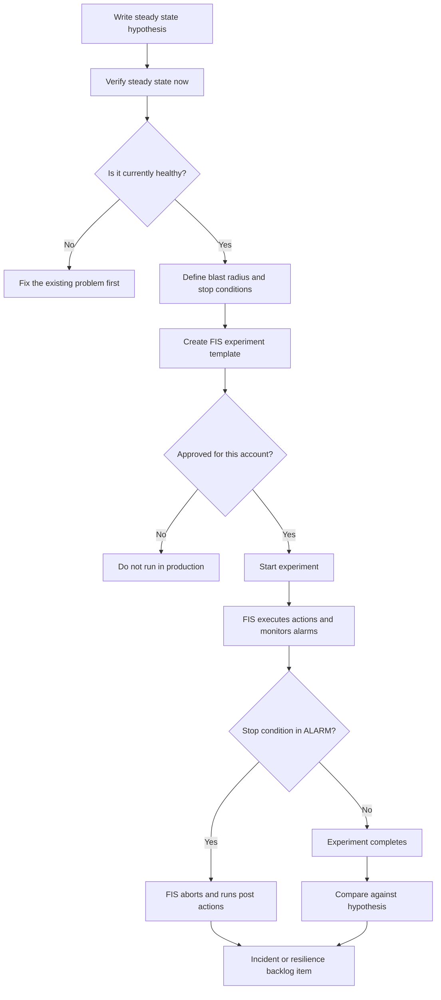
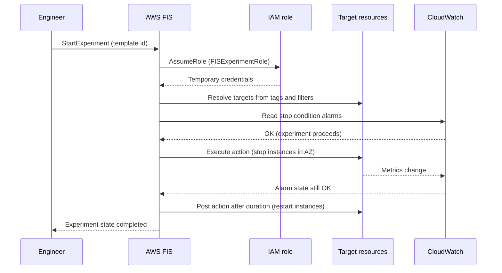
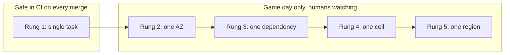

# 02 · Chaos Engineering

> **Phase 10 — Grandmaster Projects** · Lesson 02 of 06
> ⬅️ Previous: [Global SaaS Multi-Tenant Platform](./01-global-saas-multi-tenant-platform.md) · ➡️ Next: [AI-Driven Cost Optimization](./03-ai-driven-cost-optimization.md) · 🏠 [Phase overview](./README.md)

## Learning Objectives

By the end of this lesson you will be able to:

- Write a steady-state hypothesis and define blast radius before touching a single resource
- Build AWS Fault Injection Service (FIS) experiment templates with targets, actions, and stop conditions
- Simulate an Availability Zone failure and inject dependency latency safely
- Run a game day and turn the results into resilience backlog items
- Run chaos experiments inside CI against a staging account
- Design guardrails that make it structurally impossible for an experiment to destroy production

**Estimated time:** 120 min · **Difficulty:** Advanced

---

## Core Concepts

**Chaos engineering** is the discipline of experimenting on a system to build confidence in its ability to withstand turbulent conditions. It is not random destruction — it is the scientific method applied to infrastructure. You state a belief about normal behaviour, deliberately violate one assumption, and observe whether the belief holds. If it does, you gained evidence. If it does not, you found a latent failure *on your schedule*, with the alarm already wired and the responders already watching.

Every experiment has four parts. The **steady state hypothesis** is a measurable claim about normal operation: "with 3 AZs healthy, p99 latency on `GET /orders` stays under 400 ms and checkout error rate stays under 0.5%." The **blast radius** is exactly which resources, tenants, or regions the experiment may affect. The **injection** is the fault itself — stop instances in one AZ, add 500 ms of network latency to 30% of tasks, fail over a database cluster. The **abort conditions** are the pre-agreed thresholds that stop the experiment automatically. Only the first is written before the experiment; the rest protect you while it runs.

The order matters: **hypothesis → blast radius → stop conditions → experiment**. Teams that start with "let's kill an AZ and see" learn only that they are brave. Teams that start with the hypothesis learn which design decision was load-bearing.

**AWS Fault Injection Service (FIS)** is a managed experiment runner. An **experiment template** declares *targets* (how to find the resources: resource tags, filters, ARNs, and a selection mode such as `ALL`, `COUNT(2)`, or `PERCENT(30)`), *actions* (the faults, referenced by action ID such as `aws:ec2:stop-instances`), *stop conditions* (CloudWatch alarms and an experiment duration), and an *IAM role* that the service assumes. FIS resolves targets at start time, executes actions in order with optional `startAfter` sequencing, monitors stop conditions, and runs post-actions where the action supports them — for example `aws:ec2:stop-instances` restarts the instances after `startInstancesAfterDuration`.

The behaviours you test are the ones you claim in your architecture docs. Multi-AZ failover, retry and backoff, queue depth draining, read-replica promotion, cache stampede protection, and graceful degradation are all *claims*. Chaos engineering is the only way to convert the claim into evidence — and the only honest way to discover that your health check was pointing at a single AZ the whole time.

**Altitude matters.** Start at the component level in a staging account (kill one instance of a stateless tier), then move to dependency level (inject latency on a downstream call), then to topology level (AZ failure), then to regional level (Multi-Region failover) — and only when you can predict the outcome. Game days raise the altitude one rung with humans in the loop; CI chaos keeps low-altitude experiments running on every merge.

### Key terminology

| Term | Meaning |
|------|---------|
| **Steady state** | The measurable definition of "healthy", expressed as metrics with thresholds |
| **Blast radius** | The maximum set of resources or customers an experiment may affect |
| **FIS action** | A fault primitive, identified as `aws:service:action-type`, e.g. `aws:ec2:stop-instances` |
| **Target** | A rule that resolves the resources an action runs against, using tags, filters, or ARNs |
| **Selection mode** | How many resolved resources to act on: `ALL`, `COUNT(n)`, `PERCENT(n)` |
| **Stop condition** | A CloudWatch alarm (or `none`) that aborts the experiment immediately when in ALARM |
| **Post action** | A documented rollback that FIS performs after the action duration, where supported |
| **Game day** | A scheduled, rehearsed experiment with responders, comms, and a written runbook |
| **Experiment option** | Run-wide behaviour such as `accountTargeting` or `emptyTargetResolutionMode` |

---

## Architecture Diagram

The experiment loop — note that the abort path is not an afterthought, it is wired into the template:



How FIS interacts with the account during a run:



Blast radius as a ladder — climb one rung per release, never two:



---

## Hands-on Lab: AZ Failure and Latency Injection with FIS

**Goal:** Run two experiments against a staging account — stop every tagged instance in one Availability Zone, then inject network latency into 30% of ECS tasks — each with a CloudWatch alarm stop condition.

**Prerequisites:** A staging account with at least two running EC2 instances tagged for chaos, AWS CLI v2 with admin credentials, one ECS service (optional, for Step 5), and a CloudWatch alarm that represents steady state.

### Step 1 — Tag eligibility and create the FIS role

Never target by resource ID. Target by tag, and only tag resources you are willing to lose.

```bash
# Tag the resources that experiments are allowed to touch
aws ec2 create-tags \
  --resources i-0aaaaaaaaaaaaaaa1 i-0bbbbbbbbbbbbbbb2 \
  --tags Key=chaos-eligible,Value=true Key=chaos-az,Value=eu-west-1a

# Confirm the target resolves to exactly what you expect, before FIS does
aws ec2 describe-instances \
  --filters "Name=tag:chaos-eligible,Values=true" "Name=instance-state-name,Values=running" \
  --query 'Reservations[].Instances[].{Id:InstanceId,AZ:Placement.AvailabilityZone}'
```

```json
{
  "Version": "2012-10-17",
  "Statement": [
    {
      "Effect": "Allow",
      "Principal": {"Service": "fis.amazonaws.com"},
      "Action": "sts:AssumeRole",
      "Condition": {
        "StringEquals": {"aws:SourceAccount": "111122223333"}
      }
    }
  ]
}
```

```bash
# Role that FIS assumes; scope it to tagged chaos resources, not the whole account
aws iam create-role --role-name FISExperimentRole \
  --assume-role-policy-document file://fis-trust-policy.json \
  --description "Role assumed by AWS FIS during experiments"

# AWS-managed policies that cover the actions you plan to run
aws iam attach-role-policy --role-name FISExperimentRole \
  --policy-arn arn:aws:iam::aws:policy/service-role/AWSFaultInjectionSimulatorEC2Access
aws iam attach-role-policy --role-name FISExperimentRole \
  --policy-arn arn:aws:iam::aws:policy/service-role/AWSFaultInjectionSimulatorNetworkAccess
aws iam attach-role-policy --role-name FISExperimentRole \
  --policy-arn arn:aws:iam::aws:policy/CloudWatchReadOnlyAccess
```

### Step 2 — Discover actions instead of guessing

FIS publishes its own catalogue, including the parameters each action accepts. Query it rather than trusting a blog post.

```bash
# What action identifiers exist in this region?
aws fis list-actions --region eu-west-1 \
  --query 'actions[?id==`aws:ec2:stop-instances` || id==`aws:network:disrupt-connectivity` || id==`aws:ecs:task-network-latency`]'

# Exact parameters and required permissions for one action
aws fis get-action --id aws:ec2:stop-instances \
  --query 'action.{Params:parameters,Resource:targets}'

# Resource types you can target for experiments
aws fis list-target-resource-types --query 'targetResourceTypes[].resourceType' --output text
```

Add a scoped inline policy so an over-broad managed policy cannot act on unlabelled resources:

```json
{
  "Version": "2012-10-17",
  "Statement": [
    {
      "Sid": "OnlyChaosEligibleInstances",
      "Effect": "Allow",
      "Action": ["ec2:StopInstances", "ec2:StartInstances"],
      "Resource": "arn:aws:ec2:*:111122223333:instance/*",
      "Condition": {
        "StringEquals": {"aws:ResourceTag/chaos-eligible": "true"}
      }
    }
  ]
}
```

```bash
# Attach the tag-scoped policy so the managed policy is capped by a condition
aws iam put-role-policy --role-name FISExperimentRole \
  --policy-name ChaosEligibleOnly --policy-document file://chaos-scoped-policy.json
```

### Step 3 — Create the AZ-failure experiment template

The template stops instances in one AZ for ten minutes, then restarts them, and aborts if the error-rate alarm fires.

```json
{
  "description": "Stop chaos-eligible instances in eu-west-1a for 10 minutes",
  "targets": {
    "azInstances": {
      "resourceType": "aws:ec2:instance",
      "selectionMode": "ALL",
      "resourceTags": {
        "chaos-eligible": "true",
        "chaos-az": "eu-west-1a"
      },
      "filters": [
        {"path": "State.Name", "values": ["running"]}
      ]
    }
  },
  "actions": {
    "stopInstances": {
      "actionId": "aws:ec2:stop-instances",
      "description": "Stop the AZ targets and restart them after 10 minutes",
      "parameters": {
        "startInstancesAfterDuration": "PT10M"
      },
      "targets": {
        "Instances": "azInstances"
      }
    }
  },
  "stopConditions": [
    {
      "source": "aws:cloudwatch:alarm",
      "value": "arn:aws:cloudwatch:eu-west-1:111122223333:alarm/saas-checkout-error-rate"
    }
  ],
  "roleArn": "arn:aws:iam::111122223333:role/FISExperimentRole",
  "logConfiguration": {
    "cloudWatchLogsConfiguration": {
      "logGroupArn": "arn:aws:logs:eu-west-1:111122223333:log-group:/aws/fis:*"
    }
  },
  "experimentOptions": {
    "accountTargeting": "single-account",
    "emptyTargetResolutionMode": "fail"
  },
  "tags": {
    "purpose": "chaos",
    "environment": "staging"
  }
}
```

> `emptyTargetResolutionMode: fail` is deliberate. When set to `skip`, an experiment that matched zero resources reports success — a false negative that quietly convinces everyone the system is resilient.

```bash
# Create the template from the file above and capture its ID
TEMPLATE_ID=$(aws fis create-experiment-template \
  --cli-input-json file://fis-az-failure.json \
  --query 'experimentTemplate.id' --output text)
echo "$TEMPLATE_ID"

# Always render the resolved template before starting anything
aws fis get-experiment-template --id "$TEMPLATE_ID"
```

### Step 4 — Establish steady state, then run the experiment

```bash
# Steady state: error rate and p99 latency over the last 30 minutes (must be inside thresholds)
aws cloudwatch get-metric-statistics \
  --namespace AWS/ApplicationELB --metric-name HTTPCode_Target_5XX_Count \
  --dimensions Name=LoadBalancer,Value=app/saas-alb/50dc6c495c0c9188 \
  --start-time "$(date -u -v-30M +%Y-%m-%dT%H:%M:%SZ)" \
  --end-time "$(date -u +%Y-%m-%dT%H:%M:%SZ)" \
  --period 300 --statistics Sum

# Start the experiment (fails fast if the stop condition alarm is already in ALARM)
EXPERIMENT_ID=$(aws fis start-experiment \
  --experiment-template-id "$TEMPLATE_ID" \
  --client-token "az-failure-$(date -u +%Y%m%dT%H%M%S)" \
  --query 'experiment.id' --output text)
echo "$EXPERIMENT_ID"

# Optional rehearsal: resolve targets but skip every action, to prove the template is well formed
aws fis start-experiment --experiment-template-id "$TEMPLATE_ID" \
  --experiment-options actionsMode=skip-all

# Watch the actions progress in real time
watch -n 15 "aws fis get-experiment --id $EXPERIMENT_ID \
  --query 'experiment.{State:state.status,Actions:state.actions}'"

# Emergency stop — know this command before you need it
aws fis stop-experiment --id "$EXPERIMENT_ID"
```

### Step 5 — Inject dependency latency

Target only a slice of the fleet, so the service degrades rather than dies. This is the experiment that finds missing timeouts and unbounded retries.

```json
{
  "description": "Add 500 ms latency with 100 ms jitter to 30 percent of ECS tasks",
  "targets": {
    "latencyTasks": {
      "resourceType": "aws:ecs:task",
      "selectionMode": "PERCENT(30)",
      "resourceTags": {"chaos-eligible": "true"},
      "filters": [
        {"path": "LastStatus", "values": ["RUNNING"]},
        {"path": "AvailabilityZone", "values": ["eu-west-1a"]}
      ]
    }
  },
  "actions": {
    "addLatency": {
      "actionId": "aws:ecs:task-network-latency",
      "parameters": {
        "duration": "PT5M",
        "delayMilliseconds": "500",
        "jitterMilliseconds": "100",
        "flowsPercent": "50"
      },
      "targets": {"Tasks": "latencyTasks"}
    }
  },
  "stopConditions": [
    {
      "source": "aws:cloudwatch:alarm",
      "value": "arn:aws:cloudwatch:eu-west-1:111122223333:alarm/saas-p99-latency"
    }
  ],
  "roleArn": "arn:aws:iam::111122223333:role/FISExperimentRole",
  "tags": {"purpose": "chaos", "environment": "staging"}
}
```

```bash
# Same lifecycle, different fault: create the template, then run it
LATENCY_TEMPLATE_ID=$(aws fis create-experiment-template \
  --cli-input-json file://fis-ecs-latency.json \
  --query 'experimentTemplate.id' --output text)
aws fis start-experiment --experiment-template-id "$LATENCY_TEMPLATE_ID" \
  --client-token "latency-$(date -u +%Y%m%dT%H%M%S)"
```

### Step 6 — Verify

```bash
# 1. Action-level detail: each action's status and its own start/end timestamps
aws fis get-experiment --id "$EXPERIMENT_ID" \
  --query 'experiment.state.actions.{Action:name,Status:status,Reason:reason}'

# 2. The stopped instances must be running again after the post action fires
aws ec2 describe-instances \
  --filters "Name=tag:chaos-eligible,Values=true" \
  --query 'Reservations[].Instances[].{Id:InstanceId,State:State.Name}'

# 3. The experiment log stream must exist (faults and stop-condition transitions are recorded)
aws logs describe-log-streams --log-group-name /aws/fis \
  --order-by LastEventTime --descending --max-items 5
```

Success looks like: every chaos-eligible instance is `running` when the experiment reaches `completed`, at most 30% of `tenant-api` tasks ever showed added latency, and no stop condition ever entered `ALARM`.

### Step 7 — Chaos in CI

Keep the smallest fault in the pipeline so regressions are caught on the pull request, not in a game day.

```yaml
# .github/workflows/chaos.yml
name: chaos-smoke
on:
  workflow_dispatch:
  schedule:
    - cron: "0 2 * * 2"

permissions:
  id-token: write
  contents: read

jobs:
  fis-smoke:
    runs-on: ubuntu-latest
    environment: staging
    steps:
      - uses: aws-actions/configure-aws-credentials@v4
        with:
          role-to-assume: arn:aws:iam::111122223333:role/GitHubActionsChaosRole
          aws-region: eu-west-1
      - name: Fail fast if steady state is already unhealthy
        run: |
          if [ "$(aws cloudwatch describe-alarms \
              --alarm-names saas-checkout-error-rate \
              --query 'MetricAlarms[0].StateValue' --output text)" != "OK" ]; then
            echo "Steady state is not OK - refusing to start a chaos experiment"; exit 1
          fi
      - name: Run the experiment and wait for a terminal state
        run: |
          ID=$(aws fis start-experiment \
            --experiment-template-id "${{ vars.FIS_SMOKE_TEMPLATE_ID }}" \
            --query 'experiment.id' --output text)
          for i in $(seq 1 40); do
            STATUS=$(aws fis get-experiment --id "$ID" --query 'experiment.state.status' --output text)
            echo "experiment $ID status: $STATUS"
            case "$STATUS" in
              completed|stopped|failed) break ;;
            esac
            sleep 30
          done
          test "$STATUS" = "completed"
```

---

## CLI Reference

```bash
# List every experiment template you own, newest first
aws fis list-experiment-templates \
  --query 'reverse(sort_by(experimentTemplates,&creationTime))[].{Id:id,Desc:description}'

# List recent experiment runs with their final state and reason
aws fis list-experiments --query 'experiments[].{Id:id,Status:state.status,Reason:state.reason}'

# Abort a running experiment immediately (FIS still runs supported post actions)
aws fis stop-experiment --id EXT1234567890

# Update an existing template in place (e.g. tighten the stop condition)
aws fis update-experiment-template --id EXT1234567890 \
  --stop-conditions source=aws:cloudwatch:alarm,value=arn:aws:cloudwatch:eu-west-1:111122223333:alarm/saas-p99-latency

# Dry run: resolve targets and validate everything without injecting any fault
aws fis start-experiment --experiment-template-id EXT1234567890 \
  --experiment-options actionsMode=skip-all

# Multi-account game days: register target accounts and a role FIS can assume there
aws fis create-target-account-configuration \
  --account-id 444455556666 \
  --role-arn arn:aws:iam::444455556666:role/FISExperimentRole \
  --experiment-template-id EXT1234567890

# Delete a template you no longer trust
aws fis delete-experiment-template --id EXT1234567890
```

| Command | Purpose |
|---------|---------|
| `list-actions` / `get-action` | Discover real action IDs and their parameters |
| `create-experiment-template` | Define targets, actions, stop conditions, and the experiment role |
| `start-experiment` | Begin a run; `--client-token` makes retries idempotent |
| `get-experiment` | Poll state and per-action status during a game day |
| `stop-experiment` | Emergency abort — script this before the game day starts |
| `create-target-account-configuration` | Extend experiments across accounts |

---

## Best Practices

| Practice | Why it matters |
|----------|----------------|
| Write the steady-state hypothesis before the template | Turns a stunt into an experiment with a falsifiable outcome |
| Target by tag, never by resource ID | Templates stay valid as the fleet changes; eligibility is explicit |
| Set `emptyTargetResolutionMode` to `fail` in CI | Prevents "passed" experiments that matched nothing |
| Always attach a CloudWatch alarm stop condition | Automatic abort is faster and calmer than a human noticing a dashboard |
| Use `PERCENT(n)` or `COUNT(n)` before `ALL` | Small blast radius first; you can always widen it next run |
| Start in a staging account and rehearse the stop command | Cheap failures teach the same lesson as expensive ones |
| Log experiments to CloudWatch Logs | Post-incident review needs the exact fault timeline, not recollection |
| Turn every successful experiment into a regression test | Resilience is only real if it is continuously verified |
| Publish the blast radius to stakeholders in advance | Chaos without comms destroys trust faster than it builds it |

---

## Common Pitfalls

| Pitfall | Symptom | Fix |
|---------|---------|-----|
| No steady-state baseline | Cannot tell whether the fault caused the degradation | Capture 30 minutes of metrics before starting |
| Over-broad target by tag | Production instances stopped by a staging experiment | Separate accounts and OUs; require a `chaos-eligible=true` tag and pin `chaos-az` |
| Stop condition alarm that never fires | Experiment runs to completion while customers suffer | Test the alarm by forcing ALARM in staging, and alarm on *symptoms* (error rate, latency), not causes |
| Action parameters assumed, not read | `ValidationException` on start, or a silent no-op | `aws fis get-action --id <action>` and use the documented parameter names |
| Post action does not restore state | Data plane still degraded after the experiment | Verify the post-action path (`startInstancesAfterDuration`) and re-check instance and task state afterwards |
| Encrypted EBS prevents restart | Instances stop but cannot start again | Grant FIS access to the KMS key for the volume, or use unencrypted staging volumes with `chaos-eligible` |
| Chaos only in staging | Production config drifts from the tested one | Run low-altitude experiments continuously in a production-like account, or in production with tiny blast radius |
| Experiments without owners | Findings are never fixed | Every failed hypothesis becomes a tracked backlog item with a due date |

---

## Cost Considerations

**AWS FIS itself is free** — you pay only for the resources the experiment consumes. That makes chaos engineering a matter of discipline rather than budget, but the indirect costs are real:

- **Stopped EC2 instances** still bill for attached EBS volumes and any Elastic IPs; a 10-minute AZ failure test costs cents, but a forgotten experiment that never restarts instances costs full-price nothing while your service is down.
- **Multi-AZ tests require Multi-AZ infrastructure in the first place.** A staging environment with 3 AZs, a Multi-AZ RDS cluster, and NAT gateways in each AZ can cost 2–3× a single-AZ environment. That premium is the price of the evidence.
- **ECS network latency and stress actions consume real CPU and network** on the target tasks. `PERCENT(30)` limits the overage; `ALL` on a shared cluster means other tenants pay for the experiment.
- **CloudWatch alarms and log ingestion** are billed per alarm-month and per GB. A handful of stop-condition alarms is negligible; logging every experiment at debug volume is not.
- **Run chaos during business hours** with the on-call team available. Off-hours experiments that fail convert into overtime, incident bridges, and lost trust — the most expensive outcomes of all.

---

## Security Considerations

- **The FIS role is the blast radius.** Never attach `PowerUserAccess` or `*`. Use the AWS-managed `AWSFaultInjectionSimulator*Access` policies as a base and cap them with an inline policy conditioned on `aws:ResourceTag/chaos-eligible`.
- **Enforce account separation with SCPs.** Deny `fis:StartExperiment` in production OUs, or deny it unless `aws:RequestTag/environment` is `staging`. Guardrails that live in code beat guardrails that live in a wiki.
- **`sts:TagSession` discipline.** Session tags used by ABAC (see [Lesson 01](./01-global-saas-multi-tenant-platform.md)) can be set by any principal that has the permission — restrict it to known automation roles so chaos credentials cannot be re-tagged into another tenant's scope.
- **Stop conditions are a safety control, not a convenience.** An alarm in `ALARM` at start time prevents the experiment from running at all; keep alarms narrow enough to protect customers and broad enough to catch real degradation.
- **Audit everything.** FIS writes to CloudTrail (`StartExperiment`, `CreateExperimentTemplate`) and to the configured CloudWatch Logs group. Alert on template creation and on any `StartExperiment` outside a maintenance window.
- **Protect data, not just compute.** Experiments that stop a database node or disrupt DynamoDB traffic can interrupt writes. Prefer read-path faults in staging, and require written sign-off plus a restore point before faulting a production data store.
- **Announce the window.** Security and support teams should know a fault is injected, or your noise will be indistinguishable from a real incident.

---

## Exercise

Design and run a **regional degradation game day** for the tenant platform from Lesson 01.

1. Write a steady-state hypothesis covering two metrics: checkout error rate under 0.5% and p99 `GET /orders` latency under 400 ms.
2. Build a FIS template that disrupts connectivity for one subnet using `aws:network:disrupt-connectivity` with `scope: availability-zone` and a 5-minute duration, targeting subnets selected by tag.
3. Run it in staging with the whole team watching, then write a one-page report: what failed, what degraded gracefully, and what you will fix.

Success looks like: the template stops automatically (or completes) with no customer-visible errors beyond your declared threshold, and the report lists at least one concrete resilience change with an owner and a date.

---

## Resources

- [AWS Fault Injection Service User Guide](https://docs.aws.amazon.com/fis/latest/userguide/what-is.html)
- [AWS FIS actions reference](https://docs.aws.amazon.com/fis/latest/userguide/fis-actions-reference.html)
- [AWS FIS action syntax, targets, and duration](https://docs.aws.amazon.com/fis/latest/userguide/action-sequence.html)
- [Experiment options: account targeting and empty target resolution](https://docs.aws.amazon.com/fis/latest/userguide/experiment-options.html)
- [Principles of Chaos Engineering](https://principlesofchaos.org/)
- [AWS Well-Architected — Reliability Pillar: test recovery procedures](https://docs.aws.amazon.com/wellarchitected/latest/reliability-pillar/rel_testing_resiliency.html)

---

## Next Steps

You now have evidence about how your system behaves when it breaks — and evidence is what makes optimization safe. The next lesson builds an engine that watches the other side of the ledger: what your architecture costs, and how to shrink that number without a human opening a spreadsheet.

> ⬅️ Previous: [Global SaaS Multi-Tenant Platform](./01-global-saas-multi-tenant-platform.md) · ➡️ Next: [AI-Driven Cost Optimization](./03-ai-driven-cost-optimization.md) · 🏠 [Phase overview](./README.md)
