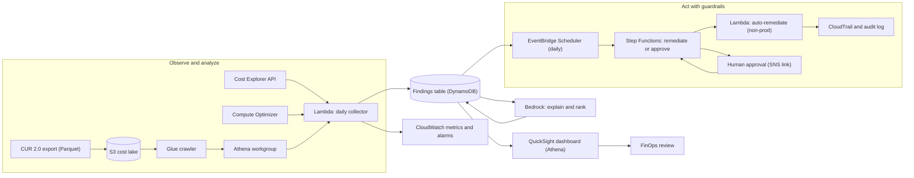
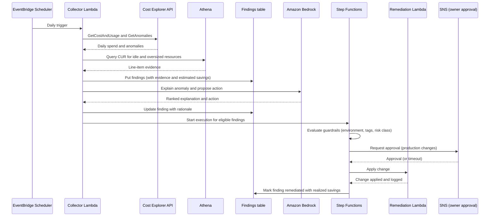
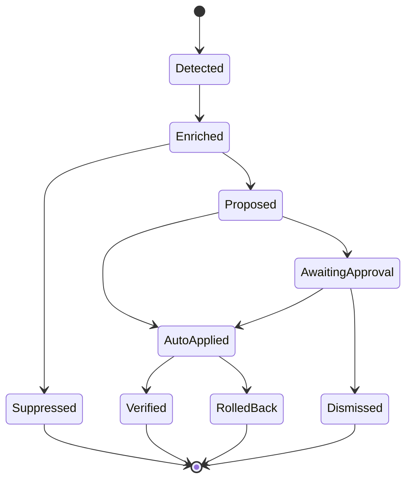

# 03 · AI-Driven Cost Optimization

> **Phase 10 — Grandmaster Projects** · Lesson 03 of 06
> ⬅️ Previous: [Chaos Engineering](./02-chaos-engineering.md) · ➡️ Next: [Contributing to Open Source](./04-contributing-to-open-source.md) · 🏠 [Phase overview](./README.md)

## 🎯 Learning Objectives

By the end of this lesson you will be able to:

- Pull cost and usage data from the Cost Explorer API and from CUR 2.0 via Athena
- Generate rightsizing and idle-resource findings from first-party AWS recommendation services
- Detect spend anomalies with Cost Anomaly Detection and add reasoning with Amazon Bedrock
- Automate remediation with EventBridge Scheduler, Step Functions, and Lambda — with guardrails
- Prove automation cannot delete production, using tags, SCPs, and approval stages
- Publish a savings-tracking dashboard that shows realized, not hypothetical, savings

**Estimated time:** 150 min · **Difficulty:** Advanced

---

## 🧠 Core Concepts

Cost optimization has four stages and most teams stop at the second. **Observe** means you can answer "what did we spend, on what, for whom, yesterday?" **Analyze** means you can rank waste: idle resources, oversized resources, unattached storage, forgotten environments, and commitment gaps. **Act** means a change actually happens — which is where human attention runs out. **Prove** means you can show, in dollars, what the change saved, 30 days later.

Traditional FinOps tooling automates observe and analyze, then mails a report nobody actionizes. An **AI-driven cost engine** closes the loop: it continuously pulls cost data, enriches it with utilization telemetry and recommendations, asks a foundation model to explain *why* a pattern is anomalous and what to do about it, then applies only the remediations that a strict policy allows — and escalates everything else to a human with a one-click action.

Two decisions dominate the design. The first is the **data path**: the Cost Explorer API is convenient and expensive-per-call (~$0.01 per request) with a delay of up to 24 hours, while CUR 2.0 is the complete, line-item-level record delivered to S3 and queryable with Athena at a fraction of the cost. Use the API for daily dashboards and anomaly enrichment; use CUR in Athena for unit economics, per-tenant allocation, and anything you would otherwise run hourly.

The second is the **trust boundary**: what may the automation change without a human? A workable rule set:

| Class | Example | Policy |
|-------|---------|--------|
| Reversible, low risk | Delete an unattached EBS volume older than 30 days, stop an idle dev instance | Auto-apply in non-production |
| Reversible, medium risk | Rightsize a production instance via ASG launch template | Propose, apply after one-click approval |
| Irreversible or customer-visible | Delete a DynamoDB table, resize an RDS instance in place | Human only, never automated |
| Contractual | Purchase a Savings Plan or Reserved Instances | Human only, with a forecast in hand |

That table *is* the guardrail specification. Encode it as tags (`auto-remediate`, `environment`, `owner`) plus an SCP that denies destructive actions to the automation role regardless of what the Lambda code says.

**Right-sizing is a supply-side question, not a spreadsheet.** `GetRightsizingRecommendation`, Compute Optimizer, and Cost Optimization Hub each answer it from a different angle: current-generation migration, utilization over a lookback window, and cross-service opportunity ranking. Feed all three into one findings table so you rank by *savings × confidence ÷ risk*, not by savings alone.

### Key terminology

| Term | Meaning |
|------|---------|
| **CUR 2.0** | Cost and Usage Report delivered as Parquet via Data Exports, the line-item source of truth |
| **Unblended cost** | Cost as incurred, without blending across accounts; the default currency of optimization |
| **Amortized cost** | Upfront commitment cost spread across the period; the honest view of Savings Plan spend |
| **Rightsizing** | Matching instance or task size to measured utilization |
| **Idle resource** | A resource that exists, bills, and serves no traffic — unattached EBS, unused EIP, empty ALB |
| **Commitment coverage** | The share of eligible spend covered by Savings Plans or Reserved Instances |
| **Anomaly monitor** | A Cost Anomaly Detection monitor that learns a spend baseline per dimension |
| **Guardrail** | An SCP, tag condition, or approval gate that constrains automation |
| **Realized savings** | Measured reduction in a specific cost line after a change, net of recomputation |

---

## 🗺️ Architecture Diagram

The engine: a scheduled read path, an analysis and reasoning path, a constrained write path, and a reporting path.



The detect-to-remediate loop, including the approval branch that keeps a human in the path for production:



Every finding has a lifecycle, and only two paths ever mutate resources:



---

## 🧪 Hands-on Lab: Build the Detect-to-Remediate Loop

**Goal:** Collect cost data, detect an idle resource, have Bedrock explain it, and remediate it automatically only when the guardrail tags allow it.

**Prerequisites:** An AWS account with Cost Explorer enabled, at least one EBS volume in `available` state, permission to create IAM roles, and (for the Bedrock step) model access enabled for a foundation model in your region.

### Step 1 — Make the cost data queryable

CUR 2.0 is the durable data source. Deliver Parquet so Athena scans stay small.

```bash
# Create a CUR 2.0 export: daily Parquet into S3, refreshing up to three times a day
aws bcm-data-exports create-export --export '{
  "Name": "cur2-daily",
  "Description": "Daily cost and usage line items for the optimization engine",
  "DataQuery": {
    "QueryStatement": "SELECT bill_billing_period_start_date, line_item_usage_account_id, line_item_product_code, line_item_usage_type, line_item_resource_id, line_item_unblended_cost, resource_tags FROM COST_AND_USAGE_REPORT",
    "TableConfigurations": {
      "COST_AND_USAGE_REPORT": {
        "TIME_GRANULARITY": "DAILY",
        "INCLUDE_RESOURCES": "TRUE",
        "INCLUDE_CREDITS": "TRUE",
        "INCLUDE_SUPPORT_CHARGES": "TRUE",
        "INCLUDE_TAXES": "FALSE"
      }
    }
  },
  "DestinationConfigurations": {
    "S3Destination": {
      "S3Bucket": "my-cost-lake",
      "S3Prefix": "cur2",
      "S3Region": "eu-west-1",
      "S3OutputConfigurations": {
        "OutputType": "CUSTOM",
        "Format": "PARQUET",
        "Compression": "PARQUET",
        "Overwrite": "CREATE_NEW_REPORT"
      }
    }
  },
  "RefreshCadence": {"Frequency": "SYNCHRONOUS"}
}'

# Check delivery status before pointing Athena at the bucket
aws bcm-data-exports list-exports --query 'Exports[].{Arn:ExportArn,Name:Export.Name}'
```

```bash
# Catalog the export, then query it from Athena
aws glue create-database --database-input '{"Name":"costdb"}'
aws glue create-crawler --name cur2-crawler \
  --role arn:aws:iam::111122223333:role/GlueServiceRole \
  --database-name costdb \
  --targets '{"S3Targets":[{"Path":"s3://my-cost-lake/cur2/"}]}'
aws glue start-crawler --name cur2-crawler

# Per-service spend for the last 7 days, computed from line items
aws athena start-query-execution \
  --query-string "SELECT line_item_product_code AS service, ROUND(SUM(line_item_unblended_cost), 2) AS usd
                  FROM costdb.cur2
                  WHERE line_item_usage_start_date >= date_add('day', -7, current_date)
                  GROUP BY 1 ORDER BY usd DESC LIMIT 20" \
  --query-execution-context Database=costdb \
  --result-configuration OutputLocation=s3://my-cost-lake/athena-results/
```

### Step 2 — Daily collector: cost, rightsizing, and idle detection

The collector writes *evidence* alongside every finding, so a human can audit the decision later.

```bash
# 30 days of daily spend, grouped by service — the baseline the engine trends against
aws ce get-cost-and-usage \
  --time-period Start=2026-09-14,End=2026-10-14 \
  --granularity DAILY --metrics UnblendedCost \
  --group-by Type=DIMENSION,Key=SERVICE

# Rightsizing candidates for EC2, with the discount considered
aws ce get-rightsizing-recommendation \
  --service AmazonEC2 \
  --configuration '{"RecommendationTarget":"SAME_INSTANCE_FAMILY","BenefitsConsidered":true}'

# Compute Optimizer's view: over-provisioned instances, volumes, and Lambda functions
aws compute-optimizer get-ec2-instance-recommendations \
  --query 'instanceRecommendations[].{Id:instanceArn,Finding:finding,Current:currentInstanceType}'
aws compute-optimizer get-ebs-volume-recommendations
aws compute-optimizer get-lambda-function-recommendations

# One ranked list across services, instead of four consoles
aws cost-optimization-hub list-recommendations \
  --filter '{"resourceTypes":["Ec2Instance","EbsVolume","LambdaFunction"]}' \
  --query 'items[].{Type:resourceType,Save:estimatedMonthlySavings,Action:actionType}' \
  --max-results 25

# Idle candidates: unattached volumes, unpublished addresses, and old snapshots
aws ec2 describe-volumes --filters "Name=status,Values=available" \
  --query 'Volumes[].{Id:VolumeId,Size:Size,Created:CreateTime,Tags:Tags}'
aws ec2 describe-addresses --query 'Addresses[?AssociationId==null].{Ip:PublicIp,Alloc:AllocationId}'
aws ec2 describe-snapshots --owner-ids self \
  --query 'Snapshots[?StartTime<=`2026-04-14`].{Id:SnapshotId,Size:VolumeSize}'
```

```python
# collector.py - one Lambda run: gather evidence and persist findings
import boto3, datetime, os, uuid

ce = boto3.client("ce")
ec2 = boto3.client("ec2")
ddb = boto3.resource("dynamodb").Table(os.environ["FINDINGS_TABLE"])

def idle_volumes():
    findings = []
    for vol in ec2.describe_volumes(Filters=[{"Name": "status", "Values": ["available"]}])["Volumes"]:
        tags = {t["Key"]: t["Value"] for t in vol.get("Tags", [])}
        age_days = (datetime.datetime.now(datetime.timezone.utc) - vol["CreateTime"]).days
        # An unattached volume only becomes a finding after a grace period.
        if age_days < 30:
            continue
        gp3_monthly = vol["Size"] * 0.08  # eu-west-1 gp3, usd per GB-month
        findings.append({
            "finding_id": f"ebs-{vol['VolumeId']}",
            "resource_type": "EbsVolume",
            "resource_id": vol["VolumeId"],
            "evidence": {"age_days": age_days, "size_gb": vol["Size"], "state": vol["State"]},
            "estimated_monthly_savings": round(gp3_monthly, 2),
            "environment": tags.get("environment", "unknown"),
            "auto_remediate": tags.get("auto-remediate", "false"),
            "owner": tags.get("owner", "unknown"),
            "status": "detected",
        })
    return findings

def persist(findings):
    for f in findings:
        ddb.put_item(Item={**f, "ttl": int((datetime.datetime.now(datetime.timezone.utc)
                        + datetime.timedelta(days=400)).timestamp())})

def lambda_handler(event, context):
    findings = idle_volumes()
    persist(findings)
    return {"detected": len(findings),
            "potential_monthly_savings": round(sum(f["estimated_monthly_savings"] for f in findings), 2)}
```

```bash
# The findings table: one partition key, TTL so old findings expire
aws dynamodb create-table --table-name cost-findings \
  --attribute-definitions AttributeName=finding_id,AttributeType=S \
  --key-schema AttributeName=finding_id,KeyType=HASH \
  --billing-mode PAY_PER_REQUEST

# Metrics are also published by the collector so savings are dashboardable
aws cloudwatch put-metric-data --namespace CostEngine --metric-name PotentialMonthlySavings \
  --unit None --value 412.80
```

### Step 3 — Anomaly detection plus model reasoning

```bash
# DIMENSIONAL monitor on SERVICE: learns a band per service, far fewer false positives than a total-spend monitor
aws ce create-anomaly-monitor --anomaly-monitor '{
  "MonitorName": "saas-service-monitor",
  "MonitorType": "DIMENSIONAL",
  "MonitorDimension": "SERVICE"
}'

# Subscribe the FinOps channel and the owning teams
aws ce create-anomaly-subscription --anomaly-subscription '{
  "SubscriptionName": "saas-anomalies",
  "MonitorArn": "arn:aws:ce::111122223333:anomalymonitor/abcd1234-5678-90ab-cdef-1234567890ab",
  "Frequency": "DAILY",
  "Subscribers": [{"Address": "finops@example.com", "Type": "EMAIL"}]
}'

# Pull the anomalies the engine should explain
aws ce get-anomalies \
  --date-interval StartDate=2026-09-14,EndDate=2026-10-14 \
  --monitor-arn arn:aws:ce::111122223333:anomalymonitor/abcd1234-5678-90ab-cdef-1234567890ab \
  --query 'Anomalies[].{Id:AnomalyId,Impact:Impact,Score:AnomalyScore,Service:RootCauses[0].Service}'
```

A foundation model earns its place when it turns a metric into a sentence a service owner can act on: what changed, which resources are implicated, what the likely cause is, and what to check first.

```python
# explain.py - turn a structured anomaly into a ranked, human-readable hypothesis
import boto3, json, os

bedrock = boto3.client("bedrock-runtime", region_name="eu-west-1")

SYSTEM = ("You are a FinOps analyst. You receive cost anomalies with evidence. "
          "Explain the most likely cause, name the resources to inspect, and propose one action. "
          "Never propose deleting data stores or terminating instances in production. "
          "Reply with JSON only: {\"cause\": str, \"inspect\": [str], \"action\": str, \"confidence\": float}")

def explain(anomaly: dict) -> dict:
    body = {
        "anthropic_version": "bedrock-2023-05-31",
        "max_tokens": 600,
        "system": SYSTEM,
        "messages": [{
            "role": "user",
            "content": [{"type": "text", "text": json.dumps(anomaly)}],
        }],
    }
    resp = bedrock.invoke_model(
        modelId=os.environ["MODEL_ID"],           # e.g. anthropic.claude-3-5-sonnet-20241022-v2:0
        contentType="application/json",
        accept="application/json",
        body=json.dumps(body),
    )
    payload = json.loads(resp["body"].read())
    text = payload["content"][0]["text"]
    try:
        return json.loads(text)
    except json.JSONDecodeError:
        return {"cause": text, "inspect": [], "action": "manual review", "confidence": 0.0}
```

```bash
# Smoke-test the same call from the CLI before wiring the Lambda
aws bedrock-runtime invoke-model \
  --model-id anthropic.claude-3-5-sonnet-20241022-v2:0 \
  --content-type application/json --accept application/json \
  --body file://anomaly-prompt.json \
  out.json && cat out.json
```

Bedrock is the *explanation* layer, not the detector. Statistical detection (Cost Anomaly Detection, CloudWatch anomaly detection bands, or a rolling median in your own code) is cheaper, deterministic, and auditable; the model adds language and triage, and its output must never be the sole trigger of an irreversible change.

### Step 4 — Remediate with guardrails

The Lambda refuses to act unless every guardrail passes, and it validates independently of any caller.

```python
# remediate.py - delete an unattached volume only if the guardrails allow it
import boto3, os

ec2 = boto3.client("ec2")
PROTECTED_ENVIRONMENTS = {"prod", "production", "pci", "hipaa"}

def allowed(finding) -> tuple[bool, str]:
    if finding["resource_type"] != "EbsVolume":
        return False, "resource type is not auto-remediable"
    if finding.get("auto_remediate") != "true":
        return False, "auto-remediate tag is not true"
    if finding.get("environment", "").lower() in PROTECTED_ENVIRONMENTS:
        return False, "production-like environment"
    if float(finding.get("estimated_monthly_savings", 0)) < 5:
        return False, "savings below the automation threshold"
    snapshots = ec2.describe_snapshots(
        Filters=[{"Name": "volume-id", "Values": [finding["resource_id"]]}]
    )["Snapshots"]
    if not snapshots:
        return False, "no snapshot exists - create one before deletion"
    return True, "allowed"

def lambda_handler(event, context):
    if os.environ.get("DRY_RUN", "true") == "true":
        return {"decision": "dry-run", "finding": event["finding_id"]}
    ok, reason = allowed(event)
    if not ok:
        return {"decision": "escalate", "reason": reason, "finding": event["finding_id"]}
    # --dry-run is available on EC2 mutating calls: prove permissions before acting
    ec2.delete_volume(VolumeId=event["resource_id"], DryRun=False)
    return {"decision": "applied", "finding": event["finding_id"]}
```

```bash
# Delete only after a snapshot exists, and only for a tagged, non-production volume
aws ec2 create-snapshot --volume-id vol-0123456789abcdef0 \
  --description "Pre-remediation snapshot for cost-findings/ebs-vol-0123456789abcdef0" \
  --tag-specifications 'ResourceType=snapshot,Tags=[{Key=owner,Value=finops},{Key=purpose,Value=cost-remediation}]'

# Prove you have permission before touching anything
aws ec2 delete-volume --volume-id vol-0123456789abcdef0 --dry-run
```

**The SCP that makes the guardrail structural.** Even a bug in `remediate.py` cannot delete a production database, because the automation role is not allowed to.

```json
{
  "Version": "2012-10-17",
  "Statement": [
    {
      "Sid": "DenyDestructiveActionsOnProductionTags",
      "Effect": "Deny",
      "Action": [
        "ec2:TerminateInstances",
        "ec2:DeleteVolume",
        "rds:DeleteDBInstance",
        "rds:DeleteDBCluster",
        "dynamodb:DeleteTable",
        "s3:DeleteBucket"
      ],
      "Resource": "*",
      "Condition": {
        "StringEquals": {"aws:ResourceTag/environment": ["prod", "production"]},
        "ArnLike": {"aws:PrincipalArn": "arn:aws:iam::*:role/CostRemediation*"}
      }
    },
    {
      "Sid": "RequireExplicitAutomationOptIn",
      "Effect": "Deny",
      "Action": ["ec2:DeleteVolume"],
      "Resource": "*",
      "Condition": {
        "StringNotEquals": {"aws:ResourceTag/auto-remediate": "true"}
      }
    }
  ]
}
```

### Step 5 — Schedule, orchestrate, and track savings

```bash
# Daily schedule that invokes the collector
aws scheduler create-schedule --name cost-collector-daily \
  --schedule-expression "cron(15 5 * * ? *)" \
  --flexible-time-window '{"Mode":"OFF"}' \
  --target '{
    "Arn": "arn:aws:lambda:eu-west-1:111122223333:function:cost-collector",
    "RoleArn": "arn:aws:iam::111122223333:role/SchedulerInvokeRole"
  }'

# A budget with an alert, so the engine is not the only thing watching spend
aws budgets create-budget --account-id 111122223333 \
  --budget '{
    "BudgetName": "monthly-platform",
    "BudgetLimit": {"Amount": "8000", "Unit": "USD"},
    "TimeUnit": "MONTHLY",
    "BudgetType": "COST"
  }' \
  --notifications-with-subscribers '[{
    "Notification": {"NotificationType":"ACTUAL","ComparisonOperator":"GREATER_THAN","Threshold":90},
    "Subscribers": [{"SubscriptionType":"EMAIL","Address":"finops@example.com"}]
  }]'
```

### Step 6 — Verify

```bash
# 1. The finding exists and carries its evidence
aws dynamodb get-item --table-name cost-findings \
  --key '{"finding_id":{"S":"ebs-vol-0123456789abcdef0"}}'

# 2. The volume is gone and the snapshot remains
aws ec2 describe-volumes --volume-ids vol-0123456789abcdef0    # expect InvalidVolume.NotFound
aws ec2 describe-snapshots --owner-ids self \
  --filters "Name=tag:purpose,Values=cost-remediation" \
  --query 'Snapshots[].SnapshotId'

# 3. The change is attributable in CloudTrail
aws cloudtrail lookup-events \
  --lookup-attributes AttributeKey=EventName,AttributeValue=DeleteVolume \
  --max-results 5 \
  --query 'Events[].{Time:EventTime,User:Username,Source:EventSource}'

# 4. Realized savings: compare the cost line before and after the change
aws ce get-cost-and-usage \
  --time-period Start=2026-09-14,End=2026-10-14 --granularity MONTHLY \
  --metrics UnblendedCost --filter '{"Dimensions":{"Key":"USAGE_TYPE","Values":["EU-EBS:VolumeUsage.gp3"]}}'
```

Success looks like: the finding is marked `applied`, the volume is deleted with a tagged snapshot in place, CloudTrail shows the automation role making the call, and the EBS usage line drops in the following billing period.

---

## 💻 CLI Reference

```bash
# Forecast the current month, so guardrails can act before the overrun happens
aws ce get-cost-forecast --time-period Start=2026-10-01,End=2026-11-01 \
  --metric UNBLENDED_COST --granularity MONTHLY

# Commitment coverage and utilization: are you paying for waste, or leaving discount on the table?
aws ce get-savings-plans-utilization --time-period Start=2026-09-14,End=2026-10-14 \
  --granularity DAILY
aws ce get-savings-plans-coverage --time-period Start=2026-09-14,End=2026-10-14 \
  --granularity DAILY

# Per-tenant unit economics straight from CUR line items
aws athena start-query-execution \
  --query-string "SELECT resource_tags['user_tenant_id'] AS tenant, ROUND(SUM(line_item_unblended_cost),2) AS usd
                  FROM costdb.cur2 WHERE line_item_usage_start_date >= date_add('day',-30,current_date)
                  GROUP BY 1 ORDER BY usd DESC" \
  --query-execution-context Database=costdb \
  --result-configuration OutputLocation=s3://my-cost-lake/athena-results/
```

| Command | Purpose |
|---------|---------|
| `bcm-data-exports create-export` | Deliver CUR 2.0 line items to S3 for Athena analysis |
| `ce get-rightsizing-recommendation` | Compare current EC2 sizing against observed utilization |
| `ce create-anomaly-monitor` | Learn a spend baseline per dimension and detect deviations |
| `cost-optimization-hub list-recommendations` | Rank opportunities across services in one response |
| `compute-optimizer get-*` | Per-resource over-provisioning for EC2, EBS, Lambda, ECS |
| `ec2 delete-volume --dry-run` | Validate permissions before a destructive call |
| `cloudtrail lookup-events` | Attribute every automated change to a principal |

---

## ✅ Best Practices

| Practice | Why it matters |
|----------|----------------|
| Query CUR in Athena, not the Cost Explorer API, for anything recurring | API calls are billed per request and capped in throughput |
| Attach evidence (metrics, age, utilization) to every finding | Makes the decision auditable and debuggable months later |
| Default the remediation Lambda to `DRY_RUN=true` | A deployment mistake cannot delete resources on its first run |
| Require a snapshot or backup before any delete | Deleting is free; recovering without one is impossible |
| Separate detect, decide, and apply into different components | You can throttle or disable one stage without losing telemetry |
| Rank by savings × confidence ÷ risk | Prevents chasing a risky $30/month change over a safe $3,000 one |
| Measure realized savings for 30 days after the change | Most "savings" claims evaporate when recomputation or regrowth is counted |
| Give every finding an owner via tags | Ownerless findings are never actioned and never closed |

---

## ⚠️ Common Pitfalls

| Pitfall | Symptom | Fix |
|---------|---------|-----|
| Automating deletions with no tag guardrail | Production volume deleted by a "safe" rule | Require `auto-remediate=true` and deny production tags by SCP |
| Trusting rightsizing without a lookback window | Instance downsized just before a seasonal peak | Require 14+ days of utilization above the target percentile before acting |
| Ignoring amortized cost | Savings Plan purchases make daily spend look erratic | Report amortized cost for commitment analysis, unblended for anomaly detection |
| Anomaly detection on total spend only | Alert fires after a multi-day overrun, too late and too vague | Use DIMENSIONAL monitors per service or linked account |
| Letting the model make the call | Irreversible change based on an unverifiable sentence | Deterministic rules decide; the model explains and ranks |
| No idempotency on remediation | Retries delete the same resource twice, or fail and stall the workflow | Key every action on `finding_id` and make the state transition conditional in DynamoDB |
| Savings measured as "list price avoided" | Dashboard celebrates savings that were never realized | Measure the specific cost line before and after, in the next full period |
| One engine per team | Five collectors, five dashboards, conflicting numbers | One cost lake, one findings table, many consumers |

---

## 💰 Cost Considerations

The engine must cost far less than it saves — a self-defeating optimizer is a common and embarrassing failure mode.

- **Cost Explorer API calls are billed (~$0.01 per request).** A naive hourly collector with 30 grouping dimensions costs dollars per day and returns nothing new (data refreshes at most three times daily). Collect once daily; anything analytical belongs in Athena.
- **CUR 2.0 delivery is free; S3 storage and Athena scans are not.** Parquet plus partition pruning keeps a month of line items scannable for cents. A full-table CSV scan can cost more than the waste you are hunting.
- **Bedrock is billed per input and output token.** Send distilled evidence — a finding summary of a few hundred tokens — not raw CUR rows. Cache explanations per finding and never call the model in a loop over thousands of resources.
- **Compute Optimizer is free for basic recommendations** (enhanced infrastructure metrics require the CloudWatch agent, which has its own cost). Cost Optimization Hub and Cost Anomaly Detection are free features of Cost Explorer.
- **Snapshot storage costs money.** Deleting a 1 TB volume saves ~$80/month but retaining its snapshot costs ~$50/month until expiry. Set snapshot lifecycle policies, or the remediation nets almost nothing.
- **Compute the engine's own bill.** Publish `CostEngine/*` metrics (Lambda duration, tokens, Athena bytes scanned) and require the engine's monthly cost to stay under a few percent of detected savings.

---

## 🔐 Security Considerations

- **Least privilege with resource-tag conditions.** The remediation role should allow only the specific delete/stop actions, conditioned on `aws:ResourceTag/auto-remediate=true` and denial of production tags. Never attach `PowerUserAccess`.
- **The Lambda is a privileged principal — treat it as production code.** Require code review, signed artifacts, and a deployment pipeline; a malicious commit to the remediation function is an infrastructure-wide deletion primitive.
- **Guard against confused deputy.** Cross-account cost collection should use `sts:AssumeRole` with an external ID, or an organization-level role with `aws:PrincipalOrgID` conditions.
- **Protect the findings table.** It contains resource inventory, owners, and cost figures. Encrypt with KMS, restrict reads to the FinOps role, and never surface it to the internet.
- **Audit trail is mandatory.** Every automated change must appear in CloudTrail with a distinguishable principal (for example `arn:...:assumed-role/CostRemediationRole/...`), and the finding record must store the correlation ID.
- **Model prompts are data flows.** Anomalies may contain resource names and account IDs. Use Bedrock in-region, disable model invocation logging if it would capture sensitive identifiers, and never send customer data.
- **Approval links are credentials.** If SNS emails a one-click approval, make it a signed, single-use URL bound to the finding ID and an expiry, not an open API endpoint.
- **Budgets and Budget Actions are controls too.** Configure a Budget Action that applies an SCP to stop further spend rather than trusting the engine to always be running.

---

## 🧩 Exercise

Extend the engine to handle **idle dev instances**, end to end.

1. Write an Athena query over CUR that lists EC2 instances whose CPU utilization averaged under 3% for 14 days (join CUR line items with a CloudWatch metrics export, or use Compute Optimizer's `get-ec2-instance-recommendations` finding instead).
2. Write a Lambda that stops only instances tagged `environment=dev` and `auto-remediate=true`, refusing to act if a CloudWatch alarm named `keep-alive-<instance-id>` is in `OK` state.
3. Prove the guardrail by attempting to stop a `prod` instance and showing the action is denied by the SCP.

Success looks like: the collector reports the idle dev instances and their monthly cost, the stop succeeds for tagged dev instances, and the production attempt returns `AccessDenied` with the SCP referenced in the error.

---

## 📚 Resources

- [AWS Cost Explorer API reference](https://docs.aws.amazon.com/aws-cost-management/latest/APIReference/API_Operations_AWS_Cost_Explorer_Service.html)
- [Data Exports (CUR 2.0) User Guide](https://docs.aws.amazon.com/cur/latest/userguide/what-is-data-exports.html)
- [Cost Anomaly Detection](https://docs.aws.amazon.com/aws-cost-management/latest/userguide/manage-ad.html)
- [AWS Compute Optimizer recommendations](https://docs.aws.amazon.com/compute-optimizer/latest/ug/view-ec2-recommendations.html)
- [AWS Cost Optimization Hub](https://docs.aws.amazon.com/cost-management/latest/userguide/what-is-cost-optimization-hub.html)
- [AWS Budgets and Budget Actions](https://docs.aws.amazon.com/cost-management/latest/userguide/budgets-managing-costs.html)
- [Amazon Bedrock Converse and InvokeModel APIs](https://docs.aws.amazon.com/bedrock/latest/userguide/inference-api.html)
- [FinOps Foundation — Framework and capabilities](https://www.finops.org/framework/)

---

## ➡️ Next Steps

You have built three systems that a senior architect would recognize: a multi-tenant platform, a resilience practice, and a self-optimizing cost engine. The next lesson shifts from building systems to shaping the tools everyone else builds on — contributing to the AWS open-source ecosystem.

> ⬅️ Previous: [Chaos Engineering](./02-chaos-engineering.md) · ➡️ Next: [Contributing to Open Source](./04-contributing-to-open-source.md) · 🏠 [Phase overview](./README.md)
