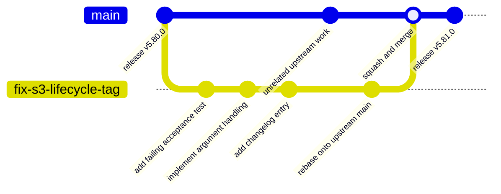
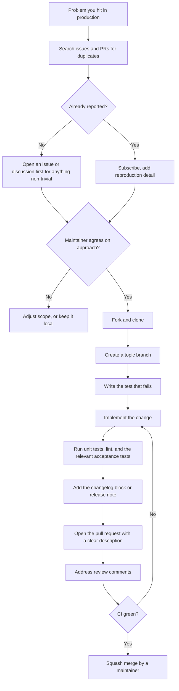
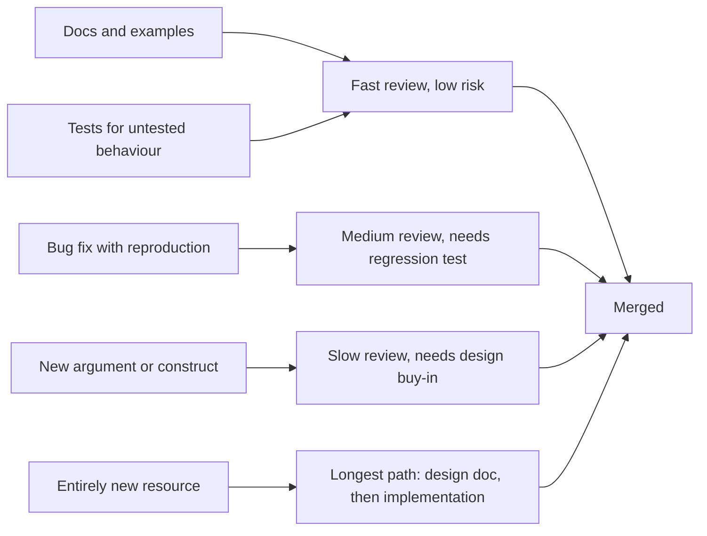

# 04 · Contributing to Open Source

> **Phase 10 — Grandmaster Projects** · Lesson 04 of 06
> ⬅️ Previous: [AI-Driven Cost Optimization](./03-ai-driven-cost-optimization.md) · ➡️ Next: [Teaching and Thought Leadership](./05-teaching-and-thought-leadership.md) · 🏠 [Phase overview](./README.md)

## 🎯 Learning Objectives

By the end of this lesson you will be able to:

- Navigate the AWS-adjacent open-source landscape and pick a project that matches your goals
- Find genuinely approachable issues instead of guessing at what maintainers want
- Follow the real contribution workflow for Terraform providers, CDK constructs, LocalStack, and AWS SDKs
- Write pull requests that maintainers can review quickly: tests, changelog entries, and a clean branch
- Comply with CLA and DCO requirements without friction
- Maintain your own module or project to a publishable standard

**Estimated time:** 90 min · **Difficulty:** Advanced

---

## 🧠 Core Concepts

Open source is how the cloud ecosystem actually evolves. When you need a provider argument that does not exist, a CDK construct for a pattern you use weekly, or a bug fix in the SDK that your business depends on, the fastest path is often upstream: implement it once, correctly, and everyone — including you at your next employer — benefits. The second-order benefit is subtler but larger: contributing to a widely used project is the most credible way to demonstrate that you understand a system below the API surface.

The landscape splits into four groups, and they demand different skills:

| Project family | Examples | Primary language | Contribution shape |
|----------------|----------|------------------|--------------------|
| Infrastructure providers | `hashicorp/terraform-provider-aws`, `pulumi/pulumi-aws` | Go | New resource arguments, bug fixes, acceptance tests, changelog blocks |
| Infrastructure-as-code libraries | `aws/aws-cdk`, `aws/aws-cdk-lib`, `cdklabs/*` constructs | TypeScript | New constructs with unit tests and snapshot tests |
| Emulators and tooling | `localstack/localstack`, `aws/aws-cli` | Python | API coverage, integration tests against real AWS, CLI argument handling |
| SDKs and samples | `boto3`/`botocore`, `aws/aws-sdk-js-v3`, `aws/aws-sdk-go-v2`, `aws-samples/*` | Python, TS, Go, Java | Type and shape generation, retries, examples, documentation |

**Small is not the same as easy.** A one-line documentation fix that clarifies a confusing error message can be more valuable than a 900-line feature, and it is reviewed in hours. Maintainers are volunteers or thinly staffed teams; a PR that arrives with a failing test, no changelog, and a 40-commit history is a burden regardless of how good the idea is. The etiquette of contribution is mostly the etiquette of reducing someone else's work.

**Respect the project's contract.** Every mature project has a `CONTRIBUTING.md`, a test convention, a changelog format, and a review culture. Terraform providers want acceptance tests plus `.changelog/<PR-number>.txt` release-note blocks; CDK wants unit tests plus snapshot updates and `projen` task runs; LocalStack wants integration tests that also run against real AWS; SDK repos often forbid hand-editing generated code. Read those files first — they are the specification for your PR.

**Two legal gates, one habit.** A **CLA** (Contributor License Agreement) grants the project the rights it needs to distribute your code; a **DCO** (`Signed-off-by:`) is a per-commit assertion that you have the right to submit it. AWS projects use a CLA assistant bot (one-time, click-through, per organization), many Linux Foundation projects require DCO sign-off (`git commit -s`), and several require both. Signing is not a transfer of copyright in most cases — but a missing sign-off will block your PR indefinitely, so configure it once and forget it.

**Maintaining is the next rung.** The step from contributor to maintainer is not a promotion, it is a change of job: triage, review, releases, security response, and saying no politely. If you publish a module or a construct library, its trustworthiness depends on boring things — semver discipline, a `SECURITY.md`, automated releases, and an issue template that asks for a reproduction.

### Key terminology

| Term | Meaning |
|------|---------|
| **Good first issue** | A label maintainers apply to issues they believe a newcomer can complete |
| **Acceptance test** | A test that creates real cloud resources and asserts behaviour; slow, so it is gated |
| **Snapshot test** | A test that compares generated output (for example synthesized CloudFormation) against a stored fixture |
| **Golden file** | A checked-in expected output used to detect unintended changes |
| **CLA** | Contributor License Agreement; signed once per organization via a bot |
| **DCO** | Developer Certificate of Origin; asserted per commit with `git commit -s` |
| **Changelog block** | The release-note fragment a project requires, e.g. `.changelog/12345.txt` |
| **CODEOWNERS** | A file mapping paths to required reviewers |
| **Triage** | Labeling, reproducing, closing, and prioritizing incoming issues |

---

## 🗺️ Architecture Diagram

A typical contribution branch flow, including the rebase that keeps your branch current and the squash that maintainers usually apply:



The lifecycle from idea to merged code — note how much of it happens before you write any code:



Where contributions actually land, and how much review each needs:



---

## 🧪 Hands-on Lab: Ship a Real Contribution End to End

**Goal:** Take one small, real change through the complete workflow — find an issue, branch, test, fix, changelog, and PR — using the same commands maintainers expect to see.

**Prerequisites:** A GitHub account, `git`, `gh` CLI authenticated (`gh auth login`), Go 1.22+ (for the Terraform provider example), Python 3.11+ and Docker (for LocalStack). You do not need to merge anything to complete the lab; the artifacts are the branch, the test, and the PR description.

### Step 1 — Find work that is actually wanted

Do not invent a feature. Search for labelled, confirmed problems.

```bash
# Issues maintainers have explicitly marked as newcomer-friendly
gh issue list --repo hashicorp/terraform-provider-aws \
  --label "good first issue" --state open --limit 20

# Anything the AWS provider team has accepted but nobody has implemented
gh search issues --repo hashicorp/terraform-provider-aws \
  --label "help wanted" --sort updated --limit 20

# Documentation and example fixes, which are reviewed fastest
gh search issues --repo aws-samples/aws-cdk-examples \
  --label "documentation" --limit 20

# LocalStack tracks feature coverage per service
gh issue list --repo localstack/localstack \
  --label "good first issue" --state open --limit 20
```

Before writing code, read the project's rules:

```bash
# The three files that define the contract you must satisfy
gh api repos/hashicorp/terraform-provider-aws/contents/CONTRIBUTING.md --jq '.download_url'
gh api repos/localstack/localstack/contents/CONTRIBUTING.md --jq '.download_url'
gh api repos/aws/aws-cdk/contents/CONTRIBUTING.md --jq '.download_url'
```

### Step 2 — Fork, clone, and branch

```bash
# Fork and clone in one step, keeping upstream as a second remote
gh repo fork hashicorp/terraform-provider-aws --clone --remote
cd terraform-provider-aws

# Confirm remotes: origin is yours, upstream is the source of truth
git remote -v

# Branch names describe the change, not your initials
git checkout -b fix-aws-s3-bucket-lifecycle-tag upstream/main
```

### Step 3 — Write the failing test first

For Terraform providers, acceptance tests are gated behind `TF_ACC` and create real resources in a sandbox account.

```bash
# Build the provider and run the fast unit tests
make build
make test

# Run only the acceptance test related to your change (this creates real AWS resources)
make testacc TESTARGS='-run=TestAccS3BucketLifecycleConfiguration_basic' TF_ACC=1
```

```go
// internal/service/s3/bucket_lifecycle_configuration_test.go (illustrative shape)
func TestAccS3BucketLifecycleConfiguration_tags(t *testing.T) {
	ctx := acctest.Context(t)
	rName := sdkacctest.RandomWithPrefix(acctest.ResourcePrefix)
	resourceName := "aws_s3_bucket_lifecycle_configuration.test"

	resource.ParallelTest(t, resource.TestCase{
		PreCheck:                 func() { acctest.PreCheck(ctx, t) },
		ErrorCheck:               acctest.ErrorCheck(t, names.S3ServiceID),
		ProtoV5ProviderFactories: acctest.ProtoV5ProviderFactories,
		CheckDestroy:             testAccCheckBucketLifecycleConfigurationDestroy(ctx),
		Steps: []resource.TestStep{
			{
				Config: testAccBucketLifecycleConfigurationConfig_tags(rName),
				Check: resource.ComposeTestCheckFunc(
					testAccCheckBucketLifecycleConfigurationExists(ctx, resourceName),
					resource.TestCheckResourceAttr(resourceName, "rule.0.filter.0.tag.0.key", "Environment"),
				),
			},
		},
	})
}
```

For LocalStack, run the unit suite first, then the service integration suite — which is also run against real AWS in CI.

```bash
# LocalStack: install dependencies and run the fast unit tests
make install
pytest tests/unit -q

# Run one service's integration tests (starts the local runtime as needed)
pytest tests/aws/services/s3/test_s3.py -k "bucket_versioning" -q

# Formatting and linting are enforced in CI, so run them locally
make format
make lint
```

For CDK constructs, unit tests assert the synthesized CloudFormation template.

```bash
# awscdk-construct projects use projen as the task runner
npx projen test           # unit tests plus snapshot comparisons
npx projen build          # compile, lint, test, package
npx projen eslint
```

For SDK repositories, respect the generated-code boundary:

```bash
# botocore: unit tests plus the maintainer-provided PR check target
pytest tests/unit/test_s3.py -q
make pr

# aws-sdk-js-v3: build and test a single client package
cd clients/client-s3
yarn build && yarn test:unit

# aws-sdk-go-v2: test one service module
go test ./service/s3/... -run TestBucket -count=1
```

### Step 4 — Implement, then add the changelog block

Terraform providers require a release-note fragment named after the PR number. It is a fenced block, not prose.

````bash
# One file per change, named after the PR: .changelog/<PR number>.txt
# The file contains a fenced release-note block followed by the changelog sentence.
cat > .changelog/39215.txt <<'EOF'
```release-note:enhancement
resource/aws_s3_bucket_lifecycle_configuration: Add tag filter support for lifecycle rules
```
EOF
````

```bash
# Commit with a DCO sign-off where the project requires it, and a conventional subject
git add internal/service/s3 .changelog/39215.txt
git commit -s -m "r/aws_s3_bucket_lifecycle_configuration: support tag filters"
```

### Step 5 — Prepare the branch for review

```bash
# Keep the branch current without a merge commit
git fetch upstream && git rebase upstream/main

# If your PR already has review comments, use a force-with-lease push, never a plain force
git push --force-with-lease origin fix-aws-s3-bucket-lifecycle-tag
```

````bash
# Open the PR with the description maintainers ask for: what, why, how it was tested
gh pr create --repo hashicorp/terraform-provider-aws --base main \
  --title "r/aws_s3_bucket_lifecycle_configuration: support tag filters" \
  --body "$(cat <<'EOF'
### Description
Lifecycle rules with tag-based filters were rejected by the provider, even though the S3 API supports them.

### Relations
Closes #39180

### Output from acceptance testing
```
% make testacc TESTARGS='-run=TestAccS3BucketLifecycleConfiguration_tags'
--- PASS: TestAccS3BucketLifecycleConfiguration_tags (18.42s)
```
EOF
)"
````

### Step 6 — Verify

```bash
# 1. CI status and required checks for your PR
gh pr checks --watch

# 2. Review status, including the CLA bot if the project uses one
gh pr view --json state,reviewDecision,statusCheckRollup

# 3. Confirm your diff contains nothing unintended (no local debug, no unrelated formatting)
git diff --stat upstream/main...HEAD
```

Success looks like: a branch with a scoped diff, one failing-then-passing test, a changelog block, a green CI run, and a PR description that a maintainer can accept without asking you a single question.

---

## 💻 CLI Reference

```bash
# Search across all of GitHub for newcomer-friendly AWS work
gh search issues --label "good first issue" --language go "terraform provider aws" --limit 25

# Read a project's contributor guide without cloning it
gh api repos/aws/aws-sdk-js-v3/contents/CONTRIBUTING.md --jq '.content' | base64 -d | head -60

# See how a project expects releases to be documented
gh api repos/hashicorp/terraform-provider-aws/contents/.changelog --jq '.[0].name'

# Check whether a maintainer has already reviewed your PR
gh pr status

# Inspect the linked issue before committing to a design
gh issue view 39180 --repo hashicorp/terraform-provider-aws --comments
```

| Command | Purpose |
|---------|---------|
| `gh repo fork --clone --remote` | Creates your fork and wires `upstream` in one step |
| `gh search issues --label` | Finds confirmed, labelled work instead of guessing |
| `git commit -s` | Adds the DCO `Signed-off-by` trailer projects verify |
| `git push --force-with-lease` | Safely updates a branch that already has review comments |
| `gh pr checks --watch` | Blocks until CI finishes, so you fix failures immediately |
| `make testacc TF_ACC=1` | Runs real-resource acceptance tests for a provider change |

---

## ✅ Best Practices

| Practice | Why it matters |
|----------|----------------|
| Open an issue or discussion before non-trivial code | Prevents a large PR being rejected on design grounds after the work |
| One concern per pull request | Reviewers approve small, coherent diffs in minutes and large ones in weeks |
| Write the failing test first, and paste the output in the PR | Proves the bug exists and that your change fixes it |
| Run the project's formatter and linter before pushing | Style-only review comments waste a full review cycle |
| Follow the project's changelog format exactly | A missing or malformed fragment blocks the release pipeline |
| Never force-push to shared branches; use `--force-with-lease` on your own | Rewriting history other people have pulled breaks their work |
| Respond to review within a few days | Stale PRs are closed by triage bots, and reviewers lose context |
| Sign the CLA and configure DCO sign-off once, globally | Removes the most common cause of silently blocked PRs |
| Credit others and link related work in the description | Maintainers notice generosity and reciprocate with review attention |

---

## ⚠️ Common Pitfalls

| Pitfall | Symptom | Fix |
|---------|---------|-----|
| Skipping the CLA | PR stays labelled "CLA not signed" and is never reviewed | Complete the one-time CLA flow; keep the same email on commits |
| Missing DCO trailer | A bot rejects every push with `Signed-off-by: not found` | `git commit -s`, or add `commit.gpgsign`-style config for `-s` |
| Editing generated code in an SDK repo | CI regenerates and reverts your change | Change the source model or the generator, then regenerate |
| Changelog file named arbitrarily | Release tooling ignores it | Name it `.changelog/<PR number>.txt` with the required fenced block |
| Acceptance tests run against a production account | Real resources deleted, or unexpected bills | Use a dedicated sandbox account with `TF_ACC=1` and scoped credentials |
| Including unrelated reformatting | Reviewer cannot see the real change | Rebase, revert formatting, keep the diff minimal |
| Force-pushing after review | Reviewers lose comment anchors and re-review from scratch | Push new commits during review; squash only at the end if asked |
| Arguing in review threads | PR stalls and the maintainer disengages | Provide evidence, accept the decision, and reopen the discussion in an issue |
| Abandoning a PR | Issue stays blocked, someone redoes the work | Say so explicitly so the issue can be released back to the community |

---

## 💰 Cost Considerations

Open source contribution is unusual in this roadmap: the **out-of-pocket cost is nearly zero and the expensive input is your time**.

- **Acceptance tests create real resources.** A Terraform provider test suite can spin up VPCs, NAT gateways, RDS clusters, and load balancers. Always run them in a dedicated sandbox account, tear down after every run, and check for orphaned resources: a single forgotten NAT Gateway costs more per month than most contributors spend on cloud in a year.
- **Use the project's teardown helpers.** Providers ship destroy checkers precisely so resources are removed; if a test fails midway, clean up manually before you walk away.
- **LocalStack is free for core emulation** and runs on your laptop, so service-level tests need no AWS spend at all. Pro features are paid — a reminder that the open-source version you contribute to is someone's business model.
- **CI is someone else's bill.** Keep pushes batched, avoid re-running the full acceptance suite for a comment-only change, and use draft PRs to avoid waking heavy workflows before your change is coherent.
- **Bedrock or AI-assisted coding tools** are permitted in many projects but must be declared where the policy requires it, and you remain responsible for licensing and originality of the output. Never commit generated code you have not read, and never paste proprietary or customer code into a tool.

---

## 🔐 Security Considerations

- **Never commit credentials, account IDs, or internal hostnames.** Acceptance test configs leak real data surprisingly often. Use `acctest.RandomWithPrefix`-style generated names and scrub your PR description before opening it.
- **Scrub your commits, not just your diff.** A deleted secret survives in history; rewrite the branch before pushing, and rotate the credential anyway. Add `.env`, `*.tfstate`, and credential files to your global ignore list.
- **Treat verification of your identity as part of the change.** Sign commits (or at least tag them), and keep your GitHub account secured with MFA and passkeys — a compromised contributor account is a direct path to a supply-chain compromise in projects thousands of companies depend on.
- **Beware typosquatted forks and fake "fix" PRs.** When reviewing other people's contributions, verify that the fork belongs to the claimed author and that no test or install script was modified to fetch remote content.
- **Dependency changes are security changes.** A PR that adds or bumps a dependency deserves a look at the lockfile, the maintainer count, and install scripts.
- **Follow the project's disclosure process.** If you find a vulnerability in a project, use its `SECURITY.md` or GitHub private vulnerability reporting. Never open a public issue with exploit details, and never test against infrastructure you do not own.
- **Governance hygiene for your own project.** Add `SECURITY.md`, enable Dependabot and secret scanning, require signed commits on protected branches, and use GitHub Actions with pinned action SHAs rather than floating tags.

---

## 🧩 Exercise

Choose one project from the four families above and make a **complete, mergeable contribution** to it — preferably documentation or a small bug fix with a regression test.

1. Find a labelled issue you can genuinely resolve, and comment that you are working on it.
2. Implement it on a topic branch with a test and the project's changelog convention.
3. Open the pull request with the testing evidence pasted in, and go through at least one round of review feedback.

Success looks like: a public PR link with a green CI run, a signed CLA or DCO trailer, and either a merge or a maintainer comment confirming the change is correct and in scope.

---

## 📚 Resources

- [Terraform AWS provider — contributing guide](https://github.com/hashicorp/terraform-provider-aws/blob/main/.github/CONTRIBUTING.md)
- [AWS CDK — contributing guide](https://github.com/aws/aws-cdk/blob/main/CONTRIBUTING.md)
- [LocalStack — contributing guide](https://github.com/localstack/localstack/blob/master/CONTRIBUTING.md)
- [AWS SDK for JavaScript v3 — contributing](https://github.com/aws/aws-sdk-js-v3/blob/main/CONTRIBUTING.md)
- [boto3 and botocore contribution guidance](https://github.com/boto/botocore/blob/develop/CONTRIBUTING.rst)
- [aws-samples repositories](https://github.com/orgs/aws-samples/repositories)
- [GitHub Docs — about the DCO and CLA](https://docs.github.com/en/communities/setting-up-your-project-for-healthy-contributions/adding-a-license-to-a-repository)
- [GitHub Docs — private vulnerability reporting](https://docs.github.com/en/code-security/security-advisories/guidance-on-reporting-and-writing-information-about-vulnerabilities/privately-reporting-a-security-vulnerability)
- [Open Source Guides — how to contribute](https://opensource.guide/how-to-contribute/)

---

## ➡️ Next Steps

Merged pull requests give you credibility, but they are asymmetric: your code is public while your reasoning usually is not. The next lesson turns that reasoning into teaching — written content, labs, talks, and the community programs that amplify all of it.

> ⬅️ Previous: [AI-Driven Cost Optimization](./03-ai-driven-cost-optimization.md) · ➡️ Next: [Teaching and Thought Leadership](./05-teaching-and-thought-leadership.md) · 🏠 [Phase overview](./README.md)
