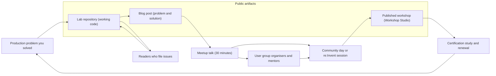
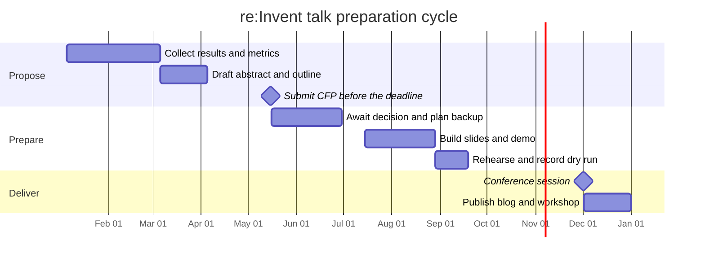
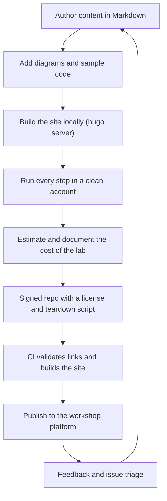

# 05 · Teaching and Thought Leadership

> **Phase 10 — Grandmaster Projects** · Lesson 05 of 06
> ⬅️ Previous: [Contributing to Open Source](./04-contributing-to-open-source.md) · ➡️ Next: [Grandmaster Capstone](./06-grandmaster-capstone.md) · 🏠 [Phase overview](./README.md)

## Learning Objectives

By the end of this lesson you will be able to:

- Turn production experience into technical content that other engineers can reproduce
- Build a lab repository that runs end to end, from deploy to teardown, with cost warnings
- Write an abstract and a talk that survive the CFP process for meetups, community days, and re:Invent
- Author a published workshop in AWS Workshop Studio format
- Plan credentials (SAP, DOP, SCS, MLS/MLA, ANS) and community programs such as AWS Community Builders and AWS Heroes
- Sustain a teaching practice for years without burnout

**Estimated time:** 90 min · **Difficulty:** Advanced

---

## Core Concepts

**Teaching is the last stage of learning.** You can use a service, size an architecture, and pass an exam without ever testing whether your model of the system is correct. Writing it down and having someone else reproduce it does test that. Every gap in your understanding becomes visible the moment a reader says "this step did not work." That feedback loop is why the most effective way to consolidate the roadmap so far is to teach it.

Content that lands has four properties. It is **specific** (a real problem, a real error message, a real bill), **reproducible** (commands that work in a fresh account, with placeholders clearly marked), **honest** (you say what broke, what it cost, and what you would do differently), and **bounded** (one idea, finished). "Everything about EKS" is not a topic; "cutting EKS control-plane cost by moving clusters to a scheduled stop" is.

**Pick the channel that matches the effort.** A blog post takes a weekend. A workshop takes a month. A conference talk takes a season. Choose based on what you already have: if you built a lab, you already have a workshop; if you debugged a great incident, you already have a talk. Repurposing the same underlying work across formats is the only way this stays sustainable.

| Channel | Effort | Reach | Best for |
|---------|--------|-------|----------|
| Lab repository | Medium | Low, high intent | Learners who want working code |
| Blog post | Low | Medium | Search traffic, one sharp problem |
| User group talk | Low | Small, high feedback | Rehearsing an idea, local network |
| Community day talk | Medium | Regional | A polished 30-minute talk |
| re:Invent session | High | Global | A novel architecture or measurable result |
| Workshop (Workshop Studio) | High | Global, durable | Skills practice with a real end state |
| Certification | Medium | Personal credibility | Proving breadth and depth to employers |

**Credentials compound with content.** Passing AWS Certified Solutions Architect – Professional (SAP-C02), DevOps Engineer – Professional (DOP-C02), Security – Specialty (SCS-C02), Machine Learning – Specialty (MLS-C01) or Machine Learning Engineer – Associate (MLA-C01), and Advanced Networking – Specialty (ANS-C01) gives you structured coverage of the domains this roadmap already covers. The reverse is also true: writing about a domain forces the kind of recall the exams reward. Certifications are valid for three years and can be renewed through the online recertification exam or by passing a higher-level exam.

**Community programs are earned, not applied for blindly.** AWS Community Builders is an annual program for people actively creating public technical content — the application asks for links to posts, talks, repos, and videos, so the portfolio must exist first. AWS Heroes is a recognition program for people with sustained, significant community impact; you cannot self-nominate, but anyone can submit a nomination with evidence. Both are consequences of consistent teaching, never substitutes for it.

**Burnout is the default outcome of unstructured ambition.** The pattern is predictable: commit to weekly posts, accept three conference invitations, start a certification, and then stop entirely within a quarter. The fix is structural, not motivational — a cadence you can hold while working full time, a rule that you only teach what you already built, and permission to republish and recycle.

### Key terminology

| Term | Meaning |
|------|---------|
| **CFP** | Call For Proposals; the submission window and process for conference sessions |
| **Abstract** | The 100–200 word summary of a talk, the single most important artifact in the CFP |
| **Breakout session** | A 45–60 minute conference talk with slides and usually a demo |
| **Chalk talk** | An interactive, whiteboard-driven session with a small audience |
| **Workshop** | A hands-on, timed lab session where attendees build something in their own accounts |
| **Workshop Studio** | AWS-hosted platform for publishing self-paced and event workshops |
| **Community Builder** | Participant in the annual AWS program for active public content creators |
| **AWS Hero** | Recognized individual with significant, sustained AWS community impact |
| **Recertification** | Renewing an AWS certification for another three years |
| **Content flywheel** | The loop where each artifact you produce feeds the next format |

---

## Architecture Diagram

The content flywheel: build once, teach in four formats, and let each stage fund the next.



The CFP timeline for a November conference — most rejections are caused by missing the abstract window, not by weak ideas:



A workshop repository pipeline, from local authoring to a public URL:



---

## Hands-on Lab: Publish a Lab Repo and a Workshop Chapter

**Goal:** Create a public, reproducible lab repository for one thing you built in this roadmap, then package one chapter of it as a Workshop Studio-style document and deploy a static site for your writing.

**Prerequisites:** A GitHub account, `git` and `gh` CLI authenticated, Hugo installed (`brew install hugo` on macOS), an AWS sandbox account for validating the lab, and one completed project from an earlier phase to write about.

### Step 1 — Give the lab a structure that survives contact with readers

```bash
# Create the repository and the layout learners expect
gh repo create aws-cost-engine-lab --public \
  --description "Build an AI-driven cost optimization engine on AWS, step by step" \
  --license MIT --clone
cd aws-cost-engine-lab

mkdir -p infra content/diagrams content/samples scripts
```

```text
aws-cost-engine-lab/
├── README.md                  # What it builds, prerequisites, cost warning, teardown
├── LICENSE                    # MIT or Apache-2.0 - be explicit
├── SECURITY.md                # How to report a problem with the lab
├── infra/                     # CDK or Terraform that deploys the lab
├── content/                   # Workshop-style chapters and diagrams
├── scripts/
│   ├── deploy.sh
│   ├── verify.sh              # Asserts the end state, not just "no error"
│   └── destroy.sh             # One command to stop the bill
└── .github/workflows/ci.yml   # Validates every step on every push
```

````bash
# The README contract: cost first, because that is the reader's real risk
cat > README.md <<'EOF'
# AWS Cost Engine Lab

Build a detect-to-remediate cost optimization loop on AWS.

**Cost warning:** this lab deploys an Athena workgroup, a Lambda function,
a DynamoDB table, and S3 buckets. Running it for a day costs under 2 USD
in eu-west-1 if you run `scripts/destroy.sh` when you finish. Leaving the
Glue crawler and Athena workgroup behind is not the only risk - check for
unattached EBS volumes created by the optional module.

## Prerequisites
- An AWS account you can throw away, with admin access
- AWS CLI v2, Node.js 20+, and `jq`
- 60 minutes

## Deploy
```bash
./scripts/deploy.sh
```

## Verify
```bash
./scripts/verify.sh     # exits non-zero unless the finding appears
```

## Teardown
```bash
./scripts/destroy.sh
```
EOF
````

### Step 2 — Make the lab verifiable and safe to run

```bash
# verify.sh asserts the outcome, so readers know their run actually worked
cat > scripts/verify.sh <<'EOF'
#!/usr/bin/env bash
set -euo pipefail

# 1. The collector ran in the last 24 hours
COUNT=$(aws logs filter-log-events --log-group-name /aws/lambda/cost-collector \
  --start-time "$(( ($(date +%s) - 86400) * 1000 ))" \
  --query 'length(events)' --output text)
test "$COUNT" -gt 0 || { echo "collector has not run in 24h"; exit 1; }

# 2. At least one finding exists with evidence attached
aws dynamodb scan --table-name cost-findings --max-items 1 \
  --query 'Items[0].estimated_monthly_savings.N' --output text | grep -q '[0-9]' \
  || { echo "no findings recorded"; exit 1; }

echo "OK: lab verified end to end"
EOF
chmod +x scripts/verify.sh
```

```yaml
# .github/workflows/ci.yml - keep the repo honest without a cloud account
name: ci
on:
  pull_request:
  push:
    branches: [main]

jobs:
  docs:
    runs-on: ubuntu-latest
    steps:
      - uses: actions/checkout@v4
      - name: Check every relative link resolves
        uses: lycheeverse/lychee-action@v2
        with:
          args: --no-progress --offline --include-fragments ./README.md ./content
      - name: Lint the shell scripts
        run: shellcheck scripts/*.sh
```

### Step 3 — Write one workshop chapter in the published format

Workshop Studio content is Markdown with front matter: `title`, `weight` (ordering), and `chapter` for nesting.

````yaml
---
title: "Detect idle resources"
weight: 30
chapter: false
---

# Detect idle resources

In this chapter you deploy a Lambda function that finds unattached EBS volumes
older than 30 days and records them as findings.

**Time to complete:** 15 minutes

## 1. Deploy the collector

```bash
cd infra && npx cdk deploy CostCollectorStack
```

## 2. Confirm the finding

```bash
aws dynamodb scan --table-name cost-findings --max-items 3 \
  --query 'Items[].{Id:finding_id.S,Savings:estimated_monthly_savings.N}'
```

## 3. Understand the guardrail

The collector never deletes anything. Remediation is a separate, tag-gated
step, which the next chapter covers.

::alert[This chapter creates a DynamoDB table and a Lambda function. Run the teardown chapter when you finish.]{type="warning"}
````

```bash
# Build and preview locally exactly as the platform renders it
hugo server --port 8080 --bind 127.0.0.1

# Validate the site before publishing
hugo --minify
```

Two rules specific to workshop content: never link images hosted outside your own repository, and never assume the reader's account already has anything.

### Step 4 — Stand up a home for your writing

```bash
# A minimal Hugo site, deployed to GitHub Pages by Actions
hugo new site mysite && cd mysite
git init -b main

# Add a theme as a submodule so builds are reproducible
git submodule add https://github.com/adityatelange/hugo-PaperMod themes/papermod

# First post, in a folder that makes the URL readable
hugo new posts/chaos-engineering-in-ci.md
```

```yaml
# .github/workflows/pages.yml - build and deploy on every push to main
name: deploy-site
on:
  push:
    branches: [main]
  workflow_dispatch:

permissions:
  contents: read
  pages: write
  id-token: write

jobs:
  build:
    runs-on: ubuntu-latest
    steps:
      - uses: actions/checkout@v4
        with:
          submodules: recursive
      - uses: actions/configure-pages@v5
      - name: Build the site
        run: hugo --minify --baseURL "${{ steps.pages.outputs.base_url }}/"
      - uses: actions/upload-pages-artifact@v3
        with:
          path: ./public

  deploy:
    needs: build
    runs-on: ubuntu-latest
    environment:
      name: github-pages
      url: ${{ steps.deployment.outputs.page_url }}
    steps:
      - id: deployment
        uses: actions/deploy-pages@v4
```

```bash
# Enable Pages from Actions and push
gh api "repos/{owner}/mysite/pages" -X POST -f "build_type=workflow"
git add -A && git commit -m "Add Hugo site with GitHub Pages deployment" && git push -u origin main
```

### Step 5 — Build the talk from the lab

An abstract that survives review names the problem, the audience, the takeaway, and the evidence. Everything else is decoration.

```text
Title:    Cut Your AWS Bill Without Breaking Production
Level:    300 (advanced)
Length:   30 minutes
Audience: Platform and FinOps engineers running multi-tenant workloads

Abstract:
Most teams can find their waste and almost none of them can remove it safely.
This session walks through a detect-to-remediate cost engine built on CUR 2.0,
Compute Optimizer, and Bedrock, and focuses on the part that usually fails:
making automation that is structurally incapable of deleting production.
Attendees leave with a guardrail pattern - tag-gated IAM conditions plus an SCP
ceiling - and real numbers from a platform that reduced idle storage spend by
41 percent with zero customer-visible incidents.

Takeaways:
1. Build a cost data path that does not cost more than it saves
2. Gate automation with tags and SCPs, not with code review alone
3. Measure realized savings 30 days later, not projected savings on day one
```

```bash
# A recording of the talks you give is the strongest CFP evidence
gh repo create talks-archive --public --description "Slides, abstracts, and recordings of my AWS talks"
gh issue create --repo OWNER/talks-archive --title "2026-03 User group: Cut your AWS bill" \
  --body "Recording, slides, and abstract for the Hamburg meetup."
```

### Step 6 — Verify

```bash
# 1. The lab repo passes CI and has a license and teardown documented
gh repo view --json licenseInfo,hasIssuesEnabled --jq '{license: .licenseInfo.spdxId, issues: .hasIssuesEnabled}'
gh run list --limit 3

# 2. The site builds locally with no broken links
hugo --minify && grep -rL "http" public/index.html >/dev/null; echo "site built"

# 3. Preview the workshop content as a reader would see it
hugo server --port 8080 &
curl -s -o /dev/null -w "%{http_code}\n" http://localhost:8080/   # expect 200
```

Success looks like: a public lab repo whose `verify.sh` passes in a fresh account, a workshop chapter that renders with correct front matter, a site deployed by Actions, and one talk abstract you would be comfortable submitting today.

---

## CLI Reference

```bash
# Scaffold a topic branch for a new post and open a draft PR for review
git checkout -b post-subnet-disrupt-connectivity
gh pr create --draft --title "Post: chaos in CI with FIS" --body "Draft content for review"

# Audit all public repositories for accidentally committed secrets
gh repo list --limit 100 --json name --jq '.[].name' | while read -r r; do
  gh secret list --repo "OWNER/$r" >/dev/null 2>&1 || true
done

# List your repositories with the least stars first, to find the abandoned ones
gh repo list --source --json name,stargazerCount,updatedAt \
  --jq 'sort_by(.stargazerCount) | .[] | "\(.name) \(.stargazerCount) \(.updatedAt)"'

# Check the license of any repo you plan to reuse code or images from
gh api repos/localstack/localstack/license --jq '.license.spdx_id'
```

| Command | Purpose |
|---------|---------|
| `gh repo create --license MIT` | Publishes a lab with explicit reuse terms from day one |
| `hugo server` | Previews workshop or blog content exactly as learners will read it |
| `gh api repos/{owner}/{repo}/pages` | Enables GitHub Pages configured for Actions builds |
| `gh run list` | Confirms the site and CI ran on the latest commit |
| `gh issue create` | Tracks talk abstracts and recordings so CFP evidence accumulates |
| `gh api .../license` | Verifies reuse rights before republishing someone else's assets |

---

## Best Practices

| Practice | Why it matters |
|----------|----------------|
| Teach only what you have actually built and run | Reproducibility is the only thing that makes technical content trustworthy |
| Put the cost warning in the first screen of the README | Readers abandon labs that surprise them with a bill |
| Ship a one-command teardown | Residual resources are the number one complaint about cloud labs |
| Write the abstract before the slides | CFP deadlines are the constraint; slides are cheap to produce afterwards |
| Draft content in public and ask for review | Early readers catch the step that does not reproduce |
| Reuse one project across lab, post, talk, and workshop | Effort amortizes; each format reaches a different audience |
| Publish under an explicit license | Removes ambiguity for anyone who wants to reuse or translate |
| Keep a talks archive with recordings | Program committees weight prior delivery heavily |
| Commit to a cadence you can hold for a year | Consistency beats intensity by an order of magnitude |

---

## Common Pitfalls

| Pitfall | Symptom | Fix |
|---------|---------|-----|
| Publishing steps you never re-ran | Readers hit a failure at step 4 and open issues | `destroy.sh`, deploy from scratch, then run `verify.sh` before publishing |
| No teardown instructions | Lab creates a NAT gateway and the reader pays for months | Ship teardown in the repo and repeat it in the README and last chapter |
| Abstract written as a summary, not a promise | CFP rejected despite good material | Lead with the problem and the takeaway, then the evidence |
| Missing the CFP window | A year lost waiting for the next cycle | Put submission deadlines in your calendar as six-month-ahead milestones |
| Slides that are a wall of bullets | Audience disengages and the recording performs poorly | One idea per slide, one architecture diagram, a live demo with a fallback recording |
| Publishing customer data, account IDs, or credentials | Compliance incident and a leaked secret | Scrub account IDs, rotate anything that appeared in a commit, use placeholder `111122223333` |
| Applying to Community Builders with no portfolio | Rejected; the program requires existing public content | Publish consistently for two quarters before applying |
| Doing everything alone | Content quality stalls and motivation dies | Find a co-author, a reviewer, or a study group for certifications |
| Confusing reach with impact | Chasing followers instead of helping one engineer succeed | Track reader outcomes: issues answered, labs completed, mentees promoted |

---

## Cost Considerations

Teaching has two bills: your cloud bill and your time bill. Both are controllable.

- **Lab infrastructure is the recurring cost.** A lab with a NAT Gateway (~$32/month) or an EKS control plane (~$73/month) will be left running by someone. Design labs to use the cheapest thing that demonstrates the lesson: Lambda and DynamoDB on-demand over always-on EC2, no NAT Gateway where a VPC endpoint or public subnet with tight security groups will do.
- **Educate about cost inside every lab.** A "Cost" chapter that shows the actual bill for a full run teaches a skill the exam does not: reading a Cost Explorer chart for something you deployed yourself.
- **Certification exams are a real line item** (roughly $150–$300 per Professional or Specialty exam, less in some regions), and AWS often offers discounts through community programs and events. Bundle study with content creation so one effort serves both.
- **Conference attendance is expensive** (ticket, travel, hotel). Speak at regional community days and user groups first: they are free to attend, cheaper to reach, and better rehearsal for a global stage.
- **AI assistance for drafting is cheap; verification is not.** Use models to outline, rewrite, and generate diagram boilerplate, but every command must be executed and every number verified by you — an unverified tutorial damages your credibility more than no tutorial.
- **Community Builder and Hero programs include credits and event access** designed to offset exactly these costs. They are rewards for work you are already doing, not a plan.

---

## Security Considerations

- **Never publish real account IDs, ARNs with account numbers, access keys, or console screenshots containing them.** Use `111122223333` and placeholder ARNs throughout, and run a secret scan before every push (enable GitHub secret scanning and push protection).
- **Assume lab readers will run the lab in a production account.** Design for it: least-privilege IAM in the templates, explicit teardown, no `AdministratorAccess` policies handed out casually, and a first-chapter warning that the account must be disposable.
- **Do not teach insecure patterns, even in a lab.** A tutorial that opens an S3 bucket to the world or attaches `s3:*` to a role will be copy-pasted into production. Show the scoped policy and explain why.
- **Respect third-party content and licenses.** Verify image and diagram licenses before publishing, prefer your own diagrams, give attribution, and check the SPDX license of any code you reuse.
- **Consent and privacy when recording.** Ask before recording a meetup audience or a video call, follow the venue's code of conduct, and never publish participant names without permission.
- **Your own repositories are attack surface.** Require MFA, enable branch protection, pin GitHub Action SHAs instead of floating tags, and review any pull request that modifies CI workflows before merging it.
- **Disclose AI assistance where required.** Some conferences and publications require it, and readers deserve to know which parts were machine-drafted.
- **Know your employer's policy.** Get written approval before publishing architecture details, customer-adjacent numbers, or anything covered by an NDA or an intellectual-property agreement.

---

## Exercise

Produce one complete teaching artifact from work you already did in this roadmap.

1. Take the chaos engineering lab from [Lesson 02](./02-chaos-engineering.md) and turn it into a public repository with `deploy.sh`, `verify.sh`, and `destroy.sh`.
2. Write a 900–1,200 word blog post about the single most surprising thing you learned while running it, ending with the exact command that surfaced the problem.
3. Draft a 30-minute talk abstract about it, with three numbered takeaways and one measured result.

Success looks like: a public repo where a stranger can clone, deploy, verify, and tear down without asking you a question, plus an abstract you have submitted to a user group or community day CFP.

---

## Resources

- [AWS Certification — exam guides and recertification](https://aws.amazon.com/certification/)
- [AWS Certified Solutions Architect – Professional (SAP-C02)](https://aws.amazon.com/certification/certified-solutions-architect-professional/)
- [AWS Certified DevOps Engineer – Professional (DOP-C02)](https://aws.amazon.com/certification/certified-devops-engineer-professional/)
- [AWS Certified Security – Specialty (SCS-C02)](https://aws.amazon.com/certification/certified-security-specialty/)
- [AWS Certified Machine Learning – Specialty (MLS-C01)](https://aws.amazon.com/certification/certified-machine-learning-specialty/)
- [AWS Certified Advanced Networking – Specialty (ANS-C01)](https://aws.amazon.com/certification/certified-advanced-networking-specialty/)
- [AWS Community Builders program](https://aws.amazon.com/developer/community/community-builders/)
- [AWS Heroes program](https://aws.amazon.com/developer/community/heroes/)
- [AWS Workshop Studio — building workshop content](https://catalog.workshops.aws/)
- [AWS User Groups](https://aws.amazon.com/developer/community/usergroups/)
- [AWS Events — re:Invent and Community Days](https://aws.amazon.com/events/)
- [Hugo documentation](https://gohugo.io/documentation/)

---

## Next Steps

You have built the systems, proved their resilience, optimized their cost, and learned to explain all of it to other engineers. The final lesson asks you to do all of it at once: a single integrated capstone that stands as the portfolio piece for the entire roadmap.

> ⬅️ Previous: [Contributing to Open Source](./04-contributing-to-open-source.md) · ➡️ Next: [Grandmaster Capstone](./06-grandmaster-capstone.md) · 🏠 [Phase overview](./README.md)
