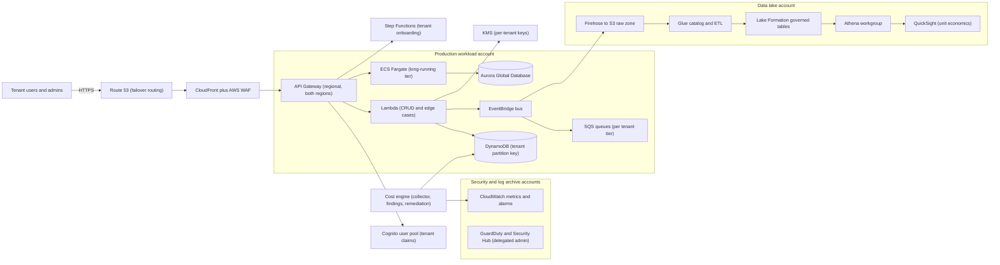
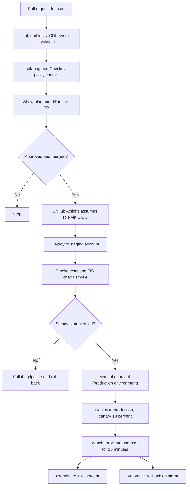

# 06 · Grandmaster Capstone

> **Phase 10 — Grandmaster Projects** · Lesson 06 of 06
> ⬅️ Previous: [Teaching and Thought Leadership](./05-teaching-and-thought-leadership.md) · ➡️ Next: [🏁 End of the roadmap — Roadmap home](../README.md) · 🏠 [Phase overview](./README.md)

## 🎯 Learning Objectives

By the end of this lesson you will be able to:

- Assemble every phase of this roadmap into one coherent, defensible architecture
- Provision a multi-account landing zone with Organizations, Control Tower, and SCPs from code
- Deploy a hybrid serverless and container workload with keyless CI/CD using GitHub Actions OIDC
- Govern a tenant-aware data lake with Lake Formation permissions and row-level filtering
- Prove the system with chaos experiments and a documented game day report
- Operate an AI-driven cost engine with per-tenant allocation and realized-savings tracking
- Deliver the whole thing in phases, with ADRs, runbooks, and a rubric you can be assessed against

**Estimated time:** 40–60 hours (multi-week project) · **Difficulty:** Advanced

---

## 🧠 Core Concepts

This capstone has one purpose: to prove you can **design and run AWS at scale**, not that you can complete a tutorial. Everything you have learned across ten phases appears here exactly once, and each piece has a reason to exist in the same system:

| Roadmap area | Component in the capstone |
|--------------|---------------------------|
| Phase 1 — Foundations | VPC design, subnets, security groups, S3 lifecycle, CloudWatch, CloudTrail |
| Phase 2 — Professional architecture | Multi-AZ, multi-region DR with RTO/RPO targets, Route 53 failover, CloudFront |
| Phase 3 — DevOps | CDK and Terraform, GitHub Actions pipelines, ECS Fargate, observability |
| Phase 4 — Serverless | API Gateway, Lambda, Step Functions, EventBridge, SQS, DynamoDB |
| Phase 5 — Data and AI | S3 data lake, Glue catalog, Athena, Lake Formation, Bedrock |
| Phase 6 — Security and governance | Organizations, Control Tower, Security Hub, GuardDuty, KMS, IAM Identity Center |
| Phase 7 — Edge and IoT | One edge ingestion path (IoT Core or CloudFront Functions) feeding the lake |
| Phase 8 — Industry architectures | Compliance-aligned controls and a regulated-tenant isolation pattern |
| Phase 9 — Cutting edge | Graviton compute, an AIOps signal path, sustainability-aware instance selection |
| Phase 10 — Grandmaster | Multi-tenancy, chaos engineering, cost engine, teaching artifacts |

**Treat this as four deliveries, not one project.** A multi-account landing zone that works but has no workload is a valid milestone. A workload that runs in two regions with a tested failover is another. Resilience and cost automation come third. The teaching artifacts — workshop, blog series, talk — come last, because they are the by-products of the first three.

**Constraints make it credible.** A capstone without constraints degenerates into a diagram. Impose these on yourself and write them into the README as if a client had set them:

| Constraint | Target | Why it is here |
|------------|--------|----------------|
| Tenant isolation | Pooled by default, siloed for enterprise tier | Forces the bridge model rather than a single pattern |
| Availability | 99.95% monthly for the API tier; multi-AZ for all stateful services | Makes single-AZ shortcuts visible |
| Recovery | RTO 30 minutes, RPO 5 minutes for the primary region failure | Requires tested failover, not aspirational design |
| Performance | p99 under 400 ms for `GET /orders` at 500 requests/second | Turns rightsizing and caching into real decisions |
| Cost | Under 3,000 USD/month at 200 tenants, with cost per tenant under 15 USD | Prevents "just add capacity" from being the answer |
| Security | No long-lived credentials, no public data stores, all data encrypted with customer-managed keys | Removes the easiest shortcuts |
| Change | Fully automated deploys to staging; production deploys require an approval and support instant rollback | Makes CI/CD a requirement rather than a demo |

**Write decisions down.** Twelve architecture decision records (ADRs) — one page each, with context, options, decision, and consequences — are part of the deliverable. The ADR set is what separates an architect from someone who followed a tutorial: it shows *why* pooling beat siloing for the free tier, why RDS beat DynamoDB for billing records, and why you accepted a temporary single-region analytics dependency.

### Key terminology

| Term | Meaning |
|------|---------|
| **Landing zone** | The multi-account foundation: OUs, accounts, guardrails, networking, logging, identity |
| **Control Tower control** | A managed or custom guardrail applied to an OU to enforce or detect policy |
| **SCP** | Service Control Policy; the hard ceiling on what any principal in an account may do |
| **Permission set** | An IAM Identity Center construct that provisions roles and assignments per account |
| **OIDC federation** | GitHub Actions exchanging a short-lived OIDC token for AWS credentials; no stored keys |
| **LF-Tag** | Lake Formation tag; attribute-based access control for data catalog resources |
| **Cell** | A deployment unit serving a bounded set of tenants, sized to fail independently |
| **ADR** | Architecture Decision Record; one page documenting a decision and its consequences |
| **Game day** | A rehearsed fault injection exercise with humans in the loop |
| **Rubric** | The scoring table used to assess the finished deliverable |

---

## 🗺️ Architecture Diagram

Full-system view. Two workload accounts (staging and production), a shared services account, a security tooling account, and a log archive account, with the data lake and cost engine as shared capabilities.



Deployment pipeline: a single workflow, three environments, no long-lived credentials, and a manual approval before production.



Phased delivery across twelve weeks; each phase ends with something demonstrable.

```mermaid
gantt
    title Grandmaster capstone delivery
    dateFormat YYYY-MM-DD
    axisFormat %b %d
    section Phase A - Landing zone
    Organizations, OUs, and accounts          :a1, 2026-01-05, 7d
    Control Tower controls and SCPs           :a2, after a1, 5d
    IAM Identity Center and logging           :a3, after a2, 4d
    Milestone: landing zone review            :milestone, ma, after a3, 1d
    section Phase B - Workload
    Network, ECS and Lambda tiers             :b1, after ma, 10d
    Data model and tenant isolation tests     :b2, after b1, 6d
    CI/CD with OIDC and environments          :b3, after b1, 8d
    Milestone: staging demo                   :milestone, mb, after b3, 1d
    section Phase C - Data and security
    Lake Formation and tenant row filters     :c1, after mb, 8d
    Security Hub, GuardDuty, Config           :c2, after mb, 6d
    Milestone: compliance evidence pack       :milestone, mc, after c2, 1d
    section Phase D - Prove and teach
    Chaos experiments and game day            :d1, after mc, 6d
    Cost engine with per-tenant allocation    :d2, after mc, 8d
    Workshop, blog series, and talk           :d3, after d1, 10d
    Milestone: public release                 :milestone, md, after d3, 1d
```

---

## 🧪 Hands-on Lab: Delivery Runbook

**Goal:** Execute the capstone in four phases, with an acceptance criterion for each, ending in a public, demonstrable system.

**Prerequisites:** A management account (or a sandbox organization) you control, permission to create accounts, GitHub repository admin rights, CDK v2 and Terraform 1.9+, Node.js 20+, and a domain in Route 53 (optional, only for the vanity URL).

### Phase A — Landing zone from code

```bash
# Create the organization with all features so SCPs and tag policies are available
aws organizations create-organization --feature-set ALL

# Organizational units: keep workloads and security separate
aws organizations create-organizational-unit --parent-id r-EXAMPLE --name "Security"
aws organizations create-organizational-unit --parent-id r-EXAMPLE --name "Infrastructure"
aws organizations create-organizational-unit --parent-id r-EXAMPLE --name "Workloads"

# One account per environment plus shared services, security tooling, and log archive
aws organizations create-account --email aws+prod@example.com --account-name "saas-prod" \
  --role-name OrganizationAccountAccessRole
aws organizations create-account --email aws+staging@example.com --account-name "saas-staging"
aws organizations create-account --email aws+log@example.com --account-name "log-archive"

# Verify the OU layout before applying guardrails
aws organizations list-organizational-units-for-parent --parent-id r-EXAMPLE
aws organizations list-accounts-for-parent --parent-id ou-EXAMPLE
```

```json
{
  "Version": "2012-10-17",
  "Statement": [
    {
      "Sid": "DenyRegionOutsideApprovedList",
      "Effect": "Deny",
      "NotAction": [
        "iam:*",
        "organizations:*",
        "cloudfront:*",
        "route53:*",
        "support:*",
        "budgets:*",
        "ce:*"
      ],
      "Resource": "*",
      "Condition": {
        "StringNotEquals": {"aws:RequestedRegion": ["eu-west-1", "eu-central-1", "us-east-1"]}
      }
    },
    {
      "Sid": "ProtectAuditTrails",
      "Effect": "Deny",
      "Action": [
        "cloudtrail:StopLogging",
        "cloudtrail:DeleteTrail",
        "config:DeleteConfigurationRecorder",
        "guardduty:DeleteDetector"
      ],
      "Resource": "*"
    },
    {
      "Sid": "RequireDataClassificationTag",
      "Effect": "Deny",
      "Action": [
        "s3:PutBucketPolicy",
        "rds:CreateDBInstance",
        "dynamodb:CreateTable"
      ],
      "Resource": "*",
      "Condition": {
        "StringEquals": {"aws:RequestedRegion": ["eu-west-1"]},
        "Null": {"aws:ResourceTag/data-classification": "true"}
      }
    }
  ]
}
```

```bash
# Attach the guardrail to the Workloads OU (all accounts under it inherit it)
aws organizations create-policy \
  --content file://workloads-guardrail.json \
  --description "Region, audit protection, and data classification guardrail" \
  --name "WorkloadsBaseline" --type SERVICE_CONTROL_POLICY

aws organizations attach-policy --policy-id p-EXAMPLE \
  --target-id ou-EXAMPLE
```

```bash
# Centralized identity: one permission set per persona, assigned per account
aws sso-admin create-permission-set --instance-arn arn:aws:sso:::instance/ssoins-EXAMPLE \
  --name "PlatformEngineer" --description "Deploy and operate workloads" --session-duration PT8H

aws sso-admin create-permission-set --instance-arn arn:aws:sso:::instance/ssoins-EXAMPLE \
  --name "SecurityAuditor" --description "Read-only security review" --session-duration PT4H

# Turn on the security baseline in every account via its delegated administrator
aws guardduty create-detector --enable --finding-publishing-frequency FIFTEEN_MINUTES
aws securityhub enable-security-hub --enable-default-standards
aws configservice put-conformance-pack --conformance-pack-name operational-best-practices \
  --template-s3-uri s3://example-config-templates/Operational-Best-Practices-for-All-AWS-Services.yaml
```

**Acceptance for Phase A:** a new account added to the Workloads OU inherits the SCP, appears in the organization trail, has GuardDuty and Security Hub enabled, and can only be accessed through IAM Identity Center — with no IAM users created.

### Phase B — Workload with keyless CI/CD

```bash
# GitHub Actions assumes a role via OIDC: register the provider once per account
aws iam create-open-id-connect-provider \
  --url https://token.actions.githubusercontent.com \
  --client-id-list sts.amazonaws.com
```

```yaml
# .github/workflows/deploy.yml - build once, deploy to staging, approve, then production
name: deploy
on:
  push:
    branches: [main]

permissions:
  id-token: write
  contents: read

jobs:
  build:
    runs-on: ubuntu-latest
    steps:
      - uses: actions/checkout@v4
      - uses: actions/setup-node@v4
        with:
          node-version: 20
          cache: npm
      - run: npm ci
      - run: npm run lint && npm test
      - run: npx cdk synth --quiet
      - run: npx cdk-nag           # fails the build on non-compliant resources

  staging:
    needs: build
    runs-on: ubuntu-latest
    environment: staging
    steps:
      - uses: actions/checkout@v4
      - uses: aws-actions/configure-aws-credentials@v4
        with:
          role-to-assume: arn:aws:iam::222233334444:role/GitHubDeployRole
          aws-region: eu-west-1
      - run: npm ci && npx cdk deploy --all --require-approval never
      - name: Smoke test the deployed API
        run: ./scripts/smoke.sh https://api.staging.example.com

  production:
    needs: staging
    runs-on: ubuntu-latest
    environment: production      # protects the job with required reviewers
    steps:
      - uses: actions/checkout@v4
      - uses: aws-actions/configure-aws-credentials@v4
        with:
          role-to-assume: arn:aws:iam::111122223333:role/GitHubDeployRole
          aws-region: eu-west-1
      - run: npm ci && npx cdk deploy --all --require-approval never
      - name: Canary then promote
        run: ./scripts/canary.sh tenant-api 10 15
```

```json
{
  "Version": "2012-10-17",
  "Statement": [
    {
      "Effect": "Allow",
      "Principal": {"Federated": "arn:aws:iam::111122223333:oidc-provider/token.actions.githubusercontent.com"},
      "Action": "sts:AssumeRoleWithWebIdentity",
      "Condition": {
        "StringEquals": {
          "token.actions.githubusercontent.com:aud": "sts.amazonaws.com"
        },
        "StringLike": {
          "token.actions.githubusercontent.com:sub": "repo:your-org/saas-capstone:environment:production"
        }
      }
    }
  ]
}
```

```bash
# The tenant-scoped isolation tests from Lesson 01 must pass in CI, not just locally
npm test -- --testPathPattern tenant-isolation
```

**Acceptance for Phase B:** a merge to `main` deploys to staging automatically, the production job waits for an approval, the production role can be assumed only by the `production` environment of your repository, and the tenant isolation test suite passes in the pipeline.

### Phase C — Data lake governance with Lake Formation

```bash
# Register the lake buckets with Lake Formation so it controls access to the catalog
aws lakeformation register-resource \
  --resource-arn arn:aws:s3:::saas-datalake-raw \
  --use-service-linked-role

# LF-Tags give attribute-based access without enumerating every table grant
aws lakeformation create-lf-tag --tag-key tenant --tag-values acme globex shared
aws lakeformation create-lf-tag --tag-key classification --tag-values public internal confidential

# The analytics role sees only the columns and rows tagged for it
aws lakeformation grant-permissions \
  --principal DataLakePrincipalIdentifier=arn:aws:iam::111122223333:role/AnalyticsReadRole \
  --resource '{"TableWithColumns":{"DatabaseName":"saas_curated","Name":"orders","ColumnWildcard":{}}}' \
  --permissions SELECT DESCRIBE \
  --permissions-with-grant-option SELECT
```

```sql
-- Row-level filter: analysts for a tenant only ever see their own rows
-- Data filters are created in Lake Formation and attached to the table grant
SELECT * FROM saas_curated.orders WHERE tenant_id = 'acme';
```

**Acceptance for Phase C:** an analyst role can query only its tagged tables and rows (a cross-tenant query returns zero rows), every data store is encrypted with a customer-managed key, and the compliance evidence pack contains Config conformance results plus Security Hub findings with owners.

### Phase D — Prove it, then teach it

```bash
# Chaos: an AZ failure in staging must not breach the error-rate SLO (template from Lesson 02)
aws fis start-experiment --experiment-template-id EXT-CAPSTONE-AZ \
  --client-token "capstone-az-$(date -u +%Y%m%dT%H%M%S)"

# The cost engine runs continuously and reports realized savings per tenant
aws ce get-cost-and-usage \
  --time-period Start=2026-03-01,End=2026-04-01 \
  --granularity MONTHLY --metrics AmortizedCost \
  --group-by Type=TAG,Key=tenant_id

# Multi-region DR: fail the primary and record actual RTO and RPO
aws route53 change-resource-record-sets --hosted-zone-id ZEXAMPLE \
  --change-batch file://failover-to-eu-central-1.json
```

**Acceptance for Phase D:** a written game day report with measured RTO/RPO against the 30-minute/5-minute targets, a cost report showing cost per tenant below the 15 USD target, and a public workshop plus talk abstract.

---

## 💻 CLI Reference

```bash
# Full inventory of accounts and their OU placement - the landing zone's ground truth
aws organizations list-accounts --query 'Accounts[].{Id:Id,Name:Name,Status:Status}'

# Which SCPs are actually attached and where
aws organizations list-policies --filter SERVICE_CONTROL_POLICY
aws organizations list-targets-for-policy --policy-id p-EXAMPLE

# Audit whether drift has appeared since the last deploy
aws cloudformation describe-stacks --query 'Stacks[].{Name:StackName,Status:StackStatus}'
cd infra && npx cdk diff --all

# Confirm no long-lived credentials exist in any workload account
aws iam list-users --max-items 10
aws iam list-access-keys --user-name any-user-that-should-not-exist

# Evidence for the compliance pack: current Security Hub findings by severity
aws securityhub get-findings \
  --filters '{"SeverityLabel":[{"Value":"CRITICAL","Comparison":"EQUALS"},{"Value":"HIGH","Comparison":"EQUALS"}]}' \
  --max-results 20

# Prove the cost engine did not break the bill itself
aws ce get-cost-and-usage --time-period Start=2026-03-01,End=2026-04-01 \
  --granularity MONTHLY --metrics UnblendedCost \
  --group-by Type=DIMENSION,Key=SERVICE \
  --filter '{"Dimensions":{"Key":"SERVICE","Values":["AWS Lambda","Amazon Bedrock","Amazon Athena"]}}'
```

| Command | Purpose |
|---------|---------|
| `organizations create-account` | Adds environments to the landing zone from the CLI |
| `organizations attach-policy` | Applies an SCP guardrail to an OU |
| `iam create-open-id-connect-provider` | Enables keyless GitHub Actions deployments |
| `lakeformation grant-permissions` | Grants governed access to catalog resources |
| `fis start-experiment` | Runs the capstone resilience test |
| `ce get-cost-and-usage --group-by Type=TAG` | Renders per-tenant economics |
| `securityhub get-findings` | Produces the compliance evidence pack |

---

## ✅ Best Practices

| Practice | Why it matters |
|----------|----------------|
| Build the landing zone before the workload | Retrofitting accounts, SCPs, and logging later is a rebuild, not a migration |
| One account per environment, never one account for everything | Blast radius, quota isolation, and clean cost attribution all depend on it |
| Deploy with OIDC roles, never stored access keys | Removes the most common credential-leak path in CI/CD |
| Pin the OIDC `sub` claim to a repository and environment | Prevents any other workflow in the organization from assuming your deploy role |
| Automate a rollback path and test it | A deploy pipeline without a tested rollback is a one-way door |
| Govern data at the catalog, not with bucket policies alone | Row and column filtering belongs in Lake Formation, where it is enforced consistently |
| Run chaos experiments before the go-live review | Resilience claimed in a diagram is unverified; run the experiment and show the report |
| Right-size the cost engine as well as the workload | An optimizer that costs more than it saves is a net negative |
| Write ADRs as you decide, not afterwards | Reconstructing rationale weeks later produces fiction |
| Keep the teaching artifacts in the same repository | They stay current when they live with the code |

---

## ⚠️ Common Pitfalls

| Pitfall | Symptom | Fix |
|---------|---------|-----|
| Building the workload first | SCPs and GuardDuty retrofitted, breaking deploys for days | Phase A first, and validate a toy deploy in the landing zone before the real workload |
| Accounts created by hand in the console | Drift; the landing zone no longer reproducible | Create accounts and OUs from code, or at minimum record them in an IaC-managed inventory |
| Environment protection used as the only gate | A workflow edit silently removes the approval | Combine GitHub environments with an SCP that denies deploy roles outside the approved pipeline |
| Over-broad OIDC trust policy | Any branch or fork can assume the production role | Restrict `sub` to `repo:<org>/<repo>:environment:production` |
| Lake Formation registered late | Redundant bucket policies and inconsistent access | Register the lake and define LF-Tags before the first consumer queries data |
| Chaos run for the first time during the go-live review | Fixes discovered in the review turn into scope creep | Run experiments in staging throughout Phase D, not once at the end |
| Cost engine given admin permissions | Automation is now a privilege-escalation path | Least privilege plus tag conditions plus SCP ceiling (see [Lesson 03](./03-ai-driven-cost-optimization.md)) |
| DR plan written but never executed | RTO/RPO numbers are aspirational | Perform a real failover and record the measured numbers, including the surprises |
| Nobody owns the finished capstone | The repo rots; the portfolio piece undermines you | Put a review cadence and an owner in the README, and date every artifact |

---

## 💰 Cost Considerations

The stated target — under 3,000 USD/month at 200 tenants — is part of the assessment, so treat the cost model as a deliverable rather than a footnote.

**What drives the bill at this scale:**

- **Data transfer, NAT Gateways, and load balancers dominate** the fixed share. Two Multi-AZ VPCs with NAT Gateways cost roughly 130 USD/month before a single request; use VPC endpoints for S3 and DynamoDB and a single NAT per environment where availability permits.
- **Aurora Global Database** is the largest fixed cost (a small writer plus reader in two regions approaches 200–400 USD/month). Justify it only for the enterprise tenant tier; keep pooled tenants on DynamoDB.
- **Compute is the variable you control.** Graviton (ARM64) Lambda and Fargate reduce price-per-performance by roughly 20%; Fargate Spot absorbs batch and tenant-onboarding workloads at a steep discount.
- **Observability is a silent line item.** High-cardinality metrics, verbose logs, and long retention can exceed compute spend. Sample logs, set retention per log group, and route metrics with moderation.
- **The data lake is cheap if you keep it tidy.** Parquet plus lifecycle policies (raw to Infrequent Access after 30 days, Glacier after 90) cut storage cost by 60% or more versus keeping everything in Standard.
- **The cost engine must pay for itself.** Budget its Lambda, Athena, and Bedrock tokens, and publish a single metric: `savings_realized / cost_engine_spend`. Anything below 10× is a design problem.

**Rough monthly envelope for the reference build in eu-west-1 (200 tenants, modest traffic):**

| Component | Estimate |
|-----------|----------|
| VPC networking (NAT, endpoints, ALB) | 180 USD |
| ECS Fargate (2 services, Graviton, autoscaled) | 350 USD |
| Lambda, API Gateway, DynamoDB on-demand | 220 USD |
| Aurora Global Database (enterprise tier only) | 380 USD |
| S3 lake, Glue, Athena, QuickSight | 260 USD |
| CloudWatch, X-Ray, Config, GuardDuty, Security Hub | 300 USD |
| Route 53, CloudFront, WAF | 140 USD |
| Cost engine (Lambda, Athena, Bedrock) | 90 USD |
| **Total** | **~1,920 USD** |

Use Savings Plans for the steady-state Fargate share once utilization is stable for two weeks — that is worth 15–25% on the compute lines.

---

## 🔐 Security Considerations

- **No long-lived credentials anywhere.** No IAM users in workload accounts, OIDC for pipelines, IAM Identity Center for humans, and `iam:CreateAccessKey` denied by SCP. Verify with `aws iam list-users` returning an empty list.
- **Guardrails proven, not assumed.** For each SCP, record a scripted attempt that must fail (for example, creating an unencrypted table, or deploying outside `eu-west-1`) and store the output as evidence.
- **Data protection by default.** Customer-managed KMS keys per data store, per-tenant keys for the enterprise tier, S3 Block Public Access at the account level, TLS enforced by policy, and Secrets Manager for third-party credentials.
- **Tenant isolation is tested continuously.** Cross-tenant denial assertions run on every pull request; a failure blocks the merge. This is the single most important security test in a multi-tenant system.
- **Detective coverage with named owners.** GuardDuty, Security Hub (AWS Foundational Security Best Practices), Config conformance packs, and Access Analyzer findings must each have a triage owner and a resolution path; unowned findings are noise.
- **Log integrity across accounts.** Organization trail to the log archive account, S3 Object Lock in compliance mode for audit logs, and a bucket policy that denies deletion even to administrators.
- **Deployment is the highest-risk action.** Require approvals for production, restrict deploy roles by OIDC `sub`, enable CloudTrail data events on the artifact buckets, and sign or verify build artifacts.
- **Incident readiness.** Runbooks for the five most likely incidents (leaked credential, tenant data exposure, region failure, cost spike, certificate expiry), each with a first action a tired on-call engineer can execute at 3 a.m.
- **Post-capstone hygiene.** The moment the project stops being maintained, rotate and delete its credentials, tear down the expensive resources, and archive the repository with a README that describes its final state.

---

## 🧩 Exercise

Deliver the capstone, then defend it.

1. **Build it in the four phases above** and keep the repository public, with ADRs, runbooks, and the SLO document committed alongside the infrastructure.
2. **Submit the project to review** — a peer, a mentor, or a public GitHub issue in your own repository — using the rubric below and fixing anything scored below 3.
3. **Write the retrospective:** what the architecture cost, what broke, what you would change, and which single decision you would defend hardest in a design review.

| Area | Score 1 | Score 3 | Score 5 |
|------|---------|---------|---------|
| Landing zone | Single account, console-built | Multiple accounts, partially coded | Accounts, OUs, SCPs, identity, and logging fully reproducible from code |
| Multi-tenancy | Shared everything, no isolation tests | Pooled with tag-based isolation | Bridge model with ABAC, per-tenant keys, and continuous isolation tests |
| CI/CD | Manual deploys | Pipeline with approvals | OIDC, canary, automatic rollback, policy checks in the pipeline |
| Data governance | Bucket policies only | Catalog plus coarse grants | Lake Formation LF-Tags with row and column filters, proven by tests |
| Security baseline | GuardDuty on in one account | Organization-wide detection | Guardrails plus detection plus named owners and scripted negative tests |
| Resilience | Multi-AZ by design | Multi-AZ plus one drilled failover | Measured RTO/RPO from a real region failover, plus a chaos game day report |
| Cost | No model | Cost model per component | Per-tenant allocation, budget guardrails, and realized savings tracked |
| Teaching | Not documented | README and diagrams | Public workshop, blog series, and talk abstract with a measured result |

Success looks like: a public repository a stranger can deploy, a design review you can lead from memory, and a rubric where every area scores at least 3 — with a written retrospective that names the weakest decision honestly.

---

## 📚 Resources

- [AWS Control Tower User Guide](https://docs.aws.amazon.com/controltower/latest/userguide/what-is-control-tower.html)
- [AWS Organizations — SCPs and OU structure](https://docs.aws.amazon.com/organizations/latest/userguide/orgs_manage_policies_scps.html)
- [IAM Identity Center permission sets](https://docs.aws.amazon.com/singlesignon/latest/userguide/permissionsetsconcept.html)
- [GitHub Actions — configuring OpenID Connect in AWS](https://docs.github.com/en/actions/deployment/security-hardening-your-deployments/configuring-openid-connect-in-amazon-web-services)
- [AWS Lake Formation — LF-Tags and data filters](https://docs.aws.amazon.com/lake-formation/latest/dg/tag-based-access-control.html)
- [AWS Well-Architected Framework](https://docs.aws.amazon.com/wellarchitected/latest/framework/welcome.html)
- [AWS Well-Architected — multi-tenant SaaS lens](https://docs.aws.amazon.com/wellarchitected/latest/saas-lens/saas-lens.html)
- [AWS Fault Injection Service User Guide](https://docs.aws.amazon.com/fis/latest/userguide/what-is.html)
- [AWS Prescriptive Guidance — architecture decision records](https://docs.aws.amazon.com/prescriptive-guidance/latest/architectural-decision-records/welcome.html)
- [AWS Architecture Center — reference architectures](https://aws.amazon.com/architecture/)

---

## ➡️ Next Steps

There is no next lesson. The capstone is the roadmap's last artifact, and your job now is to keep it alive: review the architecture quarterly, re-run the game day when the system changes, and keep publishing. Head back to the [roadmap home](../README.md) to see the whole path again, or continue with the phase wrap-up below.

> ⬅️ Previous: [Teaching and Thought Leadership](./05-teaching-and-thought-leadership.md) · ➡️ Next: [🏁 End of the roadmap — Roadmap home](../README.md) · 🏠 [Phase overview](./README.md)
