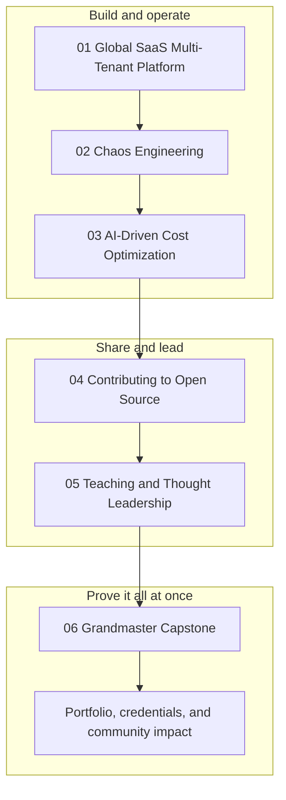
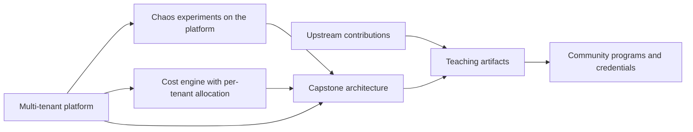

# Phase 10 — Grandmaster Projects

This is the final phase of the roadmap, and it is deliberately different from the nine that came before it. Phases 1 through 9 taught you services and patterns; Phase 10 asks you to **operate at the level of a system owner**. Everything here is a multi-week project rather than an afternoon lab: a global multi-tenant SaaS platform, a chaos engineering practice, an AI-driven cost optimization engine, upstream open-source contribution, and a teaching practice that puts your work in front of other engineers. The phase ends with one integrated capstone that combines the entire roadmap into a single deployable system — the portfolio piece you can defend in a design review at any seniority level.

The reason this phase comes last is that every component depends on judgement you have already built. Multi-tenancy without a firm grasp of IAM is a data breach waiting to happen; chaos engineering without observability is just an outage; cost automation without guardrails is a deletion tool. Do not attempt these projects by copying commands — attempt them by deciding, documenting the trade-offs, and proving the result with evidence.

## 🎯 Phase Goals

- Design and operate a global multi-tenant SaaS platform with pooled, siloed, and bridged tenancy
- Prove tenant isolation continuously with IAM ABAC, session tags, per-tenant KMS keys, and automated denial tests
- Establish a chaos engineering practice with steady-state hypotheses, FIS experiment templates, and game days
- Build an AI-driven cost optimization engine that remediates safely and reports realized savings
- Contribute upstream to the AWS open-source ecosystem with tests, changelogs, and clean pull requests
- Teach and publish: lab repositories, workshops, talks, and community programs
- Deliver one grandmaster capstone that integrates the whole roadmap into a business-ready system

## 🗺️ Phase Map

How the components of this phase reinforce each other:

## 📚 Lessons in this Phase

| # | Lesson | Focus | Difficulty |
|---|--------|-------|------------|
| 01 | [Global SaaS Multi-Tenant Platform](./01-global-saas-multi-tenant-platform.md) | Silo, pool, and bridge models; tenant isolation with IAM ABAC, Cognito claims, and per-tenant KMS keys; partitioning strategies; noisy-neighbour control; per-tenant cost allocation; onboarding automation | Advanced |
| 02 | [Chaos Engineering](./02-chaos-engineering.md) | Steady-state hypotheses, blast radius, AWS FIS experiment templates, AZ failure, dependency latency injection, game days, chaos in CI, safety guardrails | Advanced |
| 03 | [AI-Driven Cost Optimization](./03-ai-driven-cost-optimization.md) | CUR 2.0 and Cost Explorer data paths, rightsizing and idle detection, anomaly detection with Bedrock reasoning, automated remediation with guardrails, realized-savings dashboards | Advanced |
| 04 | [Contributing to Open Source](./04-contributing-to-open-source.md) | Terraform provider and CDK construct contribution, LocalStack, AWS SDKs, finding good first issues, PR etiquette, tests and changelogs, CLA and DCO, maintaining a module | Advanced |
| 05 | [Teaching and Thought Leadership](./05-teaching-and-thought-leadership.md) | Writing technical content, building lab repositories, meetups and re:Invent submissions, Community Builders and Heroes, Workshop Studio, certifications, teaching without burnout | Intermediate |
| 06 | [Grandmaster Capstone](./06-grandmaster-capstone.md) | One integrated system: multi-account landing zone, hybrid serverless and container workload, governed data lake, security baseline, chaos testing, and cost automation | Advanced |

## 🛠️ Capstone Project

**Atlas** — a global multi-tenant SaaS platform, delivered in four phased milestones.

The capstone combines every prior phase into a single system: a multi-account landing zone with Control Tower, SCPs, and IAM Identity Center; a hybrid API tier of Lambda and ECS Fargate behind API Gateway; a tenant-aware data lake governed by Lake Formation; a security baseline of GuardDuty, Security Hub, and Config; CI/CD with GitHub Actions OIDC and a manual production approval; chaos experiments run against the whole thing; and an AI-driven cost engine that keeps it affordable.

**Deliverables:**

- A full-system architecture diagram, a deployment pipeline diagram, and a phased delivery plan
- Twelve architecture decision records covering the load-bearing trade-offs
- Landing zone as code: accounts, OUs, SCPs, identity, and centralized logging
- A tenant isolation test suite that runs on every pull request
- A game day report with measured RTO and RPO against the stated targets
- A cost report showing cost per tenant and the cost engine's own return on investment
- A public workshop and talk abstract, plus the written retrospective

## ✅ Phase Checklist

- [ ] Choose and justify a tenancy model per tier (pool, silo, or bridge)
- [ ] Enforce tenant isolation with session tags, IAM conditions, and per-tenant KMS keys
- [ ] Prove cross-tenant access is denied with an automated test
- [ ] Write a steady-state hypothesis before running any chaos experiment
- [ ] Run a FIS AZ failure experiment with a CloudWatch alarm stop condition
- [ ] Hold a game day and record the results
- [ ] Pull CUR 2.0 data and query per-tenant cost in Athena
- [ ] Detect an idle resource and remediate it through a tag-gated, SCP-capped automation
- [ ] Merge one pull request into an AWS-adjacent open-source project
- [ ] Publish a lab repository with a one-command teardown
- [ ] Submit one talk abstract to a meetup or community day
- [ ] Deliver the Atlas capstone and score at least 3 on every rubric area

## 📚 Phase Resources

- [AWS SaaS Factory — architecture and tenancy models](https://docs.aws.amazon.com/whitepapers/latest/saas-architecture-fundamentals/saas-architecture-fundamentals.html)
- [AWS Well-Architected Framework](https://docs.aws.amazon.com/wellarchitected/latest/framework/welcome.html)
- [AWS Well-Architected SaaS Lens](https://docs.aws.amazon.com/wellarchitected/latest/saas-lens/saas-lens.html)
- [AWS Fault Injection Service User Guide](https://docs.aws.amazon.com/fis/latest/userguide/what-is.html)
- [Principles of Chaos Engineering](https://principlesofchaos.org/)
- [Data Exports (CUR 2.0)](https://docs.aws.amazon.com/cur/latest/userguide/what-is-data-exports.html)
- [AWS Cost Optimization Hub](https://docs.aws.amazon.com/cost-management/latest/userguide/what-is-cost-optimization-hub.html)
- [Terraform AWS provider — contributing](https://github.com/hashicorp/terraform-provider-aws/blob/main/.github/CONTRIBUTING.md)
- [AWS CDK on GitHub](https://github.com/aws/aws-cdk)
- [LocalStack](https://github.com/localstack/localstack)
- [AWS Community Builders](https://aws.amazon.com/developer/community/community-builders/)
- [AWS Heroes](https://aws.amazon.com/developer/community/heroes/)
- [AWS Architecture Center](https://aws.amazon.com/architecture/)

## 🏁 End of the Roadmap

You have reached the end of the AWS Grandmaster Roadmap. From IAM users and VPC fundamentals in Phase 1 to a governed multi-account, multi-tenant platform with chaos testing and automated cost control in Phase 10, you now hold a complete, connected mental model of AWS — and, more importantly, a portfolio of systems you built, broke, fixed, and explained to other people.

The roadmap ends here; the practice does not.

### Where to go from here

**Certifications — prove the breadth.** Convert what you have built into formal credentials, in the order that matches your current work:

| Credential | Code | Best paired with |
|------------|------|------------------|
| Solutions Architect – Professional | SAP-C02 | Phases 2, 6, and the capstone |
| DevOps Engineer – Professional | DOP-C02 | Phase 3 and the OIDC CI/CD pipeline |
| Security – Specialty | SCS-C02 | Phase 6 and the Control Tower baseline |
| Advanced Networking – Specialty | ANS-C01 | Phase 2 with Phase 7 edge work |
| Machine Learning – Specialty (or ML Engineer – Associate) | MLS-C01 / MLA-C01 | Phase 5 with the cost engine's Bedrock work |
| Data Engineer – Associate | DEA-C01 | Phase 5 data lake and Lake Formation |

AWS certifications are valid for three years and can be renewed with an online recertification exam or by passing a higher-level exam.

**Specializations — go deep on one axis.** Depth beats breadth once you have the professional credentials: pick the domain where your capstone was strongest and push further — streaming and analytics, platform engineering with EKS, generative AI on Bedrock and SageMaker, regulated-industry security and compliance, or large-scale networking and hybrid connectivity.

**Community — make it compound.** Maintain the capstone repository, mentor someone through Phase 1, answer questions in the AWS re:Post community and your local user group, and keep publishing. When your portfolio shows sustained public work, apply to the AWS Community Builders program; significant and lasting community impact is what earns an AWS Heroes nomination. Both are outcomes of consistent contribution, never shortcuts around it.

**The one habit that matters.** Review the capstone quarterly: re-run the game day when the system changes, re-check the cost per tenant, re-read the ADRs, and update what you got wrong. Architecture that is never revisited is not architecture — it is archaeology.

---

> ⬅️ Previous phase: [Phase 9 — Cutting-Edge AWS](../phase-9-cutting-edge-aws/README.md) · 🏠 [Roadmap home](../README.md)
