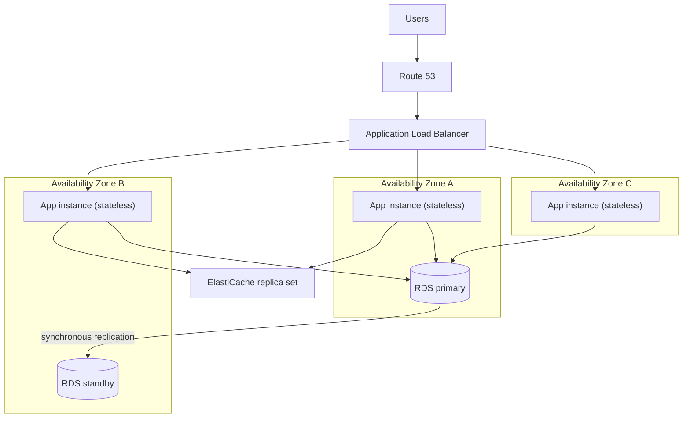
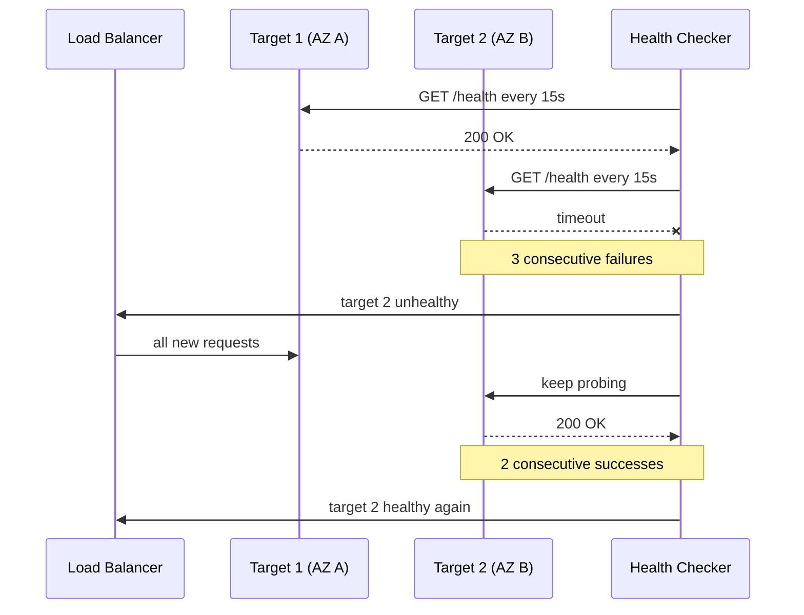
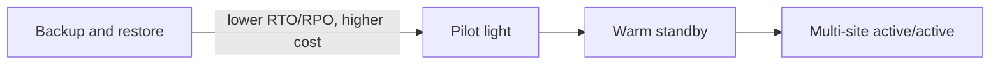

# 01 · High Availability

> **Phase 2 — Professional Architectures** · Lesson 01 of 08
> ⬅️ Previous: [Capstone: Secure 3-Tier Web App](../phase-1-core-foundations/18-project-secure-3-tier-web-app.md) · ➡️ Next: [Disaster Recovery](./02-disaster-recovery.md) · 🏠 [Phase overview](./README.md)

## Learning Objectives

By the end of this lesson you will be able to:

- Distinguish availability, high availability, fault tolerance, and durability
- Place workloads across multiple Availability Zones and explain why multi-region is a different problem
- Choose between ALB, NLB, and GWLB for a given traffic pattern
- Configure health checks and predict how a load balancer removes a failing target
- Define RTO and RPO and use them to drive architecture decisions
- Design a stateless application tier that can lose any instance without user impact

**Estimated time:** 70 min · **Difficulty:** Intermediate

---

## Core Concepts

**Availability** is the fraction of time a system answers correctly. It is usually written as a number of nines: 99.9% ("three nines") allows about 43 minutes of downtime per month, 99.99% allows about 4 minutes, and 99.999% allows about 26 seconds. Availability is a property of the whole path a request takes — DNS, CDN, load balancer, compute, and database — and multiplying the availability of components in series is brutal. Two components at 99.9% in series give you 99.8%. Redundancy in parallel is how you buy the number back.

**High availability (HA)** means the system keeps serving when a component fails, usually with a short interruption or none at all. **Fault tolerance** is a stronger claim: the system continues with *no* loss of in-flight work and no degradation, which normally requires fully synchronous redundancy and costs a lot more. **Durability** is different again — it means the data still exists (S3 is designed for 99.999999999% durability), not that it is readable right now.

An **Availability Zone (AZ)** is one or more physically separate data centers with independent power, cooling, and networking, connected to sibling AZs by low-latency links. Multi-AZ is the default answer for HA inside a region: run at least two (ideally three) copies of every layer in different AZs and let a load balancer or database failover mechanism route around the dead one. A **region** is a physically separate geographic area with independent AZs. Multi-region protects against events that take out an entire region — and it is a *different* discipline, because now you own data replication, DNS failover, and two times the infrastructure.

The single most powerful availability technique is **statelessness**. If an application tier keeps no local session state — sessions live in a database, ElastiCache, or a signed token — then any instance can be replaced at any moment and any load balancer can send the next request anywhere. Stateless tiers scale horizontally, deploy with zero drama, and fail over without warning.

**RTO (Recovery Time Objective)** is how long you may be down; **RPO (Recovery Point Objective)** is how much data you may lose, expressed as time. They are business decisions with a price tag, not engineering preferences. A 15-minute RTO and a 5-minute RPO rule out "restore from a nightly backup" immediately, and that constraint — not technology taste — picks your architecture. Lesson 02 turns these two numbers into a concrete strategy.

### Key terminology

| Term | Meaning |
|------|---------|
| **AZ** | Isolated data center group inside a region; the unit of Multi-AZ redundancy |
| **ELB** | Elastic Load Balancing — the family name for ALB, NLB, and GWLB |
| **Target group** | A set of registered targets (instances, IPs, Lambda, ALB) that a load balancer listener forwards to |
| **Health check** | Periodic probe that decides whether a target receives traffic |
| **Listener** | The port and protocol a load balancer accepts traffic on |
| **Cross-zone load balancing** | Distributing traffic evenly across all targets in every enabled AZ, not per AZ |
| **Quorum / failover** | The mechanism a data store uses to elect a new primary (RDS Multi-AZ, Aurora, ElastiCache) |
| **Graceful degradation** | Serving a reduced feature set instead of failing completely, for example read-only mode |
| **Blast radius** | How much stops working when a given component fails |

---

## Architecture Diagram

A three-tier workload spread across three AZs. Every layer has at least two independent copies:



What the load balancer sees when one target fails its health check:



The RTO/RPO trade-off, from cheap-and-slow to expensive-and-instant:



---

## Hands-on Lab: Multi-AZ ALB with Self-Healing Targets

**Goal:** Build a load-balanced, Multi-AZ web tier, then deliberately kill a target and watch the load balancer route around it.

**Prerequisites:** An AWS account, AWS CLI v2 configured, a VPC with at least two public subnets in different AZs, a security group allowing inbound port 80 from the internet, an EC2 key pair, a launched AMI or launch template.

### Step 1 — Create the load balancer and target group

```bash
# Create an internet-facing ALB spanning two AZs (ALB requires at least two subnets)
aws elbv2 create-load-balancer \
  --name app-alb \
  --type application \
  --scheme internet-facing \
  --subnets subnet-0aaa1111 subnet-0bbb2222 \
  --security-groups sg-0abc123def456

# Target group with an aggressive health check: 15s interval, 2 OK / 3 failures
aws elbv2 create-target-group \
  --name app-tg \
  --protocol HTTP \
  --port 80 \
  --vpc-id vpc-0abc123def \
  --target-type instance \
  --health-check-protocol HTTP \
  --health-check-path /health \
  --health-check-interval-seconds 15 \
  --health-check-timeout-seconds 5 \
  --healthy-threshold-count 2 \
  --unhealthy-threshold-count 3
```

A short interval costs more health check traffic but cuts detection time. With these numbers, a dead instance stops receiving traffic in roughly 45 seconds (3 × 15s) instead of the default 90+ seconds.

### Step 2 — Register targets and add a listener

```bash
# Register one instance per AZ so a single AZ failure cannot take the tier down
aws elbv2 register-targets \
  --target-group-arn arn:aws:elasticloadbalancing:eu-west-1:123456789012:targetgroup/app-tg/50dc6c495c0c9188 \
  --targets Id=i-0abc1111 Id=i-0abc2222

# Forward port 80 to the target group
aws elbv2 create-listener \
  --load-balancer-arn arn:aws:elasticloadbalancing:eu-west-1:123456789012:loadbalancer/app/app-alb/6d0ecf831eec9f09 \
  --protocol HTTP \
  --port 80 \
  --default-actions Type=forward,TargetGroupArn=arn:aws:elasticloadbalancing:eu-west-1:123456789012:targetgroup/app-tg/50dc6c495c0c9188
```

### Step 3 — Let Auto Scaling replace failures automatically

```bash
# Spread the group across subnets in two AZs, minimum 2 so one AZ outage is survivable
aws autoscaling create-auto-scaling-group \
  --auto-scaling-group-name app-asg \
  --launch-template LaunchTemplateName=app-lt,Version='$Latest' \
  --min-size 2 \
  --max-size 6 \
  --desired-capacity 2 \
  --vpc-zone-identifier "subnet-0aaa1111,subnet-0bbb2222" \
  --target-group-arns arn:aws:elasticloadbalancing:eu-west-1:123456789012:targetgroup/app-tg/50dc6c495c0c9188 \
  --health-check-type ELB \
  --health-check-grace-period 60

# Add a scaling policy that reacts to CPU rather than to guessing
aws autoscaling put-scaling-policy \
  --auto-scaling-group-name app-asg \
  --policy-name cpu-target-tracking \
  --policy-type TargetTrackingScaling \
  --target-tracking-configuration file://tt-cpu.json
```

```json
{
  "TargetValue": 55.0,
  "PredefinedMetricSpecification": {
    "PredefinedMetricType": "ASGAverageCPUUtilization"
  },
  "ScaleInCooldown": 120,
  "ScaleOutCooldown": 60
}
```

`--health-check-type ELB` is the important flag: it tells Auto Scaling to replace instances that fail the *load balancer's* health check, not merely the EC2 status check. Without it, a hung web server keeps an instance alive forever.

### Step 4 — Verify failover behavior

```bash
# Confirm both targets are healthy before you break anything
aws elbv2 describe-target-health \
  --target-group-arn arn:aws:elasticloadbalancing:eu-west-1:123456789012:targetgroup/app-tg/50dc6c495c0c9188 \
  --query 'TargetHealthDescriptions[].{Id:Target.Id,State:TargetHealth.State}'

# Stop one instance and watch the health check drop it
aws ec2 stop-instances --instance-ids i-0abc1111

# Poll: the stopped target should move to unused/unhealthy, and traffic should keep flowing
aws elbv2 describe-target-health \
  --target-group-arn arn:aws:elasticloadbalancing:eu-west-1:123456789012:targetgroup/app-tg/50dc6c495c0c9188

# Prove the application still answers from the load balancer DNS name
curl -s -o /dev/null -w "%{http_code}\n" http://app-alb-1234567890.eu-west-1.elb.amazonaws.com/health
```

Then test the database layer:

```bash
# Force a Multi-AZ failover and measure how long the writer is unavailable
aws rds reboot-db-instance --db-instance-identifier app-db --force-failover

# Check the availability zone of the new primary
aws rds describe-db-instances \
  --db-instance-identifier app-db \
  --query 'DBInstances[0].{AZ:AvailabilityZone,MultiAZ:MultiAZ,Status:DBInstanceStatus}'
```

RDS Multi-AZ failover normally completes in 60–120 seconds, during which connections break and the DNS record for the instance endpoint is repointed at the standby. Application code must retry, not crash.

---

## CLI Reference

```bash
# List every load balancer with its DNS name and state
aws elbv2 describe-load-balancers \
  --query 'LoadBalancers[].{Name:LoadBalancerName,DNS:DNSName,State:State.Code}'

# Create a Network Load Balancer (static IPs per AZ, layer 4)
aws elbv2 create-load-balancer \
  --name tcp-nlb \
  --type network \
  --subnets subnet-0aaa1111 subnet-0bbb2222 \
  --scheme internet-facing

# Create a Gateway Load Balancer for third-party firewalls (GENEVE port 6081)
aws elbv2 create-load-balancer --name fw-gwlb --type gateway --subnets subnet-0aaa1111 subnet-0bbb2222
aws elbv2 create-target-group \
  --name fw-tg \
  --protocol GENEVE \
  --port 6081 \
  --vpc-id vpc-0abc123def \
  --target-type instance

# Slow down deregistration so in-flight requests finish (ALB default is 300s)
aws elbv2 modify-target-group-attributes \
  --target-group-arn arn:aws:elasticloadbalancing:eu-west-1:123456789012:targetgroup/app-tg/50dc6c495c0c9188 \
  --attributes Key=deregistration_delay.timeout_seconds,Value=30

# Enable cross-zone load balancing on an NLB (off by default, billed as data transfer)
aws elbv2 modify-target-group-attributes \
  --target-group-arn arn:aws:elasticloadbalancing:eu-west-1:123456789012:targetgroup/tcp-tg/1234567890abcdef \
  --attributes Key=load_balancing.cross_zone.enabled,Value=true

# Alarm on unhealthy hosts so a human finds out before customers do
aws cloudwatch put-metric-alarm \
  --alarm-name alb-unhealthy-hosts \
  --namespace AWS/ApplicationELB \
  --metric-name UnHealthyHostCount \
  --dimensions Name=TargetGroup,Value=targetgroup/app-tg/50dc6c495c0c9188 Name=LoadBalancer,Value=app/app-alb/6d0ecf831eec9f09 \
  --statistic Maximum \
  --period 60 \
  --threshold 1 \
  --comparison-operator GreaterThanOrEqualToThreshold \
  --evaluation-periods 2 \
  --alarm-actions arn:aws:sns:eu-west-1:123456789012:ops-alerts

# Describe Auto Scaling activity to see what replaced what, and why
aws autoscaling describe-scaling-activities --auto-scaling-group-name app-asg --max-items 10
```

| Command | Purpose |
|---------|---------|
| `describe-target-health` | The fastest way to prove whether a target is receiving traffic |
| `create-load-balancer --type application\|network\|gateway` | Picks the layer and feature set |
| `modify-target-group-attributes` | Tunes deregistration delay and cross-zone behavior |
| `reboot-db-instance --force-failover` | Rehearses a database failover without waiting for a real outage |
| `describe-scaling-activities` | Explains why the group scaled and which instance was replaced |

---

## Best Practices

| Practice | Why it matters |
|----------|----------------|
| Use **three AZs**, not two, for critical tiers | Two AZs gives no headroom if one AZ is degraded but not fully down |
| Keep the application tier **stateless** | Enables horizontal scaling, blue/green deploys, and no-drama failover |
| Health check a **real dependency path** | `/health` should verify the DB pool and cache, but stay fast and never depend on a slow downstream |
| Set `deregistration_delay` to match request duration | Prevents 502s during deployments |
| Design **idempotent, retrying clients** | Failover always breaks connections; code that retries survives it |
| Alarm on `UnHealthyHostCount`, `HTTPCode_Target_5XX`, and `HealthyHostCount` | Availability failures are visible in metrics long before users complain |
| Test failover on a schedule | An untested failover path is a hypothesis, not a capability |
| Separate the blast radius by account and AZ | Limits how far one failure propagates |

---

## Common Pitfalls

| Pitfall | Symptom | Fix |
|---------|---------|-----|
| Sticky sessions used to hide state | Users logged out after failover | Move session state to ElastiCache or signed tokens |
| ALB and NLB in the same subnet but one AZ has no healthy target | Intermittent timeouts | Register targets in every AZ the load balancer spans, or enable cross-zone balancing |
| Health check points at `/` which returns 302 | Targets permanently unhealthy | Point the check at a lightweight endpoint returning 200 |
| Auto Scaling without `--health-check-type ELB` | Hung instances never replaced | Use ELB health checks plus a grace period |
| `Multi-AZ` database used for *read* scaling | Standby sits idle; readers still saturate the primary | Use read replicas or Aurora replicas for reads, Multi-AZ for failover |
| Ignoring cross-AZ data transfer | Unexpected data transfer charges | Keep chatty tiers in one AZ where possible, and know the per-GB cross-AZ price |
| Treating Multi-AZ as disaster recovery | A regional outage takes everything down | Add a multi-region strategy (next lesson) if the RTO demands it |
| Long-lived WebSocket connections and short deregistration delay | Connection resets during deploys | Raise the delay, or drain connections explicitly |

---

## Cost Considerations

High availability is a redundancy purchase, and you should know what you are buying:

- **Compute:** Multi-AZ means paying for at least `N × AZs` capacity. Three AZs at 30% average utilization is roughly three times the instance bill of a single-AZ deployment at the same capacity. Use Auto Scaling with a low baseline and burst capacity instead of provisioning for peak in every AZ.
- **Load balancers:** ALB is billed on hours plus **LCU** (Load Balancer Capacity Units: new connections, active connections, processed bytes, rule evaluations). An idle ALB costs about $0.02–$0.03 per hour depending on the region plus a small LCU floor; a busy one is dominated by LCUs. NLB is billed on hours plus **NLCU**, and costs less per GB than an ALB for high-throughput TCP. An unused load balancer is a classic "find the waste" item.
- **Databases:** RDS Multi-AZ costs about **twice** the single-AZ instance price because you pay for the standby. Aurora charges for both the writer and readers, but its storage is shared and replicated across three AZs by default at no separate replication cost.
- **Data transfer:** cross-AZ traffic is billed per GB in both directions (about $0.01/GB in each direction in most regions, i.e. ~$0.02/GB round trip). Chatty microservices spread across AZs can quietly cost more than the instances they run on.
- **Health checks:** Route 53 health checks are billed per check per month; ALB health checks are free but generate log noise and target CPU.
- **What drives the bill:** instance hours, LCU/NLCU, and cross-AZ data transfer. The cheapest availability win is almost always *fixing statelessness* so you can run a small baseline fleet and scale out only when needed.

---

## Security Considerations

- **Load balancers belong in public subnets; targets do not.** Keep the compute tier in private subnets and reference the load balancer's security group as the only allowed source on the target security group.
- **Terminate TLS at the load balancer with ACM certificates**, redirect HTTP to HTTPS at the listener level, and enforce a modern security policy (`ELBSecurityPolicy-TLS13-1-2-2021-06` or newer).
- **NLB preserves the client IP** (`--enable-client-ip-preservation` behavior is default for instance targets); ALB does not, and sends `X-Forwarded-For`. Authorize on the real client IP only behind an NLB, or trust the header carefully on an ALB.
- **Gateway Load Balancer** exists for centralized inspection: route traffic through appliances via the GWLB endpoint so every packet is examined by your firewall fleet without changing application subnets.
- **Attribute actions in CloudTrail** so that someone disabling a health check or deleting a listener is an auditable event. Alarm on `DeleteLoadBalancer` and `DeregisterTargets` in production accounts.
- **Deny delete and modify on production listeners** with an SCP or resource-based condition, and require MFA for console access to the DR region.

---

## Exercise

Take the stack you built in the lab and make it survive a full AZ failure with zero manual intervention. Add a third AZ to the Auto Scaling group, place the target group across all three, and configure a CloudWatch alarm on `UnHealthyHostCount` that notifies an SNS topic.

Then write a one-paragraph justification, in business terms, of what RTO and RPO this design actually guarantees — including the RDS failover window you measured.

Success looks like: with all instances in one AZ terminated simultaneously, `describe-target-health` never shows fewer than one healthy target, a synthetic request loop records no 5xx responses, and Auto Scaling launches replacements without your involvement.

---

## Resources

- [Elastic Load Balancing: what is load balancing](https://docs.aws.amazon.com/elasticloadbalancing/latest/userguide/what-is-load-balancing.html)
- [Application Load Balancer target groups and health checks](https://docs.aws.amazon.com/elasticloadbalancing/latest/application/target-group-health-checks.html)
- [Gateway Load Balancers](https://docs.aws.amazon.com/elasticloadbalancing/latest/gateway/introduction.html)
- [RDS: Multi-AZ DB instance deployments](https://docs.aws.amazon.com/AmazonRDS/latest/UserGuide/Concepts.MultiAZSingleStandby.html)
- [Amazon EC2 Auto Scaling health checks](https://docs.aws.amazon.com/autoscaling/ec2/userguide/ec2-auto-scaling-health-checks.html)
- [AWS whitepaper: Disaster Recovery of Workloads on AWS](https://docs.aws.amazon.com/whitepapers/latest/disaster-recovery-workloads-on-aws/disaster-recovery-workloads-on-aws.html)

---

## Next Steps

Multi-AZ protects you from a data center failing. It does nothing when an entire region, an account, or a logical mistake in your deployment pipeline takes everything down at once. The next lesson takes the RTO and RPO numbers you just measured and turns them into four concrete disaster recovery strategies, each with a price tag.

> ⬅️ Previous: [Capstone: Secure 3-Tier Web App](../phase-1-core-foundations/18-project-secure-3-tier-web-app.md) · ➡️ Next: [Disaster Recovery](./02-disaster-recovery.md) · 🏠 [Phase overview](./README.md)
