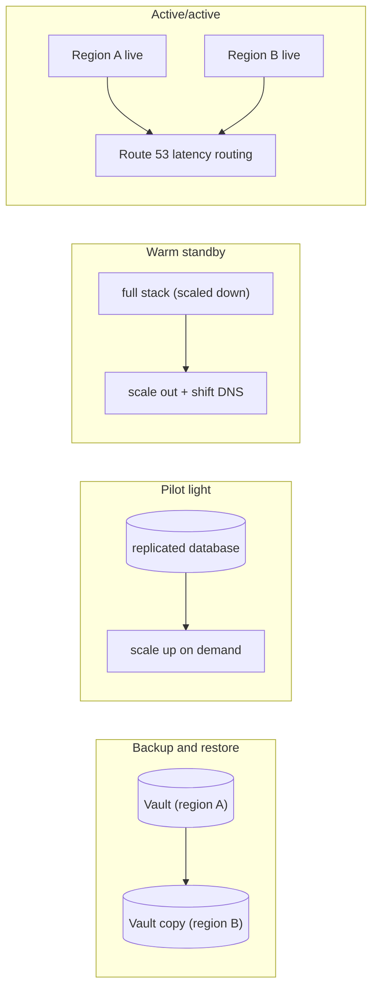
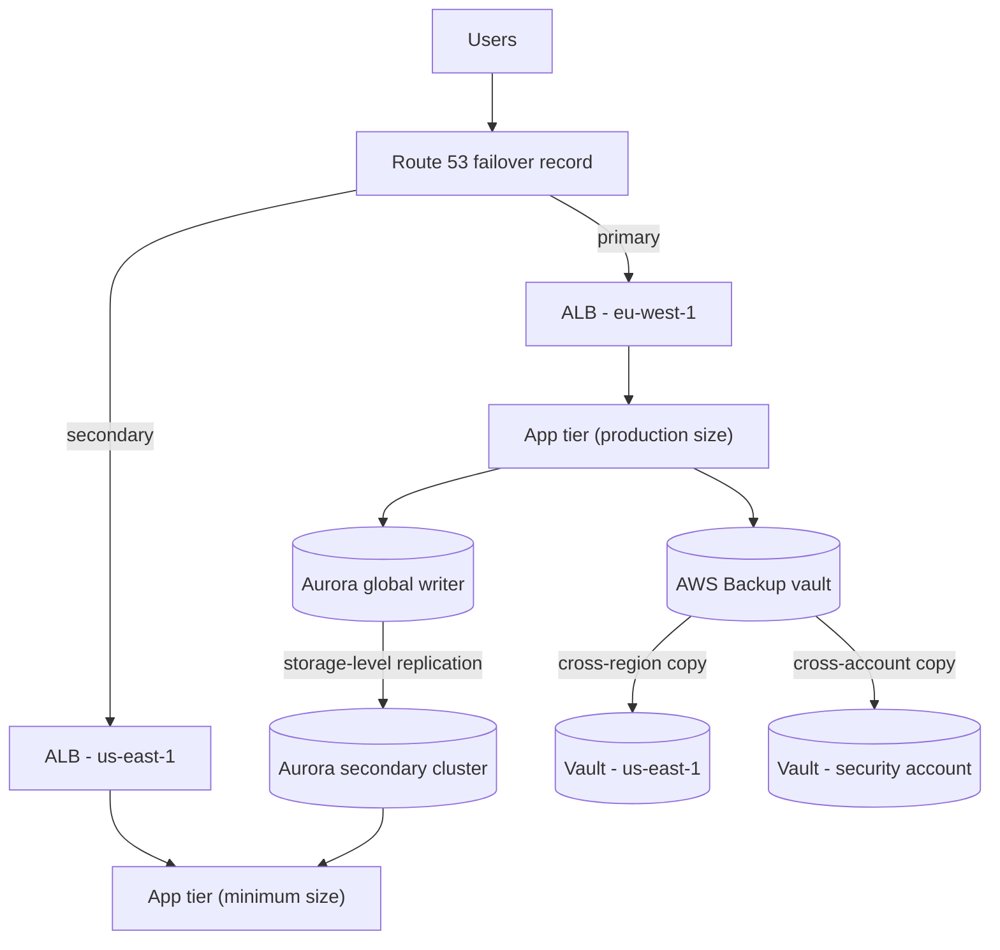
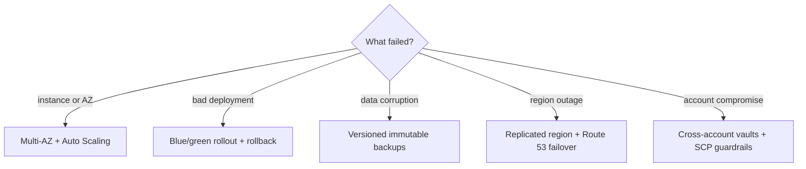

# 02 · Disaster Recovery

> **Phase 2 — Professional Architectures** · Lesson 02 of 08
> ⬅️ Previous: [High Availability](./01-high-availability.md) · ➡️ Next: [Multi-Region VPC Design](./03-multi-region-vpc-design.md) · 🏠 [Phase overview](./README.md)

## 🎯 Learning Objectives

By the end of this lesson you will be able to:

- Explain why disaster recovery is a business decision expressed as RTO and RPO, not a technology choice
- Compare the four DR strategies — backup & restore, pilot light, warm standby, active/active — on cost, RTO, and RPO
- Build an AWS Backup plan with retention, cross-region copy, and Vault Lock
- Deploy AWS Elastic Disaster Recovery (DRS) for continuous block-level replication and recovery
- Rehearse a failover with a timed runbook and report actual RTO/RPO against target

**Estimated time:** 75 min · **Difficulty:** Advanced

---

## 🧠 Core Concepts

**High availability protects against component failure; disaster recovery protects against loss of a whole environment.** A Multi-AZ application in three AZs will not survive an operator dropping the production database, a runaway deployment that corrupts data, malicious deletion, or a regional event that takes out `eu-west-1` for hours. DR is what you do when the thing that broke is not a machine but your entire system.

DR strategy selection starts from two numbers the business must own:

- **RTO — Recovery Time Objective:** the maximum tolerable downtime. "We may not be down for more than 4 hours."
- **RPO — Recovery Point Objective:** the maximum tolerable data loss, measured backwards from the failure. "We may not lose more than 15 minutes of orders."

Everything else follows. A nightly backup plan has an RPO of up to 24 hours and an RTO of hours-to-days. Continuous replication with a standby environment gives an RPO of seconds and an RTO of minutes. The cost curve is steep in that direction — going from "restore a snapshot" to "keep a live copy warm" typically multiplies steady-state cost by 2–5×, and active/active more than doubles it again once you pay for duplicate data and cross-region transfer.

The **four canonical strategies**, in ascending order of cost and descending order of RTO/RPO:

1. **Backup and restore.** Backups land in a vault (and, ideally, a second region and a second account). Nothing runs in the recovery region until a disaster. RTO is dominated by restore time — for a large database that can be many hours.
2. **Pilot light.** A minimal copy of the core is always running in the DR region: the database is replicated and kept current, images and templates exist, but application servers are stopped or reduced to a single small instance. Recovery means *scaling up* something that already exists.
3. **Warm standby.** A functional but scaled-down copy of the full stack runs in the DR region and can take traffic immediately, typically at a fraction of production capacity. Recovery means scaling out and shifting DNS.
4. **Multi-site active/active.** Two or more regions serve production traffic simultaneously. Failover is a routing change, not a deployment. This requires data that can be written in multiple places (DynamoDB global tables, Aurora Global Database with write forwarding, or your own conflict-resolution design) and it is the most operationally demanding option.

Two failure modes are worth naming because they are not infrastructure failures at all. **Data corruption** replicates: if a bad migration writes garbage to the primary, every replica — including your warm standby — receives it within seconds. That is why the answer to corruption is *versioned backups with retention and immutability*, not replication. **Logical deletion** (an engineer or an attacker deleting everything) is answered by **Vault Lock**, cross-account copies, and MFA-delete buckets — backups the primary account cannot destroy.

### Key terminology

| Term | Meaning |
|------|---------|
| **RTO / RPO** | Maximum tolerable downtime / maximum tolerable data loss |
| **Recovery region** | The region that takes over when the primary region fails |
| **Pilot light** | Core components (data + templates) always on, application scaled to near zero |
| **Warm standby** | Full stack running at reduced capacity in the recovery region |
| **Active/active** | Multiple regions concurrently serving production traffic |
| **AWS Backup** | Centralized, policy-driven backup across many services with vaults, copies, and lock |
| **Vault Lock** | Write-once-read-many (WORM) enforcement that makes recovery points immutable |
| **AWS DRS** | Elastic Disaster Recovery — continuous block-level replication to a staging area, recovery to EC2 |
| **Switchover vs failover** | Planned, graceful shift vs unplanned, forced shift |
| **Runbook** | The ordered, tested procedure a human follows during an incident |

---

## 🗺️ Architecture Diagram

The four strategies, side by side:



Reference topology for a warm standby with an Aurora Global Database and immutable backups:



How the mechanisms divide the responsibility:



---

## 🗺️ Failover Timeline

A realistic unplanned failover for a warm standby, from detection to full capacity. Note that *detection and decision* consume most of the RTO if you have not automated them:

```mermaid
gantt
    title Warm standby failover drill - target RTO 60 minutes
    dateFormat HH:mm
    axisFormat %H:%M
    section Detect
    Alarm fires and on-call acknowledges :a1, 00:00, 5m
    Incident commander assigned :a2, after a1, 3m
    section Decide
    Confirm regional impact :a3, after a2, 5m
    Go/no-go on failover :a4, after a3, 4m
    section Execute
    Break Aurora global cluster replication :b1, after a4, 3m
    Promote secondary cluster to writer :b2, after b1, 4m
    Scale warm standby to production size :b3, after b2, 8m
    Shift Route 53 failover record :b4, after b3, 2m
    section Verify
    Smoke tests and synthetic checks :c1, after b4, 10m
    DNS TTL expiry for existing clients :c2, after b4, 6m
    Announce recovered :c3, after c1, 5m
```



Baseline requirement for that timeline to hold: the Route 53 record's TTL must be short (60 seconds), the warm standby must already have valid TLS certificates and DNS records, and the promotion runbook must be automated or at least scripted. Otherwise the *verify* section quietly doubles.

---

## 🧪 Hands-on Lab: Backup Plan, Immutable Vault, and a Timed DR Rehearsal

**Goal:** Protect an EC2/EBS workload with a cross-region, locked backup plan, then restore it on demand and measure the RTO.

**Prerequisites:** AWS CLI v2, an EC2 instance with a data volume, a second region, and IAM permissions for AWS Backup (`AWSBackupServiceRolePolicyForBackup` attached to the backup role).

### Step 1 — Create a vault and lock it

```bash
# A dedicated vault per region, encrypted with a customer managed KMS key
aws backup create-backup-vault \
  --backup-vault-name prod-daily \
  --encryption-key-arn arn:aws:kms:eu-west-1:123456789012:key/1a2b3c4d-1111-2222-3333-444455556666

# WORM enforcement: nobody, not even the account root, can shorten retention or delete points
aws backup put-backup-vault-lock \
  --backup-vault-name prod-daily \
  --min-retention-days 7 \
  --max-retention-days 365 \
  --changeable-for-days 3
```

The three-day grace period is a grace period for *you*: after it expires, the lock can never be removed. Get the parameters right before you apply it in production.

### Step 2 — Create the backup plan with cross-region copy

```json
{
  "BackupPlan": {
    "BackupPlanName": "prod-daily-with-dr-copy",
    "Rules": [
      {
        "RuleName": "daily",
        "TargetBackupVaultName": "prod-daily",
        "ScheduleExpression": "cron(0 2 * * ? *)",
        "StartWindowMinutes": 60,
        "CompletionWindowMinutes": 180,
        "Lifecycle": {
          "MoveToColdStorageAfterDays": 30,
          "DeleteAfterDays": 365
        },
        "CopyActions": [
          {
            "DestinationBackupVaultArn": "arn:aws:backup:us-east-1:123456789012:backup-vault:dr-daily",
            "Lifecycle": { "DeleteAfterDays": 365 }
          }
        ]
      }
    ]
  }
}
```

```bash
# Register the plan (the vault in the destination region must already exist)
aws backup create-backup-plan --backup-plan file://backup-plan.json

# Select resources by tag, not by resource ID — new instances are then covered automatically
aws backup create-backup-selection \
  --backup-plan-id 8b8f4c37-3b34-4ba2-8c1f-0a1b2c3d4e5f \
  --backup-selection file://selection.json
```

```json
{
  "BackupSelection": {
    "SelectionName": "tagged-production-volumes",
    "IamRoleArn": "arn:aws:iam::123456789012:role/service-role/AWSBackupDefaultServiceRole",
    "ListOfTags": [
      {
        "ConditionType": "STRINGEQUALS",
        "ConditionKey": "Backup",
        "ConditionValue": "daily"
      }
    ]
  }
}
```

### Step 3 — Prove the backup ran in both regions

```bash
# Recent recovery points in the primary vault
aws backup list-recovery-points-by-backup-vault \
  --backup-vault-name prod-daily \
  --max-results 5 \
  --query 'RecoveryPoints[].{Arn:RecoveryPointArn,Status:Status,Created:CreationDate}'

# The copy should exist in the DR region before you ever need it
aws backup list-recovery-points-by-backup-vault \
  --backup-vault-name dr-daily \
  --region us-east-1 \
  --max-results 5
```

### Step 4 — Restore and time it

```bash
# Restore an EBS volume into a chosen AZ; metadata keys are resource-type specific
aws backup start-restore-job \
  --recovery-point-arn arn:aws:ec2:eu-west-1::snapshot/snap-0abc1234def567890 \
  --metadata file://restore-metadata.json \
  --iam-role-arn arn:aws:iam::123456789012:role/service-role/AWSBackupDefaultServiceRole

# Watch the job; the elapsed time here is your measured RTO for this resource
aws backup describe-restore-job \
  --restore-job-id 3F2A9B1C-4D5E-6789-0ABC-1D2E3F4A5B6C
```

```json
{
  "VolumeType": "gp3",
  "AvailabilityZone": "eu-west-1b",
  "Size": "100"
}
```

Record the start and end timestamps of `describe-restore-job`. That number, not a vendor claim, is your real RTO for a full environment restore — and remember to add DNS changes, instance launches, and smoke testing on top.

### Step 5 — Schedule restore testing so you never discover a broken backup during an incident

```bash
# Automated restore testing: pick the latest supported point within a window, weekly
aws backup create-restore-testing-plan \
  --restore-testing-plan file://restore-testing.json
```

```json
{
  "RestoreTestingPlanName": "weekly-dr-restore-test",
  "ScheduleExpression": "cron(0 6 ? * SUN *)",
  "RecoveryPointSelection": {
    "Algorithm": "LATEST_WITHIN_WINDOW",
    "IncludeVaults": ["dr-daily"],
    "RecoveryPointTypes": ["SNAPSHOT"],
    "SelectionWindowDays": 7
  }
}
```

### Step 6 — Verify

```bash
# Weekly test runs should show Succeeded, not Failed
aws backup list-restore-testing-plans --query 'RestoreTestingPlans[].RestoreTestingPlanName'

# Audit that copies exist cross-region and cross-account
aws backup list-backup-jobs --by-state COMPLETED --max-results 10 \
  --query 'BackupJobs[].{Resource:ResourceArn,Region:Region,Status:Status}'
```

---

## 💻 CLI Reference

```bash
# On-demand backup of a single resource (useful before a risky change)
aws backup start-backup-job \
  --backup-vault-name prod-daily \
  --resource-arn arn:aws:ec2:eu-west-1:123456789012:volume/vol-0abc1234def567890 \
  --iam-role-arn arn:aws:iam::123456789012:role/service-role/AWSBackupDefaultServiceRole

# Copy one recovery point to another region immediately (do not wait for the schedule)
aws backup start-copy-job \
  --recovery-point-arn arn:aws:ec2:eu-west-1::snapshot/snap-0abc1234def567890 \
  --source-backup-vault-name prod-daily \
  --destination-backup-vault-arn arn:aws:backup:us-east-1:123456789012:backup-vault:dr-daily \
  --iam-role-arn arn:aws:iam::123456789012:role/service-role/AWSBackupDefaultServiceRole

# Let a second, hardened account read your vault for cross-account copy
aws backup put-backup-vault-access-policy \
  --backup-vault-name prod-daily \
  --policy file://vault-access-policy.json

# RDS: copy an automated snapshot to the DR region, re-encrypted with the DR key
aws rds copy-db-snapshot \
  --source-db-snapshot-identifier arn:aws:rds:eu-west-1:123456789012:snapshot:rds:app-db-2026-10-14-02-00 \
  --target-db-snapshot-identifier app-db-dr-copy \
  --kms-key-id alias/dr-rds-key \
  --source-region eu-west-1 \
  --region us-east-1

# Aurora: promote the secondary cluster when the primary region is gone
aws rds failover-global-cluster \
  --global-cluster-identifier app-global \
  --target-db-cluster-identifier arn:aws:rds:us-east-1:123456789012:cluster:app-secondary

# Aurora: planned, zero-data-loss switchover for a DR drill
aws rds switchover-global-cluster \
  --global-cluster-identifier app-global \
  --target-db-cluster-identifier arn:aws:rds:us-east-1:123456789012:cluster:app-secondary

# DynamoDB: enable point-in-time recovery, then restore to an exact moment
aws dynamodb update-continuous-backups \
  --table-name orders \
  --point-in-time-recovery-specification PointInTimeRecoveryEnabled=true

aws dynamodb restore-table-to-point-in-time \
  --source-table-name orders \
  --target-table-name orders-restored \
  --restore-date-time 2026-10-14T10:00:00Z

# AWS DRS: initialize the service in the recovery region
aws drs initialize-service --region us-east-1

# AWS DRS: check replication health and lag for a protected server
aws drs describe-source-servers \
  --filters 'sourceServerIDs=s-1234567890abcdef0' \
  --query 'items[].{Id:sourceServerID,Lag:dataReplicationInfo.lagDuration,Status:dataReplicationInfo.dataReplicationState}'

# AWS DRS: drill recovery without disturbing the source (--is-drill is a top-level flag)
aws drs start-recovery \
  --source-servers sourceServerID=s-1234567890abcdef0 \
  --is-drill

# AWS DRS: real recovery for one server
aws drs start-recovery --source-servers sourceServerID=s-1234567890abcdef0

# AWS DRS: fail back to the original site once the primary is restored
aws drs start-failback-launch --source-servers sourceServerID=s-1234567890abcdef0

# Check why a recovery job stalled (agent, network, or credential problems)
aws drs describe-job-log-items --job-id drsjob-1234567890abcdef0
```

| Command | Purpose |
|---------|---------|
| `backup start-backup-job` | Ad-hoc protection before a risky change |
| `backup start-copy-job` | Forces a cross-region copy outside the schedule |
| `backup put-backup-vault-lock` | Makes recovery points immutable (ransomware/insider defense) |
| `rds copy-db-snapshot` | Cross-region, re-encrypted database snapshot copy |
| `rds failover-global-cluster` | Unplanned promotion of an Aurora secondary cluster |
| `drs start-recovery --isDrill` | Non-disruptive DR rehearsal |
| `backup describe-restore-job` | Gives you the measured RTO number |

---

## ✅ Best Practices

| Practice | Why it matters |
|----------|----------------|
| Write RTO/RPO into the design doc **with a business owner's sign-off** | Prevents engineering from over- or under-building |
| Use **tag-based** backup selections | New resources are protected by default, no ticket required |
| Always copy to a **second region and a second account** | Protects against regional loss *and* account compromise |
| Apply **Vault Lock** to the DR vault | Makes backups undeletable even by a compromised admin |
| Prefer **continuous replication** (DRS, Aurora Global, DynamoDB global tables) when RTO < 1 hour | Snapshot restore time scales with data size and rarely meets tight RTOs |
| Keep certificates, DNS records, and IAM roles **pre-provisioned in the DR region** | Eliminates the long tail of failover surprises |
| Test failover **quarterly with real traffic shapes** | Untested DR is a document, not a capability |
| Make recovery **idempotent and scriptable** | Humans under pressure make mistakes; scripts do not |
| Record actual RTO/RPO per drill | Turns the design into measurable evidence |

---

## ⚠️ Common Pitfalls

| Pitfall | Symptom | Fix |
|---------|---------|-----|
| Backups "verified" only by job success | Restore fails when needed | Automated restore testing on a schedule |
| Replication confused with protection | Corrupted data appears in every region | Keep versioned, immutable backups alongside replication |
| DR region missing quota or capacity | Failover fails to launch instances | Pre-raise service quotas; leave a running pilot light |
| DNS TTL of 24 hours | "Failover" takes a day for clients | Lower TTL on failover records before cutover (60s) |
| Application config hardcoded to the primary region | App starts in DR but cannot reach dependencies | Externalize region-specific values in Parameter Store/Secrets Manager replicas |
| Cross-region copy silently disabled after resource rename | Only local recovery points exist | Monitor copy jobs and alarm on failures |
| Encryption keys region-bound | Restored volumes cannot be encrypted as expected | Create multi-region KMS keys, or replicate keys per region and grant access |
| No documented authority to declare a disaster | Hours lost debating whether to fail over | Name an incident commander and pre-agree the trigger |

---

## 💰 Cost Considerations

Approximate steady-state cost of each strategy for a workload whose primary environment costs **$10,000/month**:

| Strategy | Typical RTO | Typical RPO | Added monthly cost | Added cost as % of primary |
|----------|-------------|-------------|--------------------|-----------------------------|
| Backup and restore | 4–24 h | 15 min – 24 h | $200–$600 (storage + copies) | ~2–6% |
| Pilot light | 30–120 min | 1–15 min (replication) | $700–$1,500 (data + minimal compute) | ~7–15% |
| Warm standby | 10–30 min | Seconds – 5 min | $2,300–$3,200 (30% of full stack) | ~25–35% |
| Multi-site active/active | Seconds | Near zero (or seconds) | $9,000–$12,000 (full duplicate + transfer) | ~90–120% |

What drives the DR bill, in order of magnitude:

- **Compute hours in the recovery region.** Pilot light's entire advantage is that instances are stopped or tiny; you pay for storage and data, not for idle fleets.
- **Recovery point storage.** AWS Backup bills per GB-month by warm/cold storage tier, plus a per-GB **cross-region copy** charge and per-GB data transfer for the copy. Cold storage (specified by `MoveToColdStorageAfterDays`) is far cheaper but restores in hours, not minutes.
- **DRS costs** are three parts: a lightweight **replication server** (default `t3.small`) per source server in the staging area, **staging area EBS storage** (the largest cost for big volumes), and **point-in-time snapshots**. Recovery instances you launch are billed as normal EC2 and should be terminated after a drill.
- **Aurora Global Database** charges full writer + reader pricing in every region, plus per-GB replication data transfer out of the primary region.
- **DynamoDB global tables** charge for replicated write capacity units and cross-region data transfer, not just storage.
- **Data transfer between regions** is the silent multiplier in active/active designs; keep chatty calls inside a region and replicate only what must cross.
- **What drives the bill:** how much data you must replicate, how much compute you keep *running*, and how far it travels. Dropping a warm standby from 30% to 10% of production size often cuts DR spend in half with little RTO impact, because you scale out during the failover window.

---

## 🔐 Security Considerations

- **Immutable, cross-account backups defeat ransomware.** A compromised admin key in the production account cannot delete recovery points that live in another account's locked vault, so the attacker's leverage disappears.
- **Encrypt backups with customer managed KMS keys** and mirror the key policy into the DR region. Default AWS-managed keys cannot be shared across accounts and rotate without your control.
- **Restrict `backup:DeleteRecoveryPoint`, `backup:PutBackupVaultLockConfiguration`, and `backup:DeleteBackupVault`** with SCPs and explicit denies; alarm on their use.
- **DRS uses its own IAM roles** (`AWSElasticDisasterRecoveryRecoveryInstanceRole`, `AWSElasticDisasterRecoveryAgent` policies). Scope them tightly, and remember the recovery instances inherit the staging area's security posture — validate security groups and subnet placement in the launch template before you need it.
- **Test failover in an isolated account or VPC** so a drill cannot leak production data or overwrite production systems.
- **Audit everything with CloudTrail in both regions**, including the DR account, and route logs to the log archive account. A regional failover that stops your logging is a blind spot exactly when you need visibility.
- **Require MFA for destructive DR operations** (vault deletion, terminating recovery instances) and break-glass credentials stored offline with a documented rotation process.
- **Verify that backups are not a data-exfiltration path**: copy destinations should be owned accounts, and vault access policies should list explicit principals, never `"Principal": "*"`.

---

## 🧩 Exercise

Choose an application you have running (or the Phase 1 three-tier app) and design a DR strategy whose targets are **RTO ≤ 30 minutes and RPO ≤ 5 minutes**. Document:

1. Which of the four strategies you selected and why the cheaper one fails the targets.
2. The exact replication mechanism for the data layer, and what happens to replication when you fail over.
3. A written runbook with numbered steps, the estimated duration of each, and the named decision-maker for the go/no-go call.

Then execute the runbook as a drill, timing each step, and compute the delta between your estimated and actual RTO.

Success looks like: a timed runbook that completed inside 30 minutes with a recorded RPO under 5 minutes, plus a list of the steps you had to add once you actually ran it.

---

## 📚 Resources

- [AWS whitepaper: Disaster Recovery of Workloads on AWS](https://docs.aws.amazon.com/whitepapers/latest/disaster-recovery-workloads-on-aws/disaster-recovery-workloads-on-aws.html)
- [AWS Backup Developer Guide](https://docs.aws.amazon.com/aws-backup/latest/devguide/whatisbackup.html)
- [AWS Backup: restore testing](https://docs.aws.amazon.com/aws-backup/latest/devguide/restore-testing.html)
- [AWS Backup Vault Lock](https://docs.aws.amazon.com/aws-backup/latest/devguide/vault-lock.html)
- [AWS Elastic Disaster Recovery documentation](https://docs.aws.amazon.com/drs/latest/userguide/what-is-drs.html)
- [Amazon Aurora Global Database](https://docs.aws.amazon.com/AmazonRDS/latest/AuroraUserGuide/aurora-global-database.html)
- [DynamoDB global tables](https://docs.aws.amazon.com/amazondynamodb/latest/developerguide/GlobalTables.html)

---

## ➡️ Next Steps

You now know *what* to replicate and *how fast* it must arrive. The next lesson builds the network that carries it: Transit Gateway, Route 53 Resolver, PrivateLink, and the CIDR planning decisions that are extremely painful to undo once two regions are live.

> ⬅️ Previous: [High Availability](./01-high-availability.md) · ➡️ Next: [Multi-Region VPC Design](./03-multi-region-vpc-design.md) · 🏠 [Phase overview](./README.md)
