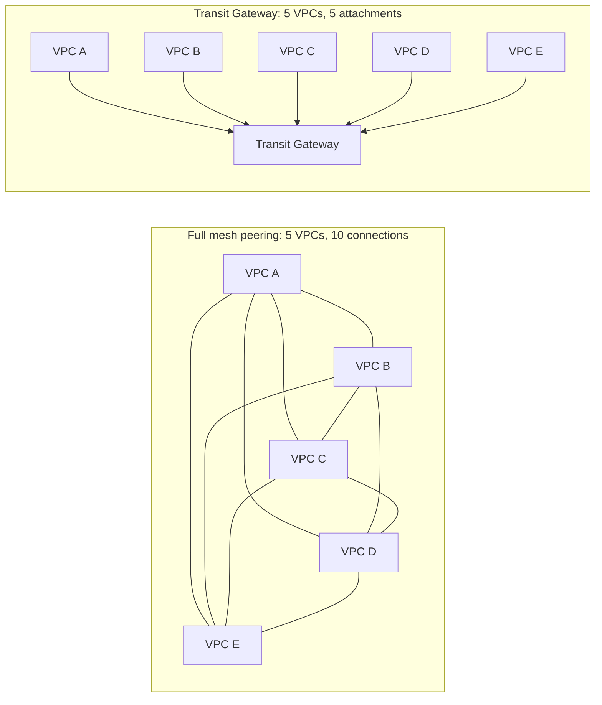
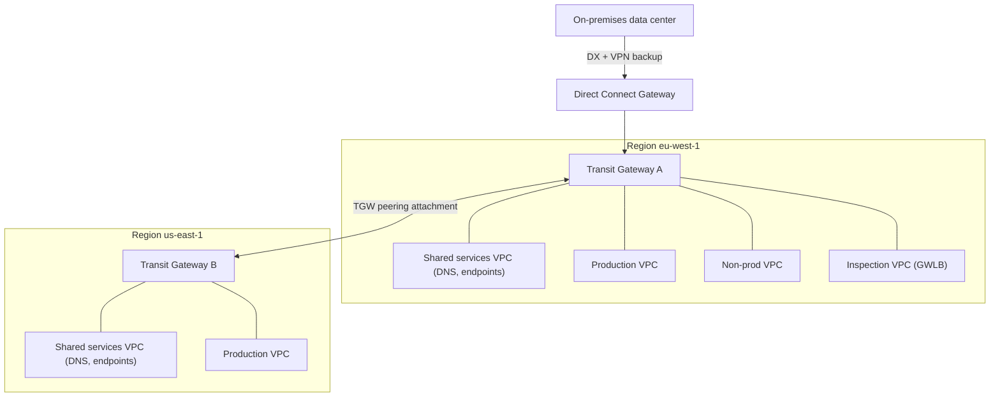
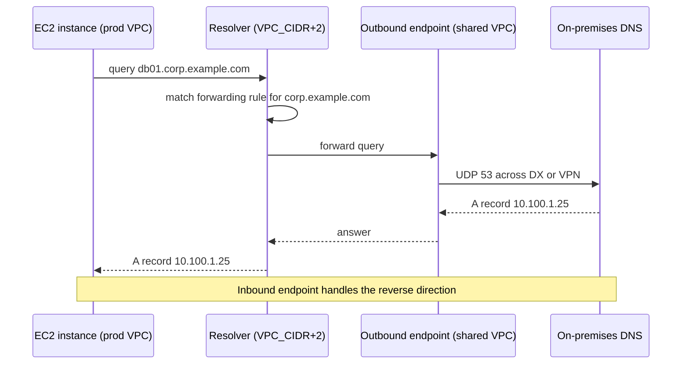
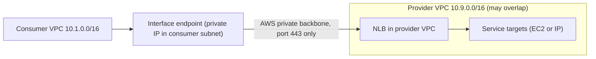

# 03 · Multi-Region VPC Design

> **Phase 2 — Professional Architectures** · Lesson 03 of 08
> ⬅️ Previous: [Disaster Recovery](./02-disaster-recovery.md) · ➡️ Next: [Route 53](./04-route-53.md) · 🏠 [Phase overview](./README.md)

## Learning Objectives

By the end of this lesson you will be able to:

- Choose between VPC peering and a Transit Gateway hub-and-spoke topology, and justify it with numbers
- Build a multi-region hub-and-spoke network with Transit Gateway peering and centralized shared services
- Centralize DNS with Route 53 Resolver inbound and outbound endpoints, rules, and query logging
- Expose a service across accounts and regions with PrivateLink instead of peering
- Diagnose and work around overlapping CIDR ranges before they block an integration

**Estimated time:** 80 min · **Difficulty:** Advanced

---

## Core Concepts

Networking is the part of an architecture that is hardest to change later. Subnet layouts leak into firewall rules, database connection strings, and third-party integrations; a CIDR range that collides with an acquisition's LAN can stall a migration for months. In multi-account, multi-region organizations, the goal is not "connect everything to everything" but **deliberate, controllable reachability**: networks that need to talk should be able to, networks that do not should fail to route by design.

**VPC peering** is a direct, one-to-one connection between two VPCs. It is simple, cheap (data transfer only, no hourly attachment fee), and fast. Its limitation is arithmetic: full-mesh peering grows as *n(n−1)/2*. Five VPCs need 10 peering connections; twenty VPCs need 190. Each one needs its own route table entries, and peering is **non-transitive** — if VPC A peers with B, and B peers with C, A still cannot reach C. Peering also fails outright if the VPCs have overlapping CIDR ranges.

**AWS Transit Gateway (TGW)** is a regional, highly available router. Every VPC attaches once, and the TGW decides routing through its **route tables**, which gives you a hub-and-spoke topology with *n* attachments instead of *n²* connections. TGW supports transitive routing, segmentation (separate route tables for prod, non-prod, and shared services), central inspection, and cross-account sharing through AWS Resource Access Manager (RAM). The trade-offs are an hourly per-attachment charge plus per-GB processing, a hard limit of **50 Gbps per VPC attachment** (use multiple attachments for more), and the fact that route tables are a new technical skill to learn — most TGW outages are route table mistakes, not service failures.

**Route 53 Resolver** solves DNS across the same boundaries. Every VPC has a `VPC_CIDR+2` resolver address (for example `10.0.0.2`) that answers public names and private hosted zones. For hybrid DNS you add **inbound endpoints** (on-premises systems query AWS private zones) and **outbound endpoints** (AWS workloads query on-premises zones via **forwarding rules**). Centralize both in a shared services VPC and share the rules with RAM so every spoke VPC inherits consistent name resolution.

**PrivateLink** publishes a service from one VPC to others without any network-level connectivity. The consumer gets an **interface endpoint** (an ENI with a private IP in its own subnet) that talks to an **NLB** in the provider VPC. Because only the service port is exposed, PrivateLink is the cleanest answer to overlapping CIDRs, cross-organization access, and "I need one service, not a network." Gateway endpoints are the special case for S3 and DynamoDB, which are route-table-based rather than ENI-based.

**Overlapping CIDRs** are the classic organizational failure. RFC 1918 space is finite and everyone picks `10.0.0.0/16`. If two VPCs overlap, you cannot peer them, TGW will not route between them, and no amount of NAT fixes it cleanly. The realistic options are: re-IP one side (painful but permanent), put the service behind PrivateLink (traffic goes to an endpoint in your own range, so overlap is irrelevant), front the service with an NLB/ALB and reach it over the public internet with TLS, use a NAT instance to translate in a DMZ, or isolate one side in its own appliance VPC. The only real prevention is **planning address space centrally with VPC IPAM before the first VPC exists**.

### Key terminology

| Term | Meaning |
|------|---------|
| **Attachment** | A TGW connection to a VPC, VPN, Direct Connect gateway, or peering TGW |
| **TGW route table** | The routing domain inside a TGW; association routes traffic, propagation learns routes |
| **Blackhole route** | A TGW route pointing at a detached attachment; it silently drops traffic |
| **Shared services VPC** | Central VPC for DNS, directory, inspection, and shared endpoints |
| **Outbound endpoint** | Resolver ENIs that AWS uses to forward queries to on-premises DNS |
| **Inbound endpoint** | Resolver ENIs that on-premises DNS queries to resolve AWS private names |
| **Resource share** | RAM construct that shares a TGW or resolver rule with accounts/OUs |
| **VPC IPAM** | Central IP address management across regions and accounts |
| **Appliance mode** | TGW attachment setting that keeps flow symmetry to a firewall appliance |

---

## Architecture Diagram

Why mesh peering does not scale, and what replaces it:



A production multi-region topology: regional TGWs, a shared services VPC per region, policy segmentation by route table, and hybrid connectivity:



DNS resolution across the boundary — AWS workloads asking on-premises names, and the reverse:



PrivateLink: no routing between the VPCs, only the service port:



---

## Hands-on Lab: Two Hubs, One Network

**Goal:** Build two Transit Gateways in different regions, attach a VPC to each, peer the TGWs, share one with another account, and verify a packet path with DNS resolution.

**Prerequisites:** Two VPCs with **non-overlapping** CIDRs in different regions, two subnets per VPC, an AWS Organization with RAM sharing enabled, and permissions to create TGWs and route tables.

### Step 1 — Create the regional transit gateways

```bash
# Region A hub. Disable default route table association so segmentation is explicit
aws ec2 create-transit-gateway \
  --description "core-tgw-eu-west-1" \
  --options AmazonSideAsn=64512,AutoAcceptSharedAttachments=disable,DefaultRouteTableAssociation=disable,DefaultRouteTablePropagation=disable,DnsSupport=enable,VpnEcmpSupport=enable \
  --region eu-west-1

# Region B hub with a different ASN so BGP stays unambiguous
aws ec2 create-transit-gateway \
  --description "core-tgw-us-east-1" \
  --options AmazonSideAsn=64513,AutoAcceptSharedAttachments=disable,DefaultRouteTableAssociation=disable,DefaultRouteTablePropagation=disable,DnsSupport=enable,VpnEcmpSupport=enable \
  --region us-east-1
```

### Step 2 — Create segmented route tables and attach VPCs

```bash
# One route table per trust domain: production and shared services
aws ec2 create-transit-gateway-route-table \
  --transit-gateway-id tgw-0aaa1111 \
  --tag-specifications 'ResourceType=transit-gateway-route-table,Tags=[{Key=Name,Value=prod-rt}]' \
  --region eu-west-1

aws ec2 create-transit-gateway-vpc-attachment \
  --transit-gateway-id tgw-0aaa1111 \
  --vpc-id vpc-0prod \
  --subnet-ids subnet-0aaa subnet-0bbb \
  --region eu-west-1

# Associate the attachment with the route table so its traffic uses that domain
aws ec2 create-transit-gateway-association \
  --transit-gateway-route-table-id tgw-rtb-0prod \
  --transit-gateway-attachment-id tgw-attach-0prod \
  --region eu-west-1

# Propagate the VPC's CIDR into the route table so other spokes learn it
aws ec2 create-transit-gateway-propagation \
  --transit-gateway-route-table-id tgw-rtb-0prod \
  --transit-gateway-attachment-id tgw-attach-0prod \
  --region eu-west-1
```

A VPC route table entry pointing at the TGW is still required — TGW attachments do not add VPC routes for you:

```bash
# Send the remote region's CIDR into the transit gateway
aws ec2 create-route \
  --route-table-id rtb-0prod-public \
  --destination-cidr-block 10.20.0.0/16 \
  --transit-gateway-id tgw-0aaa1111 \
  --region eu-west-1
```

### Step 3 — Peer the two hubs

```bash
# Create the peering attachment from Region A toward Region B
aws ec2 create-transit-gateway-peering-attachment \
  --transit-gateway-id tgw-0aaa1111 \
  --peer-transit-gateway-id tgw-0bbb2222 \
  --peer-account-id 123456789012 \
  --peer-region us-east-1 \
  --region eu-west-1

# Accept it from Region B
aws ec2 accept-transit-gateway-peering-attachment \
  --transit-gateway-attachment-id tgw-attach-0peer \
  --region us-east-1
```

Then associate and propagate the peering attachment in *both* regions. Peering route tables are one-directional: traffic from A to B needs a route in A's table, and the answer path needs a route in B's table. Forgetting one direction produces "ping works, response never arrives."

### Step 4 — Share the hub with another account

```bash
# Share the TGW with an OU rather than individual account IDs
aws ram create-resource-share \
  --name core-network-share \
  --resource-arns arn:aws:ec2:eu-west-1:123456789012:transit-gateway/tgw-0aaa1111 \
  --principals arn:aws:organizations::123456789012:ou/o-abc123/ou-xyz-1234567890 \
  --region eu-west-1
```

New attachments in the consuming accounts are created with `AutoAcceptSharedAttachments` handling: if the TGW has it `disable`, the owner must accept each attachment. Keep it `disable` in production so nobody can join your routing domain by themselves.

### Step 5 — Centralize DNS

```bash
# Outbound endpoint in the shared services VPC (two AZs for availability)
aws route53resolver create-resolver-endpoint \
  --creator-request-id "$(uuidgen)" \
  --name outbound-dns \
  --direction OUTBOUND \
  --security-group-ids sg-0dns \
  --ip-addresses SubnetId=subnet-0shared-a,Ip=10.30.1.10 SubnetId=subnet-0shared-b,Ip=10.30.2.10 \
  --region eu-west-1

# Forward the corporate zone to on-premises resolvers
aws route53resolver create-resolver-rule \
  --creator-request-id "$(uuidgen)" \
  --name corp-example-forward \
  --rule-type FORWARD \
  --domain-name corp.example.com \
  --resolver-endpoint-id rslvr-out-0abc123 \
  --target-ips Ip=10.100.1.53,Port=53 Ip=10.100.2.53,Port=53 \
  --region eu-west-1

# Share the rule with every VPC in the organization via RAM
aws ram associate-resource-share \
  --resource-share-arn arn:aws:ram:eu-west-1:123456789012:resource-share/1a2b3c4d-1111-2222-3333-444455556666 \
  --resource-arns arn:aws:route53resolver:eu-west-1:123456789012:resolver-rule/rslvr-rr-0abc123 \
  --region eu-west-1
```

### Step 6 — Verify

```bash
# Inspect every route the TGW has learned, including any blackholes
aws ec2 search-transit-gateway-routes \
  --transit-gateway-route-table-id tgw-rtb-0prod \
  --filters Name=state,Values=active \
  --region eu-west-1 \
  --query 'Routes[].{Dest:DestinationCidrBlock,Attach:TransitGatewayAttachments[0].ResourceId}'

# Confirm the resolver endpoint is operational with ENIs in each AZ
aws route53resolver list-resolver-endpoints \
  --region eu-west-1 \
  --query 'ResolverEndpoints[].{Name:Name,Direction:Direction,Status:Status}'

# From an instance in the shared VPC, prove hybrid name resolution works
dig +short db01.corp.example.com
```

Also enable **Resolver query logging** into a log-archive bucket before you need to debug a DNS mystery; without it there is no record of who asked for what:

```bash
aws route53resolver create-resolver-query-log-config \
  --creator-request-id "$(uuidgen)" \
  --name dns-query-logs \
  --destination-arn arn:aws:s3:::dns-query-logs-123456789012 \
  --region eu-west-1

aws route53resolver associate-resolver-query-log-config \
  --resolver-query-log-config-id rqlc-0abc123 \
  --resource-id vpc-0prod \
  --region eu-west-1
```

---

## CLI Reference

```bash
# Direct peering between two VPCs — same region or cross-region, non-overlapping CIDRs only
aws ec2 create-vpc-peering-connection \
  --vpc-id vpc-0aaa \
  --peer-vpc-id vpc-0bbb \
  --peer-region eu-central-1 \
  --peer-owner-id 210987654321

aws ec2 accept-vpc-peering-connection --vpc-peering-connection-id pcx-0abc123

# Route traffic through the peering connection (required on both sides)
aws ec2 create-route \
  --route-table-id rtb-0aaa \
  --destination-cidr-block 10.50.0.0/16 \
  --vpc-peering-connection-id pcx-0abc123

# Send all default traffic from a spoke to a centralized egress VPC attachment
aws ec2 create-transit-gateway-route \
  --destination-cidr-block 0.0.0.0/0 \
  --transit-gateway-route-table-id tgw-rtb-0prod \
  --transit-gateway-attachment-id tgw-attach-0egress \
  --region eu-west-1

# Keep firewall flows symmetric for stateful appliances
aws ec2 modify-transit-gateway-vpc-attachment \
  --transit-gateway-attachment-id tgw-attach-0inspect \
  --options ApplianceModeSupport=enable \
  --region eu-west-1

# Publish a service over PrivateLink with manual acceptance required
aws ec2 create-vpc-endpoint-service-configuration \
  --network-load-balancer-arns arn:aws:elasticloadbalancing:eu-west-1:123456789012:loadbalancer/net/svc-nlb/2f8d9cbb7d0d4f21 \
  --acceptance-required \
  --region eu-west-1

# Allow exactly one consumer account to connect
aws ec2 modify-vpc-endpoint-service-permissions \
  --service-id vpce-svc-0abc123 \
  --add-allowed-principals arn:aws:iam::210987654321:root \
  --region eu-west-1

# Consumer side: create the interface endpoint in your own subnets
aws ec2 create-vpc-endpoint \
  --vpc-id vpc-0consumer \
  --service-name com.amazonaws.vpce.eu-west-1.vpce-svc-0abc123 \
  --vpc-endpoint-type Interface \
  --subnet-ids subnet-0consumer-a \
  --security-group-ids sg-0consumer \
  --region eu-west-1

# Gateway endpoint for S3 and DynamoDB (no hourly charge, route-table based)
aws ec2 create-vpc-endpoint \
  --vpc-id vpc-0prod \
  --service-name com.amazonaws.eu-west-1.s3 \
  --vpc-endpoint-type Gateway \
  --route-table-ids rtb-0prod-public \
  --region eu-west-1

# Plan address space centrally so overlaps cannot happen again
aws ec2 create-ipam \
  --description "global-ipam" \
  --operating-regions RegionName=eu-west-1 RegionName=us-east-1 \
  --region eu-west-1

# SD-WAN / third-party appliance integration over GRE
aws ec2 create-transit-gateway-connect \
  --transit-gateway-attachment-id tgw-attach-0sdwan \
  --transport-transit-gateway-attachment-id tgw-attach-0transport \
  --options Protocol=GRE \
  --region eu-west-1
```

| Command | Purpose |
|---------|---------|
| `create-transit-gateway-route-table` | Creates the segmentation domain that controls who can reach whom |
| `create-transit-gateway-vpc-attachment` | Joins a VPC to the hub |
| `search-transit-gateway-routes` | Shows learned routes and blackholes; fastest TGW troubleshooting tool |
| `create-transit-gateway-peering-attachment` | Connects two regional hubs |
| `create-resolver-endpoint` | Enables inbound or outbound hybrid DNS |
| `create-resolver-rule` | Defines the forwarding rule for a specific domain |
| `create-vpc-endpoint-service-configuration` | Publishes a service over PrivateLink |
| `create-ipam` | Prevents the next overlapping-CIDR incident |

---

## Best Practices

| Practice | Why it matters |
|----------|----------------|
| Allocate CIDRs from **VPC IPAM** before creating any VPC | Retrofitting non-overlapping space means re-IP-ing workloads |
| Use `/16` for VPCs and reserve a larger supernet per region | Leaves room for growth and for hybrid routes |
| Default to **hub-and-spoke TGW** beyond three or four VPCs | Peering complexity grows quadratically and is unmanageable at scale |
| Use **separate TGW route tables** for prod, non-prod, and shared services | Segmentation is the point of a hub; one flat table defeats it |
| Set `AutoAcceptSharedAttachments=disable` | Prevents another account from joining your routing domain silently |
| Keep DNS endpoints in a **shared services VPC** and share rules with RAM | One place to change, consistent answers everywhere |
| Enable **Resolver query logging** from day one | DNS problems are invisible without query logs |
| Prefer **PrivateLink for a single service** rather than a whole network | Smaller blast radius, works with overlapping CIDRs |
| Alarm on TGW attachment state and blackhole route counts | A detached attachment is silent until traffic fails |

---

## Common Pitfalls

| Pitfall | Symptom | Fix |
|---------|---------|-----|
| Route added on one side only | One-way traffic, TCP SYN with no SYN-ACK | Add the return route; TGW peering is not symmetric by default |
| Overlapping CIDRs discovered late | Peering or TGW routing impossible | Use PrivateLink, NLB/ALB with TLS, or re-IP |
| VPC subnet route table missing the TGW entry | Instances cannot reach the hub | Add a route for the remote CIDR to `transit-gateway-id` |
| TGW attachment in a subnet with insufficient IPs | Attachment ends up in a single AZ or fails | Use dedicated /28 subnets per AZ |
| `ApplianceModeSupport` left disabled | Asymmetric routing breaks stateful firewalls | Enable appliance mode on the inspection attachment |
| Resolver endpoint in a VPC that has no route to on-premises | Forwarding rule exists but queries time out | Fix the network path; resolver rules only control *where* queries go |
| S3 traffic billed as NAT traffic | NAT gateway data processing charges climb | Add a Gateway endpoint for S3 in every VPC |
| Sharing a TGW without sharing the subnets | Consumers attach but assets are unreachable | Share VPC subnets with RAM as well when required |

---

## Cost Considerations

- **VPC peering** costs nothing for the connection itself — only data transfer, and cross-AZ transfer inside a region is billed (~$0.01/GB each direction). It is the cheapest option until the operational complexity becomes the real cost.
- **Transit Gateway** is billed per **attachment-hour** (about $0.05/hour per VPC attachment in `eu-west-1`, roughly $36/month) plus **per-GB data processing** (~$0.02/GB). Twenty attachments is roughly $720/month before a single byte moves. That is the price of segmentation, transitive routing, and one place to manage routes.
- **TGW peering and VPN attachments** are billed at the same attachment-hour rate; data that crosses TGW peering between regions also pays inter-region data transfer.
- **AWS PrivateLink** is billed per interface endpoint per AZ per hour plus per-GB data processing. It is far cheaper than a TGW attachment for a handful of consumers, but scaling to hundreds of endpoints can exceed the cost of a hub.
- **Gateway endpoints for S3 and DynamoDB are free** and often the single largest quick cost win in a NAT-heavy VPC.
- **Route 53 Resolver endpoints** are billed per endpoint per hour **per IP address** — an outbound endpoint with two IPs in each of two AZs is four billed ENIs — plus per-query charges for rules processed.
- **NAT Gateways** are the usual hidden driver: hourly charge per NAT plus $0.045/GB processing in `eu-west-1`. Centralizing egress in a shared VPC reduces the number of NATs, at the cost of cross-AZ data transfer.
- **What drives the bill:** the number of attachments and endpoints you keep running, plus data processing per GB. Deleting unused attachments in sandbox accounts is a safe, immediate saving.

---

## Security Considerations

- **Segmentation is a security control.** A flat TGW with one route table lets a compromised dev instance route to production; separate route tables with explicit propagation prevent that by construction.
- **Prefer PrivateLink over peering for third parties and acquisitions.** Peering grants network reachability in both directions; PrivateLink grants exactly one service on one port.
- **Watch for CIDR overlap as a security issue too.** Overlapping ranges force teams toward public exposure or NAT tricks that bypass inspection — both are worse than re-IP-ing.
- **Inspect east-west traffic** in a dedicated inspection VPC with a Gateway Load Balancer, and enable appliance mode to keep flows symmetric. Route spoke-to-spoke traffic through inspection rather than directly.
- **Lock down the shared services VPC.** It typically holds DNS resolvers and shared endpoints; a compromise there is a network-wide event. Restrict inbound to port 53 from known CIDRs only.
- **Require TLS on PrivateLink services** and terminate with a certificate whose name matches what consumers expect, or use private DNS names for the endpoint so applications need no changes.
- **Enable VPC Flow Logs to a central log archive account** for all production VPCs, and turn on TGW flow logs for cross-VPC traffic. Without them, incident reconstruction is guesswork.
- **Protect RAM shares with explicit principals** (OU ARNs, not `arn:aws:iam::*:root`) and audit `ram:AssociateResourceShare` in CloudTrail.
- **Deny `ec2:DeleteTransitGateway` and `ec2:DeleteVpcPeeringConnection`** in production via SCP; these actions can sever an entire organization's connectivity in one API call.

---

## Exercise

You are asked to connect four VPCs (production, staging, shared services, and a partner VPC in another AWS account) plus an on-premises network over Direct Connect. The production and staging VPCs both use `10.0.0.0/16`, and the partner's VPC is `10.10.0.0/16`, which also collides with your staging tier.

Produce a design document that contains:

1. A routing topology diagram showing TGW route tables, which attachments propagate where, and where inspection happens.
2. A written decision on the overlapping CIDRs, including which integrations use PrivateLink and why re-IP-ing is or is not justified.
3. The exact DNS design for the corporate zone and any private hosted zone, naming the resolver endpoints required.

Success looks like: a reviewer can trace a packet from a staging instance to the partner service and to `db01.corp.example.com` without asking you a single clarifying question.

---

## Resources

- [AWS Transit Gateway documentation](https://docs.aws.amazon.com/vpc/latest/tgw/what-is-transit-gateway.html)
- [Transit Gateway route tables](https://docs.aws.amazon.com/vpc/latest/tgw/how-transit-gateways-work.html)
- [Whitepaper: Building a Scalable and Secure Multi-VPC AWS Network Infrastructure](https://docs.aws.amazon.com/whitepapers/latest/building-scalable-secure-multi-vpc-network-infrastructure/welcome.html)
- [Route 53 Resolver endpoints and forwarding rules](https://docs.aws.amazon.com/Route53/latest/DeveloperGuide/resolver.html)
- [AWS PrivateLink concepts](https://docs.aws.amazon.com/vpc/latest/privatelink/what-is-privatelink.html)
- [VPC IPAM](https://docs.aws.amazon.com/vpc/latest/ipam/what-it-is-ipam.html)

---

## Next Steps

You have global, segmented connectivity — but every client still has to find the right endpoint, and every failover depends on DNS moving fast. The next lesson is Route 53: hosted zones, record types, health checks, all seven routing policies, and DNSSEC.

> ⬅️ Previous: [Disaster Recovery](./02-disaster-recovery.md) · ➡️ Next: [Route 53](./04-route-53.md) · 🏠 [Phase overview](./README.md)
