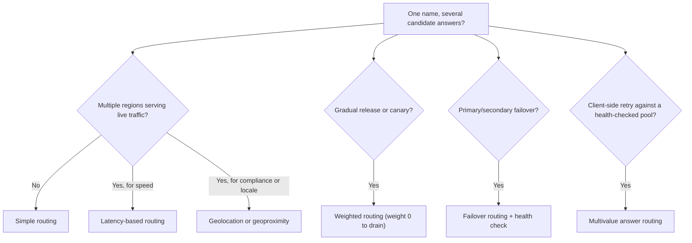
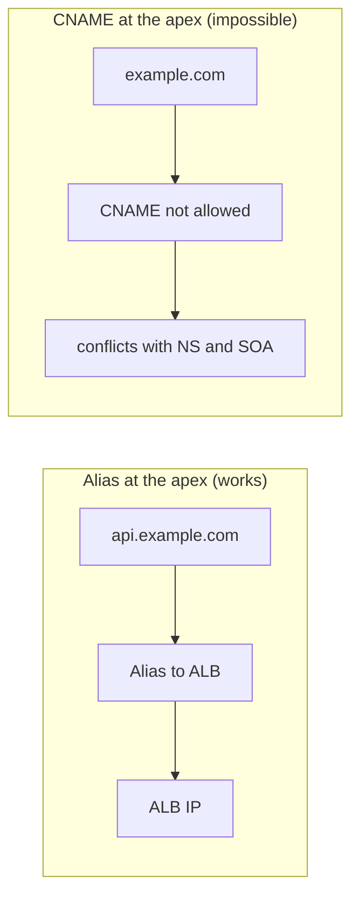
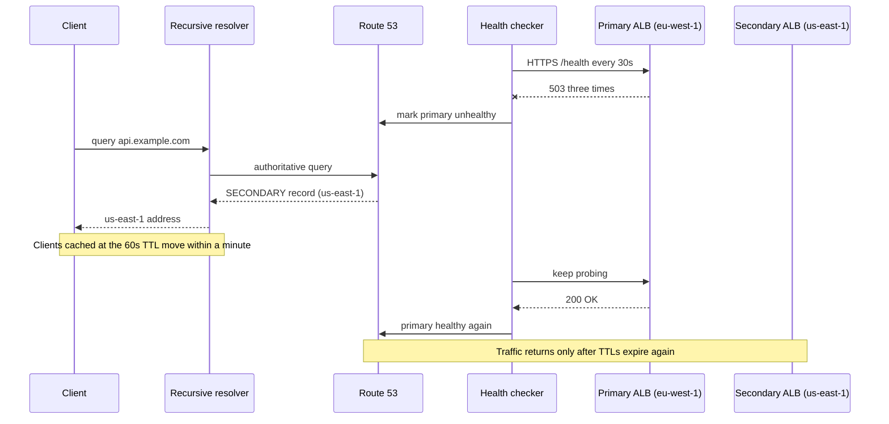
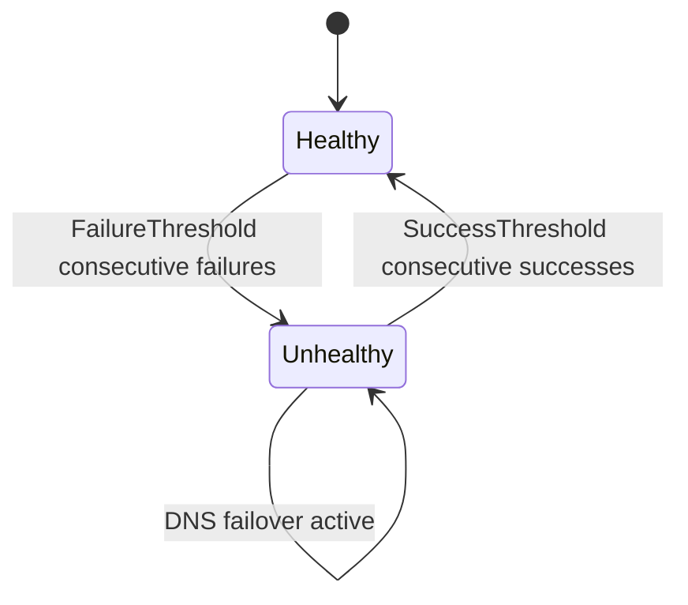

# 04 · Route 53

> **Phase 2 — Professional Architectures** · Lesson 04 of 08
> ⬅️ Previous: [Multi-Region VPC Design](./03-multi-region-vpc-design.md) · ➡️ Next: [CloudFront](./05-cloudfront.md) · 🏠 [Phase overview](./README.md)

## Learning Objectives

By the end of this lesson you will be able to:

- Create public and private hosted zones and delegate a domain to them
- Choose correctly between a CNAME and an alias record, and explain why the zone apex needs an alias
- Configure all seven routing policies and know what each one is for
- Wire health checks into failover routing and predict how fast clients move
- Enable DNSSEC signing for a public hosted zone and verify the chain of trust

**Estimated time:** 70 min · **Difficulty:** Intermediate

---

## Core Concepts

Amazon Route 53 is two products in one: a **domain registrar** and a **highly available authoritative DNS service** with 100% availability SLA. It answers DNS queries from a globally distributed set of name servers, and it doubles as a health-checking and traffic-routing engine. That second role is why it appears in almost every HA and DR design — DNS is the one control plane every client on earth respects.

A **public hosted zone** holds the records for a domain that is reachable from the internet. A **private hosted zone** is associated with one or more VPCs and answers only inside them, which is how you give internal services names like `db.internal.example.com` without exposing anything. When you register a domain (or bring one from another registrar), you delegate to Route 53 by pointing the registrar's NS records at the four name servers Route 53 assigns to your zone.

Route 53 supports the standard record types — `A`, `AAAA`, `CNAME`, `MX`, `TXT`, `NS`, `SOA`, `SRV`, `CAA`, `PTR`, `NAPTR`, `DS` — plus one non-standard creation of its own: the **alias record**. An alias is not a real DNS record type; it is a `CNAME`-like construct that resolves at query time to an AWS resource (ALB, CloudFront, S3 website, API Gateway, another Route 53 record). Aliases matter for three reasons: they can be created at the **zone apex** (`example.com`, where a CNAME is illegal), they are **free to query** when the target is an AWS resource, and when combined with `EvaluateTargetHealth` they inherit the target's health state.

The most common design mistake in this lesson is a **CNAME at the apex**. DNS forbids it because a CNAME claims the entire name, which would collide with the required `NS` and `SOA` records. Use an alias instead.

The other half of Route 53 is **routing policy** — how a query is answered when more than one record can match:

- **Simple:** one record, one answer. Everything else is a variation on this.
- **Weighted:** split traffic by percentage. Used for canaries, blue/green, and gradual migrations. Weight `0` means *no traffic*, which makes it a kill switch.
- **Latency-based:** answer with the region that has the lowest measured latency for the requester. Used for multi-region active/active. It is about network latency, not geography.
- **Failover:** a `PRIMARY` record backed by a health check plus a `SECONDARY` record that takes over when the primary is unhealthy. This is the backbone of every DR runbook in Lesson 02.
- **Geolocation:** answer based on where the *resolver* is (continent, country, or US state). Used for data-residency, localization, and licensing.
- **Geoproximity:** answer based on distance between the user and your resources, with a **bias** to shift the boundary deliberately. Used to drain a region gradually.
- **Multivalue answer:** return up to eight healthy records at once so clients can retry others on failure. It looks like a poor man's load balancer, and it is not a substitute for one.

**Health checks** decide whether a failover happens. Route 53 can check an endpoint directly over HTTP/HTTPS/TCP, monitor a CloudWatch alarm, or combine other health checks with a threshold (a calculated health check). Checks are evaluated from multiple locations; a failure requires enough locations to agree, which is what makes them resistant to local network blips. Critically, **clients do not move instantly**: they move when their cached TTL expires, so a failover record with a 24-hour TTL means up to 24 hours of downtime for some users. Use short TTLs (60 seconds) on records involved in failover.

### Key terminology

| Term | Meaning |
|------|---------|
| **Hosted zone** | Container for records for one domain; public or private |
| **Delegation set** | The four name servers assigned to your zone |
| **Alias record** | Route 53 extension that points to an AWS resource, usable at the apex, free for AWS targets |
| **Zone apex** | The root of the domain (`example.com`), where CNAMEs are not allowed |
| **SetIdentifier** | Required field that distinguishes multiple records answering the same name and type |
| **EvaluateTargetHealth** | Makes an alias inherit the health of its target |
| **Health check** | Probe (or alarm monitor) that marks an endpoint healthy or unhealthy |
| **Calculated health check** | Parent check that aggregates child checks and is healthy above a threshold |
| **TTL** | How long resolvers may cache an answer; the real limiter on failover speed |
| **DNSSEC** | Cryptographic signing of DNS answers, chained to the parent zone |
| **Routing control** | Route 53 Application Recovery Controller construct for safe, auditable manual failover |

---

## Architecture Diagram

Choosing a routing policy:



An alias record resolves to a resource in one hop; a CNAME adds a lookup and cannot live at the apex:



What happens during a failover, including the TTL delay that everyone forgets:



Health-check state transitions:



---

## Hands-on Lab: Weighted Canary, Then a Health-Checked Failover

**Goal:** Register a zone, serve 90/10 traffic between two endpoints, then add failover with health checks and measure how long clients take to move.

**Prerequisites:** A registered domain, AWS CLI v2, two HTTP endpoints that return `200` on `/health` (an ALB in two regions, or two EC2 instances), and permissions for Route 53.

### Step 1 — Create the hosted zone and delegate

```bash
# Create the public hosted zone for your domain
aws route53 create-hosted-zone \
  --name example.com \
  --caller-reference "example-com-$(date +%s)" \
  --hosted-zone-config Comment="production zone"

# Read the four name servers you must set at your registrar
aws route53 get-hosted-zone --id Z0123456789ABCDEFGHIJ \
  --query 'DelegationSet.NameServers'
```

Set those four NS values at the registrar, then confirm delegation from the outside. Until propagation completes, everything else you do is invisible to the internet:

```bash
# Verify the authoritative answer matches what Route 53 told you
dig +short NS example.com
dig +short SOA example.com
```

### Step 2 — Point the zone apex at an Application Load Balancer with an alias

First fetch the ALB's canonical hosted zone ID — never guess this value:

```bash
# Canonical hosted zone ID for the load balancer (used as AliasTarget.HostedZoneId)
aws elbv2 describe-load-balancers --names app-alb \
  --query 'LoadBalancers[0].{DNS:DNSName,Zone:CanonicalHostedZoneId}'
```

```json
{
  "Comment": "Apex alias to the Application Load Balancer",
  "Changes": [
    {
      "Action": "UPSERT",
      "ResourceRecordSet": {
        "Name": "example.com",
        "Type": "A",
        "AliasTarget": {
          "HostedZoneId": "<alb-canonical-hosted-zone-id>",
          "DNSName": "dualstack.app-alb-1234567890.eu-west-1.elb.amazonaws.com",
          "EvaluateTargetHealth": true
        }
      }
    }
  ]
}
```

```bash
# Apply the change; CHANGE_ID is returned so you can wait for INSYNC
aws route53 change-resource-record-sets \
  --hosted-zone-id Z0123456789ABCDEFGHIJ \
  --change-batch file://apex-alias.json

# Block until Route 53 has propagated the change to all name servers
aws route53 wait resource-record-sets-changed --id C0123456789ABCDEF
```

### Step 3 — Add a 90/10 weighted canary

```bash
# Two records for the same name and type, distinguished by SetIdentifier and Weight
aws route53 change-resource-record-sets \
  --hosted-zone-id Z0123456789ABCDEFGHIJ \
  --change-batch file://weighted-canary.json
```

```json
{
  "Comment": "Weighted split: 90 percent stable, 10 percent canary",
  "Changes": [
    {
      "Action": "UPSERT",
      "ResourceRecordSet": {
        "Name": "api.example.com",
        "Type": "A",
        "SetIdentifier": "stable-eu-west-1",
        "Weight": 90,
        "AliasTarget": {
          "HostedZoneId": "<alb-canonical-hosted-zone-id>",
          "DNSName": "dualstack.app-alb-1234567890.eu-west-1.elb.amazonaws.com",
          "EvaluateTargetHealth": true
        }
      }
    },
    {
      "Action": "UPSERT",
      "ResourceRecordSet": {
        "Name": "api.example.com",
        "Type": "A",
        "SetIdentifier": "canary-us-east-1",
        "Weight": 10,
        "AliasTarget": {
          "HostedZoneId": "<alb2-canonical-hosted-zone-id>",
          "DNSName": "dualstack.canary-alb-0987654321.us-east-1.elb.amazonaws.com",
          "EvaluateTargetHealth": true
        }
      }
    }
  ]
}
```

To drain the canary instantly, set its `Weight` to `0` — a weight of zero means *no traffic*, not "a small share". This is the fastest rollback available to you.

### Step 4 — Create health checks and a failover pair

```bash
# Primary health check: HTTPS, 30s interval, three strikes
aws route53 create-health-check \
  --caller-reference "api-primary-$(date +%s)" \
  --health-check-config '{
    "Type": "HTTPS",
    "FullyQualifiedDomainName": "primary-alb-1234567890.eu-west-1.elb.amazonaws.com",
    "ResourcePath": "/health",
    "Port": 443,
    "RequestInterval": 30,
    "FailureThreshold": 3,
    "EnableSNI": true
  }'

# A calculated health check: healthy while at least two of three child checks pass
aws route53 create-health-check \
  --caller-reference "api-calculated-$(date +%s)" \
  --health-check-config '{
    "Type": "CALCULATED",
    "HealthThreshold": 2,
    "ChildHealthChecks": ["hc-primary-111", "hc-primary-222", "hc-primary-333"]
  }'
```

```bash
# Failover records: PRIMARY carries the health check, SECONDARY normally carries none
aws route53 change-resource-record-sets \
  --hosted-zone-id Z0123456789ABCDEFGHIJ \
  --change-batch file://failover-pair.json
```

```json
{
  "Comment": "Failover pair built from aliases: no TTL field is allowed",
  "Changes": [
    {
      "Action": "UPSERT",
      "ResourceRecordSet": {
        "Name": "app.example.com",
        "Type": "A",
        "SetIdentifier": "primary-eu-west-1",
        "Failover": "PRIMARY",
        "HealthCheckId": "11111111-2222-3333-4444-555555555555",
        "AliasTarget": {
          "HostedZoneId": "<alb-canonical-hosted-zone-id>",
          "DNSName": "dualstack.primary-alb-1234567890.eu-west-1.elb.amazonaws.com",
          "EvaluateTargetHealth": true
        }
      }
    },
    {
      "Action": "UPSERT",
      "ResourceRecordSet": {
        "Name": "app.example.com",
        "Type": "A",
        "SetIdentifier": "secondary-us-east-1",
        "Failover": "SECONDARY",
        "AliasTarget": {
          "HostedZoneId": "<alb2-canonical-hosted-zone-id>",
          "DNSName": "dualstack.secondary-alb-0987654321.us-east-1.elb.amazonaws.com",
          "EvaluateTargetHealth": true
        }
      }
    }
  ]
}
```

Note the missing `TTL` field: alias records do not accept one — Route 53 manages the TTL for aliases to AWS resources, and it is short, which is exactly what failover wants. If you need an explicit TTL you control, use a standard record type (for example a `CNAME` pointing at the load balancer's DNS name) and set `"TTL": 60`.

### Step 5 — Verify failover end to end

```bash
# Confirm both checks are healthy before you break anything
aws route53 get-health-check-status \
  --health-check-id 11111111-2222-3333-4444-555555555555 \
  --query 'HealthCheckObservations[].StatusReport.Status'

# Break the primary (stop its instance, or block the /health path) and poll the answer
while true; do dig +short app.example.com @ns-1234.awsdns-56.org; sleep 10; done
```

Expect: health check flips after about 90 seconds (3 × 30s), Route 53 starts answering with the secondary, and clients follow within one TTL (60 seconds). Total observed failover in a well-built setup is typically 2–3 minutes.

### Step 6 — Enable DNSSEC signing

```bash
# Turn on DNSSEC for the zone (requires a KMS key with the ECDSA_P256_SHA_256 spec in us-east-1)
aws route53 enable-hosted-zone-dnssec --hosted-zone-id Z0123456789ABCDEFGHIJ

# Create the key-signing key backed by that KMS key
aws route53 create-key-signing-key \
  --hosted-zone-id Z0123456789ABCDEFGHIJ \
  --key-management-service-arn arn:aws:kms:us-east-1:123456789012:key/1a2b3c4d-1111-2222-3333-444455556666 \
  --name "app-example-com-ksk" \
  --caller-reference "ksk-$(date +%s)"

# Show the DS record you must give your registrar to complete the chain of trust
aws route53 get-dnssec --hosted-zone-id Z0123456789ABCDEFGHIJ \
  --query 'KeySigningKeys[].{Name:Name,Status:Status}'
```

DNSSEC is only effective when the parent zone publishes the `DS` record. If you registered through Route 53, that happens automatically; with an external registrar you must upload the DS record there.

---

## CLI Reference

```bash
# All hosted zones with their private/public flag
aws route53 list-hosted-zones \
  --query 'HostedZones[].{Id:Id,Name:Name,Private:Config.PrivateZone}'

# Every record in a zone, including SetIdentifier for policy records
aws route53 list-resource-record-sets \
  --hosted-zone-id Z0123456789ABCDEFGHIJ \
  --query 'ResourceRecordSets[].{Name:Name,Type:Type,Policy:SetIdentifier}'

# Latency, geolocation, geoproximity, and multivalue records in one batch
aws route53 change-resource-record-sets \
  --hosted-zone-id Z0123456789ABCDEFGHIJ \
  --change-batch file://routing-policies.json
```

```json
{
  "Changes": [
    { "Action": "UPSERT", "ResourceRecordSet": { "Name": "latency.example.com", "Type": "A", "SetIdentifier": "eu-west-1", "Region": "eu-west-1", "AliasTarget": { "HostedZoneId": "<alb-canonical-hosted-zone-id>", "DNSName": "dualstack.eu-alb-1234567890.eu-west-1.elb.amazonaws.com", "EvaluateTargetHealth": true } } },
    { "Action": "UPSERT", "ResourceRecordSet": { "Name": "geo.example.com", "Type": "A", "SetIdentifier": "eu", "GeoLocation": { "ContinentCode": "EU" }, "AliasTarget": { "HostedZoneId": "<alb-canonical-hosted-zone-id>", "DNSName": "dualstack.eu-alb-1234567890.eu-west-1.elb.amazonaws.com", "EvaluateTargetHealth": true } } },
    { "Action": "UPSERT", "ResourceRecordSet": { "Name": "geo.example.com", "Type": "A", "SetIdentifier": "default", "GeoLocation": { "CountryCode": "*" }, "AliasTarget": { "HostedZoneId": "<alb2-canonical-hosted-zone-id>", "DNSName": "dualstack.us-alb-0987654321.us-east-1.elb.amazonaws.com", "EvaluateTargetHealth": true } } },
    { "Action": "UPSERT", "ResourceRecordSet": { "Name": "proximity.example.com", "Type": "A", "SetIdentifier": "eu-bias-30", "GeoProximityLocation": { "AWSRegion": "eu-west-1", "Bias": 30 }, "AliasTarget": { "HostedZoneId": "<alb-canonical-hosted-zone-id>", "DNSName": "dualstack.eu-alb-1234567890.eu-west-1.elb.amazonaws.com", "EvaluateTargetHealth": true } } },
    { "Action": "UPSERT", "ResourceRecordSet": { "Name": "pool.example.com", "Type": "A", "SetIdentifier": "pool-a", "TTL": 60, "HealthCheckId": "11111111-2222-3333-4444-555555555555", "ResourceRecords": [ { "Value": "198.51.100.10" } ] } },
    { "Action": "UPSERT", "ResourceRecordSet": { "Name": "pool.example.com", "Type": "A", "SetIdentifier": "pool-b", "TTL": 60, "HealthCheckId": "66666666-7777-8888-9999-000000000000", "ResourceRecords": [ { "Value": "198.51.100.11" } ] } }
  ]
}
```

Read the fragment as a map of policies: `Region` selects latency-based routing; `GeoLocation` with `ContinentCode` or `CountryCode` selects geolocation, and `CountryCode: "*"` is the required default catch-all; `GeoProximityLocation` with `AWSRegion` plus `Bias` selects geoproximity, where a positive bias pulls more traffic toward that resource; and the two plain `A` records at `pool.example.com` are a multivalue answer set, each with its own TTL and health check, returning up to eight healthy addresses.

```bash
# Private hosted zone for internal names
aws route53 create-hosted-zone \
  --name internal.example.com \
  --caller-reference "internal-$(date +%s)" \
  --vpc VPCRegion=eu-west-1,VPCId=vpc-0abc123def456

# Associate the private zone with a VPC in another region
aws route53 associate-vpc-with-hosted-zone \
  --hosted-zone-id Z0987654321ZYXWVUT \
  --vpc VPCRegion=us-east-1,VPCId=vpc-0def456abc123

# Check that a CloudWatch alarm based health check is healthy
aws route53 get-health-check-status --health-check-id 66666666-7777-8888-9999-000000000000

# List and query the health checks you own
aws route53 list-health-checks --query 'HealthChecks[].{Id:Id,Type:Config.Type,Target:Config.FullyQualifiedDomainName}'

# Manual, auditable failover with Application Recovery Controller routing controls
aws route53-recovery-cluster update-routing-control-state \
  --routing-control-arn arn:aws:route53-recovery-control::123456789012:controlpanel/abcdef123456/routingcontrol/11111111-2222-3333-4444-555555555555 \
  --routing-control-state Off

# Registrar hygiene: lock the domain so it cannot be transferred away silently
aws route53domains enable-domain-transfer-lock --domain-name example.com
```

| Command | Purpose |
|---------|---------|
| `create-hosted-zone` | Creates the public or private zone that holds your records |
| `get-hosted-zone` | Returns the delegation set (name servers) you must publish |
| `change-resource-record-sets` | The single command for create/update/delete on **record sets** |
| `get-health-check-status` | Current per-location health check observations |
| `enable-hosted-zone-dnssec` | Starts DNSSEC signing for a public zone |
| `associate-vpc-with-hosted-zone` | Makes a private zone resolvable from an extra VPC |

---

## Best Practices

| Practice | Why it matters |
|----------|----------------|
| Use **alias records** for AWS resources, including the apex | No CNAME at the apex, no query charge for AWS targets, health-aware |
| Set the TTL to 60 seconds on the records involved in failover | TTL, not the health-check interval, sets how fast cached clients actually move |
| Add a `TTL` field only to **non-alias** records | Alias records reject `TTL`; Route 53 manages it for AWS resource targets |
| Check **`/health`** on a lightweight endpoint, not `/` | A redirect or login page makes targets look permanently unhealthy |
| Pair `Failover: SECONDARY` with a health check only when the DR site also needs monitoring | A second failing health check can leave you with *no* answer |
| Use **calculated health checks** for composite services | Avoids flapping on one component while the service is fine |
| Give every policy record a descriptive **SetIdentifier** | Makes `list-resource-record-sets` and audit logs readable |
| Keep private zones in a **central account** and share them | One source of truth for internal names |
| Turn on **query logging** for private zones | Captures the NXDOMAIN storms that DNS troubleshooting needs |
| Enable **DNSSEC** and registrar transfer locks for public zones | Prevents spoofing and domain hijacking |
| Use **routing controls** for planned failovers rather than editing records by hand | Auditable, reversible, and safe for two-person review |

---

## Common Pitfalls

| Pitfall | Symptom | Fix |
|---------|---------|-----|
| CNAME created at the zone apex | Record creation fails | Use an alias record |
| Only one of two weighted records created | 100% of traffic goes to a single endpoint | Always create both records with weights that total 100 |
| `Weight` set to `0` expecting proportional routing | Endpoint receives no traffic at all | Use a small positive weight for a real canary |
| `TTL` added to an alias record | `InvalidChangeBatch` error on update | Remove the `TTL` field, or use a standard record type when you need an explicit TTL |
| Long TTL on a failover record | Failover "does not work" for hours | Lower the TTL well before the event (TTL changes propagate on old TTL) |
| Failover record without `SetIdentifier` | API error, or records overwrite each other | Every policy record needs a unique SetIdentifier |
| Health check points at an endpoint requiring a Host header | Permanently unhealthy | Set the FQDN to the virtual host, or use a CloudWatch alarm check |
| Geoproximity expected to behave like latency routing | Traffic lands in surprising places | Understand bias: positive bias attracts traffic toward that resource |
| Delegation never updated at the registrar | Zone looks correct but the internet resolves nothing | Publish the NS records and verify with `dig NS` from an external resolver |
| DNSSEC enabled with a KMS key outside `us-east-1` | Signing cannot be enabled | Create the KMS key in `us-east-1` |

---

## Cost Considerations

Route 53 is inexpensive relative to what it protects, but the meters are unusual:

- **Hosted zones:** about **$0.50 per hosted zone per month** (first 25 zones), including private zones.
- **Queries:** roughly **$0.40 per million** standard queries; **latency-based** ~$0.60/million; **geolocation** ~$0.70/million; **geoproximity** ~$0.50/million plus a bias-based increment. Aliases that point to AWS resources are not charged as queries to *your* zone.
- **Health checks:** about **$0.50–$0.75 per check per month**, with a surcharge for the fast (10-second) request interval and for HTTPS with SNI options. Calculated health checks are billed on their child checks. Fifty endpoints with per-endpoint checks plus calculated parents is real money — around **$40–$80/month** — and is a frequent discovery in cost reviews.
- **Domain registration:** typically **$12–$40 per year** depending on TLD, plus ICANN fees.
- **Resolver endpoints** (Lesson 03) are billed separately per ENI per hour plus per query.
- **What drives the bill:** the number of hosted zones (clean up abandoned ones), query volume for non-alias records, and especially the **number of health checks**. Health checks for decommissioned endpoints are pure waste and appear in every audit — use `list-health-checks` to find them.

---

## Security Considerations

- **Protect the registrar account above all.** Domain hijacking bypasses every other security control you own. Enable **transfer lock**, registrar-level MFA, and ideally a dedicated AWS account for DNS with no other workloads.
- **Restrict who can change records.** `route53:ChangeResourceRecordSets` is a high-privilege permission: a single API call can redirect production traffic to an attacker's endpoint. Use IAM conditions on the hosted zone ARN, require MFA, and alert on changes to apex and `www` records.
- **Enable DNSSEC** for public zones so resolvers can cryptographically verify answers, and publish the `DS` record at the registrar to complete the chain.
- **Use private hosted zones for internal names** instead of leaking internal topology into public DNS or relying on split-horizon tricks you have not documented.
- **Turn on Resolver query logging** (public and private) into a central, access-controlled log bucket for incident forensics and data-exfiltration detection via DNS tunneling.
- **Consider DNS Firewall** in front of outbound resolver traffic to block known malicious domains, and alert on unusually high query rates from a single instance (tunneling signature).
- **Watch for subdomain takeover**: an alias or CNAME pointing at a deleted S3 bucket, CloudFront distribution, or load balancer lets an attacker claim that hostname. Audit dangling targets regularly.
- **Keep the delegation set stable**; changing name servers is a high-risk operation that should be change-managed and monitored like a production deployment.

---

## Exercise

Design and implement DNS for a two-region application with these requirements: European users must be served from `eu-west-1` for compliance reasons; all other users get the lowest-latency region; a canary release must receive exactly 5% of traffic in `eu-west-1`; and the whole platform must fail over to `us-east-1` if `eu-west-1` becomes unhealthy.

Document the record set for each requirement (name, type, policy, SetIdentifier, TTL, health check) and the interaction between geolocation and failover where two policies must be layered by using different names (for example `api.example.com` vs `eu.api.example.com`).

Success looks like: a query from an EU resolver goes to the EU endpoint at 95/5 weights, a query from outside the EU goes to the lowest-latency healthy region, and stopping the EU endpoint moves EU traffic to `us-east-1` within three minutes.

---

## Resources

- [Amazon Route 53 Developer Guide](https://docs.aws.amazon.com/Route53/latest/DeveloperGuide/Welcome.html)
- [Choosing a routing policy](https://docs.aws.amazon.com/Route53/latest/DeveloperGuide/routing-policy.html)
- [Route 53 health checks and DNS failover](https://docs.aws.amazon.com/Route53/latest/DeveloperGuide/dns-failover.html)
- [Alias records vs CNAME records](https://docs.aws.amazon.com/Route53/latest/DeveloperGuide/resource-record-sets-choosing-alias-non-alias.html)
- [Configuring DNSSEC signing](https://docs.aws.amazon.com/Route53/latest/DeveloperGuide/dns-configuring-dnssec.html)
- [Route 53 Application Recovery Controller](https://docs.aws.amazon.com/r53recovery/latest/dg/what-is-route53-recovery.html)

---

## Next Steps

DNS gets users to your front door, but it does not make the trip faster or cheaper once they are there. The next lesson puts a caching layer in front of that door: CloudFront, cache behaviors, invalidation, signed URLs, and Origin Access Control.

> ⬅️ Previous: [Multi-Region VPC Design](./03-multi-region-vpc-design.md) · ➡️ Next: [CloudFront](./05-cloudfront.md) · 🏠 [Phase overview](./README.md)
