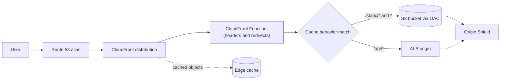
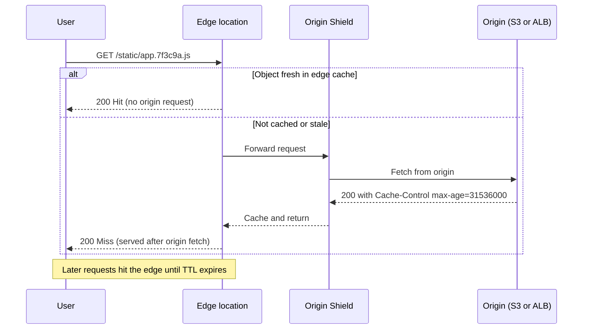
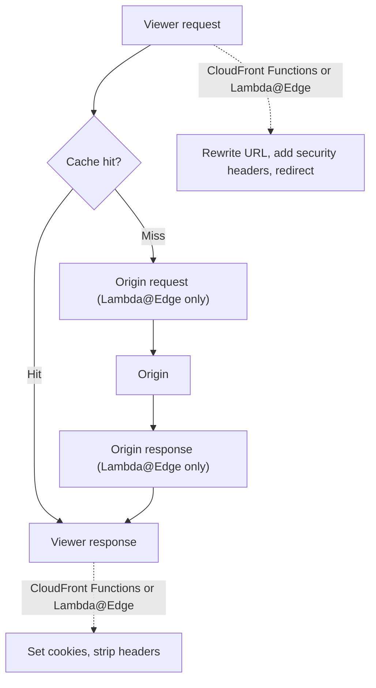

# 05 · CloudFront

> **Phase 2 — Professional Architectures** · Lesson 05 of 08
> ⬅️ Previous: [Route 53](./04-route-53.md) · ➡️ Next: [Global Accelerator](./06-global-accelerator.md) · 🏠 [Phase overview](./README.md)

## Learning Objectives

By the end of this lesson you will be able to:

- Build a CloudFront distribution with multiple origins and cache behaviors
- Choose cache TTLs deliberately, using cache policies instead of legacy forwarded values
- Invalidate content correctly and know when invalidation is the wrong answer
- Serve private content with signed URLs and signed cookies using key groups
- Secure an S3 origin with Origin Access Control (OAC) instead of the legacy OAI
- Add security headers and redirects with CloudFront Functions or Lambda@Edge

**Estimated time:** 75 min · **Difficulty:** Intermediate

---

## Core Concepts

Amazon CloudFront is a global content delivery network with **600+ points of presence**. When a user requests a URL served by CloudFront, their request lands at the nearest edge location; if that edge has a fresh cached copy, the response never leaves the edge. If it does not, CloudFront fetches from the **origin** over AWS's backbone, caches the object, and serves it. CloudFront terminates TLS with your ACM certificate, so users never see the origin.

A **distribution** is the configuration object. It contains one or more **origins** (an S3 bucket, an ALB, an API Gateway endpoint, a MediaStore container, or any custom HTTP server) and a set of **cache behaviors** that map URL path patterns to origins and caching rules. Order matters: CloudFront evaluates behaviors from most specific to least specific, and the default behavior (`*`) catches everything else. A typical design uses `/api/*` routed to an ALB with caching disabled and all query strings forwarded, `/static/*` routed to S3 with a long TTL, and `*` routed to S3 for the SPA.

**Caching is controlled by TTLs and the cache key.** The cache key determines what counts as "the same object": by default it is the path only. Forwarding query strings, headers, or cookies multiplies cache entries (lowering hit rate) and leaks more variation into the origin. In modern CloudFront you express this with **cache policies** (`MinTTL`, `DefaultTTL`, `MaxTTL`, plus what goes into the cache key) and **origin request policies** (what is sent to the origin but not counted in the cache key). The TTL actually applied is:

1. `MinTTL` wins if the origin's `Cache-Control`/`Expires` says less.
2. The origin's own `Cache-Control: max-age` applies when it falls between `MinTTL` and `MaxTTL`.
3. `DefaultTTL` applies when the origin sends no caching headers at all.
4. `MaxTTL` caps everything.

Because the origin's headers participate, a well-behaved origin is as important as the distribution config. Split caching is the norm: `s-maxage` for shared caches such as CloudFront, `max-age` for browsers.

**Invalidation** is explicit eviction of paths (`/index.html`, `/images/*`). It is billed after the first 1,000 paths each month and takes a few minutes to propagate, and it is a symptom of a versioning gap: if you deploy immutable, content-hashed filenames (`app.7f3c9a.js`), you rarely need to invalidate anything, because a new deploy produces new URLs.

**Private content** is protected either by **signed URLs** (one URL, ideal for a single file or when the client cannot set cookies) or **signed cookies** (a whole directory or streaming manifest, ideal for many files). Both rely on a CloudFront **key group** containing a public key whose private half your application uses to sign. Also useful: **trusted key groups** on the behavior, **field-level encryption** for sensitive form fields, and **geo restriction** when licensing demands it.

**Origin Access Control (OAC)** has replaced the legacy **Origin Access Identity (OAI)** for S3 and other origins. OAC signs origin requests with SigV4 (`SigningBehavior: always`) and supports SSE-KMS-encrypted objects, all regions, and newer features that OAI cannot reach; OAI is legacy and cannot be used with SSE-KMS. With OAC, the bucket policy allows `cloudfront.amazonaws.com` only when `AWS:SourceArn` matches your distribution ARN, and the distribution references the OAC by ID. Block Public Access stays on.

**Edge compute** comes in two flavors. **CloudFront Functions** run in under a millisecond at very low cost and are limited to viewer request/response events with a restricted JavaScript runtime — perfect for header normalization, security headers, URL rewrites, and simple redirects. **Lambda@Edge** runs full Node.js/Python at origin request/response events, can make network calls, and is the choice for image resizing, A/B logic requiring data, or complex origin selection. Rule of thumb: if it can be done with string manipulation, use CloudFront Functions; if it needs the network or heavy libraries, use Lambda@Edge.

### Key terminology

| Term | Meaning |
|------|---------|
| **Distribution** | The CloudFront configuration: origins, behaviors, certificate, price class |
| **Origin** | Where CloudFront fetches uncached content (S3, ALB, custom HTTP, media services) |
| **Cache behavior** | Path-pattern rule mapping requests to an origin plus cache and origin policies |
| **Cache policy** | TTLs plus the cache key (query strings, headers, cookies) |
| **Origin request policy** | What CloudFront sends to the origin without making it part of the cache key |
| **TTL** | Time to live for a cached object; the core cost/performance dial |
| **Invalidation** | Explicit removal of cached objects by path |
| **OAC / OAI** | Origin Access Control (current, SigV4) vs Origin Access Identity (legacy) |
| **Signed URL / cookie** | Time-limited access grants for private content |
| **Key group** | Named set of CloudFront public keys used to verify signed URLs and cookies |
| **Price class** | Which edge locations serve your content; directly controls cost |
| **Origin Shield** | An extra caching layer in front of the origin that reduces origin load |

---

## Architecture Diagram

A distribution with two origins, three behaviors, and an edge function in front:



Cache hit, cache miss, and the TTL that decides which happens:



Where edge functions can intervene in a request lifecycle:



---

## Hands-on Lab: S3 Origin Behind OAC with Security Headers

**Goal:** Serve a private S3 bucket through CloudFront using OAC, add strict security headers at the edge, and prove that the bucket is unreachable directly.

**Prerequisites:** AWS CLI v2, an S3 bucket with Block Public Access enabled, an ACM certificate in `us-east-1` for your domain, and a Route 53 hosted zone.

### Step 1 — Create the origin access control

```bash
# OAC signs origin requests with SigV4; "always" means no unsigned fallback
aws cloudfront create-origin-access-control \
  --origin-access-control-config '{
    "Name": "assets-bucket-oac",
    "Description": "SigV4 access to the assets bucket",
    "SigningProtocol": "sigv4",
    "SigningBehavior": "always",
    "OriginAccessControlOriginType": "s3"
  }'
```

### Step 2 — Create the distribution

```json
{
  "CallerReference": "assets-dist-2026-10-14",
  "Comment": "Static assets with an S3 origin behind OAC",
  "Enabled": true,
  "Aliases": { "Quantity": 1, "Items": ["www.example.com"] },
  "DefaultRootObject": "index.html",
  "Origins": {
    "Quantity": 1,
    "Items": [
      {
        "Id": "s3-assets",
        "DomainName": "assets-bucket.s3.eu-west-1.amazonaws.com",
        "OriginPath": "",
        "S3OriginConfig": { "OriginAccessIdentity": "" },
        "OriginAccessControlId": "E2QWRUHAPOMQZL",
        "CustomHeaders": { "Quantity": 0 },
        "ConnectionAttempts": 3,
        "ConnectionTimeout": 10
      }
    ]
  },
  "DefaultCacheBehavior": {
    "TargetOriginId": "s3-assets",
    "ViewerProtocolPolicy": "redirect-to-https",
    "AllowedMethods": {
      "Quantity": 2,
      "Items": ["GET", "HEAD"],
      "CachedMethods": { "Quantity": 2, "Items": ["GET", "HEAD"] }
    },
    "CachePolicyId": "658327ea-f89d-4fab-a63d-7e88639e58f6",
    "Compress": true
  },
  "PriceClass": "PriceClass_100",
  "HttpVersion": "http2and3",
  "IsIPV6Enabled": true,
  "Restrictions": { "GeoRestriction": { "RestrictionType": "none", "Quantity": 0 } },
  "ViewerCertificate": {
    "ACMCertificateArn": "arn:aws:acm:us-east-1:123456789012:certificate/8f2c1e40-2222-3333-4444-555566667777",
    "SSLSupportMethod": "sni-only",
    "MinimumProtocolVersion": "TLSv1.2_2021"
  }
}
```

```bash
# Create the distribution; note the S3 origin carries no OriginAccessIdentity value
aws cloudfront create-distribution --distribution-config file://distribution.json

# Capture the distribution ID and the ARN you will put in the bucket policy
aws cloudfront list-distributions \
  --query 'DistributionList.Items[].{Id:Id,Domain:DomainName,Status:Status}'
```

Note what is *absent* from the default behavior: no `MinTTL`, `DefaultTTL`, `MaxTTL`, and no `ForwardedValues`. When you use a cache policy, those fields are supplied by the policy instead, and mixing the two is an API error.

### Step 3 — Lock the bucket to CloudFront only

```json
{
  "Version": "2012-10-17",
  "Statement": [
    {
      "Sid": "AllowCloudFrontServicePrincipalReadOnly",
      "Effect": "Allow",
      "Principal": { "Service": "cloudfront.amazonaws.com" },
      "Action": "s3:GetObject",
      "Resource": "arn:aws:s3:::assets-bucket/*",
      "Condition": {
        "StringEquals": {
          "AWS:SourceArn": "arn:aws:cloudfront::123456789012:distribution/E2QWRUHAPOMQZL"
        }
      }
    }
  ]
}
```

```bash
# Apply the bucket policy and keep Block Public Access enabled
aws s3api put-bucket-policy --bucket assets-bucket --policy file://bucket-policy.json

aws s3api put-public-access-block --bucket assets-bucket \
  --public-access-block-configuration BlockPublicAcls=true,IgnorePublicAcls=true,BlockPublicPolicy=false,RestrictPublicBuckets=true
```

The `AWS:SourceArn` condition is the part that matters: without it, *any* CloudFront distribution in any account that knows your bucket name could read it.

### Step 4 — Create a cache policy and a security-headers function

```json
{
  "Name": "StaticAssetsLongCache",
  "Comment": "One year TTL for content-hashed assets",
  "MinTTL": 0,
  "DefaultTTL": 86400,
  "MaxTTL": 31536000,
  "ParametersInCacheKeyAndForwardedToOrigin": {
    "EnableAcceptEncodingGzip": true,
    "EnableAcceptEncodingBrotli": true,
    "HeadersConfig": { "HeaderBehavior": "none" },
    "CookiesConfig": { "CookieBehavior": "none" },
    "QueryStringsConfig": { "QueryStringBehavior": "none" }
  }
}
```

```bash
# Cache policy: nothing in the cache key, so one entry per path
aws cloudfront create-cache-policy --cache-policy-config file://cache-policy.json

# Minimal viewer-response function: add security headers to every response
aws cloudfront create-function \
  --name add-security-headers \
  --function-config '{"Comment":"Adds security headers","Runtime":"cloudfront-js-2.0"}' \
  --function-code fileb://security-headers.js
```

```javascript
// CloudFront Function (viewer response): enforce modern browser protections
function handler(event) {
  var response = event.response;
  var headers = response.headers;
  headers['strict-transport-security'] = { value: 'max-age=63072000; includeSubDomains; preload' };
  headers['x-content-type-options'] = { value: 'nosniff' };
  headers['x-frame-options'] = { value: 'DENY' };
  headers['referrer-policy'] = { value: 'strict-origin-when-cross-origin' };
  headers['content-security-policy'] = { value: "default-src 'self'; img-src 'self' data:; object-src 'none'" };
  return response;
}
```

```bash
# Publish (the ETag guard prevents concurrent overwrites) and attach it to a behavior
aws cloudfront publish-function --name add-security-headers --if-match ETVPDKIKX0DER

# Test in DEVELOPMENT stage before publishing to production traffic
aws cloudfront test-function \
  --name add-security-headers \
  --if-match ETVPDKIKX0DER \
  --stage DEVELOPMENT \
  --event-object fileb://test-event.json
```

Alternatively, if you do not need logic, use a managed **response headers policy** so AWS maintains the header set for you:

```bash
# Reusable response headers policy: HSTS, CSP, frame options in one managed object
aws cloudfront create-response-headers-policy \
  --response-headers-policy-config file://response-headers-policy.json
```

```json
{
  "Name": "SecuredDefaults",
  "Comment": "Managed-equivalent security headers for every response",
  "SecurityHeadersConfig": {
    "StrictTransportSecurity": {
      "Override": true,
      "AccessControlMaxAgeSec": 63072000,
      "IncludeSubdomains": true,
      "Preload": true
    },
    "ContentTypeOptions": { "Override": true },
    "FrameOptions": { "Override": true, "FrameOption": "DENY" },
    "ReferrerPolicy": {
      "Override": true,
      "ReferrerPolicy": "strict-origin-when-cross-origin"
    },
    "ContentSecurityPolicy": {
      "Override": true,
      "ContentSecurityPolicy": "default-src 'self'; img-src 'self' data:; object-src 'none'"
    }
  }
}
```

### Step 5 — Invalidate, then stop needing to

```bash
# Invalidate specific paths after a deploy (billed after the first 1000 paths per month)
aws cloudfront create-invalidation \
  --distribution-id E2QWRUHAPOMQZL \
  --paths "/index.html" "/config.json"

# Poll until the invalidation completes
aws cloudfront get-invalidation --distribution-id E2QWRUHAPOMQZL --id I2J0Y8EXAMPLE
```

If your build produces `app.7f3c9a.js` style filenames, deploy by uploading new filenames and only invalidate `index.html`. That is the difference between a two-path invalidation and a `/*` invalidation on every release.

### Step 6 — Verify

```bash
# Direct bucket access must fail (403) because the bucket is private
curl -s -o /dev/null -w "%{http_code}\n" https://assets-bucket.s3.eu-west-1.amazonaws.com/index.html

# CloudFront access must succeed
curl -sI https://www.example.com/ | grep -Ei "x-cache|strict-transport-security|content-security-policy"

# Confirm the object is cached at the edge
curl -sI https://www.example.com/index.html | grep -i x-cache
```

`x-cache: Hit from cloudfront` proves the edge is serving the object without touching the origin.

---

## CLI Reference

```bash
# Read the distribution config and its ETag (update requires --if-match with this ETag)
aws cloudfront get-distribution-config --id E2QWRUHAPOMQZL

# Update a distribution safely
aws cloudfront update-distribution \
  --id E2QWRUHAPOMQZL \
  --if-match E2QWRUHAPOMQZL_ETAG \
  --distribution-config file://distribution-updated.json

# Create a public key and key group for signed URLs and signed cookies
aws cloudfront create-public-key --public-key-config file://public-key.json
aws cloudfront create-key-group --key-group-config file://key-group.json

# Generate a signed URL valid until a fixed moment (uses the private key that matches the key group)
aws cloudfront sign \
  --url "https://d111111abcdef8.cloudfront.net/private/report.pdf" \
  --key-pair-id K2JCJMDEHXQW5F \
  --private-key file://pk-APKAJM22QV32RTIFSTY.pem \
  --date-less-than 2026-12-31

# Sign with a custom policy that also restricts the client IP address
aws cloudfront sign \
  --url "https://d111111abcdef8.cloudfront.net/private/report.pdf" \
  --key-pair-id K2JCJMDEHXQW5F \
  --private-key file://pk-APKAJM22QV32RTIFSTY.pem \
  --policy file://signed-url-policy.json

# Origin request policy: forward headers and cookies to the origin without caching on them
aws cloudfront create-origin-request-policy --origin-request-policy-config file://origin-request-policy.json

# Realtime logs to Kinesis (for security monitoring, not for billing reports)
aws cloudfront create-realtime-log-config \
  --name edge-security-logs \
  --sampling-rate 100 \
  --fields Timestamp c-ip sc-status cs-uri-stem x-edge-result-type \
  --end-points StreamType=Kinesis,KinesisStreamConfig={RoleArn=arn:aws:iam::123456789012:role/CloudFrontRealtimeLogRole,StreamArn=arn:aws:kinesis:eu-west-1:123456789012:stream/cf-edge-logs}

# List distributions with their aliases and status
aws cloudfront list-distributions \
  --query 'DistributionList.Items[].{Id:Id,Aliases:Aliases.Items,Enabled:Enabled,Status:Status}'
```

| Command | Purpose |
|---------|---------|
| `get-distribution-config` | Returns the config plus the ETag needed for any update |
| `create-origin-access-control` | Creates the SigV4 origin identity that replaces OAI |
| `create-cache-policy` | Defines TTLs and the cache key in one reusable object |
| `create-invalidation` | Evicts cached paths; expensive at scale, so prefer versioned filenames |
| `create-key-group` / `sign` | Publishes signing keys and mints time-limited URLs |
| `create-function` + `publish-function` | Deploys edge logic with an ETag concurrency guard |
| `create-realtime-log-config` | Streams edge request telemetry into Kinesis |

---

## Best Practices

| Practice | Why it matters |
|----------|----------------|
| Use **OAC, not OAI** | OAC supports SSE-KMS, SigV4, and is where new features land |
| Always add the **`AWS:SourceArn` condition** to the bucket policy | Prevents any other distribution from reading your bucket |
| Put **immutable, content-hashed filenames** in the cache key path | Makes invalidations unnecessary |
| Use **cache policies** rather than legacy `ForwardedValues` | TTLs and the cache key are versioned, auditable objects |
| Forward only what varies | Every forwarded header or cookie fragments the cache and lowers hit rate |
| Keep the **origin's `Cache-Control`** honest and consistent with `MinTTL`/`MaxTTL` | Prevents surprise cache durations in production |
| Enable **origin failover** with an origin group for critical origins | Turns a single-origin outage into a transparent failover |
| Attach a **WAF web ACL** at the distribution | Blocks common attacks before they reach the origin |
| Use the **cheapest price class that meets your SLA** | `PriceClass_100` covers North America and Europe only, and cuts cost materially |
| Test edge functions in **DEVELOPMENT** before publishing | Broken viewer-request code breaks every request on the distribution |

---

## Common Pitfalls

| Pitfall | Symptom | Fix |
|---------|---------|-----|
| Deploying new content but keeping the same filename | Users see stale pages | Versioned filenames, or invalidate the specific paths |
| `/*` invalidation on every release | Growing invalidation charges and slow deploys | Only invalidate entry points like `index.html` |
| Forwarding all headers or all cookies | Very low cache hit ratio, high origin load | Narrow the cache policy to the minimum that varies |
| No `MinTTL` floor when the origin sends `no-cache` | Nothing is ever cached | Set `MinTTL` to the minimum acceptable freshness |
| Distribution created without an ACM certificate in `us-east-1` | Certificate cannot be selected | Certificates for CloudFront viewer TLS must live in `us-east-1` |
| OAI used with SSE-KMS encrypted objects | 403 from the origin | Migrate to OAC and grant KMS permissions to the distribution |
| Signed URL generated with the wrong key | 403 for legitimate users | Verify the key group is attached to the behavior and the key pair ID matches |
| `AllowedMethods` missing `POST` on an API behavior | 405 Method Not Allowed from the edge | Add the methods, and stop caching them |
| CloudFront Function referencing unsupported APIs | Function fails to publish | Keep to the restricted runtime or move to Lambda@Edge |

---

## Cost Considerations

CloudFront is usually a **cost saver** when it replaces directly served egress, but the meters matter:

- **Data transfer out** is billed per GB by price class and destination tier — roughly **$0.085/GB** for the first 10 TB/month in North America and Europe under `PriceClass_All`, with lower rates for `PriceClass_100`. Direct S3 or EC2 egress in the same regions costs about **$0.09/GB**, so caching also cuts origin data transfer.
- **Requests** are billed per 10,000 (HTTP) or 10,000 HTTPS requests, a few cents. **Free tier:** 1 TB out and 10 million requests per month, permanently.
- **Invalidations:** the first **1,000 paths per month are free**, then about **$0.005 per path**. A `/*` invalidation twice a day is roughly 60 paths/month — cheap. Invalidating thousands of individual paths is not.
- **CloudFront Functions:** about **$0.10 per 1 million invocations**, which is why header manipulation is essentially free at the edge. **Lambda@Edge:** about **$0.60 per 1 million requests** plus per-GB-second compute — roughly 6× the request cost, plus more latency.
- **Origin Shield** adds a per-request charge but can dramatically cut origin egress and load for multi-region origin fetching; it pays for itself on hot objects.
- **Field-level encryption, real-time logs, and dedicated IP custom SSL** each add monthly or per-request charges; SNI-only certificates are free.
- **What drives the bill:** bytes delivered × price class, request count, and how much the *origin* still serves as a result of caching too little. Raising hit ratio from 70% to 95% typically cuts origin cost and latency more than any other single change.

---

## Security Considerations

- **OAC plus a scoped bucket policy** is the modern default for S3 origins: no public bucket, SigV4 on every origin fetch, and `AWS:SourceArn` pinning the distribution.
- **Enforce HTTPS** with `ViewerProtocolPolicy: redirect-to-https` (or `https-only` for APIs) and a modern `MinimumProtocolVersion` such as `TLSv1.2_2021`.
- **Security headers belong at the edge.** HSTS, CSP, `X-Content-Type-Options: nosniff`, `X-Frame-Options`/`frame-ancestors`, and `Referrer-Policy` can be applied globally with one function or managed policy, instead of hoping every service remembers.
- **Never cache authenticated responses by accident.** Check that `Authorization` headers or session cookies are not in a cache policy for responsive-to-authenticated requests; use `Cache-Control: private, no-store` at the origin as a second line of defense.
- **Signed URLs and cookies** should be short-lived and scoped to the smallest path that works; put an explicit expiry and, when possible, an IP restriction in the policy.
- **Protect the signing private key** like a credential. Store it in Secrets Manager or KMS, rotate by publishing a new public key in a key group, and never ship it to clients.
- **Attach AWS WAF** (rate-based rules first) and consider **geo restriction** only where licensing or regulation requires it — it is not a security boundary against determined attackers.
- **Enable logging**: standard access logs to S3 for billing-adjacent forensics, and real-time logs to Kinesis for security monitoring and alerting on 4xx/5xx spikes.
- **Watch for dangling aliases.** A distribution or S3 origin deleted while DNS still points at it enables subdomain takeover; audit `list-distributions` against your DNS zones.

---

## Exercise

Take a static site plus a JSON API and put both behind one distribution:

1. `/static/*` and `*` served from S3 through OAC with a one-year TTL for hashed assets and a 60-second TTL for `index.html`.
2. `/api/*` routed to an ALB with caching disabled, `Authorization` and `Accept-Language` forwarded to the origin but not part of the cache key.
3. Security headers applied to *all* responses via a CloudFront Function.
4. A signed URL for `/private/report.pdf` that expires in 15 minutes.

Then measure the cache hit ratio from CloudFront's `CacheHitRate` metric after 100 requests to a repeated asset.

Success looks like: `curl -I` on a static file shows `x-cache: Hit from cloudfront`, the API behavior shows `x-cache: Miss` every time, and the signed URL returns 403 after its expiry while the unsigned URL is rejected immediately.

---

## Resources

- [Amazon CloudFront Developer Guide](https://docs.aws.amazon.com/AmazonCloudFront/latest/DeveloperGuide/Introduction.html)
- [Restricting access to an S3 origin with OAC](https://docs.aws.amazon.com/AmazonCloudFront/latest/DeveloperGuide/private-content-restricting-access-to-s3.html)
- [Serving private content with signed URLs and signed cookies](https://docs.aws.amazon.com/AmazonCloudFront/latest/DeveloperGuide/PrivateContent.html)
- [Customizing at the edge with CloudFront Functions](https://docs.aws.amazon.com/AmazonCloudFront/latest/DeveloperGuide/cloudfront-functions.html)
- [Cache policies and origin request policies](https://docs.aws.amazon.com/AmazonCloudFront/latest/DeveloperGuide/controlling-the-cache-key.html)
- [CloudFront pricing](https://aws.amazon.com/cloudfront/pricing/)

---

## Next Steps

CloudFront accelerates and caches HTTP content. The next lesson covers the other global traffic service — Global Accelerator — which does not cache anything at all but moves raw TCP and UDP onto AWS's backbone using anycast static IPs.

> ⬅️ Previous: [Route 53](./04-route-53.md) · ➡️ Next: [Global Accelerator](./06-global-accelerator.md) · 🏠 [Phase overview](./README.md)
