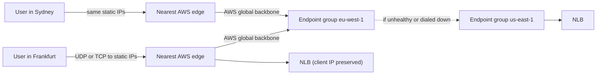
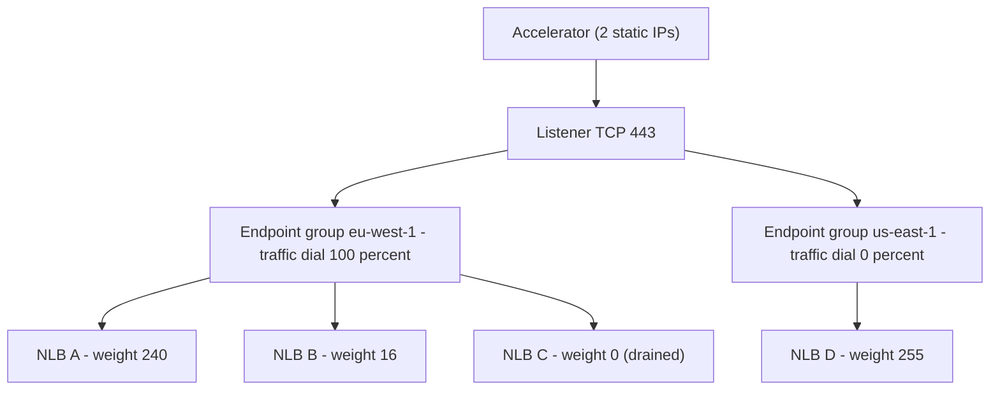
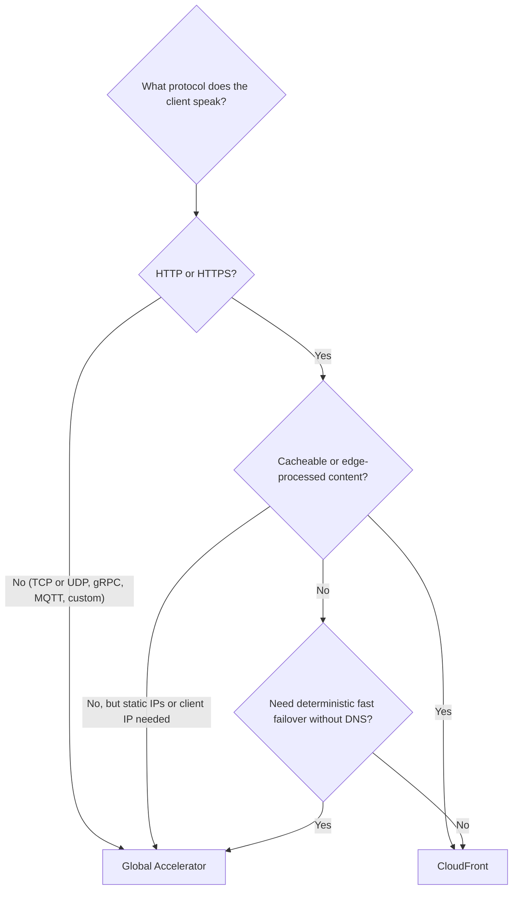

# 06 · Global Accelerator

> **Phase 2 — Professional Architectures** · Lesson 06 of 08
> ⬅️ Previous: [CloudFront](./05-cloudfront.md) · ➡️ Next: [Cost Optimization](./07-cost-optimization.md) · 🏠 [Phase overview](./README.md)

## Learning Objectives

By the end of this lesson you will be able to:

- Explain anycast and why Global Accelerator's static IPs behave consistently worldwide
- Build an accelerator with listeners, endpoint groups, and endpoints
- Shift traffic deliberately using traffic dials and endpoint weights
- Preserve client IP addresses and choose endpoint types that support it
- Decide between CloudFront and Global Accelerator for a given workload using a decision table
- Use BYOIP and custom routing when the workload demands your own addresses or many UDP ports

**Estimated time:** 60 min · **Difficulty:** Advanced

---

## Core Concepts

AWS Global Accelerator is a global, anycast network service. It gives you **two static IPv4 addresses** (four addresses if you enable dual-stack) that are announced from AWS edge locations worldwide. A user in Frankfurt and a user in Sydney connect to the *same* IP addresses, and the network's BGP routing delivers each of them to the nearest AWS edge. From there, traffic travels over the AWS global backbone to the endpoint in the region you chose. It does not cache, terminate TLS, or inspect content — it moves packets, fast and deterministically.

The distinction from CloudFront is fundamental. CloudFront is an HTTP(S) cache and edge compute platform: it must terminate TLS, it can only serve HTTP(S), and it changes what the client sees. Global Accelerator is a **layer-4 on-ramp**: it works with TCP and UDP, preserves the client's source IP to the endpoint, and never needs to understand the application protocol. If your client speaks gRPC over TLS, MQTT, RTSP, or a custom UDP protocol, Global Accelerator handles it and CloudFront cannot.

**Static IP addresses** are the feature enterprises notice first. A firewall allow-list that references two IPs never needs updating when you add a region, add endpoints, or fail over. That is simply impossible with DNS-based routing, where the answer set changes and clients may cache stale records.

**Endpoint groups** are the unit of regional placement. Each group lives in one region and contains endpoints — Network Load Balancers, Application Load Balancers, EC2 instances, or Elastic IP addresses. Each group has a **health check** configuration (protocol, port override, path, interval, threshold) and a **traffic dial** (0–100%) that scales all traffic to that group. Within a group, each endpoint has a **weight** (0–255) that splits the remaining traffic. The mental model: *traffic dial = how much traffic reaches this region; endpoint weight = how it is divided inside the region.*

The combination is how you do zero-drama migrations: dial the new region to 5%, watch it, raise to 50%, then 100%, and dial the old region to 0%. Because traffic dial changes propagate in seconds, this is the fastest safe regional cutover available.

**Fast failover** comes from health checking at the edge, not from DNS. Global Accelerator health-checks every endpoint and, when one fails, routes new TCP connections to the next healthy endpoint within about 30 seconds, and immediately for UDP traffic, without waiting for TTL expiry. Compared with a DNS failover, that is both faster and friendlier to clients that ignore TTLs.

**Client IP preservation** is available for Network Load Balancer, EC2 instance, and Elastic IP endpoints — but *not* for Application Load Balancer endpoints, because the ALB needs to terminate and re-originate connections. If your application authorizes or rate-limits by client IP, choose NLB endpoints.

Two advanced features round out the service. **BYOIP (Bring Your Own IP)** lets you advertise an existing `/24` from AWS so your addresses stay with you across the migration; the address range must be provisioned in `us-west-2`, then the accelerator uses it. **Custom routing** lets you map specific UDP/TCP port ranges directly to specific EC2 instances for deterministic, low-latency delivery — built for game servers and real-time media where every player must reach one specific server instance.

### Key terminology

| Term | Meaning |
|------|---------|
| **Anycast** | One IP address announced from many locations; BGP delivers users to the nearest |
| **Accelerator** | The Global Accelerator resource that owns the static IP addresses |
| **Listener** | A set of port ranges and a protocol the accelerator accepts |
| **Endpoint group** | Endpoints plus health checks plus a traffic dial, scoped to one region |
| **Traffic dial** | Percentage of traffic sent to an endpoint group (0–100) |
| **Endpoint weight** | Relative share within an endpoint group (0–255) |
| **Client affinity** | Optional stickiness so a client keeps the same endpoint (`SOURCE_IP`) |
| **Port override** | Health-check port that differs from the listener port |
| **Custom routing** | Deterministic mapping of port ranges to specific EC2 instances |
| **BYOIP** | Bringing your own public IPv4 range to AWS for use with the accelerator |
| **DT-Premium** | The per-GB data transfer premium that is the main cost of the service |

---

## Architecture Diagram

How a packet reaches an endpoint in the nearest healthy region:



Traffic dials drain a region; weights divide traffic inside the region that remains:



Choosing between CloudFront and Global Accelerator:



---

## Hands-on Lab: A Two-Region Accelerator with a Traffic Dial

**Goal:** Create an accelerator with one listener and two endpoint groups, then drain one region to zero and confirm clients follow the static IPs to the healthy region.

**Prerequisites:** Two Network Load Balancers in two regions (each with healthy targets), AWS CLI v2, and permissions for Global Accelerator.

### Step 1 — Create the accelerator and read its static IPs

```bash
# One accelerator per workload; IPV4 gives you two static IPv4 addresses
aws globalaccelerator create-accelerator \
  --name app-accelerator \
  --ip-address-type IPV4 \
  --enabled

# Note the two static IPs and the DNS name you will alias from Route 53
aws globalaccelerator list-accelerators \
  --query 'Accelerators[].{Name:Name,Ips:IpSets,Dns:DnsName,Status:Status}'
```

The DNS name (`a1b2c3d4e5f6g7h8.awsglobalaccelerator.com`) resolves to those same addresses everywhere, which is why the two IPs never change even when endpoints do.

### Step 2 — Add a listener

```bash
# Accept TCP 443 only; add another listener for UDP if the protocol needs it
aws globalaccelerator create-listener \
  --accelerator-arn arn:aws:globalaccelerator::123456789012:accelerator/1234abcd-abcd-1234-abcd-1234abcdefgh \
  --port-ranges FromPort=443,ToPort=443,Protocol=TCP
```

Each accelerator allows up to 10 listeners, and each listener up to 10 port ranges — a design that pushes you toward a small number of well-defined entry points rather than opening every port.

### Step 3 — Create endpoint groups in two regions

```bash
# Primary region at full traffic, health-checked on the NLB listener
aws globalaccelerator create-endpoint-group \
  --listener-arn arn:aws:globalaccelerator::123456789012:listener/1234abcd-abcd-1234-abcd-1234abcdefgh \
  --endpoint-group-region eu-west-1 \
  --traffic-dial-percentage 100 \
  --health-check-protocol TCP \
  --health-check-port 443 \
  --health-check-interval-seconds 30 \
  --threshold-count 3 \
  --endpoint-configurations '[{
    "EndpointId": "arn:aws:elasticloadbalancing:eu-west-1:123456789012:loadbalancer/net/app-nlb-eu/2f8d9cbb7d0d4f21",
    "Weight": 128,
    "ClientIPPreservationEnabled": true
  }]'

# Secondary region starts with no traffic but healthy endpoints
aws globalaccelerator create-endpoint-group \
  --listener-arn arn:aws:globalaccelerator::123456789012:listener/1234abcd-abcd-1234-abcd-1234abcdefgh \
  --endpoint-group-region us-east-1 \
  --traffic-dial-percentage 0 \
  --health-check-protocol TCP \
  --health-check-port 443 \
  --health-check-interval-seconds 30 \
  --threshold-count 3 \
  --endpoint-configurations '[{
    "EndpointId": "arn:aws:elasticloadbalancing:us-east-1:123456789012:loadbalancer/net/app-nlb-us/8c7b6a5d4e3f2a10",
    "Weight": 255,
    "ClientIPPreservationEnabled": true
  }]'
```

A traffic dial of `0` keeps the region *health-checked and warm* while serving no traffic. That is the difference between a two-minute failover and a two-hour restore: the failover path is already alive and verified.

### Step 4 — Shift traffic in increments

```bash
# Move 10 percent of traffic to the new region and hold it there for a soak period
aws globalaccelerator update-endpoint-group \
  --endpoint-group-arn arn:aws:globalaccelerator::123456789012:endpoint-group/abcdef12-1234-5678-90ab-cdef12345678 \
  --traffic-dial-percentage 10

# Complete the cutover
aws globalaccelerator update-endpoint-group \
  --endpoint-group-arn arn:aws:globalaccelerator::123456789012:endpoint-group/abcdef12-1234-5678-90ab-cdef12345678 \
  --traffic-dial-percentage 100
```

Traffic dial changes take effect within seconds. Watch 5xx rates and latency between steps; because a single dial controls the whole region, a bad step is one API call away from being reversed.

### Step 5 — Verify failover and client IP handling

```bash
# Confirm both endpoint groups are healthy before breaking anything
aws globalaccelerator describe-endpoint-group \
  --endpoint-group-arn arn:aws:globalaccelerator::123456789012:endpoint-group/abcdef12-1234-5678-90ab-cdef12345678 \
  --query 'EndpointGroup.EndpointDescriptions[].{Endpoint:EndpointId,Health:HealthState,Weight:Weight}'

# Speak to the accelerator's static IP directly — no DNS involved
curl -sI --resolve app.example.com:443:198.51.100.10 https://app.example.com/ | head -1
```

Then stop the targets behind the primary NLB and observe that health goes to `UNHEALTHY`, that new connections land in the secondary region within about 30 seconds, and that the *static IPs never change*. Finally, check the client IP the application sees — with an NLB endpoint and `ClientIPPreservationEnabled: true`, the original client address is preserved end to end.

### Step 6 — Turn on flow logs

```bash
# Edge flow logs land in S3 and answer "which edge did this client use?" questions
aws globalaccelerator update-accelerator-attributes \
  --accelerator-arn arn:aws:globalaccelerator::123456789012:accelerator/1234abcd-abcd-1234-abcd-1234abcdefgh \
  --flow-logs-enabled \
  --flow-logs-s3-bucket ga-flow-logs-123456789012 \
  --flow-logs-s3-prefix production/app-accelerator
```

---

## CLI Reference

```bash
# Add another endpoint to an existing group (for example a new AZ's NLB)
aws globalaccelerator add-endpoints \
  --endpoint-group-arn arn:aws:globalaccelerator::123456789012:endpoint-group/abcdef12-1234-5678-90ab-cdef12345678 \
  --endpoint-configurations EndpointId=arn:aws:elasticloadbalancing:eu-west-1:123456789012:loadbalancer/net/app-nlb-az-b/1111222233334444,Weight=64

# Remove an endpoint from service
aws globalaccelerator remove-endpoints \
  --endpoint-group-arn arn:aws:globalaccelerator::123456789012:endpoint-group/abcdef12-1234-5678-90ab-cdef12345678 \
  --endpoint-identifiers EndpointId=arn:aws:elasticloadbalancing:eu-west-1:123456789012:loadbalancer/net/app-nlb-az-b/1111222233334444

# List every accelerator you own with its IP sets
aws globalaccelerator list-accelerators --query 'Accelerators[].{Name:Name,Ips:IpSets,Enabled:Enabled}'

# Inspect the listener's port ranges and client affinity setting
aws globalaccelerator describe-listener \
  --listener-arn arn:aws:globalaccelerator::123456789012:listener/1234abcd-abcd-1234-abcd-1234abcdefgh

# Pin a client to one endpoint for the life of its flow (needed by some stateful protocols)
aws globalaccelerator update-listener \
  --listener-arn arn:aws:globalaccelerator::123456789012:listener/1234abcd-abcd-1234-abcd-1234abcdefgh \
  --client-affinity SOURCE_IP

# BYOIP: provision your own range (must be done in us-west-2), then advertise it
aws ec2 provision-byoip-cidr \
  --cidr 203.0.113.0/24 \
  --cidr-authorization-context Message="1|203.0.113.0/24|2026-10-14|ae1f2b3c4d5e6f70",Signature="BASE64SIGNATUREFROMYOURREGISTRY" \
  --region us-west-2

aws ec2 advertise-byoip-cidr --cidr 203.0.113.0/24 --region us-west-2

# Custom routing: deterministic port-to-instance mapping for UDP workloads
aws globalaccelerator create-custom-routing-accelerator \
  --name game-accelerator \
  --ip-address-type IPV4

aws globalaccelerator create-custom-routing-listener \
  --accelerator-arn arn:aws:globalaccelerator::123456789012:accelerator/2234abcd-abcd-1234-abcd-1234abcdefgh \
  --port-ranges FromPort=7000,ToPort=8000,Protocol=UDP

# Check state of the accelerator after a change
aws globalaccelerator get-accelerator-attributes \
  --accelerator-arn arn:aws:globalaccelerator::123456789012:accelerator/1234abcd-abcd-1234-abcd-1234abcdefgh
```

Alias your own domain to the accelerator so clients can use a friendly name over the static IPs:

```json
{
  "Comment": "Alias the branded hostname to the accelerator",
  "Changes": [
    {
      "Action": "UPSERT",
      "ResourceRecordSet": {
        "Name": "app.example.com",
        "Type": "A",
        "AliasTarget": {
          "HostedZoneId": "Z2BJ6XQ5FK7U4H",
          "DNSName": "a1b2c3d4e5f6g7h8.awsglobalaccelerator.com",
          "EvaluateTargetHealth": true
        }
      }
    }
  ]
}
```

| Command | Purpose |
|---------|---------|
| `create-accelerator` | Allocates the two static anycast IP addresses |
| `create-listener` | Defines the port ranges and protocol the accelerator accepts |
| `create-endpoint-group` | Adds a region with health checks and an initial traffic dial |
| `update-endpoint-group --traffic-dial-percentage` | Shifts traffic between regions in seconds |
| `update-listener --client-affinity SOURCE_IP` | Keeps a client on one endpoint |
| `update-accelerator-attributes --flow-logs-enabled` | Enables edge flow logs for forensics |
| `provision-byoip-cidr` | Brings your own range to AWS (in `us-west-2`) |

---

## Best Practices

| Practice | Why it matters |
|----------|----------------|
| Use **NLB or EC2 endpoints** when you need the client IP | ALB endpoints cannot preserve the source address |
| Keep at least two healthy endpoints per group, in different AZs | A group is only as available as its endpoints |
| Override the **health-check port** if the app port differs from the listener | Prevents permanent `UNHEALTHY` states |
| Start new regions at **traffic dial 0** and soak before dialing up | Verification happens before customers are exposed |
| Change traffic in **steps of 5–10%** | Limits the blast radius of a bad release or misconfiguration |
| Use **weights, not dials**, for intra-region distribution | Dials act on the whole region; weights split inside it |
| Enable **flow logs** for anything security-relevant | Answers which edge and which endpoint handled a connection |
| Pin the accelerator into **Infrastructure as Code** with explicit IP expectations | The static IPs are a public contract; losing them breaks customer firewalls |
| Consider **CloudFront in front** for HTTP(S) workloads that also need L4 | Each service does its own job best |

---

## Common Pitfalls

| Pitfall | Symptom | Fix |
|---------|---------|-----|
| ALB endpoint with client IP authorization | Every client appears to come from Accel-owned addresses | Switch to an NLB endpoint and preserve the client IP |
| Traffic dial left at 100 on a region you intended to drain | Old region keeps serving | Set the dial explicitly; verify with `describe-endpoint-group` |
| Health check on a port the endpoint does not listen on | Permanently unhealthy group | Set `--health-check-port` to the real port |
| Assuming Global Accelerator caches | Repeated identical requests still hit the origin | Add CloudFront for cacheable HTTP content |
| Expecting the endpoint to see TLS termination | Certificate mismatch errors | Global Accelerator is a pass-through; terminate TLS at the endpoint or client |
| Endpoint in a single AZ | AZ failure drains the whole group | Register endpoints in every AZ you rely on |
| Using DNS-based failover alongside the accelerator and expecting DNS speed | Two failover mechanisms fight | Let the accelerator own failover; keep DNS as an alias |
| Deleting and recreating the accelerator | **Static IPs change** and customer allow-lists break | Never delete the accelerator; change endpoints and groups instead |

---

## Cost Considerations

Global Accelerator pricing has two components, and they behave very differently:

- **Fixed hourly fee:** about **$0.025 per hour per accelerator**, roughly **$18 per month**, regardless of traffic. That is the price of two static anycast IPs and instant failover. A second accelerator for a staging environment doubles it.
- **DT-Premium (data transfer premium):** about **$0.015 per GB for the first 10 TB/month**, tapering at higher volumes. This is added *on top of* normal data transfer out from the endpoint region.
- **BYOIP:** a small hourly charge per IPv4 `/24` (roughly $0.0075/hour, about $5.50/month) plus the standard data transfer.
- **Custom routing:** accelerator hours plus DT-Premium, with no charge for the port-range mapping itself.
- **Flow logs:** delivered to S3 and billed at normal S3 storage and request rates.
- **What drives the bill:** bytes moved through the accelerator, not the number of endpoints. Endpoint groups and endpoints are free; the meter is traffic plus the fixed accelerator-hour. For high-volume workloads, compare the accelerator's DT-Premium against direct internet or CloudFront delivery — at multi-petabyte scale, the premium becomes the dominant line item, and offloading cacheable HTTP to CloudFront first is usually the right move.

---

## Security Considerations

- **Static IPs make allow-listing possible** — but they also mean your two addresses are known and constant. Pair the accelerator with a WAF at the endpoint, TLS everywhere, and rate limiting, because attackers can hammer a fixed address indefinitely.
- **Use NLB endpoints with client IP preservation** so existing IP-based controls (rate limiting, geo-fencing, deny lists) keep working through the accelerator.
- **Accelerators do not terminate TLS.** Certificates live on the endpoint, so enforce modern TLS there and consider mutual TLS for service-to-service traffic.
- **Enable flow logs to a dedicated, access-controlled bucket** and ship them to your SIEM; edge logs show connection metadata that VPC Flow Logs cannot see before the packet enters the VPC.
- **Scope IAM tightly** on `globalaccelerator:*`. `UpdateEndpointGroup` with a bad traffic dial is an availability incident, and `CreateAccelerator` consumes scarce static IPs — restrict both to a small operations group.
- **BYOIP carriers must protect their RPKI/IRR configuration**: a hijacked or deregistered range takes down every customer whose allow-list points at you.
- **Guard against accidental deletion** with SCPs or resource policies: deleting an accelerator releases its static IPs, which is effectively a permanent, customer-visible outage for anyone who allow-listed them.
- **Review the endpoint's subnet and security groups** as carefully as you would for public exposure — the accelerator makes a private endpoint publicly reachable through the front door, so backend controls must still be correct.

---

## Exercise

You are asked to serve a real-time voice application (UDP) from two regions with a hard requirement: customer firewalls may only allow two specific IP addresses, and if one region fails, calls must reconnect within 30 seconds without a DNS change.

Design and implement it:

1. Create an accelerator with a UDP listener on the required port range and two endpoint groups.
2. Configure health checks that reflect real application health rather than port-open status, and explain your choice of protocol and threshold.
3. Write the cutover procedure for a planned region migration, including the exact traffic dial values and the metrics you would watch at each step.
4. Explain what happens to in-flight calls on failover, and whether client affinity changes the picture.

Success looks like: a tester with only the two static IPs allow-listed completes calls in both regions, and a simulated region failure shows new connections established in the healthy region within one health-check cycle without any DNS update.

---

## Resources

- [AWS Global Accelerator Developer Guide](https://docs.aws.amazon.com/global-accelerator/latest/dg/what-is-global-accelerator.html)
- [Endpoint groups, health checks, and traffic dials](https://docs.aws.amazon.com/global-accelerator/latest/dg/about-endpoint-groups.html)
- [Global Accelerator client IP address preservation](https://docs.aws.amazon.com/global-accelerator/latest/dg/preserve-client-ip-address.html)
- [Bring your own IP addresses (BYOIP)](https://docs.aws.amazon.com/global-accelerator/latest/dg/using-byoip.html)
- [Custom routing accelerators](https://docs.aws.amazon.com/global-accelerator/latest/dg/about-custom-routing-accelerators.html)
- [Global Accelerator pricing](https://aws.amazon.com/global-accelerator/pricing/)

---

## Next Steps

You now have a resilient, globally reachable architecture — and a bill that grows with every redundancy decision you made. The next lesson is about paying for it deliberately: purchasing models, rightsizing evidence, storage classes, and a quantified optimization plan.

> ⬅️ Previous: [CloudFront](./05-cloudfront.md) · ➡️ Next: [Cost Optimization](./07-cost-optimization.md) · 🏠 [Phase overview](./README.md)
