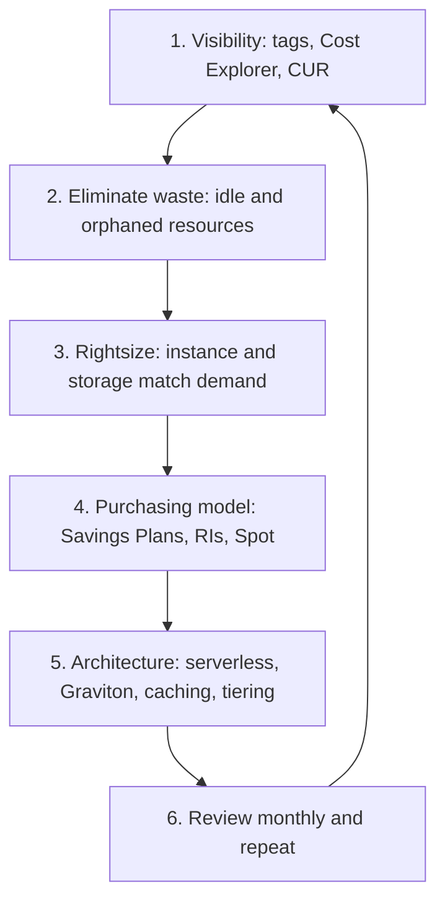
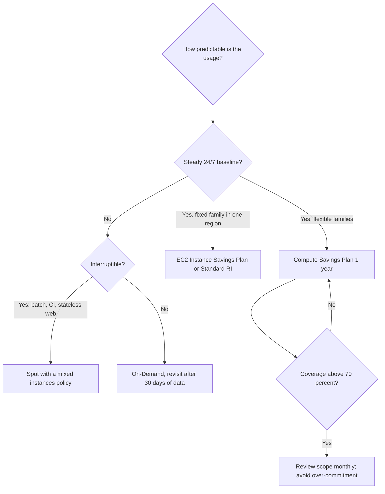
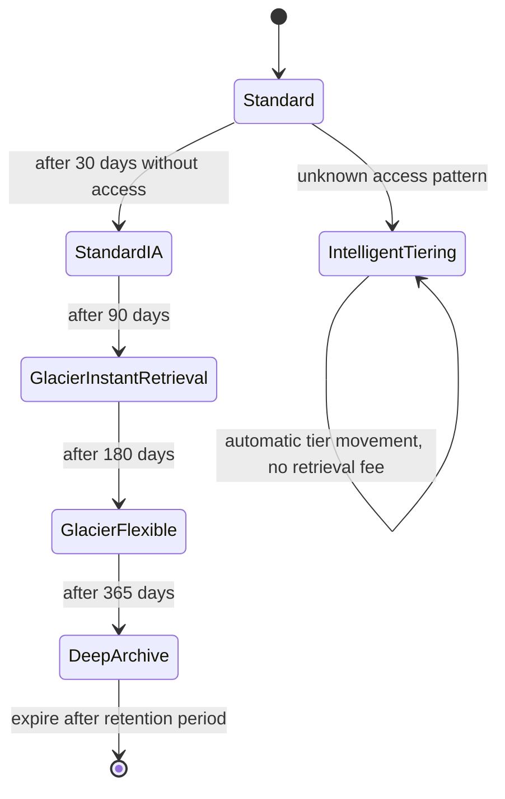

# 07 · Cost Optimization

> **Phase 2 — Professional Architectures** · Lesson 07 of 08
> ⬅️ Previous: [Global Accelerator](./06-global-accelerator.md) · ➡️ Next: [Well-Architected Framework](./08-well-architected-framework.md) · 🏠 [Phase overview](./README.md)

## Learning Objectives

By the end of this lesson you will be able to:

- Query Cost Explorer and set Budgets that alert before the invoice surprises you
- Choose between Savings Plans, Reserved Instances, Spot, and On-Demand for a given workload pattern
- Produce a rightsizing recommendation backed by Compute Optimizer and CloudWatch evidence
- Apply S3 storage classes and Intelligent-Tiering with correct lifecycle transitions
- Attribute spend with Cost Allocation Tags and a Cost and Usage Report
- Quantify savings in a worked scenario and defend the numbers

**Estimated time:** 75 min · **Difficulty:** Intermediate

---

## Core Concepts

Cost optimization is an engineering discipline, not an accounting task. The bill is a technical artifact: every line item is the consequence of an instance size, a storage class, a data path, or a commitment you did or did not make. The cloud's pricing model — pay for what you use, with discounts for predicting what you will use — means the same architecture can cost twice as much depending purely on how it is purchased and sized.

**Visibility comes first.** Cost Explorer answers "what did we spend, on what, for whom" and can forecast the month ahead. Cost Allocation Tags make that answer meaningful, because an untagged environment can only be analyzed by service, never by team, product, or environment. Tag activation is a deliberate step: creating a tag does not make it a *cost allocation* tag; you must activate it in Billing, and cost data only starts the day it is activated. For granular, queryable data, the **Cost and Usage Report (CUR)** delivers hourly or daily line items to S3, usually consumed through Athena.

**Budgets** are guardrails, not reports. A monthly cost budget with alerts at 80% actual and 100% forecasted catches drift while you can still react, and **budget actions** can attach an IAM policy, stop instances, or trigger a workflow when a threshold is breached. **Cost Anomaly Detection** complements budgets by watching for *unusual* spend rather than *absolute* spend — a good alarm for a compromised key spinning up GPU instances on a Tuesday night.

**Purchasing models** are where the largest single savings sit:

| Model | Commitment | Typical discount | Best for |
|-------|-----------|------------------|----------|
| On-Demand | None | 0% | Unpredictable, short-lived, spiky workloads |
| Compute Savings Plan | $/hour for 1 or 3 years | up to ~66% | Most workloads; flexible across instance family, region, OS, and even Fargate and Lambda |
| EC2 Instance Savings Plan | $/hour on a specific family in a region | up to ~72% | Stable, predictable instance families |
| Standard Reserved Instance | Specific instance type in an AZ | up to ~72% | Deeply stable capacity; sellable on the RI marketplace |
| Convertible Reserved Instance | Instance type, exchangeable | up to ~54% | Stable capacity with expected changes |
| Spot | None, interruptible | up to ~90% | Stateless, fault-tolerant, batch, CI runners |

Savings Plans replaced the flexibility problem of RIs: instead of buying a specific instance, you commit to an hourly spend and it is applied automatically to the eligible usage that is running. The commitment is the risk — under-utilized commitments are money burned every hour, which is why you start with computed recommendations, layer 1-year commitments before 3-year, and monitor utilization.

**Rightsizing** means matching the resource to the workload using evidence: Compute Optimizer recommendations, CloudWatch utilization at p95 rather than peak, and knowledge of whether the workload is CPU-, memory-, or I/O-bound. Typical findings are instances at single-digit CPU utilization, oversize EBS volumes whose filesystems are half empty, and idle load balancers, NAT gateways, and non-production databases running 24/7 for eight hours of work. Stopping non-production environments outside business hours is free money that no purchasing model can match.

**S3 storage classes** are a sliding scale of cost versus retrieval speed and minimum duration:

| Class | Approx. storage price (eu-west-1) | Min duration | Retrieval | Use for |
|-------|-----------------------------------|--------------|-----------|---------|
| S3 Standard | $0.023/GB-month | none | immediate | Hot, frequently accessed data |
| S3 Intelligent-Tiering | Standard rate + small monitoring fee | none | immediate | Unknown or changing access patterns |
| S3 Standard-IA | $0.0125/GB-month | 30 days | immediate, per-GB fee | Infrequent but instant access |
| S3 One Zone-IA | ~$0.01/GB-month | 30 days | immediate, per-GB fee | Reproducible, non-critical data in one AZ |
| S3 Glacier Instant Retrieval | ~$0.004/GB-month | 90 days | immediate, per-GB fee | Archive accessed a few times a year |
| S3 Glacier Flexible Retrieval | ~$0.0036/GB-month | 90 days | minutes to hours | Backup and compliance archives |
| S3 Glacier Deep Archive | ~$0.00099/GB-month | 180 days | 12 hours (standard) | Long-term retention, rarely read |

**Intelligent-Tiering** deserves special attention because it has no retrieval fees and no minimum duration: it monitors access and moves objects between frequent, infrequent, archive-instant, archive, and deep-archive access tiers automatically. For data whose access pattern you cannot predict, it is the low-risk default — the trade-off is a per-1,000-object monitoring and automation fee, which is negligible for large objects and noticeable for millions of tiny ones.

**Graviton** is the cheapest broad lever in compute: AWS-designed ARM processors typically deliver better price-performance than comparable x86 instances for the same workload, so the same traffic can be served by fewer or smaller instances. Most managed services (RDS, ElastiCache, OpenSearch, Lambda) offer Graviton options, which means the migration is often a configuration change rather than a recompile.

### Key terminology

| Term | Meaning |
|------|---------|
| **Unblended cost** | Actual cost charged, before any credits or amortization |
| **Amortized cost** | Upfront commitment payments spread across the commitment period |
| **Cost Allocation Tag** | Tag activated for billing so spend can be grouped by team, product, or environment |
| **RI / SP coverage** | Share of eligible usage covered by a commitment |
| **Utilization** | Share of a purchased commitment that was actually consumed |
| **Rightsizing** | Changing instance size, family, or storage to match measured demand |
| **Spot interruption** | AWS reclaiming a Spot instance with a two-minute warning |
| **Idle resource** | Anything billing hourly with no workload behind it; the cheapest thing to fix |
| **CUR** | Cost and Usage Report: hourly or daily line-item data delivered to S3 |

---

## Architecture Diagram

The order in which you should attack cost — each step makes the next one cheaper:



Choosing a purchasing model from the workload's shape:



S3 lifecycle transitions and the minimum durations that make them safe:



---

## Hands-on Lab: Find the Waste, Then Buy Smart

**Goal:** Produce a cost breakdown by service and tag, set a budget with an alert, and generate a compute purchase recommendation.

**Prerequisites:** AWS CLI v2, permissions for Cost Explorer, Budgets, Compute Optimizer, and S3.

### Step 1 — Get the spend breakdown

```bash
# Cost Explorer lives in us-east-1; pass --region us-east-1 explicitly
aws ce get-cost-and-usage \
  --time-period Start=2026-09-01,End=2026-10-01 \
  --granularity MONTHLY \
  --metrics UnblendedCost \
  --group-by Type=DIMENSION,Key=SERVICE \
  --region us-east-1 \
  --query 'ResultsByTime[0].Groups[].{Service:Keys[0],Cost:Total.UnblendedCost.Amount}'
```

```bash
# Same month, but split by the Environment tag — only works if the tag is activated
aws ce get-cost-and-usage \
  --time-period Start=2026-09-01,End=2026-10-01 \
  --granularity MONTHLY \
  --metrics UnblendedCost \
  --group-by Type=TAG,Key=Environment \
  --region us-east-1

# Activate a tag for cost allocation (data appears from the activation date forward)
aws ce update-cost-allocation-tags-status \
  --cost-allocation-tags-status '[{"TagKey":"Environment","Status":"Active"},{"TagKey":"CostCenter","Status":"Active"}]' \
  --region us-east-1
```

### Step 2 — Forecast the month and catch anomalies

```bash
# Forecast the current month's total
aws ce get-cost-forecast \
  --time-period Start=2026-10-01,End=2026-11-01 \
  --metric UNBLENDED_COST \
  --granularity MONTHLY \
  --region us-east-1

# Anomaly monitor across all services, with an email subscription
aws ce create-anomaly-monitor \
  --anomaly-monitor '{"MonitorName":"all-services","MonitorType":"DIMENSIONAL","MonitorDimension":"SERVICE"}' \
  --region us-east-1

aws ce create-anomaly-subscription \
  --anomaly-subscription '{
    "SubscriptionName":"daily-anomaly-digest",
    "MonitorArnList":["arn:aws:ce::123456789012:anomalymonitor/abcdef12-3456-7890-abcd-ef1234567890"],
    "Subscribers":[{"Address":"finops@example.com","Type":"EMAIL"}],
    "Frequency":"DAILY"
  }' \
  --region us-east-1
```

### Step 3 — Set a budget with two thresholds

```json
{
  "BudgetName": "monthly-total",
  "BudgetLimit": { "Amount": "5000", "Unit": "USD" },
  "TimeUnit": "MONTHLY",
  "BudgetType": "COST"
}
```

```json
[
  {
    "Notification": {
      "NotificationType": "ACTUAL",
      "ComparisonOperator": "GREATER_THAN",
      "Threshold": 80
    },
    "Subscribers": [{ "SubscriptionType": "EMAIL", "Address": "finops@example.com" }]
  },
  {
    "Notification": {
      "NotificationType": "FORECASTED",
      "ComparisonOperator": "GREATER_THAN",
      "Threshold": 100
    },
    "Subscribers": [{ "SubscriptionType": "EMAIL", "Address": "finops@example.com" }]
  }
]
```

```bash
# Create the budget and its subscribers in one call
aws budgets create-budget \
  --account-id 123456789012 \
  --budget file://budget.json \
  --notifications-with-subscribers file://budget-notifications.json \
  --region us-east-1
```

The **forecasted** notification is the valuable one: it fires while there is still time to act, whereas an actual-100% alert is a postmortem.

### Step 4 — Get purchase recommendations and rightsizing evidence

```bash
# What would a 1-year, no-upfront Compute Savings Plan save at current usage?
aws ce get-savings-plans-purchase-recommendation \
  --savings-plans-type COMPUTE_SP \
  --term-in-years ONE_YEAR \
  --payment-option NO_UPFRONT \
  --lookback-period-in-days SIXTY_DAYS \
  --region us-east-1

# Rightsizing based on CloudWatch history, considering only same-family changes
aws ce get-rightsizing-recommendation \
  --service AmazonEC2 \
  --configuration file://rightsizing-config.json \
  --region us-east-1
```

```json
{
  "RecommendationTarget": "SAME_INSTANCE_FAMILY",
  "BenefitsConsidered": true
}
```

```bash
# Compute Optimizer: per-instance findings with utilization percentiles
aws compute-optimizer get-ec2-instance-recommendations \
  --region eu-west-1 \
  --query 'instanceRecommendations[].{Instance:instanceArn,Current:currentInstanceType,Finding:finding,Recommended:recommendationOptions[0].instanceType}'

# Export a full report to S3 for offline analysis
aws compute-optimizer export-ec2-instance-recommendations \
  --s3-destination-config bucket=finops-reports-123456789012,keyPrefix=compute-optimizer \
  --region eu-west-1
```

`BenefitsConsidered: true` is the important flag: it accounts for existing Savings Plans and RIs, so the recommendation reflects the price you actually pay rather than list price.

### Step 5 — Check commitment utilization before buying more

```bash
# Coverage: how much of eligible usage is already covered
aws ce get-savings-plans-coverage \
  --time-period Start=2026-08-01,End=2026-10-01 \
  --granularity MONTHLY \
  --region us-east-1

# Utilization: how much of what you bought was actually consumed
aws ce get-savings-plans-utilization \
  --time-period Start=2026-08-01,End=2026-10-01 \
  --granularity MONTHLY \
  --region us-east-1

# Reserved Instance equivalents
aws ce get-reservation-coverage \
  --time-period Start=2026-08-01,End=2026-10-01 \
  --granularity MONTHLY \
  --region us-east-1

aws ce get-reservation-utilization \
  --time-period Start=2026-08-01,End=2026-10-01 \
  --granularity MONTHLY \
  --region us-east-1
```

Rule of thumb: buy more when coverage is under about 70% and utilization is above 95%. Never buy when utilization is below 90% — fix unused commitments first.

### Step 6 — Lifecycle a bucket and measure the result

```json
{
  "Rules": [
    {
      "ID": "logs-tiering",
      "Status": "Enabled",
      "Filter": { "Prefix": "logs/" },
      "Transitions": [
        { "Days": 30, "StorageClass": "STANDARD_IA" },
        { "Days": 90, "StorageClass": "GLACIER_IR" },
        { "Days": 365, "StorageClass": "DEEP_ARCHIVE" }
      ],
      "NoncurrentVersionTransitions": [
        { "NoncurrentDays": 30, "StorageClass": "GLACIER_IR" }
      ],
      "NoncurrentVersionExpiration": { "NoncurrentDays": 365 },
      "AbortIncompleteMultipartUpload": { "DaysAfterInitiation": 7 }
    }
  ]
}
```

```bash
# Measure first, then apply: how much data and how many objects are actually there?
aws s3 ls --recursive --summarize s3://app-logs-bucket/logs/ | tail -2

# Apply the lifecycle policy
aws s3api put-bucket-lifecycle-configuration \
  --bucket app-logs-bucket \
  --lifecycle-configuration file://lifecycle.json

# For unpredictable access patterns, use Intelligent-Tiering with archive tiers instead
aws s3api put-bucket-intelligent-tiering-configuration \
  --bucket app-logs-bucket \
  --id archive-tier \
  --intelligent-tiering-configuration file://intelligent-tiering.json
```

```json
{
  "Id": "archive-tier",
  "Status": "Enabled",
  "Filter": { "Prefix": "logs/" },
  "Tierings": [
    { "Days": 90, "AccessTier": "ARCHIVE_ACCESS" },
    { "Days": 180, "AccessTier": "DEEP_ARCHIVE_ACCESS" }
  ]
}
```

### Step 7 — Verify

```bash
# Confirm the lifecycle policy is attached and what it will do
aws s3api get-bucket-lifecycle-configuration --bucket app-logs-bucket

# Verify the budget exists with its notifications
aws budgets describe-budgets --account-id 123456789012 --region us-east-1

# Confirm Compute Optimizer is actually recommending things (it needs 14+ days of metrics)
aws compute-optimizer get-recommendation-summaries --region eu-west-1
```

---

## CLI Reference

```bash
# Hourly line-item data for Athena: the CUR is the only source of full granularity
aws cur put-report-definition \
  --report-definition '{
    "ReportName":"daily-cur",
    "TimeUnit":"DAILY",
    "Format":"Parquet",
    "Compression":"Parquet",
    "AdditionalSchemaElements":["RESOURCES"],
    "S3Bucket":"billing-cur-123456789012",
    "S3Prefix":"reports",
    "S3Region":"eu-west-1",
    "AdditionalArtifacts":["ATHENA"],
    "RefreshClosedReports":true,
    "ReportVersioning":"OVERWRITE_REPORT"
  }' \
  --region us-east-1

# Find Spot prices before committing a fleet to them
aws ec2 describe-spot-price-history \
  --instance-types m7g.large m7i.large \
  --product-descriptions "Linux/UNIX" \
  --start-time 2026-10-01T00:00:00Z \
  --region eu-west-1 \
  --max-items 5

# Request a Spot Fleet: diversified across generations, capacity-optimized, cost-aware
aws ec2 request-spot-fleet --spot-fleet-request-config file://spot-fleet.json --region eu-west-1
```

```json
{
  "IamFleetRole": "arn:aws:iam::123456789012:role/aws-ec2-spot-fleet-tagging-role",
  "TargetCapacity": 4,
  "AllocationStrategy": "priceCapacityOptimized",
  "Type": "maintain",
  "ReplaceUnhealthyInstances": true,
  "LaunchSpecifications": [
    {
      "InstanceType": "m7g.large",
      "ImageId": "ami-0abc1234567890def",
      "SubnetId": "subnet-0aaa1111",
      "WeightedCapacity": 2,
      "InstanceInterruptionBehavior": "terminate",
      "SecurityGroups": [{ "GroupId": "sg-0abc123def456" }]
    },
    {
      "InstanceType": "m7i.large",
      "ImageId": "ami-0abc1234567890def",
      "SubnetId": "subnet-0bbb2222",
      "WeightedCapacity": 2,
      "InstanceInterruptionBehavior": "terminate",
      "SecurityGroups": [{ "GroupId": "sg-0abc123def456" }]
    }
  ]
}
```

```bash
# Cancel a Spot Fleet and terminate its instances
aws ec2 cancel-spot-fleet-requests \
  --spot-fleet-request-ids sfr-11112222-3333-4444-5555-666677778888 \
  --terminate-instances \
  --region eu-west-1

# See what a 1-year all-upfront Reserved Instance would cost for a size you use
aws ec2 describe-reserved-instances-offerings \
  --instance-type m7g.large \
  --product-description "Linux/UNIX" \
  --offering-class standard \
  --instance-tenancy default \
  --offering-type "All Upfront" \
  --region eu-west-1 \
  --max-results 5

# List the Savings Plans you already own
aws savingsplans list-savings-plans --states ACTIVE --region us-east-1

# S3 Storage Lens: organization-wide storage metrics, including incomplete multipart uploads
aws s3control list-storage-lens-configurations --account-id 123456789012 --region us-east-1

# Tag hygiene: which resources are missing the tags your cost reports depend on?
aws resourcegroupstaggingapi get-resources \
  --tag-filters Key=Environment,Values=prod \
  --region eu-west-1 \
  --query 'ResourceTagMappingList[].ResourceARN' \
  --max-items 20
```

| Command | Purpose |
|---------|---------|
| `ce get-cost-and-usage` | The workhorse query: spend by service, tag, or account |
| `ce get-cost-forecast` | Answers "where will this month land?" |
| `ce update-cost-allocation-tags-status` | Turns a tag into a billable dimension |
| `budgets create-budget` | Guardrail that alerts before the invoice surprises you |
| `ce get-savings-plans-purchase-recommendation` | What to commit to, and how much it saves |
| `ce get-rightsizing-recommendation` | Which instances are oversized (with benefits considered) |
| `compute-optimizer get-ec2-instance-recommendations` | Independent, metric-based rightsizing evidence |
| `cur put-report-definition` | Enables hourly granularity and Athena analysis |

---

## Best Practices

| Practice | Why it matters |
|----------|----------------|
| Tag everything at creation with a **tag policy** enforcing keys | Untagged spend can never be attributed, and you cannot retroactively tag history |
| Set budgets on **actual and forecasted** thresholds | Forecast alerts give you time to react |
| Cover only the **steady-state baseline** with commitments | Over-commitment is a guaranteed loss; on-demand handles the peaks |
| Prefer **1-year no-upfront** commitments first | Lowest risk, still most of the discount; upgrade to 3-year once utilization proves itself |
| Use **Compute Savings Plans** when instance families may change | Flexibility is worth more than the few extra points of an EC2 Instance SP |
| Run **Spot with a mixed instances policy** and capacity-optimized allocation | Cuts interruptions dramatically compared to cheapest-price allocation |
| Turn off non-production environments on a schedule | An eight-hour workday is 33% of a week; stopping nights and weekends saves up to 70% |
| Rightsize with **p95 utilization**, not peak | Peak-driven sizing leaves capacity idle most of the month |
| Delete idle resources: unattached EBS, old snapshots, unused load balancers, orphaned Elastic IPs | These are the most common findings in any cost audit and cost nothing to remove |
| Re-evaluate Graviton for every workload | Managed-service Graviton options are usually a configuration change |
| Review the top ten cost drivers **monthly** | Cost regressions are gradual and invisible without a routine |

---

## Common Pitfalls

| Pitfall | Symptom | Fix |
|---------|---------|-----|
| Tags created but never activated for billing | Cost Explorer shows no split by tag | `update-cost-allocation-tags-status` |
| Buying commitments based on peak usage | Utilization below 90%, wasted spend every hour | Commit to the baseline; use on-demand for the rest |
| Spot used for stateful single-instance workloads | Sudden terminations with two-minute warning | Reserve Spot for stateless, horizontally scaled, or checkpointed work |
| Lifecycle rules that skip the minimum duration | Early-deletion charges exceed the storage saved | Check minimums (30/90/180 days) before transitioning |
| Intelligent-Tiering applied to millions of tiny objects | Monitoring fee approaches the storage cost | Use explicit lifecycle rules for small-object buckets |
| Snapshot sprawl | Storage bill grows while nothing is restored | Enforce retention with AWS Backup lifecycle and audit monthly |
| Cross-AZ chatty traffic | Data transfer lines grow faster than compute | Keep chatty tiers in one AZ, or use zonal endpoints |
| NAT Gateway for S3 traffic | Large NAT data processing charges | Add a Gateway endpoint for S3 and DynamoDB |
| Rightsizing recommendations applied blindly | Performance regressions after the change | Cross-check Compute Optimizer with CloudWatch memory and app metrics |
| Idle resources left "because we might need them" | Steady avoidable spend | Set a policy: delete after 30 days of zero usage |

---

## Cost Considerations

Baseline: a two-region web platform, list prices assumed, one month = 730 hours.

| Component | Assumption | On-demand monthly cost |
|-----------|-----------|------------------------|
| Compute: 10 × `m6i.large` (x86), 24/7 | $0.096/hour each | $700 |
| EBS: 5 TB `gp3` provisioned, 3 TB used | $0.088/GB-month | $450 |
| S3: 20 TB in Standard | $0.023/GB-month | $471 |
| NAT: 2 gateways + 3 TB processed | $0.048/hour + $0.045/GB | $208 |
| ALB: hours + LCU | ~$56 | $56 |
| RDS: `db.m6i.large` Multi-AZ + 200 GB `gp3` | ~$0.42/hour + storage | $368 |
| **Total** | | **≈ $2,253** |

Now apply the six levers:

| Change | Math | Monthly saving |
|--------|------|----------------|
| Graviton migration (10 × `m6i.large` → `m7g.large`) | 10 × ($0.096 − $0.080) × 730 | $117 |
| Rightsizing (4 instances at 8% CPU → `m7g.medium`) | 4 × ($0.080 − $0.040) × 730 | $117 |
| 1-year no-upfront Compute Savings Plan at ~20% on the remaining 6 instances | 6 × $0.080 × 730 × 0.20 | $70 |
| Spot for 4 stateless web instances at ~60% off | 4 × $0.040 × 730 × 0.60 | $70 |
| EBS right-size from 5 TB to 3.5 TB | 1,536 GB × $0.088 | $135 |
| S3 tiering: 8 TB → Glacier IR, 4 TB → Deep Archive | (8,192 × $0.019) + (4,096 × $0.022) | $246 |
| Gateway endpoint for S3 (removes NAT processing) | 3 TB × $0.045 | $138 |
| **Total identified** | | **≈ $893 (40% of the baseline)** |

Two points worth making about the list. First, the largest single savings come from **storage tiering and data-path changes**, not from purchasing models — a fact that surprises teams who start with Savings Plans. Second, every item has an operational precondition: Graviton needs a compatible build, Spot needs statelessness, lifecycle rules need the right retention policy, and the gateway endpoint needs the S3 client to prefer the endpoint (usually automatic with the AWS CLI and SDKs). Buying a Savings Plan, by contrast, requires no engineering at all — which is exactly why it should come *after* you have fixed the architecture, since commitments are priced against usage you might remove next month.

**What drives the bill, in order:** sustained compute hours, storage volume multiplied by class, data transfer and processing (especially NAT), and the gap between provisioned and used capacity.

---

## Security Considerations

- **Cost controls are security controls.** Anomaly detection and budget alarms are two of the fastest ways to notice a compromised access key mining cryptocurrency, because the signature is sudden GPU or compute spend in an unusual region.
- **Guardrails against expensive mistakes:** SCPs that deny instance families you do not use (for example GPU types outside approved accounts), region restrictions, and IAM conditions that cap the size of what a team can launch.
- **Budget actions can be load-bearing.** A budget action that applies a restrictive IAM policy or stops instances is a powerful automation; store the execution role with least privilege and review `ApprovalModel` so it cannot be triggered silently by an attacker inflating cost.
- **Protect billing data.** The CUR bucket and Cost Explorer exports contain account IDs, resource ARNs, and usage patterns. Restrict S3 access, enable encryption, and treat it as sensitive operational data.
- **Tag values are inputs, not truth.** Never use a tag for an authorization decision without validating that only privileged principals can write it — a mutable `Environment=prod` tag is not a security boundary.
- **Spot and interruption handling needs a safe default.** A shutdown handler that writes partial state or deletes resources on interruption is an availability risk; terminate behavior should be idempotent.
- **Lifecycle transitions are irreversible in practice.** Moving objects to Deep Archive with a wrong retention policy can make compliance data unavailable for 12 hours. Test on a small prefix, and use Object Lock where retention is regulated.
- **Audit who can change cost settings.** `budgets:DeleteBudget`, `ce:*`, and `savingsplans:CreateSavingsPlan` are financial permissions. Alarm on them like you would on key deletion.

---

## Exercise

Pick a real account (or the capstone project) and produce a one-page cost optimization plan:

1. Run `get-cost-and-usage` grouped by service and by tag, and identify the top three drivers with their monthly amounts.
2. Find every resource that has been idle for 30 days (unattached EBS volumes, unused Elastic IPs, load balancers with zero requests, databases with no connections) and total their cost.
3. Produce a purchase recommendation with a specific dollar commitment, an expected saving, and the coverage and utilization you would monitor afterwards.
4. Choose one storage tiering change and state the retention policy that justifies it.

Success looks like: a plan that names specific resources, specific dollar amounts, at least one change removable with zero risk (deleting idle resources), and at least one that requires an engineering change — plus a stated verification metric for each, such as Savings Plans utilization staying above 95%.

---

## Resources

- [AWS Cost Management documentation](https://docs.aws.amazon.com/cost-management/latest/userguide/what-is-costmanagement.html)
- [Cost Explorer API reference](https://docs.aws.amazon.com/aws-cost-management/latest/APIReference/API_Operations_AWS_Cost_Explorer_Service.html)
- [AWS Budgets best practices](https://docs.aws.amazon.com/cost-management/latest/userguide/budgets-best-practices.html)
- [Savings Plans User Guide](https://docs.aws.amazon.com/savingsplans/latest/userguide/what-is-savings-plans.html)
- [Spot Instance best practices](https://docs.aws.amazon.com/AWSEC2/latest/UserGuide/spot-best-practices.html)
- [S3 storage classes](https://docs.aws.amazon.com/AmazonS3/latest/userguide/storage-class-intro.html)
- [S3 Intelligent-Tiering](https://docs.aws.amazon.com/AmazonS3/latest/userguide/intelligent-tiering.html)
- [AWS Compute Optimizer](https://docs.aws.amazon.com/compute-optimizer/latest/ug/what-is-compute-optimizer.html)
- [AWS Graviton](https://aws.amazon.com/ec2/graviton/)

---

## Next Steps

Cost optimization is one of six pillars of the AWS Well-Architected Framework. The final lesson in this phase puts it, and everything else you have built, into a repeatable review process with a tool, a set of lenses, and saved milestones that prove the architecture is improving over time.

> ⬅️ Previous: [Global Accelerator](./06-global-accelerator.md) · ➡️ Next: [Well-Architected Framework](./08-well-architected-framework.md) · 🏠 [Phase overview](./README.md)
