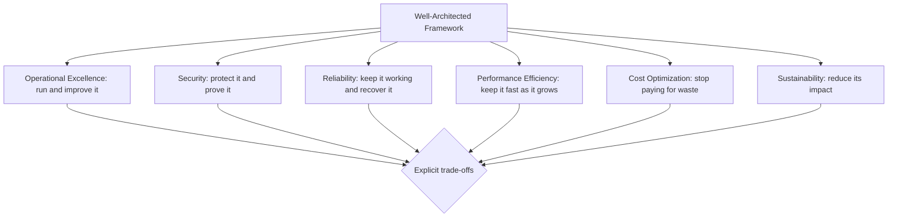
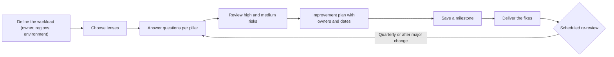
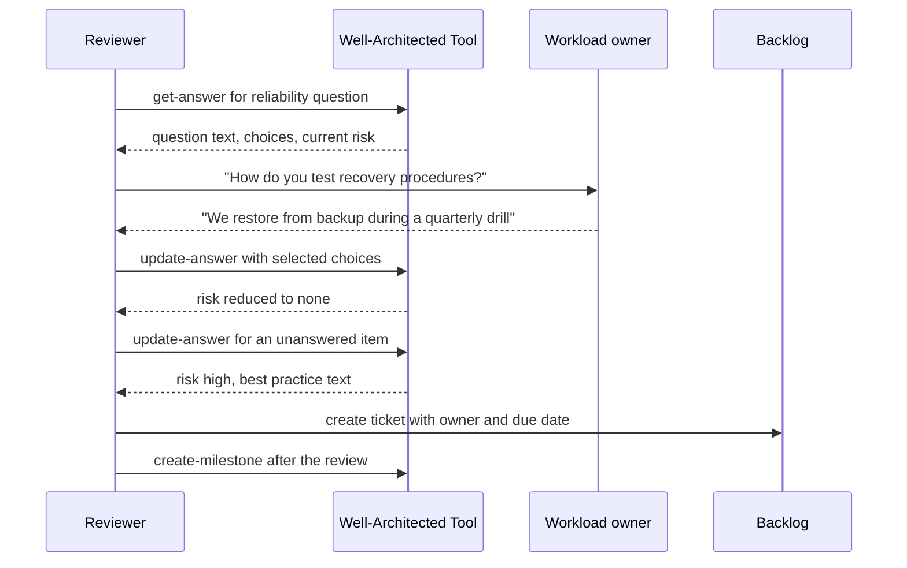

# 08 · Well-Architected Framework

> **Phase 2 — Professional Architectures** · Lesson 08 of 08
> ⬅️ Previous: [Cost Optimization](./07-cost-optimization.md) · ➡️ Next: [Phase 3 — DevOps and Automation](../phase-3-devops-and-automation/README.md) · 🏠 [Phase overview](./README.md)

## Learning Objectives

By the end of this lesson you will be able to:

- Describe the six pillars of the Well-Architected Framework and what each one optimizes for
- State the design principles behind each pillar and recognize them in a real workload
- Run a workload review in the AWS Well-Architected Tool and score it honestly
- Turn high-risk findings into an improvement plan with owners and deadlines
- Save milestones so architecture quality can be compared over time
- Choose the right lens, including the Serverless, SaaS, and Containers lenses, and when to build your own

**Estimated time:** 65 min · **Difficulty:** Beginner

---

## Core Concepts

The **AWS Well-Architected Framework** is a structured set of questions and best practices distilled from running thousands of workloads on AWS. It is not a checklist of services; it is a way of arguing about architecture using shared vocabulary so that a review produces decisions instead of opinions. The framework is organized into **six pillars**:

- **Operational Excellence** — running and monitoring systems to deliver business value, and continually improving processes. "We can change it safely, and we learn from what happens."
- **Security** — protecting information, systems, and assets while delivering business value through risk assessments and mitigation. "Only the right things can reach the right data, and we can prove it."
- **Reliability** — ensuring a workload performs its intended function correctly and consistently, including recovery from failure. "It keeps working, and we have tested how it recovers."
- **Performance Efficiency** — using computing resources efficiently and maintaining that efficiency as demand changes and technology evolves. "It is fast enough, and it stays fast as it grows."
- **Cost Optimization** — delivering business value at the lowest price point. "We know what we spend and why, and we are not paying for waste."
- **Sustainability** — minimizing the environmental impact of running cloud workloads. "We use what we need, and we measure our impact."

Each pillar has a small number of **design principles** that guide how you think, and a larger set of **questions with best practices** that the tool turns into risk items. The pillars interact: raising reliability usually raises cost, and raising security sometimes reduces performance. Reviews exist to surface those trade-offs explicitly rather than accidentally.

The framework's most important cultural idea is the **trade-off**: there is no universally "right" architecture, only architecture that fits a workload's business context. A review question is answered with one of three states — **none**, **some**, or **high risk** — and "none" for a workload that does not need something is a perfectly valid answer. What matters is that the answer was chosen, not inherited.

The **AWS Well-Architected Tool** is a free service in the console and API that holds workloads, their answers, and their history. You answer questions per pillar, and the tool summarizes risks and produces a report you can share. **Milestones** are the key feature most teams miss: a milestone is an immutable snapshot of the review, so you can prove that the five high-risk items from last quarter are now resolved — or see that they are not. A review without milestones is an opinion; a review with milestones is a measurement.

**Lenses** extend the framework to specific technology or industry contexts: Serverless Applications, SaaS, Machine Learning, Data Analytics, Financial Services, Healthcare, Games, IoT, SAP, Container Build, and Migration. Start with the base framework, then add the lens that matches the workload — a serverless workload reviewed only against the general framework will miss serverless-specific risks such as function-level resilience or cold-start strategy.

**Risk ratings drive action.** Every unanswered or negatively answered question is a potential risk item; the tool marks each high or medium. A review's output is not the score — it is the **improvement plan**: a list of items, each with an owner and a date, inserted into the same backlog as features. Reviews that produce documents rather than tickets change nothing.

Finally, the framework is deliberately **iterative**. You review at design time (before you build), after a significant change, and on a recurring schedule (typically quarterly). Each review saves a milestone, so the trend of risk over time is visible — which is precisely what leadership needs to see.

### Key terminology

| Term | Meaning |
|------|---------|
| **Pillar** | One of the six perspectives; each contains principles and questions |
| **Design principle** | A guiding rule for a pillar, such as "test recovery procedures" |
| **Question** | A review prompt within a pillar; answered per workload |
| **Best practice** | Specific guidance attached to a question, usually with implementation options |
| **Risk (high/medium)** | The tool's assessment that a question is not well handled |
| **Improvement plan** | The prioritized list of work items derived from identified risks |
| **Milestone** | An immutable snapshot of a review, used to track progress over time |
| **Lens** | A pillar/question set tailored to a domain, technology, or industry |
| **Workload** | The unit the tool reviews: a service, application, or platform |
| **WA Tool** | The AWS service that hosts reviews, lens answers, and milestones |

---

## Architecture Diagram

The six pillars and the question each one answers:



The review workflow, from workload definition to a repeatable cadence:



What a single question looks like during a review:



---

## Hands-on Lab: Run a Real Review and Save the Milestone

**Goal:** Create a workload in the Well-Architected Tool, answer a pillar honestly, extract the improvement plan, and save a milestone.

**Prerequisites:** AWS CLI v2 with `wellarchitected:*` permissions (the tool itself is free), and a workload you know well enough to answer for.

### Step 1 — Create the workload

```bash
# Define the workload once; everything else hangs off this ID
aws wellarchitected create-workload \
  --workload-name "Payments API" \
  --description "Public payment API serving EU and US customers" \
  --environment PRODUCTION \
  --review-owner "platform-team@example.com" \
  --lenses wellarchitected \
  --aws-regions eu-west-1 us-east-1 \
  --account-ids 123456789012 \
  --industry "Financial Services" \
  --architectural-design "ALB, Auto Scaling EC2 tier, Aurora PostgreSQL Multi-AZ, DynamoDB for idempotency keys"
```

```bash
# Confirm the workload and check which lenses exist
aws wellarchitected list-workloads \
  --query 'WorkloadSummaries[].{Id:WorkloadId,Name:WorkloadName,Risks:RiskCounts}'

aws wellarchitected list-lenses \
  --query 'LensSummaries[].{Alias:LensAlias,Name:LensName,Version:LensVersion}'
```

### Step 2 — Start a lens review and see the questions

```bash
# Create the review for the base framework lens
aws wellarchitected create-lens-review \
  --workload-id w-0123456789abcdef0 \
  --lens-alias wellarchitected \
  --lens-version "latest"

# List the review questions for one pillar, with the current risk
aws wellarchitected list-answers \
  --workload-id w-0123456789abcdef0 \
  --lens-alias wellarchitected \
  --pillar-id reliability \
  --query 'AnswerSummaries[].{Question:QuestionId,Risk:Risk,Title:QuestionTitle}'
```

The pillar IDs used by the API are `operationalExcellence`, `security`, `reliability`, `performance`, `costOptimization`, and `sustainability`. Use them exactly as written when scripting.

### Step 3 — Answer questions and record the evidence

```bash
# Read one question in full, including its choices and best practices
aws wellarchitected get-answer \
  --workload-id w-0123456789abcdef0 \
  --lens-alias wellarchitected \
  --question-id rel_11

# Record the answer: choose the options that describe reality, then set the risk
aws wellarchitected update-answer \
  --workload-id w-0123456789abcdef0 \
  --lens-alias wellarchitected \
  --question-id rel_11 \
  --is-applicable true \
  --selected-choices rel_11_1 \
  --notes "Quarterly restore drill executed 2026-09-12; RTO measured at 47 minutes versus a 60 minute target." \
  --risk "NONE"
```

Write the **notes** field like evidence, not opinion. "We have a backup plan" is worth nothing; "restore drill on 2026-09-12, measured RTO 47 of 60 minutes, evidence in ticket OPS-4471" survives both an audit and a change of staff.

### Step 4 — Extract the improvement plan

```bash
# All improvement items for one pillar, highest risk first
aws wellarchitected list-lens-review-improvements \
  --workload-id w-0123456789abcdef0 \
  --lens-alias wellarchitected \
  --pillar-id security \
  --query 'ImprovementSummaries[].{Question:QuestionId,Risk:Risk,Improvement:ImprovementPlanUrl}'

# The whole lens review: risk counts plus per-pillar breakdown
aws wellarchitected get-lens-review \
  --workload-id w-0123456789abcdef0 \
  --lens-alias wellarchitected
```

### Step 5 — Save a milestone

```bash
# Snapshot the review so progress can be measured later
aws wellarchitected create-milestone \
  --workload-id w-0123456789abcdef0 \
  --milestone-name "2026-Q4-baseline-review"

# List all milestones for the workload
aws wellarchitected list-milestones \
  --workload-id w-0123456789abcdef0 \
  --query 'MilestoneSummaries[].{Number:MilestoneNumber,Name:MilestoneName,Created:RecordedAt}'

# Compare a milestone to the live review to see what changed
aws wellarchitected get-milestone \
  --workload-id w-0123456789abcdef0 \
  --milestone-number 1
```

### Step 6 — Add a technology lens and a custom lens when needed

```bash
# Serverless lens for a Lambda-based workload
aws wellarchitected create-lens-review \
  --workload-id w-0123456789abcdef0 \
  --lens-alias serverless \
  --lens-version "latest"

# Publish an internal standard as a custom lens (JSON definition)
aws wellarchitected import-lens \
  --lens-json fileb://company-secure-by-default-lens.json \
  --client-request-token "$(uuidgen)"

# Custom lenses appear with a distinct type
aws wellarchitected list-lenses --lens-type CUSTOM_SELF
```

### Step 7 — Verify

```bash
# The workload should show risk counts that match what you answered
aws wellarchitected get-workload \
  --workload-id w-0123456789abcdef0 \
  --query 'Workload.{Name:WorkloadName,Risks:RiskCounts,Improvement:ImprovementStatus}'

# Generate a shareable report (Base64-encoded PDF in the response)
aws wellarchitected get-lens-review-report \
  --workload-id w-0123456789abcdef0 \
  --lens-alias wellarchitected \
  --output-format PDF \
  --query 'LensReviewReport.Base64String' \
  --output text > lens-review-report.b64
```

Decode `lens-review-report.b64` to get a PDF you can attach to the review ticket or send to stakeholders.

---

## CLI Reference

```bash
# Every check available from Trusted Advisor (full set requires a Business or higher support plan)
aws support describe-trusted-advisor-checks --language en --region us-east-1

# Currently failing or warning checks across your account
aws support describe-trusted-advisor-checks \
  --language en \
  --region us-east-1 \
  --query 'checks[?status!=`ok`].[name,status,category]'

# Delete a workload you no longer review (it must have no active lens reviews)
aws wellarchitected delete-workload --workload-id w-0123456789abcdef0

# Associate a second account's workload when a platform serves multiple accounts
aws wellarchitected associate-lenses \
  --workload-id w-0123456789abcdef0 \
  --lens-aliases wellarchitected serverless

# Update workload context as the system evolves
aws wellarchitected update-workload \
  --workload-id w-0123456789abcdef0 \
  --description "Payments API with an added us-east-1 warm standby"
```

| Command | Purpose |
|---------|---------|
| `create-workload` | Defines the unit being reviewed, with owner and regions |
| `create-lens-review` | Starts a review against the base framework or a lens |
| `list-answers` / `get-answer` | Lists questions and reads their choices and best practices |
| `update-answer` | Records evidence, selected choices, and the risk rating |
| `list-lens-review-improvements` | Produces the improvement plan you turn into tickets |
| `create-milestone` | Freezes a snapshot so progress is measurable |
| `get-lens-review-report` | Generates a shareable report for stakeholders |
| `import-lens` | Publishes an internal standard as a reusable custom lens |

---

## Best Practices

Every pillar below lists its published design principles, then the practices this roadmap's earlier lessons put into action.

### Operational Excellence

**Design principles:** perform operations as code; make frequent, small, reversible changes; refine operations procedures frequently; anticipate failure; learn from all operational failures.

| Practice | Why it matters |
|----------|----------------|
| Define everything in Infrastructure as Code | Environments become reproducible and reviewable |
| Use runbooks that are executed regularly, not just written | A procedure nobody runs is a hypothesis |
| Instrument with metrics, logs, and traces before you need them | You cannot debug what you did not record |
| Run game days and post-incident reviews without blame | Turns incidents into permanent capability |
| Make deployments small and reversible | Small changes fail small |

### Security

**Design principles:** implement a strong identity foundation; maintain traceability; apply security at all layers; automate security best practices; protect data in transit and at rest; keep people away from data; prepare for security events.

| Practice | Why it matters |
|----------|----------------|
| Least privilege, with permission boundaries for delegation | Limits what a compromised identity can do |
| Centralize identity and use temporary credentials | Removes long-lived secrets from the estate |
| Encrypt in transit and at rest, with customer-managed keys where required | Meets regulatory expectations and enables revocation |
| Log everything centrally, in an account the workload cannot modify | Preserves evidence during an incident |
| Automate detection and response (GuardDuty, Security Hub, Config) | Humans are too slow for automated attacks |

### Reliability

**Design principles:** automatically recover from failure; test recovery procedures; scale horizontally to increase aggregate availability; stop guessing capacity; manage change through automation.

| Practice | Why it matters |
|----------|----------------|
| Multi-AZ for every stateful layer, with tested failover | Removes the single-AZ blast radius |
| Health checks plus Auto Scaling with ELB health checks | Machines that do not serve are replaced automatically |
| Backups that are immutable, cross-region, and restore-tested | Protects against corruption and deletion, not just loss |
| Documented RTO/RPO with a rehearsed runbook | Converts availability from an aspiration into a number |
| Graceful degradation (read-only mode, cached responses) | Partial service beats no service |

### Performance Efficiency

**Design principles:** democratize advanced technologies; go global in minutes; use serverless architectures; experiment more often; consider mechanical sympathy.

| Practice | Why it matters |
|----------|----------------|
| Cache at the edge and in the tier nearest the data | Removes most load before it reaches the origin |
| Choose the right storage and database for the access pattern | A relational engine for analytics or a key-value store for sessions both cost more than the right tool |
| Use managed and serverless options instead of operating servers | Shifts undifferentiated work to AWS |
| Load test with realistic traffic shapes | Finds the bottleneck before customers do |
| Review new instance families and Graviton regularly | Price-performance improves faster than architectures change |

### Cost Optimization

**Design principles:** implement cloud financial management; adopt a consumption model; measure overall efficiency; stop spending money on undifferentiated heavy lifting; analyze and attribute expenditure.

| Practice | Why it matters |
|----------|----------------|
| Tag everything and review the top cost drivers monthly | Attribution is the prerequisite for every saving |
| Match purchasing models to usage patterns (Lesson 07) | 20–70% of compute cost is a pricing decision |
| Rightsize with metrics, not instinct | Most instances are oversized most of the time |
| Tier storage with lifecycle policies | Cold data should not pay hot prices |
| Set budgets and anomaly alerts | Detects both drift and compromise |

### Sustainability

**Design principles:** understand your impact; establish sustainability goals; maximize utilization; anticipate and adopt new, more efficient hardware and software offerings; use managed services; reduce the downstream impact of your cloud workloads.

| Practice | Why it matters |
|----------|----------------|
| Raise utilization of what you already run | Fewer, busier instances use less energy per unit of work |
| Prefer Graviton and newer generations | Better performance per watt for the same workload |
| Delete idle resources and expired data | Energy and cost follow the same curve |
| Choose regions and services with lower carbon intensity where latency allows | Supported by the AWS Customer Carbon Footprint Tool |
| Right-size output: compress, deduplicate, and avoid redundant transfers | Reduces downstream energy as well as bandwidth cost |

---

## Common Pitfalls

| Pitfall | Symptom | Fix |
|---------|---------|-----|
| Reviewing without the workload owner present | Answers are guesses; nothing changes | Owner must attend and own the improvement plan |
| Chasing a perfect score | Teams mark items "not applicable" to look good | Answer honestly; the goal is informed trade-offs |
| Reviewing only at design time | Risks introduced over the next year are never seen | Re-review quarterly and after major changes |
| No milestones saved | Progress cannot be demonstrated | `create-milestone` at every review |
| Improvement plan stays in a document | The same risks reappear next quarter | Convert every high risk into a backlog ticket with an owner |
| Using only the base framework for a specialized workload | Domain-specific risks are invisible | Add the relevant lens (Serverless, SaaS, Financial Services, and so on) |
| Treating Trusted Advisor as a Well-Architected review | Checklist findings cannot see architectural context | Use both: Trusted Advisor for hygiene, WA Tool for design |
| A custom lens that encodes opinions, not standards | Teams ignore it | Publish custom lenses only for agreed, testable requirements |

---

## Cost Considerations

The Well-Architected Tool itself is **free** — there is no charge for workloads, lens reviews, or milestones. That makes the review's cost an opportunity cost: typically two to four hours for a small workload and a day or two for a complex platform, spread across the people who own it.

The economics of reviewing are almost always favorable, because reviews find money and risk in the same session:

- A single unreviewed Multi-AZ database that nobody tested failing over is an unbounded incident cost.
- A review typically surfaces idle resources, oversized instances, and missing lifecycles — the same items as a cost audit — often worth 10–40% of a workload's monthly bill.
- **Trusted Advisor** is where cost and hygiene findings live, but the full check set requires a **Business, Enterprise On-Ramp, or Enterprise** support plan, starting at the lower-hundreds of dollars per month. The framework review is the free alternative, though it requires your time.
- An **AWS-led Well-Architected Review** is available with support plans and is included for higher tiers; it buys an external, experienced perspective for the cost of scheduling it.
- **What drives the bill here:** the improvements you decide to make. Reviews are cheap; the architectural changes they justify are not. That is precisely why the improvement plan needs prioritization — a high-risk security item and a low-risk performance polish item should not consume the same engineering capacity.

---

## Security Considerations

- **The Security pillar is not the whole of security.** Reviews cover design and process; they do not replace threat modeling, penetration testing, or a vulnerability management program.
- **Never paste secrets, customer data, or internal hostnames into review notes.** Workload descriptions and answers are stored in the tool and visible to everyone with access to the account. Refer to systems by role, not by address.
- **Control access to the tool itself.** `wellarchitected:*` permissions reveal your entire architecture and its weaknesses — a useful reconnaissance document for an attacker. Restrict review access to the teams that need it and audit access with CloudTrail.
- **A review's risk list is a roadmap of your weaknesses.** Treat saved milestones and reports as sensitive; store exported reports in access-controlled locations and share them by link rather than by attachment.
- **Use the Security pillar questions as an audit trail.** Documented, evidence-based answers ("restore drill on 2026-09-12, measured RTO 47 minutes") are exactly what auditors ask for, and are far easier to produce during a review than after the fact.
- **Automate what you review.** Every answer that says "we check this manually each quarter" is a candidate for AWS Config rules, Security Hub controls, or an SCP so the control becomes continuous rather than periodic.
- **Include security in the definition of done for the improvement plan.** A high-risk Security item queued behind low-risk operational polish is a decision — make it explicitly, in writing.

---

## Exercise

Run a full Well-Architected review of the capstone project you built in this phase, then turn it into engineering work:

1. Create the workload with an accurate description, owner, and regions.
2. Answer every question in Operational Excellence, Security, and Reliability — with evidence in the notes for anything you answered "none risk".
3. Generate the improvement plan and prioritize it. Rank each item by risk and by effort.
4. Save a milestone named for the quarter.
5. Convert the top five items into backlog tickets with owners and dates, then implement one and re-run the affected questions.

Success looks like: a saved milestone showing a measurable reduction in risk counts between this review and your next one, plus at least one implemented improvement with evidence in the notes.

---

## Resources

- [AWS Well-Architected Framework](https://docs.aws.amazon.com/wellarchitected/latest/framework/welcome.html)
- [AWS Well-Architected Tool User Guide](https://docs.aws.amazon.com/wellarchitected/latest/userguide/intro.html)
- [Well-Architected lenses](https://docs.aws.amazon.com/wellarchitected/latest/userguide/lenses.html)
- [Operational Excellence Pillar](https://docs.aws.amazon.com/wellarchitected/latest/operational-excellence-pillar/welcome.html)
- [Security Pillar](https://docs.aws.amazon.com/wellarchitected/latest/security-pillar/welcome.html)
- [Reliability Pillar](https://docs.aws.amazon.com/wellarchitected/latest/reliability-pillar/welcome.html)
- [Performance Efficiency Pillar](https://docs.aws.amazon.com/wellarchitected/latest/performance-efficiency-pillar/welcome.html)
- [Cost Optimization Pillar](https://docs.aws.amazon.com/wellarchitected/latest/cost-optimization-pillar/welcome.html)
- [Sustainability Pillar](https://docs.aws.amazon.com/wellarchitected/latest/sustainability-pillar/sustainability-pillar.html)
- [AWS Trusted Advisor](https://docs.aws.amazon.com/awssupport/latest/user/trusted-advisor.html)

---

## Next Steps

Phase 2 ends here, and you now have the whole professional architecture toolkit: availability, disaster recovery, global networking, edge delivery, cost discipline, and a review process that keeps all of it honest. Phase 3 turns these architectures into deployable, repeatable systems with Infrastructure as Code, CI/CD pipelines, and containers — because the best architecture in the world is worthless if only one person can deploy it.

> ⬅️ Previous: [Cost Optimization](./07-cost-optimization.md) · ➡️ Next: [Phase 3 — DevOps and Automation](../phase-3-devops-and-automation/README.md) · 🏠 [Phase overview](./README.md)
