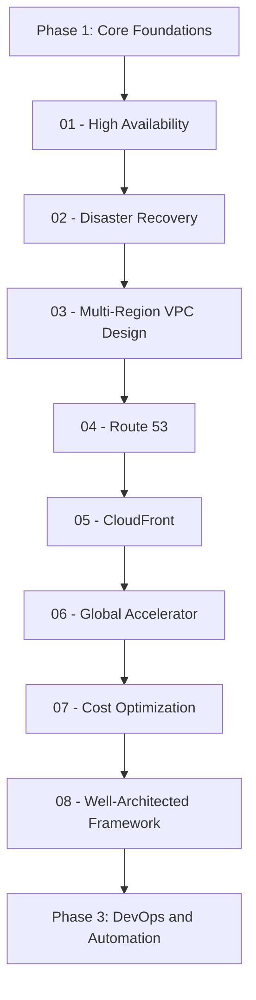
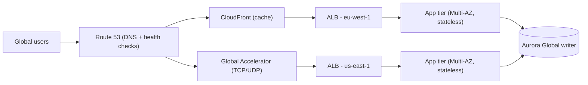

# Phase 2 — Professional Architectures

Phase 1 taught you how individual AWS services work. Phase 2 teaches you how to **combine** them into systems that survive failures, serve users on the other side of the planet, and still fit inside a budget. This is the phase where the AWS Certified Solutions Architect – Professional exam lives: high availability, disaster recovery, global networking, edge delivery, and the Well-Architected Framework as a repeatable review process.

Everything here assumes the Phase 1 fundamentals: VPCs and subnets, IAM roles, Auto Scaling, S3, RDS, CloudWatch. If any of those still feel shaky, finish Phase 1 first — the lessons below build directly on them.

## Phase Goals

- Design **highly available** workloads with Multi-AZ placement, load balancing, health checks, and stateless tiers
- Choose a **disaster recovery strategy** (backup & restore → pilot light → warm standby → active/active) from real RTO/RPO targets and cost
- Build **multi-region and multi-account network topologies** with Transit Gateway, PrivateLink, and Route 53 Resolver
- Deliver content and applications **globally** with Route 53, CloudFront, and Global Accelerator
- Drive **cost optimization** with the right purchasing model, storage class, and rightsizing evidence
- Run a **Well-Architected review** and turn its findings into an engineering backlog

## Phase Map

The first three lessons build **resilience**; the next three build **reach**; the last two make the result **affordable and reviewable**.

## Lessons in this Phase

| # | Lesson | Focus | Difficulty |
|---|--------|-------|------------|
| 01 | [High Availability](./01-high-availability.md) | Multi-AZ vs multi-region, ALB/NLB/GWLB, health checks, failover, RTO/RPO, stateless design | Intermediate |
| 02 | [Disaster Recovery](./02-disaster-recovery.md) | Backup & restore, pilot light, warm standby, active/active, AWS DRS, AWS Backup, failover timelines | Advanced |
| 03 | [Multi-Region VPC Design](./03-multi-region-vpc-design.md) | Transit Gateway, peering vs hub-and-spoke, Route 53 Resolver, PrivateLink, overlapping CIDRs | Advanced |
| 04 | [Route 53](./04-route-53.md) | Hosted zones, record types, alias vs CNAME, all routing policies, health checks, DNSSEC | Intermediate |
| 05 | [CloudFront](./05-cloudfront.md) | Distributions, cache behaviors and TTLs, invalidation, signed URLs, OAC, edge functions | Intermediate |
| 06 | [Global Accelerator](./06-global-accelerator.md) | Anycast, static IPs, TCP/UDP acceleration, endpoint groups, traffic dials | Advanced |
| 07 | [Cost Optimization](./07-cost-optimization.md) | Cost Explorer, Budgets, Savings Plans vs RIs, Spot, rightsizing, S3 classes, Graviton, tags | Intermediate |
| 08 | [Well-Architected Framework](./08-well-architected-framework.md) | The six pillars, design principles, Well-Architected Tool workflow, milestones | Beginner |

## Capstone Project

**Project: "Continental" — a two-region, DR-proven web platform**

Take the 3-tier application you built in Phase 1 and turn it into something you would actually put in front of paying customers.

**Deliverables:**

1. **Region A (active):** ALB + Auto Scaling group across three AZs, Aurora PostgreSQL Multi-AZ, ElastiCache, all in private subnets, no public IPs on compute.
2. **Region B (warm standby):** scaled-down copy of the same stack, deployed by the *same* Infrastructure-as-Code template with different parameters.
3. **Global entry:** Route 53 public hosted zone with a failover routing policy pointing at Region A (primary) and Region B (secondary), plus health checks on both ALBs.
4. **Data protection:** an AWS Backup plan with a daily rule, 35-day retention, cross-region copy to Region B, and Vault Lock in compliance mode.
5. **DR drill:** a written runbook plus evidence of one executed failover — RTO measured and RPO measured against your stated targets.
6. **Cost report:** a Cost Explorer breakdown by service for 30 days, one Savings Plan or Reserved Instance purchase recommendation with the math, and one S3 lifecycle policy that moves data to a colder class.
7. **Well-Architected review:** a completed workload review in the Well-Architected Tool, one milestone saved, and the top five high-risk items converted into backlog tickets.

## Phase Checklist

- [ ] I can explain the difference between Multi-AZ and multi-region, and when each is required
- [ ] I can pick a DR strategy from an RTO/RPO statement and justify the cost
- [ ] I have restored a real workload from a backup, not just taken one
- [ ] I can connect three VPCs with a Transit Gateway and control traffic with route tables
- [ ] I can explain when VPC peering is wrong and Transit Gateway is right
- [ ] I can configure weighted, latency, failover, geolocation, geoproximity, and multivalue routing records
- [ ] I can design a CloudFront cache behavior strategy with explicit TTLs
- [ ] I can decide between CloudFront and Global Accelerator for a given workload
- [ ] I can produce a rightsizing recommendation backed by metrics rather than guesswork
- [ ] I have completed at least one Well-Architected review with saved milestones

## Phase Resources

- [AWS Well-Architected Framework](https://docs.aws.amazon.com/wellarchitected/latest/framework/welcome.html)
- [Disaster Recovery of Workloads on AWS (whitepaper)](https://docs.aws.amazon.com/whitepapers/latest/disaster-recovery-workloads-on-aws/disaster-recovery-workloads-on-aws.html)
- [Elastic Load Balancing User Guide](https://docs.aws.amazon.com/elasticloadbalancing/latest/userguide/what-is-load-balancing.html)
- [Building a Scalable and Secure Multi-VPC AWS Network Infrastructure](https://docs.aws.amazon.com/whitepapers/latest/building-scalable-secure-multi-vpc-network-infrastructure/welcome.html)
- [Amazon Route 53 Developer Guide](https://docs.aws.amazon.com/Route53/latest/DeveloperGuide/Welcome.html)
- [Amazon CloudFront Developer Guide](https://docs.aws.amazon.com/AmazonCloudFront/latest/DeveloperGuide/Introduction.html)
- [AWS Global Accelerator Developer Guide](https://docs.aws.amazon.com/global-accelerator/latest/dg/what-is-global-accelerator.html)
- [AWS Pricing Calculator](https://calculator.aws/)

## Next Phase

[Phase 3 — DevOps and Automation](../phase-3-devops-and-automation/README.md)
