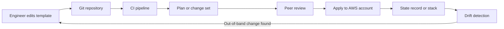
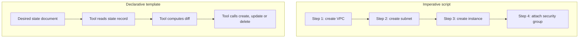
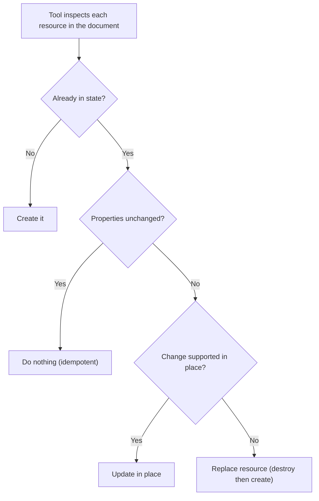

# 01 · Infrastructure as Code Fundamentals

> **Phase 3 — DevOps and Automation** · Lesson 01 of 13
> ⬅️ Previous: [Phase 1 — Core Foundations](../phase-1-core-foundations/README.md) · ➡️ Next: [CloudFormation](./02-cloudformation.md) · 🏠 [Phase overview](./README.md)

## 🎯 Learning Objectives

By the end of this lesson you will be able to:

- Explain the difference between declarative and imperative infrastructure management
- Define idempotency and prove whether a given tool or script is idempotent
- Describe what "state" means, where each tool keeps it, and why drift matters
- Compare CloudFormation, CDK, Terraform, and Pulumi and pick one for a given team

**Estimated time:** 45 min · **Difficulty:** Beginner

---

## 🧠 Core Concepts

**Infrastructure as Code (IaC)** means your cloud environment is described by files that live in version control, and every change to the environment flows through those files. The value is not "automation" — a shell script automating the console clicks is still not IaC. The value is that the *description* of the target environment is reviewable, diffable, testable, and reproducible.

The single most important distinction is **declarative vs imperative**. An imperative script says *how*: create a VPC, then create a subnet, then create an instance. A declarative template says *what*: "there is a VPC with this CIDR and two subnets." With a declarative tool you never call create — you hand the tool a desired-state document and it works out what to create, change, or delete to converge reality onto that document. That is why running a declarative tool twice with the same input does nothing the second time.

That property is **idempotency**: applying the same definition any number of times leaves you in the same state. It is what makes declarative tools safe to run from a pipeline on every commit, and it is the reason a `create-bucket` CLI call is a poor building block — the second run fails with `BucketAlreadyOwnedByYou`.

The last concept is **state**. A declarative tool must know what it created last time, otherwise it cannot tell whether a resource needs updating or creating, and it cannot safely delete what is no longer in the template. Tools solve this differently: CloudFormation keeps an authoritative state record inside AWS itself (the *stack*), while Terraform keeps a **state file** that you are responsible for storing, locking, and protecting. Losing that file is painful; leaking it can expose secrets. When reality and the definition diverge — someone edits a security group in the console — you have **drift**, and drift is the enemy that drift detection exists to find.

### Key terminology

| Term | Meaning |
|------|---------|
| **Declarative** | You describe the end state; the tool computes the steps. |
| **Imperative** | You write the ordered steps yourself; the tool executes them blindly. |
| **Idempotent** | Running the same operation repeatedly produces the same result. |
| **Desired state** | What the code says the environment should look like. |
| **Actual state** | What the cloud provider currently reports. |
| **State file / stack** | The tool's record of previously created resources and their provider IDs. |
| **Drift** | A difference between desired state and actual state caused by out-of-band change. |
| **Plan / change set** | A preview of exactly what the tool intends to create, update, or destroy. |
| **Provider** | The plugin that translates generic resource definitions into a vendor's API calls. |

---

## 🗺️ Architecture Diagram

The core IaC loop — code is the source of truth, and the tool reconciles reality against it:



Imperative steps versus a declarative document:



What the state record buys you — three questions it answers on every run:



---

## 🧪 Hands-on Lab: Prove Idempotency, Then Find Drift

**Goal:** Feel the difference between an imperative CLI call and a declarative template, then observe drift being detected.

**Prerequisites:** AWS CLI v2 configured with a profile that can create S3 buckets and CloudFormation stacks, permissions to create a bucket, and the `us-east-1` region (bucket names are globally unique — pick a suffix).

### Step 1 — Do it imperatively and watch it fail on the second run

```bash
# Bucket names are global; make this unique to you
BUCKET="iac-demo-$(date +%s)"

# Imperative: create the bucket directly through the API
aws s3api create-bucket --bucket "$BUCKET" --region us-east-1

# Run the exact same command again — this is the idempotency test
aws s3api create-bucket --bucket "$BUCKET" --region us-east-1
```

The second call fails with `BucketAlreadyOwnedByYou`. The script is not idempotent: it has no idea what already exists, so it cannot converge.

Delete this bucket before moving on, otherwise the next step collides with it.

```bash
# Clean up the imperative bucket
aws s3api delete-bucket --bucket "$BUCKET" --region us-east-1
```

### Step 2 — Describe the same thing declaratively

Save this as `bucket.yaml`:

```yaml
AWSTemplateFormatVersion: "2010-09-09"
Description: IaC fundamentals lab — one versioned, private bucket

Parameters:
  BucketSuffix:
    Type: String
    Description: Globally unique suffix, e.g. your account ID

Resources:
  ArtifactBucket:
    Type: AWS::S3::Bucket
    Properties:
      BucketName: !Sub "iac-demo-${BucketSuffix}"
      VersioningConfiguration:
        Status: Enabled
      PublicAccessBlockConfiguration:
        BlockPublicAcls: true
        BlockPublicPolicy: true
        IgnorePublicAcls: true
        RestrictPublicBuckets: true

Outputs:
  BucketName:
    Description: Name of the created bucket
    Value: !Ref ArtifactBucket
```

### Step 3 — Apply twice and confirm idempotency

```bash
# First apply: creates the stack and the bucket
aws cloudformation deploy \
  --stack-name iac-demo \
  --template-file bucket.yaml \
  --parameter-overrides BucketSuffix=123456789012 \
  --region us-east-1

# Second apply with identical input: expect "No changes to deploy"
aws cloudformation deploy \
  --stack-name iac-demo \
  --template-file bucket.yaml \
  --parameter-overrides BucketSuffix=123456789012 \
  --region us-east-1

# Confirm the stack recorded the bucket as one managed resource
aws cloudformation describe-stack-resources \
  --stack-name iac-demo \
  --query "StackResources[].{Logical:LogicalResourceId,Type:ResourceType,Status:ResourceStatus}" \
  --output table
```

### Step 4 — Create drift on purpose, then detect it

```bash
# Out-of-band change: add a tag straight through the S3 API, bypassing the template
aws s3api put-bucket-tagging \
  --bucket iac-demo-123456789012 \
  --tagging 'TagSet=[{Key=Owner,Value=someone-via-console}]'

# Ask CloudFormation to compare template against reality
aws cloudformation detect-stack-drift --stack-name iac-demo

# Read the result (wait a few seconds after the command above)
aws cloudformation describe-stack-resource-drifts \
  --stack-name iac-demo \
  --stack-resource-drift-status-filters MODIFIED DELETED \
  --query "StackResourceDrifts[].{Logical:LogicalResourceId,Status:StackResourceDriftStatus,Diff:PropertyDifferences}" \
  --output json
```

### Step 5 — Verify

The drift report lists the bucket with status `MODIFIED` and a property difference for `Tags`. Now re-run the `deploy` command from Step 3 — the template wins and the hand-added tag is removed. That is the whole promise of IaC in one experiment: reality is forced back to the definition.

---

## 💻 CLI Reference

```bash
# Preview what a Terraform change would do without touching anything
terraform plan -out=tfplan

# Apply a saved plan exactly as reviewed
terraform apply tfplan

# Show the diff between local definitions and a deployed CloudFormation stack
aws cloudformation describe-stack-events --stack-name iac-demo \
  --query "StackEvents[0:5].[Timestamp,ResourceStatus,ResourceType]" --output table

# Synthesize a CDK app into CloudFormation templates without deploying
cdk synth

# Show the diff between a CDK app and the deployed stack
cdk diff

# Preview a Pulumi change
pulumi preview

# List stacks CloudFormation knows about in this region
aws cloudformation list-stacks \
  --stack-status-filter CREATE_COMPLETE UPDATE_COMPLETE \
  --query "StackSummaries[].{Name:StackName,Status:StackStatus}" --output table
```

| Command | Purpose |
|---------|---------|
| `terraform plan` | Human-readable preview of create/update/destroy |
| `cdk synth` | Turn code into plain CloudFormation for review |
| `cdk diff` | Compare synthesised template with deployed stack |
| `pulumi preview` | Preview with a language-native diff |
| `describe-stack-resource-drifts` | Enumerate resources that no longer match the template |

---

## ✅ Best Practices

| Practice | Why it matters |
|----------|----------------|
| Make the template the only way to change production | Console edits create drift that the next apply silently reverts |
| Always review a plan or change set before applying | Replacing a database instead of updating it is unrecoverable |
| Keep state centralized, versioned, and locked | Two concurrent applies against one state corrupt it |
| Parameterize per environment, never branch the template | One template + parameters avoids configuration skew across stages |
| Put IaC in its own repo or folder with CODEOWNERS | Infrastructure change review should be explicit, not incidental |
| Tag every resource with owner, environment, and cost center | Enables cost allocation and safe bulk operations later |
| Test in a sandbox account, then promote unchanged artifacts | Same code path for every stage reduces surprise |

---

## ⚠️ Common Pitfalls

| Pitfall | Symptom | Fix |
|---------|---------|-----|
| Hand-editing provisioned resources | Next apply reverts your fix without warning | Change the template; add drift detection to a schedule |
| No state locking | Two pipelines apply at once, resources duplicated or orphaned | Use DynamoDB locking (Terraform) or one pipeline per stack (CloudFormation) |
| Mixing secrets into templates | Credentials land in Git and in state files | Pull from Secrets Manager or SSM at deploy time with dynamic references |
| Deleting a state file | Terraform wants to recreate everything that already exists | Keep versioned remote state in S3 with object-lock or versioning |
| Renaming resources | Tool destroys and recreates instead of renaming | Use `moved` blocks (Terraform) or a stack import/retain strategy |
| Over-nesting modules early | Nobody can follow the indirection | Start flat, extract a module after the second copy-paste |
| Applying straight to production from a laptop | Unreviewed changes, no audit trail | Run applies only from CI with an approval gate |

---

## 💰 Cost Considerations

IaC tooling itself is cheap. CloudFormation, CDK, and Pulumi's open-source CLI cost nothing; Terraform open-source is free, while HCP Terraform charges per managed resource per hour once you outgrow the free tier. **Pulumi Cloud** and **CloudFormation** are free up to a point, and AWS charges only for the resources created.

The real bill is what IaC lets you create *fast*. A template with a hard-coded `m5.4xlarge` and a NAT Gateway spins up roughly $0.09/hour per NAT Gateway plus data processing, in every environment, on every deploy. Add three things to every template: a `CostCenter` tag so Cost Explorer can attribute spend, a `DeletionPolicy: Retain` only where data loss is worse than cost, and a naming convention containing the environment so a forgotten `dev` stack is obvious. Also budget for state storage: an S3 backend with versioning for Terraform state costs cents, but a NAT Gateway created "temporarily" by a lab costs dollars per day.

---

## 🔐 Security Considerations

- **State files contain secrets in plaintext.** Terraform state stores RDS passwords and generated keys. Encrypt the S3 bucket with KMS, block all public access, enable versioning, and restrict read access to the deployment role only.
- **Use a dedicated deployment role, not an admin user.** The pipeline assumes a role with a scoped trust policy; humans never hold long-lived keys (see [GitHub Actions for AWS](./07-github-actions-for-aws.md) for the OIDC pattern).
- **Guard the destructive paths.** In CloudFormation, set `DeletionPolicy: Retain` and `UpdateReplacePolicy: Retain` on stateful resources; in Terraform, use `prevent_destroy` in a `lifecycle` block on databases and buckets.
- **Never hand-edit provisioned resources**, and treat drift detection findings as security findings — someone with console access bypassed your reviewed process.
- **Review plans for IAM and network changes at a higher bar.** A widened `/0` security group or a wildcard policy passes tests silently.

---

## 🧩 Exercise

Take the bucket template from the lab and add a second resource: an SNS topic, plus an output that exports the topic ARN. Then deliberately introduce drift in two different ways — rename the topic's tags in the console and delete the bucket's versioning configuration — and run drift detection.

Success looks like: `describe-stack-resource-drifts` reports two resources with status `MODIFIED`, and a subsequent `aws cloudformation deploy` with the original template returns the environment to a clean state with `detect-stack-drift` reporting `IN_SYNC`.

---

## 📚 Resources

- [What is Infrastructure as Code?](https://docs.aws.amazon.com/whitepapers/latest/introduction-devops-aws/infrastructure-as-code.html)
- [AWS CloudFormation User Guide](https://docs.aws.amazon.com/AWSCloudFormation/latest/UserGuide/Welcome.html)
- [Terraform: What is Terraform?](https://developer.hashicorp.com/terraform/intro)
- [AWS CDK Developer Guide](https://docs.aws.amazon.com/cdk/v2/guide/home.html)
- [Pulumi: Infrastructure as Code in Any Programming Language](https://www.pulumi.com/what-is/what-is-infrastructure-as-code/)

---

## ➡️ Next Steps

You now know *why* IaC matters and how each tool keeps track of the world. The next lesson takes the native AWS tool and goes deep: templates, stacks, change sets, rollback semantics, and the intrinsic functions that make a template dynamic.

> ⬅️ Previous: [Phase 1 — Core Foundations](../phase-1-core-foundations/README.md) · ➡️ Next: [CloudFormation](./02-cloudformation.md) · 🏠 [Phase overview](./README.md)
