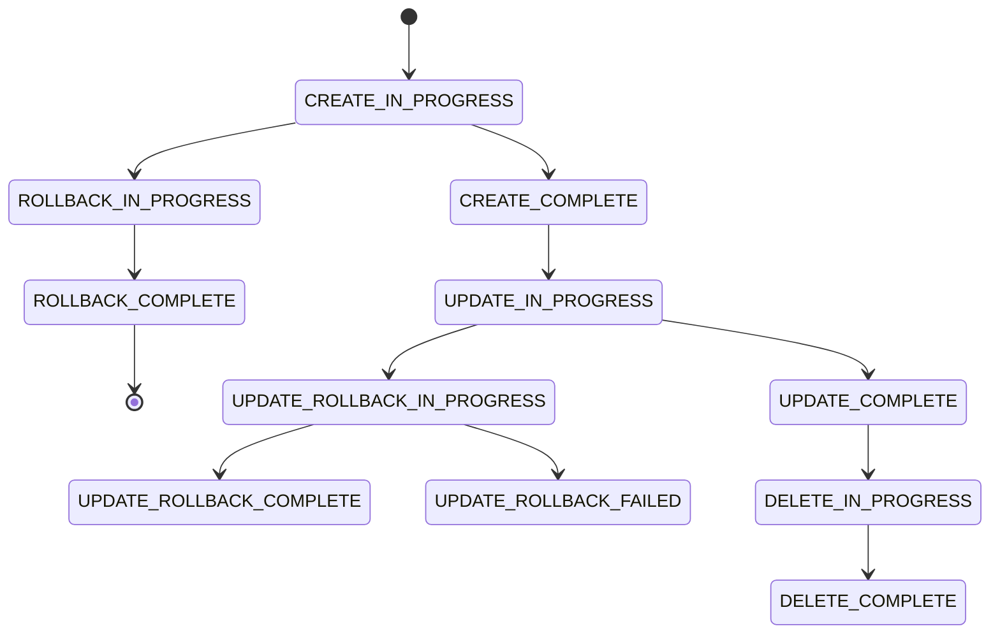
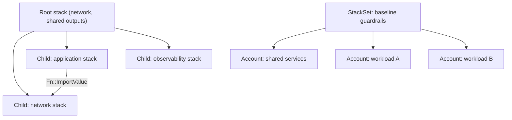
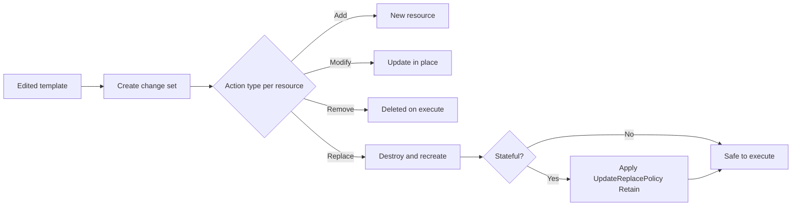

# 02 · CloudFormation

> **Phase 3 — DevOps and Automation** · Lesson 02 of 13
> ⬅️ Previous: [Infrastructure as Code Fundamentals](./01-infrastructure-as-code-fundamentals.md) · ➡️ Next: [AWS CDK](./03-aws-cdk.md) · 🏠 [Phase overview](./README.md)

## Learning Objectives

By the end of this lesson you will be able to:

- Write a multi-resource CloudFormation template using `Ref`, `Fn::GetAtt`, and `Fn::Sub`
- Deploy changes safely with change sets instead of blind updates
- Explain CloudFormation rollback behavior and recover a stuck `UPDATE_ROLLBACK_FAILED` stack
- Split large systems with nested stacks and deploy across an organization with StackSets
- Resolve secrets at deploy time with dynamic references instead of hard-coding them

**Estimated time:** 75 min · **Difficulty:** Intermediate

---

## Core Concepts

A **template** is a JSON or YAML document describing resources. A **stack** is an instance of that template in one account and region, plus the state record CloudFormation keeps for it. You never talk to the resources directly through CloudFormation — you declare the end state, submit it, and CloudFormation orders the API calls, retries, and rolls back on failure.

Templates are made dynamic by **intrinsic functions**. `Ref` returns a resource's physical ID (or a parameter's value), `Fn::GetAtt` returns a specific attribute of a resource (an ARN, a DNS name, an endpoint), and `Fn::Sub` interpolates strings with references. YAML short forms (`!Ref`, `!GetAtt`, `!Sub`) are the idiomatic way to write them. Everything else — `Fn::Join`, `Fn::Select`, `Fn::GetAZs`, conditions like `Fn::If` — composes on top.

Never deploy an update without a **change set**. A change set tells you, before anything happens, which resources will be added, modified, or **replaced**. Replacement is the dangerous category: `AWS::RDS::DBInstance` with a changed `DBInstanceIdentifier`, or a bucket with a changed name, is destroyed and recreated. Reading a change set costs nothing and has prevented more outages than any other CloudFormation practice.

**Rollback behavior** is worth memorizing because it determines what you do at 3 a.m. If stack *creation* fails, CloudFormation rolls back to nothing and the stack ends in `ROLLBACK_COMPLETE` — a state you cannot update, only delete. If an *update* fails, CloudFormation restores the previous template and ends in `UPDATE_ROLLBACK_COMPLETE`, which is healthy and updateable again. If the rollback itself cannot complete (often because a resource was changed out-of-band), you land in `UPDATE_ROLLBACK_FAILED` and must either fix the offending resource or run `continue-update-rollback` with `--resources-to-skip`.

At scale you use two features. **Nested stacks** break one large template into a parent that references child templates in S3, which keeps each template reviewable and lets you update one layer at a time. **StackSets** deploy the same template to many accounts and regions at once — the standard tool for organizational guardrails like CloudTrail, Config, and baseline IAM roles.

Finally, **dynamic references** let a template read live values at deploy time: `{{resolve:ssm:/path/param}}` for SSM Parameter Store and `{{resolve:secretsmanager:secret-id:SecretString:key}}` for Secrets Manager. CloudFormation resolves them during the operation and does not store the resolved secret as a property, which keeps credentials out of the template and out of the console.

### Key terminology

| Term | Meaning |
|------|---------|
| **Template** | YAML or JSON definition of resources, parameters, mappings, conditions, outputs. |
| **Stack** | A deployed instance of a template in one account and region. |
| **Change set** | A preview of the operations an update would perform, including replacements. |
| **Drift** | A managed resource whose actual configuration no longer matches the template. |
| **Nested stack** | A stack created by a parent stack via `AWS::CloudFormation::Stack`. |
| **StackSet** | A template deployed to many accounts and regions with one operation. |
| **Export / ImportValue** | Cross-stack outputs — one stack publishes a value, another consumes it. |
| **DeletionPolicy** | What happens to a resource when its stack is deleted: `Delete`, `Retain`, `Snapshot`. |
| **CreationPolicy / WaitCondition** | Signals that gate stack progress until an instance or external process reports success. |

---

## Architecture Diagram

The stack lifecycle, including the rollback paths you will meet in production:



How a nested stack plus a StackSet deployment fit together:



The update decision path, in the order you should think about it:



---

## Hands-on Lab: A Realistic Stack with Change Sets and Rollback

**Goal:** Deploy a VPC with two public subnets, a versioned bucket, and an SSM parameter; then practise the change-set and rollback workflow on it.

**Prerequisites:** AWS CLI v2, an account with `us-east-1` access, IAM permissions for VPC, S3, SSM, and CloudFormation, and the ability to create IAM roles if you extend the lab.

### Step 1 — Write the template

Save as `network.yaml`:

```yaml
AWSTemplateFormatVersion: "2010-09-09"
Description: Phase 3 lab - VPC with two public subnets and a versioned artifact bucket

Parameters:
  ProjectName:
    Type: String
    Default: phase3lab
    AllowedPattern: "[a-z0-9-]+"
    Description: Lowercase project prefix used in resource names
  Stage:
    Type: String
    Default: dev
    AllowedValues: [dev, staging, prod]
  VpcCidr:
    Type: String
    Default: 10.42.0.0/16
    AllowedPattern: "^([0-9]{1,3}\\.){3}[0-9]{1,3}/[0-9]{1,2}$"

Conditions:
  IsProd: !Equals [!Ref Stage, prod]

Mappings:
  StageConfig:
    dev:
      LogRetentionDays: 7
    staging:
      LogRetentionDays: 14
    prod:
      LogRetentionDays: 90

Resources:
  Vpc:
    Type: AWS::EC2::VPC
    Properties:
      CidrBlock: !Ref VpcCidr
      EnableDnsSupport: true
      EnableDnsHostnames: true
      Tags:
        - Key: Name
          Value: !Sub "${ProjectName}-${Stage}-vpc"

  PublicSubnetA:
    Type: AWS::EC2::Subnet
    Properties:
      VpcId: !Ref Vpc
      CidrBlock: !Select [0, !Cidr [!Ref VpcCidr, 4, 8]]
      AvailabilityZone: !Select [0, !GetAZs ""]
      MapPublicIpOnLaunch: true
      Tags:
        - Key: Name
          Value: !Sub "${ProjectName}-${Stage}-public-a"

  PublicSubnetB:
    Type: AWS::EC2::Subnet
    Properties:
      VpcId: !Ref Vpc
      CidrBlock: !Select [1, !Cidr [!Ref VpcCidr, 4, 8]]
      AvailabilityZone: !Select [1, !GetAZs ""]
      MapPublicIpOnLaunch: true

  InternetGateway:
    Type: AWS::EC2::InternetGateway

  GatewayAttachment:
    Type: AWS::EC2::VPCGatewayAttachment
    Properties:
      VpcId: !Ref Vpc
      InternetGatewayId: !Ref InternetGateway

  PublicRouteTable:
    Type: AWS::EC2::RouteTable
    Properties:
      VpcId: !Ref Vpc

  DefaultRoute:
    Type: AWS::EC2::Route
    DependsOn: GatewayAttachment
    Properties:
      RouteTableId: !Ref PublicRouteTable
      DestinationCidrBlock: 0.0.0.0/0
      GatewayId: !Ref InternetGateway

  PublicSubnetARouteAssociation:
    Type: AWS::EC2::SubnetRouteTableAssociation
    Properties:
      SubnetId: !Ref PublicSubnetA
      RouteTableId: !Ref PublicRouteTable

  ArtifactBucket:
    Type: AWS::S3::Bucket
    DeletionPolicy: Retain
    UpdateReplacePolicy: Retain
    Properties:
      BucketName: !Sub "${ProjectName}-${Stage}-artifacts-${AWS::AccountId}"
      VersioningConfiguration:
        Status: Enabled
      PublicAccessBlockConfiguration:
        BlockPublicAcls: true
        BlockPublicPolicy: true
        IgnorePublicAcls: true
        RestrictPublicBuckets: true

  AppLogGroup:
    Type: AWS::Logs::LogGroup
    Properties:
      LogGroupName: !Sub "/${ProjectName}/${Stage}/app"
      RetentionInDays: !FindInMap [StageConfig, !Ref Stage, LogRetentionDays]

  DbHostParameter:
    Type: AWS::SSM::Parameter
    Properties:
      Name: !Sub "/${ProjectName}/${Stage}/db/host"
      Type: String
      Value: !Sub "db.${Stage}.internal"

Outputs:
  VpcId:
    Description: VPC identifier for downstream stacks
    Value: !Ref Vpc
    Export:
      Name: !Sub "${ProjectName}-${Stage}-vpc-id"

  BucketName:
    Description: Artifact bucket
    Value: !Ref ArtifactBucket

  PublicSubnetIds:
    Description: Comma-separated public subnets
    Value: !Join [",", [!Ref PublicSubnetA, !Ref PublicSubnetB]]

  VpcCidrOut:
    Description: CIDR assigned to the VPC
    Value: !GetAtt Vpc.CidrBlock
```

### Step 2 — Validate, then create a change set instead of deploying

```bash
# Catch syntax problems locally before touching the API
aws cloudformation validate-template --template-body file://network.yaml

# Create a change set for a brand-new stack (render the template to S3-free inline form)
aws cloudformation create-change-set \
  --stack-name phase3lab-dev-network \
  --change-set-name initial \
  --change-set-type CREATE \
  --template-body file://network.yaml \
  --parameters ParameterKey=ProjectName,ParameterValue=phase3lab ParameterKey=Stage,ParameterValue=dev \
  --region us-east-1

# Wait until the change set is ready, then read exactly what will happen
aws cloudformation wait change-set-create-complete \
  --stack-name phase3lab-dev-network --change-set-name initial --region us-east-1

aws cloudformation describe-change-set \
  --stack-name phase3lab-dev-network --change-set-name initial \
  --query "Changes[].ResourceChange.{Action:Action,Logical:LogicalResourceId,Type:ResourceType,Replacement:Replacement}" \
  --output table
```

Every row should read `Add`. Nothing has been created yet.

### Step 3 — Execute the change set

```bash
# Commit the previewed change set
aws cloudformation execute-change-set \
  --stack-name phase3lab-dev-network --change-set-name initial --region us-east-1

# Watch the events list instead of staring at the console
aws cloudformation describe-stack-events --stack-name phase3lab-dev-network \
  --query "StackEvents[0:15].[Timestamp,LogicalResourceId,ResourceStatus,ResourceStatusReason]" \
  --output table

aws cloudformation wait stack-create-complete --stack-name phase3lab-dev-network --region us-east-1
```

### Step 4 — Prove rollback works

Introduce an impossible value, then update:

```bash
# An invalid CIDR must fail validation and roll the update back
aws cloudformation deploy \
  --stack-name phase3lab-dev-network \
  --template-file network.yaml \
  --parameter-overrides ProjectName=phase3lab Stage=dev VpcCidr=10.42.0.0/33 \
  --region us-east-1
```

The command fails and the stack returns to its previous good template. Confirm with:

```bash
# Status should be UPDATE_ROLLBACK_COMPLETE, meaning the old config is intact
aws cloudformation describe-stacks --stack-name phase3lab-dev-network \
  --query "Stacks[0].StackStatus" --output text
```

Now change something legitimate — for example add `Stage=staging` and re-run `aws cloudformation deploy`. Reading the output, note that the `AWS::S3::Bucket` logical resource keeps its physical name only because the name changes with the stage; a *name* change on a bucket forces a replacement, which is exactly why `UpdateReplacePolicy: Retain` is set.

### Step 5 — Verify

```bash
# All managed resources and their current statuses
aws cloudformation describe-stack-resources --stack-name phase3lab-dev-network \
  --query "StackResources[].{Logical:LogicalResourceId,Status:ResourceStatus,Physical:PhysicalResourceId}" \
  --output table

# Exports other stacks can import
aws cloudformation list-exports --query "Exports[?starts_with(Name,'phase3lab')].[Name,Value]" --output table

# Drift check on the whole stack
aws cloudformation detect-stack-drift --stack-name phase3lab-dev-network
```

### Step 6 — Clean up

```bash
# Retained buckets and log groups must be deleted by hand after the stack goes away
aws cloudformation delete-stack --stack-name phase3lab-dev-network --region us-east-1
aws cloudformation wait stack-delete-complete --stack-name phase3lab-dev-network --region us-east-1
aws s3 rb "s3://phase3lab-dev-artifacts-$(aws sts get-caller-identity --query Account --output text)" --force
```

---

## CLI Reference

```bash
# Package a template that references local files (Lambda code, nested templates) and upload to S3
aws cloudformation package \
  --template-file root.yaml \
  --s3-bucket my-artifacts-123456789012 \
  --output-template-file packaged.yaml

# Deploy the packaged template as a change set plus execute (one-command CI path)
aws cloudformation deploy \
  --template-file packaged.yaml \
  --stack-name phase3lab-prod-network \
  --capabilities CAPABILITY_IAM CAPABILITY_NAMED_IAM CAPABILITY_AUTO_EXPAND \
  --parameter-overrides Stage=prod \
  --tags Project=phase3lab Environment=prod \
  --no-fail-on-empty-changeset

# Inspect drift across every resource in a stack
aws cloudformation describe-stack-resource-drifts \
  --stack-name phase3lab-dev-network \
  --stack-resource-drift-status-filters MODIFIED DELETED ADDED NOT_CHECKED

# Recover a stack whose rollback could not complete
aws cloudformation continue-update-rollback \
  --stack-name phase3lab-dev-network \
  --resources-to-skip PublicSubnetB

# Roll back a successful update on purpose
aws cloudformation rollback-stack --stack-name phase3lab-dev-network

# Create a StackSet that deploys to whole OUs
aws cloudformation create-stack-set \
  --stack-set-name org-baseline \
  --template-body file://baseline.yaml \
  --capabilities CAPABILITY_NAMED_IAM \
  --permission-model SERVICE_MANAGED \
  --auto-deployment Enabled=true,RetainStacksOnAccountRemoval=false

# Instantiate the StackSet in specific accounts and regions
aws cloudformation create-stack-instances \
  --stack-set-name org-baseline \
  --accounts 111122223333 444455556666 \
  --regions us-east-1 eu-west-1 \
  --operation-preferences FailureToleranceCount=1,MaxConcurrentCount=2

# Read what a nested child stack is doing
aws cloudformation describe-stack-resources --stack-name phase3lab-prod-network \
  --query "StackResources[?ResourceType=='AWS::CloudFormation::Stack'].[LogicalResourceId,PhysicalResourceId]" \
  --output table
```

| Command | Purpose |
|---------|---------|
| `package` | Uploads local artifacts and rewrites template references to S3 URLs |
| `deploy` | Change set + execute in one step, ideal for CI |
| `create-change-set` | Explicit, reviewable preview path for production |
| `detect-stack-drift` | Flags out-of-band changes for re-convergence or investigation |
| `continue-update-rollback` | Unsticks `UPDATE_ROLLBACK_FAILED` |
| `create-stack-instances` | Fans a StackSet out to many accounts and regions |

---

## Best Practices

| Practice | Why it matters |
|----------|----------------|
| Use change sets for every production update | Replacement surprises are the leading cause of CloudFormation incidents |
| Cap stack size; go nested beyond ~30 resources | Event history and troubleshooting stay tractable |
| Version child templates in S3 under a unique key per build | Stack updates pin an immutable template revision |
| `DeletionPolicy: Retain` on buckets, databases, and KMS keys | A mistaken stack delete should never delete customer data |
| Use `Fn::Sub` rather than `Fn::Join` chains | Readable, one interpolation syntax, fewer type mistakes |
| Set `--no-fail-on-empty-changeset` in CI | No-op deploys should be green, not red |
| Tag parameters and stacks with owner and cost center | Cost allocation and safe bulk operations |
| Attach a stack policy to production stacks | Blocks accidental replacement of critical resources |
| Use StackSets for guardrails, not for application deploys | Guardrails need drift-aware, org-wide convergence |

---

## Common Pitfalls

| Pitfall | Symptom | Fix |
|---------|---------|-----|
| Updating a `ROLLBACK_COMPLETE` stack | `ValidationError: Stack is in ROLLBACK_COMPLETE state` | Delete the failed stack, fix the template, deploy again |
| Changing a name property | Resource silently replaced and data lost | Change sets + `UpdateReplacePolicy: Retain` + naming without volatile parts |
| Missing `CAPABILITY_NAMED_IAM` | `InsufficientCapabilitiesException` | Pass `--capabilities CAPABILITY_NAMED_IAM` when creating named IAM resources |
| Exported value in use | `Cannot delete export ... in use by stack` | Find consumers with `aws cloudformation list-imports` and update them first |
| Hard-coded secrets in properties | Secrets appear in template and console history | Use `{{resolve:secretsmanager:...}}` dynamic references |
| Stack events scrolling past the failure | No idea which resource broke | `describe-stack-events` sorted by timestamp, look for the first non-`*_IN_PROGRESS` |
| Deleting a bucket with objects | `DELETE_FAILED`, stack stuck | Empty the bucket, then `delete-stack` again with `--retain-resources` if needed |
| Drift accepted as normal | Templates no longer describe reality | Schedule drift detection, treat findings as incidents |

---

## Cost Considerations

CloudFormation has **no charge** for templates, stacks, change sets, drift detection, or StackSets. You pay only for the resources created — plus a small S3 cost for nested-stack templates and packaged artifacts (pennies per month), and CloudTrail data events if you audit every API call.

The bill lever is what templates provision by default. A NAT Gateway at roughly $0.045/hour plus $0.045/GB processed is about $32/month per gateway before traffic; three environments with one gateway each and a replica in a second region can quietly reach several hundred dollars a month. `AWS::Logs::LogGroup` with no `RetentionInDays` retains logs forever — the mapping in the lab exists precisely to make retention explicit per environment. Guard rails worth adding: `RetentionInDays` on every log group, `AutoMinorVersionUpgrade` discipline on RDS to avoid surprise instance-class replacements, and a `CostCenter` tag on every stack so Cost Explorer can attribute spend to the stack that created it. Use `Resource Groups` filtered on stack tags to find forgotten lab stacks that never got deleted.

---

## Security Considerations

- **Never store secrets in template properties.** Use `{{resolve:ssm-secure:/app/db/password}}` or `{{resolve:secretsmanager:MySecret:SecretString:password}}`; CloudFormation resolves them at apply time and marks them sensitive in resource properties.
- **Plan IAM changes like network changes.** A role with `"Action": "*"` in a template is a finding, and `CAPABILITY_AUTO_EXPAND` means nested templates are expanded without your review — pair it with StackSet or S3 permission controls.
- **Restrict who can run `execute-change-set`.** Update permissions equal production write access; scope them through a deployment role assumed by CI, never a human's long-lived key.
- **Protect stateful resources structurally.** Use `DeletionPolicy` and `UpdateReplacePolicy` on every data-bearing resource, and attach a stack policy that denies `Update:Replace` on them.
- **Enable stack termination protection** (`--enable-termination-protection`) on production stacks to make accidental deletion a two-step, deliberate act.
- **Log everything:** CloudFormation API calls appear in CloudTrail; route them to a locked-down, org-wide trail so a template change is attributable to a principal.
- **Guard StackSet blast radius.** `MaxConcurrentCount` and `FailureToleranceCount` limit how many accounts a bad template can break in one operation.

---

## Exercise

Add a nested stack to the lab. Create a child template `app.yaml` that takes `VpcId` and `SubnetIds` as parameters and creates a security group plus an Application Load Balancer, then reference it from a new `root.yaml` with `AWS::CloudFormation::Stack`, passing the imported values from `network.yaml` via `Fn::ImportValue`.

Success looks like: `aws cloudformation package` uploads `app.yaml` to S3, `create-change-set` on `root.yaml` shows one `Add` for the nested `AWS::CloudFormation::Stack` resource, and after execution `describe-stack-resources` on the root stack shows the child with a physical ID equal to the child stack's ARN.

---

## Resources

- [AWS CloudFormation User Guide](https://docs.aws.amazon.com/AWSCloudFormation/latest/UserGuide/Welcome.html)
- [Intrinsic Function Reference](https://docs.aws.amazon.com/AWSCloudFormation/latest/UserGuide/intrinsic-function-reference.html)
- [Dynamic References](https://docs.aws.amazon.com/AWSCloudFormation/latest/UserGuide/dynamic-references.html)
- [Detecting Unmanaged Configuration Changes to Stacks](https://docs.aws.amazon.com/AWSCloudFormation/latest/UserGuide/using-cfn-stack-drift.html)
- [AWS CloudFormation StackSets](https://docs.aws.amazon.com/AWSCloudFormation/latest/UserGuide/what-is-cfnstacksets.html)

---

## Next Steps

Templates are powerful but verbose, and YAML cannot express loops, types, or reusable abstractions. The next lesson replaces hand-written templates with real code that synthesizes them: the AWS Cloud Development Kit.

> ⬅️ Previous: [Infrastructure as Code Fundamentals](./01-infrastructure-as-code-fundamentals.md) · ➡️ Next: [AWS CDK](./03-aws-cdk.md) · 🏠 [Phase overview](./README.md)
