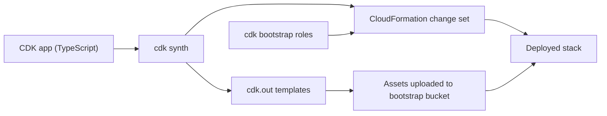
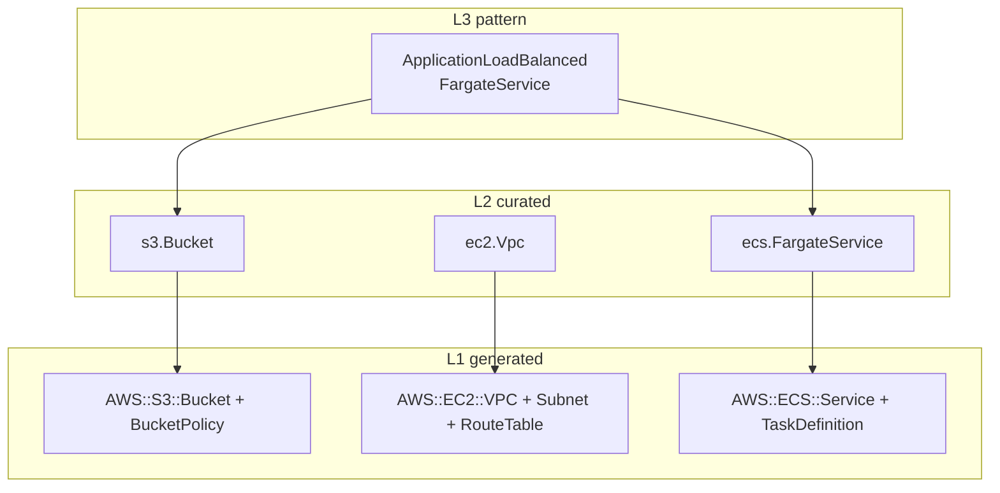
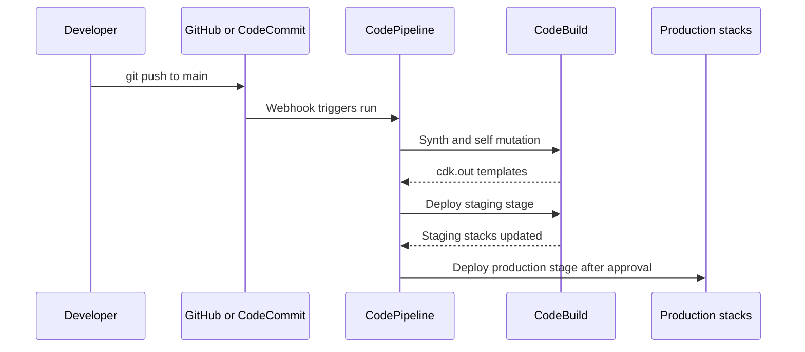

# 03 · AWS CDK

> **Phase 3 — DevOps and Automation** · Lesson 03 of 13
> ⬅️ Previous: [CloudFormation](./02-cloudformation.md) · ➡️ Next: [Terraform on AWS](./04-terraform-on-aws.md) · 🏠 [Phase overview](./README.md)

## 🎯 Learning Objectives

By the end of this lesson you will be able to:

- Distinguish L1, L2, and L3 constructs and choose the right level for a task
- Write a TypeScript CDK app that deploys a Fargate service behind an ALB
- Use `cdk synth`, `cdk diff`, `cdk bootstrap`, and `cdk deploy` in a safe workflow
- Enforce guardrails with `cdk-nag` and lock behaviour down with snapshot tests
- Model a multi-stage delivery pipeline with CDK Pipelines

**Estimated time:** 75 min · **Difficulty:** Intermediate

---

## 🧠 Core Concepts

The AWS CDK lets you define CloudFormation templates in a real programming language. Your app is a tree of **constructs**; running `cdk synth` walks that tree and emits plain CloudFormation, which CloudFormation then deploys. Nothing new happens in AWS — CDK is a compiler with strong opinions, and the artifact it produces is a template you can still read, review, and hand to a change set.

Constructs come in three levels. **L1** constructs (prefixed `Cfn*`) map one-to-one onto CloudFormation resources and are fully explicit — `new s3.CfnBucket(this, 'Bucket', { versioningConfiguration: { status: 'Enabled' } })`. **L2** constructs are the curated AWS experience: sensible defaults, helper methods, and automatic IAM wiring, so `new s3.Bucket(...)` with `enforceSSL: true` produces several L1 resources and a bucket policy for you. **L3** constructs are **patterns** — opinionated combinations such as `ApplicationLoadBalancedFargateService`, which creates a cluster, task definition, service, ALB, listener, target group, and security groups in one statement. Use L3 for standard shapes, L2 for everything else, and drop to L1 only for resources the higher levels do not cover yet.

Two mechanical details trip people up. **Bootstrap** — CDK needs an S3 bucket and IAM roles in the target account to hold assets; `cdk bootstrap` creates them once per account/region, and every deploy afterwards runs inside those roles. **Assets** — a Dockerfile or Lambda bundle is packaged, uploaded, and referenced by an immutable key, which is why your Docker image is addressable but never re-uploaded needlessly.

The CDK's biggest advantage is that infrastructure is now testable code. `assertions.Template.fromStack()` lets you assert that a stack contains a versioned bucket or a TLS-only policy, and snapshot tests fail when a refactor unexpectedly changes a resource. `cdk-nag` goes further and applies AWS Solutions checks — public buckets, unencrypted volumes, wildcard IAM — as annotations during `synth`, turning a whole class of findings into a build error. **CDK Pipelines** closes the loop: the pipeline itself is CDK code, and adding a stage deploys the whole stack set to a new environment with a single `addStage` call.

### Key terminology

| Term | Meaning |
|------|---------|
| **App** | The root construct; running it synthesizes stacks. |
| **Stack** | A CDK stack maps to one CloudFormation stack in one account and region. |
| **L1 / L2 / L3** | Raw resources / curated resources / multi-resource patterns. |
| **Synth** | The compile step: constructs become a CloudFormation template in `cdk.out`. |
| **Bootstrap** | One-time per-account/region setup of the CDK toolkit stack and roles. |
| **Asset** | A local file or Docker build that CDK uploads and references by hash. |
| **Aspect** | A visitor that walks the construct tree to validate or mutate it — how `cdk-nag` hooks in. |
| **Context** | Cached environment facts and feature flags stored in `cdk.context.json`. |
| **CDK Pipelines** | A CodePipeline construct that self-mutates to match your app definition. |

---

## 🗺️ Architecture Diagram

From TypeScript code to running infrastructure:



The three construct levels and what each one hides:



A CDK Pipelines deployment, which self-mutates before doing anything else:



---

## 🧪 Hands-on Lab: A CDK App with Tests and Nag Checks

**Goal:** Build, test, and deploy a Fargate service behind an ALB using CDK, then add automated guardrails.

**Prerequisites:** Node.js 18+, AWS CLI v2 configured, `npm install -g aws-cdk`, Docker running (for the image asset), and an account where you can create ECS, ALB, VPC, and IAM resources.

### Step 1 — Scaffold the app

```bash
# Create a TypeScript CDK app in a new folder
mkdir cdk-phase3 && cd cdk-phase3
cdk init app --language typescript

# Add the security and test tooling used later in the lab
npm install --save-dev jest ts-jest @types/jest cdk-nag

# Bootstrap the account and region once (replace with your account id)
cdk bootstrap aws://123456789012/us-east-1
```

### Step 2 — Write the application stack

Replace `lib/cdk-phase3-stack.ts` with the following:

```typescript
import * as cdk from 'aws-cdk-lib';
import { Construct } from 'constructs';
import * as ec2 from 'aws-cdk-lib/aws-ec2';
import * as ecs from 'aws-cdk-lib/aws-ecs';
import * as elbv2 from 'aws-cdk-lib/aws-elasticloadbalancingv2';
import * as logs from 'aws-cdk-lib/aws-logs';
import * as s3 from 'aws-cdk-lib/aws-s3';

export class WebStack extends cdk.Stack {
  constructor(scope: Construct, id: string, props?: cdk.StackProps) {
    super(scope, id, props);

    const bucket = new s3.Bucket(this, 'Artifacts', {
      versioned: true,
      encryption: s3.BucketEncryption.S3_MANAGED,
      blockPublicAccess: s3.BlockPublicAccess.BLOCK_ALL,
      enforceSSL: true,
      removalPolicy: cdk.RemovalPolicy.RETAIN,
    });

    const vpc = new ec2.Vpc(this, 'Vpc', {
      maxAzs: 2,
      natGateways: 1,
      subnetConfiguration: [
        { name: 'public', subnetType: ec2.SubnetType.PUBLIC, cidrMask: 24 },
        { name: 'private', subnetType: ec2.SubnetType.PRIVATE_WITH_EGRESS, cidrMask: 24 },
      ],
    });

    const cluster = new ecs.Cluster(this, 'Cluster', {
      vpc,
      containerInsightsV2: ecs.ContainerInsights.ENABLED,
    });

    // L2: task definition plus the execution role and log driver wiring
    const taskDefinition = new ecs.FargateTaskDefinition(this, 'Task', {
      cpu: 512,
      memoryLimitMiB: 1024,
      runtimePlatform: {
        cpuArchitecture: ecs.CpuArchitecture.ARM64,
        operatingSystemFamily: ecs.OperatingSystemFamily.LINUX,
      },
    });

    taskDefinition.addContainer('app', {
      image: ecs.ContainerImage.fromAsset('app'),
      portMappings: [{ containerPort: 8080 }],
      logging: ecs.LogDrivers.awsLogs({
        streamPrefix: 'app',
        logRetention: logs.RetentionDays.ONE_MONTH,
      }),
      environment: { ARTIFACT_BUCKET: bucket.bucketName },
      healthCheck: {
        command: ['CMD-SHELL', 'curl -f http://localhost:8080/healthz || exit 1'],
        interval: cdk.Duration.seconds(30),
        retries: 3,
      },
    });

    // Grants least-privilege access to the task role, not the execution role
    bucket.grantReadWrite(taskDefinition.taskRole);

    const service = new ecs.FargateService(this, 'Service', {
      cluster,
      taskDefinition,
      desiredCount: 2,
      minHealthyPercent: 100,
      maxHealthyPercent: 200,
      circuitBreaker: { rollback: true },
      enableExecuteCommand: true,
    });

    const alb = new elbv2.ApplicationLoadBalancer(this, 'Alb', {
      vpc,
      internetFacing: true,
      dropInvalidHeaderFields: true,
    });

    alb.addListener('Http', {
      port: 80,
      open: true,
      defaultTargetGroups: [
        new elbv2.ApplicationTargetGroup(this, 'Blue', {
          vpc,
          port: 8080,
          protocol: elbv2.ApplicationProtocol.HTTP,
          targets: [service],
          healthCheck: { path: '/healthz', healthyHttpCodes: '200' },
          deregistrationDelay: cdk.Duration.seconds(30),
        }),
      ],
    });

    new cdk.CfnOutput(this, 'LoadBalancerDns', { value: alb.loadBalancerDnsName });
    new cdk.CfnOutput(this, 'BucketNameOut', { value: bucket.bucketName });
  }
}
```

Point `bin/cdk-phase3.ts` at it and pin the environment:

```typescript
#!/usr/bin/env node
import 'source-map-support/register';
import * as cdk from 'aws-cdk-lib';
import { AwsSolutionsChecks } from 'cdk-nag';
import { WebStack } from '../lib/cdk-phase3-stack';

const app = new cdk.App();

// Fail synth on AWS Solutions findings instead of discovering them in production
cdk.Aspects.of(app).add(new AwsSolutionsChecks({ verbose: true }));

new WebStack(app, 'Phase3WebStack', {
  env: {
    account: process.env.CDK_DEFAULT_ACCOUNT,
    region: process.env.CDK_DEFAULT_REGION,
  },
  description: 'Phase 3 CDK lab - Fargate service behind an ALB',
});
```

### Step 3 — Add tests before deploying

Create `test/web-stack.test.ts`:

```typescript
import * as cdk from 'aws-cdk-lib';
import { Template, Match } from 'aws-cdk-lib/assertions';
import { WebStack } from '../lib/cdk-phase3-stack';

test('bucket is versioned, encrypted and blocks public access', () => {
  const app = new cdk.App();
  const template = Template.fromStack(new WebStack(app, 'TestStack'));

  template.hasResourceProperties('AWS::S3::Bucket', {
    VersioningConfiguration: { Status: 'Enabled' },
    PublicAccessBlockConfiguration: {
      BlockPublicAcls: true,
      BlockPublicPolicy: true,
      IgnorePublicAcls: true,
      RestrictPublicBuckets: true,
    },
  });
});

test('service runs at least two tasks with the circuit breaker on', () => {
  const app = new cdk.App();
  const template = Template.fromStack(new WebStack(app, 'TestStack'));

  template.hasResourceProperties('AWS::ECS::Service', {
    DesiredCount: 2,
    DeploymentConfiguration: Match.objectLike({
      DeploymentCircuitBreaker: { Enable: true, Rollback: true },
    }),
  });
});

test('container port is not exposed to the internet', () => {
  const app = new cdk.App();
  const template = Template.fromStack(new WebStack(app, 'TestStack'));

  template.resourceCountIs('AWS::ECS::Service', 1);
  template.resourceCountIs('AWS::ElasticLoadBalancingV2::Listener', 1);
});

// Snapshot: any unintended structural change fails the build
test('stack matches the stored snapshot', () => {
  const app = new cdk.App();
  const template = Template.fromStack(new WebStack(app, 'TestStack'));
  expect(template.toJSON()).toMatchSnapshot();
});
```

### Step 4 — Synthesize, diff, and deploy

```bash
# Compile to CloudFormation; cdk-nag findings appear as errors here
cdk synth

# Run the assertions and snapshot test
npx jest

# See exactly what changes in the deployed stack
cdk diff Phase3WebStack

# Deploy; approve only non-security-sensitive changes automatically
cdk deploy Phase3WebStack --require-approval broadening
```

`--require-approval broadening` stops the deploy and asks you to confirm whenever the template widens IAM permissions or security group rules — the two changes you never want to approve implicitly.

### Step 5 — Verify

```bash
# Confirm the CloudFormation stack exists and is healthy
aws cloudformation describe-stacks --stack-name Phase3WebStack \
  --query "Stacks[0].[StackStatus,Outputs]" --output json

# Hit the load balancer DNS name from the stack output
ALB_DNS=$(aws cloudformation describe-stacks --stack-name Phase3WebStack \
  --query "Stacks[0].Outputs[?OutputKey=='LoadBalancerDns'].OutputValue" --output text)
curl -s -o /dev/null -w "%{http_code}\n" "http://${ALB_DNS}/healthz"
```

### Step 6 — Clean up and read the generated template

```bash
# Inspect the L1 resources that the L2 constructs produced
jq '.Resources | keys' cdk.out/Phase3WebStack.template.json | head -40

# Tear everything down (the retained bucket survives by design)
cdk destroy Phase3WebStack
```

---

## 💻 CLI Reference

```bash
# List stacks in the app without synthesizing fully
cdk list

# Show context values and feature flags CDK resolved
cdk context

# Watch mode: redeploy on file save, hotswapping when possible
cdk watch Phase3WebStack

# Update the snapshot after an intentional change
npx jest --updateSnapshot

# Protect against a stack being deleted by accident
cdk deploy Phase3WebStack --termination-protection

# Deploy all stacks in the app with a single command
cdk deploy --all --concurrency 3

# Diagnose environment and version problems
cdk doctor

# Compare against a specific deployed stack rather than the current one
cdk diff Phase3WebStack --method=template

# See the role CloudFormation will assume (used for cross-account work)
cdk deploy --require-approval never --role-arn arn:aws:iam::123456789012:role/cdk-hnb659fds-deploy-role-123456789012-us-east-1
```

| Command | Purpose |
|---------|---------|
| `cdk synth` | Emit CloudFormation; runs aspects such as `cdk-nag` |
| `cdk diff` | Preview changes before they reach CloudFormation |
| `cdk bootstrap` | Create the toolkit bucket and roles per account/region |
| `cdk deploy --require-approval broadening` | Enforce human review when permissions widen |
| `cdk watch` | Fast inner loop for non-production iterations |
| `cdk doctor` | Reports misconfiguration and version mismatches |

---

## ✅ Best Practices

| Practice | Why it matters |
|----------|----------------|
| Prefer L2 constructs; drop to L1 only when necessary | L2 encodes years of defaults such as TLS, encryption, and IAM scoping |
| Never hard-code account or region in a stack | Use `env` from `CDK_DEFAULT_ACCOUNT` / `CDK_DEFAULT_REGION` so the same code deploys anywhere |
| Add `AwsSolutionsChecks` in `bin/` | Every synth in every environment gets the same guardrails |
| Keep one stack per bounded context | Blast radius and deploy time stay small |
| Use `grant*` methods instead of hand-written policies | Permissions stay in sync with the resources they belong to |
| Assert with `Template.fromStack` over snapshot-only tests | Intent-revealing assertions survive cosmetic refactors |
| Turn on `circuitBreaker: { rollback: true }` for ECS services | Failed deployments roll back instead of hanging |
| Separate stateful and stateless stacks | Data resources change rarely and deserve `RETAIN` plus protective policies |
| Pin CDK version in `package.json` and CI | A CLI upgrade that changes generated templates becomes a deliberate change |

---

## ⚠️ Common Pitfalls

| Pitfall | Symptom | Fix |
|---------|---------|-----|
| Missing bootstrap | `cdk deploy` fails asking for a bootstrap stack | Run `cdk bootstrap aws://<account>/<region>` for that account and region |
| Context resolved on the wrong machine | Template differs on a CI runner because AZs changed | Commit `cdk.context.json` so synth is deterministic |
| Two stacks referencing each other | CloudFormation circular dependency error | Extract the shared value to a lower stack and pass it down |
| Snapshot tests as the only test | Every refactor forces a snapshot update nobody reads | Keep a small number of behaviour assertions plus one snapshot |
| Unpinned Docker image asset | Surprise new image on every deploy | Build images in the pipeline and pass a digest to `ContainerImage.fromEcrRepository` |
| Wildcard IAM from an L3 pattern | cdk-nag failure and broader access than expected | Replace the pattern with explicit L2 constructs |
| Deploying from a laptop into production | No audit trail, no review | Deploy production only through CDK Pipelines |
| Forgetting `RemovalPolicy` | `cdk destroy` leaves orphaned buckets or deletes your data | Set it explicitly on every stateful resource |

---

## 💰 Cost Considerations

The CDK is free; you pay for what it deploys. The lab stack is a realistic minimum: one NAT Gateway (~$32/month), two Fargate tasks at 0.5 vCPU / 1 GiB (~$18–25/month each at steady state with ARM64 pricing), one ALB (~$16/month plus LCU charges), Container Insights, and CloudWatch Logs retention. That is roughly **$90–110/month per environment**, and most of it continues to accrue in environments you forgot about.

Control costs by making the environment a parameter of the app: one NAT gateway instead of three in `dev`, `desiredCount: 1`, log retention of one week, and ARM64 (Graviton) task definitions, which are typically 20% cheaper than x86 for the same capacity. Use `cdk diff` as a cost review — a diff that changes an instance class or adds a NAT gateway deserves the same scrutiny as an IAM change. CDK also makes teardown reliable, so `cdk destroy` on lab stacks is a legitimate cost control, whereas console-built labs tend to linger.

---

## 🔐 Security Considerations

- **Let grants write policies.** `bucket.grantReadWrite(taskDefinition.taskRole)` produces a scoped policy; a hand-written `"Resource": "*"` in `iam.PolicyStatement` is the most common CDK security defect.
- **Separate task role from execution role.** The execution role pulls the image and writes logs; the task role is what your code uses. Granting application permissions to the execution role hands them to anything that can start a task.
- **Keep secrets out of `environment`.** Use `ecs.Secret.fromSecretsManager(secret)` so values are injected from Secrets Manager at task start, not baked into the task definition.
- **Turn on `enforceSSL` on buckets, S3-managed or KMS encryption everywhere, and `blockPublicAccess: BLOCK_ALL`** — `cdk-nag` flags all of these, so let it.
- **Treat `cdk bootstrap` roles as privileged.** The `cdk-hnb659fds-*` roles can deploy anything in the account; restrict who can assume them, and use `--trust` only for accounts that genuinely need to deploy.
- **Guard against drift caused by `cdk.out` from an older commit.** Pipelines must synth fresh on every run, never reuse a stale artifact.

---

## 🧩 Exercise

Replace the L2 ALB setup in the lab with the L3 pattern `ApplicationLoadBalancedFargateService` from `aws-cdk-lib/aws-ecs-patterns`, then run `cdk-nag` again.

Success looks like: the pattern deploys with less code, `npx jest` still passes after you update the snapshot intentionally, and `cdk synth` reports zero `AwsSolutions` errors — or you can explain, in a comment in the code, exactly which suppression you had to add and why (`NagSuppressions.addResourceSuppressions` with a reason string).

---

## 📚 Resources

- [AWS CDK Developer Guide](https://docs.aws.amazon.com/cdk/v2/guide/home.html)
- [CDK API Reference](https://docs.aws.amazon.com/cdk/api/v2/docs/aws-construct-library.html)
- [Best Practices for Developing and Deploying CDK Applications](https://docs.aws.amazon.com/cdk/v2/guide/best-practices.html)
- [cdk-nag on GitHub](https://github.com/cdklabs/cdk-nag)
- [CDK Pipelines](https://docs.aws.amazon.com/cdk/v2/guide/cdk_pipeline.html)

---

## ➡️ Next Steps

CDK is excellent inside AWS and awkward outside it. The next lesson covers the tool that manages AWS, Azure, GCP, and your DNS provider in one model — Terraform — including remote state in S3 with DynamoDB locking.

> ⬅️ Previous: [CloudFormation](./02-cloudformation.md) · ➡️ Next: [Terraform on AWS](./04-terraform-on-aws.md) · 🏠 [Phase overview](./README.md)
