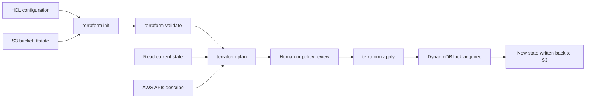
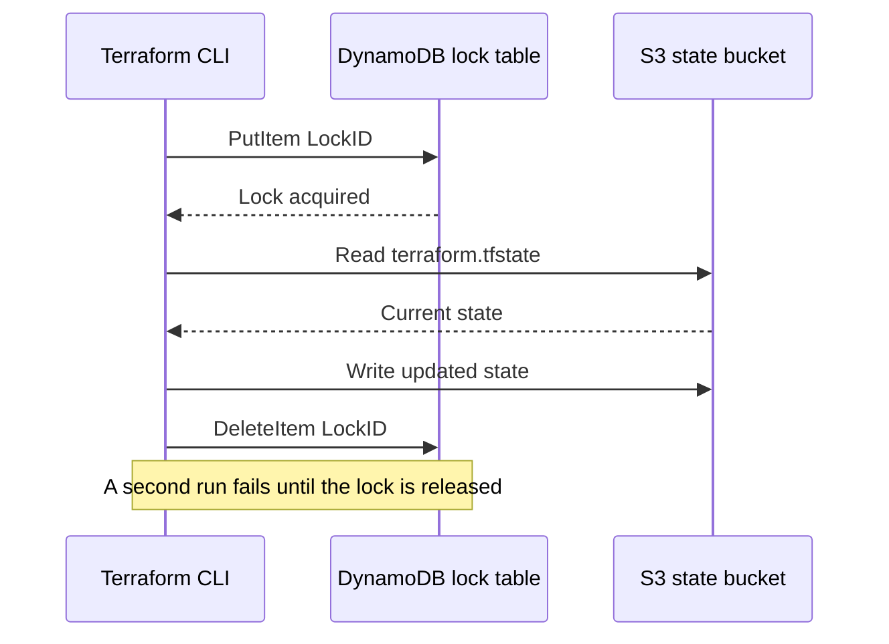
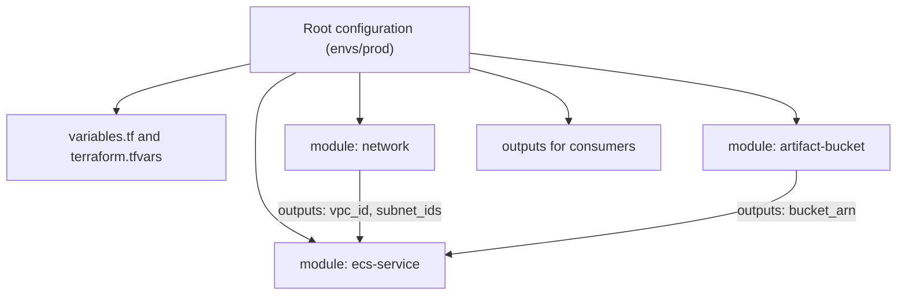

# 04 · Terraform on AWS

> **Phase 3 — DevOps and Automation** · Lesson 04 of 13
> ⬅️ Previous: [AWS CDK](./03-aws-cdk.md) · ➡️ Next: [CodePipeline](./05-codepipeline.md) · 🏠 [Phase overview](./README.md)

## Learning Objectives

By the end of this lesson you will be able to:

- Write HCL with providers, variables, locals, outputs, and `for_each`
- Configure remote state in S3 with DynamoDB locking and explain why it is mandatory
- Build a reusable module and consume it from a root configuration
- Use workspaces to drive multiple environments from one configuration
- Bring existing infrastructure under management with `terraform import` and `moved` blocks

**Estimated time:** 90 min · **Difficulty:** Intermediate

---

## Core Concepts

Terraform reads **HCL** configuration, compares it with a **state file**, and produces a plan. Every construct in HCL is about feeding that comparison: `variable` blocks parameterize, `locals` compute intermediate values, `data` blocks read facts from the provider without managing them, and `output` blocks publish values for humans or other configurations. Resources are the only blocks that create infrastructure.

**State is the whole ballgame.** The state file maps your configuration addresses (`module.artifacts.aws_s3_bucket.this`) to real cloud IDs (`legacy-bucket-name`). Without it, Terraform cannot know that a resource already exists. Locally that file is `terraform.tfstate` and it is a liability: it contains resource attributes in plain text — including secrets the provider returns — and two people running `apply` against two copies of it will happily create duplicated resources. The fix is a **remote backend**: state in S3 with versioning and encryption, plus **DynamoDB locking** so only one apply can hold the state at a time. Since Terraform 1.10 you can alternatively enable `use_lockfile = true` on the S3 backend, which uses S3 conditional writes for locking instead of DynamoDB.

**Providers** are plugins that translate resource blocks into API calls. The AWS provider is versioned independently of Terraform, and you should pin both: `required_version` for the CLI, `required_providers` for the provider. Version drift between an engineer's laptop and CI is a real source of "it works for me" failures.

**Modules** are directories of `.tf` files that take input variables and return outputs, and they are how you avoid copy-pasting the same ten resources into five repositories. A good module is opinionated about one thing (a bucket, a service, a network), exposes a small input surface, and never hard-codes environment-specific values. **Workspaces** are the light alternative for environment separation: one root configuration, several named states, with `terraform.workspace` available as a value. Use them for similar environments; use separate root directories when staging and production genuinely differ in topology, because a workspace cannot vary the structure of the configuration itself.

Finally, adoption. Almost nobody starts greenfield, so `terraform import` (or the declarative `import {}` block) attaches an existing resource to a configuration address, and `moved` blocks let you refactor addresses — for instance wrapping a resource in a module — without destroying and recreating anything.

### Key terminology

| Term | Meaning |
|------|---------|
| **Provider** | Plugin implementing the resources for a platform; `hashicorp/aws` for AWS. |
| **Resource** | A managed object; Terraform owns its full lifecycle. |
| **Data source** | A read-only lookup of an existing object Terraform does not manage. |
| **State** | The mapping from configuration addresses to real resource identifiers. |
| **Backend** | Where state lives: S3, Terraform Cloud, or local. |
| **Locking** | A mutual-exclusion record preventing two applies on one state. |
| **Plan** | A diff of configuration against state, split into create/update/replace/destroy. |
| **Module** | A reusable directory of configuration with inputs and outputs. |
| **Workspace** | A named, isolated state in the same backend and configuration. |
| **Drift** | A resource changed outside Terraform; visible in the next plan. |

---

## Architecture Diagram

The Terraform run loop against remote state:



How locking prevents two writers:



Composition of a root configuration and its modules:



---

## Hands-on Lab: Remote State, a Module, and an Import

**Goal:** Build an S3-backed, DynamoDB-locked Terraform configuration that deploys a hardened artifact bucket from a reusable module, then import a pre-existing bucket into it.

**Prerequisites:** Terraform 1.6+ installed, AWS CLI v2 configured, permissions to create S3 buckets, DynamoDB tables, and IAM policies.

### Step 1 — Create the state bucket and lock table by hand

This is the one part of Terraform you bootstrap imperatively, because the state backend must exist before Terraform can run.

```bash
# Globally unique state bucket (us-east-1 needs no LocationConstraint)
BUCKET="phase3lab-tfstate-123456789012"
aws s3api create-bucket --bucket "$BUCKET" --region us-east-1

# Versioning protects you from a corrupted or truncated state write
aws s3api put-bucket-versioning --bucket "$BUCKET" \
  --versioning-configuration Status=Enabled

# Encrypt and block all public access
aws s3api put-bucket-encryption --bucket "$BUCKET" \
  --server-side-encryption-configuration \
  '{"Rules":[{"ApplyServerSideEncryptionByDefault":{"SSEAlgorithm":"AES256"},"BucketKeyEnabled":true}]}'

aws s3api put-public-access-block --bucket "$BUCKET" \
  --public-access-block-configuration \
  BlockPublicAcls=true,IgnorePublicAcls=true,BlockPublicPolicy=true,RestrictPublicBuckets=true

# Lock table: hash key must be named LockID and be a string
aws dynamodb create-table \
  --table-name terraform-locks \
  --attribute-definitions AttributeName=LockID,AttributeType=S \
  --key-schema AttributeName=LockID,KeyType=HASH \
  --billing-mode PAY_PER_REQUEST \
  --region us-east-1
```

### Step 2 — Write the root configuration

Create `main.tf`:

```hcl
terraform {
  required_version = ">= 1.6.0"

  required_providers {
    aws = {
      source  = "hashicorp/aws"
      version = "~> 5.60"
    }
  }

  backend "s3" {
    bucket         = "phase3lab-tfstate-123456789012"
    key            = "artifacts/terraform.tfstate"
    region         = "us-east-1"
    dynamodb_table = "terraform-locks"
    encrypt        = true
  }
}

provider "aws" {
  region = var.region

  default_tags {
    tags = {
      Project     = var.project
      Environment = terraform.workspace
      ManagedBy   = "terraform"
    }
  }
}

data "aws_caller_identity" "current" {}

locals {
  name_prefix = "${var.project}-${terraform.workspace}"
  account_id  = data.aws_caller_identity.current.account_id
}
```

Create `variables.tf`:

```hcl
variable "project" {
  description = "Short project name used in resource names"
  type        = string
  default     = "phase3lab"
}

variable "region" {
  description = "AWS region to deploy into"
  type        = string
  default     = "us-east-1"
}

variable "noncurrent_version_days" {
  description = "Days to keep noncurrent object versions"
  type        = number
  default     = 30
}
```

Create `outputs.tf`:

```hcl
output "artifact_bucket_arn" {
  description = "ARN of the artifact bucket"
  value       = module.artifacts.bucket_arn
}

output "artifact_bucket_name" {
  description = "Name of the artifact bucket"
  value       = module.artifacts.bucket_id
}
```

### Step 3 — Write a complete module

Create `modules/artifact-bucket/main.tf`:

```hcl
terraform {
  required_providers {
    aws = {
      source  = "hashicorp/aws"
      version = ">= 5.0"
    }
  }
}

resource "aws_s3_bucket" "this" {
  bucket        = var.bucket_name
  force_destroy = var.force_destroy

  tags = merge(var.tags, { Name = var.bucket_name })
}

resource "aws_s3_bucket_versioning" "this" {
  count  = var.versioning_enabled ? 1 : 0
  bucket = aws_s3_bucket.this.id

  versioning_configuration {
    status = "Enabled"
  }
}

resource "aws_s3_bucket_server_side_encryption_configuration" "this" {
  bucket = aws_s3_bucket.this.id

  rule {
    apply_server_side_encryption_by_default {
      sse_algorithm     = var.kms_key_arn == null ? "AES256" : "aws:kms"
      kms_master_key_id = var.kms_key_arn
    }
    bucket_key_enabled = true
  }
}

resource "aws_s3_bucket_public_access_block" "this" {
  bucket                  = aws_s3_bucket.this.id
  block_public_acls       = true
  block_public_policy     = true
  ignore_public_acls      = true
  restrict_public_buckets = true
}

resource "aws_s3_bucket_lifecycle_configuration" "this" {
  bucket = aws_s3_bucket.this.id

  rule {
    id     = "expire-old-versions"
    status = "Enabled"

    filter {}

    noncurrent_version_expiration {
      noncurrent_days = var.noncurrent_version_days
    }

    abort_incomplete_multipart_upload {
      days_after_initiation = 7
    }
  }
}

# Deny any request that is not over TLS
data "aws_iam_policy_document" "tls_only" {
  statement {
    sid     = "DenyInsecureTransport"
    effect  = "Deny"
    actions = ["s3:*"]

    principals {
      type        = "*"
      identifiers = ["*"]
    }

    resources = [
      aws_s3_bucket.this.arn,
      "${aws_s3_bucket.this.arn}/*",
    ]

    condition {
      test     = "Bool"
      variable = "aws:SecureTransport"
      values   = ["false"]
    }
  }
}

resource "aws_s3_bucket_policy" "this" {
  bucket = aws_s3_bucket.this.id
  policy = data.aws_iam_policy_document.tls_only.json
}
```

Create `modules/artifact-bucket/variables.tf`:

```hcl
variable "bucket_name" {
  description = "Globally unique bucket name"
  type        = string

  validation {
    condition     = can(regex("^[a-z0-9][a-z0-9.-]{1,61}[a-z0-9]$", var.bucket_name))
    error_message = "Bucket names must be 3-63 characters, lowercase, with no underscores."
  }
}

variable "versioning_enabled" {
  description = "Enable object versioning"
  type        = bool
  default     = true
}

variable "kms_key_arn" {
  description = "Optional customer managed KMS key; falls back to SSE-S3 when null"
  type        = string
  default     = null
}

variable "noncurrent_version_days" {
  description = "Days before a noncurrent version is permanently deleted"
  type        = number
  default     = 30
}

variable "force_destroy" {
  description = "Allow destroy to delete a non-empty bucket"
  type        = bool
  default     = false
}

variable "tags" {
  description = "Additional tags applied to all resources"
  type        = map(string)
  default     = {}
}
```

Create `modules/artifact-bucket/outputs.tf`:

```hcl
output "bucket_id" {
  description = "Name of the bucket"
  value       = aws_s3_bucket.this.id
}

output "bucket_arn" {
  description = "ARN of the bucket"
  value       = aws_s3_bucket.this.arn
}

output "bucket_regional_domain_name" {
  description = "Regional domain name of the bucket"
  value       = aws_s3_bucket.this.bucket_regional_domain_name
}
```

Consume it from the root by appending to `main.tf`:

```hcl
module "artifacts" {
  source = "./modules/artifact-bucket"

  bucket_name            = "${local.name_prefix}-artifacts-${local.account_id}"
  versioning_enabled     = true
  noncurrent_version_days = var.noncurrent_version_days
  force_destroy          = terraform.workspace == "dev"

  tags = {
    Project = var.project
  }
}
```

### Step 4 — Initialize, plan, and apply

```bash
# Download providers and configure the S3 backend
terraform init

# Format and statically validate before doing anything risky
terraform fmt -recursive
terraform validate

# Create the dev workspace, then plan and apply
terraform workspace new dev
terraform plan -out=devplan
terraform apply devplan
```

Read the plan output carefully. `Plan: 6 to add, 0 to change, 0 to destroy` for the module is expected: the bucket, versioning, encryption, public access block, lifecycle config, and bucket policy are separate resources.

### Step 5 — Add a second environment with the same configuration

```bash
# A workspace is an isolated state in the same backend
terraform workspace new prod
terraform plan -out=prodplan
terraform apply prodplan

# Show which state file each workspace maps to
terraform workspace list
terraform show -json | jq '.values.outputs.artifact_bucket_name.value'
```

Because `force_destroy` and the lifecycle rule are driven by `terraform.workspace`, `dev` and `prod` differ in behaviour while sharing every line of configuration.

### Step 6 — Import an existing bucket

Find or create a bucket you already have outside Terraform, then bring it under management.

```bash
# Declare the address first so the plan knows what the import is for
terraform import 'module.artifacts.aws_s3_bucket.generated' legacy-artifacts-123456789012
```

Prefer the declarative form, which plans the import like any other change:

```hcl
import {
  to = module.artifacts.aws_s3_bucket.generated
  id = "legacy-artifacts-123456789012"
}
```

After importing, run `terraform plan` and expect adjustments — attributes such as tags or lifecycle rules that the real bucket has but the configuration does not describe yet. Iterate until the plan reports no changes.

### Step 7 — Verify

```bash
# Every resource Terraform believes it owns in this workspace
terraform state list

# Confirm the bucket really exists and matches
BUCKET=$(terraform output -raw artifact_bucket_name)
aws s3api get-bucket-versioning --bucket "$BUCKET"
aws s3api get-bucket-lifecycle-configuration --bucket "$BUCKET"

# Prove that a second plan is a no-op — the idempotency check
terraform plan -detailed-exitcode
# Exit code 0 means no changes; 2 means changes are pending
```

### Step 8 — Clean up

```bash
# Tear down both workspaces (prod uses force_destroy = false, so empty it first)
terraform workspace select dev && terraform destroy
```

---

## CLI Reference

```bash
# Reconfigure the backend after changing the key or bucket
terraform init -reconfigure

# Copy state to a new backend location (e.g. when splitting environments)
terraform init -migrate-state

# Plan a destroy without touching anything
terraform plan -destroy

# Replace a single resource you know is broken, without tainting anything
terraform apply -replace='module.artifacts.aws_s3_bucket.this'

# Inspect and repair state
terraform state list
terraform state show 'module.artifacts.aws_s3_bucket.this'
terraform state mv 'aws_s3_bucket.old' 'module.artifacts.aws_s3_bucket.this'
terraform state rm 'aws_s3_bucket.no_longer_managed'

# Release a lock left behind by a killed run (only after confirming nobody is applying)
terraform force-unlock 5f3a1c2b-9d4e-4a71-9b0c-2f6e8a1d3c47

# Select a workspace per environment in CI
terraform workspace select prod

# Detect and record out-of-band changes without changing configuration
terraform plan -refresh-only

# Read machine-friendly outputs for downstream jobs
terraform output -json

# Lock provider checksums for the CI platform, not just your laptop
terraform providers lock -platform=linux_amd64 -platform=darwin_arm64
```

| Command | Purpose |
|---------|---------|
| `init` | Installs providers and connects the backend |
| `validate` / `fmt` | Static correctness and canonical formatting |
| `plan -out=file` | Produces a reviewable, replayable plan |
| `apply file` | Applies exactly the reviewed plan |
| `state mv` / `state rm` | Refactors addresses without touching real resources |
| `import` | Adopts an existing resource into state |
| `force-unlock` | Clears a stale lock after verifying no run is active |
| `plan -detailed-exitcode` | 0 = no changes, 2 = changes, 1 = error — ideal for CI gates |

---

## Best Practices

| Practice | Why it matters |
|----------|----------------|
| Remote state in S3 with versioning, encryption, and locking | Prevents corruption and accidental duplication; enables team collaboration |
| One state per environment and per blast radius | A mistake in `dev` cannot touch `prod` state |
| Pin `required_version` and provider versions, and commit `.terraform.lock.hcl` | Reproducible plans across laptops and CI |
| Read secrets from data sources, never from `.tfvars` in Git | Keeps credentials out of the repository and out of the plan file |
| Mark sensitive variables and outputs with `sensitive = true` | Prevents accidental disclosure in CI logs |
| Add `lifecycle { prevent_destroy = true }` to databases and stateful buckets | Turns a catastrophic destroy into an error message |
| Keep modules small and single-purpose | A module with fifteen inputs is a template with extra steps |
| Run `terraform plan -detailed-exitcode` in CI and `apply` only after approval | Mirrors the change-set discipline of CloudFormation |
| Use `moved` blocks rather than `state mv` for refactors | The change is reviewed in a pull request and reproducible by anyone |
| Prefer `for_each` over `count` for collections | Removing an item from `count` shifts every index and recreates resources |

---

## Common Pitfalls

| Pitfall | Symptom | Fix |
|---------|---------|-----|
| State in a laptop folder | Colleagues recreate resources that already exist | Move to a remote backend immediately; use `init -migrate-state` |
| Committing state or `.terraform` to Git | Secrets and state history in the repository | Add `*.tfstate*`, `.terraform/`, and `*.tfvars` to `.gitignore` |
| Stale lock after a killed CI job | `Error acquiring the state lock` | Confirm no run is active, then `terraform force-unlock <LOCK_ID>` |
| Editing state by hand | Undefined behaviour on the next plan | Use `state mv`, `state rm`, `import`, or `terraform state pull` for inspection only |
| Changing a `count` collection | Unrelated resources destroyed and recreated | Switch to `for_each` with stable keys |
| Implicit provider upgrades | Plan suddenly wants to replace resources | Pin the provider and commit the lock file |
| Ignoring drift for months | Plan shows dozens of changes you did not make | Run `plan -refresh-only` on a schedule and reconcile deliberately |
| Two workspaces sharing one backend key | One environment overwrites the other | Keep `key` or workspace naming unique per environment |

---

## Cost Considerations

Terraform itself is free (HashiCorp's open-source CLI). The S3 state bucket costs cents per month, and a DynamoDB table in `PAY_PER_REQUEST` mode costs fractions of a cent per lock operation. HCP Terraform, the managed alternative, is priced per managed resource per hour with a limited free tier — worth it for teams that want remote runs and policy enforcement without operating the backend.

The expensive part is Terraform's power: a `for_each` over ten availability zones or a module called four times can multiply infrastructure silently. Two habits keep that in check. First, read the plan's resource counts — `terraform plan` printing `Plan: 42 to add` on a change you thought touched one bucket is the signal. Second, `terraform destroy` on lab workspaces, because Terraform makes cleanup reliable and therefore expected. Watch three specific resources: NAT Gateways (~$32/month each), unattached Elastic IPs (billed hourly), and EBS volumes orphaned by a partial destroy. Tag through `default_tags` so Cost Explorer attributes spend to workspaces, and remember that `default_tags` does not retroactively fix resources created before it was added.

---

## Security Considerations

- **State files contain secrets in plaintext.** RDS passwords, generated keys, and provider-returned tokens all land in state. Encrypt the S3 bucket with KMS, block public access, enable versioning, and restrict `s3:GetObject` on the state prefix to the CI role and a break-glass admin role.
- **Never commit `.tfvars` with credentials.** Pass secrets as `TF_VAR_` environment variables from your CI secret store, or read them with `data "aws_secretsmanager_secret_version"`. `sensitive = true` only redacts output — the value is still in state.
- **Assume a scoped role in CI.** The pipeline's role should allow exactly the services its configurations manage. Avoid `AdministratorAccess` even when it is convenient.
- **Add static analysis to the pipeline.** `checkov`, `tfsec`, or `trivy config` catch public buckets, unencrypted volumes, and wildcard IAM before apply; run them on the plan output for the highest signal.
- **Guard the destroy path.** `prevent_destroy` on databases, buckets, and KMS keys; and consider `--target` free workflows where a plan must be reviewed in full before apply.
- **Rotate access to the backend** on personnel change, and review S3 access logs for the state prefix — unexpected reads are worth investigating.

---

## Exercise

Refactor the lab so the bucket created directly in the root configuration is fully owned by the module, then add a customer-managed KMS key and pass its ARN in through `kms_key_arn`. Use `moved` blocks so the refactor causes no destroy.

Success looks like: `terraform plan` reports only an in-place update to the bucket's encryption configuration (plus the new key resources), with `0 to destroy`, and `aws s3api get-bucket-encryption` shows `aws:kms` with your key ARN.

---

## Resources

- [Terraform Language Documentation](https://developer.hashicorp.com/terraform/language)
- [S3 Backend Reference](https://developer.hashicorp.com/terraform/language/settings/backends/s3)
- [AWS Provider Registry](https://registry.terraform.io/providers/hashicorp/aws/latest/docs)
- [Import Existing Resources](https://developer.hashicorp.com/terraform/language/import)
- [Module Composition](https://developer.hashicorp.com/terraform/language/modules/develop/composition)
- [terraform-aws-modules: Community Modules](https://github.com/terraform-aws-modules)

---

## Next Steps

You can now describe infrastructure in three different languages. What you cannot yet do is ship it automatically on every commit — that is the job of the next lesson: AWS CodePipeline, CodeBuild, and CodeDeploy working together.

> ⬅️ Previous: [AWS CDK](./03-aws-cdk.md) · ➡️ Next: [CodePipeline](./05-codepipeline.md) · 🏠 [Phase overview](./README.md)
