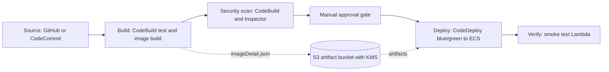
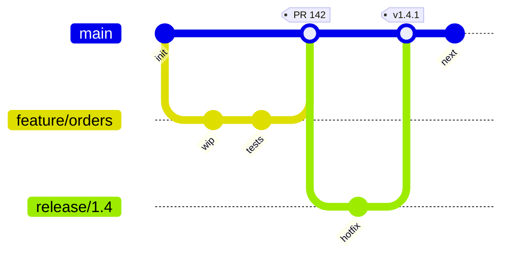
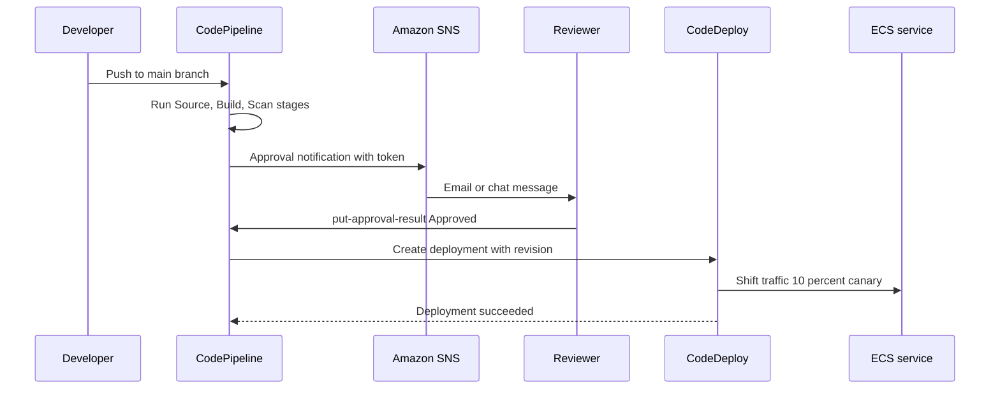

# 05 · CodePipeline

> **Phase 3 — DevOps and Automation** · Lesson 05 of 13
> ⬅️ Previous: [Terraform on AWS](./04-terraform-on-aws.md) · ➡️ Next: [Jenkins on AWS](./06-jenkins-on-aws.md) · 🏠 [Phase overview](./README.md)

## Learning Objectives

By the end of this lesson you will be able to:

- Describe how CodeCommit, CodeBuild, and CodeDeploy fit together inside CodePipeline
- Write a `buildspec.yml` that builds, tests, and pushes a container image
- Write an `appspec.yml` for an ECS blue/green deployment with lifecycle hooks
- Configure manual approval gates and cross-account, cross-region deployments
- Diagnose a failed execution using pipeline state and action executions

**Estimated time:** 80 min · **Difficulty:** Intermediate

---

## Core Concepts

CodePipeline is an orchestrator, not a builder. It models a release as **stages**, each containing **actions**, and each action is delegated to a service: CodeCommit or CodeStar Connections for source, CodeBuild for anything that runs commands, CodeDeploy for traffic shifting, Lambda for custom logic, and Manual Approval for humans. Between stages, CodePipeline moves **artifacts** — zip files and JSON — through an S3 bucket, which is why the artifact bucket's encryption key policy is often the thing that breaks a cross-account pipeline.

**CodeCommit** is AWS's managed Git service. Note the availability change: AWS announced in July 2024 that CodeCommit is no longer open to new customers, steering them to GitHub, GitLab, or Bitbucket. If your account already has it, it works fine and integrates with IAM natively; if not, use CodeStar Connections to attach a GitHub repository instead. The connection resource is what you reference from a source action.

**CodeBuild** runs your commands in a fresh container. The `buildspec.yml` at the root of the source defines phases — `install`, `pre_build`, `build`, `post_build` — plus `reports`, `artifacts`, and `cache`. Everything CodeBuild injects is an environment variable: `CODEBUILD_SRC_DIR`, `CODEBUILD_RESOLVED_SOURCE_VERSION` (the full commit SHA), `CODEBUILD_BUILD_ID`. Secrets come in through `parameter-store` or `secrets-manager` blocks and are masked in logs. Critically, each phase is a fresh shell unless you export variables — a common surprise is a variable set in `pre_build` being empty in `build`.

**CodeDeploy** performs the actual release with a chosen **deployment configuration** that controls how fast traffic moves. For EC2 and on-premises it runs lifecycle hooks (`BeforeInstall`, `AfterInstall`, `ApplicationStart`, `ValidateService`); for ECS blue/green it swaps target groups on an ALB and can call Lambda hooks `BeforeAllowTraffic` and `AfterAllowTraffic`. The `appspec.yml` describes which of your resources to update — for ECS it typically points at an `imageDetail.json` produced by the build stage, so the image tag flows from build to deploy without anyone copying a digest by hand.

Two pipeline features deserve early adoption. **V2 pipelines** add `Triggers` with git-aware filtering (branch, tag, and file path patterns) and pipeline-level variables, which removes most of the need for one pipeline per branch. **Manual approval** actions pause an execution and emit a token; approving is an API call, which means you can approve from the console, from Slack via SNS, or from a script.

### Key terminology

| Term | Meaning |
|------|---------|
| **Stage** | An ordered group of actions; the whole stage must succeed before the next starts. |
| **Action** | A single unit of work owned by a provider, with inputs and outputs. |
| **Artifact** | The zip or JSON passed between stages through the artifact store. |
| **buildspec.yml** | CodeBuild's declarative build definition. |
| **appspec.yml** | CodeDeploy's declarative deployment definition. |
| **Deployment configuration** | Traffic-shifting strategy: `AllAtOnce`, `OneAtATime`, `Canary10Percent5Minutes`, `Linear10PercentEvery1Minute`. |
| **Cross-account role** | A role in the target account that the pipeline's action assumes to deploy. |
| **Manual approval** | A gated action that waits for `put-approval-result`. |
| **Execution** | One run of the pipeline, identified by `pipelineExecutionId`. |

---

## Architecture Diagram

A four-stage pipeline with an approval gate and an artifact store:



The branching model that drives those triggers:



What happens when a human approves, and what the automation does with it:



---

## Hands-on Lab: Source to ECS Blue/Green with an Approval Gate

**Goal:** Build a pipeline that tests code, pushes an image to ECR, waits for approval, and deploys to ECS using CodeDeploy blue/green.

**Prerequisites:** An ECS Fargate service behind an Application Load Balancer with two target groups, an ECR repository, an S3 artifact bucket, and a CodeStar Connections connection to GitHub (or an existing CodeCommit repository).

### Step 1 — CodeBuild project and buildspec

Create `buildspec.yml` in the repository root:

```yaml
version: 0.2

env:
  variables:
    AWS_REGION: us-east-1
    NODE_ENV: production
  parameter-store:
    SONAR_TOKEN: /phase3lab/sonar/token
  secrets-manager:
    DB_PASSWORD: phase3lab/prod/db:password
  exported-variables:
    - IMAGE_TAG

phases:
  install:
    runtime-versions:
      nodejs: 20
    commands:
      - echo "Installing dependencies"
      - npm ci
  pre_build:
    commands:
      # Resolve the short commit SHA and log in to ECR
      - IMAGE_TAG=$(echo "$CODEBUILD_RESOLVED_SOURCE_VERSION" | cut -c 1-7)
      - echo "Building image tag $IMAGE_TAG"
      - aws ecr get-login-password --region "$AWS_REGION" | docker login --username AWS --password-stdin "$ECR_REPO"
      - npm test -- --ci --reporters=default --reporters=jest-junit
  build:
    commands:
      - docker build -t "$ECR_REPO:$IMAGE_TAG" .
  post_build:
    commands:
      - docker push "$ECR_REPO:$IMAGE_TAG"
      # imageDetail.json is what CodeDeploy reads to find the new image
      - printf '{"ImageURI":"%s"}' "$ECR_REPO:$IMAGE_TAG" > imageDetail.json

reports:
  jest-report:
    files:
      - junit.xml
    file-format: JUNITXML

artifacts:
  files:
    - imageDetail.json
    - appspec.yaml
    - taskdef.json

cache:
  paths:
    - node_modules/**/*
```

Register the project:

```bash
# Create the CodeBuild project that the pipeline will invoke
aws codebuild create-project \
  --name phase3lab-api-build \
  --service-role arn:aws:iam::123456789012:role/phase3lab-codebuild-role \
  --artifacts type=CODEPIPELINE \
  --environment type=LINUX_CONTAINER,image=aws/codebuild/amazonlinux2-aarch64-standard:3.0,computeType=BUILD_GENERAL1_SMALL,privilegedMode=true,environmentVariables=[{name=ECR_REPO,value=123456789012.dkr.ecr.us-east-1.amazonaws.com/phase3lab/api}] \
  --source type=CODEPIPELINE,buildspec=buildspec.yml \
  --region us-east-1
```

`privilegedMode=true` is what allows Docker builds inside CodeBuild. Do not enable it on projects that do not need it.

### Step 2 — CodeDeploy application for ECS blue/green

Create `appspec.yaml`:

```yaml
version: 0.0

Resources:
  - TargetService:
      Type: AWS::ECS::Service
      Properties:
        TaskDefinition: <TASK_DEFINITION>
        LoadBalancerInfo:
          ContainerName: app
          ContainerPort: 8080
        PlatformVersion: LATEST
        NetworkConfiguration:
          AwsvpcConfiguration:
            Subnets:
              - subnet-0aa11bb22cc33dd44
              - subnet-0ee55ff66aa77bb88
            SecurityGroups:
              - sg-0123456789abcdef0
            AssignPublicIp: DISABLED

Hooks:
  - BeforeAllowTraffic: arn:aws:lambda:us-east-1:123456789012:function:phase3lab-pre-traffic
  - AfterAllowTraffic: arn:aws:lambda:us-east-1:123456789012:function:phase3lab-smoke-test
```

`<TASK_DEFINITION>` is a CodeDeploy placeholder replaced by a dynamic reference to the task definition produced by the pipeline. Create the application and deployment group:

```bash
# Blue/green application served from ECS
aws deploy create-application \
  --application-name phase3lab-api \
  --compute-platform ECS

# Deployment group binds the ECS service, both target groups and the ALB listener
aws deploy create-deployment-group \
  --application-name phase3lab-api \
  --deployment-group-name phase3lab-api-prod \
  --deployment-config-name CodeDeployDefault.ECSLinear10PercentEvery1Minutes \
  --service-role-arn arn:aws:iam::123456789012:role/phase3lab-codedeploy-role \
  --ecs-services clusterName=phase3lab-cluster,serviceName=phase3lab-api \
  --load-balancer-info targetGroupPairInfoList=[{targetGroups=[{name=phase3lab-api-blue},{name=phase3lab-api-green}],prodTrafficRoute={listenerArns=[arn:aws:elasticloadbalancing:us-east-1:123456789012:listener/app/phase3lab/50dc6c495c0c9188/1a2b3c4d5e6f7a8b]},testTrafficRoute={listenerArns=[arn:aws:elasticloadbalancing:us-east-1:123456789012:listener/app/phase3lab/50dc6c495c0c9188/9f8e7d6c5b4a3928]}}] \
  --auto-rollback-configuration enabled=true,events=DEPLOYMENT_FAILURE,DEPLOYMENT_STOP_ON_ALARM \
  --alarm-configuration enabled=true,alarms=[{name=phase3lab-api-5xx-errors}] \
  --region us-east-1
```

Automatic rollback on alarm is the single most valuable setting on this page: a bad release that spikes 5xx errors reverts without a human.

### Step 3 — Define the pipeline

Save `pipeline.json` and create the pipeline:

```json
{
  "pipeline": {
    "name": "phase3lab-api",
    "pipelineType": "V2",
    "roleArn": "arn:aws:iam::123456789012:role/phase3lab-codepipeline-role",
    "artifactStore": {
      "type": "S3",
      "location": "phase3lab-artifacts-123456789012",
      "encryptionKey": {
        "id": "arn:aws:kms:us-east-1:123456789012:key/1234abcd-12ab-34cd-56ef-1234567890ab",
        "type": "KMS"
      }
    },
    "triggers": [
      {
        "providerType": "CodeStarSourceConnection",
        "gitConfiguration": {
          "sourceActionName": "GitHub",
          "push": [
            {
              "branches": { "includes": ["main"] },
              "filePaths": { "includes": ["services/api/**", "buildspec.yml"] }
            }
          ]
        }
      }
    ],
    "stages": [
      {
        "name": "Source",
        "actions": [
          {
            "name": "GitHub",
            "actionTypeId": {
              "category": "Source",
              "owner": "AWS",
              "provider": "CodeStarSourceConnection",
              "version": "1"
            },
            "configuration": {
              "ConnectionArn": "arn:aws:codestar-connections:us-east-1:123456789012:connection/aaaa1111-bbbb-2222-cccc-333344445555",
              "FullRepositoryId": "my-org/phase3lab-monorepo",
              "BranchName": "main",
              "OutputArtifactFormat": "CODE_ZIP"
            },
            "outputArtifacts": [{ "name": "SourceArtifact" }]
          }
        ]
      },
      {
        "name": "Build",
        "actions": [
          {
            "name": "BuildAndPush",
            "actionTypeId": {
              "category": "Build",
              "owner": "AWS",
              "provider": "CodeBuild",
              "version": "1"
            },
            "configuration": { "ProjectName": "phase3lab-api-build" },
            "inputArtifacts": [{ "name": "SourceArtifact" }],
            "outputArtifacts": [{ "name": "BuildArtifact" }]
          }
        ]
      },
      {
        "name": "Approve",
        "actions": [
          {
            "name": "ProdApproval",
            "actionTypeId": {
              "category": "Approval",
              "owner": "AWS",
              "provider": "Manual",
              "version": "1"
            },
            "configuration": {
              "NotificationArn": "arn:aws:sns:us-east-1:123456789012:phase3lab-approvals",
              "CustomData": "Deploying phase3lab-api to production. Check the smoke test report before approving."
            }
          }
        ]
      },
      {
        "name": "Deploy",
        "actions": [
          {
            "name": "BlueGreenECS",
            "actionTypeId": {
              "category": "Deploy",
              "owner": "AWS",
              "provider": "CodeDeployToECS",
              "version": "1"
            },
            "configuration": {
              "ApplicationName": "phase3lab-api",
              "DeploymentGroupName": "phase3lab-api-prod",
              "TaskDefinitionTemplateArtifact": "BuildArtifact",
              "TaskDefinitionTemplatePath": "taskdef.json",
              "AppSpecTemplateArtifact": "BuildArtifact",
              "AppSpecTemplatePath": "appspec.yaml",
              "Image1ArtifactName": "BuildArtifact",
              "Image1ContainerName": "IMAGE1_NAME"
            },
            "inputArtifacts": [{ "name": "BuildArtifact" }]
          }
        ]
      }
    ]
  }
}
```

```bash
# Create the pipeline from the JSON definition
aws codepipeline create-pipeline --cli-input-json file://pipeline.json --region us-east-1
```

### Step 4 — Run it and approve it

```bash
# Trigger an execution manually to skip waiting for a git push
aws codepipeline start-pipeline-execution --name phase3lab-api --region us-east-1

# Poll state; the approval action reports status InProgress and a token via get-pipeline-state
aws codepipeline get-pipeline-state --name phase3lab-api \
  --query "stageStates[].{Stage:stageName,Status:latestExecution.status}" --output table

# Read the approval token and approve (token comes from the approval action's token field)
TOKEN=$(aws codepipeline get-pipeline-state --name phase3lab-api \
  --query "stageStates[?stageName=='Approve'].actionStates[0].latestExecution.token" --output text)

aws codepipeline put-approval-result \
  --pipeline-name phase3lab-api \
  --stage-name Approve \
  --action-name ProdApproval \
  --result summary="Verified canary metrics, approving",status=Approved \
  --token "$TOKEN" \
  --region us-east-1
```

### Step 5 — Verify

```bash
# Confirm the deployment shifted traffic instead of restarting in place
aws deploy list-deployments --application-name phase3lab-api \
  --query "deployments[0:3]" --output text

aws deploy get-deployment --deployment-id d-XXXXXXXXX \
  --query "deploymentInfo.{Status:status,Overview:deploymentOverview,Config:deploymentConfigName}" --output json

# A canary deployment replaces the target group rather than restarting tasks
aws elbv2 describe-target-health \
  --target-group-arn arn:aws:elasticloadbalancing:us-east-1:123456789012:targetgroup/phase3lab-api-green/6d0ecf831eec9f09 \
  --query "TargetHealthDescriptions[].TargetHealth.State" --output text
```

### Step 6 — Clean up

```bash
# Stop a stuck execution rather than deleting the pipeline
aws codepipeline stop-pipeline-execution \
  --pipeline-name phase3lab-api \
  --pipeline-execution-id 01234567-89ab-cdef-0123-456789abcdef \
  --abandon --region us-east-1
```

---

## CLI Reference

```bash
# Inspect the full action history of the latest execution
aws codepipeline list-action-executions --pipeline-name phase3lab-api \
  --query "actionExecutionDetails[].{Action:actionName,Status:status,Error:errorDetails.message}" --output table

# Re-run only what failed, keeping successful work intact
aws codepipeline retry-stage-execution \
  --pipeline-name phase3lab-api \
  --stage-name Deploy \
  --pipeline-execution-id 01234567-89ab-cdef-0123-456789abcdef \
  --retry-mode FAILED_ACTIONS

# Run a build outside the pipeline for a hotfix experiment
aws codebuild start-build --project-name phase3lab-api-build \
  --source-version main --environment-variables-override name=IMAGE_TAG,value=hotfix1

# Get the build log and phase timings
aws codebuild batch-get-builds --ids phase3lab-api-build:1a2b3c4d-5e6f-7890-abcd-ef1234567890 \
  --query "builds[0].{Phase:currentPhase,Status:buildStatus,Logs:logs.groupName}" --output json

# Stop a runaway build
aws codebuild stop-build --id phase3lab-api-build:1a2b3c4d-5e6f-7890-abcd-ef1234567890

# Create a git-backed source repository if CodeCommit is available in your account
aws codecommit create-repository --repository-name phase3lab-api

# Put CodeCommit under the pipeline as a source action (existing accounts only)
aws codecommit get-repository --repository-name phase3lab-api

# Wait for a CodeDeploy deployment to finish so a script can act on the outcome
aws deploy wait deployment-successful --deployment-id d-XXXXXXXXX

# Roll back a deployment manually
aws deploy stop-deployment --deployment-id d-XXXXXXXXX --auto-rollback-enabled
```

| Command | Purpose |
|---------|---------|
| `start-pipeline-execution` | Triggers a run without a commit |
| `get-pipeline-state` | Shows stage, action, and approval token state |
| `put-approval-result` | Approves or rejects a manual gate |
| `retry-stage-execution` | Re-runs failed actions only |
| `list-action-executions` | The fastest way to find the failing action and its error |
| `stop-deployment --auto-rollback-enabled` | Reverts a release in progress |

---

## Best Practices

| Practice | Why it matters |
|----------|----------------|
| Use V2 pipelines with trigger filters | Builds only what changed, cutting cost and queue time |
| Encrypt the artifact store with a customer-managed KMS key | Cross-account pipelines need an explicit key policy; also enables revocation |
| Put a manual approval in front of production | A human owns the decision even when automation does the work |
| Enable automatic rollback on alarms and deployment failure | Recovers without a human at 3 a.m. |
| Keep buildspec phases free of side effects before tests pass | A failing test should never push an image |
| Export only the variables you need | `exported-variables` controls what reaches later stages and the console |
| Store secrets in Secrets Manager or Parameter Store, never in the buildspec | Buildspec files are in Git |
| Use separate pipelines per service, not one monolith | Independent release cadence and smaller blast radius |
| Name actions after what they do | `BlueGreenECS` reads better than `Deploy1` in an incident |
| Wire SNS notifications to failures | The pipeline should tell someone rather than wait to be noticed |

---

## Common Pitfalls

| Pitfall | Symptom | Fix |
|---------|---------|-----|
| Artifact bucket KMS policy missing the target account | Cross-region deployment fails with `AccessDenied` on the artifact | Grant the target account `kms:Decrypt` and `s3:GetObject` on the artifact prefix |
| Variable set in one buildspec phase, used in another | Empty value in a later phase | Use `exported-variables`, or set it in the same phase |
| `privilegedMode` disabled | `docker build` fails with permission errors | Enable privileged mode on the CodeBuild project |
| Approval token expired | `put-approval-result` returns `InvalidApprovalToken` | Tokens are per execution; fetch a fresh one with `get-pipeline-state` |
| CodeDeploy cannot find the ECS service | `Invalid ECS service` error in the deployment | Deployment group's cluster and service names must match exactly, including case |
| Blue and green target groups on the same listener | Deployment stalls before `BeforeAllowTraffic` | Use separate production and test listeners as CodeDeploy requires |
| Pipeline triggered on documentation changes | Wasted builds and noisy history | Filter with `filePaths` in the V2 trigger |
| Deleting a pipeline while an execution runs | Orphaned deployment still shifting traffic | Stop the execution first |

---

## Cost Considerations

CodePipeline charges **$1.00 per active pipeline per month** (the first pipeline is free, and V2 pipelines count per pipeline, not per action). CodeBuild is billed per build minute: `BUILD_GENERAL1_SMALL` on ARM is roughly **$0.0034/minute**, and a 6-minute build running 200 times a month costs about $4 — until someone enables `cache` badly or leaves a 45-minute integration suite in the critical path. CodeDeploy for EC2 and ECS has **no extra charge**. CodeCommit charges $1 per active user per month and $1 per GB-month of storage for existing accounts.

Where the money actually goes is the pipeline's blast radius. Trigger filters mean a docs-only commit no longer builds three services. `cache: paths: [node_modules/**/*]` in S3 cuts install time dramatically, but caching a directory that changes every run costs more than it saves. Separate build projects for unit tests (seconds) and integration tests (minutes) let you fail fast and skip the expensive one on documentation branches. And because the pipeline deploys ECS services, remember that each deploy creates a new task revision: without task-definition cleanup, ECR storage and CloudWatch log groups grow forever. Add an ECR lifecycle policy that keeps the last 30 tagged images.

---

## Security Considerations

- **Separate roles per concern.** The pipeline role moves artifacts; the CodeBuild role pushes images and reads secrets; the CodeDeploy role shifts traffic. One shared administrator role means a compromised buildspec can deploy anywhere.
- **Scope the artifact bucket.** Block public access, deny non-TLS requests, and use a KMS key policy that lists only the accounts that need to read artifacts.
- **Do not put credentials in buildspec.** `parameter-store` and `secrets-manager` blocks fetch values at build time and mask them in logs. Prefer short-lived credentials from IAM roles over any static key.
- **Rotate CodeStar Connections rather than storing GitHub tokens.** Connections use an installed app, so there is no long-lived personal access token to leak.
- **Require an approval with context.** Use `CustomData` to point the approver at the build report and the canary metrics, and keep the approval permission in a small group.
- **Guard the deployment group.** Restrict who can call `CreateDeployment` and `StopDeployment`; a rogue rollback during a traffic shift is an outage.
- **Log the release.** Pipelines emit to CloudWatch Logs and CloudTrail; retain them at least as long as your compliance window, and alarm on `DeploymentFailures` and pipeline failures.

---

## Exercise

Add a `SecurityScan` stage between `Build` and `Approve`. It should run a second CodeBuild project that executes `docker scan` or `trivy image` against the pushed image tag, write a report artifact, and fail the stage when a `CRITICAL` vulnerability is found. Then trigger the pipeline with a deliberately vulnerable base image and confirm the approval stage is never reached.

Success looks like: `list-action-executions` shows the scan action `Failed` with the vulnerability count in its error output, the `Approve` stage stays `InProgress` or is skipped entirely, and no ECS deployment is created.

---

## Resources

- [What is AWS CodePipeline?](https://docs.aws.amazon.com/codepipeline/latest/userguide/welcome.html)
- [CodeBuild buildspec Reference](https://docs.aws.amazon.com/codebuild/latest/userguide/build-spec-ref.html)
- [CodeDeploy AppSpec Reference for ECS](https://docs.aws.amazon.com/codedeploy/latest/userguide/reference-appspec-file-structure.html)
- [CodePipeline V2 Pipeline Types and Triggers](https://docs.aws.amazon.com/codepipeline/latest/userguide/pipeline-types-planning.html)
- [CodeDeploy Blue/Green Deployments for Amazon ECS](https://docs.aws.amazon.com/codedeploy/latest/userguide/deployment-type-bluegreen.html)
- [CodeCommit Availability Change](https://aws.amazon.com/blogs/devops/aws-codecommit-availability-change/)

---

## Next Steps

CodePipeline is the native, lowest-maintenance option, but plenty of organizations already run Jenkins and need it to work well on AWS. The next lesson covers running Jenkins properly — controller, elastic agents, plugins, and credentials — without leaving it wide open on the internet.

> ⬅️ Previous: [Terraform on AWS](./04-terraform-on-aws.md) · ➡️ Next: [Jenkins on AWS](./06-jenkins-on-aws.md) · 🏠 [Phase overview](./README.md)
