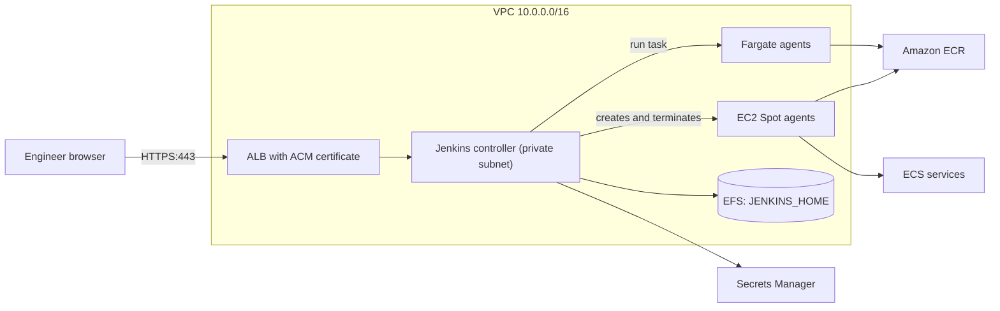
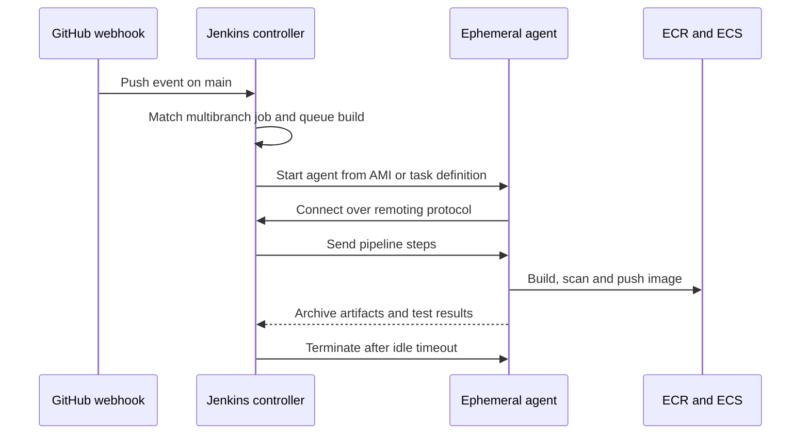
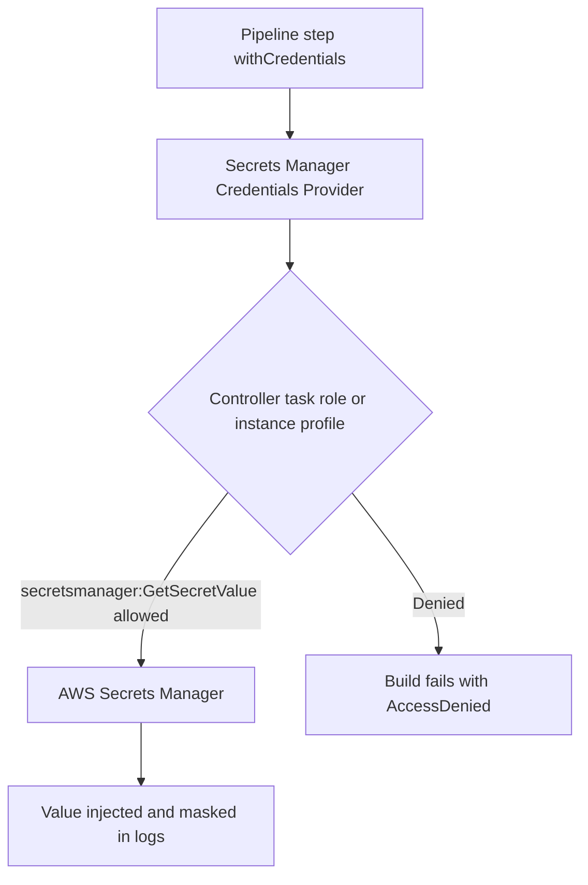

# 06 · Jenkins on AWS

> **Phase 3 — DevOps and Automation** · Lesson 06 of 13
> ⬅️ Previous: [CodePipeline](./05-codepipeline.md) · ➡️ Next: [GitHub Actions for AWS](./07-github-actions-for-aws.md) · 🏠 [Phase overview](./README.md)

## Learning Objectives

By the end of this lesson you will be able to:

- Design a controller-agent Jenkins topology that lives safely inside a VPC
- Run the controller on EC2 or ECS with durable storage for `JENKINS_HOME`
- Provision ephemeral agents on EC2 Spot and Fargate, and scale them with demand
- Manage credentials with AWS Secrets Manager and configuration with JCasC
- Harden Jenkins with IAM roles, private networking, and least-privilege plugins

**Estimated time:** 80 min · **Difficulty:** Advanced

---

## Core Concepts

Jenkins is a **controller-agent** (historically master-slave) system. The controller owns configuration, schedules work, and records results; **agents** are the processes that actually run build steps. That split is what makes Jenkins work well on AWS: keep exactly one stateful controller, and make everything that does real work disposable.

The controller needs durable storage for `JENKINS_HOME` — jobs, plugins, credentials metadata, and build history. On EC2 that means a dedicated EBS volume (gp3) separate from the root volume, snapshotted on a schedule by AWS Backup or Data Lifecycle Manager. On ECS it means an **EFS access point mounted at `/var/jenkins_home`**, because Fargate is stateless by definition. Either way, the controller must never be the thing doing `npm install` in a 45-minute build; that is what agents are for.

**Agents** are best treated as cattle. The EC2 plugin starts an instance from an AMI on demand and terminates it when idle — configure it with a Spot request to cut the bill by 60–70% and accept that a reclaimed agent simply fails a build that gets retried. The Amazon ECS plugin goes further: define a task definition whose container image is an inbound-agent image, and each build gets a Fargate task with no host to patch, no SSH, and no leftover state. The trade-off is startup latency — an EC2 agent takes 60–90 seconds from cold, a Fargate agent 30–60 seconds, and an always-warm agent takes none.

Credentials are where Jenkins deployments usually go wrong. The default credential store is an encrypted file on the controller's disk, which means the security of every AWS key your builds use depends on one filesystem. The **AWS Secrets Manager Credentials Provider** plugin replaces that: credentials are stored in Secrets Manager, access is governed by the controller's IAM role, and rotation happens in AWS rather than in the Jenkins UI. Pair it with **IAM roles for agents** — a build that pushes an image should get a short-lived token from the instance or task role, not a static access key pasted into a credential.

Finally, treat the controller's configuration as code. **Jenkins Configuration as Code (JCasC)** reads a `jenkins.yaml` at startup, so your plugin settings, credential provider, clouds, and security realm are reviewable and reproducible. Without it, rebuilding a lost controller means clicking through a UI you cannot diff.

### Key terminology

| Term | Meaning |
|------|---------|
| **Controller** | The single Jenkins instance that schedules builds and stores configuration. |
| **Agent** | A process that executes build steps on behalf of the controller. |
| **Inbound agent** | Agent that connects out to the controller over the Java network port (50000). |
| **JNLP / remoting protocol** | The protocol inbound agents use to talk to the controller. |
| **JENKINS_HOME** | Directory holding all controller configuration, jobs, and plugins. |
| **JCasC** | Configuration as Code plugin; applies `jenkins.yaml` at boot. |
| **Ephemeral agent** | Short-lived agent created for one build and then destroyed. |
| **Cloud** | Jenkins' abstraction for a provider that can create agents on demand. |
| **Plugin** | Extension installed into `JENKINS_HOME/plugins`, each with its own update cycle. |

---

## Architecture Diagram

A production Jenkins topology in one VPC, with no public access to the controller:



The lifecycle of a single build on an ephemeral agent:



How credentials flow when Secrets Manager is the source of truth:



---

## Hands-on Lab: Controller on EC2 with Elastic Fargate Agents

**Goal:** Run a Jenkins controller on EC2 with EFS-free durable storage, add a Fargate agent cloud, and drive a container build from a Jenkinsfile using Secrets Manager credentials.

**Prerequisites:** An AWS account with a VPC containing two private subnets and a NAT Gateway, an ECR repository, an ECS cluster, permissions for EC2, ECS, IAM, and Secrets Manager, and a GitHub repository with a `Jenkinsfile`.

### Step 1 — Store the controller's secrets in Secrets Manager

```bash
# Admin password and agent join secret live in Secrets Manager, not in a Jenkins credential
aws secretsmanager create-secret \
  --name jenkins/controller/admin \
  --secret-string '{"username":"admin","password":"ChangeMe-Str0ng-P@ss"}'

# A token the agent cloud can use to authenticate against the controller
aws secretsmanager create-secret \
  --name jenkins/controller/agent-token \
  --secret-string 'ReplaceWithRandomToken'
```

### Step 2 — Launch the controller on EC2

Create an instance profile, security groups that allow 443 from the ALB and 50000 from the agent group only, and a data volume for `JENKINS_HOME`.

```bash
# Controller host: Amazon Linux 2023, Graviton for cheaper compute
aws ec2 run-instances \
  --image-id resolve:ssm:/aws/service/ami-amazon-linux-latest/al2023-ami-kernel-default-arm64 \
  --instance-type m7g.large \
  --iam-instance-profile Name=jenkins-controller-profile \
  --security-group-ids sg-0controller123456 \
  --subnet-id subnet-0private1111111 \
  --block-device-mappings 'DeviceName=/dev/xvda,Ebs={VolumeSize=30,VolumeType=gp3},DeviceName=/dev/xvdf,Ebs={VolumeSize=200,VolumeType=gp3,Encrypted=true,DeleteOnTermination=false}' \
  --tag-specifications 'ResourceType=instance,Tags=[{Key=Name,Value=jenkins-controller}]' \
  --region us-east-1

# Install Java 17 and fetch the Jenkins war (Amazon Linux 2023)
sudo dnf install -y java-17-amazon-corretto-devel
sudo mkfs -t xfs /dev/nvme1n1
sudo mkdir -p /var/lib/jenkins
sudo mount /dev/nvme1n1 /var/lib/jenkins

# Persist the mount and start Jenkins with JENKINS_HOME on the data volume
echo '/dev/nvme1n1 /var/lib/jenkins xfs defaults,nofail 0 2' | sudo tee -a /etc/fstab
sudo curl -fsSL -o /usr/share/java/jenkins.war https://get.jenkins.io/war-stable/latest/jenkins.war
sudo JENKINS_HOME=/var/lib/jenkins java -jar /usr/share/java/jenkins.war --httpPort=8080 --prefix=/jenkins
```

For a containerised controller on ECS, mount EFS instead — Fargate has no persistent local disk:

```bash
# EFS access point so the controller container has a writable JENKINS_HOME
aws efs create-access-point \
  --file-system-id fs-0123456789abcdef0 \
  --posix-user Uid=1000,Gid=1000 \
  --root-directory 'Path=/jenkins,CreationInfo={OwnerUid=1000,OwnerGid=1000,Permissions=0755}'

# Minimal controller task using the LTS image with the JDK 17 tag
aws ecs run-task \
  --cluster jenkins-controller \
  --launch-type FARGATE \
  --task-definition jenkins-controller:3 \
  --network-configuration 'awsvpcConfiguration={subnets=[subnet-0private1111111,subnet-0private2222222],securityGroups=[sg-0controller123456],assignPublicIp=DISABLED}' \
  --region us-east-1
```

### Step 3 — Install plugins non-interactively

```bash
# Install plugins with the plugin manager CLI bundled in the official images
jenkins-plugin-cli --plugins \
  configuration-as-code workflow-aggregator git github-branch-source \
  amazon-ecs:1.47 aws-secrets-manager-credentials-provider \
  aws-credentials ec2 cloudbees-folder credentials-binding junit \
  pipeline-stage-view build-timeout ws-cleanup slack

# Or drop the .jpi files into JENKINS_HOME and restart
ls /var/lib/jenkins/plugins | head
```

The Amazon ECS plugin publishes under the plugin id `amazon-ecs`, and the secrets provider is `aws-secrets-manager-credentials-provider`. Version numbers change constantly — omit the version and let Jenkins resolve the latest compatible one, then pin it in JCasC-driven builds.

### Step 4 — Define agents and security as code

Write `/var/lib/jenkins/casc/jenkins.yaml`:

```yaml
jenkins:
  systemMessage: "Phase 3 lab controller - managed by JCasC"
  numExecutors: 0
  mode: EXCLUSIVE
  clouds:
    - ecs:
        name: "fargate-agents"
        credentialsId: "ecs-agent-role"
        cluster: "jenkins-agents"
        regionName: "us-east-1"
        templates:
          - label: "linux-arm64"
            name: "fargate-linux-arm64"
            idleTimeout: 10
            instanceCap: 20
            image: "123456789012.dkr.ecr.us-east-1.amazonaws.com/jenkins/inbound-agent:jdk17"
            cpu: 2048
            memory: 4096
            subnetIds:
              - "subnet-0private1111111"
              - "subnet-0private2222222"
            securityGroups: "sg-0agent123456"
            # Privileged mode is required for docker build inside the agent task
            privileged: true
            executionRole: "arn:aws:iam::123456789012:role/jenkins-fargate-execution-role"
            taskrole: "arn:aws:iam::123456789012:role/jenkins-fargate-task-role"
credentials:
  system:
    domainCredentials:
      - credentials:
          - aws:
              scope: GLOBAL
              id: "agent-instance-profile"
              description: "Short-lived credentials from the agent instance role"
              iamRoleArn: "arn:aws:iam::123456789012:role/jenkins-agent-role"
unclassified:
  awsCredentialsProvider:
    filter: "jenkins/*"
    prefix: ""
    profileName: ""
```

`numExecutors: 0` on the controller is deliberate: the controller must never run build steps, because a hostile pipeline step would otherwise have read access to every credential stored on the controller.

```bash
# Apply configuration at startup, not through the UI
export CASC_JENKINS_CONFIG=/var/lib/jenkins/casc/jenkins.yaml
java -jar /usr/share/java/jenkins.war --httpPort=8080
```

### Step 5 — Write the Jenkinsfile

```groovy
pipeline {
  agent { label 'linux-arm64' }

  options {
    timeout(time: 30, unit: 'MINUTES')
    buildDiscarder(logRotator(numToKeepStr: '30', artifactNumToKeepStr: '5'))
    disableConcurrentBuilds()
    ansiColor('xterm')
  }

  environment {
    AWS_REGION = 'us-east-1'
    ECR_REPO   = '123456789012.dkr.ecr.us-east-1.amazonaws.com/phase3lab/api'
  }

  stages {
    stage('Checkout') {
      steps { checkout scm }
    }

    stage('Test') {
      steps {
        sh 'npm ci'
        sh 'npm test -- --ci --reporters=default --reporters=jest-junit'
      }
      post {
        always {
          junit 'junit.xml'
        }
      }
    }

    stage('Build and push image') {
      steps {
        sh '''
          set -euo pipefail
          IMAGE_TAG=$(git rev-parse --short HEAD)
          REGISTRY="${ECR_REPO%%/*}"
          aws ecr get-login-password --region "$AWS_REGION" \
            | docker login --username AWS --password-stdin "$REGISTRY"
          docker build -t "$ECR_REPO:$IMAGE_TAG" .
          docker push "$ECR_REPO:$IMAGE_TAG"
        '''
      }
    }

    stage('Deploy') {
      when { branch 'main' }
      steps {
        withCredentials([string(credentialsId: 'jenkins/phase3lab/ecs-cluster', variable: 'ECS_CLUSTER')]) {
          sh 'aws ecs update-service --cluster "$ECS_CLUSTER" --service api --force-new-deployment'
        }
      }
    }
  }

  post {
    failure {
      slackSend channel: '#builds', color: 'danger',
        message: "FAILED ${env.JOB_NAME} #${env.BUILD_NUMBER} (<${env.BUILD_URL}|open>)"
    }
    cleanup {
      cleanWs()
    }
  }
}
```

### Step 6 — Verify

```bash
# Confirm agents were created and then removed by the cloud provider
aws ecs list-tasks --cluster jenkins-agents --region us-east-1

# Confirm the controller is reachable only through the ALB
curl -s -o /dev/null -w "%{http_code}\n" https://jenkins.example.com/jenkins/login

# Confirm no static AWS keys exist in the credential store
aws secretsmanager list-secrets --filters Key=name,Values=jenkins/ \
  --query "SecretList[].Name" --output text
```

---

## CLI Reference

```bash
# Read the controller admin password when Jenkins is running in a container
docker exec jenkins cat /var/jenkins_home/secrets/initialAdminPassword

# SSH or SSM into the controller without opening port 22 to the internet
aws ssm start-session --target i-0123456789abcdef0

# Inspect agents created by the EC2 plugin
aws ec2 describe-instances \
  --filters "Name=tag:Role,Values=jenkins-agent" "Name=instance-state-name,Values=running" \
  --query "Reservations[].Instances[].[InstanceId,InstanceType,SpotInstanceRequestId]" --output table

# Request Spot capacity explicitly so agents cost less
aws ec2 request-spot-instances \
  --spot-price "0.05" \
  --instance-count 1 \
  --type one-time \
  --launch-specification file://agent-launch-spec.json

# Manage the Secrets Manager credentials provider from the CLI
aws secretsmanager put-secret-value \
  --secret-id jenkins/phase3lab/ecs-cluster \
  --secret-string phase3lab-cluster

# Back up JENKINS_HOME with a snapshot-triggered policy instead of copying files
aws dlm create-lifecycle-policy --cli-input-json file://jenkins-backup-policy.json

# Restart Jenkins safely on an EC2 controller
sudo systemctl restart jenkins

# Check which plugins are installed and their versions
java -jar jenkins-cli.jar -s https://jenkins.example.com/jenkins/ -auth @creds list-plugins
```

| Command | Purpose |
|---------|---------|
| `jenkins-plugin-cli --plugins` | Deterministic plugin installation at boot |
| `start-session` | Administrative access without a public SSH port |
| `describe-instances --filters tag:Role` | See which elastic agents exist right now |
| `put-secret-value` | Rotate a credential without touching the Jenkins UI |
| `ecs list-tasks --cluster jenkins-agents` | Verify Fargate agents are ephemeral, not accumulating |
| `list-plugins` | Audit plugin versions for known CVEs |

---

## Best Practices

| Practice | Why it matters |
|----------|----------------|
| `numExecutors: 0` on the controller | Build steps should never have access to controller credentials |
| Ephemeral agents for every build | No leftover state, no long-lived SSH keys, no drift between agents |
| Spot capacity for build agents | 60–70% cheaper; retries absorb the occasional reclaim |
| Secrets Manager as the credential store | Rotation and IAM scoping live in AWS, not in `JENKINS_HOME` |
| JCasC for everything configurable | A rebuilt controller is a `git clone` and a restart, not a week of clicking |
| Pin plugin versions and update on a schedule | Plugins are the most common Jenkins CVE surface |
| Snapshot `JENKINS_HOME` volume daily | Job history and configuration survive an instance failure |
| Put the controller behind an ALB with ACM TLS and no public port | 8080 and 50000 must never be internet-facing |
| Restrict the agent port to the agent security group | The remoting protocol is authenticated but should still be network-scoped |
| Use multibranch pipelines with webhooks | Every branch gets a pipeline without manual job creation |

---

## Common Pitfalls

| Pitfall | Symptom | Fix |
|---------|---------|-----|
| Controller runs builds | Builds compete with the scheduler; a bad build can exfiltrate controller secrets | Set executors to 0 and require an agent label |
| `JENKINS_HOME` on the root volume | Lost instance means lost jobs and plugins | Dedicated EBS volume or EFS access point |
| Fargate agent with no privileged mode | `docker build` fails inside the agent | Set `privileged: true` in the ECS plugin template |
| Agent stuck offline forever | Queue grows, builds time out | Set `idleTimeout` and `instanceCap`; check the agent security group and controller URL |
| Plugin version conflicts | Controller fails to start after an update | Pin versions, snapshot first, and use the plugin manager for updates |
| Static AWS keys in Jenkins credentials | Keys leak through job configs and logs | Switch to the Secrets Manager provider plus instance or task roles |
| Publicly reachable 8080 | Crypto-mining agents appear within hours | ALB + TLS, private subnets, security groups, and `Jenkins` URL configuration |
| Unbounded ECR growth from builds | Storage bill climbs every week | ECR lifecycle policy keeping the last 30 tagged images |
| No build log retention policy | Disk fills and the controller dies | `buildDiscarder` in the Jenkinsfile plus a workspace cleanup step |

---

## Cost Considerations

The controller is a fixed cost: an `m7g.large` on-demand runs about **$0.08/hour (~$58/month)**, plus 200 GB of gp3 storage (~$16/month) and daily snapshots. That is the baseline — everything else scales with build volume, which is exactly what you want.

Agents are where the savings live. A `c7g.xlarge` agent on demand costs about **$0.145/hour**; on Spot the same instance is typically **$0.04–0.06/hour**. A busy team running 300 builds a month at 10 minutes each consumes 50 agent-hours — roughly $7 on Spot versus $22 on demand, before considering that an always-on agent fleet would burn 720 hours per instance per month regardless of load. Fargate agents cost per vCPU-second: a 2 vCPU / 4 GB task at ~$0.07877/hour is about **$0.013 per 10-minute build**, with nothing to patch between runs.

Three cost traps deserve attention. Idle agents with no `idleTimeout` are pure waste. A NAT Gateway is required for private-subnet agents (~$32/month plus data processing), and every Docker pull from ECR travels through it. ECR storage grows forever without a lifecycle policy. Set `instanceCap` and `idleTimeout` on every cloud, and enable CloudWatch metrics on the ECS cluster to see whether agents are actually terminating.

---

## Security Considerations

- **Never expose the controller.** Terminate TLS at an ALB with an ACM certificate, keep the controller in private subnets, and allow the security group to accept traffic only from the ALB and from agents on the remoting port.
- **Use IAM roles, not keys.** The controller's instance profile should allow `secretsmanager:GetSecretValue` on `jenkins/*` only; agents should have their own task or instance role scoped to a single ECR repository and one ECS service.
- **Treat build steps as untrusted code.** Any contributor who can open a pull request can run arbitrary commands on an agent; agents must never have production write access, and should run in a separate account when the pipeline touches production.
- **Keep plugins current.** Jenkins publishes security advisories weekly; subscribe to the mailing list and patch on a defined cadence, because most incidents are a known plugin CVE rather than a Jenkins core issue.
- **Require authentication for all sign-up and use a matrix authorization strategy.** Disable "Anyone can do anything", enable CSRF protection, and use a role strategy so developers cannot edit jobs that hold credentials.
- **Audit credential use.** CloudTrail records `GetSecretValue` calls; alarm on reads from outside the controller role, and rotate any secret that appears in build logs.
- **Encrypt `JENKINS_HOME` and back it up with a KMS key you control.** Snapshots inherit the volume encryption only if the volume was encrypted.

---

## Exercise

Add an EC2 Spot agent cloud alongside the Fargate one, labelled `linux-x86_64`, and change the Jenkinsfile to run the test stage on Fargate and the build stage on the Spot agent that has a warm Docker layer cache. Configure an AMI with the Jenkins inbound agent preinstalled and a Spot request at 50% of on-demand price.

Success looks like: `aws ec2 describe-instances --filters "Name=tag:Role,Values=jenkins-agent" "Name=instance-lifecycle,Values=spot"` shows an instance started during the build and terminated within the `idleTimeout` afterwards, and `aws ec2 describe-spot-price-history --instance-types c7g.xlarge` confirms you paid less than the on-demand rate.

---

## Resources

- [Jenkins: Installing Jenkins](https://www.jenkins.io/doc/book/installing/)
- [Jenkins Configuration as Code](https://www.jenkins.io/projects/jcasc/)
- [Amazon ECS Plugin for Jenkins](https://plugins.jenkins.io/amazon-ecs/)
- [AWS Secrets Manager Credentials Provider](https://plugins.jenkins.io/aws-secrets-manager-credentials-provider/)
- [Jenkins on AWS: Reference Architecture](https://www.jenkins.io/doc/book/installing/amazon-ec2/)
- [EC2 Fleet and Spot Best Practices](https://docs.aws.amazon.com/AWSEC2/latest/UserGuide/spot-best-practices.html)

---

## Next Steps

Jenkins gives you maximum control at the cost of maximum operational surface. The next lesson takes the opposite approach: GitHub Actions with OIDC federation, which deletes the credential problem entirely and runs on infrastructure you never patch.

> ⬅️ Previous: [CodePipeline](./05-codepipeline.md) · ➡️ Next: [GitHub Actions for AWS](./07-github-actions-for-aws.md) · 🏠 [Phase overview](./README.md)
