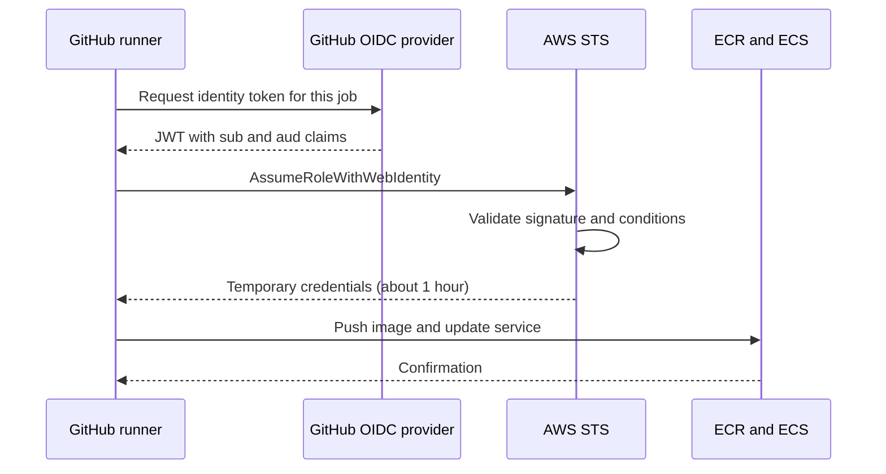
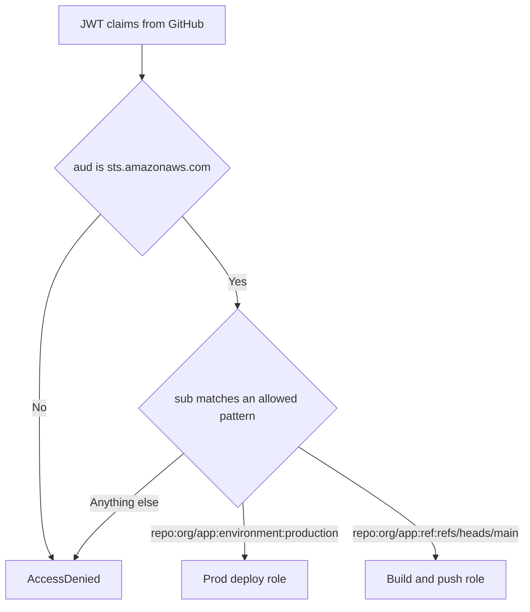
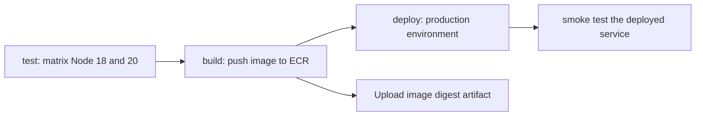

# 07 · GitHub Actions for AWS

> **Phase 3 — DevOps and Automation** · Lesson 07 of 13
> ⬅️ Previous: [Jenkins on AWS](./06-jenkins-on-aws.md) · ➡️ Next: [Containers and ECS](./08-containers-and-ecs.md) · 🏠 [Phase overview](./README.md)

## Learning Objectives

By the end of this lesson you will be able to:

- Federate GitHub Actions to AWS with OIDC so no long-lived access keys exist anywhere
- Write a complete build-and-deploy workflow that pushes to ECR and updates an ECS service
- Factor shared logic into reusable workflows and run multi-version matrix builds
- Gate production with GitHub environments, required reviewers, and protected branches
- Cache dependencies and Docker layers so CI stays fast and cheap

**Estimated time:** 75 min · **Difficulty:** Intermediate

---

## Core Concepts

GitHub Actions runs workflows defined in `.github/workflows/*.yml` on GitHub-hosted or self-hosted runners. Each workflow has **jobs**, each job runs on a fresh **runner**, and jobs pass data through artifacts or job outputs. Because the runner is ephemeral and lives outside your account, the interesting problem is entirely about identity: how does a runner in GitHub's infrastructure get permission to push an image to ECR?

The modern answer is **OIDC federation**. You create an IAM OIDC identity provider for `token.actions.githubusercontent.com`, then create a role whose trust policy accepts tokens from it — with conditions on the `sub` claim. GitHub mints a short-lived token for each job, AWS exchanges it for temporary credentials via `sts:AssumeRoleWithWebIdentity`, and the credentials expire in an hour. There is no secret to rotate, nothing in repository settings an attacker can exfiltrate, and CloudTrail shows exactly which repository, branch, and workflow assumed the role.

The `sub` condition is the security boundary, and it is worth writing carefully. `repo:my-org/my-repo:ref:refs/heads/main` restricts to pushes on main. `repo:my-org/my-repo:environment:production` restricts to jobs that declared the `production` environment — which is what you want for deploy roles, because environment protection rules then control who can trigger them. A wildcard like `repo:my-org/*` hands every repository in the organization the role, including ones created tomorrow.

**Reusable workflows** (`workflow_call`) let one team own the build logic and many repositories call it, which is how you avoid seventeen slightly different copies of `npm test` drifting apart. **Matrix builds** fan one job definition across versions, platforms, or regions with `strategy.matrix`, and `fail-fast: false` makes sure one broken combination still tells you about the others. **Environments** add approval gates: declaring `environment: production` on a job pauses the run until a required reviewer approves, and the OIDC subject changes to the environment form, which is precisely what lets you keep the production deploy role completely unreachable from a pull request.

Finally, **caching** is what keeps this pleasant. `actions/setup-node` with `cache: npm` restores `~/.npm`; `docker/build-push-action` with `cache-from: type=gha` stores layers in the GitHub Actions cache. A container build that takes four minutes cold typically takes forty seconds warm — and on private runners, that difference is a bill.

### Key terminology

| Term | Meaning |
|------|---------|
| **Workflow** | A YAML file in `.github/workflows` triggered by events. |
| **Job** | A set of steps executed on one runner; jobs run in parallel unless ordered. |
| **Step** | A single command or action within a job. |
| **Runner** | The ephemeral machine executing a job (`ubuntu-latest` or self-hosted). |
| **OIDC provider** | The IAM identity provider for `token.actions.githubusercontent.com`. |
| **`sub` claim** | Subject of the token; the condition that scopes which repo, ref, or environment may assume a role. |
| **Reusable workflow** | A workflow with `on: workflow_call` invoked by other workflows. |
| **Matrix** | A strategy that expands one job across combinations of values. |
| **Environment** | A GitHub deployment target with protection rules such as required reviewers. |
| **OIDC thumbprint** | Legacy verification value; AWS now validates against trusted root CAs. |

---

## Architecture Diagram

The OIDC exchange, with nothing long-lived involved:



Where the trust boundary is enforced:



The job graph of the workflow built in the lab:



---

## Hands-on Lab: Keyless CI/CD from GitHub to ECS

**Goal:** Wire GitHub Actions to AWS using OIDC, then build, test, push, and deploy a container with an approval gate on production.

**Prerequisites:** A GitHub repository, an ECR repository, an ECS Fargate service and cluster, and IAM permissions to create an OIDC provider and roles.

### Step 1 — Create the OIDC identity provider

```bash
# Register GitHub as an OIDC provider in this account (once per account)
aws iam create-open-id-connect-provider \
  --url https://token.actions.githubusercontent.com \
  --client-id-list sts.amazonaws.com \
  --thumbprint-list 6938fd4d98bab03faadb97b34396831e3780aea1 \
  --region us-east-1

# Confirm the provider ARN
aws iam list-open-id-connect-providers
```

AWS validates GitHub's token signature against the trusted root CAs, so the thumbprint value is no longer security-critical — but the API still expects a value. The provider is an account-level resource; create it once, not per repository.

### Step 2 — Create two roles: build and deploy

Build role trust policy, saved as `trust-build.json`:

```json
{
  "Version": "2012-10-17",
  "Statement": [
    {
      "Sid": "GitHubActionsBuildOnly",
      "Effect": "Allow",
      "Principal": {
        "Federated": "arn:aws:iam::123456789012:oidc-provider/token.actions.githubusercontent.com"
      },
      "Action": "sts:AssumeRoleWithWebIdentity",
      "Condition": {
        "StringEquals": {
          "token.actions.githubusercontent.com:aud": "sts.amazonaws.com"
        },
        "StringLike": {
          "token.actions.githubusercontent.com:sub": "repo:my-org/phase3lab-api:ref:refs/heads/main"
        }
      }
    }
  ]
}
```

Deploy role trust policy, saved as `trust-deploy.json` — note that it is scoped to the **environment**, not a branch:

```json
{
  "Version": "2012-10-17",
  "Statement": [
    {
      "Sid": "GitHubActionsProductionEnvironment",
      "Effect": "Allow",
      "Principal": {
        "Federated": "arn:aws:iam::123456789012:oidc-provider/token.actions.githubusercontent.com"
      },
      "Action": "sts:AssumeRoleWithWebIdentity",
      "Condition": {
        "StringEquals": {
          "token.actions.githubusercontent.com:aud": "sts.amazonaws.com",
          "token.actions.githubusercontent.com:sub": "repo:my-org/phase3lab-api:environment:production"
        }
      }
    }
  ]
}
```

```bash
# Create both roles with short session durations
aws iam create-role --role-name github-actions-build \
  --assume-role-policy-document file://trust-build.json \
  --max-session-duration 3600

aws iam create-role --role-name github-actions-deploy-prod \
  --assume-role-policy-document file://trust-deploy.json \
  --max-session-duration 3600

# Build role: push only to one repository
aws iam put-role-policy --role-name github-actions-build \
  --policy-name ecr-push-one-repo \
  --policy-document '{
    "Version": "2012-10-17",
    "Statement": [
      {"Effect": "Allow", "Action": "ecr:GetAuthorizationToken", "Resource": "*"},
      {"Effect": "Allow",
       "Action": ["ecr:BatchCheckLayerAvailability","ecr:InitiateLayerUpload","ecr:UploadLayerPart",
                  "ecr:CompleteLayerUpload","ecr:PutImage"],
       "Resource": "arn:aws:ecr:us-east-1:123456789012:repository/phase3lab/api"}
    ]
  }'
```

### Step 3 — Write the full workflow

Create `.github/workflows/build-and-deploy.yml`:

```yaml
name: build-and-deploy

on:
  push:
    branches: [main]
    paths-ignore:
      - "docs/**"
      - "**.md"
  pull_request:
    branches: [main]

# OIDC requires id-token: write; contents: read is all the checkout step needs
permissions:
  id-token: write
  contents: read

# One deploy at a time per branch; cancel superseded runs
concurrency:
  group: deploy-${{ github.ref }}
  cancel-in-progress: true

env:
  AWS_REGION: us-east-1
  ECR_REPOSITORY: phase3lab/api
  CONTAINER_NAME: app

jobs:
  test:
    name: Test on Node ${{ matrix.node }}
    runs-on: ubuntu-latest
    strategy:
      fail-fast: false
      matrix:
        node: [18, 20]
    steps:
      - uses: actions/checkout@v4

      - name: Set up Node with dependency caching
        uses: actions/setup-node@v4
        with:
          node-version: ${{ matrix.node }}
          cache: npm

      - name: Install dependencies
        run: npm ci

      - name: Run unit tests
        run: npm test -- --ci --reporters=default --reporters=jest-junit

      - name: Upload test report
        if: always()
        uses: actions/upload-artifact@v4
        with:
          name: junit-node-${{ matrix.node }}
          path: junit.xml
          retention-days: 7

  build:
    name: Build and push image
    needs: test
    if: github.event_name == 'push'
    runs-on: ubuntu-latest
    outputs:
      image: ${{ steps.image.outputs.image }}
    steps:
      - uses: actions/checkout@v4

      - name: Assume the build role via OIDC
        uses: aws-actions/configure-aws-credentials@v4
        with:
          role-to-assume: arn:aws:iam::123456789012:role/github-actions-build
          role-session-name: gha-build-${{ github.run_id }}
          aws-region: ${{ env.AWS_REGION }}

      - name: Log in to Amazon ECR
        id: ecr
        uses: aws-actions/amazon-ecr-login@v2

      - name: Set up Buildx
        uses: docker/setup-buildx-action@v3

      - name: Build and push with GitHub Actions layer cache
        id: build
        uses: docker/build-push-action@v6
        with:
          context: .
          push: true
          tags: |
            ${{ steps.ecr.outputs.registry }}/${{ env.ECR_REPOSITORY }}:${{ github.sha }}
            ${{ steps.ecr.outputs.registry }}/${{ env.ECR_REPOSITORY }}:latest
          cache-from: type=gha
          cache-to: type=gha,mode=max
          provenance: true
          sbom: true

      - name: Record the immutable image reference
        id: image
        run: |
          # Prefer the digest so downstream jobs deploy exactly this artifact
          echo "image=${{ steps.ecr.outputs.registry }}/${{ env.ECR_REPOSITORY }}@${{ steps.build.outputs.digest }}" >> "$GITHUB_OUTPUT"

  deploy:
    name: Deploy to production
    needs: build
    if: github.ref == 'refs/heads/main'
    runs-on: ubuntu-latest
    # Declaring the environment pauses the job for required reviewers
    environment:
      name: production
      url: https://api.example.com
    steps:
      - uses: actions/checkout@v4

      - name: Assume the production deploy role
        uses: aws-actions/configure-aws-credentials@v4
        with:
          role-to-assume: arn:aws:iam::123456789012:role/github-actions-deploy-prod
          role-session-name: gha-deploy-${{ github.run_id }}
          aws-region: ${{ env.AWS_REGION }}

      - name: Download the current task definition
        run: |
          # Start from what is running so unrelated settings are preserved
          aws ecs describe-task-definition \
            --task-definition phase3lab-api \
            --query taskDefinition \
            > task-definition.json

      - name: Render the new image into the task definition
        id: render
        uses: aws-actions/amazon-ecs-render-task-definition@v1
        with:
          task-definition: task-definition.json
          container-name: ${{ env.CONTAINER_NAME }}
          image: ${{ needs.build.outputs.image }}

      - name: Deploy and wait for stability
        uses: aws-actions/amazon-ecs-deploy-task-definition@v2
        with:
          task-definition: ${{ steps.render.outputs.task-definition }}
          service: phase3lab-api
          cluster: phase3lab-cluster
          wait-for-service-stability: true

      - name: Smoke test the deployed service
        run: |
          set -euo pipefail
          # Fail the workflow if the new version is not answering health checks
          for i in $(seq 1 10); do
            code=$(curl -s -o /dev/null -w "%{http_code}" https://api.example.com/healthz || true)
            [ "$code" = "200" ] && echo "Healthy" && exit 0
            sleep 6
          done
          echo "Smoke test failed" && exit 1

```

### Step 4 — Add a reusable workflow

Create `.github/workflows/reusable-container-build.yml`:

```yaml
name: reusable-container-build

on:
  workflow_call:
    inputs:
      repository:
        description: ECR repository name
        required: true
        type: string
      dockerfile:
        description: Path to the Dockerfile
        required: false
        type: string
        default: Dockerfile
      role-arn:
        description: IAM role that can push to ECR
        required: true
        type: string
    outputs:
      image:
        description: Immutable image reference including digest
        value: ${{ jobs.build.outputs.image }}

permissions:
  id-token: write
  contents: read

jobs:
  build:
    runs-on: ubuntu-latest
    outputs:
      image: ${{ steps.image.outputs.image }}
    steps:
      - uses: actions/checkout@v4

      - uses: aws-actions/configure-aws-credentials@v4
        with:
          role-to-assume: ${{ inputs.role-arn }}
          aws-region: us-east-1

      - id: ecr
        uses: aws-actions/amazon-ecr-login@v2

      - uses: docker/setup-buildx-action@v3

      - id: build
        uses: docker/build-push-action@v6
        with:
          context: .
          file: ${{ inputs.dockerfile }}
          push: true
          tags: ${{ steps.ecr.outputs.registry }}/${{ inputs.repository }}:${{ github.sha }}
          cache-from: type=gha
          cache-to: type=gha,mode=max

      - id: image
        run: |
          echo "image=${{ steps.ecr.outputs.registry }}/${{ inputs.repository }}@${{ steps.build.outputs.digest }}" >> "$GITHUB_OUTPUT"
```

Call it from a service workflow, optionally fanning out across regions with a matrix:

```yaml
name: service-release

on:
  push:
    tags: ["v*"]

jobs:
  build:
    uses: ./.github/workflows/reusable-container-build.yml
    with:
      repository: phase3lab/api
      role-arn: arn:aws:iam::123456789012:role/github-actions-build

  deploy:
    needs: build
    strategy:
      fail-fast: false
      max-parallel: 1
      matrix:
        include:
          - region: us-east-1
            environment: production-us
          - region: eu-west-1
            environment: production-eu
    environment: ${{ matrix.environment }}
    runs-on: ubuntu-latest
    steps:
      - uses: aws-actions/configure-aws-credentials@v4
        with:
          role-to-assume: arn:aws:iam::123456789012:role/github-actions-deploy-prod
          aws-region: ${{ matrix.region }}
      - run: |
          echo "Deploying ${{ needs.build.outputs.image }} to ${{ matrix.region }}"
```

### Step 5 — Turn on environment protection

In the repository settings, create an environment named `production`, add yourself as a required reviewer, and restrict deployment branches to `main`. Then verify the gate works.

```bash
# Inspect the assumption that happened, with the subject GitHub presented
aws cloudtrail lookup-events \
  --lookup-attributes AttributeKey=EventName,AttributeValue=AssumeRoleWithWebIdentity \
  --max-results 5 \
  --query "Events[].[EventTime,CloudTrailEvent]" --output text
```

### Step 6 — Verify

```bash
# Confirm no long-lived keys exist in the repository
# (Settings -> Secrets and variables -> Actions should have no AWS_ACCESS_KEY_ID)

# Confirm the image in ECR is the digest the workflow recorded
aws ecr describe-images --repository-name phase3lab/api \
  --query "sort_by(imageDetails,&imagePushedAt)[-1].imageDigest" --output text

# Confirm the ECS service is running the new task definition revision
aws ecs describe-services --cluster phase3lab-cluster --services phase3lab-api \
  --query "services[0].{TaskDefinition:taskDefinition,Desired:desiredCount,Running:runningCount}" --output json
```

---

## CLI Reference

```bash
# Find every role that trusts the GitHub OIDC provider
aws iam list-roles \
  --query "Roles[?contains(AssumeRolePolicyDocument.Statement[0].Principal.Federated || '', 'token.actions.githubusercontent.com')].RoleName" \
  --output text

# Add an additional subject to a role's trust policy without recreating it
aws iam update-assume-role-policy --role-name github-actions-build \
  --policy-document file://trust-build.json

# List workflow runs from the CLI when you cannot open a browser
gh run list --workflow build-and-deploy.yml --limit 10

# Re-run only the failed jobs
gh run rerun 1234567890 --failed
```

| Command | Purpose |
|---------|---------|
| `create-open-id-connect-provider` | One-time account setup for keyless GitHub access |
| `update-assume-role-policy` | Adjust which repositories or environments may assume a role |
| `lookup-events ... AssumeRoleWithWebIdentity` | Audit exactly which workflow assumed which role |
| `gh run rerun --failed` | Retry without a new commit |
| `put-image-tag-mutability` | Prevent a tag from being overwritten with different bits |

---

## Best Practices

| Practice | Why it matters |
|----------|----------------|
| OIDC everywhere; no stored AWS keys | Nothing to rotate and nothing to leak |
| Scope trust policies to repo, ref, or environment | A wildcard `sub` grants every repository in the org |
| Separate build and deploy roles | The build role cannot touch production services |
| Gate production with an environment and reviewers | The trust subject becomes `environment:production`, unreachable from a PR |
| Deploy by image digest, not tag | Tags move; digests cannot be overwritten |
| Keep `permissions` minimal per job | `id-token: write` only where credentials are needed |
| Use `concurrency` groups | Prevents two deploys racing on the same service |
| Cache dependencies and Docker layers | Warm builds finish in a fraction of the time |
| Pin third-party actions to a tag or SHA | A compromised action version runs with your OIDC token |
| Use `needs` and job outputs rather than rebuilding | One build artifact, many deploy targets |
| Add `paths-ignore` for documentation changes | Skips expensive jobs that cannot affect the artifact |

---

## Common Pitfalls

| Pitfall | Symptom | Fix |
|---------|---------|-----|
| Missing `id-token: write` | `configure-aws-credentials` fails with `Could not load credentials` | Add the permission at workflow or job level |
| `sub` claim mismatch | `AccessDenied` with "Not authorized to perform sts:AssumeRoleWithWebIdentity" | Check whether the subject is a ref or an environment, and match exactly |
| Environment job without required reviewers | Production deploys run unattended | Add protection rules to the environment |
| Wrong OIDC provider ARN | `InvalidIdentityToken: No OpenIDConnect provider found` | Include the account ID and confirm the provider exists in that account |
| Tag `latest` used for deploys | Rollback brings a different version than expected | Deploy the digest from `steps.build.outputs.digest` |
| Secrets used instead of federation | Old `AWS_SECRET_ACCESS_KEY` still present | Delete stored secrets once OIDC works, then rotate the exposed keys |
| Matrix explosion | 40 jobs for a minor change | Trim combinations with `exclude`, or use `include` only |
| Deployment blocked by a pending approval | Workflow sits in `Waiting` for days | Set an environment timeout and use `concurrency` `cancel-in-progress` |
| ECR push failing only in CI | Local `docker push` works | Role policy must include `ecr:GetAuthorizationToken` on `*` |
| Wildcard `sub` in the trust policy | Any repository in the organization can assume the deploy role | Scope to `repo:org/repo:ref:refs/heads/main` or to an environment |

---

## Cost Considerations

GitHub Actions minutes are free for public repositories and metered for private ones: Linux runners cost about **$0.008/minute**, with 2,000 minutes per month included in Team plans. A workflow that runs on every push, builds a container, and deploys takes roughly 8 minutes across its jobs — about $0.06 per run at 300 pushes a month, roughly $19. Caching is the biggest lever: a warm Docker layer cache routinely cuts the build job in half, and `paths-ignore` for documentation changes eliminates runs entirely.

AWS-side costs are small but real. ECR storage is $0.10 per GB-month, so 30 tagged images at 400 MB each is about $1.20/month — add a lifecycle policy and it stays flat. The ECS deployment itself is free; you pay for the tasks that run. `wait-for-service-stability: true` is not free — it holds the runner while the service stabilises, and if the service never stabilises the job burns runner minutes until the step times out, so set a job-level `timeout-minutes`. Self-hosted runners make sense past roughly 5,000 minutes a month, but then you inherit patching and a NAT Gateway, which is often the larger bill.

---

## Security Considerations

- **Federation replaces secrets; it does not replace least privilege.** A build role should push to exactly one ECR repository, and a deploy role should update exactly one ECS service.
- **Never trust `pull_request` with credentials.** Workflows triggered by `pull_request` from a fork do not receive secrets or an OIDC token by default; keep it that way, and never use `pull_request_target` with a checkout of untrusted code.
- **Pin actions to a commit SHA in production workflows.** `@v4` is convenient but a moved tag is a supply-chain risk; Dependabot can still keep SHAs current.
- **Mind artifact provenance.** `provenance: true` and `sbom: true` on the build prove where the image came from — turn them on and verify signatures with `cosign verify` before deploy.
- **Restrict who can approve environments and who can push to `main`.** The OIDC subject ties the role to the branch or environment, so branch protection is part of your AWS security boundary.
- **Audit assumptions.** `AssumeRoleWithWebIdentity` events in CloudTrail show the subject; alarm on unexpected repositories, and review roles whose trust policy contains a wildcard.
- **Do not build secrets into images.** Pass runtime configuration through task definition secrets from Secrets Manager, not `ARG` or `ENV` in the Dockerfile.

---

## Exercise

Convert the `test` and `build` jobs in `build-and-deploy.yml` into a single reusable workflow, `reusable-ci.yml`, that takes `node-version` and `repository` as inputs and returns the image digest as an output. Then have two service workflows (`orders` and `payments`) call it.

Success looks like: both service workflows complete without duplicating any build steps, `gh run list` shows the reusable workflow name in the run details, and the digest printed by the reusable workflow matches the digest in ECR for each repository.

---

## Resources

- [Configuring OpenID Connect in Amazon Web Services](https://docs.aws.amazon.com/IAM/latest/UserGuide/id_roles_providers_create_oidc.html)
- [GitHub Docs: Configuring OpenID Connect in AWS](https://docs.github.com/en/actions/deployment/security-hardening-your-deployments/configuring-openid-connect-in-amazon-web-services)
- [aws-actions/configure-aws-credentials](https://github.com/aws-actions/configure-aws-credentials)
- [Reusing Workflows](https://docs.github.com/en/actions/using-workflows/reusing-workflows)
- [Using a Matrix for Your Jobs](https://docs.github.com/en/actions/using-jobs/using-a-matrix-for-your-jobs)
- [aws-actions/amazon-ecs-deploy-task-definition](https://github.com/aws-actions/amazon-ecs-deploy-task-definition)

---

## Next Steps

Your pipeline can now build and deploy a container. The next lesson goes inside the container runtime itself: ECS task definitions, services, launch types, and the rolling and blue/green strategies that keep a deployment invisible to users.

> ⬅️ Previous: [Jenkins on AWS](./06-jenkins-on-aws.md) · ➡️ Next: [Containers and ECS](./08-containers-and-ecs.md) · 🏠 [Phase overview](./README.md)
