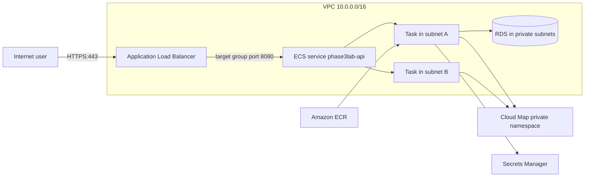
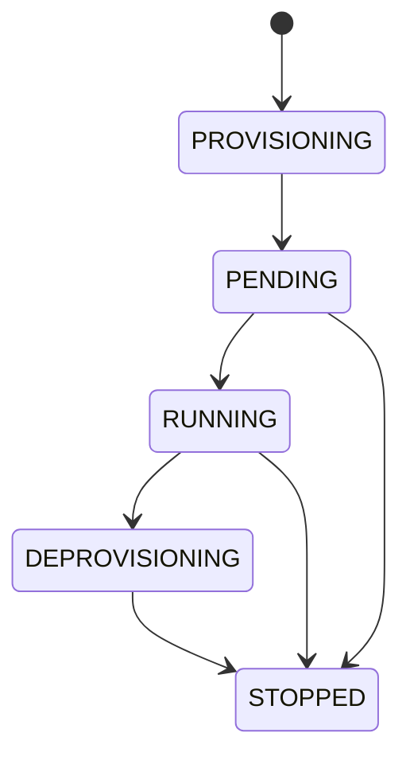
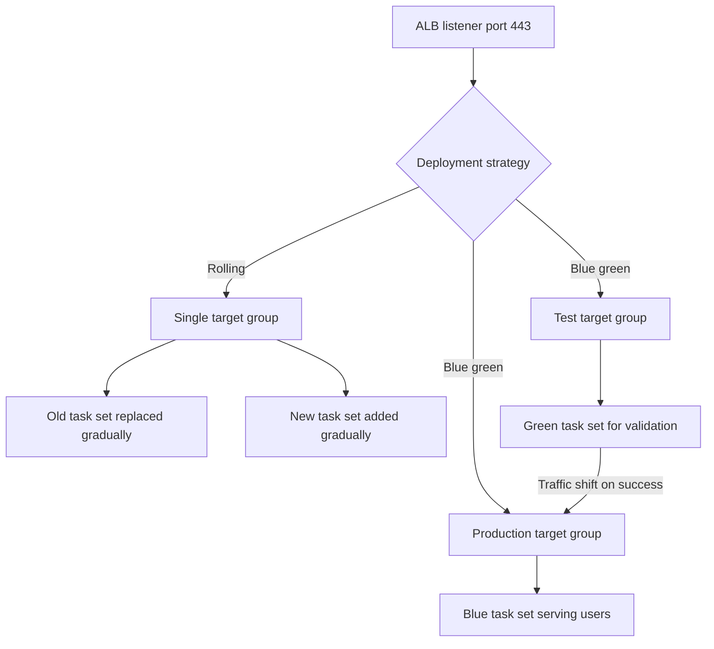

# 08 · Containers and ECS

> **Phase 3 — DevOps and Automation** · Lesson 08 of 13
> ⬅️ Previous: [GitHub Actions for AWS](./07-github-actions-for-aws.md) · ➡️ Next: [Amazon EKS](./09-amazon-eks.md) · 🏠 [Phase overview](./README.md)

## 🎯 Learning Objectives

By the end of this lesson you will be able to:

- Register a task definition and run it as a long-lived ECS service behind an ALB
- Choose between Fargate and EC2 launch types on evidence rather than habit
- Configure capacity providers and placement strategies for cost and resilience
- Wire service-to-service discovery with Cloud Map instead of hard-coded URLs
- Deploy with rolling updates and with CodeDeploy blue/green, and know when each is right

**Estimated time:** 85 min · **Difficulty:** Intermediate

---

## 🧠 Core Concepts

Amazon ECS has three objects you must keep straight. A **cluster** is a logical grouping — with Fargate it is almost free to create one per environment and it holds nothing but services and tasks. A **task definition** is the immutable blueprint: which images, how much CPU and memory, which ports, which log configuration, which secrets, and which IAM roles. A **service** keeps a chosen number of copies of that task definition running, replaces unhealthy tasks, and attaches them to a load balancer. Every deploy creates a new task definition *revision*; nothing is ever edited in place.

The launch type determines who owns the host. **Fargate** removes the host entirely: you declare CPU and memory in the task definition (as a valid pair, like 1024 CPU with 2048 MB), and AWS runs your task on managed capacity billed per second. **EC2 launch type** places tasks on instances you own and manage through an Auto Scaling group joined to the cluster; you get GPU support, larger instance types, deeper AMI customization, and reserved-instance pricing, at the cost of patching, capacity planning, and cluster-level autoscaling. The honest rule of thumb: choose Fargate unless you need GPUs, very large tasks, or Windows containers, or unless your steady-state utilization is high enough that Savings Plans and reserved instances on EC2 win on price.

Networking is where ECS surprises people. With `awsvpc` mode — the only mode Fargate supports — every task gets its own elastic network interface and its own private IP in the subnet you specify, with its own security group. That means a task behaves like an instance for security-group purposes, subnet IP exhaustion is a real failure mode, and `host` and `bridge` networking exist only on EC2 launch types. Service-to-service calls should not need to know IPs at all: **Cloud Map** registers each task in a private DNS namespace so `api.phase3.internal` resolves to healthy task IPs.

Deployments come in two flavors. A **rolling update** replaces tasks in place according to `minimumHealthyPercent` and `maximumPercent`, which is simple and free but briefly runs two versions behind the same target group. **Blue/green with CodeDeploy** creates a second task set behind an alternate target group, optionally routes test traffic to it, shifts production traffic in one step or gradually, and rolls back by discarding the new task set — which is why it is the right choice for anything with a database migration or a breaking API change. The `deploymentCircuitBreaker` with `rollback: true` is non-negotiable on rolling updates: without it, a service that cannot start will keep failing forward until you notice.

### Key terminology

| Term | Meaning |
|------|---------|
| **Cluster** | Logical grouping of services and tasks; with Fargate, mostly a namespace. |
| **Task definition** | Immutable blueprint: images, CPU, memory, ports, secrets, roles. |
| **Task** | A running instantiation of a task definition. |
| **Service** | Maintains desired count, replaces unhealthy tasks, registers with load balancers. |
| **Capacity provider** | Source of capacity: `FARGATE`, `FARGATE_SPOT`, or an ASG (EC2 launch type). |
| **Task role** | IAM role your application code assumes inside the container. |
| **Execution role** | IAM role the ECS agent uses to pull images and write logs. |
| **awsvpc** | Network mode giving each task its own ENI, IP, and security group. |
| **Task set** | Group of tasks created with the same task definition revision; used for blue/green. |
| **Container health check** | In-task check that ECS evaluates to replace unhealthy tasks. |

---

## 🗺️ Architecture Diagram

An ECS service behind an ALB with Cloud Map for internal calls:



The task lifecycle, which is what `describe-tasks` reports:



Rolling update versus blue/green traffic flow:



---

## 🧪 Hands-on Lab: Deploy a Fargate Service with Cloud Map and Blue/Green

**Goal:** Register a task definition, run it as a service behind an ALB, add private service discovery, and configure a CodeDeploy blue/green deployment.

**Prerequisites:** A VPC with two private subnets and a public subnet pair, an ALB with two target groups and two listeners, an ECR image, and permissions for ECS, ELB, Cloud Map, and IAM.

### Step 1 — Create the cluster and capacity provider strategy

```bash
# Container Insights gives you task-level metrics out of the box
aws ecs create-cluster \
  --cluster-name phase3lab-cluster \
  --settings name=containerInsights,value=enabled \
  --region us-east-1

# Mix on-demand and Spot Fargate capacity: 1 base task on demand, weight the rest to Spot
aws ecs put-cluster-capacity-providers \
  --cluster phase3lab-cluster \
  --capacity-providers FARGATE FARGATE_SPOT \
  --default-capacity-provider-strategy \
    capacityProvider=FARGATE,base=1,weight=1 \
    capacityProvider=FARGATE_SPOT,base=0,weight=3 \
  --region us-east-1
```

Fargate Spot costs roughly 70% less than on-demand and can be reclaimed with a two-minute warning. `base=1` guarantees one on-demand task so the service never drops to zero.

### Step 2 — Register the task definition

Save as `taskdef.json`:

```json
{
  "family": "phase3lab-api",
  "networkMode": "awsvpc",
  "requiresCompatibilities": ["FARGATE"],
  "cpu": "1024",
  "memory": "2048",
  "runtimePlatform": {
    "cpuArchitecture": "ARM64",
    "operatingSystemFamily": "LINUX"
  },
  "executionRoleArn": "arn:aws:iam::123456789012:role/phase3lab-ecs-execution-role",
  "taskRoleArn": "arn:aws:iam::123456789012:role/phase3lab-api-task-role",
  "volumes": [
    {
      "name": "tmp-storage"
    }
  ],
  "containerDefinitions": [
    {
      "name": "app",
      "image": "123456789012.dkr.ecr.us-east-1.amazonaws.com/phase3lab/api:1.4.1",
      "essential": true,
      "portMappings": [
        {
          "name": "http",
          "containerPort": 8080,
          "protocol": "tcp",
          "appProtocol": "http"
        }
      ],
      "environment": [
        { "name": "NODE_ENV", "value": "production" },
        { "name": "AWS_REGION", "value": "us-east-1" }
      ],
      "secrets": [
        {
          "name": "DB_PASSWORD",
          "valueFrom": "arn:aws:secretsmanager:us-east-1:123456789012:secret:phase3lab/prod/db-abc123:password::"
        }
      ],
      "mountPoints": [
        { "sourceVolume": "tmp-storage", "containerPath": "/tmp" }
      ],
      "healthCheck": {
        "command": ["CMD-SHELL", "curl -f http://localhost:8080/healthz || exit 1"],
        "interval": 30,
        "timeout": 5,
        "retries": 3,
        "startPeriod": 15
      },
      "logConfiguration": {
        "logDriver": "awslogs",
        "options": {
          "awslogs-group": "/ecs/phase3lab-api",
          "awslogs-region": "us-east-1",
          "awslogs-stream-prefix": "app",
          "mode": "non-blocking",
          "max-buffer-size": "4m"
        }
      },
      "linuxParameters": {
        "initProcessEnabled": true
      },
      "stopTimeout": 30
    }
  ]
}
```

```bash
# Register the task definition; the response contains a new revision number
aws ecs register-task-definition --cli-input-json file://taskdef.json \
  --query "taskDefinition.{Family:family,Revision:revision}" --output json

# Verify the secret references resolved before the service exists
aws ecs describe-task-definition --task-definition phase3lab-api:1 \
  --query "taskDefinition.containerDefinitions[0].secrets" --output json
```

`initProcessEnabled: true` reaps zombie processes, and `stopTimeout: 30` gives the app time to drain in-flight requests — both prevent the classic "task killed mid-request" error spike.

### Step 3 — Create a Cloud Map namespace and register the service

```bash
# Private DNS namespace for service-to-service discovery
aws servicediscovery create-private-dns-namespace \
  --name phase3.internal \
  --vpc vpc-0abc1234def567890 \
  --region us-east-1

# A service that returns A records for healthy task IPs
aws servicediscovery create-service \
  --name api \
  --namespace-id ns-abcdef0123456789 \
  --dns-config 'NamespaceId=ns-abcdef0123456789,RoutingPolicy=WEIGHTED,DnsRecords=[{Type=A,TTL=15}]' \
  --health-check-custom-config FailureThreshold=1 \
  --region us-east-1
```

### Step 4 — Create the service behind the load balancer

```bash
# Long-lived service: 3 tasks, rolling updates, circuit breaker for automatic rollback
aws ecs create-service \
  --cluster phase3lab-cluster \
  --service-name phase3lab-api \
  --task-definition phase3lab-api:1 \
  --desired-count 3 \
  --launch-type FARGATE \
  --platform-version LATEST \
  --network-configuration 'awsvpcConfiguration={subnets=[subnet-0private1111111,subnet-0private2222222],securityGroups=[sg-0api123456],assignPublicIp=DISABLED}' \
  --load-balancers 'targetGroupArn=arn:aws:elasticloadbalancing:us-east-1:123456789012:targetgroup/phase3lab-api-blue/6d0ecf831eec9f09,containerName=app,containerPort=8080' \
  --health-check-grace-period-seconds 60 \
  --deployment-configuration 'maximumPercent=200,minimumHealthyPercent=100,deploymentCircuitBreaker={enable=true,rollback=true}' \
  --service-registries 'registryArn=arn:aws:servicediscovery:us-east-1:123456789012:service/srv-abcdef0123456789' \
  --propagate-tags SERVICE \
  --enable-execute-command \
  --tags key=Environment,value=prod key=Project,value=phase3lab \
  --region us-east-1
```

`minimumHealthyPercent=100` with `maximumPercent=200` is the zero-downtime combination: ECS starts the replacement tasks before stopping any old ones.

### Step 5 — Roll out a new revision and watch it happen

```bash
# Update to a new revision; ECS performs a rolling deployment
aws ecs update-service \
  --cluster phase3lab-cluster \
  --service phase3lab-api \
  --task-definition phase3lab-api:2 \
  --region us-east-1

# Watch the deployment and task sets while it drains and replaces
aws ecs describe-services --cluster phase3lab-cluster --services phase3lab-api \
  --query "services[0].{Desired:desiredCount,Running:runningCount,Pending:pendingCount,Deployments:deployments[].{Status:status,TaskDef:taskDefinition,Rollout:rolloutState}}" \
  --output json

# Block until the new revision is fully stable
aws ecs wait services-stable --cluster phase3lab-cluster --services phase3lab-api
```

### Step 6 — Switch to blue/green with CodeDeploy

```bash
# A blue/green service uses the CODE_DEPLOY controller and two target groups
aws ecs create-service \
  --cluster phase3lab-cluster \
  --service-name phase3lab-api-bg \
  --task-definition phase3lab-api:2 \
  --desired-count 3 \
  --launch-type FARGATE \
  --deployment-controller type=CODE_DEPLOY \
  --network-configuration 'awsvpcConfiguration={subnets=[subnet-0private1111111,subnet-0private2222222],securityGroups=[sg-0api123456],assignPublicIp=DISABLED}' \
  --load-balancers 'targetGroupArn=arn:aws:elasticloadbalancing:us-east-1:123456789012:targetgroup/phase3lab-api-green/50dc6c495c0c9188,containerName=app,containerPort=8080,advancedConfiguration={alternateTargetGroupArn=arn:aws:elasticloadbalancing:us-east-1:123456789012:targetgroup/phase3lab-api-blue/6d0ecf831eec9f09,productionListenerRule=arn:aws:elasticloadbalancing:us-east-1:123456789012:listener-rule/app/phase3lab/50dc6c495c0c9188/1a2b3c4d5e6f7a8b/9f8e7d6c5b4a3928,testListenerRule=arn:aws:elasticloadbalancing:us-east-1:123456789012:listener-rule/app/phase3lab/50dc6c495c0c9188/1a2b3c4d5e6f7a8b/2b3c4d5e6f7a8b9c,roleArn=arn:aws:iam::123456789012:role/phase3lab-codedeploy-role}' \
  --region us-east-1
```

The CodeDeploy application and deployment group from the [CodePipeline lesson](./05-codepipeline.md) own the traffic shift from here: `CodeDeployDefault.ECSLinear10PercentEvery1Minutes` moves 10% per minute, with automatic rollback if your 5xx alarm fires.

### Step 7 — Verify

```bash
# Every task should be RUNNING with the revision you deployed
aws ecs list-tasks --cluster phase3lab-cluster --service-name phase3lab-api --query "taskArns[0]" --output text

# Inspect a single task's status, health and availability zone
TASK_ARN=$(aws ecs list-tasks --cluster phase3lab-cluster --service-name phase3lab-api --query "taskArns[0]" --output text)
aws ecs describe-tasks --cluster phase3lab-cluster --tasks "$TASK_ARN" \
  --query "tasks[0].{LastStatus:lastStatus,Health:healthStatus,Revision:taskDefinition,AZ:availabilityZone}" --output json

# Target group health
aws elbv2 describe-target-health \
  --target-group-arn arn:aws:elasticloadbalancing:us-east-1:123456789012:targetgroup/phase3lab-api-green/50dc6c495c0c9188 \
  --query "TargetHealthDescriptions[].TargetHealth.State" --output text

# Service discovery resolves to the healthy task IPs
dig +short api.phase3.internal
```

---

## 💻 CLI Reference

```bash
# Run a one-off task with a command override (migrations, backfills)
aws ecs run-task --cluster phase3lab-cluster --task-definition phase3lab-api:2 \
  --launch-type FARGATE --count 1 \
  --network-configuration 'awsvpcConfiguration={subnets=[subnet-0private1111111],securityGroups=[sg-0api123456],assignPublicIp=DISABLED}' \
  --overrides 'containerOverrides=[{name=app,command=[npm,run,migrate]}]'

# Shell into a running container without SSH (requires enableExecuteCommand)
aws ecs execute-command --cluster phase3lab-cluster --task 0a1b2c3d4e5f67890 \
  --container app --interactive --command "/bin/sh"

# Force a new deployment without changing the task definition
aws ecs update-service --cluster phase3lab-cluster --service phase3lab-api --force-new-deployment

# Scale manually
aws ecs update-service --cluster phase3lab-cluster --service phase3lab-api --desired-count 6

# Inspect stopped tasks and the reason the scheduler gives
aws ecs list-tasks --cluster phase3lab-cluster --desired-status STOPPED --family phase3lab-api

# See how many tasks the cluster is actually running
aws ecs describe-clusters --clusters phase3lab-cluster \
  --query "clusters[0].{Running:runningTasksCount,Pending:pendingTasksCount,Instances:registeredContainerInstancesCount}"

# Update the execution role policy so tasks can read a new secret
aws iam put-role-policy --role-name phase3lab-ecs-execution-role \
  --policy-name read-app-secrets \
  --policy-document file://execution-role-secrets.json

# Application Auto Scaling target for a queue-driven worker
aws application-autoscaling register-scalable-target \
  --service-namespace ecs --resource-id service/phase3lab-cluster/phase3lab-worker \
  --scalable-dimension ecs:service:DesiredCount --min-capacity 1 --max-capacity 20
```

| Command | Purpose |
|---------|---------|
| `register-task-definition` | Creates an immutable revision; never edits in place |
| `create-service` / `update-service` | Runs tasks and converges to the desired count |
| `wait services-stable` | Blocks a pipeline until the deployment finishes |
| `run-task` | One-off work outside the service scheduler |
| `execute-command` | Debug a live container without SSH |
| `describe-clusters` | Capacity and task counts for troubleshooting |

---

## ✅ Best Practices

| Practice | Why it matters |
|----------|----------------|
| `deploymentCircuitBreaker` with `rollback: true` | Stops a broken release from looping forever |
| `minimumHealthyPercent: 100`, `maximumPercent: 200` | Zero-downtime rolling updates |
| Separate task role from execution role | Application permissions never leak into the infrastructure path |
| Secrets via `secrets`, never `environment` | Values are injected at start and never stored in the task definition |
| AWS ARM64 (Graviton) unless x86 is required | Roughly 20% cheaper for the same performance |
| Health check grace period longer than app startup | Prevents the scheduler from killing tasks that are still booting |
| `awslogs` with non-blocking mode | A slow log destination cannot stall your application |
| `initProcessEnabled: true` and a real `stopTimeout` | Clean shutdowns, no zombie processes |
| Cloud Map instead of hard-coded URLs | Task IPs change on every deployment |
| One service per task definition family | Independent scaling and deployment cadence |
| CloudWatch alarms on ALB 5xx and task count | Deployment rollback needs a signal to act on |

---

## ⚠️ Common Pitfalls

| Pitfall | Symptom | Fix |
|---------|---------|-----|
| Invalid CPU and memory pair | `ClientException: Invalid CPU or memory combination` | Use documented Fargate pairs such as 512/1024, 1024/2048, 2048/4096 |
| Subnet IP exhaustion | Tasks stuck in `PENDING` with `ResourceInitializationError` | Add subnets or larger CIDR blocks; each awsvpc task consumes an ENI and an IP |
| No NAT Gateway or VPC endpoints | Image pull and Secrets Manager calls fail | Add a NAT Gateway or interface endpoints for ECR, S3, and Secrets Manager |
| Health check path mismatch | Tasks cycle between `RUNNING` and `STOPPED` | Align the container health check, target group health check, and grace period |
| Execution role missing `secretsmanager:GetSecretValue` | `ResourceInitializationError: unable to pull secrets` | Grant the execution role access to the exact secret ARN |
| Image tag `latest` with no force deploy | Tasks keep running old code | Deploy by digest or call `--force-new-deployment` |
| Two overlapping deployments | Service never stabilises | Keep `maximumPercent` sane and avoid concurrent `update-service` calls |
| Multiple target groups on one listener rule | Blue/green stalls in `IN_PROGRESS` | Give production and test traffic their own listener rules |
| Stopped tasks with exit code 137 | Container killed by the OOM killer | Raise task memory or fix the memory leak; 137 is SIGKILL |

---

## 💰 Cost Considerations

You pay for what tasks consume, not for the cluster. A 1 vCPU / 2 GB Fargate task at ARM64 pricing runs about **$0.0405/hour**, so three tasks cost roughly **$88/month** on demand. The same shape on Fargate Spot is about **$0.012/hour** — the capacity provider strategy in the lab weights Spot 3:1, which typically lands a three-task service near $40/month while keeping one on-demand task as a floor. EC2 launch type on a Graviton instance with a Savings Plan can be cheaper still at high utilization, but only if you pack tasks efficiently; an under-utilized EC2 cluster is more expensive than Fargate.

The hidden line items matter as much as the tasks. An ALB costs about **$16/month plus LCU charges**. A NAT Gateway costs about **$32/month before data processing**, and every image pull through it adds up — VPC endpoints for ECR and S3 avoid that traffic. CloudWatch Logs at $0.50 per GB ingested grows quietly when an application logs at debug level in production; 30-day retention instead of "never expire" is a one-line change with immediate effect. Container Insights adds a per-metric cost that is usually worth it for a production service and rarely worth it in a sandbox. And `desiredCount` is a cost lever: a staging service with three tasks is a habit, not a requirement.

---

## 🔐 Security Considerations

- **One security group per service, referencing other groups as sources** — allow 8080 from `sg-0alb` rather than a CIDR range. Tasks in `awsvpc` mode are individually addressable, so group references stay accurate as IPs change.
- **Never bake secrets into images or task definitions.** Use the `secrets` block with Secrets Manager or SSM `SecureString` parameters and a scoped execution role policy.
- **Keep `assignPublicIp: DISABLED`.** Tasks belong in private subnets with a NAT Gateway or VPC endpoints for outbound access.
- **Scope the task role to what the code does**, not what the team finds convenient. A task that reads one DynamoDB table should have exactly that permission.
- **Restrict `execute-command`.** It grants shell access to production containers; gate it behind the same IAM permissions you would give SSH, and enable it only where operational need justifies it.
- **Scan images on push:** `aws ecr put-image-scanning-configuration --repository-name phase3lab/api --image-scanning-configuration scanOnPush=true` catches known CVEs before a task ever starts.
- **Enforce read-only root filesystems where possible** with `readonlyRootFilesystem: true` plus a writable `tmp` volume, and drop unnecessary Linux capabilities.

---

## 🧩 Exercise

Add a second service called `phase3lab-worker` that consumes from an SQS queue, has no load balancer, and scales on queue depth using Application Auto Scaling with a target-tracking policy on `SQSApproximateNumberOfMessagesVisible` at 50 messages per task.

Success looks like: `aws application-autoscaling describe-scalable-targets --service-namespace ecs` lists the worker service, injecting 500 messages increases `desiredCount` above the minimum within a few minutes, and draining the queue returns the service to its minimum task count.

---

## 📚 Resources

- [Amazon ECS Developer Guide](https://docs.aws.amazon.com/AmazonECS/latest/developerguide/Welcome.html)
- [Task Definition Parameters](https://docs.aws.amazon.com/AmazonECS/latest/developerguide/task_definition_parameters.html)
- [Fargate Task CPU and Memory Combinations](https://docs.aws.amazon.com/AmazonECS/latest/developerguide/task-cpu-memory-error.html)
- [Service Discovery with Cloud Map](https://docs.aws.amazon.com/AmazonECS/latest/developerguide/service-discovery.html)
- [Blue/Green Deployments with CodeDeploy and ECS](https://docs.aws.amazon.com/AmazonECS/latest/developerguide/deployment-type-bluegreen.html)
- [Fargate Capacity Providers](https://docs.aws.amazon.com/AmazonECS/latest/developerguide/fargate-capacity-providers.html)

---

## ➡️ Next Steps

ECS gives you a managed scheduler with an AWS-shaped API. If your team already thinks in Kubernetes — or needs the ecosystem around it — the next lesson covers Amazon EKS, including the identity bridge that makes pods first-class AWS principals.

> ⬅️ Previous: [GitHub Actions for AWS](./07-github-actions-for-aws.md) · ➡️ Next: [Amazon EKS](./09-amazon-eks.md) · 🏠 [Phase overview](./README.md)
