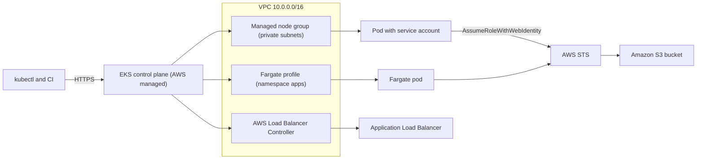
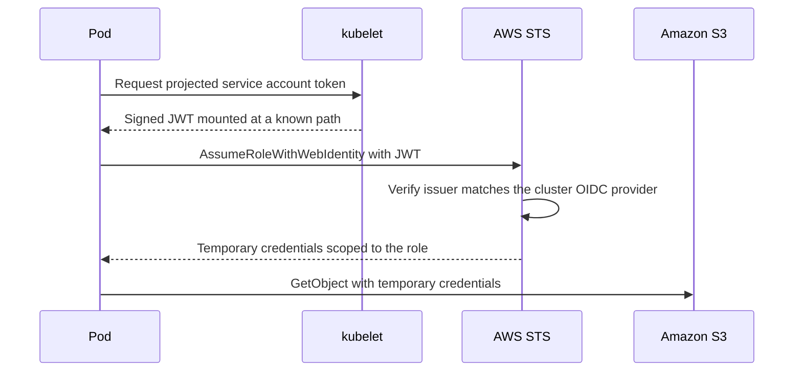
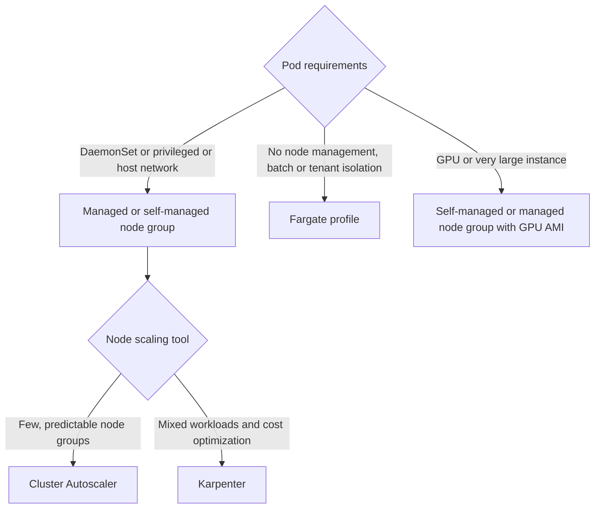

# 09 · Amazon EKS

> **Phase 3 — DevOps and Automation** · Lesson 09 of 13
> ⬅️ Previous: [Containers and ECS](./08-containers-and-ecs.md) · ➡️ Next: [AWS Fargate](./10-aws-fargate.md) · 🏠 [Phase overview](./README.md)

## 🎯 Learning Objectives

By the end of this lesson you will be able to:

- Create an EKS cluster with managed node groups, Fargate profiles, and the required add-ons
- Grant AWS permissions to individual pods with IRSA or EKS Pod Identity instead of node roles
- Scale a cluster with Cluster Autoscaler or Karpenter and explain the difference
- Use `kubectl` confidently for deploys, rollbacks, logs, and debugging
- Harden a cluster with private endpoint access, access entries, and secret encryption

**Estimated time:** 90 min · **Difficulty:** Advanced

---

## 🧠 Core Concepts

EKS is Kubernetes with the control plane run by AWS. You get an API server, etcd, and the scheduler spread across three availability zones, patched and highly available, for a flat hourly fee. What you own is the **data plane**: the worker nodes, their AMIs, their scaling, and the VPC they live in. This split is the whole mental model — anything in `kube-system` that runs on nodes is your responsibility, and the API server is not.

Worker capacity comes in three shapes. **Managed node groups** give you an Auto Scaling group that EKS understands: it drains nodes during an update, applies the latest EKS-optimized AMI, and reports status back to the cluster. **Self-managed nodes** are ordinary ASG instances you bootstrap with `bootstrap.sh`, useful for custom AMIs, GPUs, or on-premises-style taints. **Fargate profiles** run pods with no node at all, selected by namespace and label, which is perfect for isolation but excludes DaemonSets, host networking, and privileged containers.

Identity is the part that separates EKS practitioners from Kubernetes practitioners. Out of the box, pods inherit the node instance role, so every pod on a node gets every permission the node has — which is exactly wrong. **IRSA (IAM Roles for Service Accounts)** projects a signed JWT into the pod, and `sts:AssumeRoleWithWebIdentity` exchanges it for a scoped role based on the service account. **EKS Pod Identity** achieves the same outcome through a cluster agent that hands credentials to pods directly, without an OIDC provider or trust policy per cluster. Either way, the goal is one IAM role per workload, with no long-lived keys, and a node role that does nothing but join the cluster.

Scaling is a two-layer problem. The Horizontal Pod Autoscaler adds pods based on CPU, memory, or custom metrics. Something must then add *nodes* for those pods to land on. **Cluster Autoscaler** adjusts the desired capacity of the ASGs it is configured with, which makes it tied to node group shapes. **Karpenter** watches for unschedulable pods and launches exactly the instance type that fits, from a broad set of candidates, then consolidates underutilized nodes by moving pods and terminating them — usually cheaper and faster, at the cost of another component to operate.

Add-ons are the Kubernetes equivalents of managed services: `vpc-cni` for pod networking, `coredns` for cluster DNS, `kube-proxy` for service routing, `aws-ebs-csi-driver` for persistent volumes, and the AWS Load Balancer Controller for ingresses and services of type LoadBalancer. Install them through the EKS add-on API so version compatibility is checked for you.

### Key terminology

| Term | Meaning |
|------|---------|
| **Control plane** | AWS-managed API server and etcd; billed hourly per cluster. |
| **Node group** | Group of worker instances joined to the cluster. |
| **Fargate profile** | Selection rule that runs matching pods on Fargate with no nodes. |
| **IRSA** | IAM Roles for Service Accounts; pod-level AWS identity via OIDC. |
| **EKS Pod Identity** | Pod-level credentials delivered by the cluster agent, no OIDC provider needed. |
| **Access entry** | EKS-native mapping of an IAM principal to Kubernetes RBAC, replacing `aws-auth`. |
| **Add-on** | Managed cluster component with AWS-validated version compatibility. |
| **Pod Identity Agent** | DaemonSet/agent that serves credentials to pods using Pod Identity. |
| **Consolidation** | Karpenter replacing underutilized nodes with cheaper or fewer nodes. |

---

## 🗺️ Architecture Diagram

A cluster with managed nodes, a Fargate profile, and pod-level AWS identity:



How a pod gets AWS credentials without any node-level permission sprawl:



Choosing where pods run:



---

## 🧪 Hands-on Lab: A Cluster with IRSA and Karpenter

**Goal:** Create an EKS cluster with a managed node group, install core add-ons, give a pod scoped S3 access with IRSA, and add Karpenter for node scaling.

**Prerequisites:** `eksctl` 0.180+, `kubectl`, `helm`, AWS CLI v2, and an account with permissions for EKS, EC2, IAM, and CloudFormation.

### Step 1 — Create the cluster declaratively

Save `cluster.yaml`:

```yaml
apiVersion: eksctl.io/v1alpha5
kind: ClusterConfig

metadata:
  name: phase3lab
  region: us-east-1
  version: "1.30"

iam:
  withOIDC: true

vpc:
  cidr: 10.42.0.0/16
  nat:
    gateway: Single
  clusterEndpoints:
    publicAccess: true
    privateAccess: true

managedNodeGroups:
  - name: standard
    instanceType: m6g.large
    desiredCapacity: 3
    minSize: 2
    maxSize: 6
    amiFamily: AmazonLinux2023
    volumeSize: 50
    labels:
      role: general
      arch: arm64
    tags:
      Project: phase3lab
    iam:
      withAddonPolicies:
        ebs: true
        cloudWatch: true

addons:
  - name: vpc-cni
  - name: coredns
  - name: kube-proxy
  - name: aws-ebs-csi-driver

fargateProfiles:
  - name: batch
    selectors:
      - namespace: batch
        labels:
          compute: fargate
```

```bash
# Create the cluster, node groups, add-ons and IAM roles in one pass
eksctl create cluster -f cluster.yaml

# Point kubectl at the new cluster
aws eks update-kubeconfig --name phase3lab --region us-east-1
kubectl get nodes -o wide
kubectl get pods -n kube-system
```

### Step 2 — Create an IAM role bound to a service account

```bash
# A service account whose pods get S3 read access and nothing else
eksctl create iamserviceaccount \
  --cluster phase3lab \
  --region us-east-1 \
  --namespace apps \
  --name s3-reader \
  --attach-policy-arn arn:aws:iam::aws:policy/AmazonS3ReadOnlyAccess \
  --override-existing-serviceaccounts \
  --approve
```

The trust policy that `eksctl` created asserts the cluster's OIDC issuer and the exact `namespace:serviceaccount` subject:

```json
{
  "Version": "2012-10-17",
  "Statement": [
    {
      "Effect": "Allow",
      "Principal": {
        "Federated": "arn:aws:iam::123456789012:oidc-provider/oidc.eks.us-east-1.amazonaws.com/id/EXAMPLED539D4633E53DE1B716D3041E"
      },
      "Action": "sts:AssumeRoleWithWebIdentity",
      "Condition": {
        "StringEquals": {
          "oidc.eks.us-east-1.amazonaws.com/id/EXAMPLED539D4633E53DE1B716D3041E:sub": "system:serviceaccount:apps:s3-reader",
          "oidc.eks.us-east-1.amazonaws.com/id/EXAMPLED539D4633E53DE1B716D3041E:aud": "sts.amazonaws.com"
        }
      }
    }
  ]
}
```

Annotate and run a workload with it:

```yaml
apiVersion: v1
kind: ServiceAccount
metadata:
  name: s3-reader
  namespace: apps
  annotations:
    eks.amazonaws.com/role-arn: arn:aws:iam::123456789012:role/eksctl-phase3lab-addon-iamserviceaccount-apps-s3-reader
---
apiVersion: v1
kind: Pod
metadata:
  name: s3-check
  namespace: apps
spec:
  serviceAccountName: s3-reader
  containers:
    - name: aws-cli
      image: public.ecr.aws/aws-cli/aws-cli:latest
      command: ["sh", "-c", "aws sts get-caller-identity && aws s3 ls s3://phase3lab-artifacts-123456789012 && sleep 3600"]
```

```bash
# Confirm the pod assumes the scoped role rather than the node role
kubectl apply -f s3-reader-pod.yaml
kubectl logs -n apps s3-check
```

### Step 3 — Grant human and CI access with access entries

```bash
# EKS access entries replace the aws-auth ConfigMap and are auditable in the API
aws eks create-access-entry \
  --cluster-name phase3lab \
  --principal-arn arn:aws:iam::123456789012:role/PlatformEngineer \
  --type STANDARD \
  --kubernetes-groups system:masters

# Read-only group for the observability team
aws eks create-access-entry \
  --cluster-name phase3lab \
  --principal-arn arn:aws:iam::123456789012:role/ObservabilityRO \
  --type STANDARD \
  --kubernetes-groups view

# Verify what is granted
aws eks list-access-entries --cluster-name phase3lab
```

Bind the group to Kubernetes RBAC:

```yaml
apiVersion: rbac.authorization.k8s.io/v1
kind: ClusterRoleBinding
metadata:
  name: observability-view
roleRef:
  apiGroup: rbac.authorization.k8s.io
  kind: ClusterRole
  name: view
subjects:
  - kind: Group
    name: view
    apiGroup: rbac.authorization.k8s.io
```

### Step 4 — Install Karpenter for node scaling

```bash
# Environment values from the cluster
export CLUSTER_NAME=phase3lab
export AWS_REGION=us-east-1
export KARPENTER_VERSION=v1.0.6
export CLUSTER_ENDPOINT=$(aws eks describe-cluster --name "$CLUSTER_NAME" \
  --query "cluster.endpoint" --output text)

# Install the chart from the public ECR registry
helm upgrade --install karpenter oci://public.ecr.aws/karpenter/karpenter \
  --version "${KARPENTER_VERSION}" \
  --namespace kube-system \
  --set "settings.clusterName=${CLUSTER_NAME}" \
  --set "settings.interruptionQueue=${CLUSTER_NAME}" \
  --set controller.resources.requests.cpu=1 \
  --set controller.resources.requests.memory=1Gi \
  --set controller.resources.limits.cpu=1 \
  --set controller.resources.limits.memory=1Gi \
  --wait
```

Define what Karpenter may launch:

```yaml
apiVersion: karpenter.sh/v1
kind: NodePool
metadata:
  name: general
spec:
  template:
    metadata:
      labels:
        role: general
    spec:
      requirements:
        - key: kubernetes.io/arch
          operator: In
          values: ["arm64", "amd64"]
        - key: karpenter.sh/capacity-type
          operator: In
          values: ["spot", "on-demand"]
        - key: karpenter.k8s.aws/instance-category
          operator: In
          values: ["c", "m", "r"]
        - key: karpenter.k8s.aws/instance-generation
          operator: Gt
          values: ["5"]
      nodeClassRef:
        group: karpenter.k8s.aws
        kind: EC2NodeClass
        name: default
      expireAfter: 720h
  limits:
    cpu: "200"
    memory: 400Gi
  disruption:
    consolidationPolicy: WhenEmptyOrUnderutilized
    consolidateAfter: 1m
---
apiVersion: karpenter.k8s.aws/v1
kind: EC2NodeClass
metadata:
  name: default
spec:
  amiSelectorTerms:
    - alias: al2023@latest
  role: KarpenterNodeRole-phase3lab
  subnetSelectorTerms:
    - tags:
        karpenter.sh/discovery: phase3lab
  securityGroupSelectorTerms:
    - tags:
        karpenter.sh/discovery: phase3lab
  blockDeviceMappings:
    - deviceName: /dev/xvda
      ebs:
        volumeSize: 80Gi
        volumeType: gp3
        encrypted: true
```

```bash
# Confirm Karpenter is running and watching for pods
kubectl get pods -n kube-system -l app.kubernetes.io/name=karpenter
kubectl get nodepool,ec2nodeclass
```

### Step 5 — Deploy an application and verify

```bash
# Deploy a workload with a HPA so scaling has something to react to
kubectl create deployment web --image=public.ecr.aws/nginx/nginx:1.27 --replicas=2 -n apps
kubectl expose deployment web --port=80 --target-port=80 -n apps
kubectl autoscale deployment web --cpu-percent=70 --min=2 --max=20 -n apps

# Watch pods schedule and Karpenter add capacity if needed
kubectl get pods -n apps -o wide
kubectl get nodes -l karpenter.sh/nodepool=general
```

### Step 6 — Verify

```bash
# Add-ons and their versions
aws eks list-addons --cluster-name phase3lab
aws eks describe-addon --cluster-name phase3lab --addon-name vpc-cni \
  --query "addon.{Name:addonName,Version:addonVersion,Status:status}" --output json

# Cluster endpoint configuration — public access should be off in production
aws eks describe-cluster --name phase3lab \
  --query "cluster.resourcesVpcConfig.{Public:endpointPublicAccess,Private:endpointPrivateAccess,Cidrs:publicAccessCidrs}"

# Node health
kubectl get nodes -o custom-columns='NAME:.metadata.name,INSTANCE:.spec.providerID,STATUS:.status.conditions[-1].type'
```

### Step 7 — Clean up

```bash
# Delete workloads first so load balancers and volumes are released
kubectl delete deployment web -n apps
kubectl delete hpa web -n apps

# Then delete the cluster and everything eksctl created
eksctl delete cluster --name phase3lab --region us-east-1
```

---

## 💻 CLI Reference

```bash
# Create a cluster without eksctl (control plane only)
aws eks create-cluster \
  --name phase3lab \
  --role-arn arn:aws:iam::123456789012:role/eks-cluster-role \
  --resources-vpc-config subnetIds=subnet-0private1111111,subnet-0private2222222,securityGroupIds=sg-0eks123456,endpointPublicAccess=false,endpointPrivateAccess=true \
  --kubernetes-version 1.30

# Add a managed node group
aws eks create-nodegroup \
  --cluster-name phase3lab \
  --nodegroup-name workers-arm \
  --scaling-config minSize=2,maxSize=6,desiredSize=3 \
  --subnets subnet-0private1111111 subnet-0private2222222 \
  --node-role arn:aws:iam::123456789012:role/eks-node-role \
  --instance-types m6g.large \
  --ami-type AL2023_ARM_64_STANDARD \
  --capacity-type ON_DEMAND

# Run a namespace on Fargate (no nodes, no DaemonSets)
aws eks create-fargate-profile \
  --cluster-name phase3lab \
  --fargate-profile-name batch \
  --pod-execution-role-arn arn:aws:iam::123456789012:role/eks-fargate-pod-role \
  --selectors namespace=batch \
  --subnets subnet-0private1111111 subnet-0private2222222

# Update an add-on to the version AWS validates for this Kubernetes release
aws eks update-addon --cluster-name phase3lab --addon-name vpc-cni \
  --addon-version v1.18.5-eksbuild.1 --resolve-conflicts PRESERVE

# Daily kubectl work
kubectl get pods -A -o wide
kubectl describe pod web-6d4f8b9c7-x2k9m -n apps
kubectl logs -n apps deploy/web --tail=100 --follow
kubectl exec -it -n apps deploy/web -- /bin/sh
kubectl rollout status deployment/web -n apps
kubectl rollout undo deployment/web -n apps --to-revision=3
kubectl top nodes
kubectl cordon ip-10-42-1-17.ec2.internal
kubectl drain ip-10-42-1-17.ec2.internal --ignore-daemonsets --delete-emptydir-data

# Check what the cluster can actually schedule for
kubectl describe node -l karpenter.sh/nodepool=general | grep -A5 Allocatable
```

| Command | Purpose |
|---------|---------|
| `update-kubeconfig` | Writes cluster credentials into `~/.kube/config` |
| `create-access-entry` | Grants an IAM principal Kubernetes RBAC access |
| `create-fargate-profile` | Runs matching pods without nodes |
| `update-addon` | Upgrades a managed cluster component safely |
| `kubectl rollout undo` | Rolls a deployment back to a previous revision |
| `kubectl drain` | Evicts pods before terminating a node |

---

## ✅ Best Practices

| Practice | Why it matters |
|----------|----------------|
| One IAM role per workload via IRSA or Pod Identity | Node roles give every pod on a node the same permissions |
| `endpointPublicAccess=false` for production clusters | Keeps the API server off the internet; use VPN, bastion, or SSM |
| Managed node groups for standard workloads | EKS handles AMI updates and draining |
| Access entries instead of the `aws-auth` ConfigMap | Auditable through the API and easier to reason about |
| Enable envelope encryption of Kubernetes secrets with KMS | etcd secrets are not readable without your key |
| Keep the cluster within a supported Kubernetes version | AWS supports roughly three minor versions per year for 14 months |
| Upgrade one minor version at a time | Skipping versions is unsupported and frequently breaks add-ons |
| Set resource requests and limits on every workload | Without requests the scheduler cannot place pods; without limits one pod can starve a node |
| Use Karpenter for mixed workloads, Cluster Autoscaler for static node groups | Match the tool to the shape of the fleet |
| `expireAfter` on nodes | Forces regular AMI refresh, which is how security patches actually reach nodes |
| Pod Disruption Budgets on every multi-replica service | Node consolidation and drains should not take a service to zero |

---

## ⚠️ Common Pitfalls

| Pitfall | Symptom | Fix |
|---------|---------|-----|
| Pod uses the node role, not an IRSA role | Permissions are far broader than intended, or a `403` on a specific API | Annotate the service account and confirm the pod env vars `AWS_ROLE_ARN` and `AWS_WEB_IDENTITY_TOKEN_FILE` exist |
| OIDC provider missing for IRSA | `sts:AssumeRoleWithWebIdentity` fails with `invalid identity token` | Create the IAM OIDC provider for the cluster (`eksctl utils associate-iam-oidc-provider`) |
| Add-on version ahead of the cluster | Pods in `kube-system` crash, DNS fails cluster-wide | Use `aws eks describe-addon-versions` and match the Kubernetes version |
| Subnet tags missing for the AWS Load Balancer Controller | Ingress created but no ALB appears | Tag subnets with `kubernetes.io/role/elb` (public) or `internal-elb` (private) |
| CIDR exhaustion | Pods stuck `Pending` with `failed to assign an IP address` | Size subnets for pods, enable prefix delegation on the VPC CNI, or add secondary CIDRs |
| Node stuck `NotReady` after an AMI update | Scheduling failures on a healthy-looking node group | Check `kubelet` logs and bootstrap arguments; wrong `bootstrap.sh` flags are the usual cause |
| Fargate profile matching nothing | Pods stay `Pending` forever | Verify both namespace and label selectors match the pod spec exactly |
| Karpenter cannot launch instances | Pods `Pending`, Karpenter logs show `UnauthorizedOperation` | The node IAM role and instance profile must match what `EC2NodeClass` references |
| `eksctl delete cluster` leaves orphaned resources | NAT Gateways and load balancers billed after deletion | Check for leftover CloudFormation stacks and ELBs; the Load Balancer Controller must delete them first |
| Secrets in plain `ConfigMap`s | Credentials visible to anyone with `get configmap` | Use Secrets with KMS encryption, or better, an external secret operator |

---

## 💰 Cost Considerations

The control plane costs **$0.10 per hour, about $73 per month**, for every cluster regardless of size — which is why running one cluster per developer or per branch is an expensive habit. Worker nodes are the larger variable: three `m6g.large` on demand is roughly **$150/month**, while the same capacity on Karpenter-provisioned Spot is often **$45–60/month**.

Four levers move the EKS bill most. First, **consolidation**: Karpenter replacing five half-empty nodes with two full ones is the single biggest saving, and `consolidateAfter: 1m` with `WhenEmptyOrUnderutilized` delivers it automatically. Second, **Spot for stateless workloads** with a fallback to on-demand via a second NodePool, plus `terminationGracePeriodSeconds` and Pod Disruption Budgets so interruptions are handled gracefully. Third, **Graviton** nodes, which are about 20% cheaper for the same performance and work for almost every modern image. Fourth, **avoid duplicate clusters**: a staging cluster that mirrors production doubles the control plane and node cost, and namespace-based environments often serve better.

Watch the surrounding services too: a NAT Gateway (~$32/month) is required for nodes in private subnets to pull images, and the AWS Load Balancer Controller creates an ALB (~$16/month) for each Ingress unless you share one. VPC endpoints for ECR, S3, and STS cut NAT data processing charges meaningfully on busy clusters.

---

## 🔐 Security Considerations

- **Pod identity over node identity, always.** IRSA or Pod Identity means a compromised pod has exactly one workload's permissions, not the node's. Audit for pods that do not have `AWS_ROLE_ARN` set and treat them as findings.
- **Turn off public API endpoint access in production** (`endpointPublicAccess=false`) and reach the API through a VPN, a bastion host, or SSM. If you must keep it public, restrict `publicAccessCidrs`.
- **Enable Kubernetes secrets encryption with a customer-managed KMS key**, and rotate the key on a defined schedule.
- **Enforce admission policy.** Gatekeeper or Kyverno can require non-root containers, read-only root filesystems, image registries you trust, and signed images before a pod ever starts.
- **Scan images continuously.** ECR scan-on-push catches known CVEs at build time; GuardDuty EKS Protection and Runtime Monitoring catch behavior afterwards.
- **Patch by upgrading, not by hand.** EKS supports each Kubernetes minor version for about 14 months; running an unsupported version means missing control-plane patches and an eventual forced upgrade.
- **Separate clusters by trust boundary, not by team.** Multi-tenant clusters need namespace isolation plus NetworkPolicies — the VPC CNI supports network policy enforcement — and careful RBAC; a shared cluster with no isolation is one compromised workload away from a cluster-wide incident.

---

## 🧩 Exercise

Add a second Karpenter NodePool named `batch` that only uses Spot `c7g` instances, taints nodes with `workload=batch:NoSchedule`, and has an `expireAfter` of 168 hours. Then deploy a `CronJob` that tolerates that taint and confirm it lands on a Spot node which Karpenter creates and later terminates.

Success looks like: `kubectl get nodeclaims` shows a `batch` nodeclaim created during the job window, `kubectl get node <name> -o jsonpath='{.spec.providerID}'` reveals a Spot instance, and within a few minutes of the job finishing `kubectl get nodes` returns to the original node count as Karpenter consolidates.

---

## 📚 Resources

- [Amazon EKS User Guide](https://docs.aws.amazon.com/eks/latest/userguide/what-is-eks.html)
- [IAM Roles for Service Accounts](https://docs.aws.amazon.com/eks/latest/userguide/iam-roles-for-service-accounts.html)
- [EKS Pod Identity](https://docs.aws.amazon.com/eks/latest/userguide/pod-identities.html)
- [EKS Access Entries](https://docs.aws.amazon.com/eks/latest/userguide/access-entries.html)
- [Karpenter Documentation](https://karpenter.sh/docs/)
- [Cluster Autoscaler on AWS](https://github.com/kubernetes/autoscaler/blob/master/cluster-autoscaler/cloudprovider/aws/README.md)
- [eksctl Documentation](https://eksctl.io/)

---

## ➡️ Next Steps

EKS gives you the full Kubernetes ecosystem with the operational cost of running it. The next lesson zooms in on the serverless half of containers — Fargate — and covers the sizing, storage, and networking details that decide whether it is cheaper than nodes.

> ⬅️ Previous: [Containers and ECS](./08-containers-and-ecs.md) · ➡️ Next: [AWS Fargate](./10-aws-fargate.md) · 🏠 [Phase overview](./README.md)
