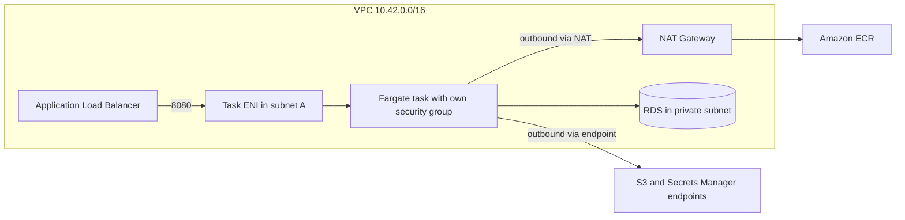
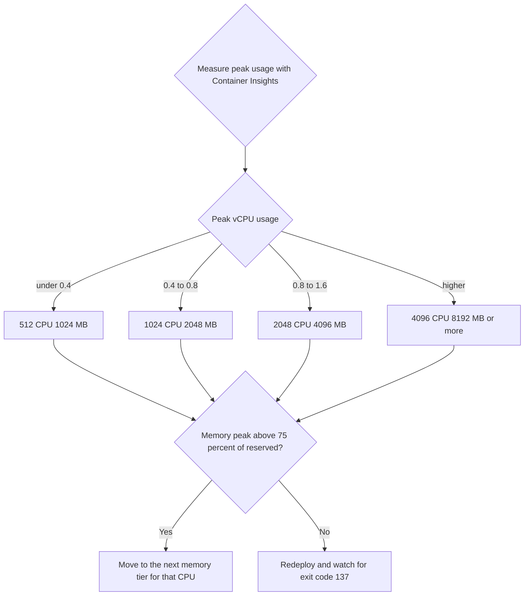
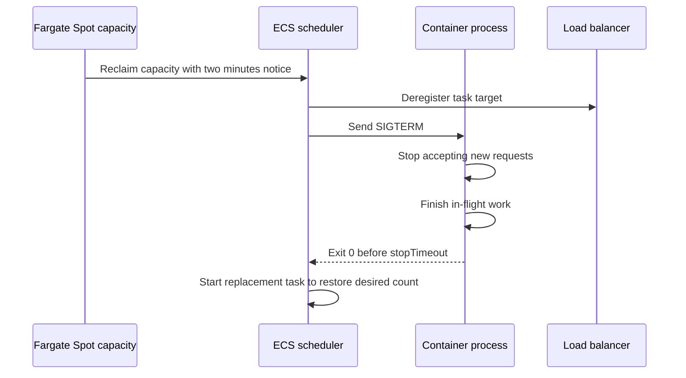

# 10 · AWS Fargate

> **Phase 3 — DevOps and Automation** · Lesson 10 of 13
> ⬅️ Previous: [Amazon EKS](./09-amazon-eks.md) · ➡️ Next: [AWS X-Ray](./11-aws-x-ray.md) · 🏠 [Phase overview](./README.md)

## 🎯 Learning Objectives

By the end of this lesson you will be able to:

- Pick a valid Fargate CPU and memory combination and split resources between containers
- Size ephemeral storage correctly and understand what happens when it fills
- Use Fargate Spot safely, including handling the two-minute interruption notice
- Explain why Fargate only supports `awsvpc` networking and what that costs you
- Decide with evidence whether a workload belongs on Fargate or on EC2 nodes

**Estimated time:** 70 min · **Difficulty:** Intermediate

---

## 🧠 Core Concepts

Fargate is a billing and provisioning model, not a separate scheduler. You still define ECS task definitions (or EKS pods through Fargate profiles); what changes is that no host exists. Every task gets its own micro-VM with a fixed amount of CPU and memory reserved for its lifetime, billed per second, and destroyed when the task stops. There is no instance to patch, no bin-packing decision to make, and no way to borrow idle capacity from a neighbour.

**Sizing** is constrained by a fixed table of valid combinations. At the task level you choose `cpu` in CPU units (1024 = 1 vCPU) and `memory` in MiB, and only specific pairs are legal: 256 CPU with 512 or 1024 MB, 512 CPU with 1024–4096 MB, 1024 CPU with 2048–8192 MB, and so on. Inside a task, containers can declare their own `cpu` and `memory`; container CPU values are absolute units that must sum to no more than the task CPU, and they act as *shares* when the task is contended. Container memory reservations are soft in the ECS scheduler's arithmetic but a container that exceeds its hard limit is killed with exit code 137 — which is how most people discover their limit was too low.

**Ephemeral storage** defaults to 20 GiB and can be raised up to 200 GiB with `ephemeralStorage.sizeInGiB`. It is backed by the task's own disk, is deleted when the task stops, and is shared by all containers in the task. It is the right home for a Docker build context or a temporary download, and the wrong home for anything you need after the task exits. Newer ECS features also allow attaching an EBS volume to a Fargate task when you need storage that outlives a single task, but the default assumption should still be that Fargate storage is temporary.

**Fargate Spot** sells spare capacity at roughly 70% off in exchange for the possibility of interruption, with a two-minute warning delivered as SIGTERM to your container and an `ECS_TASK_...`-style event visible in task state. That warning is generous if your application handles SIGTERM: stop accepting new work, finish in-flight requests, and exit before `stopTimeout` elapses. It is brutal if your container ignores SIGTERM and gets SIGKILLed mid-write. Spot is ideal for CI runners, batch jobs, queue workers, and stateless services with more than one replica; it is a poor fit for a singleton stateful service.

**Networking** is `awsvpc` only, and this is a design constraint rather than a limitation to work around. Each task receives its own ENI with a private IP from the subnet you specify and its own security group, so a task is addressable exactly like an instance. Two consequences follow: your subnet must have enough free IP addresses for peak task count (a `/24` gives 251 usable addresses, minus ENIs for other services), and outbound internet access requires a NAT Gateway or VPC endpoints, because tasks in private subnets have no route to the internet by default. That NAT Gateway is often the largest line item on a small Fargate bill.

### Key terminology

| Term | Meaning |
|------|---------|
| **Task size** | The `cpu` and `memory` pair reserved for the whole task. |
| **Container size** | Optional `cpu` and `memory` per container inside the task. |
| **Ephemeral storage** | Task-local disk, 20 GiB by default, up to 200 GiB. |
| **FARGATE_SPOT** | Spare capacity at a discount, reclaimable with a two-minute warning. |
| **Platform version** | Fargate runtime version; `LATEST` tracks the current release. |
| **awsvpc** | Networking mode giving each task an ENI, a private IP, and a security group. |
| **stopTimeout** | Seconds between SIGTERM and SIGKILL for a container. |
| **Compute Savings Plan** | Commitment-based discount that applies to Fargate usage. |

---

## 🗺️ Architecture Diagram

How a Fargate task's networking actually looks:



Sizing decision path for a new workload:



What happens when Spot reclaims capacity, and what your app must do:



---

## 🧪 Hands-on Lab: Right-Size a Fargate Task and Run It on Spot

**Goal:** Deploy a task with explicit container-level sizing and 40 GiB ephemeral storage, measure real usage, then move it to a Spot-weighted capacity provider with graceful shutdown.

**Prerequisites:** An ECS cluster, an ECR image that handles SIGTERM, and an ALB target group.

### Step 1 — Register a task with explicit sizing and storage

Save `taskdef-sized.json`:

```json
{
  "family": "phase3lab-report",
  "networkMode": "awsvpc",
  "requiresCompatibilities": ["FARGATE"],
  "cpu": "2048",
  "memory": "4096",
  "ephemeralStorage": {
    "sizeInGiB": 40
  },
  "runtimePlatform": {
    "cpuArchitecture": "ARM64",
    "operatingSystemFamily": "LINUX"
  },
  "executionRoleArn": "arn:aws:iam::123456789012:role/phase3lab-ecs-execution-role",
  "taskRoleArn": "arn:aws:iam::123456789012:role/phase3lab-report-task-role",
  "volumes": [
    { "name": "scratch" }
  ],
  "containerDefinitions": [
    {
      "name": "worker",
      "image": "123456789012.dkr.ecr.us-east-1.amazonaws.com/phase3lab/report:2.1.0",
      "essential": true,
      "cpu": 1536,
      "memory": 3072,
      "memoryReservation": 2048,
      "mountPoints": [
        { "sourceVolume": "scratch", "containerPath": "/scratch" }
      ],
      "environment": [
        { "name": "SCRATCH_DIR", "value": "/scratch" }
      ],
      "logConfiguration": {
        "logDriver": "awslogs",
        "options": {
          "awslogs-group": "/ecs/phase3lab-report",
          "awslogs-region": "us-east-1",
          "awslogs-stream-prefix": "worker"
        }
      },
      "linuxParameters": {
        "initProcessEnabled": true
      },
      "stopTimeout": 60
    },
    {
      "name": "sidecar-metrics",
      "image": "123456789012.dkr.ecr.us-east-1.amazonaws.com/phase3lab/metrics-sidecar:1.0.0",
      "essential": false,
      "cpu": 256,
      "memory": 512,
      "portMappings": [
        { "containerPort": 9090, "protocol": "tcp" }
      ]
    }
  ]
}
```

```bash
# Register and confirm the sizing was accepted
aws ecs register-task-definition --cli-input-json file://taskdef-sized.json \
  --query "taskDefinition.{Cpu:cpu,Memory:memory,Storage:ephemeralStorage,Containers:containerDefinitions[].{Name:name,Cpu:cpu,Memory:memory}}" \
  --output json
```

The two container `cpu` values (1536 + 256) sum to exactly the task's 2048. Ask the API for a fifth container pair that does not exist in the table and you get an error — the table is enforced, not advisory.

### Step 2 — Run it and measure actual consumption

```bash
# One-off run to collect a baseline
TASK_ARN=$(aws ecs run-task \
  --cluster phase3lab-cluster \
  --task-definition phase3lab-report:1 \
  --launch-type FARGATE \
  --capacity-provider-strategy capacityProvider=FARGATE,weight=1 \
  --network-configuration 'awsvpcConfiguration={subnets=[subnet-0private1111111],securityGroups=[sg-0task123456],assignPublicIp=DISABLED}' \
  --query "tasks[0].taskArn" --output text)

echo "$TASK_ARN"

# Watch CPU and memory utilisation reported per container
aws ecs describe-tasks --cluster phase3lab-cluster --tasks "$TASK_ARN" \
  --query "tasks[0].containers[].{Name:name,Cpu:cpu,Memory:memory,MemoryReservation:memoryReservation}" \
  --output json

# Container Insights gives the time series you need for real right-sizing
aws cloudwatch get-metric-statistics \
  --namespace ECS/ContainerInsights \
  --metric-name CpuUtilized \
  --dimensions Name=ClusterName,Value=phase3lab-cluster Name=ServiceName,Value=phase3lab-report \
  --start-time "$(date -u -v-2H +%Y-%m-%dT%H:%M:%SZ)" \
  --end-time "$(date -u +%Y-%m-%dT%H:%M:%SZ)" \
  --period 300 --statistics Average Maximum
```

Typical outcome: CPU peaks in the first minute and then sits far below the reservation. Memory is the one that matters — if `MemoryUtilized` approaches the limit, you will eventually see exit code 137 in `stoppedReason`.

### Step 3 — Move the service to Spot with graceful shutdown

```bash
# Weight Spot 3:1 but keep one on-demand task as a floor
aws ecs put-cluster-capacity-providers \
  --cluster phase3lab-cluster \
  --capacity-providers FARGATE FARGATE_SPOT \
  --default-capacity-provider-strategy \
    capacityProvider=FARGATE,base=1,weight=1 \
    capacityProvider=FARGATE_SPOT,base=0,weight=3

# Services inherit the strategy unless they override it
aws ecs create-service \
  --cluster phase3lab-cluster \
  --service-name phase3lab-report \
  --task-definition phase3lab-report:1 \
  --desired-count 4 \
  --capacity-provider-strategy capacityProvider=FARGATE_SPOT,base=1,weight=3 capacityProvider=FARGATE,weight=1 \
  --network-configuration 'awsvpcConfiguration={subnets=[subnet-0private1111111,subnet-0private2222222],securityGroups=[sg-0task123456],assignPublicIp=DISABLED}' \
  --deployment-configuration 'maximumPercent=200,minimumHealthyPercent=100,deploymentCircuitBreaker={enable=true,rollback=true}' \
  --region us-east-1
```

Your container must trap SIGTERM. A minimal Node.js handler looks like this:

```javascript
const server = app.listen(8080, () => console.log('listening'));

// Fargate Spot and rolling deployments both send SIGTERM first
process.on('SIGTERM', () => {
  console.log('SIGTERM received, draining connections');
  server.close(async () => {
    await pool.end();          // close database connections
    await flushMetrics();      // push any buffered telemetry
    console.log('drained, exiting');
    process.exit(0);
  });
  setTimeout(() => process.exit(0), 55000).unref();
});
```

### Step 4 — Prepare for interruption

```bash
# Interruption notices arrive as a task state change and a SIGTERM
aws ecs describe-tasks --cluster phase3lab-cluster --tasks "$TASK_ARN" \
  --query "tasks[0].{Status:lastStatus,StopReason:stoppedReason,StopCode:stopCode}"

# Alarm on Spot interruptions so you know the rate you are paying for the discount with
aws cloudwatch put-metric-alarm \
  --alarm-name phase3lab-report-spot-interruptions \
  --namespace ECS/ContainerInsights \
  --metric-name TaskCount \
  --dimensions Name=ClusterName,Value=phase3lab-cluster Name=LaunchType,Value=FARGATE_SPOT \
  --statistic Average --period 300 --threshold 2 \
  --comparison-operator LessThanThreshold --evaluation-periods 2 \
  --alarm-actions arn:aws:sns:us-east-1:123456789012:phase3lab-alerts
```

### Step 5 — Verify the bill model

```bash
# Confirm the on-demand price this task shape is billed against
aws pricing get-products \
  --service-code AmazonECS \
  --filters 'Type=TERM_MATCH,Field=usagetype,Value=USE1-Fargate-ARM-vCPU-Hours' \
            'Type=TERM_MATCH,Field=location,Value=US East (N. Virginia)' \
  --max-results 1 \
  --query "PriceList[0]" --output text | head -c 800

# Check whether a Compute Savings Plan already covers this usage
aws savingsplans describe-savings-plans \
  --states payment-pending payment-failed active \
  --query "savingsPlans[].{Type:savingsPlanType,Commitment:commitment,Start:start}" --output json
```

### Step 6 — Verify

```bash
# Tasks should be running with the expected size and storage
aws ecs describe-services --cluster phase3lab-cluster --services phase3lab-report \
  --query "services[0].{Desired:desiredCount,Running:runningCount,Capacity:capacityProviderStrategy}" --output json

# Confirm the task definition still reports 40 GiB of ephemeral storage
aws ecs describe-task-definition --task-definition phase3lab-report:1 \
  --query "taskDefinition.ephemeralStorage"
```

---

## 💻 CLI Reference

```bash
# Run a batch job on Spot without touching the service scheduler
aws ecs run-task --cluster phase3lab-cluster --task-definition phase3lab-report:1 \
  --launch-type FARGATE --count 5 \
  --capacity-provider-strategy capacityProvider=FARGATE_SPOT,weight=1 \
  --network-configuration 'awsvpcConfiguration={subnets=[subnet-0private1111111],securityGroups=[sg-0task123456],assignPublicIp=DISABLED}'

# Override the image for a one-off debug run without registering a revision
aws ecs run-task --cluster phase3lab-cluster --task-definition phase3lab-report:1 \
  --launch-type FARGATE --overrides 'containerOverrides=[{name=worker,image=123456789012.dkr.ecr.us-east-1.amazonaws.com/phase3lab/report:debug}]' \
  --network-configuration 'awsvpcConfiguration={subnets=[subnet-0private1111111],securityGroups=[sg-0task123456],assignPublicIp=DISABLED}'

# See how many task IPs a subnet still has room for
aws ec2 describe-subnets --subnet-ids subnet-0private1111111 \
  --query "Subnets[0].{Cidr:CidrBlock,Free:AvailableIpAddressCount}"

# List the VPC endpoints that keep image pulls off the NAT Gateway
aws ec2 describe-vpc-endpoints \
  --filters Name=vpc-id,Values=vpc-0abc1234def567890 \
  --query "VpcEndpoints[].{Service:ServiceName,Type:VpcEndpointType,State:State}" --output table

# Check the platform version a running task actually used
aws ecs describe-tasks --cluster phase3lab-cluster --tasks "$TASK_ARN" \
  --query "tasks[0].platformVersion" --output text

# Estimate Spot savings against on-demand for the same shape
aws pricing get-products --service-code AmazonECS \
  --filters 'Type=TERM_MATCH,Field=usagetype,Value=USE1-Fargate-ARM-GB-Hours' \
  --max-results 1 --query "PriceList[0]" --output text | head -c 400
```

| Command | Purpose |
|---------|---------|
| `run-task --capacity-provider-strategy` | One-off Spot or on-demand execution |
| `describe-tasks` | Live CPU, memory, storage, and stop reasons |
| `get-metric-statistics` | Historical utilization for right-sizing |
| `describe-subnets` | Free IP check before scaling out |
| `get-products` | Exact current Fargate rates per usage type |

---

## ✅ Best Practices

| Practice | Why it matters |
|----------|----------------|
| Right-size from Container Insights, not from instinct | Fargate bills the reservation, not the usage |
| Set `memoryReservation` below `memory` for shared tasks | Lets non-peak containers coexist without OOM kills |
| Raise ephemeral storage only when a workload needs it | Extra GiB is billed per second for the whole task lifetime |
| Trap SIGTERM in every long-lived container | Spot reclaims, rolling deploys, and scale-in all rely on it |
| Use `initProcessEnabled: true` | Prevents zombie processes and signal-handling bugs |
| Weight Spot 3:1 with an on-demand base | Keeps the discount without risking a full outage |
| Keep tasks stateless; store state in S3, DynamoDB, or EFS | Fargate disk dies with the task |
| Use VPC endpoints for ECR, S3, Secrets Manager, and Logs | Cuts NAT data processing and improves latency |
| Enable Compute Savings Plans once the baseline is stable | A 1-year commitment on steady Fargate usage is a double-digit discount |
| Prefer ARM64 images | Roughly 20% cheaper per vCPU-hour than x86 |
| Set `stopTimeout` to match your real drain time | Too short truncates requests; too long delays deploys |

---

## ⚠️ Common Pitfalls

| Pitfall | Symptom | Fix |
|---------|---------|-----|
| Illegal CPU and memory pair | `ClientException: Invalid CPU or memory combination` | Use a documented pair; do not interpolate arbitrary values |
| Container `cpu` values exceed the task | Task fails to register | Container CPU is absolute units and must sum to task CPU or less |
| Exit code 137 | Container killed mid-work | Raise memory or fix the leak; check `memoryReservation` versus `memory` |
| Out of disk | `no space left on device` in logs | Raise `ephemeralStorage.sizeInGiB`, cap builds, clean temp files |
| Subnet IP exhaustion at scale-out | `ResourceInitializationError` on new tasks | Use larger subnets or add subnets across AZs; check `AvailableIpAddressCount` |
| No route to ECR | Image pull fails in a private subnet | Add a NAT Gateway or ECR interface endpoints plus an S3 gateway endpoint |
| Spot task SIGKILLed mid-request | Sporadic 502s during interruptions | Trap SIGTERM, set `stopTimeout`, and use more than one replica |
| `assignPublicIp: ENABLED` as a shortcut | Tasks are directly reachable and cost more | Auto-assign public IP requires a public subnet; prefer private plus NAT or endpoints |
| Assuming the disk persists | Data disappears when a task restarts | Persist to S3, DynamoDB, EFS, or an attached EBS volume |
| Platform version drift | Behaviour changes unexpectedly after a deploy | Pin `platform-version` explicitly if you need stability |

---

## 💰 Cost Considerations

Fargate bills per second on two dimensions: vCPU-hours and GB-hours. In `us-east-1` with ARM64 this is roughly **$0.04048 per vCPU-hour** and **$0.004445 per GB-hour**, so a single 1 vCPU / 2 GB task costs about **$0.049/hour — $36/month** running continuously, and 4 such tasks cost about **$145/month**. The same shape on Fargate Spot is roughly **$0.012/hour for vCPU and $0.0013 for GB**, taking that 4-task service to about **$40/month**. Ephemeral storage beyond the free 20 GiB is billed at roughly $0.000111 per GB-hour, which is trivial for an hour and noticeable for a 200 GiB task left running all month.

The strongest cost lever is not Spot, it is right-sizing. A task reserved at 2 vCPU that only ever uses 0.3 vCPU costs four times what it should; Container Insights makes this visible in a day. Second is the surrounding network: a NAT Gateway at roughly $0.045/hour is about the cost of one whole Fargate task, plus $0.045 per GB processed, which image pulls and log shipping both consume — VPC endpoints pay for themselves on any cluster pulling images regularly. Third is the on-demand/Spot mix: keep the on-demand `base` at the minimum needed for availability and let the rest ride Spot.

Compute Savings Plans apply to Fargate usage and typically shave 10–20% off a one-year, no-upfront commitment on your steady-state baseline. Buy the plan against the *stable floor* (the `base=1` task plus any always-on services), not peak usage, and let Spot handle the spike above it.

---

## 🔐 Security Considerations

- **Give each task its own security group** and reference other groups as sources rather than CIDRs. In `awsvpc` mode a task is a first-class network identity, so this stays correct as IPs change.
- **Keep tasks in private subnets with `assignPublicIp: DISABLED`.** Public IPs on tasks mean direct internet exposure without a load balancer in front.
- **Split task role and execution role.** The execution role pulls images and reads secrets; the task role is what the application uses. Grant the execution role `secretsmanager:GetSecretValue` on specific ARNs, nothing more.
- **Inject secrets with the `secrets` block, never `environment`.** Task definitions are immutable and visible in CloudTrail and the console; secrets in `environment` are plaintext forever.
- **Run as non-root with a read-only root filesystem where possible**, add a writable `tmp` mount, and drop capabilities. Fargate refuses `privileged: true`, which is a security advantage of the platform.
- **Scan images before use.** `scanOnPush` plus a pipeline gate keeps known-CVE images out of production; Fargate cannot be patched at the host layer, so the image is the only thing you can fix.
- **Log to CloudWatch Logs with a retention policy** and avoid logging payloads containing personal data — Fargate gives you no host to forensic-check, so logs and traces are your evidence trail.

---

## 🧩 Exercise

Take the report task from the lab and cut it in half: determine the smallest valid Fargate pair that keeps peak CPU below 60% and peak memory below 70% under load, then run two tasks at that size instead of one large task.

Success looks like: `aws ecs describe-task-definition` shows the new pair, a load test with `hey -n 2000 -c 20` produces no 5xx responses and no tasks stopped with exit code 137, and the Container Insights `CpuUtilized` and `MemoryUtilized` charts stay within your targets for 24 hours.

---

## 📚 Resources

- [AWS Fargate on Amazon ECS](https://docs.aws.amazon.com/AmazonECS/latest/developerguide/AWS_Fargate.html)
- [Task Definition: CPU and Memory](https://docs.aws.amazon.com/AmazonECS/latest/developerguide/task-cpu-memory-error.html)
- [Fargate Task Ephemeral Storage](https://docs.aws.amazon.com/AmazonECS/latest/developerguide/fargate-task-storage.html)
- [Fargate Spot](https://docs.aws.amazon.com/AmazonECS/latest/developerguide/fargate-capacity-providers.html)
- [AWS Fargate Pricing](https://aws.amazon.com/fargate/pricing/)
- [Fargate Considerations for awsvpc Networking](https://docs.aws.amazon.com/AmazonECS/latest/developerguide/task-networking.html)

---

## ➡️ Next Steps

You can now run containers on Fargate with confidence about size, storage, interruptions, and network shape. The next lesson addresses the question those running containers immediately raise: what happened inside a single request across five services? That is distributed tracing with AWS X-Ray.

> ⬅️ Previous: [Amazon EKS](./09-amazon-eks.md) · ➡️ Next: [AWS X-Ray](./11-aws-x-ray.md) · 🏠 [Phase overview](./README.md)
