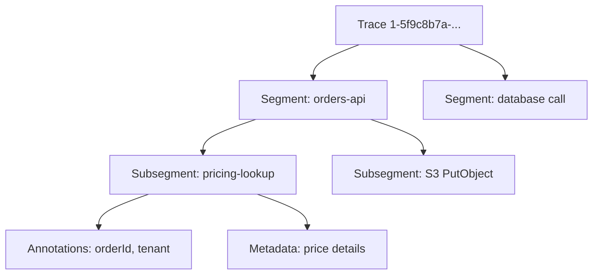
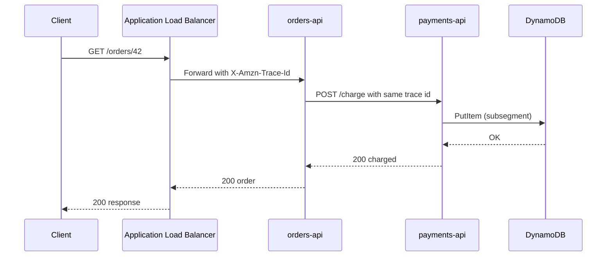
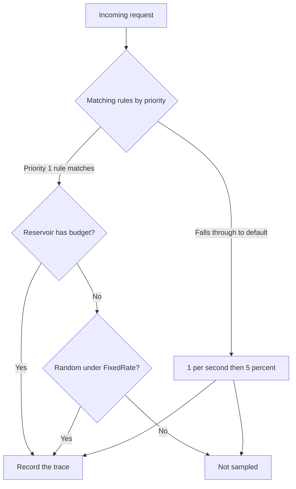

# 11 · AWS X-Ray

> **Phase 3 — DevOps and Automation** · Lesson 11 of 13
> ⬅️ Previous: [AWS Fargate](./10-aws-fargate.md) · ➡️ Next: [OpenTelemetry and ADOT](./12-opentelemetry-and-adot.md) · 🏠 [Phase overview](./README.md)

## Learning Objectives

By the end of this lesson you will be able to:

- Explain traces, segments, and subsegments, and how a trace ID propagates between services
- Instrument an application with the X-Ray SDK and run the X-Ray daemon as an ECS sidecar
- Control volume and cost with sampling rules, reservoirs, and priorities
- Use annotations and metadata to filter traces and find the requests that matter
- Read a service map to identify the slow or failing hop in a distributed request

**Estimated time:** 70 min · **Difficulty:** Intermediate

---

## Core Concepts

A **trace** is the complete record of one request's journey. X-Ray builds it from **segments** — one per service that handled the request — and each segment contains **subsegments** for the work inside it: an HTTP call to another service, a DynamoDB query, a function you wrapped yourself. Segments and subsegments are JSON documents sent to the X-Ray API, and the **service map** is simply those documents aggregated by caller and callee. That is why the service map is only as good as your instrumentation: an uninstrumented hop shows up as a gap, not as a node.

Tracing works only if the trace ID travels with the request. X-Ray uses the `X-Amzn-Trace-Id` header in the form `Root=1-5f9c8b7a-1a2b3c4d5e6f7a8b9c0d1e2f;Parent=53995c3f42cd8ad8;Sampled=1`. Each segment becomes the parent of the segments it causes downstream. Services that natively support X-Ray — API Gateway, Application Load Balancer, Lambda, Step Functions, EventBridge, SNS, SQS — inject and forward the header themselves; everything else needs the SDK or a collector to do it.

The **daemon** exists because instrumented applications should not talk to the X-Ray API directly. The SDK sends UDP packets to a local daemon on port 2000; the daemon batches segments, assumes the IAM role attached to the task or instance, and calls the X-Ray API. On ECS that means a sidecar container with the `public.ecr.aws/xray/aws-xray-daemon` image and `AWS_XRAY_DAEMON_ADDRESS=127.0.0.1:2000` on your application container. In Lambda there is no daemon — active tracing handles it — and the execution role simply needs `xray:PutTraceSegments`.

**Sampling** decides how much you record, and it is the difference between a $5 bill and a $5,000 bill. The default rule records one request per second per service (the **reservoir**) plus 5% of everything beyond that. Custom rules add matchers and a **priority**; the lowest priority number wins, and the reservoir is consumed by the highest-priority matching rule first. A sane starting point is a low-priority catch-all at 1% plus a high-priority rule that records *every* request for your most business-critical endpoint, because the traces you need during an incident are the ones you did not plan to keep.

Finally, **annotations** and **metadata** are not the same thing. Annotations are indexed key-value pairs — strings, numbers, booleans — and you can search and filter traces by them with expressions like `annotation.orderId = "42"` or `service("orders-api") { fault = true }`. Metadata is arbitrary JSON attached for inspection and is not indexed, which makes it the right place for full request bodies, but useless for filtering. Retention is fixed at 30 days, so anything you need for longer must be exported, and anything you need to query must be an annotation.

### Key terminology

| Term | Meaning |
|------|---------|
| **Trace** | One request's end-to-end record, identified by a trace ID. |
| **Segment** | The portion of a trace recorded by one service, with IAM-scoped permissions. |
| **Subsegment** | A unit of work inside a segment: a downstream call or a named function. |
| **Daemon** | Local process receiving segments over UDP 2000 and forwarding them to the API. |
| **Reservoir** | Fixed number of matching requests sampled per second, regardless of rate. |
| **Sampling rule** | Matchers plus reservoir and rate, with a priority ordering. |
| **Annotation** | Indexed key-value pair used in filter expressions. |
| **Metadata** | Non-indexed JSON attached for later inspection. |
| **Service map** | Aggregated view of segments showing callers, callees, latency, and errors. |
| **Fault vs error** | Fault is a 5xx from the service; error is a 4xx or a client-side failure. |

---

## Architecture Diagram

The anatomy of one trace and where its pieces come from:



The trace header propagating through a small system:



How a request is selected for recording:



---

## Hands-on Lab: Instrument a Service and Read Its Service Map

**Goal:** Add the X-Ray SDK and daemon to an ECS service, record custom subsegments with annotations, create a sampling rule, and diagnose a slow hop from the service map.

**Prerequisites:** A Fargate service with a task role, an Application Load Balancer with tracing enabled, and permissions to create sampling rules and read traces.

### Step 1 — Grant the tracing permissions

```bash
# Task role: write segments and read sampling rules
aws iam put-role-policy --role-name phase3lab-api-task-role \
  --policy-name xray-write \
  --policy-document '{
    "Version": "2012-10-17",
    "Statement": [
      {"Effect": "Allow",
       "Action": ["xray:PutTraceSegments", "xray:PutTelemetryRecords", "xray:GetSamplingRules", "xray:GetSamplingTargets"],
       "Resource": "*"}
    ]
  }'
```

`Resource: "*"` is unavoidable here — these are account-level APIs that do not support resource-level ARNs. Scope the role itself instead: only the services that need tracing should carry this policy.

### Step 2 — Add the daemon as a sidecar

Add this container to your task definition alongside the application container:

```json
{
  "name": "xray-daemon",
  "image": "public.ecr.aws/xray/aws-xray-daemon:latest",
  "essential": false,
  "cpu": 32,
  "memoryReservation": 256,
  "portMappings": [
    { "containerPort": 2000, "protocol": "udp" }
  ],
  "environment": [
    { "name": "AWS_REGION", "value": "us-east-1" }
  ],
  "logConfiguration": {
    "logDriver": "awslogs",
    "options": {
      "awslogs-group": "/ecs/phase3lab-xray",
      "awslogs-region": "us-east-1",
      "awslogs-stream-prefix": "daemon"
    }
  }
}
```

Point the application at the sidecar over the loopback address:

```json
      "environment": [
        { "name": "AWS_XRAY_DAEMON_ADDRESS", "value": "127.0.0.1:2000" },
        { "name": "AWS_XRAY_TRACING_NAME", "value": "orders-api" },
        { "name": "AWS_XRAY_CONTEXT_MISSING", "value": "LOG_ERROR" }
      ]
```

`AWS_XRAY_TRACING_NAME` is the service name that appears in the console and in the service map. `AWS_XRAY_CONTEXT_MISSING=LOG_ERROR` stops the SDK from throwing when a request arrives without a trace header — the right behaviour in production, where background jobs and health checks also run your code.

On EC2 instead of Fargate, install the daemon as a service and let it read the instance role:

```bash
# Install the daemon (Amazon Linux)
curl -o daemon.rpm https://s3.us-east-2.amazonaws.com/aws-xray-assets.us-east-2/xray-daemon/aws-xray-daemon-3.x.rpm
sudo yum install -y daemon.rpm

# Start it with an explicit region; it picks up credentials from the instance profile
sudo systemctl enable xray
sudo /usr/bin/xray -n us-east-1 -b 127.0.0.1:2000
```

### Step 3 — Instrument the application

Node.js with the `aws-xray-sdk`:

```javascript
import express from 'express';
import AWSXRay from 'aws-xray-sdk';
import { S3Client, PutObjectCommand } from '@aws-sdk/client-s3';

const app = express();

// Opens a segment per request and reads the incoming X-Amzn-Trace-Id header
app.use(AWSXRay.express.openSegment('orders-api'));

// Wrap AWS SDK v3 clients so every call becomes a subsegment automatically
const s3 = AWSXRay.captureAWSv3Client(new S3Client({ region: 'us-east-1' }));

async function lookupPrice(orderId) {
  // Simulated downstream call with a little latency
  await new Promise((resolve) => setTimeout(resolve, 120));
  return { amount: 4299, currency: 'EUR' };
}

app.get('/orders/:id', async (req, res) => {
  const segment = AWSXRay.getSegment();

  // Annotations are indexed and searchable
  segment.addAnnotation('orderId', req.params.id);
  segment.addAnnotation('tenant', req.headers['x-tenant'] ?? 'unknown');

  // A named subsegment makes the pricing hop visible on the service map
  const sub = segment.addNewSubsegment('pricing-lookup');
  try {
    const price = await lookupPrice(req.params.id);

    // Metadata is for inspection, not filtering
    sub.addMetadata('pricing', { amount: price.amount, currency: price.currency });

    await s3.send(new PutObjectCommand({
      Bucket: process.env.ARTIFACT_BUCKET,
      Key: `orders/${req.params.id}.json`,
      Body: JSON.stringify({ id: req.params.id, price }),
    }));

    res.json({ id: req.params.id, price });
  } catch (err) {
    sub.addError(err);
    res.status(500).json({ error: 'pricing failed' });
  } finally {
    sub.close();
  }
});

app.get('/healthz', (req, res) => res.status(200).send('ok'));

app.use(AWSXRay.express.closeSegment());
app.listen(8080, () => console.log('orders-api listening on 8080'));
```

Python with `aws-xray-sdk`, which patches libraries globally:

```python
from aws_xray_sdk.core import xray_recorder, patch_all
import requests

patch_all()  # instruments requests, boto3, psycopg2 and other supported libraries

@xray_recorder.capture('pricing-lookup')
def lookup_price(order_id: str) -> dict:
    xray_recorder.put_annotation('orderId', order_id)
    response = requests.get(f'http://pricing.phase3.internal/price/{order_id}', timeout=2)
    response.raise_for_status()
    xray_recorder.put_metadata('pricing', response.json())
    return response.json()
```

### Step 4 — Create a sampling rule

Save `sampling-rule.json`:

```json
{
  "SamplingRule": {
    "RuleName": "orders-api-critical-path",
    "ResourceARN": "*",
    "Priority": 1,
    "FixedRate": 1.0,
    "ReservoirSize": 10,
    "ServiceName": "orders-api",
    "ServiceType": "*",
    "Host": "*",
    "HTTPMethod": "GET",
    "URLPath": "/orders/*",
    "Version": 1
  }
}
```

```bash
# Record every matching request: 10 per second from the reservoir, then the remainder at 100%
aws xray create-sampling-rule --cli-input-json file://sampling-rule.json

# A low-priority catch-all keeps the rest of the fleet cheap
aws xray create-sampling-rule --sampling-rule '{
  "RuleName": "catch-all-low-rate",
  "ResourceARN": "*",
  "Priority": 100,
  "FixedRate": 0.01,
  "ReservoirSize": 1,
  "ServiceName": "*",
  "ServiceType": "*",
  "Host": "*",
  "HTTPMethod": "*",
  "URLPath": "*",
  "Version": 1
}'

# Read back what is in effect, including the default rule
aws xray get-sampling-rules --query "SamplingRuleRecords[].SamplingRule.{Name:RuleName,Priority:Priority,Rate:FixedRate,Reservoir:ReservoirSize}" \
  --output table
```

Priorities sort ascending: priority 1 wins over priority 100, and both win over the default rule, which applies only when no custom rule matches.

### Step 5 — Find the slow hop

Generate traffic, then work backwards from the trace summaries:

```bash
START=$(date -u -v-15M +%Y-%m-%dT%H:%M:%S)
END=$(date -u +%Y-%m-%dT%H:%M:%S)

# Summaries for the service, thresholding at 0.5s to surface slow requests
aws xray get-trace-summaries \
  --start-time "$START" --end-time "$END" \
  --filter-expression 'service("orders-api") AND duration > 0.5' \
  --sampling --query "TraceSummaries[].{Id:Id,Duration:Duration,ResponseTime:ResponseTime,HasFault:HasFault,HasError:HasError}" \
  --output table

# Pull the full segments for one slow trace
aws xray batch-get-traces --trace-ids 1-5f9c8b7a-1a2b3c4d5e6f7a8b9c0d1e2f \
  --query "Traces[0].Segments[].Document" --output text | jq '.'

# Traces that used your annotation, proving the indexing works
aws xray get-trace-summaries \
  --start-time "$START" --end-time "$END" \
  --filter-expression 'annotation.tenant = "acme" AND annotation.orderId = "42"' \
  --query "TraceSummaries[].Id" --output text
```

### Step 6 — Inspect the service map

```bash
# Nodes and edges with latency and error counts
aws xray get-service-graph --start-time "$START" --end-time "$END" \
  --query "Services[].{Name:Name,Type:Type,Root:Root,Faults:SummaryStatistics.FaultStatistics,Ok:SummaryStatistics.OkCount,Total:SummaryStatistics.TotalCount,Avg:SummaryStatistics.TotalResponseTime}" \
  --output json

# Compare a healthy window with a degraded one to see which edge moved
aws xray get-service-graph --start-time "$START" --end-time "$END" \
  --query "Services[?Name=='payments-api'].Edges[].{To:ReferenceId,Avg:SummaryStatistics.TotalResponseTime,Errors:SummaryStatistics.ErrorStatistics}" \
  --output json
```

In the console, the same data renders as the service map: nodes are services, edge labels show average latency and requests per minute, and red or orange outlines mark errors and faults. The fault rate on an edge is usually enough to tell you whether the problem is your service or its dependency.

### Step 7 — Verify

```bash
# Confirm the daemon is shipping: look for recent telemetry in the traces list
aws xray get-trace-summaries --start-time "$START" --end-time "$END" \
  --query "length(TraceSummaries)" --output text

# Confirm tracing is on at the load balancer
aws elbv2 describe-load-balancer-attributes \
  --load-balancer-arn arn:aws:elasticloadbalancing:us-east-1:123456789012:loadbalancer/app/phase3lab/50dc6c495c0c9188 \
  --query "Attributes[?Key=='routing.http.xray.enabled']"
```

---

## CLI Reference

```bash
# Turn on X-Ray tracing for an API Gateway stage
aws apigateway update-stage --rest-api-id a1b2c3d4e5 --stage-name prod \
  --patch-operations op=replace,path=/*/*/tracingEnabled,value=true

# Enable tracing on a Lambda function
aws lambda update-function-configuration --function-name phase3lab-worker \
  --tracing-config Mode=Active

# Group traces by a filter expression for a dashboard or alert
aws xray create-group --group-name "orders-errors" \
  --filter-expression 'service("orders-api") AND fault = true' \
  --insights-configuration InsightsEnabled=true,NotificationsEnabled=true

# Insights surface anomalies without you defining a threshold
aws xray get-insight-summaries --start-time "$START" --end-time "$END" \
  --states ACTIVE CLOSED --query "InsightSummaries[].{Id:InsightId,State:State,Start:StartTime,TopAnomalous:TopAnomalousServices}" \
  --output json

# Update a sampling rule's rate after observing real traffic volume
aws xray update-sampling-rule --cli-input-json '{
  "SamplingUpdate": {"RuleName": "catch-all-low-rate", "FixedRate": 0.02}
}'

# Encrypt traces with a customer-managed KMS key instead of the AWS-owned key
aws xray update-encryption-config --type KMS \
  --key-id arn:aws:kms:us-east-1:123456789012:key/1234abcd-12ab-34cd-56ef-1234567890ab

# Confirm an annotation-based filter is valid before using it in a dashboard
aws xray get-trace-summaries --start-time "$START" --end-time "$END" \
  --filter-expression 'annotation.tenant = "acme" AND responsetime > 1'

# Check the encryption configuration currently in force
aws xray get-encryption-config
```

| Command | Purpose |
|---------|---------|
| `get-trace-summaries` | Search traces by filter expression, with or without full documents |
| `batch-get-traces` | Retrieve full segments for specific trace IDs |
| `get-service-graph` | Latency, error, and fault statistics per service and edge |
| `create-sampling-rule` | Control recording volume by service, path, and method |
| `create-group` | Save a filter expression for dashboards and alerts |
| `get-insight-summaries` | Anomaly detection without hand-written thresholds |

---

## Best Practices

| Practice | Why it matters |
|----------|----------------|
| Name segments after services, not hosts | The service map groups by trace name; hostnames fragment it |
| Put searchable values in annotations | Only annotations are indexed for filter expressions |
| Keep metadata small | Metadata is stored per trace and counts toward storage |
| Use `addError` and `addFault` deliberately | Faults are 5xx; mixing them up makes alarms lie |
| Run the daemon as a sidecar on ECS and a service on EC2 | The SDK should never call the X-Ray API directly |
| Sample the critical path at 100% | A missing trace during an incident is worse than the cost |
| Keep a low-rate catch-all rule | Provides fleet-wide coverage at a predictable cost |
| Trace the load balancer, API Gateway, and Lambda natively | Gets you context for free, before your code runs |
| Use `AWS_XRAY_CONTEXT_MISSING=LOG_ERROR` in production | Prevents trace errors from breaking background work |
| Export anything needed beyond 30 days | X-Ray retention is fixed and not configurable |
| Tag resources and pair X-Ray with CloudWatch alarms | Tracing explains; alarms notify |

---

## Common Pitfalls

| Pitfall | Symptom | Fix |
|---------|---------|-----|
| Segmentation fault in the daemon logs | Wrong endpoint region or blocked UDP egress | Set `AWS_REGION` and allow UDP 2000 within the task's security group |
| Missing daemon sidecar | `Failed to send segment` in application logs | Add the sidecar and set `AWS_XRAY_DAEMON_ADDRESS` |
| Broken service map | A hop appears as an unknown dependency | The SDK must create subsegments for outgoing calls; use `captureAWSv3Client` or `patch_all()` |
| No traces at all | Trace list is empty despite traffic | Check `xray:PutTraceSegments` on the task role and that sampling rules match |
| Sampling rule with priority 1 matches everything | Trace volume and cost spikes | Confirm matcher specificity; priority 1 applies to all matching requests |
| Trace header lost between services | Two traces instead of one | Forward `X-Amzn-Trace-Id` on every outbound call; the SDK does this for instrumented clients |
| Health checks flood the trace list | Noise drowns real traffic | Exclude `/healthz` with a URL path sampling rule or disable tracing for that route |
| Traces show huge `totalResponseTime` gaps | Uninstrumented wait, often a queue or external API | Add a manual subsegment around the call to attribute the time |
| Attribute error `Trace ID not found` | Trace aged out or was never sampled | Search within 30 days and confirm the request was sampled |
| Everything is an error, nothing is a fault | Alarms on faults never fire | Return 5xx for server failures; 4xx is an error, not a fault |

---

## Cost Considerations

X-Ray pricing is straightforward and easy to control: traces recorded cost about **$5.00 per million**, and traces retrieved or scanned cost about **$0.50 per million**. There is a free tier of 100,000 traces recorded and 1,000,000 traces retrieved per month, which covers a small system entirely. The bill scales with sampling, so the default rule — one request per second plus 5% — is what keeps an unremarkable service in the free tier while a 100%-sampled high-traffic API quickly reaches real money: 50 million requests a month at 100% sampling is roughly **$250** in recording alone, plus Insight and retrieval charges.

Keep the cost predictable by making sampling a deliberate decision per service. Sample the endpoints that matter at 100%: checkout, payment, authentication. Sample everything else at 1% with a small reservoir, and drop health checks and static asset paths entirely. Use longer metric windows and `get-service-graph` for dashboards instead of repeatedly scanning traces, because retrieval is charged too. Send only what you need — annotations are tiny, but attaching full request bodies as metadata for every sampled trace adds up in storage. Also remember the surrounding bill: the daemon sidecar consumes 32 CPU units and 256 MB, so it costs roughly $1.50/month per task on Fargate, and CloudWatch alarms on trace metrics are charged separately.

---

## Security Considerations

- **Traces contain business data.** URLs, SQL statements, table names, ARNs, and sometimes payloads end up in segment documents. Never add credentials, tokens, or personal data as annotations or metadata, and review what your SDK instruments automatically.
- **Encrypt traces with a customer-managed KMS key** for regulated workloads using `update-encryption-config`, so access to trace data is governed by a key policy you control and can revoke.
- **Scope the write permission to the workloads that need it.** `xray:PutTraceSegments` cannot be ARN-scoped, so attach it to specific task roles and audit which roles carry it with `aws iam list-roles --query "Roles[?contains(...,'xray:PutTraceSegments')]"`.
- **Restrict read access.** Anyone with `xray:GetTraceSummaries` and `batch-get-traces` can see request paths and parameters across the whole account; treat it as production data access, not a monitoring convenience.
- **Keep the daemon private.** It listens on UDP 2000 and has no authentication of its own; bind it to the loopback interface or the task security group, never a public network.
- **Enable CloudTrail for X-Ray control-plane calls** (`CreateSamplingRule`, `UpdateEncryptionConfig`) so changes to your observability pipeline are attributable.
- **Watch for trace header spoofing.** An external caller can send `X-Amzn-Trace-Id` with a chosen `Root`; do not use trace IDs as security identifiers or correlation keys for authorization decisions.

---

## Exercise

Add a custom subsegment called `inventory-check` around a call to another internal service, annotate it with `warehouseId` and `itemCount`, and add an error when the inventory service responds with a 5xx. Then create a group named `inventory-slow` with the filter expression `service("orders-api") AND subsegment("inventory-check") AND duration > 1`.

Success looks like: `aws xray get-trace-summaries --filter-expression 'annotation.warehouseId = "eu-1"'` returns your traces, the service map shows an `inventory-check` edge under `orders-api`, and `aws xray get-group --group-name inventory-slow` returns the group with its filter expression intact.

---

## Resources

- [AWS X-Ray Developer Guide](https://docs.aws.amazon.com/xray/latest/devguide/aws-xray.html)
- [Configuring Sampling Rules](https://docs.aws.amazon.com/xray/latest/devguide/xray-console-sampling.html)
- [X-Ray SDK for Node.js](https://docs.aws.amazon.com/xray/latest/devguide/xray-sdk-nodejs.html)
- [X-Ray Daemon](https://docs.aws.amazon.com/xray/latest/devguide/xray-daemon.html)
- [Filter Expressions](https://docs.aws.amazon.com/xray/latest/devguide/xray-console-filters.html)
- [X-Ray Pricing](https://aws.amazon.com/xray/pricing/)

---

## Next Steps

X-Ray is excellent inside AWS and conversational outside it. The next lesson moves to the vendor-neutral standard that X-Ray now accepts as an upstream: OpenTelemetry, and AWS Distro for OpenTelemetry, which gives you one pipeline for traces, metrics, and logs.

> ⬅️ Previous: [AWS Fargate](./10-aws-fargate.md) · ➡️ Next: [OpenTelemetry and ADOT](./12-opentelemetry-and-adot.md) · 🏠 [Phase overview](./README.md)
