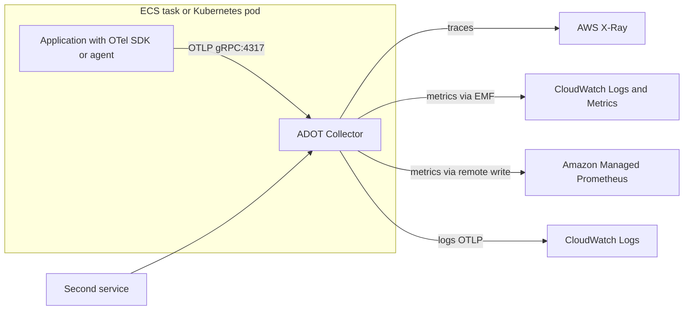
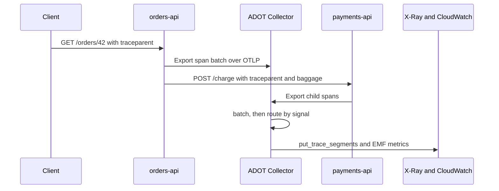
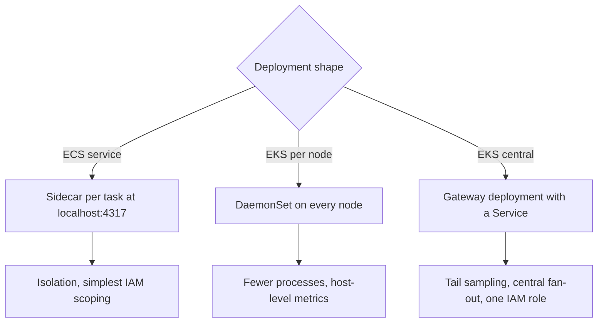

# 12 · OpenTelemetry and ADOT

> **Phase 3 — DevOps and Automation** · Lesson 12 of 13
> ⬅️ Previous: [AWS X-Ray](./11-aws-x-ray.md) · ➡️ Next: [Project: Full CI/CD Pipeline](./13-project-full-cicd-pipeline.md) · 🏠 [Phase overview](./README.md)

## Learning Objectives

By the end of this lesson you will be able to:

- Explain how OpenTelemetry separates instrumentation from the backend that stores data
- Deploy the AWS Distro for OpenTelemetry (ADOT) Collector as an ECS sidecar and as an EKS add-on
- Write a Collector configuration that exports traces to X-Ray and metrics to CloudWatch
- Instrument applications with auto-instrumentation instead of hand-written span code
- Keep observability costs predictable with sampling and attribute discipline

**Estimated time:** 75 min · **Difficulty:** Advanced

---

## Core Concepts

OpenTelemetry (OTel) is a standard for generating and shipping telemetry, not a backend. It defines three **signals** — traces, metrics, and logs — along with a vendor-neutral wire format (**OTLP**), a library of **SDKs** per language, and a **Collector** process that receives, processes, and exports telemetry. The value is decoupling: you instrument once with OTel APIs, and you can point the data at X-Ray today and another backend tomorrow without touching application code.

The split between **API**, **SDK**, and **Collector** matters when you are debugging your instrumentation. The API is what your code calls (`tracer.startSpan(...)`). The SDK is the implementation that batches and exports, configured by environment variables. The Collector is a separate process — often a sidecar or a DaemonSet — with a pipeline made of three block types: **receivers** (how data arrives, usually `otlp` on port 4317 for gRPC and 4318 for HTTP), **processors** (batch, memory limiter, attribute transforms, tail sampling), and **exporters** (where data goes). Connectors wire pipelines together, for example generating metrics from spans.

Context propagation is what makes traces join up across services. OTel standardizes on **W3C Trace Context**: a `traceparent` header carrying the trace ID, parent span ID, and sampling flags, plus an optional `baggage` header for business context. AWS-native services speak the `X-Amzn-Trace-Id` header instead, which is why the Collector sets `OTEL_PROPAGATORS=tracecontext,baggage,xray` — both formats travel at once, so an ALB-injected X-Ray header and your OTel spans end up in the same trace.

**ADOT** is AWS's supported distribution of the Collector, plus auto-instrumentation agents for Java, Python, Node.js, and .NET, plus curated Collector images. In practice you rarely write span code: you attach the ADOT Java agent with `-javaagent`, wrap a Python process with `opentelemetry-instrument`, or add a Lambda layer, and set environment variables for the service name and the OTLP endpoint. The Collector then fans out to X-Ray for traces and to CloudWatch through the `awsemf` exporter for metrics, which turns OTel measurements into CloudWatch Embedded Metric Format documents — cheaper than individual `PutMetricData` calls and queryable with CloudWatch Logs Insights.

### Key terminology

| Term | Meaning |
|------|---------|
| **Signal** | A telemetry type: traces, metrics, or logs. |
| **OTLP** | OpenTelemetry Protocol; gRPC on 4317 and HTTP on 4318, with the same wire format. |
| **Resource** | Attributes describing the entity that produced telemetry (`service.name`, host, k8s pod). |
| **Span** | A unit of work with start time, duration, attributes, and parent link. |
| **Collector pipeline** | Receiver to processor to exporter chain for one signal. |
| **Sidecar** | Collector running in the same task or pod as the application, reached at `localhost`. |
| **DaemonSet / gateway** | Collector deployment patterns on Kubernetes: per-node or central. |
| **Auto-instrumentation** | Agent or wrapper that adds spans without code changes. |
| **EMF** | CloudWatch Embedded Metric Format, extracted from structured log events. |
| **`traceparent`** | W3C header carrying trace ID, span ID, and sampling flags. |

---

## Architecture Diagram

The end-to-end telemetry path with ADOT:



What happens to a request across two instrumented services:



Two Collector deployment patterns, and when each applies:



---

## Hands-on Lab: One Collector, Two Backends, Zero Code Changes

**Goal:** Run the ADOT Collector as an ECS sidecar that exports traces to X-Ray and metrics to CloudWatch, then auto-instrument an application without editing its span logic.

**Prerequisites:** An ECS Fargate service, permissions to create IAM policies, and `aws-otel-collector` image access from public ECR.

### Step 1 — Give the Collector the permissions it needs to export

```bash
# One role, three export permissions: traces, metrics, logs
aws iam create-role --role-name phase3lab-adot-role \
  --assume-role-policy-document '{
    "Version": "2012-10-17",
    "Statement": [{
      "Effect": "Allow",
      "Principal": {"Service": "ecs-tasks.amazonaws.com"},
      "Action": "sts:AssumeRole"
    }]
  }'

aws iam put-role-policy --role-name phase3lab-adot-role \
  --policy-name adot-export \
  --policy-document '{
    "Version": "2012-10-17",
    "Statement": [
      {"Effect": "Allow",
       "Action": ["xray:PutTraceSegments", "xray:PutTelemetryRecords", "xray:GetSamplingRules", "xray:GetSamplingTargets"],
       "Resource": "*"},
      {"Effect": "Allow",
       "Action": ["cloudwatch:PutMetricData"],
       "Resource": "*"},
      {"Effect": "Allow",
       "Action": ["logs:CreateLogGroup", "logs:CreateLogStream", "logs:PutLogEvents", "logs:DescribeLogGroups", "logs:DescribeLogStreams"],
       "Resource": "arn:aws:logs:us-east-1:123456789012:log-group:/ecs/phase3lab-*:*"}
    ]
  }'
```

### Step 2 — Write the Collector configuration

Save as `collector-config.yaml` and store it in SSM Parameter Store so both the sidecar and your EKS deployment read the same source of truth:

```yaml
extensions:
  health_check:
    endpoint: 0.0.0.0:13133
  awsproxy:
    endpoint: 0.0.0.0:2000
    local_mode: true

receivers:
  otlp:
    protocols:
      grpc:
        endpoint: 0.0.0.0:4317
      http:
        endpoint: 0.0.0.0:4318
  prometheus:
    config:
      global:
        scrape_interval: 30s
      scrape_configs:
        - job_name: otel-collector-self
          static_configs:
            - targets: ["localhost:8888"]

processors:
  batch:
    timeout: 10s
    send_batch_size: 1024
  memory_limiter:
    check_interval: 1s
    limit_mib: 400
    spike_limit_mib: 100
  attributes:
    actions:
      # Drop high-cardinality attributes before they reach the backend
      - key: http.user_agent
        action: delete
      - key: telemetry.sdk.version
        action: delete

exporters:
  awsxray:
    region: us-east-1
  awsemf:
    region: us-east-1
    namespace: phase3lab
    log_group_name: /ecs/phase3lab-metrics
    dimension_rollup_option: NoDimensionRollup
    resource_to_telemetry_conversion:
      enabled: true
  debug:
    verbosity: basic

service:
  extensions: [health_check, awsproxy]
  telemetry:
    logs:
      level: info
    metrics:
      level: basic
  pipelines:
    traces:
      receivers: [otlp]
      processors: [memory_limiter, batch]
      exporters: [awsxray]
    metrics:
      receivers: [otlp, prometheus]
      processors: [memory_limiter, batch, attributes]
      exporters: [awsemf]

```

```bash
# Keep the config in SSM so the sidecar and EKS share one definition
aws ssm put-parameter --name /phase3lab/adot/collector-config \
  --type String --value file://collector-config.yaml --overwrite
```

Every pipeline is an independent chain, and a signal without a pipeline is silently dropped — a common reason "metrics do not arrive" while traces work fine.

### Step 3 — Add the sidecar to the task definition

```json
{
  "name": "adot-collector",
  "image": "public.ecr.aws/aws-observability/aws-otel-collector:v0.40.0",
  "essential": false,
  "cpu": 256,
  "memoryReservation": 512,
  "command": ["--config", "env:SSM_CONFIG"],
  "portMappings": [
    { "containerPort": 4317, "protocol": "tcp" },
    { "containerPort": 4318, "protocol": "tcp" }
  ],
  "environment": [
    { "name": "AWS_REGION", "value": "us-east-1" },
    { "name": "SSM_CONFIG", "value": "ssm:/phase3lab/adot/collector-config" }
  ],
  "logConfiguration": {
    "logDriver": "awslogs",
    "options": {
      "awslogs-group": "/ecs/phase3lab-adot",
      "awslogs-region": "us-east-1",
      "awslogs-stream-prefix": "collector"
    }
  }
}
```

Then point the application at the sidecar and turn on dual propagation:

```json
      "environment": [
        { "name": "OTEL_SERVICE_NAME", "value": "orders-api" },
        { "name": "OTEL_EXPORTER_OTLP_ENDPOINT", "value": "http://localhost:4317" },
        { "name": "OTEL_EXPORTER_OTLP_PROTOCOL", "value": "grpc" },
        { "name": "OTEL_PROPAGATORS", "value": "tracecontext,baggage,xray" },
        { "name": "OTEL_RESOURCE_ATTRIBUTES", "value": "deployment.environment=prod,service.version=2.4.1,aws.ecs.cluster=phase3lab-cluster" },
        { "name": "OTEL_TRACES_SAMPLER", "value": "parentbased_traceidratio" },
        { "name": "OTEL_TRACES_SAMPLER_ARG", "value": "0.1" },
        { "name": "OTEL_METRICS_EXPORTER", "value": "otlp" }
      ]
```

`parentbased_traceidratio` at 0.1 keeps 10% of root requests and follows the parent's decision for everything downstream, which prevents half-sampled traces where a child service records spans its parent dropped.

### Step 4 — Instrument without rewriting the application

Java, using the ADOT agent image layer:

```bash
# Attach the agent at startup instead of editing application code
java -javaagent:/opt/aws-opentelemetry-agent.jar \
     -Dotel.javaagent.extensions=/opt/aws-opentelemetry-agent-aws-ext.jar \
     -jar /app/orders-api.jar
```

Python, wrapping the process:

```bash
# opentelemetry-instrument injects spans for Flask, requests, boto3 and more
opentelemetry-instrument \
  --traces_exporter otlp \
  --metrics_exporter otlp \
  python -m uvicorn app.main:app --host 0.0.0.0 --port 8080
```

Node.js, loading the SDK before the app:

```bash
# --require loads tracing before any instrumented module is imported
node --require ./tracing.js server.js
```

```javascript
// tracing.js — no span code, only SDK wiring
const { NodeSDK } = require('@opentelemetry/sdk-node');
const { getNodeAutoInstrumentations } = require('@opentelemetry/auto-instrumentations-node');
const { OTLPTraceExporter } = require('@opentelemetry/exporter-trace-otlp-grpc');
const { OTLPMetricExporter } = require('@opentelemetry/exporter-metrics-otlp-grpc');
const { PeriodicExportingMetricReader } = require('@opentelemetry/sdk-metrics');
const { AWSXRayPropagator } = require('@opentelemetry/propagator-aws-xray');
const { AWSXRayIdGenerator } = require('@opentelemetry/id-generator-aws-xray');

const sdk = new NodeSDK({
  // X-Ray ID generator makes trace IDs valid X-Ray trace IDs
  idGenerator: new AWSXRayIdGenerator(),
  textMapPropagator: new AWSXRayPropagator(),
  traceExporter: new OTLPTraceExporter(),
  metricReader: new PeriodicExportingMetricReader({
    exporter: new OTLPMetricExporter(),
    exportIntervalMillis: 30000,
  }),
  instrumentations: [getNodeAutoInstrumentations({
    '@opentelemetry/instrumentation-fs': { enabled: false },
  })],
});

sdk.start();
process.on('SIGTERM', () => sdk.shutdown().then(() => process.exit(0)));
```

### Step 5 — Use the EKS add-on for the same pipeline

```bash
# Discover the ADOT versions AWS validates for this Kubernetes release
aws eks describe-addon-versions --addon-name adot --kubernetes-version 1.30 \
  --query "addons[].addonVersions[].addonVersion" --output text

# Install the managed add-on
aws eks create-addon \
  --cluster-name phase3lab \
  --addon-name adot \
  --addon-version v0.40.0-eksbuild.1 \
  --service-account-role-arn arn:aws:iam::123456789012:role/phase3lab-adot-role \
  --configuration-values '{"collector": {"config": {"exporters": {"awsxray": {"region": "us-east-1"}}}}}' \
  --resolve-conflicts OVERWRITE
```

For a gateway deployment with tail sampling — keeping only traces that contain an error — add this processor:

```yaml
processors:
  tail_sampling:
    decision_wait: 10s
    policies:
      - name: keep-errors
        type: status_code
        status_code:
          status_codes: [ERROR]
      - name: keep-slow
        type: latency
        latency:
          threshold_ms: 1500
      - name: baseline
        type: probabilistic
        probabilistic:
          sampling_percentage: 5
```

Tail sampling must run in a single Collector that sees every span of a trace, which is exactly why gateways exist rather than per-node DaemonSets.

### Step 6 — Verify

```bash
# The Collector exposes its own metrics on 8888 and a health endpoint on 13133
kubectl run -it --rm curl --image=curlimages/curl --restart=Never -- \
  curl -s http://adot-collector.observability.svc.cluster.local:13133

# Traces should appear in X-Ray under your service name
aws xray get-service-graph \
  --start-time "$(date -u -v-15M +%Y-%m-%dT%H:%M:%S)" \
  --end-time "$(date -u +%Y-%m-%dT%H:%M:%S)" \
  --query "Services[].{Name:Name,Total:SummaryStatistics.TotalCount}" --output table

# Metrics land in CloudWatch under the namespace you configured
aws cloudwatch list-metrics --namespace phase3lab \
  --query "Metrics[].MetricName" --output text | tr '\t' '\n' | sort -u | head -20

# Confirm the EMF log group is receiving structured metric documents
aws logs tail /ecs/phase3lab-metrics --since 10m --format short | head -5
```

---

## CLI Reference

```bash
# Inspect the add-on version and its configuration after install
aws eks describe-addon --cluster-name phase3lab --addon-name adot \
  --query "addon.{Version:addonVersion,Status:status,Config:configurationValues}"

# Validate a Collector configuration locally before deploying it
docker run --rm -v "$PWD/collector-config.yaml:/etc/otel/config.yaml" \
  public.ecr.aws/aws-observability/aws-otel-collector:v0.40.0 \
  --config /etc/otel/config.yaml --dry-run

# Send a test span with the Collector's built-in load generator
curl -s -o /dev/null -w "%{http_code}\n" \
  http://localhost:4318/v1/traces -H 'Content-Type: application/json' \
  -d '{"resourceSpans":[]}'

# Check that CloudWatch accepts OTLP directly with SigV4 from the Collector
aws cloudwatch list-metrics --namespace phase3lab --recently-active PT3H \
  --query "Metrics[].MetricName" --output text

# Attach an ADOT Lambda layer to an existing function
aws lambda update-function-configuration --function-name phase3lab-worker \
  --layers "$ADOT_LAYER_ARN" \
  --environment "Variables={OTEL_SERVICE_NAME=phase3lab-worker,OTEL_EXPORTER_OTLP_ENDPOINT=http://localhost:4317,OPENTELEMETRY_COLLECTOR_CONFIG_URI=/var/task/collector.yaml}"

# Confirm the Lambda layer applied and the runtime restarted
aws lambda get-function-configuration --function-name phase3lab-worker \
  --query "{State:State,Layers:Layers[].Arn,Env:Environment.Variables}" --output json

# Turn on X-Ray-format trace IDs so OTel traces join AWS-native traces
aws xray get-sampling-rules --query "SamplingRuleRecords[0].SamplingRule.RuleName"

# Read Collector self-metrics for queue depth and export failures
kubectl port-forward -n observability svc/adot-collector 8888:8888
curl -s localhost:8888/metrics | grep otelcol_exporter_send_failed
```

| Command | Purpose |
|---------|---------|
| `eks create-addon --addon-name adot` | Installs the AWS-supported Collector on EKS |
| `--dry-run` on the Collector | Validates configuration without starting pipelines |
| `logs tail /ecs/phase3lab-metrics` | Confirms EMF documents are arriving |
| `lambda update-function-configuration --layers` | Enables auto-instrumentation on Lambda |
| `otelcol_exporter_send_failed` | The first metric to check when data stops flowing |

---

## Best Practices

| Practice | Why it matters |
|----------|----------------|
| Keep the Collector config in Git and SSM | One reviewable source of truth for every environment |
| Set `OTEL_SERVICE_NAME` and `OTEL_RESOURCE_ATTRIBUTES` explicitly | Unnamed services appear as `unknown_service` in every backend |
| Propagate `tracecontext,baggage,xray` together | AWS-native hops and OTel hops stay in one trace |
| Use `memory_limiter` before `batch` in every pipeline | An unbounded queue is how the Collector runs out of memory |
| Convert selected resources to dimensions with `resource_to_telemetry_conversion` | Turns `service.version` into a queryable CloudWatch dimension |
| Drop high-cardinality attributes | User agents and SDK versions multiply your metric and trace cost |
| Use tail sampling in a gateway, head sampling in sidecars | Decisions that need whole traces require a single vantage point |
| Prefer auto-instrumentation, add manual spans only for business logic | Less code, faster adoption, consistent naming |
| Flush on shutdown | `sdk.shutdown()` on SIGTERM prevents losing the last batch |
| Pin Collector and agent versions | Observability components change defaults between releases |
| Health-check and alert on the Collector itself | Silent observability failure is worse than none |

---

## Common Pitfalls

| Pitfall | Symptom | Fix |
|---------|---------|-----|
| No pipeline for a signal | Metrics missing while traces work | Add the signal to `service.pipelines` |
| Collector cannot reach the OTLP port | Application logs `connection refused` on 4317 | Use `localhost` inside the same task or pod, and confirm the port mapping |
| Collector OOM kills | Container exits with 137 | Add `memory_limiter` and raise the container memory |
| `unknown_service` in X-Ray | Service name is generic and the service map is useless | Set `OTEL_SERVICE_NAME` or the `service.name` resource attribute |
| Broken traces at the first hop | Two traces for one request | Enable the X-Ray propagator alongside W3C, and confirm the ALB forwards headers |
| Missing IAM permissions | Collector logs `AccessDenied` on `PutTraceSegments` or `PutMetricData` | Grant the export actions on the Collector's own role |
| EMF metrics never appear | Log group exists but no metrics | `log_group_name` must match what the IAM policy allows and the driver writes |
| Double the expected metrics | Both a sidecar and a node agent scrape and export | Pick one deployment pattern per signal |
| Sampling that loses errors | Traces exist for successes, nothing for failures | Switch to tail sampling with a status-code policy |
| Agent not actually attached | No spans at all despite configuration | Check the JVM started with `-javaagent`, or that `--require ./tracing.js` ran before the app |
| Collector updated silently | New defaults break an exporter | Pin the image tag and the EKS add-on version |

---

## Cost Considerations

ADOT and OpenTelemetry are free; you pay for the compute that runs the Collector and the backends that store the data. A sidecar at 0.25 vCPU and 512 MB adds roughly **$11/month per task** on Fargate — three tasks is $33/month purely for collecting. A DaemonSet on EKS costs one small node's worth of capacity across the fleet, and a gateway deployment is typically one or two 1 vCPU tasks.

On the storage side, X-Ray charges about **$5 per million traces recorded** and **$0.50 per million retrieved**. CloudWatch custom metrics cost about **$0.30 per metric per month** for the first 10,000, and EMF keeps that cheap only if you control dimensions: every distinct combination of dimension values is a separate metric, so adding `user.id` to the dimension list can turn 5 metrics into 50,000. CloudWatch Logs ingestion is about **$0.50 per GB**, so shipping debug-level logs through the logs pipeline is the most common surprise.

Three rules keep this predictable. First, sample at the source with `parentbased_traceidratio` — 10% instead of 100% cuts trace storage by 90% and is usually enough. Second, allow-list attributes and dimensions rather than allowing everything through; the `attributes` processor that deletes `http.user_agent` in the lab config exists for exactly this reason. Third, use longer export intervals (30–60 seconds) and `batch` processors so the Collector makes fewer, larger API calls: `PutMetricData` and trace ingestion both charge per call or per item, and batching is free on your side.

---

## Security Considerations

- **The Collector's role is a data egress path.** It can write traces and metrics for the whole account, so scope its IAM policy to the specific actions it needs and grant `logs:*` only on its own log groups.
- **Never expose the Collector to the internet.** OTLP ports 4317 and 4318 have no authentication by default; bind to the loopback interface in sidecar mode and to a cluster-internal Service in gateway mode.
- **Treat telemetry as production data.** Trace attributes and span events routinely contain URLs, user identifiers, and query fragments. Add a `redaction` or `transform` processor to drop sensitive keys, and never put secrets in span attributes.
- **Prefer SigV4 for OTLP endpoints.** When exporting to CloudWatch or X-Ray over OTLP HTTP, use the `sigv4auth` extension so credentials come from the role and requests are signed, rather than carrying a static key in the config.
- **Encrypt in transit.** Set TLS on the OTLP receivers for gateway deployments, and use TLS on collector-to-collector links in multi-cluster setups.
- **Keep agents and Collector images patched.** They run with your application's network access and process untrusted input; pin versions but review updates on a schedule.
- **Audit configuration changes.** The Collector config lives in SSM and Git — restrict who can modify the parameter, and enable CloudTrail logging for `ssm:PutParameter` on that path.
- **Watch for exfiltration via attributes.** An attacker who controls request data can influence span attributes; a redaction processor limits how much of that reaches a backend that others can read.

---

## Exercise

Deploy a second Collector as a gateway in front of the sidecar, configured with tail sampling that keeps every trace containing an error plus 5% of everything else. Have the sidecar export to the gateway instead of directly to X-Ray.

Success looks like: `curl -s localhost:8888/metrics` on the sidecar shows `otelcol_exporter_sent_spans` increasing while the gateway shows a smaller `otelcol_exporter_sent_spans` than it received, `aws xray get-trace-summaries --filter-expression 'fault = true'` returns traces from the exercised error path, and no trace appears twice in X-Ray.

---

## Resources

- [OpenTelemetry Documentation](https://opentelemetry.io/docs/)
- [AWS Distro for OpenTelemetry](https://aws-otel.github.io/docs/introduction)
- [ADOT Collector Configuration](https://aws-otel.github.io/docs/getting-started/collector)
- [ADOT on Amazon EKS](https://aws-otel.github.io/docs/getting-started/eks-add-on)
- [OpenTelemetry Collector on ECS](https://aws-otel.github.io/docs/getting-started/ecs)
- [CloudWatch Embedded Metric Format](https://docs.aws.amazon.com/AmazonCloudWatch/latest/monitoring/CloudWatch_Embedded_Metric_Format.html)
- [W3C Trace Context](https://www.w3.org/TR/trace-context/)

---

## Next Steps

You now have every ingredient for automated delivery: IaC, CI/CD, containers, and observability. The final lesson assembles them into one end-to-end pipeline for a microservices application, with scanning, approvals, deployment, smoke tests, and rollback.

> ⬅️ Previous: [AWS X-Ray](./11-aws-x-ray.md) · ➡️ Next: [Project: Full CI/CD Pipeline](./13-project-full-cicd-pipeline.md) · 🏠 [Phase overview](./README.md)
