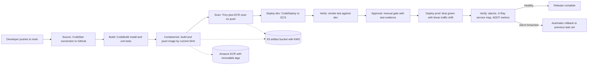
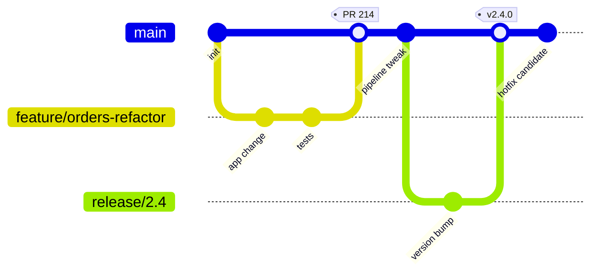
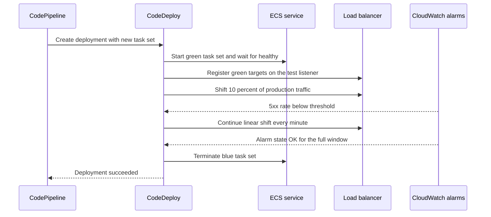
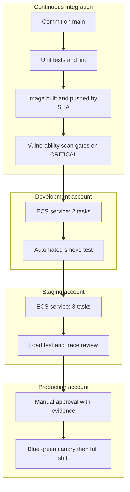

# 13 · Project: Full CI/CD Pipeline for Microservices

> **Phase 3 — DevOps and Automation** · Lesson 13 of 13
> ⬅️ Previous: [OpenTelemetry and ADOT](./12-opentelemetry-and-adot.md) · ➡️ Next: [Phase 4 — Serverless Architectures](../phase-4-serverless-architectures/README.md) · 🏠 [Phase overview](./README.md)

## 🎯 Learning Objectives

By the end of this lesson you will be able to:

- Design a delivery pipeline that covers source, build, test, containerize, scan, deploy, and verify
- Provision the whole platform, including the pipeline itself, with infrastructure as code
- Implement promotion between environments with approvals and automatic rollback
- Prove a release is healthy with smoke tests, alarms, and tracing before it reaches everyone
- Write a rollback runbook your team can follow under pressure

**Estimated time:** 4–6 hours · **Difficulty:** Advanced

---

## 🧠 Core Concepts

This capstone exists to join the previous twelve lessons into one system. Everything before it was a component: a template here, a pipeline stage there, an agent and a collector elsewhere. Production is the combination, and the combination is where the interesting failures live — the build that passes tests but pushes an image the deploy role cannot read, the deploy that succeeds but leaves the service answering 500s, the rollback that works but never gets triggered.

The design principle that makes this tractable is **one artifact, many environments**. Build the container image exactly once, tag it with the commit SHA, scan that exact image, and promote that same digest from development to staging to production. Anything that changes between environments is configuration injected at deploy time — task definition environment variables, Secrets Manager references, parameter values — never a rebuild. This is what makes "it worked in staging" a meaningful statement.

The second principle is **verifiable promotion**. Each stage ends with a check that produces a pass or fail signal rather than an assumption. Unit tests gate the build. A vulnerability scan gates the image. A smoke test against the deployed environment gates promotion. An alarm-based rollback gates continued traffic. When each gate has an owner and a clear failure mode, the pipeline becomes the place where risk is retired, not just moved.

The third is **immutable infrastructure for the platform and the pipeline**. The VPC, cluster, service, alarms, and the pipeline definition itself live in Terraform. That means you can delete and recreate the delivery system, review changes to it, and answer "what changed?" with a git log. If your pipeline only exists as click-ops in the console, you cannot test it, and you will not rebuild it correctly after an incident.

Finally, **rollback must be a first-class path, not an improvisation**. For ECS that means two mechanisms working together: CodeDeploy blue/green with automatic rollback on a CloudWatch alarm, and a circuit breaker on the ECS service for in-place updates. Both must be configured *before* the first production deploy, because the moment you need them is the moment you have no time to configure them.

### Key terminology

| Term | Meaning |
|------|---------|
| **Artifact promotion** | Moving the same image digest through environments without rebuilding |
| **Gate** | An automated or manual check that blocks progress on failure |
| **Smoke test** | A fast, shallow check that the deployed system works at all |
| **Alarm-based rollback** | CodeDeploy reverting a deployment when a CloudWatch alarm fires |
| **Circuit breaker** | ECS stopping a failing rolling deployment and restoring the previous revision |
| **Deployment window** | The period during which a canary or linear shift can be aborted cheaply |
| **Trunk-based development** | Short-lived branches merged to main, with releases cut from tags |
| **Definition of done** | The explicit checklist a change must satisfy to be considered released |

---

## 🗺️ Architecture Diagram

The complete delivery pipeline, from commit to verified production traffic:



The branching model this pipeline assumes — trunk-based with short-lived branches and release tags:



What happens between the approval gate and the final traffic shift:



The environments and the gates between them:



---

## 🧪 Capstone: Build the Pipeline End to End

**Goal:** Deliver a two-service microservices application to three environments through one automated, gated, observable pipeline that can roll itself back.

**Prerequisites:** Two AWS accounts (or three, if you want a separate production account) with Organizations, a GitHub repository you can connect via CodeStar Connections, and the Terraform and AWS CLI tooling from earlier lessons.

### Deliverables

| # | Deliverable | Where it lives |
|---|-------------|----------------|
| 1 | Platform infrastructure as code | `platform-infra/` — Terraform defining VPC, ECS cluster, ALB, ECR, alarms, pipeline |
| 2 | Service repositories with buildspecs | `services/orders/`, `services/payments/` — app code, `buildspec.yml`, `taskdef.json`, `appspec.yaml` |
| 3 | Pipeline definition as code | `platform-infra/pipeline.tf` — CodePipeline, CodeBuild projects, CodeDeploy apps |
| 4 | Automated gates | Unit tests, vulnerability scan, smoke test, integration test |
| 5 | Observability | ADOT sidecar, X-Ray tracing, CloudWatch dashboard, alarms wired to rollback |
| 6 | Rollback runbook | `docs/runbook.md` — tested at least once on purpose |
| 7 | Architecture and flow diagrams | In this lesson's format, committed next to the code |

### Step 1 — Lay out the repositories

Keep the platform and the services in separate repositories so that a service change never requires a platform review, and a platform change never triggers every service build.

```text
platform-infra/
  versions.tf          # provider and Terraform version pins
  network.tf           # VPC, subnets, endpoints, NAT
  ecs.tf               # cluster, task definition, service, capacity providers
  ecr.tf               # repositories with immutable tags and scan on push
  pipeline.tf          # CodePipeline, CodeBuild projects, CodeDeploy
  observability.tf     # alarms, dashboard, SNS topics
  envs/
    dev/terraform.tfvars
    staging/terraform.tfvars
    prod/terraform.tfvars

services/orders/
  Dockerfile
  buildspec.yml
  taskdef.json
  appspec.yaml
  src/
  tests/
```

### Step 2 — Define the platform with Terraform

Pin versions and reuse the module pattern from the Terraform lesson:

```hcl
# platform-infra/versions.tf
terraform {
  required_version = ">= 1.6.0"

  required_providers {
    aws = {
      source  = "hashicorp/aws"
      version = "~> 5.60"
    }
  }

  backend "s3" {
    bucket         = "phase3lab-tfstate-123456789012"
    key            = "platform/terraform.tfstate"
    region         = "us-east-1"
    dynamodb_table = "terraform-locks"
    encrypt        = true
  }
}
```

The ECR repository must refuse moving tags, because the pipeline deploys by digest:

```hcl
# platform-infra/ecr.tf
resource "aws_ecr_repository" "orders" {
  name                 = "phase3lab/orders"
  image_tag_mutability = "IMMUTABLE"

  image_scanning_configuration {
    scan_on_push = true
  }

  encryption_configuration {
    encryption_type = "KMS"
  }
}

resource "aws_ecr_lifecycle_policy" "orders" {
  repository = aws_ecr_repository.orders.name

  policy = jsonencode({
    rules = [{
      rulePriority = 1
      description  = "Keep the last 30 released images"
      selection = {
        tagStatus     = "any"
        countType     = "imageCountMoreThan"
        countNumber   = 30
      }
      action = { type = "expire" }
    }]
  })
}
```

The alarm that arm-wrestles CodeDeploy is part of the platform, not an afterthought:

```hcl
# platform-infra/observability.tf
resource "aws_cloudwatch_metric_alarm" "orders_5xx" {
  alarm_name          = "phase3lab-orders-5xx"
  namespace           = "AWS/ApplicationELB"
  metric_name         = "HTTPCode_Target_5XX_Count"
  statistic           = "Sum"
  period              = 60
  evaluation_periods  = 3
  datapoints_to_alarm = 2
  threshold           = 10
  comparison_operator = "GreaterThanThreshold"
  treat_missing_data  = "notBreaching"

  dimensions = {
    LoadBalancer = var.alb_arn_suffix
    TargetGroup  = var.target_group_arn_suffix
  }

  alarm_actions = [aws_sns_topic.alerts.arn]
}
```

```bash
# Apply per environment with the matching variable file
cd platform-infra
terraform workspace new prod
terraform plan -var-file=envs/prod/terraform.tfvars -out=prod.plan
terraform apply prod.plan
```

### Step 3 — Build the pipeline definition

Define the pipeline as CloudFormation inside Terraform, or directly in Terraform resources. The CloudFormation form is easier to read and diff:

```yaml
# platform-infra/pipeline.yaml — deployed by an aws_cloudformation_stack resource
AWSTemplateFormatVersion: "2010-09-09"
Description: End-to-end delivery pipeline for the orders and payments services

Parameters:
  GitHubConnectionArn: { Type: String }
  ArtifactBucketName: { Type: String }
  KmsKeyArn: { Type: String }

Resources:
  # CodeBuildRole, OrdersSmokeProject and the CodeDeploy resources live in this same file
  PipelineRole:
    Type: AWS::IAM::Role
    Properties:
      AssumeRolePolicyDocument:
        Version: "2012-10-17"
        Statement:
          - Effect: Allow
            Principal: { Service: codepipeline.amazonaws.com }
            Action: sts:AssumeRole
      Policies:
        - PolicyName: pipeline
          PolicyDocument:
            Version: "2012-10-17"
            Statement:
              - Effect: Allow
                Action: [s3:GetObject, s3:PutObject, s3:GetBucketVersioning]
                Resource:
                  - !Sub "arn:aws:s3:::${ArtifactBucketName}"
                  - !Sub "arn:aws:s3:::${ArtifactBucketName}/*"
              - Effect: Allow
                Action: [kms:Decrypt, kms:GenerateDataKey]
                Resource: !Ref KmsKeyArn
              - Effect: Allow
                Action:
                  - codebuild:StartBuild
                  - codebuild:BatchGetBuilds
                  - codestar-connections:UseConnection
                  - codedeploy:CreateDeployment
                  - codedeploy:GetDeployment
                  - ecs:RegisterTaskDefinition
                  - ecs:UpdateService
                  - iam:PassRole
                Resource: "*"

  OrdersTestProject:
    Type: AWS::CodeBuild::Project
    Properties:
      Name: phase3lab-orders-test
      ServiceRole: !GetAtt CodeBuildRole.Arn
      Artifacts: { Type: CODEPIPELINE }
      Environment:
        Type: LINUX_CONTAINER
        Image: aws/codebuild/amazonlinux2-aarch64-standard:3.0
        ComputeType: BUILD_GENERAL1_SMALL
      Source:
        Type: CODEPIPELINE
        BuildSpec: buildspec-test.yml

  OrdersImageProject:
    Type: AWS::CodeBuild::Project
    Properties:
      Name: phase3lab-orders-image
      ServiceRole: !GetAtt CodeBuildRole.Arn
      Artifacts: { Type: CODEPIPELINE }
      Cache: { Type: S3, Location: !Ref ArtifactBucketName }
      Environment:
        Type: LINUX_CONTAINER
        Image: aws/codebuild/amazonlinux2-aarch64-standard:3.0
        ComputeType: BUILD_GENERAL1_MEDIUM
        PrivilegedMode: true
        EnvironmentVariables:
          - Name: ECR_REPO
            Value: "123456789012.dkr.ecr.us-east-1.amazonaws.com/phase3lab/orders"
          - { Name: SCAN_SEVERITY, Value: "CRITICAL,HIGH" }
      Source:
        Type: CODEPIPELINE
        BuildSpec: buildspec-image.yml

  Pipeline:
    Type: AWS::CodePipeline::Pipeline
    Properties:
      Name: phase3lab-orders
      PipelineType: V2
      RoleArn: !GetAtt PipelineRole.Arn
      ArtifactStore:
        Type: S3
        Location: !Ref ArtifactBucketName
        EncryptionKey: { Id: !Ref KmsKeyArn, Type: KMS }
      Triggers:
        - ProviderType: CodeStarSourceConnection
          GitConfiguration:
            SourceActionName: GitHub
            Push:
              - Branches: { Includes: [main] }
                FilePaths: { Includes: ["services/orders/**", "platform-infra/pipeline.yaml"] }
      # Action-level syntax for each stage matches the JSON walkthrough in lesson 05
      Stages:
        - Name: Source
          Actions: [{ Name: GitHub, ActionTypeId: { Category: Source, Owner: AWS, Provider: CodeStarSourceConnection, Version: "1" }, Configuration: { ConnectionArn: !Ref GitHubConnectionArn, FullRepositoryId: my-org/platform, BranchName: main }, OutputArtifacts: [{ Name: SourceArtifact }] }]
        - Name: Build
          Actions: [{ Name: UnitTests, ActionTypeId: { Category: Build, Owner: AWS, Provider: CodeBuild, Version: "1" }, Configuration: { ProjectName: !Ref OrdersTestProject }, InputArtifacts: [{ Name: SourceArtifact }], OutputArtifacts: [{ Name: TestArtifact }] }]
        - Name: Containerize
          Actions: [{ Name: BuildScanPush, ActionTypeId: { Category: Build, Owner: AWS, Provider: CodeBuild, Version: "1" }, Configuration: { ProjectName: !Ref OrdersImageProject }, InputArtifacts: [{ Name: SourceArtifact }], OutputArtifacts: [{ Name: ImageArtifact }] }]
        - Name: DeployDev
          Actions: [{ Name: BlueGreenDev, ActionTypeId: { Category: Deploy, Owner: AWS, Provider: CodeDeployToECS, Version: "1" }, Configuration: { ApplicationName: phase3lab-orders, DeploymentGroupName: phase3lab-orders-dev, TaskDefinitionTemplateArtifact: ImageArtifact, TaskDefinitionTemplatePath: taskdef.json, AppSpecTemplateArtifact: ImageArtifact, AppSpecTemplatePath: appspec.yaml, Image1ArtifactName: ImageArtifact, Image1ContainerName: IMAGE1_NAME }, InputArtifacts: [{ Name: ImageArtifact }] }]
        - Name: VerifyDev
          Actions: [{ Name: SmokeTest, ActionTypeId: { Category: Build, Owner: AWS, Provider: CodeBuild, Version: "1" }, Configuration: { ProjectName: !Ref OrdersSmokeProject }, InputArtifacts: [{ Name: ImageArtifact }] }]
        - Name: ApproveProd
          Actions: [{ Name: ManualApproval, ActionTypeId: { Category: Approval, Owner: AWS, Provider: Manual, Version: "1" }, Configuration: { NotificationArn: arn:aws:sns:us-east-1:123456789012:phase3lab-approvals, CustomData: Review the dev smoke test report and the X-Ray service map before approving production } }]
        - Name: DeployProd
          Actions: [{ Name: BlueGreenProd, ActionTypeId: { Category: Deploy, Owner: AWS, Provider: CodeDeployToECS, Version: "1" }, Configuration: { ApplicationName: phase3lab-orders, DeploymentGroupName: phase3lab-orders-prod, TaskDefinitionTemplateArtifact: ImageArtifact, TaskDefinitionTemplatePath: taskdef.json, AppSpecTemplateArtifact: ImageArtifact, AppSpecTemplatePath: appspec.yaml, Image1ArtifactName: ImageArtifact, Image1ContainerName: IMAGE1_NAME }, InputArtifacts: [{ Name: ImageArtifact }] }]
```

### Step 4 — Write the three buildspecs

```yaml
# services/orders/buildspec-test.yml
version: 0.2

phases:
  install:
    runtime-versions:
      nodejs: 20
    commands:
      - npm ci
  build:
    commands:
      - npm run lint
      - npm test -- --ci --coverage
  post_build:
    commands:
      # Fail the stage if coverage drops below the agreed floor
      - echo "Coverage report generated at coverage/lcov.info"

reports:
  tests:
    files: ["junit.xml"]
    file-format: JUNITXML
  coverage:
    files: ["coverage/clover.xml"]
    file-format: CLOVERXML

artifacts:
  files:
    - "**/*"
```

```yaml
# services/orders/buildspec-image.yml
version: 0.2

env:
  variables:
    AWS_REGION: us-east-1
    CONTAINER_NAME: app
  exported-variables:
    - IMAGE_DIGEST
    - IMAGE_TAG

phases:
  pre_build:
    commands:
      # Tag by commit SHA so the artifact is traceable to a commit
      - IMAGE_TAG=$(echo "$CODEBUILD_RESOLVED_SOURCE_VERSION" | cut -c 1-12)
      - aws ecr get-login-password --region "$AWS_REGION" | docker login --username AWS --password-stdin "${ECR_REPO%%/*}"
      - docker pull "$ECR_REPO:latest" || true
  build:
    commands:
      - docker build --cache-from "$ECR_REPO:latest" -t "$ECR_REPO:$IMAGE_TAG" .
      - docker push "$ECR_REPO:$IMAGE_TAG"
  post_build:
    commands:
      # Resolve the digest so every later stage deploys exactly this image
      - IMAGE_DIGEST=$(aws ecr describe-images --repository-name "${ECR_REPO#*/}" --image-ids imageTag="$IMAGE_TAG" --query "imageDetails[0].imageDigest" --output text)
      - echo "Digest is $IMAGE_DIGEST"
      # Scanning the digest, not the tag, prevents a tag-swap bypass
      - |
        docker run --rm -v /var/run/docker.sock:/var/run/docker.sock \
          aquasec/trivy:0.55.0 image \
          --severity "$SCAN_SEVERITY" --exit-code 1 --ignore-unfixed \
          "$ECR_REPO@$IMAGE_DIGEST"
      - printf '{"ImageURI":"%s"}' "$ECR_REPO@$IMAGE_DIGEST" > imageDetail.json
      - envsubst < taskdef-template.json > taskdef.json
```

```yaml
# services/orders/buildspec-smoke.yml
version: 0.2

env:
  variables:
    BASE_URL: https://orders.dev.example.com

phases:
  build:
    commands:
      # Fast, shallow checks that the deployment is actually serving traffic
      - |
        set -euo pipefail
        for path in /healthz /readyz /v1/orders/health; do
          code=$(curl -s -o /dev/null -w "%{http_code}" --max-time 5 "$BASE_URL$path" || true)
          echo "$path -> $code"
          [ "$code" = "200" ] || exit 1
        done
      # A real request through the whole stack, including the database
      - |
        set -euo pipefail
        order=$(curl -s --max-time 10 -X POST "$BASE_URL/v1/orders" \
          -H 'Content-Type: application/json' \
          -d '{"itemId":"smoke-test","quantity":1}')
        echo "$order" | jq -e '.id and .status == "created"' > /dev/null
        echo "Smoke order created: $(echo "$order" | jq -r '.id')"
```

### Step 5 — Add observability to the service

The task definition carries the ADOT sidecar from the previous lesson so every release is traceable from day one:

```json
{
  "family": "phase3lab-orders",
  "networkMode": "awsvpc",
  "cpu": "1024",
  "memory": "2048",
  "requiresCompatibilities": ["FARGATE"],
  "executionRoleArn": "arn:aws:iam::123456789012:role/phase3lab-orders-execution",
  "taskRoleArn": "arn:aws:iam::123456789012:role/phase3lab-orders-task",
  "containerDefinitions": [
    {
      "name": "app",
      "image": "IMAGE1_NAME",
      "essential": true,
      "portMappings": [{ "containerPort": 8080, "appProtocol": "http" }],
      "environment": [
        { "name": "OTEL_SERVICE_NAME", "value": "orders-api" },
        { "name": "OTEL_EXPORTER_OTLP_ENDPOINT", "value": "http://localhost:4317" },
        { "name": "OTEL_PROPAGATORS", "value": "tracecontext,baggage,xray" },
        { "name": "DEPLOYMENT_ENV", "value": "ENV_NAME" },
        { "name": "IMAGE_DIGEST", "value": "IMAGE1_NAME" }
      ],
      "secrets": [
        { "name": "DB_PASSWORD", "valueFrom": "arn:aws:secretsmanager:us-east-1:123456789012:secret:phase3lab/orders/db:password::" }
      ],
      "healthCheck": {
        "command": ["CMD-SHELL", "curl -f http://localhost:8080/healthz || exit 1"],
        "interval": 15, "timeout": 5, "retries": 3, "startPeriod": 20
      },
      "logConfiguration": {
        "logDriver": "awslogs",
        "options": { "awslogs-group": "/ecs/phase3lab-orders", "awslogs-region": "us-east-1", "awslogs-stream-prefix": "app" }
      },
      "linuxParameters": { "initProcessEnabled": true },
      "stopTimeout": 30
    }
  ]
}
```

The ADOT Collector sidecar from [lesson 12](./12-opentelemetry-and-adot.md) is the second container in this same task
definition, on 0.25 vCPU and 512 MB with `SSM_CONFIG=ssm:/phase3lab/adot/collector-config`.

Run it and capture the evidence a reviewer needs:

```bash
# Pin the deployed task definition revision to the digest the pipeline built
aws ecs describe-services --cluster phase3lab-cluster --services phase3lab-orders \
  --query "services[0].taskDefinition" --output text

# Trace a production request and confirm it spans every hop
aws xray get-trace-summaries \
  --start-time "$(date -u -v-10M +%Y-%m-%dT%H:%M:%S)" \
  --end-time "$(date -u +%Y-%m-%dT%H:%M:%S)" \
  --filter-expression 'service("orders-api") AND http.status = 200' \
  --query "TraceSummaries[0].Id" --output text

# Compare error rates between the blue and green task sets during the shift
aws cloudwatch get-metric-statistics --namespace AWS/ApplicationELB \
  --metric-name HTTPCode_Target_5XX_Count --period 60 \
  --start-time "$(date -u -v-30M +%Y-%m-%dT%H:%M:%S)" \
  --end-time "$(date -u +%Y-%m-%dT%H:%M:%S)" \
  --statistics Sum \
  --dimensions Name=TargetGroup,Value=targetgroup/phase3lab-orders-green/50dc6c495c0c9188
```

### Step 6 — Configure and test rollback

```bash
# Automatic rollback on deployment failure and on the 5xx alarm
aws deploy update-deployment-group \
  --application-name phase3lab-orders \
  --current-deployment-group-name phase3lab-orders-prod \
  --auto-rollback-configuration enabled=true,events=DEPLOYMENT_FAILURE,DEPLOYMENT_STOP_ON_ALARM,DEPLOYMENT_STOP_ON_REQUEST \
  --alarm-configuration 'enabled=true,alarms=[{name=phase3lab-orders-5xx}]'

# Manual rollback of an in-flight deployment: the fastest brake you have
aws deploy stop-deployment --deployment-id d-XXXXXXXXX --auto-rollback-enabled

# Verify the previous task set is serving traffic again
aws deploy get-deployment --deployment-id d-XXXXXXXXX \
  --query "deploymentInfo.{Status:status,Overview:deploymentOverview}"
```

Now prove it works before you need it. Deploy a deliberately broken revision — for example, an image whose `/healthz` endpoint returns 500 — and watch the pipeline roll back:

```bash
# Confirm the automatic rollback happened rather than leaving the service broken
aws deploy list-deployments --application-name phase3lab-orders --include-only-statuses Failed \
  --query "deployments[0:3]" --output text

aws codepipeline list-action-executions --pipeline-name phase3lab-orders \
  --query "actionExecutionDetails[?status=='Failed'].{Action:actionName,Error:errorDetails.message}" --output table
```

Also test the stateless path: an infrastructure change failing in Terraform should leave the previous state intact, which is what `plan -out` and reviewable applies guarantee:

```bash
# A failed apply leaves the recorded state untouched; re-plan to confirm convergence
cd platform-infra
terraform plan -var-file=envs/prod/terraform.tfvars -detailed-exitcode
```

### Step 7 — Write the runbook

`docs/runbook.md` should answer, in order, the questions someone asks at 2 a.m.:

| Scenario | First action | Command |
|----------|--------------|---------|
| Production deploy is failing | Stop and roll back the deployment | `aws deploy stop-deployment --deployment-id d-XXXX --auto-rollback-enabled` |
| Rollback did not trigger automatically | Check the alarm state and roll back manually | `aws cloudwatch describe-alarms --alarm-names phase3lab-orders-5xx` |
| Service will not stabilise after rollback | Compare task definitions and force the previous revision | `aws ecs update-service --cluster phase3lab-cluster --service phase3lab-orders --task-definition phase3lab-orders:41` |
| Build fails only in the pipeline | Reproduce the build locally with the same base image | `docker run -it aws/codebuild/amazonlinux2-aarch64-standard:3.0` |
| Pipeline stuck on an approval | Fetch a fresh approval token and act | `aws codepipeline get-pipeline-state --name phase3lab-orders` |
| Traces show a slow dependency | Identify the edge in the service map, then check that service's deploy history | `aws xray get-service-graph --start-time ... --end-time ...` |
| Cost spike after a release | Check task counts and any new provisioned resources | `aws ce get-cost-and-usage --granularity DAILY --metrics UnblendedCost` |

### Step 8 — Verify the whole system

```bash
# The pipeline definition as deployed
aws codepipeline get-pipeline --name phase3lab-orders \
  --query "pipeline.stages[].{Stage:name,Actions:actions[].name}" --output json

# Latest execution and its per-stage outcome
aws codepipeline get-pipeline-state --name phase3lab-orders \
  --query "stageStates[].{Stage:stageName,Status:latestExecution.status}" --output table

# The deployed image digest matches what the build produced
aws ecs describe-task-definition \
  --task-definition "$(aws ecs describe-services --cluster phase3lab-cluster --services phase3lab-orders --query 'services[0].taskDefinition' --output text)" \
  --query "taskDefinition.containerDefinitions[?name=='app'].image" --output text

# Every alarm is in a known state, not silently in INSUFFICIENT_DATA
aws cloudwatch describe-alarms --alarm-name-prefix phase3lab \
  --query "MetricAlarms[].{Name:AlarmName,State:StateValue}" --output table
```

---

## 💻 CLI Reference

```bash
# Drive the whole pipeline from the command line for a dry run
aws codepipeline start-pipeline-execution --name phase3lab-orders

# Watch a deployment's progress rather than polling the console
aws deploy wait deployment-successful --deployment-id d-XXXXXXXXX

# Confirm which task set is currently serving production traffic
aws ecs describe-services --cluster phase3lab-cluster --services phase3lab-orders \
  --query "services[0].deployments[].{Status:status,TaskSet:taskSets,Rollout:rolloutState}"

# Re-run only the failed action after a transient failure
aws codepipeline retry-stage-execution --pipeline-name phase3lab-orders \
  --stage-name Containerize --pipeline-execution-id 01234567-89ab-cdef-0123-456789abcdef --retry-mode FAILED_ACTIONS

# Verify the platform can be rebuilt from scratch in a sandbox account
cd platform-infra && terraform destroy -var-file=envs/dev/terraform.tfvars -auto-approve

# Check cost of the last seven days by service to spot release-driven drift
aws ce get-cost-and-usage --time-period Start=2026-10-07,End=2026-10-14 \
  --granularity DAILY --metrics UnblendedCost --group-by Type=DIMENSION,Key=SERVICE \
  --query "ResultsByTime[].Groups[?Metrics.UnblendedCost.Amount>'5']"

# List every image digest currently deployed per environment
aws ecs list-clusters --query "clusterArns" --output text | tr '\t' '\n' | while read -r c; do
  echo "cluster: $c"
done
```

| Command | Purpose |
|---------|---------|
| `start-pipeline-execution` | Manual run without a commit |
| `stop-deployment --auto-rollback-enabled` | Fastest brake during a bad release |
| `wait deployment-successful` | Scriptable gate for an external system |
| `describe-services` | Which task set is live right now |
| `terraform destroy` on a sandbox | Proves the platform is reproducible, not precious |

---

## ✅ Best Practices

| Practice | Why it matters |
|----------|----------------|
| Build once, promote by digest | Guarantees staging and production run identical bits |
| Gate on tests, scan, and smoke test before approval | Each gate retires a specific class of risk |
| Keep the pipeline itself in version control | Reviewable, testable, rebuildable |
| Alarm-based rollback configured before first prod deploy | Rollback is the feature you need most and use least |
| Immutable image tags in ECR | A tag that can move makes every audit ambiguous |
| One alarm per user-visible symptom | Correlating 30 metrics during an incident is not a plan |
| Smoke test through the real stack, including dependencies | A health check that only proves the process is up proves little |
| Trace and log every environment from day one | The production incident will be the first time you need them |
| Delete the old task set only after alarms are green for the full window | The cheapest rollback is the one still available |
| Rehearse rollback on a schedule | An untested runbook is an untested assumption |
| Tag every resource with environment, service, and owner | Cost attribution and safe bulk operations depend on it |

---

## ⚠️ Common Pitfalls

| Pitfall | Symptom | Fix |
|---------|---------|-----|
| Rebuilding the image per environment | Staging and production differ in ways nobody can explain | Build once in CI, pass the digest through the pipeline |
| Deploy role cannot pull the artifact | `AccessDenied` on the cross-account artifact bucket | Grant the target account `s3:GetObject` and `kms:Decrypt` on the artifact path |
| Missing `PassRole` for ECS deploy | `iam:PassRole` error during `RegisterTaskDefinition` | Add `iam:PassRole` scoped to the execution and task roles |
| Smoke test hitting the old task set | Test passes while the new version is broken | Test the test listener on the green target group, or the environment-specific URL |
| Approval gate with no evidence | Reviewers approve by reflex | Put the build report and the dev smoke test output in `CustomData` |
| Alarm in `INSUFFICIENT_DATA` | Rollback never triggers because the alarm never evaluates | Set `treat_missing_data` deliberately and verify the alarm has data during a normal deploy |
| Pipeline cannot roll back infrastructure | Failed `terraform apply` leaves the platform half-changed | Always apply a reviewed plan file; keep state remote and versioned |
| No ownership of platform changes | Service teams blocked behind an unstaffed platform queue | Publish the module interfaces and give services their own pipeline trigger paths |
| Cost creep after enabling tracing and metrics | Bill grows without an obvious cause | Sample at 10%, allow-list dimensions, and expire old images and log groups |
| Manual console change to fix an incident | Drift, and the next apply reverts the fix | Fix forward through the pipeline, or record and reconcile the change immediately |

---

## 💰 Cost Considerations

A realistic two-service microservices platform on this pipeline costs, per environment per month: two Fargate services at 2 tasks each (~$145), one ALB (~$16 plus LCU), one NAT Gateway (~$32 plus data), ECR storage (~$2), CloudWatch Logs and metrics (~$20–40 depending on verbosity), X-Ray traces at 10% sampling (~$5–15), and ADOT sidecars (~$22). That is roughly **$250–300 per environment** — so keeping dev and staging small (1 task each, single NAT gateway, 7-day log retention) is what keeps the total near $600 instead of $1,200.

Pipeline costs are small by comparison: CodePipeline at **$1 per active pipeline per month**, CodeBuild at roughly **$0.0034 per minute for small ARM containers**, CodeDeploy free, and the artifact bucket at pennies. Three pipelines across three environments is a few dollars of orchestration plus whatever your builds consume — and caching plus trigger filters are what keep that from drifting upward.

The levers that matter most here are environmental discipline rather than tuning. Schedule non-production to scale to zero outside working hours with Application Auto Scaling scheduled actions. Use Fargate Spot for dev and staging capacity (weight Spot 4:1 with a one-task on-demand base). Cap log retention per environment with the `RetentionInDays` mapping from the CloudFormation lesson. Expire ECR images after 30 releases, which the lifecycle policy in Step 2 does. Finally, tag everything with `Environment` and `Service` so a Cost Explorer query can tell you which service caused a spike the day after a release.

---

## 🔐 Security Considerations

- **Separate accounts per environment.** Development, staging, and production in different accounts means a compromised build credential cannot reach production data, and cross-account deployment requires explicit, auditable role assumptions.
- **No long-lived credentials anywhere.** CI uses OIDC or a CodePipeline-managed role; applications use task roles. Verify by listing roles and searching for static access keys in the pipeline configuration.
- **Scope the pipeline roles tightly.** The build role pushes to one repository; the deploy role updates one service; the pipeline role moves artifacts. An administrator role shared across all three defeats the purpose of the gates.
- **Scan the digest, not the tag.** A tag can be repointed between the scan and the deploy; deploying `repo@sha256:...` in `imageDetail.json` removes that window entirely.
- **Keep secrets out of templates and task definitions** using Secrets Manager dynamic references and the `secrets` block, and grant the execution role access only to the ARNs it needs.
- **Require approval from a small, named group**, and record the decision. The approval action's output goes to the pipeline history, which is your audit record of who shipped what.
- **Encrypt artifacts and state.** KMS on the artifact bucket, KMS on ECR, KMS on the Terraform state bucket, and TLS everywhere in transit.
- **Alarm on the pipeline itself.** A delivery pipeline that fails silently is worse than one that fails loudly; notify SNS on failed executions and on `DeploymentFailures`.
- **Limit who can change the pipeline definition.** Modifying a pipeline is equivalent to modifying production permissions; treat `codepipeline:UpdatePipeline` and changes to the Terraform that defines it as privileged operations.

---

## 🧩 Exercise

Add the second service, `payments`, to the same repository and pipeline, then implement a **canary release** for it: deploy to 5% of traffic for five minutes, automatically promote if the alarm is green, and roll back if it is not.

Success looks like: `aws deploy get-deployment` reports a canary configuration for the payments deployment group, the service map shows two task sets during the canary window, injecting failures into the new revision causes an automatic rollback within the alarm's evaluation window, and the orders service experiences no measurable latency change during the process.

---

## 📚 Resources

- [AWS CodePipeline User Guide](https://docs.aws.amazon.com/codepipeline/latest/userguide/welcome.html)
- [CodeDeploy Blue/Green for ECS](https://docs.aws.amazon.com/codedeploy/latest/userguide/deployment-type-bluegreen.html)
- [CodeDeploy Automatic Rollback](https://docs.aws.amazon.com/codedeploy/latest/userguide/rollback.html)
- [Amazon ECR Image Scanning](https://docs.aws.amazon.com/AmazonECR/latest/userguide/image-scanning.html)
- [AWS Well-Architected Framework: Operational Excellence](https://docs.aws.amazon.com/wellarchitected/latest/operational-excellence-pillar/welcome.html)
- [Trivy Documentation](https://trivy.dev/latest/docs/)
- [AWS Prescriptive Guidance: Deployment Strategies](https://docs.aws.amazon.com/prescriptive-guidance/latest/choosing-git-branch-approach/welcome.html)

---

## ➡️ Next Steps

You have built the delivery system that every later phase assumes: infrastructure as code, gated pipelines, container workloads, and tracing that follows a request across services. Phase 4 moves up a level of abstraction and removes servers from the picture entirely — Lambda, API Gateway, Step Functions, and event-driven architecture.

> ⬅️ Previous: [OpenTelemetry and ADOT](./12-opentelemetry-and-adot.md) · ➡️ Next: [Phase 4 — Serverless Architectures](../phase-4-serverless-architectures/README.md) · 🏠 [Phase overview](./README.md)
