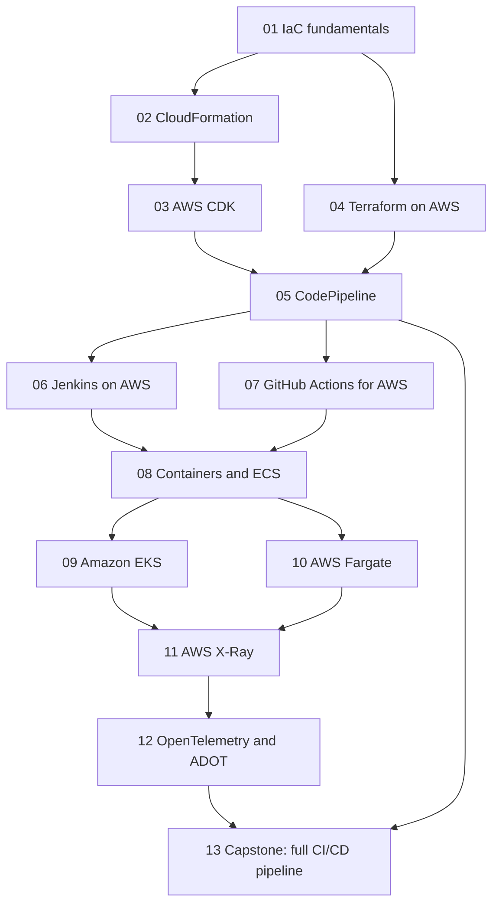

# Phase 3 — DevOps and Automation

Phase 3 turns the architecture skills from the first two phases into a delivery system. You already know how to design a resilient workload; this phase is about shipping it repeatedly, safely, and with evidence. It starts with the discipline that everything else depends on — infrastructure as code — then moves through the three main tooling families (CloudFormation, CDK, Terraform), the pipeline engines that run them (CodePipeline, Jenkins, GitHub Actions), the container platforms that host the result (ECS, EKS, Fargate), and the observability that tells you whether a release actually worked (X-Ray, OpenTelemetry). It ends with a capstone that assembles all of it into one end-to-end pipeline for a microservices application.

## 🎯 Phase Goals

- Describe infrastructure as code declaratively and use CloudFormation, CDK, or Terraform confidently
- Build CI/CD pipelines with automated gates for testing, scanning, approval, and verification
- Run containerized workloads on ECS, EKS, and Fargate and choose the right platform for each
- Federate CI to AWS without long-lived credentials using OIDC, IAM roles, and least privilege
- Instrument distributed systems with X-Ray and OpenTelemetry and read the resulting traces
- Ship one container image through multiple environments with approvals and automatic rollback

## 🗺️ Phase Map

## 📚 Lessons in this Phase

| # | Lesson | Focus | Difficulty |
|---|--------|-------|------------|
| 01 | [Infrastructure as Code Fundamentals](./01-infrastructure-as-code-fundamentals.md) | Declarative vs imperative, idempotency, state, drift, tool comparison | Beginner |
| 02 | [CloudFormation](./02-cloudformation.md) | Templates, stacks, change sets, drift detection, nested stacks, StackSets, rollback | Intermediate |
| 03 | [AWS CDK](./03-aws-cdk.md) | L1/L2/L3 constructs, synth and deploy, cdk-nag, snapshot tests, CDK Pipelines | Intermediate |
| 04 | [Terraform on AWS](./04-terraform-on-aws.md) | HCL, providers, S3 remote state with DynamoDB locking, modules, workspaces, import | Intermediate |
| 05 | [CodePipeline](./05-codepipeline.md) | CodeCommit, CodeBuild, CodeDeploy, stages, artifacts, approvals, cross-account delivery | Intermediate |
| 06 | [Jenkins on AWS](./06-jenkins-on-aws.md) | Controller-agent architecture, ECS and EC2 agents, plugins, Secrets Manager credentials | Advanced |
| 07 | [GitHub Actions for AWS](./07-github-actions-for-aws.md) | OIDC federation, reusable workflows, matrix builds, environments, caching | Intermediate |
| 08 | [Containers and ECS](./08-containers-and-ecs.md) | Clusters, task definitions, services, Fargate vs EC2, ALB, blue/green deploys | Intermediate |
| 09 | [Amazon EKS](./09-amazon-eks.md) | Control plane, node groups, Fargate profiles, IRSA, add-ons, Karpenter, kubectl | Advanced |
| 10 | [AWS Fargate](./10-aws-fargate.md) | Task sizing, ephemeral storage, Spot interruptions, awsvpc networking, cost decisions | Intermediate |
| 11 | [AWS X-Ray](./11-aws-x-ray.md) | Traces, segments, subsegments, service map, sampling rules, SDK and daemon | Intermediate |
| 12 | [OpenTelemetry and ADOT](./12-opentelemetry-and-adot.md) | OTel signals, ADOT Collector, ECS and EKS deployment, tail sampling, exporters | Advanced |
| 13 | [Project: Full CI/CD Pipeline for Microservices](./13-project-full-cicd-pipeline.md) | End-to-end pipeline: build, test, containerize, scan, deploy, verify, roll back | Advanced |

## 🛠️ Capstone Project

**Full CI/CD Pipeline for Microservices.** Build a delivery system that takes a commit to production for a two-service application, with every gate automated and every release reversible.

**Deliverables:**

- Platform infrastructure as code covering VPC, ECS cluster, ALB, ECR, alarms, and the pipeline itself
- Service repositories with `buildspec.yml`, `taskdef.json`, and `appspec.yaml` per service
- One container image built once, scanned by digest, and promoted unchanged across three environments
- Automated gates: unit tests, vulnerability scan, dev smoke test, and a manual approval with evidence
- Blue/green production deployment with alarm-based automatic rollback, tested deliberately
- ADOT sidecar plus X-Ray tracing and a CloudWatch dashboard wired to the alarms
- A rollback runbook that a teammate can follow without reading the pipeline definition

## ✅ Phase Checklist

- [ ] Provision one workload with CloudFormation using a change set, and detect drift afterwards
- [ ] Deploy the same workload with CDK and pass `cdk-nag` with no errors
- [ ] Manage remote Terraform state in S3 with DynamoDB locking and a reusable module
- [ ] Build a CodePipeline with build, test, approval, and deploy stages that succeeds end to end
- [ ] Run Jenkins with ephemeral agents and credentials sourced from Secrets Manager
- [ ] Federate GitHub Actions to AWS with OIDC and confirm no long-lived keys exist
- [ ] Deploy an ECS Fargate service behind an ALB with rolling and blue/green deployments
- [ ] Create an EKS cluster and give a pod scoped AWS permissions with IRSA
- [ ] Right-size a Fargate task from Container Insights data and run it on Spot capacity
- [ ] Trace a request across two services in X-Ray and find the slow hop from the service map
- [ ] Export traces to X-Ray and metrics to CloudWatch through the ADOT Collector
- [ ] Rehearse a production rollback and document the outcome in the runbook

## 📚 Phase Resources

- [AWS CloudFormation User Guide](https://docs.aws.amazon.com/AWSCloudFormation/latest/UserGuide/Welcome.html)
- [AWS CDK Developer Guide](https://docs.aws.amazon.com/cdk/v2/guide/home.html)
- [Terraform Language Documentation](https://developer.hashicorp.com/terraform/language)
- [AWS CodePipeline User Guide](https://docs.aws.amazon.com/codepipeline/latest/userguide/welcome.html)
- [Amazon ECS Developer Guide](https://docs.aws.amazon.com/AmazonECS/latest/developerguide/Welcome.html)
- [Amazon EKS User Guide](https://docs.aws.amazon.com/eks/latest/userguide/what-is-eks.html)
- [AWS X-Ray Developer Guide](https://docs.aws.amazon.com/xray/latest/devguide/aws-xray.html)
- [AWS Distro for OpenTelemetry](https://aws-otel.github.io/docs/introduction)
- [AWS Well-Architected Framework](https://docs.aws.amazon.com/wellarchitected/latest/framework/welcome.html)

## ➡️ Next Phase

[Phase 4 — Serverless Architectures](../phase-4-serverless-architectures/README.md)
