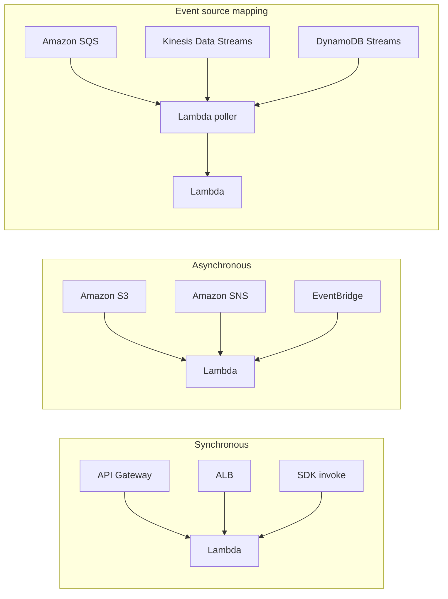
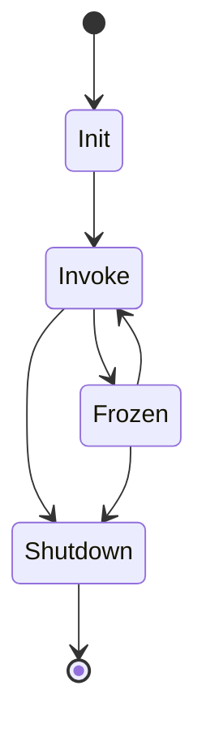

# 01 · Lambda Fundamentals

> **Phase 4 — Serverless Architectures** · Lesson 01 of 09
> ⬅️ Previous: [Phase overview](./README.md) · ➡️ Next: [Lambda Performance Tuning](./02-lambda-performance-tuning.md) · 🏠 [Phase overview](./README.md)

## 🎯 Learning Objectives

By the end of this lesson you will be able to:

- Explain the Lambda execution model, including the Init, Invoke, and Shutdown phases
- Write a handler in Python and Node.js and know how the event and context objects are shaped
- Choose between synchronous, asynchronous, and event source mapping invocation types
- Use layers, environment variables, versions, and aliases correctly
- Set reserved and provisioned concurrency without breaking your account limits

**Estimated time:** 60 min · **Difficulty:** Beginner

---

## 🧠 Core Concepts

**AWS Lambda** runs your code in response to events without you managing a server. You upload a deployment package — a ZIP file or a container image up to 10 GB — and AWS runs it in a **managed execution environment**. You are billed for the time the code runs, rounded to 1 millisecond, multiplied by the memory you allocated. Nothing runs, and nothing costs, while no events arrive.

Every execution environment goes through three phases. **Init** downloads your code, starts the runtime, and runs any code outside your handler — that is where you should create SDK clients and open database connections. **Invoke** runs your handler for each event. **Shutdown** tears the environment down, but before that the environment can be **frozen** and reused for a later request, which is why connections created in Init survive across invocations. If AWS cannot reuse a frozen environment, a new one is created and you pay the Init cost again — this is the *cold start* covered in Lesson 02.

The **handler** is the function Lambda calls. It takes two arguments: `event` (the payload, whose shape depends on the trigger) and `context` (runtime metadata such as `aws_request_id`, `function_name`, and remaining time). Whatever the handler returns becomes the response — for synchronous triggers that response goes back to the caller as JSON.

The **invocation type** determines who waits for the result:

| Type | Who calls it | Behavior on error |
|------|--------------|-------------------|
| Synchronous (`RequestResponse`) | API Gateway, ALB, SDK `invoke`, Function URLs | Error returns to the caller immediately |
| Asynchronous (`Event`) | S3, SNS, EventBridge, SDK `invoke --invocation-type Event` | Lambda retries twice with delays; then goes to a DLQ or on-failure destination |
| Event source mapping (`EventSourceMapping`) | SQS, Kinesis, DynamoDB Streams, Kafka, MQ | The poller batch is retried or the whole shard blocks until it succeeds |

Permissions come in two flavors. The **execution role** is an IAM role Lambda assumes to write logs and call other services. A **resource-based policy** is what allows *other* accounts or services to invoke your function. You need the execution role almost always; you need the resource policy only for cross-account or direct service invocation.

### Key terminology

| Term | Meaning |
|------|---------|
| **Cold start** | The Init phase cost paid when a new execution environment is created |
| **Layer** | A ZIP archive (up to 250 MB unzipped) mounted at `/opt`, shared by many functions |
| **Version** | An immutable snapshot of code and configuration, addressed by a number |
| **Alias** | A named pointer to a version, with optional weighted traffic splitting |
| **Reserved concurrency** | A hard ceiling on simultaneous executions for one function |
| **Provisioned concurrency** | Pre-initialized environments that remove cold starts |
| **Event source mapping** | The Lambda-managed poller that reads from streams and queues |
| **Qualified ARN** | A function ARN with a version or alias suffix, e.g. `...:function:api:live` |

---

## 🗺️ Architecture Diagram

How the three invocation types relate to the triggers you will use throughout this phase:



The lifecycle of an execution environment, showing where a cold start is paid:



---

## 🧪 Hands-on Lab: Build, Version, and Alias a Function

**Goal:** Deploy a Python Lambda by CLI, invoke it both ways, then publish a version and split traffic with an alias.

**Prerequisites:** AWS CLI v2 configured, an IAM role with basic Lambda execution permissions, Python 3.12 available locally.

### Step 1 — Create the execution role

```bash
# Create a role Lambda can assume
aws iam create-role \
  --role-name lambda-basic-execution \
  --assume-role-policy-document '{
    "Version": "2012-10-17",
    "Statement": [{
      "Effect": "Allow",
      "Principal": {"Service": "lambda.amazonaws.com"},
      "Action": "sts:AssumeRole"
    }]
  }'

# Attach the AWS-managed policy that allows CloudWatch Logs writes
aws iam attach-role-policy \
  --role-name lambda-basic-execution \
  --policy-arn arn:aws:iam::aws:policy/service-role/AWSLambdaBasicExecutionRole
```

### Step 2 — Write the handler

Create `app.py`. Notice that the client is created **outside** the handler — it is reused by every warm invocation.

```python
import json
import logging
import os

logger = logging.getLogger()
logger.setLevel(os.environ.get("LOG_LEVEL", "INFO"))

TABLE_NAME = os.environ.get("TABLE_NAME", "rides")


def handler(event, context):
    logger.info(
        "invoking function",
        extra={"request_id": context.aws_request_id, "table": TABLE_NAME},
    )
    if isinstance(event, str):
        event = json.loads(event)

    return {
        "statusCode": 200,
        "body": json.dumps({
            "message": f"processed event for {TABLE_NAME}",
            "ride_id": event.get("rideId"),
            "request_id": context.aws_request_id,
        }),
    }
```

### Step 3 — Package and deploy

```bash
# Bundle the handler into a deployment package
zip function.zip app.py

# Create the function with 256 MB, ARM64, and an environment variable
aws lambda create-function \
  --function-name rides-api \
  --runtime python3.12 \
  --role arn:aws:iam::123456789012:role/lambda-basic-execution \
  --handler app.handler \
  --zip-file fileb://function.zip \
  --memory-size 256 \
  --timeout 10 \
  --architectures arm64 \
  --environment "Variables={TABLE_NAME=rides,LOG_LEVEL=INFO}"
```

### Step 4 — Invoke both ways

```bash
# Synchronous invocation: the CLI waits and returns the response
aws lambda invoke \
  --function-name rides-api \
  --payload '{"rideId":"r-1001"}' \
  --cli-binary-format raw-in-base64-out \
  response.json
cat response.json
```

```bash
# Asynchronous invocation: returns as soon as the event is accepted (202)
aws lambda invoke \
  --function-name rides-api \
  --invocation-type Event \
  --payload '{"rideId":"r-1002"}' \
  --cli-binary-format raw-in-base64-out \
  response.json
```

### Step 5 — Publish a version and split traffic

```bash
# Freeze the current code and config as version 1
aws lambda publish-version --function-name rides-api

# Edit app.py, update the code, then publish version 2
zip function.zip app.py
aws lambda update-function-code --function-name rides-api --zip-file fileb://function.zip
aws lambda wait function-updated --function-name rides-api
aws lambda publish-version --function-name rides-api

# Point the "live" alias at version 2, sending 10 percent of traffic to version 1
aws lambda create-alias \
  --function-name rides-api \
  --name live \
  --function-version 2 \
  --routing-config 'AdditionalVersionWeights={"1"=0.1}'
```

### Step 6 — Verify

```bash
# Invoke through the alias; traffic splits between versions 1 and 2
aws lambda invoke \
  --function-name rides-api:live \
  --payload '{"rideId":"r-1003"}' \
  --cli-binary-format raw-in-base64-out \
  response.json

# Confirm the alias configuration
aws lambda get-alias --function-name rides-api --name live
```

Run the invoke a few times: roughly one in ten responses should come from version 1.

---

## 💻 CLI Reference

```bash
# Show configuration for a function, a version, or an alias
aws lambda get-function-configuration --function-name rides-api:live

# List published versions
aws lambda list-versions-by-function --function-name rides-api

# Update timeout and memory in one call
aws lambda update-function-configuration \
  --function-name rides-api --timeout 30 --memory-size 512

# Cap this function at 50 simultaneous executions
aws lambda put-function-concurrency \
  --function-name rides-api --reserved-concurrent-executions 50

# Send the whole account back to unreserved concurrency
aws lambda delete-function-concurrency --function-name rides-api

# Only 2 attempts (instead of the default 2 retries) and route failures to SQS
aws lambda put-function-event-invoke-config \
  --function-name rides-api \
  --maximum-retry-attempts 1 \
  --destination-config 'OnFailure={Destination=arn:aws:sqs:eu-west-1:123456789012:rides-dlq}'

# Publish a layer and attach it to a function
aws lambda publish-layer-version \
  --layer-name shared-deps \
  --zip-file fileb://layer.zip \
  --compatible-runtimes python3.12

# Add an HTTPS endpoint backed by the function, authenticated with IAM
aws lambda create-function-url-config \
  --function-name rides-api --auth-type AWS_IAM

# Read account-level concurrency quota and usage
aws lambda get-account-settings

# Inspect an event source mapping built in Lesson 06
aws lambda list-event-source-mappings --function-name rides-api
```

| Command | Purpose |
|---------|---------|
| `create-function` | Deploy a ZIP-based function for the first time |
| `invoke` | Call a function directly, sync or async |
| `publish-version` | Create an immutable snapshot for safe releases |
| `create-alias` / `update-alias` | Move traffic between versions, optionally weighted |
| `put-function-concurrency` | Reserve capacity for, or cap, one function |
| `put-function-event-invoke-config` | Tune async retries and failure destinations |
| `publish-layer-version` | Share dependencies across functions |
| `get-account-settings` | See your account-level concurrency ceiling |

---

## ✅ Best Practices

| Practice | Why it matters |
|----------|----------------|
| Create SDK clients outside the handler | Warm invocations reuse them, cutting invocation time and cost |
| One function, one job | Easier permissions, clearer metrics, independent scaling |
| Use aliases in production, never `$LATEST` | Lets you ship, monitor, and roll back traffic |
| Set an explicit `timeout` | The default 3 seconds is too short for almost everything real |
| Configure failure destinations for async invokes | Failed async events are otherwise discarded after retries |
| Use layers for large, rarely changing dependencies | Keeps deployment packages small and deploys fast |
| Read config from environment variables | Same artifact promotes from dev to prod without a rebuild |

---

## ⚠️ Common Pitfalls

| Pitfall | Symptom | Fix |
|---------|---------|-----|
| Secret values in environment variables | Secrets visible in the console and in CloudFormation | Use Secrets Manager or Parameter Store and fetch at Init |
| Handler named incorrectly | `Runtime.ImportModuleError: Unable to import module 'app'` | The handler string is `file.function_name`, e.g. `app.handler` |
| Reserved concurrency set to 0 | Function stops being invoked with no error at the caller | 0 means "disabled" — delete the setting to unblock |
| Assuming async retries are infinite | Events vanish after a few minutes | Lambda retries twice, then delivers to the DLQ or destination |
| Reusing `$LATEST` for production | Untested code goes live on every deploy | Publish versions and ship through an alias |
| Globals holding per-request state | Cross-request data leaks between users | Keep request state inside the handler |
| VPC config without NAT | Function times out calling AWS APIs | Attach a NAT gateway or use VPC endpoints |

---

## 💰 Cost Considerations

Lambda pricing has three parts. **Requests** cost $0.20 per million. **Duration** costs $0.0000166667 per GB-second on x86 and about 20 percent less on ARM64 (Graviton). **Ephemeral storage** beyond the free 512 MB costs $0.0000000309 per GB-second.

The AWS Free Tier covers 1 million requests and 400,000 GB-seconds per month, forever — not just for 12 months.

Quick math: a function with 256 MB memory running for 200 ms costs `0.25 GB × 0.2 s × $0.0000166667 = $0.00000083` per invocation. At 10 million invocations per month that is roughly $8.30 in duration plus $2.00 in requests — around **$10 per month**. Double the memory and the duration cost doubles, unless the function also runs proportionally faster (see Lesson 02).

What actually drives the bill: total GB-seconds. Because you pay for allocated memory multiplied by wall-clock time, a function that spends 400 ms waiting on a database connection is far more expensive than the same work done with a reused connection. **Provisioned concurrency** is billed separately per GB-hour even when idle, so reserve it only for latency-sensitive paths.

---

## 🔐 Security Considerations

- **Least privilege execution roles.** Start from `AWSLambdaBasicExecutionRole` and add only the specific actions the function needs, scoped to specific resource ARNs.
- **Do not put secrets in environment variables.** They are visible to anyone with `lambda:GetFunctionConfiguration`. Store them in Secrets Manager and cache the value in a module-level variable.
- **Encrypt environment variables.** Set a KMS key with `--kms-key-arn` so variables at rest are protected; the default is an AWS-managed key you do not control.
- **Use resource policies for cross-account invocation.** Grant a specific account with `aws lambda add-permission`, and never use a `Principal` of `*` on a function that can mutate data.
- **Sign your code.** AWS Signer with a code signing configuration blocks unsigned deployments, which stops a compromised pipeline from pushing arbitrary code.
- **Prefer Function URLs with `AWS_IAM` auth** over `NONE`. A public function URL is an unauthenticated internet-facing endpoint.

---

## 🧩 Exercise

Deploy a second function named `ride-notifier` that reads a `recipient` field from its event and returns a `202`-style JSON body. Publish version 1, change the response message, publish version 2, and create an alias named `prod` that sends 25 percent of traffic to version 1. Then set reserved concurrency to 5 and prove the limit exists by running `aws lambda get-function-concurrency`.

Success looks like: `get-alias prod` shows `FunctionVersion: 2` with `AdditionalVersionWeights` containing version 1 at `0.25`, and `get-function-concurrency` returns `ReservedConcurrentExecutions: 5`.

---

## 📚 Resources

- [AWS Lambda Developer Guide](https://docs.aws.amazon.com/lambda/latest/dg/welcome.html)
- [Lambda execution environment lifecycle](https://docs.aws.amazon.com/lambda/latest/dg/lambda-runtime-environment.html)
- [Lambda invocation types](https://docs.aws.amazon.com/lambda/latest/dg/lambda-invocation.html)
- [Lambda quotas](https://docs.aws.amazon.com/lambda/latest/dg/gettingstarted-limits.html)
- [Lambda pricing](https://aws.amazon.com/lambda/pricing/)

---

## ➡️ Next Steps

You can now deploy and version a function, but you have not yet answered the question every production Lambda team hits: *why did the first request take 1.8 seconds?* The next lesson attacks cold starts, the memory-to-CPU relationship, provisioned concurrency, SnapStart, and ARM64.

> ⬅️ Previous: [Phase overview](./README.md) · ➡️ Next: [Lambda Performance Tuning](./02-lambda-performance-tuning.md) · 🏠 [Phase overview](./README.md)
